> 生物药 CMC（细胞株—上游—下游—制剂—分析）培训摘要。图片：`../../img/`（自 `3-TechNotes/11-protein/image/protein` 迁入）。流程术语见 [Bio Business summary.md](../Bio%20Business%20summary.md)。

# 生物药工艺开发笔记（Protein / CMC）

## 目录

- [参考链接](#参考链接)
- [工艺表征、验证与 CPV](#工艺表征验证与-cpv)
- [细胞株开发（Cell line development）](#细胞株开发cell-line-development)
- [细胞培养 / 上游](#细胞培养--上游)
- [纯化 / 下游](#纯化--下游)
- [制剂](#制剂)
- [分析方法开发](#分析方法开发)

| 缩写 | 含义 |
| --- | --- |
| PC | Process Characterization，工艺表征 |
| PV | Process Validation，工艺验证 |
| CPV | Continued Process Verification，持续工艺确认 |
| PCB | 主细胞库前/working 级细胞库（文中「建立 PCB」按培训原文保留；与 **RCB** 重组细胞库区分） |
| RCB | Recombinant Cell Bank，重组细胞库 |
| CMC | Chemistry, Manufacturing and Controls |

---

## 参考链接

- [工艺验证相关讨论（ouryao）](https://www.ouryao.com/thread-771630-1-1.html)
- [BioWorkshops 里程碑](https://www.bioworkshops.com/cn/about/milestones.html)

---

## 工艺表征、验证与 CPV

培训主题：**工艺表征与工艺验证（PV）** 材料。

- **工艺表征（PC）**、**工艺验证（PV）**、**持续工艺确认（CPV）** 的关系见下图。

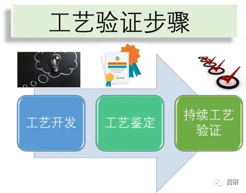

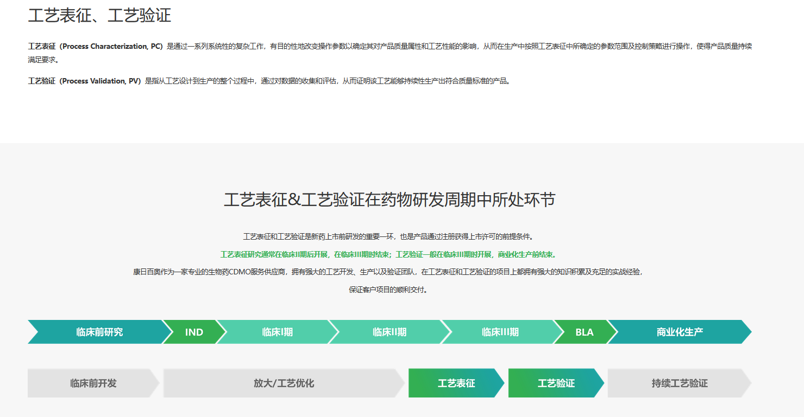

---

## 细胞株开发（Cell line development）

为获得高效、稳定细胞株，典型服务链（以 CDMO 培训材料为例）：

1. 载体构建  
2. 细胞转染  
3. 细胞 Pool / Mini-pool 筛选  
4. 单克隆筛选  
5. 建立 PCB  
6. PCB 稳定性研究  
7. 申报资料撰写  
8. 瞬转蛋白制备  

**要点**：细胞株开发是 **CMC 第一步**，决定最终产物质量；双抗项目在工作量、周期上通常大于单抗，需在**表达量、质量、开发周期**之间权衡。Discovery 阶段可提前做**可开发性（developability）**评估以降低 CMC 风险。

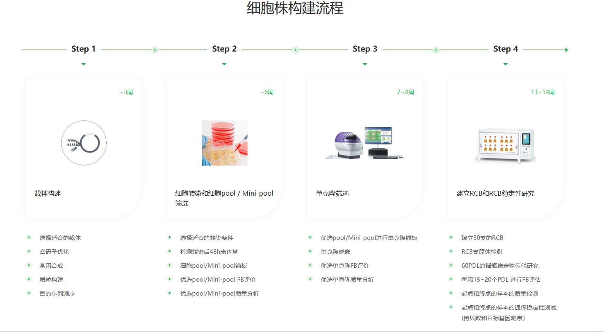

**细胞株目标特性**

- 宿主细胞来源清晰（如 CHO 平台）  
- 稳定性  
- 高表达  
- 可放大  

### RCB（重组细胞库）

- **定义**：经基因工程（质粒转染、基因编辑等）获得稳定表达外源基因的细胞系，扩增、冻存形成的细胞库。  
- **应用**：药物筛选、蛋白生产、功能研究（如 HEK293-RCB 稳定表达系）。

---

## 细胞培养 / 上游

独立上游实验室可同时支撑多个项目的**工艺开发或工艺表征**，常见内容：

- 工作细胞库 / 克隆鉴定  
- 培养基筛选、补料策略  
- 工艺表征与关键质量属性（CQA）优化  
- 工艺放大、临床前/临床样品生产  

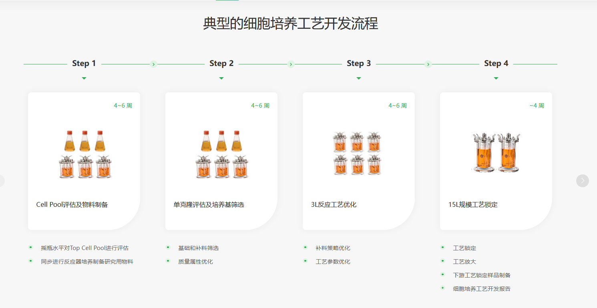

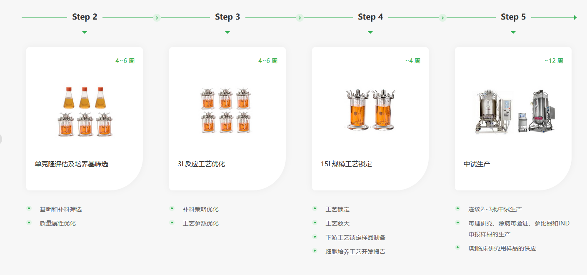

---

## 纯化 / 下游

下游平台目标：在较短时间内完成单抗或重组蛋白工艺开发，支持**工艺转移、优化或定制化**开发，交付**稳健、可放大、低成本**的纯化路线（收率与纯度）。

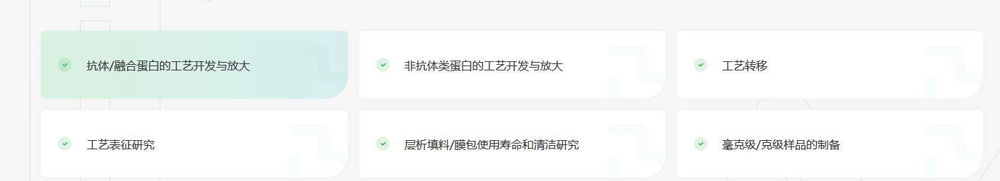

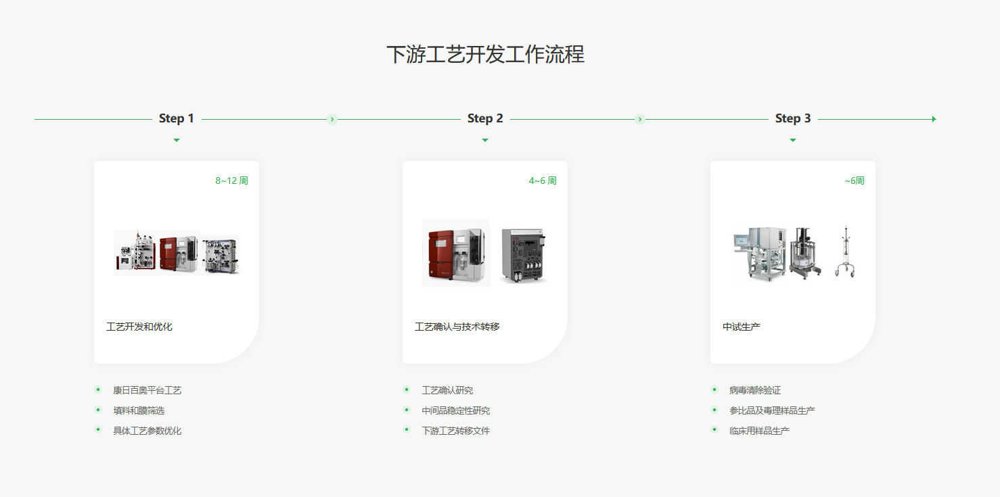

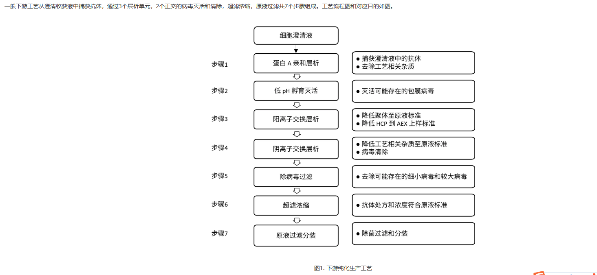

---

## 制剂

制剂平台覆盖单抗、双抗、单链/纳米抗体、重组蛋白等；常见服务包括处方开发、**灌装工艺**、基于 **DoE** 的制剂表征、成药性评估、**高浓度制剂**。

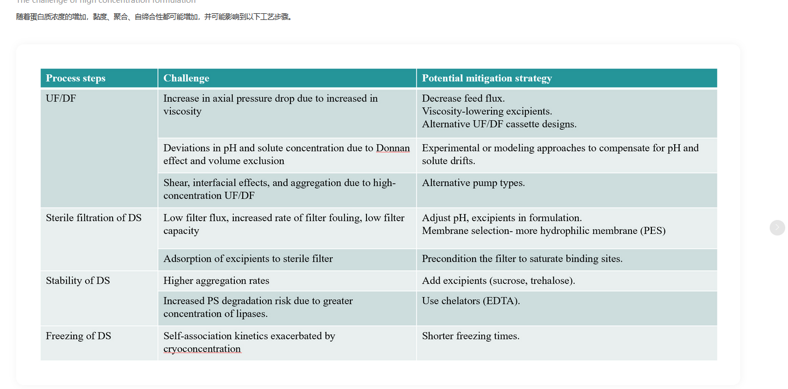

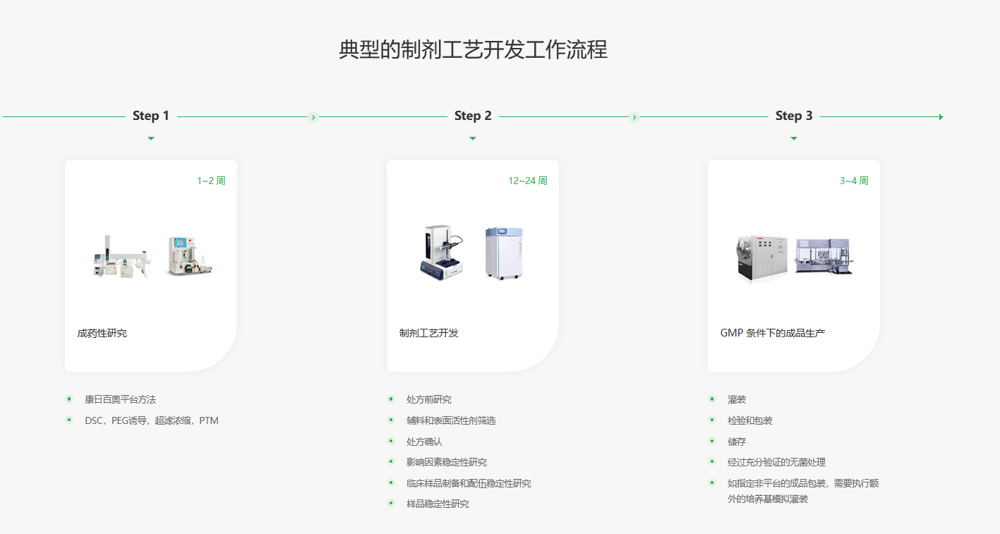

---

## 分析方法开发

覆盖临床前至 **cGMP** 阶段的理化、活性与安全性检测；**方法开发、确认与验证**。

**典型仪器**（培训列举）：Thermo Orbitrap Exactive HF-X、ProteinSimple Maurice、SCIEX PA800 Plus、Waters H-Class UPLC、Thermo Vanquish UHPLC、Thermo CAD、Octet、MD M5e、Roche 480 qPCR 等；适用于 mAb、双抗、融合蛋白、ADC 的表征与方法学。

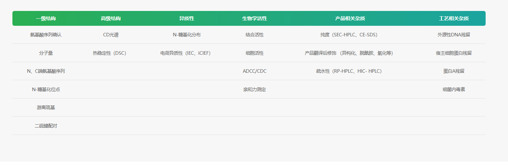

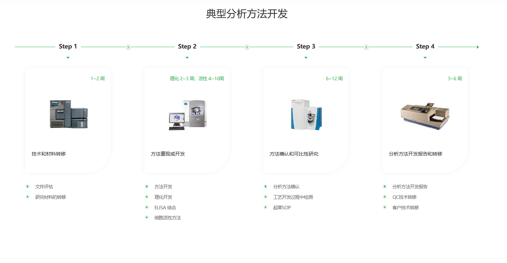
