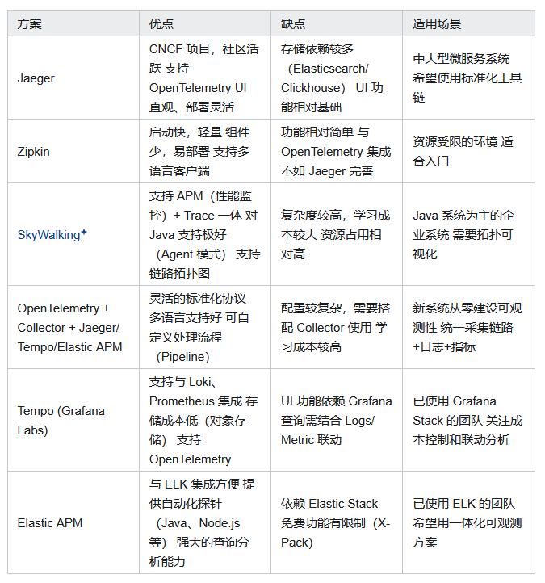
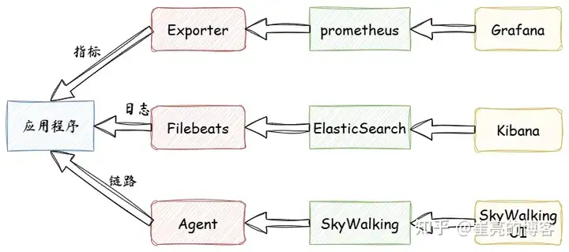
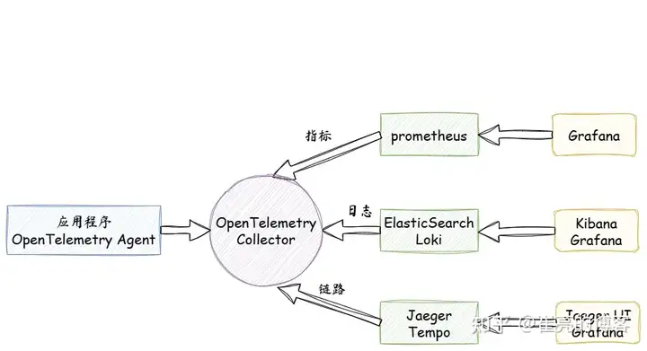
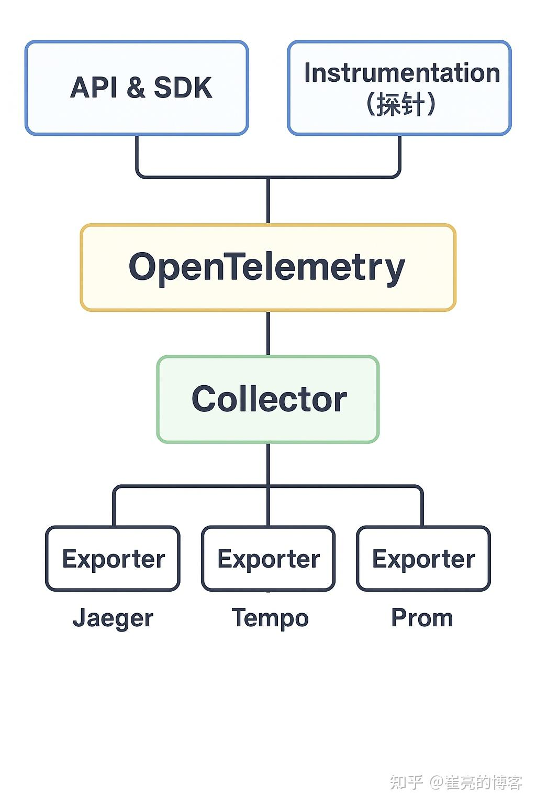
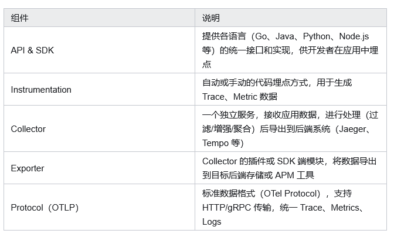

> 可观测性（OpenTelemetry）、Trace/Span、错误监控与 Sentry 部署笔记。图片：`../img/`（自 `3-TechNotes/7-Architecture/image`）。

# 可观测性与监控

## 目录

- [OpenTelemetry 概览](#opentelemetry-概览)
- [Trace 与 Span](#trace-与-span)
- [错误监控与报警](#错误监控与报警)
- [Sentry Docker 安装](#sentry-docker-安装)
- [参考链接](#参考链接)

---

## OpenTelemetry 概览

OpenTelemetry 可观测性的三个支柱：**追踪、指标、日志**。

| 支柱 | 说明 |
| --- | --- |
| 分布式追踪 | 跟踪服务请求在分布式系统中从开始到结束的路径 |
| 指标 | 一段时间内活动的度量，用于理解系统或应用性能 |
| 日志 | 系统或应用在特定时间点发生事件的文本记录 |



### 传统方案的问题

- 各家标准不统一（Prometheus、Jaeger、Zipkin、ELK 等），更换组件成本高  
- SDK 难以复用，多语言埋点易混乱  
- 很多工具无法统一分析日志 + 指标 + 链路  



### OpenTelemetry 的优势

- 用统一协议打通链路、指标、日志  
- 支持多语言自动埋点  
- 可与 Prometheus / Grafana / Jaeger 等对接  



### OpenTelemetry 组件架构





## Trace 与 Span

在 OpenTracing 标准中，**调用链**是多个 Span 组成的有向无环图（DAG）；每个 Span 代表调用链中被命名并计时的连续执行片段。

- **Trace**：一次完整请求路径，包含多个 Span  
- **Span**：请求中的一个操作（如 HTTP 请求、数据库查询）  
- 一个链路由一个或多个 Span 组成；第一个 Span 为**根 Span**，表示请求从开始到结束的全过程  
- **瀑布图**：展示 Span 之间的父子关系  

## 错误监控与报警

**监控错误 → 搜集错误 → 存储错误 → 分析错误 → 错误报警 → 定位错误 → 解决错误**

- [Sentry](https://sentry.io/welcome/)
- [BugSnag](https://www.bugsnag.com/)
- [Rollbar](https://rollbar.com/)
- [Fundebug](https://www.fundebug.com/)
- [FrontJS](https://frontjs.pgyer.com/)
- [Webfunny](https://www.webfunny.cn/purchase.html)

## Sentry Docker 安装

镜像拉取：

```bash
docker pull docker-0.unsee.tech/redis
docker pull docker-0.unsee.tech/postgres
docker pull docker-0.unsee.tech/sentry
```

推荐用自定义网络（替代 `--link`）：

```bash
docker network create sentry-network

docker run -d --name sentry-redis --network sentry-network --restart=always \
  docker-0.unsee.tech/redis

docker run -d --name sentry-postgres --network sentry-network --restart=always \
  -e POSTGRES_PASSWORD=secret -e POSTGRES_USER=sentry \
  docker-0.unsee.tech/postgres
```

生成 `SENTRY_SECRET_KEY`（输出即密钥，请自行保存，勿提交到仓库）：

```bash
docker run --rm docker-0.unsee.tech/sentry config generate-secret-key
```

初始化数据库并创建 Admin（将下面 `YOUR_SECRET_KEY` 替换为上一步输出）：

```bash
docker run -it --rm --network sentry-network \
  -e SENTRY_SECRET_KEY='YOUR_SECRET_KEY' \
  docker-0.unsee.tech/sentry upgrade
```

启动 Web / Cron / Worker（三处密钥需一致，镜像建议统一为 `docker-0.unsee.tech/sentry`）：

```bash
# Web
docker run -d -p 9000:9000 --name my-sentry --network sentry-network --restart=always \
  -e SENTRY_SECRET_KEY='YOUR_SECRET_KEY' \
  docker-0.unsee.tech/sentry

# Cron（原笔记误写 cropn）
docker run -d --name sentry-cron --network sentry-network --restart=always \
  -e SENTRY_SECRET_KEY='YOUR_SECRET_KEY' \
  docker-0.unsee.tech/sentry run cron

# Worker
docker run -d --name sentry-worker-1 --network sentry-network --restart=always \
  -e SENTRY_SECRET_KEY='YOUR_SECRET_KEY' \
  docker-0.unsee.tech/sentry run worker
```

访问：`http://localhost:9000`

<details>
<summary>旧版 --link 写法（仅供参考，与上文重复）</summary>

```bash
# docker run -d --name sentry-redis --restart=always redis:6.0
# docker run -d --name sentry-postgres -e POSTGRES_PASSWORD=secret -e POSTGRES_USER=sentry --restart=always postgres:12
# docker run -it --rm -e SENTRY_SECRET_KEY='YOUR_SECRET_KEY' \
#   --link sentry-postgres:postgres --link sentry-redis:redis \
#   docker-0.unsee.tech/sentry upgrade
```

</details>

## 参考链接

- [CSDN — OpenTracing / 调用链相关](https://blog.csdn.net/inthat/article/details/124224595)
- [知乎 — 可观测性讨论](https://www.zhihu.com/question/545762884/answer/3323681028)
