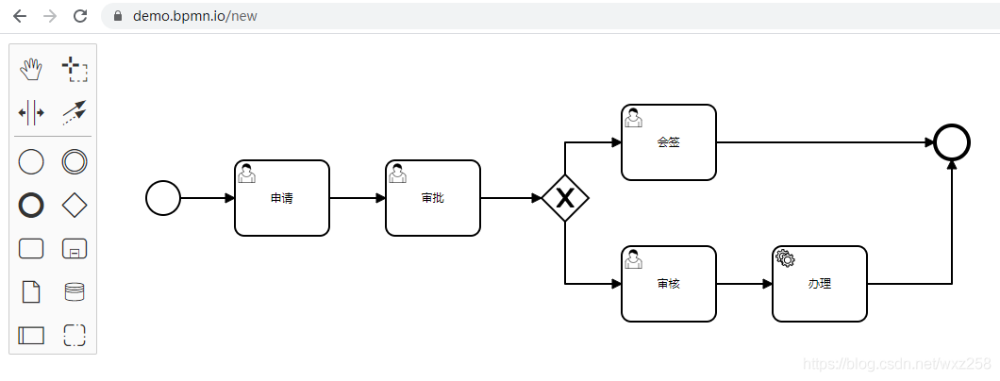
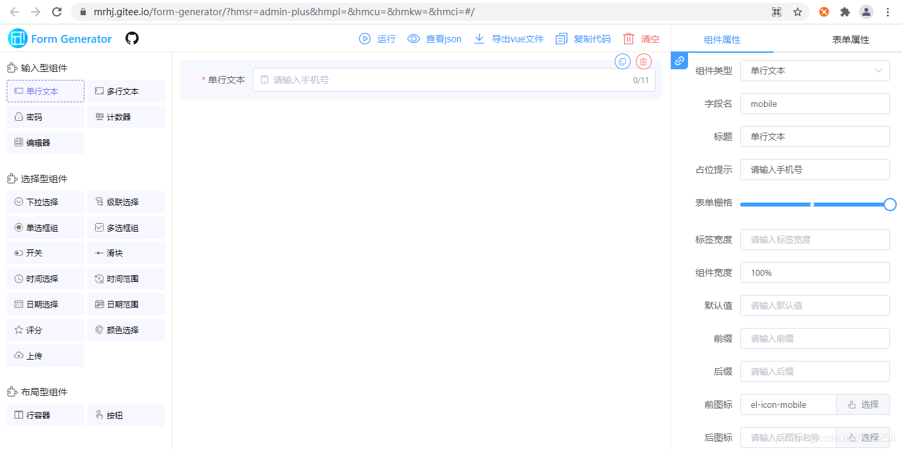
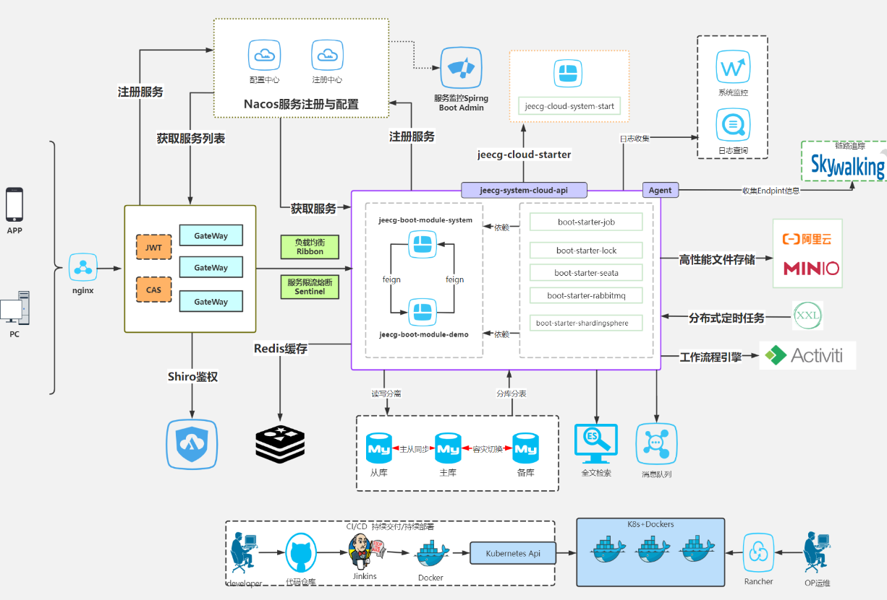

> 迁移自 `C:\Users\Mrwang\Desktop\2024\13-低代码.md`，已整理标题与笔误。图片：`../img/`。

# 低代码平台笔记

## 目录

- [现状调研](#现状调研)
- [流程引擎](#流程引擎)
- [流程设计器选型](#流程设计器选型)
- [表单设计器选型](#表单设计器选型)
- [系统管理组件选型](#系统管理组件选型)
- [可视化图表选型](#可视化图表选型)
- [后端技术栈清单](#后端技术栈清单)
- [技术栈（组件说明）](#技术栈)
- [前端技术栈（详述）](#前端技术栈详述)
- [JeecgBoot 后端](#jeecgboot-后端)
- [低代码设计哲学](#低代码设计哲学)

---

## 现状调研

国内主流的低代码开发平台有：宜搭、云程、简道云、明道云、氚云、伙伴云、道一云、JEPaaS、华炎魔方、搭搭云、JeecgBoot 、RuoYi等

- 国外的 Salesforce、OutSystems、Mendix
- 奥哲的云枢、氚云、有格
- 阿里的宜搭、云凤蝶
- 腾讯的微搭
- 华为的 AppCube
- 其他的还有明道、搭搭云、伙伴云、轻流、织信等

## 流程引擎

### OsWorkflow

Osworkflow是一个轻量化的流程引擎，基于状态机机制，数据库表很少，Osworkflow提供的工作流构成元素有：步骤（step）、条件（conditions）、循环（loops）、分支（splits）、合并（joins）等，但不支持会签、跳转、退回、加签等这些操作，需要自己扩展开发，有一定难度，如果流程比较简单，OsWorkflow 是很好的选择，笔者在2008年给某大型国企集团开发OA系统，就是基于Osworkflow，至今仍稳定运行，性能也很高。官方网站：http://www.opensymphony.com/osworkflow/

### jBPM

JBPM由JBoss公司开发，目前最高版本jBPM 7，不过从JBPM5开始已经跟之前不是同一个产品了，JBPM5的代码基础不是JBPM4，而是从Drools Flow重新开始，基于Drools Flow技术在国内市场上用的很少，所以不建议选择jBPM5以后版本，jBPM4诞生的比较早，后来JBPM4创建者Tom Baeyens离开JBoss后，加入Alfresco后很快推出了新的基于jBPM4的开源工作流系统Activiti, 另外JBPM以hibernate作为数据持久化ORM也已不是主流技术。笔者在2012年开发某集团BPM平台时，选择的就是JBPM4.4版本，也是4系列的最后一个版本，进行了大量的扩展开发，才实现中国特色的流程需求。现在时间节点选择流程引擎，JBPM不是最佳选择。官方网站：https://www.jbpm.org/

### Activiti

activiti由Alfresco软件开发，目前最高版本activiti 7。activiti的版本比较复杂，有activiti5、activiti6、activiti7几个主流版本，选型时让人晕头转向，有必要先了解一下activiti这几个版本的发展历史。activiti5和activiti6的核心leader是Tijs Rademakers，由于团队内部分歧，在2017年时Tijs Rademakers离开团队，创建了后来的flowable, activiti6以及activiti5代码已经交接给了 Salaboy团队, activiti6以及activiti5的代码官方已经暂停维护了, Salaboy团队目前在开发activiti7框架，activiti7内核使用的还是activiti6，并没有为引擎注入更多的新特性，只是在activiti之外的上层封装了一些应用。结论是activiti谨慎选择。官方网站：https://www.activiti.org/

### Flowable

flowable基于activiti6衍生出来的版本，flowable目前最新版本是v6.6.0，开发团队是从activiti中分裂出来的，修复了一众activiti6的bug，并在其基础上研发了DMN支持，BPEL支持等等，相对开源版，其商业版的功能会更强大。以flowable6.4.1版本为分水岭，大力发展其商业版产品，开源版本维护不及时，部分功能已经不再开源版发布，比如表单生成器（表单引擎）、历史数据同步至其他数据源、ES等。Flowable 是一个使用 Java 编写的轻量级业务流程引擎，使用 Apache V2 license 协议开源。2016 年 10 月，Activiti 工作流引擎的主要开发者离开 Alfresco 公司并在 Activiti 分支基础上开启了 Flowable 开源项目。基于 Activiti v6 beta4 发布的第一个 Flowable release 版本为6.0。Flowable 项目中包括 BPMN（Business Process Model and Notation）引擎、CMMN（Case Management Model and Notation）引擎、DMN（Decision Model and Notation）引擎、表单引擎（Form Engine）等模块。官方网站：https://flowable.com/open-source/

### Camunda

Camunda基于activiti5，所以其保留了PVM，最新版本Camunda7.15，保持每年发布2个小版本的节奏，开发团队也是从activiti中分裂出来的，发展轨迹与flowable相似，同时也提供了商业版，不过对于一般企业应用，开源版本也足够了，详细见：https://blog.csdn.net/wxz258/article/details/10904373。官方网站：https://docs.camunda.org/manual/7.15/。

笔者强烈推荐 Camunda流程引擎，并在云程低代码平台中使用了camunda,功能和性能表现稳定。
**选择 Camunda 的理由：**
（1）通过压力测试验证Camunda BPMN引擎性能和稳定性更好。详细见：https://blog.csdn.net/wxz258/article/details/109030329
（2）功能比较完善，除了BPMN，Camunda还支持企业和社区版本中的CMMN（案例管理）和DMN（决策自动化）。Camunda不仅带有引擎，还带有非常强大的工具，用于建模，任务管理，操作监控和用户管理，所有这些都是开源的。详细见：https://blog.csdn.net/wxz258/article/details/109121092

## 流程设计器选型

对于低代码平台中的流程可视化，流程设计器是重要的支撑工具，目前市场上比较主流的流程设计器有bpmn-js、mxGraph、Activiti-Modeler、flowable-modeler、easy-flow、bpmn2-modeler插件等。

### 1、bpmn-js

bpmn-js 是 BPMN 2.0 渲染工具包和 Web 模型。bpmn-js 正在努力成为 Camunda BPM 的一部分。bpmn-js 使用 Web 建模工具可以很方便的构建 BPMN 图表，可以把 BPMN 图表嵌入到你的项目中，容易扩展。bpmn-js是基于原生js开发，支持集成到vue、react等开源框架中。
官方网站：https://bpmn.io/

### 2、mxGraph

mxGraph是一个强大的JavaScript流程图前端库，可以快速创建交互式图表和图表应用程序，国内外著名的ProcessOne和draw.io都是使用该库创建的强大的在线流程图绘制网站. 由于mxGraph是一个开放的js绘图开发框架，我们可以开发出很炫的样式，或者完全按照项目需求定制。官方网站：http://jgraph.github.io/mxgraph/

### 3、Activiti-Modeler

Activiti 开源版本中带了web版流程设计器，在Activiti-explorer项目中有Activiti-Modeler，优点是集成简单，开发工作量小，缺点是界面不美观，用户体验差。

### 4、flowable-modeler

flowable开源版本中带了web版流程设计器，展示风格和功能基本跟Activiti-Modeler一样，优点是集成简单，开发工作量小，缺点是界面不美观，用户体验差。

### 5、easy-flow

码云上开源的流程设计器，没有深入研究，感觉离真正的BPMN流程图设计差距较大，不过至少有个框架。
https://gitee.com/xiaoka2017/easy-flow?_from=gitee_search

### 6、Eclipse插件bpmn2-modeler

C/S版本的流程设计器，如果没有强调基于浏览器设计流程图，也可以考虑Eclipse插件版流程设计器bpmn2-modeler。官方地址：http://www.eclipse.org/bpmn2-modeler/

**结论**：推荐大家使用camunda（流程引擎）+bpmn-js（流程设计器）组合，笔者在云程BPM中实战验证，功能比flowable、activiti流程引擎强大，性能和稳定性更好，体验系统：http://www.yunchengxc.com。

## 表单设计器选型

### 1、form-generator

form-generator 是基于Element UI表单设计及代码生成器，可将生成的代码直接运行在基于Element的vue项目中；也可导出JSON表单，使用配套的解析器将JSON解析成真实的表单。
官方地址：https://gitee.com/mrhj/form-generator?_from=gitee_search

### 2、vue-form-making

vue-form-making基于 vue 和 element-ui 实现的可视化表单设计器，使用了最新的前端技术栈，内置了 i18n 国际化解决方案，可以让表单开发简单而高效。
https://gitee.com/gavinzhulei/vue-form-making?_from=gitee_search

### 3 、k-form-design

k-form-design设计器布局参考form-generator项目，基于vue和ant-design-vue实现的表单设计器，样式使用less作为开发语言，主要功能是能通过简单操作来生成配置表单，生成可保存的JSON数据，并能将JSON还原成表单，使表单开发更简单更快速
https://gitee.com/kcz66/k-form-design?_from=gitee_search

### 4、vue-admin-beautiful

采用vue + element-ui 前后端分离开发模式、面向全屏幕尺寸的响应式适配能力（兼容电脑、手机、平板），有vue2和vue3两个版本，分开源版本和付费版，适合正在以及想使用 element-ui/element-plus 开发，前端开发经验 1 年+，熟悉 Vue.js 技术栈，使用它开发过几个实际项目的团队。
官方地址：https://github.com/chuzhixin/vue-admin-beautiful

### 5、Avue.js

Avue.js2.0是基于现有的element-ui库进行的二次封装，简化一些繁琐的操作，核心理念为数据驱动视图,主要的组件库针对table表格和form表单场景，同时衍生出更多企业常用的组件，达到高复用，容易维护和扩展的框架，同时内置了丰富了数据展示组件，让开发变得更加容易，avue-cli是后台模版。企业版本收费。
官方网站：https://avuejs.com

## 系统管理组件选型

### 1、若依RuoYi-Vue

基于SpringBoot，Spring Security，JWT，Vue & Element 的前后端分离权限管理系统，目前是码云开源里很火的一个框架，优点是提供了系统管理常用的功能，比如：组织管理、角色管理、日志管理等，设计比较简单，功能比较聚焦，代码好读懂，缺点是电子表单、流程引擎收费。
https://gitee.com/y_project/RuoYi-Vue

### 2、jeecg-boot

JeecgBoot 是一款基于代码生成器的低代码开发平台！前后端分离架构 SpringBoot2.x，SpringCloud，Ant Design&Vue，Mybatis-plus，Shiro，JWT，支持微服务。优点是提供了组织管理、角色管理、日志管理等系统管理常用的功能，组件比ruoyi多，涉及面比较广，代码生成器功能比较强大，但代码比ruoyi复杂，完全读懂可维护有难度，缺点是电子表单、流程引擎收费。
https://gitee.com/jeecg/jeecg-boot

### 3、OPSLI

该平台自带了菜单管理、角色管理、组织机构、租户管理、字典管理、配置管理、系统设置等系统管理常用模块。
官方地址：http://demo.opsli.arcinbj.com/#/index

## 可视化图表选型

相比于传统手工定制的图表与数据仪表盘，图表可视化制作平台的出现，可以打破低效的定制开发, 数据分散的问题，通过数据采集、清洗、分析到直观实时的数据可视化展现，能够多方位、多角度、全景展现各项指标，实时监控，动态一目了然。
可视化图表库技术选型，目前笔者调研的已知主流可视化库有:
- **ECharts** 一个基于 JavaScript 的老牌开源可视化图表库
- **D3.js** 一个数据驱动的可视化库, 可以不需要其他任何框架独立运行在现代浏览器中，它结合强大的可视化组件来驱动 DOM 操作
- **AntV** 包含一套完整的可视化组件体系
- **Chart.js** 基于 HTML5 的 简单易用的 JavaScript 图表库
- **MetricsGraphics** 建立在D3之上的可视化库, 针对可视化和布置时间序列数据进行了优化
- **C3.js** 通过包装构造整个图表所需的代码，使生成基于D3的图表变得容易
我们使用以上任何一个库都可以实现我们的可视化大屏搭建的需求, 各位可以根据喜好来选择.

## 后端技术栈清单

 Java EE 8+ （软件构建、运行需要）
 Apache Maven 3.x （软件构建需要）
 Redis 3.2+ （软件运行需要）
 nginx 1.20 （Http服务，部署前端需要）
 Mysql 5.7+ （软件运行需要）
 Spring Boot 2.3.x （主框架）
 Mybatis-plus 3.3.x （持久化）
 Druid 1.1.x（数据库连接池）
 Apache Shiro 1.7 （权限）
 JWT 3.7.0 （登录验证加密token）
 Quartz 2.3.x（定时任务）
 Easypoi 4.2.x（Excel导入导出）
 Swagger2（在线API）
 Slf4j (日志接口)
 WebSocket (即时通讯)
 Freemarker 2.3.30 (模板引擎)
 camunda 7.11 (流程引擎)
 minio 4.x (分布式文件存储)

## 技术栈

### 1 Maven 项目构建依赖管理

Maven 翻译为"专家"、“内行”，是 Apache 下的一个纯 Java 开发的开源项目。基于项目对象模型（缩写：POM）概念，Maven利用一个中央信息片断能管理一个项目的构建、报告和文档等步骤。
Maven 是一个项目管理工具，可以对 Java 项目进行构建、依赖管理。本系统采用Maven来管理项目，并且建立的是多模块项目，让每个模块独立,高内聚,低耦合.不同模块之间保持自己的完整性。可以互相不干扰.方便以后的维护开发。

### 2 Redis 缓存

Redis是一个开源的使用ANSI C语言编写、遵守BSD协议、支持网络、可基于内存亦可持久化的日志型、Key-Value数据库，并提供多种语言的API。
它的优点如下：速度快，完全基于内存，使用C语言实现，网络层使用epoll解决高并发问题，它的单线程模型避免了不必要的上下文切换及竞争条件。

### 3 Nginx Http服务和反向代理服务

什么是Nginx？Nginx是一个高性能的HTTP和反向代理服务器，也是一个IMAP/POP3/SMTP这些邮件协议的代理服务器，高可靠性，支持高并发性，低系统资源消耗性。简单来说，当一台服务器的单位时间内的访问量越大时，服务器压力就越大，大到超过自身承受能力时，服务器就会崩溃。为了避免服务器崩溃，让用户有更好的体验，以可使用 Nginx 负载均衡来分担服务器压力。

### 4 MySQL数据库

MySQL是一个关系型数据库管理系统，由瑞典MySQL AB 公司开发，属于 Oracle 旗下产品。MySQL 是最流行的关系型数据库管理系统之一，在 WEB 应用方面，MySQL是最好的 RDBMS (Relational Database Management System，关系数据库管理系统) 应用软件之一。
MySQL是一种关系型数据库管理系统，关系数据库将数据保存在不同的表中，而不是将所有数据放在一个大仓库内，这样就增加了速度并提高了灵活性。
MySQL所使用的 SQL 语言是用于访问数据库的最常用标准化语言。MySQL 软件采用了双授权政策，分为社区版和商业版，由于其体积小、速度快、总体拥有成本低，尤其是开放源码这一特点，一般中小型网站的开发都选择 MySQL 作为网站数据库。

### 5 Spring Boot框架

SpringBoot是由Pivotal团队提供的全新框架，其设计目的是用来简化新Spring应用的初始搭建以及开发过程。该框架使用了特定的方式来进行配置，从而使开发人员不再需要定义样板化的配置。通过这种方式，Spring Boot致力于在蓬勃发展的快速应用开发领域(rapid application development)成为领导者。
SpringBoot的核心就是简化配置，快速开发，非常符合我们公司的开发理念。让开发人员只关心业务的实现而无需担心开发时繁琐的配置问题,在搭配上代码生成器，即使不懂代码也能开发出自己想要的功能。 SpringBoot框架有很好的拓展性，可以将SpringBoot项目拆分为SpringCloud微服务。

### 6 MyBatis-Plus 数据持久化框架

Mybatis是当前最火热的java持久层框架之一，它不仅是一款优秀的持久层框架，还支持定制化 SQL、存储过程以及高级映射。Mybatis避免了几乎所有的JDBC代码和手动设置参数以及获取结果集。Mybatis可以使用简单的 XML或注解来配置和映射原生信息，将接口和Java的POJOs(Plain Ordinary Java Object,普通的Java对象)映射成数据库中的记录。
而Mybatis-Plus 在 Mybatis 的基础上进行扩展，只做增强不做改变，引入 Mybatis-Plus 不会对您现有的 Mybatis 构架产生任何影响，而且 MP 支持所有 Mybatis 原生的特性。

### 7 Druid数据库连接池

Druid是一款开源的JDBC连接池、监控组件。可以监控数据库访问性能，Druid内置提供了一个功能强大的StatFilter插件，能够详细统计SQL的执行性能，这对于线上分析数据库访问性能有帮助。

### 8 Shiro 权限控制
Apache Shiro是一个强大且易用的Java安全框架,执行身份验证、授权、密码和会话管理。使用Shiro的易于理解的API,您可以快速、轻松地获得任何应用程序,从最小的移动应用程序到最大的网络和企业应用程序。使用Shiro可以控制页面按钮权限、菜单访问权限、后台服务接口权限。在前后端分离架构中，可以和jwt配合使用。

### 9 JWT 登录token

Json web token (JWT), 是为了在网络应用环境间传递声明而执行的一种基于JSON的开放标准（(RFC 7519).该token被设计为紧凑且安全的，特别适用于分布式站点的单点登录（SSO）场景。JWT的声明一般被用来在身份提供者和服务提供者间传递被认证的用户身份信息，以便于从资源服务器获取资源，也可以增加一些额外的其它业务逻辑所必须的声明信息，该token也可直接被用于认证，也可被加密。在前后端分离架构中，可以和shiro配合使用。

### 10 Quartz 定时任务

Quartz框架是一个全功能、开源的任务调度服务，可以集成几乎任何的java应用程序—从小的单片机系统到大型的电子商务系统。Quartz可以执行上千上万的任务调度。云程平台集成了任务调度功能，开发了可视化界面，用简单的操作来实现自己所需要的任务调度。

### 11 EasyPoi office文档处理

云程平台office文件处理采用了EasyPoi 这个POI 工具类来做文件的快速导入导出，让一个没见接触过poi的人员 就可以方便的写出Excel导出,Excel模板导出,Excel导入,Word模板导出,通过简单的注解和模板 语言(熟悉的表达式语法),完成以前复杂的写法。也非常匹配简单、快速开发的理念。
此外，使用OpenOffice来做文档的预览功能，OpenOffice是一个开源办公套件，它的文件处理可以实现office系列文档ppt,pptx,xls,xlsx,doc, docx都能够在线预览。

### 12 Swagger2 在线API

Swagger2是一个规范和完整的框架，用于生成、描述、调用和可视化Restful风格的web服务。
现如今，前后端分离已经逐渐成为互联网项目一种标准的开发方式，前端与后端交给不同的人员开发，但是项目开发中的沟通成本也随之升高，这部分沟通成本主要在于前端开发人员与后端开发人员对WebAPI接口的沟通，Swagger2 就可以很好地解决，它可以动态生成Api接口文档，降低沟通成本，促进项目高效开发。可以使用 Swagger2 +knife4j-ui进行API发布和管理。

### 13 Slf4j 日志接口

Slf4j是一个日志接口，自己没有具体实现日志系统，只提供了一组标准的调用api,这样将调用和具体的日志实现分离，使用Slf4j后有利于根据自己实际的需求更换具体的日志系统。
比如，之前使用的具体的日志系统为log4j,想更换为logback时，只需要删除log4j相关的jar,然后加入logback相关的jar和日志配置文件即可，而不需要改动具体的日志输出方法，试想如果没有采用这种方式，当你的系统中日志输出有成千上万条时，你要更换日志系统将是多么庞大的一项工程。
如果你开发的是一个面向公众使用的组件或公共服务模块，那么一定要使用Slf4j的这种形式，这有利于别人在调用你的模块时保持和他系统中使用统一的日志输出。

### 14 WebSocket 即时通讯

云程平台即时通讯采用WebSocket协议，它是 HTML5 开始提供的一种在单个 TCP 连接上进行全双工通讯的协议。简单来说，使用WebSocket使得客户端和服务器之间的数据交换变得更加简单，并且能有效节约服务器资源和带宽。WebSocket也为本系统在web端、app端、小程序端、H5端都实现了消息实时互通，实时推送功能。

### 15 Freemarker模板引擎

FreeMarker 是一款模板引擎： 即一种基于模板和要改变的数据， 并用来生成输出文本(HTML网页，电子邮件，配置文件，源代码等)的通用工具。 它不是面向最终用户的，而是一个Java类库，是一款程序员可以嵌入他们所开发产品的组件。模板编写为FreeMarker Template Language (FTL)。
低代码平台可以采用Freemarker模板引擎来进行代码生成器模板的开发，集成了前后端模板，支持全页面操作生成自己想要的功能，包括单表的增删改查，多表关联的开发，还有工作流程表单的开发以及移动端的界面功能生成。有效降低软件开发投入成本，使开发变得简单。

### 16 camunda流程引擎

Camunda流程引擎分社区版和企业版，社区版实际上是开源版，是Apache2.0协议，企业版实际上是商业收费版本，需要购买授权才能使用。Camunda是一个基于Java的框架，支持用于工作流和流程自动化的BPMN、用于案例管理的CMMN和用于业务决策管理的DMN。Camunda包括了流程设计器（Modeler）、流程引擎（Engine）、API接口（REST/Java API）、任务列表（TaskList）、流程管理控制台（Cockpit）、系统管理工具（Admin）。在Camunda商业产品中还包括了流程监控预警工具（Optimize）、流程协同设计工具（Cawemo）。Camunda流程设计器，支持两种模式，一种是富客户端的流程建模工具Camunda Modeler，需要在客户端安装；另一种是基于浏览器的流程设计器bpmn.io，这两款软件均开源。云程平台没有重复发明轮子，对业界主流的开源流程引擎osworkflow、jbpm、activiti、flowable、camunda等进行了对比验证，发现camunda在功能和性能方面都比较优秀，最终选择了camunda流程引擎。
详细参考：https://blog.csdn.net/wxz258/article/details/109121092

### 17 minio 分布式文件存储

Minio是一个开源的对象存储服务组件，非常适合存储大量非结构化的数据，比如图片、视频、文档等。Minio兼容 Amazon的S3分布式对象存储项目，采用Golang实现，客户端支持Java,Python,Javacript, Golang语言。对于中小型企业，如果不选择存储上云，那么 Minio 是个不错的选择，麻雀虽小，五脏俱全。当然 Minio 除了直接作为对象存储使用，还可以作为云上对象存储服务的网关层，无缝对接到 Amazon S3、Microsoft Azure。

## 前端技术栈（详述）

 vue 2.6.x (vue主框架)
 ant-design-vue 1.7.x (vue组件)
 less 3.9.x (css管理工具)
 Webpack 4.x (前端工程构建打包)
 Node 8.9.x (前端工程开发运行环境)
 Npm 3.x (前端工程包管理器)
 Yarn (前端工程包管理器)
 AntV (图表组件)
 Vant 2.11.x（移动端框架）
 Uni-app (小程序框架)

#### 1 Vue框架

Vue.js是一套构建用户界面的渐进式框架。与其他重量级框架不同的是，Vue 采用自底向上增量开发的设计。Vue的核心库只关注视图层，并且非常容易学习，非常容易与其它库或已有项目整合。另一方面，Vue 完全有能力驱动采用单文件组件和Vue生态系统支持的库开发的复杂单页应用。
https://cn.vuejs.org/

#### 2 Ant Design Vue

Ant Design Vue 是使用 Vue 实现的遵循 Ant Design 设计规范的高质量 UI 组件库，用于开发和服务于企业级中后台产品。
https://www.antdv.com/docs/vue/introduce-cn/

#### 3 less css管理工具

Less 是一门 CSS 预处理语言，它扩展了 CSS 语言，增加了变量、Mixin、函数等特性，使 CSS 更易维护和扩展。Less 可以运行在 Node 或浏览器端。
http://lesscss.cn/

#### 4 Webpack 前端构建工具

Webpack 是一个前端资源加载和打包工具。所谓的模块就是在平时的前端开发中，用到一些静态资源，如JavaScript、CSS、图片等文件，webpack就将这些静态资源文件称之为模块。 webpack支持AMD和CommonJS，以及其他的一些模块系统，并且兼容多种JS书写规范，可以处理模块间的依赖关系，所以具有更强大的JS模块化的功能，它能对静态资源进行统一的管理以及打包发布。

#### 5 Node.js 前端开发运行环境

Node.js 是一个基于 Chrome V8 引擎的 JavaScript 运行环境。Node.js 使用了一个事件驱动、非阻塞式 I/O 的模型,使其轻量又高效。Node.js 的包管理器 npm,是全球最大的开源库生态系统。Vue开发需要安装node环境。
http://nodejs.cn/

#### 6 npm js包管理器

npm 为你和你的团队打开了连接整个 JavaScript 天才世界的一扇大门。它是世界上最大的软件注册表，每星期大约有 30 亿次的下载量，包含超过 600000 个 包（package） （即，代码模块）。来自各大洲的开源软件开发者使用 npm 互相分享和借鉴。包的结构使您能够轻松跟踪依赖项和版本。
https://www.npmjs.cn/

#### 7 yarn js包管理器

Yarn就是一个类似于npm的包管理工具，它是由facebook推出并开源。
与npm相比，yarn 有着众多的优势，主要的优势在于：速度快、离线模式、版本控制。
npm用下来比较强的一个痛点就是：当包的依赖层次比较深时，版本控制不够精确。会出现相同package.json，但不同人的电脑上安装出不同版本的依赖包，出现类似我的电脑上可以运行，别的电脑上不行的bug很难查找。可以使用npm-shrinkwrap来实现版本固化，版本信息会写入 npm-shrinkwrap.json文件中，但它毕竟不是npm的标准配置。
yarn天生就能实现版本固化。会生成一个类似npm-shrinkwrap.json的yarn.lock文件，而文件内会描述包自身的版本号，还会锁定所有它依赖的包的版本号，yarn.lock存储着每个包的确切依赖版本，能确保从本地开发到生产环境，所有机器上都有精确相同的依赖版本。

#### 8 AntV 数据可视化组件

AntV 是一个数据可视化项目，也是一个团队，蚂蚁金服数据可视化团队，一群有爱有梦的人，怀揣「让人们在数据世界里获得视觉化思考能力」的梦想前行， 希望成就智能时代全球领先的数据可视化解决方案，满足与日俱增的数据洞察需求。
AntV 目前覆盖了统计图表、移动端图表、图可视化、地理可视化、2D 绘图引擎和智能可视化多个领域，主要包含 G2、G6、F2、L7 以及一套完整的图表使用和设计规范。得益于丰富的业务场景和用户需求挑战，AntV 经历多年积累与不断打磨，已支撑起阿里集团内外 20000+ 业务系统，通过了日均千万级 UV 产品的严苛考验，是阿里经济体数据可视化最重要的基础设施。
https://gitee.com/antv

#### 9 uni-app 小程序开发框架

uni-app 是一个使用 Vue.js 开发所有前端应用的框架，开发者编写一套代码，可发布到iOS、Android、H5、以及各种小程序（微信/支付宝/百度/头条/QQ/钉钉/淘宝）、快应用等多个平台。

#### 10 Vant h5开发框架

Vant 是赞前端团队维护的移动端组件库，提供了一整套 UI 基础组件和业务组件。轻量、可靠的移动端 Vue 组件库，采用 MIT 开源协议, 目前github star 数9k+，是有赞的一套开源组件库。通过 Vant，可以快速搭建出风格统一的页面，提升开发效率。目前已有近 60+ 个组件，这些组件被广泛使用于有赞的各个移动端业务中。缺点是不支持小程序。

## JeecgBoot 后端

## 低代码设计哲学

从判定标准、表单驱动与模型驱动等角度理解低代码边界。

### Low Code 6个维度的判定标准

1、拖拽式开发；

2、对象封装与数据模型；

3、模型驱动；

4、脚本语言；

5、软件测试与部署；

6、API与集成。

### 表单驱动

​	业务数据以表单为载体，以工作流为核心，适合处理简单的业务场景，不用会写代码的业务人员也可以使用，也因为不能写代码，所以灵活性比较差。代表厂商有钉钉宜搭、氚云、轻流等。

​	表单驱动是传统BPM的典型标志，也是使用Excel做数据管理的常见做法：为了实现某个业务目标，利用计算机在多个参与者之间按某种预定规则自动传递文档、信息或者任务。一些从BPM或者Excel服务器类产品转型而来的低代码开发平台，大多延续了这种表单驱动的模式。

简单来说：如果不需要再配置数据库实体，直接集成在表单中，也就不能对数据库进行直接操作，称为表单驱动。

#### 优势

表单驱动在软件定制方面的优势有：

（1）、通用流程定制支持：通过针对流程过程中的抽象充分考虑到了流转过程中的权限分配模型。在一定程度上可以更灵活地完成审批业务上的定制。满足大部分流转业务。

（2）、权限集成化设计：根据业务特点，以表单和流程为中心，最大程度地集成权限模型，实现更细粒度的权限授权。

（3）、表单可视化：在表单方面，系统最大程度地提取通用组件，增加拖拽设计抽取通用属性方便用户选择。同时在部分脚本动作中实现可视化处理。在一定程度上减少代码工作量。实现简单业务逻辑。

#### 不足

（1）、系统集成能力不足

在企业实际应用中，很少有独立存在的业务审批业务，多数情况下，组织机构需要从钉钉、或企业微信读取、而各种业务审批则需要跟响应的业务系统完成数据交互。即使是简单的“请销假流程”也需要和企业微信、企业的HR（读取员工剩余假期）系统，CRM等系统进行接口交互，才能很好的完成业务流转。而这些系统接口交互使得业务表单驱动的模式很难以轻量级的模式来运行。而在这些系统集成领域则过度地依赖传统编程。

（2）、无法处理复杂数据关系

表单驱动模型，大多数表单起始于通用模板，但通用模板中更多可选择的不同业务种类以及风格样式。但实际应用中，数据间都会存在一定的数据勾稽关系。特别是一些专有领域类似于，财务、人事政府事务审批中其表单及流程的核心还是在于数据的流转，在这些领域模板就略显鸡肋。而大多数模板在勾稽关系运算方面过渡地依赖二次开发实现。

（3）、开放及交互能力较弱只能局限于内部系统使用

表单驱动模型，大多数主要还是来自于业务系统内部系统（企业OA,CRM），或者作为钉钉、企业微信等平台的附属部分即使有业务集成也绝大多数局限于内部自有业务系统集成。在跨系统或领域应用中鲜有成功的案例。

（4）、部署复杂维护困难

表单驱动本身部署及维护并不困难，但在真正融合业务后会进行大量的业务和接口定制。这些定制使得大量的混合代码（模板和原生开发）存在。在业务变更或者架构升级时，维护开发会出现超乎想象的复杂。多数系统在选择技术升级或架构改变时会抛弃替换性的升级。这也是很多成熟的行业软件即使牺牲业务的灵活度也要也选择避免流程引擎/表单定制类应用，以便于架构的简洁性。

### 模型驱动

指业务数据以组件为载体，组件可对数据灵活的操作和展示，适合大型企业对定制化需求强的业务场景。需要一定的开发经验，灵活性极强，但也因为需要写代码，所以上手有一定难度，面向开发者，是开发者的效率工具。

简单来说：如果需要再创建数据库实体与之映射的，称为模型驱动，后续可以对数据库进行直接的操作。

#### 模型驱动的优势

（1）系统架构更清晰，表单和数据模型均可单独开发与维护；

（2）基于模型的 API 层，使用少量编码即可实现更复杂逻辑；

（3）纯代码企业系统多为模型驱动，系统集成时数据打通更容易，部分平台可直连外部数据库。

#### 模型驱动的不足

上手难度高于表单驱动。

### 参考链接

- [云程体验登录](https://www.yunbangong100.com:31110/index/login?redirect=%2F)
- [云程应用入口](https://www.yunbangong100.com:31110/app/group)
- [云程语雀文档](https://yunchengxc.yuque.com/staff-kxgs7i/public)