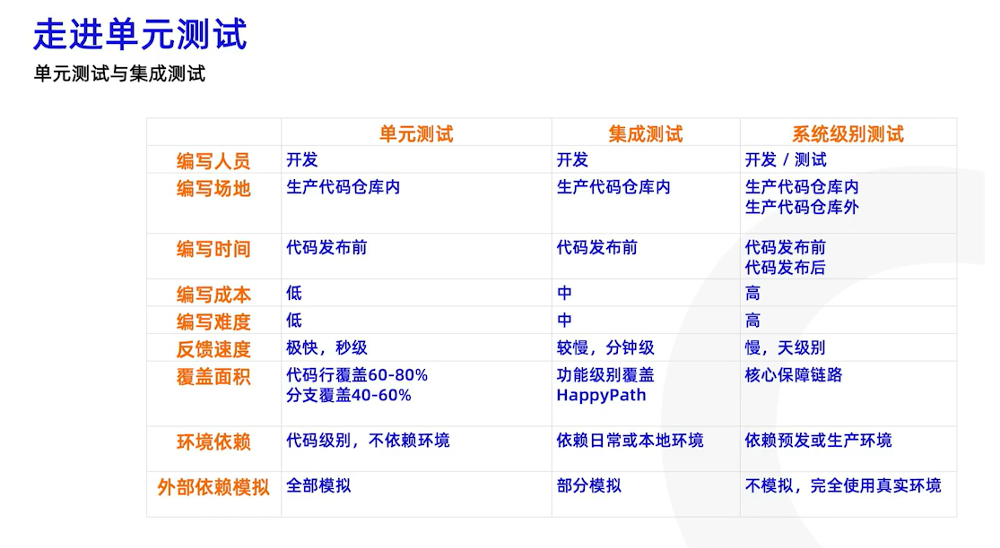
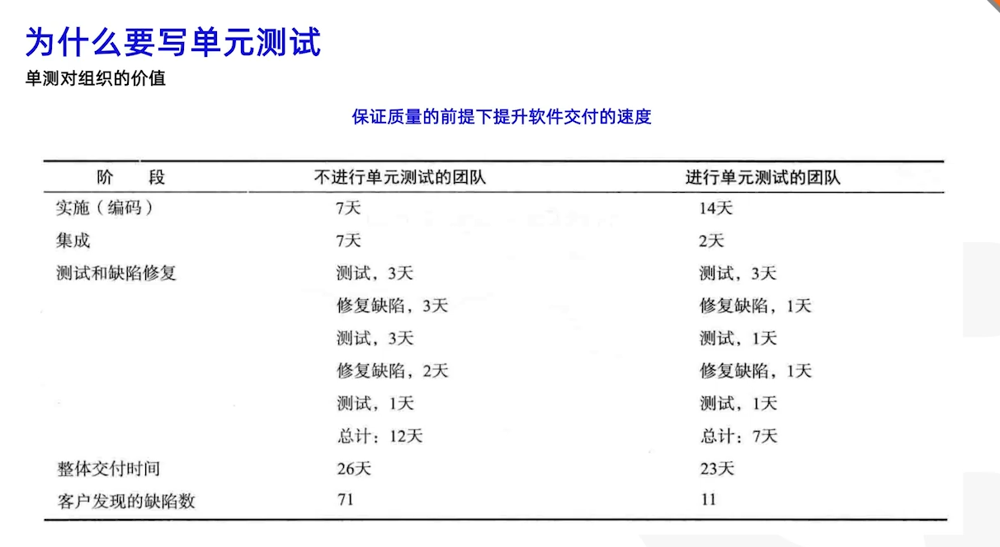
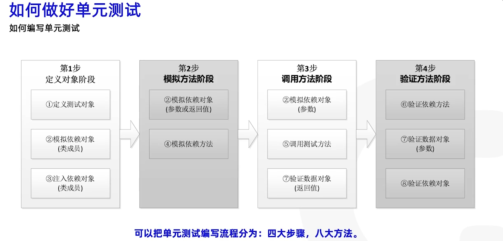
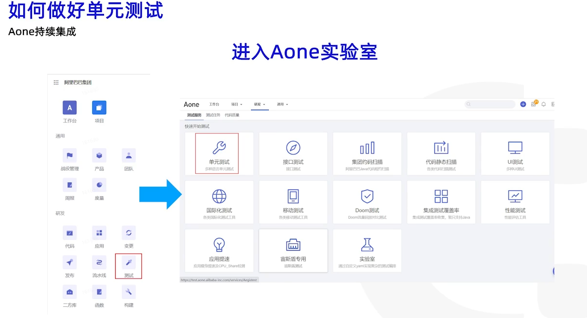
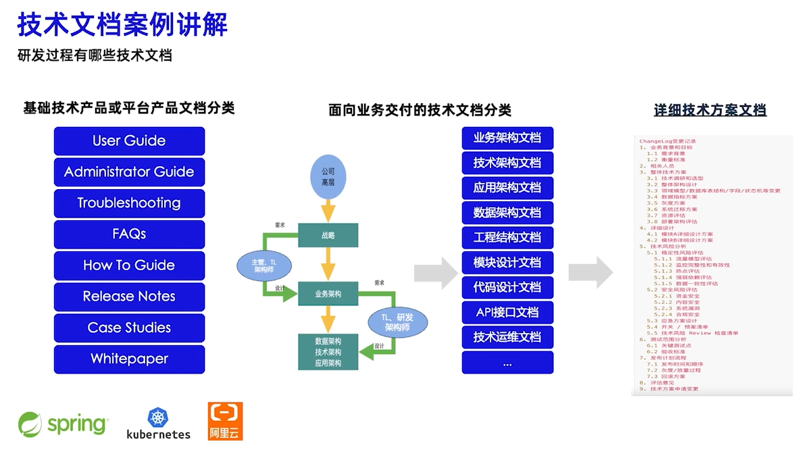

> **overall.md** 合并：`C:\Users\Mrwang\Desktop\2024\11-架构.md`（《凤凰架构》提纲等）+ 原有 wiki 设计/CQRS/MVC 笔记。图片：`../img/`。

# 架构总览

## 目录

- [设计基础 / DDD / CQRS / MVC](#设计基础)
- [《凤凰架构》与架构演进](#凤凰架构)
- [远程服务：RPC 与 REST](#访问远程服务)
- [事务、一致性与 IPC](#事物处理)
- [分布式假设与幂等](#程序员忽略的8大问题)

---

如何打造一个可用持续快速迭代的 **SaaS** 系统

可靠的大型分布式系统

## 设计基础

### OOP / 设计模式 / SOLID

DO，BO，DTO，VO

**三层架构**

| 层 | 职责 |
| --- | --- |
| Presentation | UI、Controller、BFF |
| Application | Service、校验、CRUD |
| Infra | DB、Library |

**DDD**（Domain Driven Design）

## Command Query Responsibility Segregation (CQRS)

### 传统 CRUD vs CQRS

| 维度 | 传统 CRUD | CQRS |
| --- | --- | --- |
| 模型 | 单一模型处理读写 | 读写模型分离 |
| 复杂度 | 简单场景适用 | 复杂场景优势明显 |
| 性能 | 读写互相影响 | 读写可以独立优化 |
| 扩展性 | 扩展困难 | 易于单独扩展读或写 |

**DDD 核心思想**是通过领域驱动设计定义领域模型，确定业务与应用边界，保证业务模型与代码模型一致。

Domain · Domain Model · Aggregate · Entity · Value Object · Bounded Context

**CSRF**（Cross-Site Request Forgery）：攻击者诱使用户在已登录状态下执行非预期操作。

## MVC 架构

| 层 | 说明 |
| --- | --- |
| Dao | 数据对象转换，与数据交互 |
| Model | 模型定义（结构体等） |
| Controller | 业务控制、Handler |
| View | 视图；前后端分离时常由前端 MVVM 承担 |

## 参考链接

- [Go 项目指南](https://book.ikubernetes.net/guide/goProject)
- [System Design Primer（中文）](https://geekdaxue.co/read/system-design-primer-zh_CN/README.md)
\n\n---\n\n## 《凤凰架构》与架构演进\n\nArchitecture

## 《凤凰架构》

需求管理 

流程

组织

产品化思维 （Product not Project）

IPC： （Inter-Process Communication）进程间通信

单体服务

SOA （Service oriented Architecture）： 面向服务的架构

Microservices ： 微服务

注册发现：DNS服务器

跟踪治理

负载均衡： 设置负载均衡器，选择恰当的均衡算法分流

故障隔离

认证授权

伸缩扩展

传输通道: 安全 布置TLS传输链路，配置好CA证书

事物处理

没有统一的解决方法：

容器化技术：

容器编排技术：

docker swarm , Apache mesos , Kubernets 

service-mesh 

Serverless 

Backend as a Service , Bass 后端即服务

Function as a Service , Faas  函数即服务

### 访问远程服务

#### (Remote Procedure Call , RPC)

 远程服务调用:

3个基本的问题：

1. 数据如何表示
2. 数据如何传递
3. 如何表示方法

RMi（sum/oracle）

Thrift(Facebook)

Dubuo阿里

gRPC google

#### REST

Representational state Transfer  , 表征状态转移

只能说是风格而不是协议

source: 资源

Representation： 表征

State：

Transfer：

Uniform Interface： 统一接口

Hypertext Drive： 超文本驱动

self-Description Message : 自我描述消息

#### 事物处理

AICD

数据一致性 Consistency 

原子性： Atomic： 保存多个操作，要么都成功，要么都失败

隔离性： Isolation

持久性： Durability：

A，I，D是手段，保持C（目的）

内部一致性： 当一个服务只使用一个数据源

外部一致性： 一个服务多个数据源，or 多个不同服务，多个不同的数据源

未提交事务，写入后崩溃

已提交事物，写入前崩溃

**实现原子性**

提交日志： commit logging  

commit record 

通过日志实现事物的原子性和持久性性是当今主流的方案

write-ahead-logging: 允许在事物提交之前写入变动数据

按照事物的提交点，将合适写入变动数据划分为 force 和 setal

undo log: 回滚日志 对**提取**写入的数据变动进行擦除

redo log : 重做日志 

**实现隔离性：**

保证每个事物各自读写的数据相互独立

数据库提供了3种锁：

1： 写锁 write lock 排他锁, 只有自己能写

2： 读锁 read lock 共享锁 ， 加锁的事物只能读，如果只有一个事物，该事物能写

3： 范围锁 Rang Lock  对某个范围直接加排他锁，这个范围的数据不能被写入

用户可以调节数据库的加锁方式，取得隔离性与吞吐量之间的平衡

隔离等级：

1： 可串行化 Serializable  最高等级 对事物的所有读写都加锁

2：可重复读 repeatable Read: 

 存在幻读 Phantom Read 

3： 读已提交 Read committed 

4: 读未提交 Read uncommited  (Dirty Read )

多版本并发控制： Multi-version concurrency control MVCC 

**全局事物：**

 

shadow paging : 

进程间Fa的通信：

Pipe: 管道

Signal : 信号

Semaphore : 信号量

Message Queue : 消息队列

Shared memory : 共享内存

IPC socket 本地套接字端口

程序员忽略的8大问题：

The network is reliable .

Latency is zero

Bandwidth is infinite

the network is secure 

接口的幂等性：

服务被多次执行效果是一致的

devops 项目：

welliancao/opsmanage 

https://github.com/panjf2000/ants.git

轻流

基于全场景的MPP 数据库架构  

