> 迁移自 `C:\Users\Mrwang\Desktop\2024\8-推荐系统.md`。图片目录：`../img/`（`1-Note/img`）。

# 推荐系统

## 目录

- [知识提纲](#知识提纲review)
- [协同过滤（CF）](#协同过滤cf)
- [CTR 预估与经典模型](#ctr-预估与经典模型)
  - [矩阵分解 / LR / GBDT+LR / FM 族 / 深度模型](#矩阵分解mf--lfm)
- [基于内容的推荐（TF-IDF）](#基于内容的推荐tf-idf)
- [附录：协同过滤与 LFM 图示](#附录协同过滤与-lfm-图示)
- [召回与排序补充](#召回与排序补充)

---

### 知识提纲（Review）

```text
1： 重点在review 梳理

LR 

矩阵分解

协同过滤

apori关联分析

FP-groth

fm

推荐系统：
一种主动的信息过滤系统，将信息过滤的过程由用户主动搜索变成系统主动推送
信息超载 长尾现象
```

## 协同过滤（CF）

（Collaborative,Filtering,CF）

**根据用户之前的喜好以及其他兴趣相近的用户的选择来给用户推荐物品**

- **基于用户的协同过滤算法(UserCF)**: 给用户推荐和他兴趣相似的其他用户喜欢的产品
- **基于物品的协同过滤算法(ItemCF)**: 给用户推荐和他之前喜欢的物品相似的物品

基于用户的协同过滤：

1. 找到和目标用户兴趣相似的集合
2. 找到这个集合中的用户喜欢的， 且目标用户没有听说过的物品推荐给用户。

给用户推荐物品的过程可以**形象化为一个猜测用户对商品进行打分的任务**

怎么计算两个向量之间的相似程度：

**欧式距离体现数值上的绝对差异，而余弦距离体现方向上的相对差异**

​	1：**杰卡德(Jaccard)相似系数：**

​	**2：余弦相似度**

```python
from sklearn.metrics.pairwise import cosine_similarity
i = [1, 0, 0, 0]
j = [1, 0.5, 0.5, 0]
cosine_similarity([i, j])
```

评分数据不规范的时候， 也就是说， 存在有的用户喜欢打高分， 有的用户喜欢打低分情况的时候，有的用户喜欢乱打分的情况， 这时候cosine 相似度算出来的结果可能就不是那么准确了

​	3：**皮尔逊相关系数**

Pearson 相关系数：将两个向量各自减去均值后再计算 cosine 相似度。

```python
from scipy.stats import pearsonr
i = [1, 0, 0, 0]
j = [1, 0.5, 0.5, 0]
pearsonr(i, j)
```
eg: 

用户给物品打分：

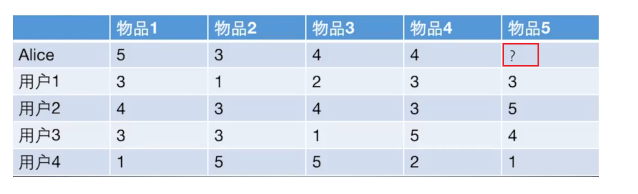

基于物品的协同过滤：
预先根据所有用户的历史偏好数据计算物品之间的相似性，然后把与用户喜欢的物品相类似的物品推荐给用户。

比如物品a和c非常相似，因为喜欢a的用户同时也喜欢c，而用户A喜欢a，所以把c推荐给用户A

**ItemCF算法并不利用物品的内容属性计算物品之间的相似度， 主要通过分析用户的行为记录计算物品之间的相似度， 该算法认为， 物品a和物品c具有很大的相似度是因为喜欢物品a的用户大都喜欢物品c**

基于物品的协同过滤算法主要分为两步：

- 计算物品之间的相似度
- 根据物品的相似度和用户的历史行为给用户生成推荐列表（购买了该商品的用户也经常购买的其他商品）

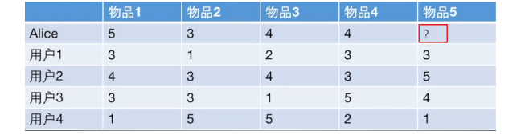

应用场景和存在问题分析

UserCF
由于是基于用户相似度进行推荐， 所以具备更强的社交特性， 这样的特点非常适于用户少， 物品多， 时效性较强的场合， 比如新闻推荐场景， 因为新闻本身兴趣点分散， 相比用户对不同新闻的兴趣偏好， 新闻的及时性，热点性往往更加重要， 所以正好适用于发现热点，跟踪热点的趋势。 另外还具有推荐新信息的能力， 更有可能发现惊喜, 因为看的是人与人的相似性, 推出来的结果可能更有惊喜，可以发现用户潜在但自己尚未察觉的兴趣爱好。

对于用户较少， 要求时效性较强的场合， 就可以考虑UserCF。
ItemCF

这个更适用于兴趣变化较为稳定的应用， 更接近于个性化的推荐， 适合物品少，用户多，用户兴趣固定持久， 物品更新速度不是太快的场合， 比如推荐艺术品， 音乐， 电影。

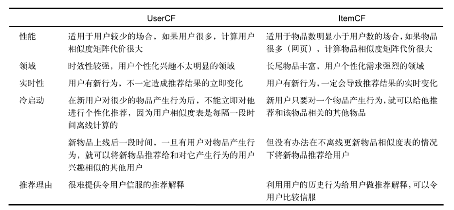

协同过滤算法存在的共性问题， 协同过滤的特点就是完全没有利用到物品本身或者是用户自身的属性， 仅仅利用了用户与物品的交互信息就可以实现推荐，是一个可解释性很强， 非常直观的模型， 但是也存在一些问题。

较差的稀疏向量处理能力

**推荐系统头部效应明显， 处理稀疏向量的能力弱。**

为了解决这个问题， 同时增加模型的泛化能力，2006年， 矩阵分解技术(Matrix Factorization,MF)被提出， 该方法在协同过滤共现矩阵的基础上， 使用更稠密的隐向量表示用户和物品， 挖掘用户和物品的隐含兴趣和隐含特征， 在一定程度上弥补协同过滤模型处理稀疏矩阵能力不足的问题。 


总结3个问题：

1 泛化能力弱，较差的稀疏向量处理能力

2 无法利用用户或者物品的本身属性特征

 **推荐系统慢慢的从以协同过滤为核心到了以逻辑回归模型为核心**

## CTR 预估与经典模型

### 矩阵分解（MF / LFM）

**为了使得协同过滤更好处理稀疏矩阵问题， 增强泛化能力**， 从协同过滤中衍生出矩阵分解模型(Matrix Factorization,MF), 并发展出了矩阵分解的分支模型

隐语义模型： LDA  (Latent Factor Model）


隐语义模型其实就是在**想办法基于这个评分矩阵（用户和物品评分矩阵）去找到上面例子中的那两个矩阵， 也就是用户兴趣和物品的隐向量表达， 然后就把这个评分矩阵分解成Q和P两个矩阵乘积的形式， 这时候就可以基于这两个矩阵去预测某个用户对某个物品的评分了。 然后基于这个评分去进行推荐**。


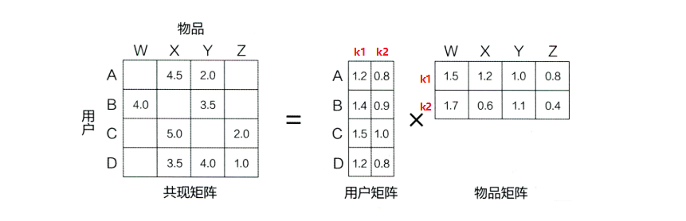

矩阵分解算法将m × n 维的共享矩阵R 分解成m × k  维的用户矩阵U 和k × n维的物品矩阵V相乘的形式。 其中m 是用户数量， n 是物品数量， k 是隐向量维度， 也就是隐含特征个数。

矩阵分解：
EVD 它要求分解的矩阵是方阵， 显然用户-物品矩阵不满足这个要求

SVD 分解计算复杂度非常高， 而我们的用户-物品矩阵非常大， 所以基本上无法使用。

 2006年的Netflix Prize之后， Simon Funk公布了一个矩阵分解算法叫做**Funk-SVD**, 后来被Netflix Prize的冠军Koren称为**Latent Factor Model(LFM)**

**Latent Factor Model(LFM)**：

**把求解上面两个矩阵的参数问题转换成一个最优化问题， 可以通过训练集里面的观察值利用最小化来学习用户矩阵和物品矩阵**，

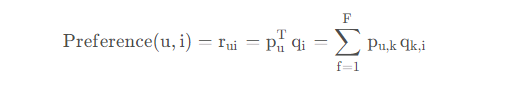

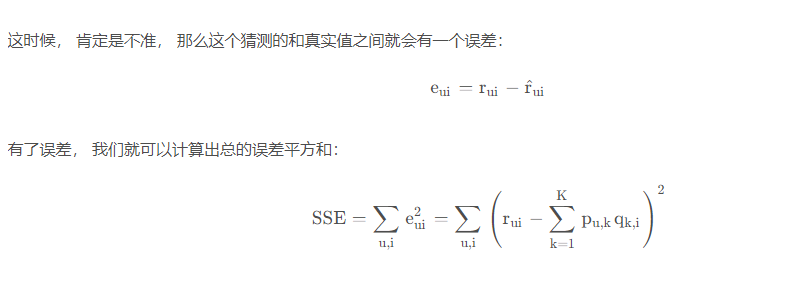

去计算两个参数矩阵U和V， 我们就可以用求解神经网络模型参数的思路计算这两个矩阵：

首先先初始化这两个矩阵
把用户评分矩阵里面已经评过分的那些样本当做训练集的label， 把对应的用户和物品的隐向量当做features， 这样就会得到(features, label)相当于训练集
通过两个隐向量乘积得到预测值pred
根据label和pred计算损失
然后反向传播， 通过梯度下降的方式，更新两个隐向量的值
未评过分的那些样本当做测试集， 通过两个隐向量就可以得到测试集的label值

这样就填充完了矩阵， 下一步就可以进行推荐了

消除用户和物品打分的偏差


一个评分系统， 有些固有的属性和用户物品无关， 而用户也有些属性和物品无关， 物品也有些属性和用户无关。

通过上面隐向量的方式， 就可以将用户和物品联系到了一起， 但是实际情况中， 单纯的

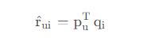

 Netfix Prize中提出了另一种LFM， 在原来的基础上加了偏置项， 来消除用户和物品打分的偏差， 预测公式如下：

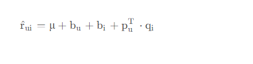

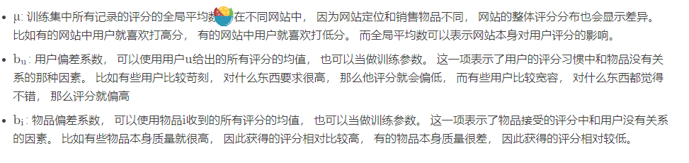

### SVD++

优点：
泛化能力强： 一定程度上解决了稀疏问题
空间复杂度低： 由于用户和物品都用隐向量的形式存放， 少了用户和物品相似度矩阵， 空间复杂度由n^2降到了( n + m ) ∗ f 更好的扩展性和灵活性：矩阵分解的最终产物是用户和物品隐向量， 这个深度学习的embedding思想不谋而合， 因此矩阵分解的结果非常便于与其他特征进行组合和拼接， 并可以与深度学习无缝结合。

------------------------------------------------

**矩阵分解算法依然是只用到了评分矩阵， 没有考虑到用户特征， 物品特征和上下文特征， 这使得矩阵分解丧失了利用很多有效信息的机会**， 同时在缺乏用户历史行为的时候， 无法进行有效的推荐。 所以为了解决这个问题， 逻辑回归模型及后续的因子分解机模型， 凭借其天然的融合不同特征的能力， 逐渐在推荐系统领域得到了更广泛的应用


推荐系统**通过分析用户的历史行为给用户的兴趣建模， 从而主动给用户推荐给能够满足他们兴趣和需求的信息， 能够真正的“懂你”**。

GBDT+LR模型完成一个点击率预测的任务

### 逻辑回归（LR）

线性模型加入sigmoid函数就是逻辑回归模型：

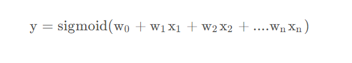

**逻辑回归假设数据服从伯努利分布,通过极大化似然函数的方法，运用梯度下降来求解参数，来达到将数据二分类的目的**

1. 逻辑回归对于高维稀疏类别的特征有比较好的拟合效果
2. 由于特征的稀疏性， 还间接的起到了特征选择的作用， 因为某些特征非常稀疏， 会有很多的0， 这时候， 参数的更新基本上就只更新那几个对于loss非常重要的特征， 使得w0+w1*x1…这一长串很多值都是0
3. 离散化比如说对某个特征进行分桶， 这样可以增加模型的鲁棒性， 不容易被某个特征给带偏， 比较稳定， 类似于归一化分桶之后， 也相当于引入了非线性

- 优点：
  LR模型形式简单，可解释性好，从特征的权重可以看到不同的特征对最后结果的影响。
- 训练时便于并行化，在预测时只需要对特征进行线性加权，所以性能比较好，往往适合处理海量id类特征，用id类特征有一个很重要的好处，就是防止信息损失（相对于范化的 CTR 特征），对于头部资源会有更细致的描述资源占用小,尤其是内存。在实际的工程应用中只需要存储权重比较大的特征及特征对应的权重方便输出结果调整。逻辑回归可以很方便的得到最后的分类结果，因为输出的是每个样本的概率分数，我们可以很容易的对这些概率分数进行cutoff，也就是划分阈值(大于某个阈值的是一类，小于某个阈值的是一类)
- 工程化需要， 在深度学习技术之前， 逻辑回归凭借易于并行化， 模型简单，训练开销小等特点，占领工程领域的主流， 因为即使工程团队发现了复杂模型会提升效果， 但一般如果没有把握击败逻辑回归的话仍然不敢尝试或者升级。

缺点：

1. 表达能力不强， 无法进行特征交叉， 特征筛选等一系列“高级“操作（这些工作都得人工来干， 这样就需要一定的经验， 否则会走一些弯路）， 因此可能造成信息的损失
2. 准确率并不是很高。因为这毕竟是一个线性模型加了个sigmoid， 形式非常的简单(非常类似线性模型)，很难去拟合数据的真实分布
3. 处理非线性数据较麻烦。逻辑回归在不引入其他方法的情况下，只能处理线性可分的数据， 如果想处理非线性， 首先对连续特征的处理需要先进行离散化（离散化的目的是为了引入非线性），如上文所说，人工分桶的方式会引入多种问题。
4. LR 需要进行人工特征组合，这就需要开发者有非常丰富的领域经验，才能不走弯路。这样的模型迁移起来比较困难，换一个领域又需要重新进行大量的特征工程。

------------------------------------------------

**自动发现有效的特征、特征组合，弥补人工经验不足，缩短LR特征实验周期**

### GBDT+LR

**训练时**，GBDT 建树的过程相当于自动进行的特征组合和离散化，然后从**根结点到叶子节点的这条路径就可以看成是不同特征进行的特征组合，用叶子节点可以唯一的表示这条路径**，并作为一个离散特征传入 LR 进行**二次训练**。（叶子节点是1，或者0）

几个关键的点：

1. 通过GBDT进行特征组合之后得到的离散向量是和训练数据的原特征一块作为逻辑回归的输入， 而不仅仅全是这种离散特征

2. 建树的时候用ensemble建树的原因就是一棵树的表达能力很弱，不足以表达多个有区分性的特征组合，多棵树的表达能力更强一些。GBDT每棵树都在学习前面棵树尚存的不足，迭代多少次就会生成多少棵树。

3. RF也是多棵树，但从效果上有实践证明不如GBDT。且GBDT前面的树，特征分裂主要体现对多数样本有区分度的特征；后面的树，主要体现的是经过前N颗树，残差仍然较大的少数样本。优先选用在整体上有区分度的特征，再选用针对少数样本有区分度的特征，思路更加合理，这应该也是用GBDT的原因。

4. 在CRT预估中， GBDT一般会建立两类树(非ID特征建一类， ID类特征建一类)， AD，ID类特征在CTR预估中是非常重要的特征，直接将AD，ID作为feature进行建树不可行，故考虑为每个AD，ID建GBDT树。

   非ID类树：不以细粒度的ID建树，此类树作为base，即便曝光少的广告、广告主，仍可以通过此类树得到有区分性的特征、特征组合

   ID类树：以细粒度 的ID建一类树，用于发现曝光充分的ID对应有区分性的特征、特征组合

树模型不能处理大量高维度离散数据的原因是容易导致过拟合， 但是具体是怎么导致的过拟合呢？ 发现下面这张图片的理由说的非常好， 直接拿过来了

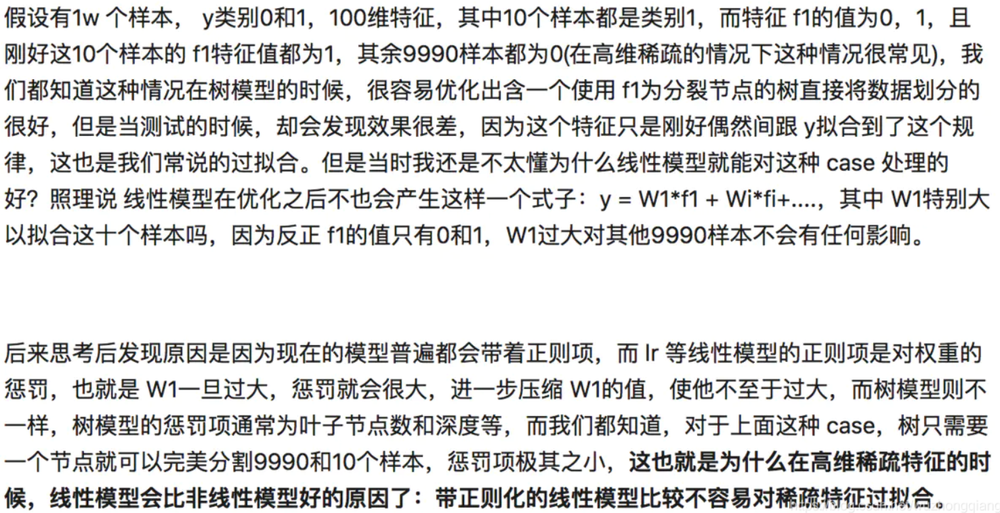


假设1w个样本， 类别为0或者1，总共有100 维特征。 其中10个样本都是类别1，其他9990个样本为0.

f1 特征取值为0，或者1。


这个模型也是工业上非常喜欢使用的模型， 下面除了上面这些关键点， 再整理几个工业上使用这个模型的细节：

1. GBDT+LR模型， GBDT的输入特征一般不能是高维稀疏的id离散特征， 树模型是不喜欢这种特征的。原因就是上面这个了， 所以如果有大量的id类特征， 一定要放到LR这块里面，也就是让连续的特征过gbdt， 然后得到输出的新特征和离散特征走LR。
2. GBDT+LR模型是可以进行增量训练的， 所谓增量训练，就是定期(比如一个小时)用新的数据对模型进行局部的更新，使的模型更加反映实时性的数据变化， 对于树模型来讲是不能进行增量更新的，因为这种模型没法局部， 训练只能是从头训练(全量更新模式)， 而GBDT+LR模型之所以能增量更新，也不是更新GBDT这块，而是LR这块可以进行增量更新。 适合增量更新的模型一般是类似于神经网络这种才可以， 可以冻结某些层，用新数据只更新某些层这种。所以GBDT的更新周期要比LR长。


GBDT的实现一般可以使用xgboost， 或者lightgbm：

### POLY2

逻辑回归存在很大的一个问题就是**只对单一特征做简单加权， 不具备特征交叉生成组合特征的能力， 因此表达能力受到了限制**

POLY2是二阶多项式模型， 数学形式如下：

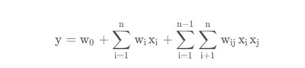


**数据稀疏性是实际问题中不可避免的挑战**。

1. 推荐系统中的数据往往是非常稀疏的(类别型数据经过独热）, 这样会导致特征向量非常的稀疏， 这时候如果再交叉的时候， 往往x i 和x j 同时不为0的情况很少， 这会导致交叉特征的权重缺乏有效的数据进行训练而无法收敛。

2. POLY2中权重参数的数量是( n − 1 ) n /2   ， 任意两个参数相互独立， 这时候如果数据非常稀疏， 再要训练这么多参数， 无疑是非常困难的， 最终模型也不会很好。


POLY2模型虽然是引入了特征的二阶交叉组合， 但是由于其模型参数， 稀疏场景受限的问题使得FM登场了！

### FM

因子分解机(Factorization Machine, FM)和域感知因子分解机(Field-aware Factorization Machine, FFM)

对于稀疏的评分矩阵， 我们有办法分解成两个向量相乘的形式， 那么为何不把这种思想用到解决POLY2的缺陷上呢？ 无非就是评分矩阵换成POLY2后面的W矩阵(所有二次项系数w i j  组成的）。于是乎， 这种思想真的就用过来了， 那就是把W 矩阵进行分解成两个矩阵相乘的方式， 可是有依据的哟：

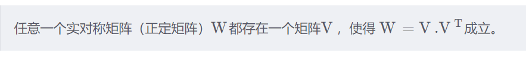

$$[Math Processing Error] 对于二次项参数w_{ij},组成的对称阵W,为了方面说明FM的由来， 对角元素设置为正实数,可以分解成V^TV 形式。$$

$$[Math Processing Error]V的第j列(v_j)表示的是第j维特征x_j的隐向量$$

$$[Math Processing Error]换句话说， 特征分量x_i和x_j的交叉系数就等于x_i和x_j对应的隐向量的内积，$$

$$[Math Processing Error]w_{ij}=<v_i,v_j>$$ , 这就是FM模型的核心 ，

隐向量特征空间K维度：

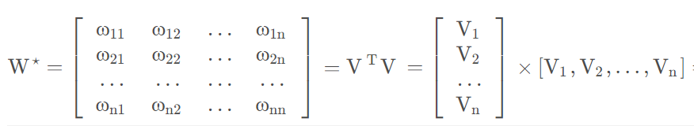


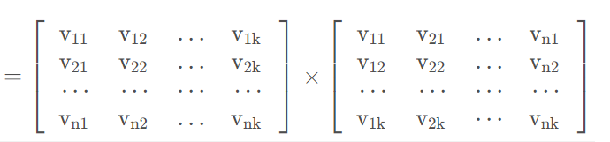


FM的模型方程：

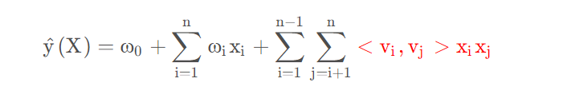

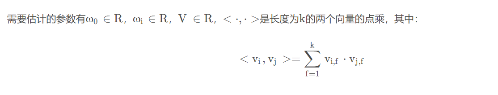


k(k<<n)为隐向量的长度，包含 k 个描述特征的因子。（k*n << n * n )

FM在2012-2014前后， 成为了业界主流的推荐模型之一


特征交叉时候，学习每个特征的latent vector , 要与其他所有特征交互学习，这样可能会使得模型的表达能力收到限制。

### FFM

是FFM在FM的基础上做的改进， **引入了域的概念， 对于每个特征， 针对不同的交叉域要学习不同的隐向量特征**。

一个特征，对应多个隐向量。不同的域学习不同的隐向量。


域内特征一般都是同一个categorical特征经过One-Hot编码生成的数值特征，比如用户性别， 职业， 日期啊等等

对于连续特征， 一个特征就对应一个域， 或者可以对连续特征离散化， 一个分箱成为一个特征， 总的分箱是一个域

更能够体现出不同域里面特征的差异性(这就是FFM里面"field-aware"的由来)， 表达能力更强， 另外一个就是学习USA特征的多个隐向量的时候， 不是综合考虑所有的类别特征， 而是自个学习自个的.


那么时间复杂度上会从FM的O ( n k ) 到FFM的O ( n f k ) ， 这里的f 就是域的个数， 这里的时间复杂度会到O ( k n 2 ) 


### AutoRec

将自编码器的思想和协同过滤结合起来的一种单隐层的神经网络推荐模型。 它的基本原理是利用协同过滤中的共现矩阵， 完成物品向量或者用户向量的自编码。 再利用自编码的结果得到用户对物品的预估评分， 进而进行的推荐排序。

和协同过滤一样， AutoRec也分为基于物品的和基于用户的， 上面这个就是基于物品的， 称为I-AutoRec。 如果把用户的评分向量作为输入， 就得到了U-AutoRec。 这个输入之后得到的输出， 就是用户对所有物品的一个评分。 这样就直接可以根据这个评分做推荐了。 但是往往用户向量会比较稀疏， 可能会影响模型效果。

### Deep Crossing

真正的把深度学习架构应用于推荐系统中的模型了， 2016年由微软提出， 完整的解决了特征工程、稀疏向量稠密化， 多层神经网络进行优化目标拟合等一系列深度学习再推荐系统的应用问题。 这个模型涉及到的技术比较基础，在传统神经网络的基础上加入了embedding， 残差连接等思想， 且结构比较简单


DeepCrossing模型应用场景是微软搜索引擎Bing中的搜索广告推荐， 用户在输入搜索词之后， 搜索引擎除了返回相关结果， 还返回与搜索词相关的广告，Deep Crossing的优化目标就是预测对于某一广告， 用户是否会点击， 依然是点击率预测的一个问题。

端到端的训练， DeepCrossing模型要在内部网络结构中解决如下问题：

1. 离散类特征编码后过于稀疏， 不利于直接输入神经网络训练， 需要解决稀疏特征向量稠密化的问题
2. 如何解决特征自动交叉组合的问题
3. 如何在输出层中达成问题设定的优化目标

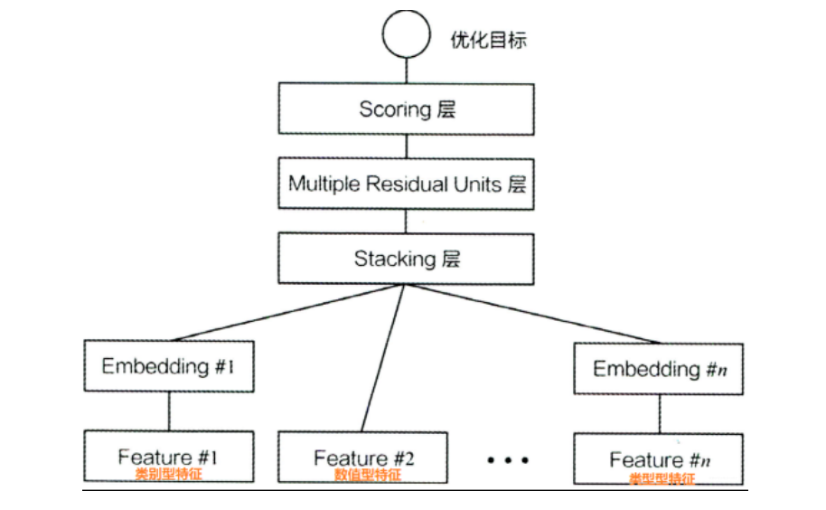

常规的Embedding+多层神经网络。但这个网络模型的出现， 有革命意义。 DeepCrossing模型中没有任何人工特征工程的参与， 只需要清洗一下， 原始特征经Embedding后输入神经网络层， 自主交叉和学习。 相比于FM， FFM只具备二阶特征交叉能力的模型， DeepCrossing可以通过调整神经网络的深度进行特征之间的“深度交叉”， 这也是Deep Crossing名称的由来。

AutoRec和Deep Crossing模型我们说是在神经网络的复杂度和层数方面进行的进化，而这两个模型也是使用深度学习从用户和条目表征的角度解决推荐问题的方案， 因为它们并没有刻意去研究特征与特征之间的两两或者三三的交互（没有应对特征交叉的能力）， 而是用全连接隐层把所有特征进行了统一的交叉学习， 这在很多场景下其实是不太合理的(这样可能会使的即使没有半毛钱关系的特征在这种情况下也会发生点关系，也可能会使几个很亲密的特征也很难擦出点火花），没有什么针对性， 所以使得模型的学习能力受到限制。另外， 虽然感觉Deep Crossing用了embedding, stacking， 残差等， 但是模型的结构还是不够复杂

### Neural CF

2017:新加坡国立大学的研究人员提出的一个模型，

根本性思路的， 一个是用户和条目的表征， 也就是如何更好地把用户特征和物品特征信息表示出来， 隐语义模型(MF)就是属于这个思路上的， 使用了embedding的思路去表示用户和物品， 从而用向量的乘积表示用户对物品的喜好程度。 第二个思路是特征交叉， 即考虑特征之间的交互信息以丰富数据的表达能力， 因子分解机(FM)的家族就是致力于解决这个问题上的。

MF:  因为相似度是夹角衡量的， 夹角关系在降维之后有可能发生了错乱， 但是这间接的说明了**单单使用内积不足以可靠的预测评分**。

提出的动机就是看着MF的内积操作比较简单， 表达能力不强， 而此时正是深度学习的浪潮啊， 所以作者就用一个“多层的神经网络+输出层”替换了矩阵分解里面的内积操作， 这样做一是让用户向量和物品向量做更充分的交叉， 得到更多有价值的特征组合信息。 二是引入更多的非线性特征， 让模型的表达能力更强.


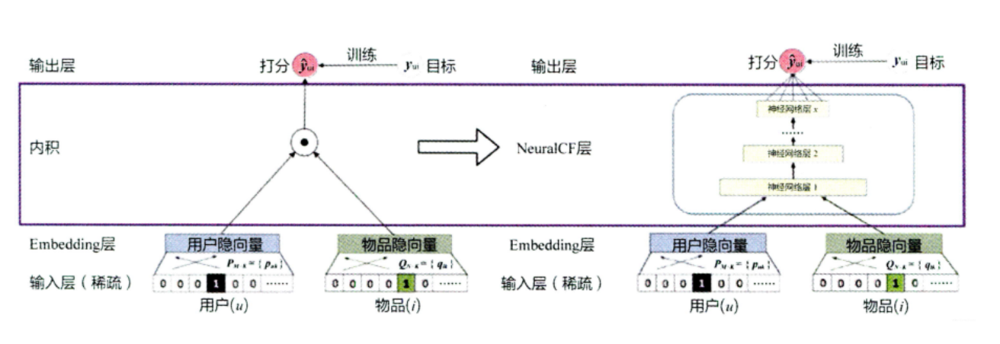

特征交叉：

1： 内积

 2：多层神经网络加入更多非线性，模拟更复杂的交叉函数也是一种

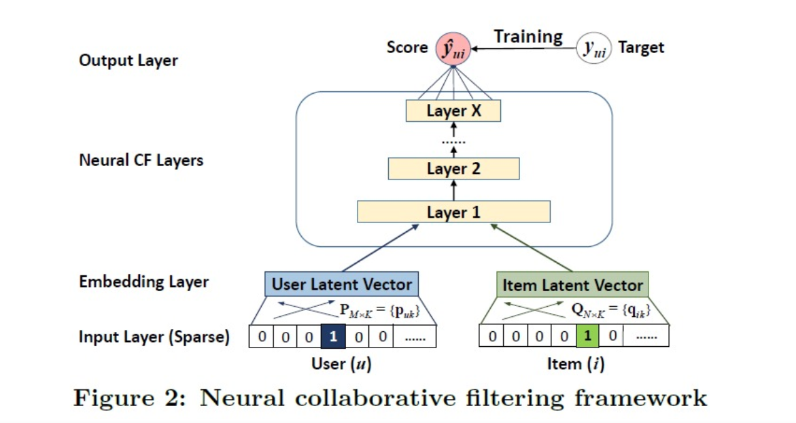

general NCF框架： （通用neural 协同过滤）

 因为向量交叉的方式可以有很多种， 如果这里是内积操作， 那么这个NCF框架就成了普通的MF：

 如果这里是多层神经网络， 那么这个框架就成了一种MLP的网络。 框架的计算公式如下

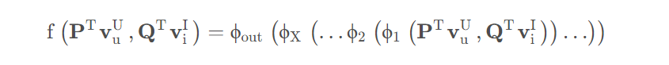

1： Generalized Matrix Factorization （GMF）

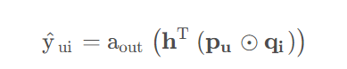


⊙表示对应元素相乘。 与普通的MF不同的是， 这里的隐向量进行对应元素相乘之后会有个权重， 也就是各个隐向量维度的重要性不一定相同了。 如果h hh是一个全1向量的话， 那模型实际上就是MF了

h: 学习的参数 

2： MLP

把 user 和 item 的 Embedding 拼起来，然后输入给多层感知机

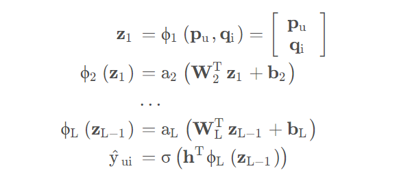

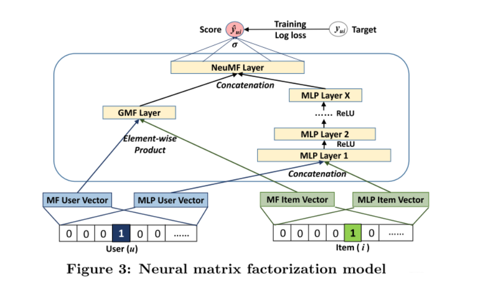

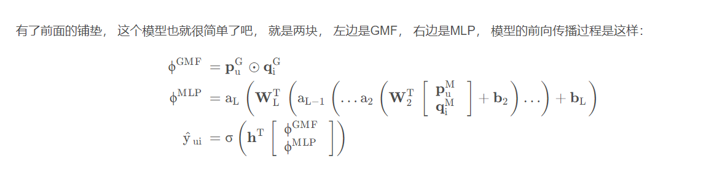

注意的一个细节， 就是这俩模型的embedding向量是单独学习的， 并不是共享的， 作者在论文里面也给出了原因， 就是这样会更加的灵活，可以根据模型的复杂程度确定不同的隐向量的维度， 然后单独去各自的模型计算， 计算的结果进行合并， 再过一层全连接得到最后的输出。

Neural CF并没有引入更多其他类型特征， 造成了一种可用信息的浪费。也就是有效资源并没有好好的利用起来。


### PNN 

Product-based Neural Networks， 这是2016年上海交大团队在ICDM会议上提出的一个模型

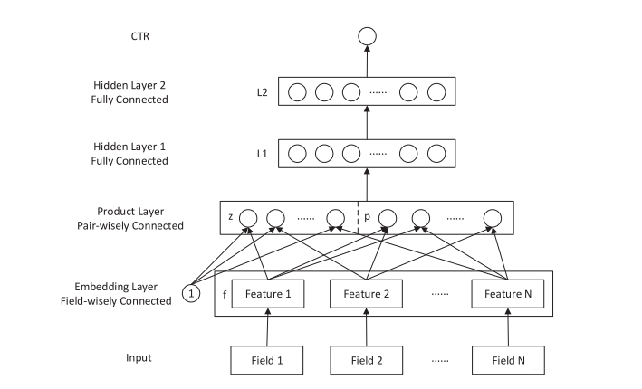


input layer :

 模型输入由N个特征域（Field）组成，都是离散稀疏的分类特征，如年龄、性别、id等（经过one-hot编码， 但是实际上我们知道， 真实复现的时候往往用LabelEncoder编码， 取相应位置的embeddind

embedding layter :  就是简单的embedding 层

product layter :

输入是N个特征域的embedding 向量，Feature1 ,...FeatureN 

输出是： lz ,lp 

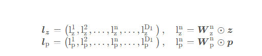


简单的模型， 比如协同过滤， 逻辑回归等，能够从历史数据中学习到高频共现的特征组合能力， 但是泛化能力不足；而像矩阵分解， embedding再加上深度学习网络， 能够利用相关性的传递性去探索历史数据中未出现的特征组合， 挖掘数据潜在的关联模式， 但是对于某些特定的场景(数据分布长尾， 共现矩阵稀疏高秩）很难有效学习低纬度的表示， 造成推荐的过渡泛化。 既然这两种模型的优缺点都这么的互补， 为啥不组合一下子他俩呢？

### Wide&Deep

Wide&Deep这种线性模型与DNN的并行连接模式，后来成为推荐领域的经典模式

Memorization"和”Generalization 	记忆和泛化

**"记忆能力"可以被理解为模型直接学习并利用历史数据中物品和特征的“共现频率”的能力**

一般来说， 协同过滤、逻辑回归这种都具有较强的“记忆能力”, 由于这类模型比较简单， 原始数据往往可以直接影响推荐结果

**泛化能力“可以被理解为模型传递特征的相关性， 以及发掘稀疏甚至从未出现过的稀有特征与最终标签相关性的能力**。

比如矩阵分解， embedding等， 使得数据稀少的用户或者物品也能生成隐向量， 从而获得由数据支撑的推荐得分， 将全局数据传递到了稀疏物品上， 提高泛化能力。再比如神经网络， 通过特征自动组合， 可以深度发掘数据中的潜在模式，提高泛化等。


Wide&Deep模型的直接动机就是将两者进行融合， 使得模型既有了简单模型的这种“记忆能力”， 也有了神经网络的这种“泛化能力”, 这也是记忆与泛化结合的伟大模式的初始尝试。

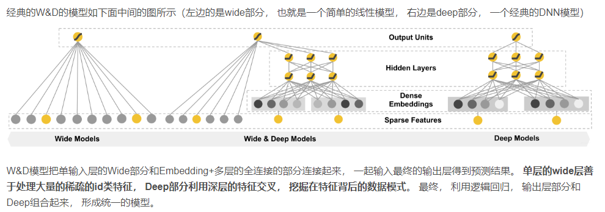

**wide:** 

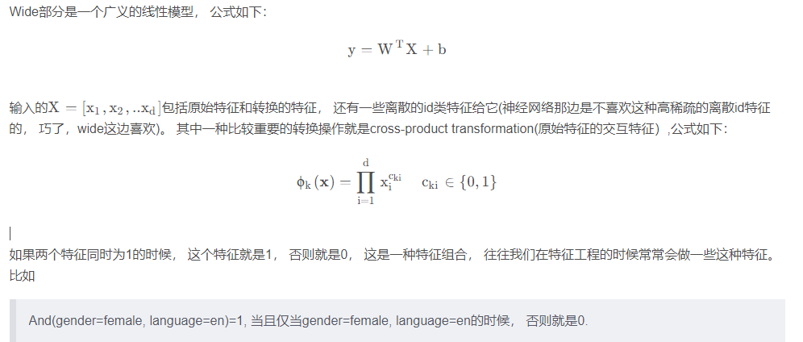


**wide**部分训练时候使用的优化器是带正则的FTRL算法(Follow-the-regularized-leader):

FTRL当作一个稀疏性很好，精度又不错的随机梯度下降方法， **该算法是非常注重模型稀疏性质的**

**Wide部分模型训练完之后留下来的特征都是非常重要的，那么模型的“记忆能力”就可以理解为发现"直接的"，“暴力的”，“显然的”关联规则的能力。**


**Deep 部分**：

​	该部分主要是一个Embedding+MLP的神经网络模型。大规模稀疏特征通过embedding转化为低维密集型特征。然后特征进行拼接输入到MLP中，挖掘藏在特征背后的数据模式。

输入的特征有两类， 一类是数值型特征， 一类是类别型特征(会经embedding)。**我们知道DNN模型随着层数的增加，中间的特征就越抽象，也就提高了模型的泛化能力。** 对于Deep部分的DNN模型作者使用了深度学习常用的优化器AdaGrad，这也是为了使得模型可以得到更精确的解。

 **Wide & Deep**

W&D模型是将两部分输出

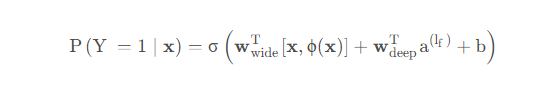


### Cross&Deep

Wide部分有一个不足就是需要人工进行特征的组合筛选， 过程繁琐且需要经验， 2阶的FM模型在线性的时间复杂度中自动进行特征交互，但是这些特征交互的表现能力并不够，并且随着阶数的上升，模型复杂度会大幅度提高。于是乎，作者用一个Cross Network替换掉了Wide部分，来自动进行特征之间的交叉，并且网络的时间和空间复杂度都是线性的。 通过与Deep部分相结合，构成了深度交叉网络（Deep & Cross Network），简称DCN。

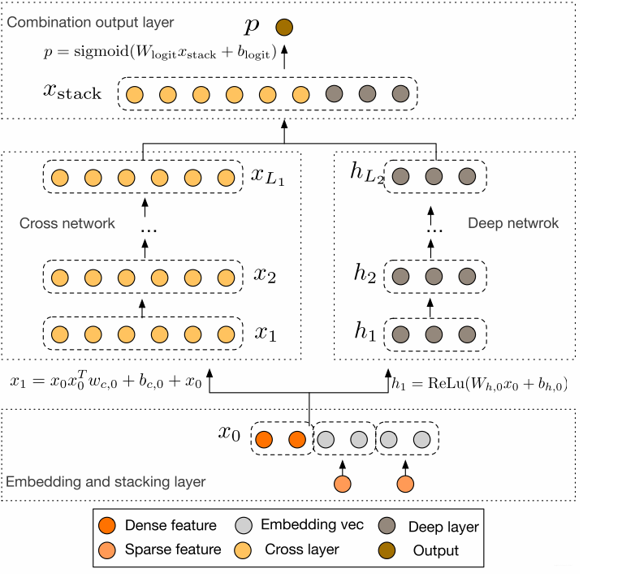

Cross Network：

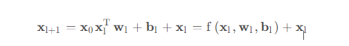

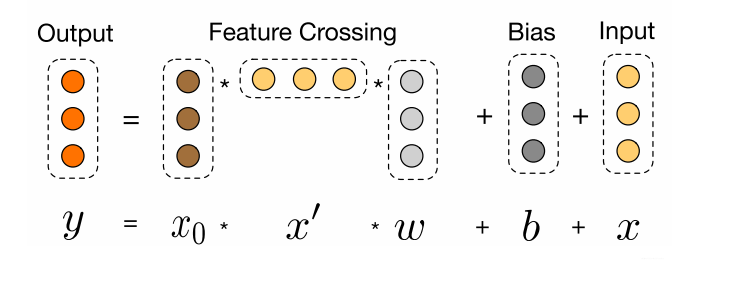


### ESMM 

entire space multi-task model 


1. 特征交互上要进一步加强学习，来增强模型的表达能力
2. 繁重的特征工程要尽可能的避免，尽量端到端无脑搞

### FNN

2016 FM和DNN组合

Factorization Machine supported Neural Network 

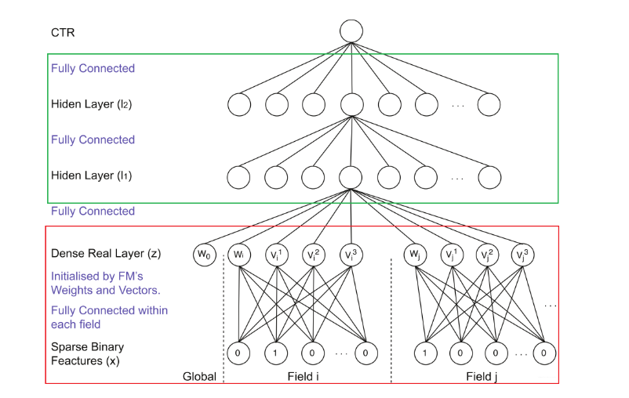

 FNN几个比较大的缺点：

1. 两阶段的训练模型，应用过程不太方便，且模型能力受限于FM表征能力的上限
2. 只关注于高阶组合特征的交叉

### DeepFM 

经典模型

Factorization-Machine Based Neural Network 

2017：  FM和DNN组合

1:	it does not need any pre-train

2: it learns both high and low-order feature interactions

3: it introduces a sharing stragegy of feature embedding to avoid feature engineering

CTR预测任务中， 高阶特征和低阶特征的学习都非常的重要,

基本上是从最简单的线性模型(LR)， 到考虑低阶特征交叉的FM， 到考虑高度交叉的神经网络，再到两者都考虑的W&D组合模型

简单的线性模型虽然简单，同样这样是它的不足，就是限制了模型的表达能力，随着数据的大且复杂，这种模型并不能充分挖掘数据中的隐含信息，且忽略了特征间的交互，如果想交互，需要复杂的特征工程。
FM模型考虑了特征的二阶交叉，但是这种交叉仅停留在了二阶层次，虽然说能够进行高阶，但是计算量和复杂性一下子随着阶数的增加一下子就上来了。所以二阶是最常见的情况，会忽略高阶特征交叉的信息
DNN，适合天然的高阶交叉信息的学习，但是低阶的交叉会忽略掉
那么如果把上面这几种结构组合一下子，是不是效果会强大一些呢？ 所以W&D模型在这个思路上进行了一个伟大的尝试，把简单的LR模型和DNN模型进行了组合， 使得模型既能够学习高阶组合特征，又能够学习低阶的特征模式，但是W&D的wide部分是用了LR模型， 这一块依然是需要一些经验性的特征工程的，且Wide部分和Deep部分需要两种不同的输入模式， 这个在具体实际应用中需要很强的业务经验


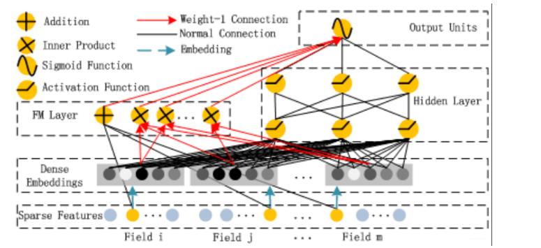

 左边的FM和右边的DNN共享相同的Embedding层的输入（这个要和W&D进行区分， 不单单是FM替换Wide那么简单，模型的输入模式上也进行了改进）


作者发现**通过高阶和低阶交互特征一块来进行反向传播更新参数反而会使得模型表现更佳，当然，这个也依赖于共享Embedding输入的策略**。


### NFM 

Neural Factorization Machine 


### AFM


### DIN（Deep Interest Network）

Deep Interest Network(DIN)

**会有大量的用户历史行为信息**

用了注意力机制来对用户的兴趣动态模拟， 而这个模拟过程存在的前提就是用户之前有大量的历史行为了，这样我们在预测某个商品广告用户是否点击的时候，就可以参考他之前购买过或者查看过的商品，这样就能猜测出用户的大致兴趣来，这样我们的推荐才能做的更加到位，所以这个模型的使用场景是非常注重用户的历史行为特征（历史购买过的商品或者类别信息）。


1. 用户兴趣多种多样，并变化多端
2. 捕捉用户兴趣点非常重要
3. 用户的兴趣往往可以在其历史行为中进行学习

Embeding&MLP模型，

大量稀疏特征先经过embedding层， 转成低维稠密的，然后进行拼接，最后喂入到多层神经网络中去。 这些模型在这种个性化广告点击预测任务中存在的问题就是**无法表达用户广泛的兴趣**，因为这些模型在得到各个特征的embedding之后，就蛮力拼接了，然后就各种交叉

matching stage: 这里知道了原来召回阶段就是matching呀，之前听到过好多次，但一直不知道这个matching是个啥， 这个阶段任务就是通过协同过滤等方法生成与访问用户相关的候选广告列表
排序阶段： 就是通过排序模型来预测用户对于候选广告的点击概率，然后根据这个概率生成一个广告推荐列表

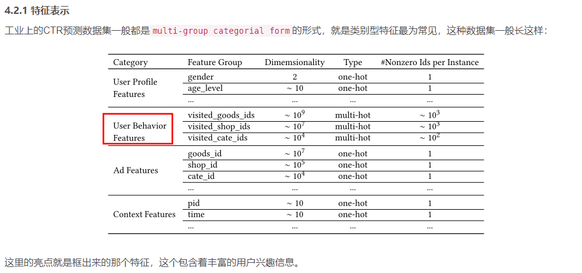


基准模型：

Embedding layer，Pooling & Concat layer和MLP， 结构如下:

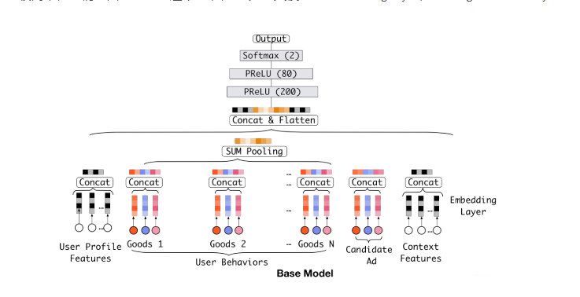

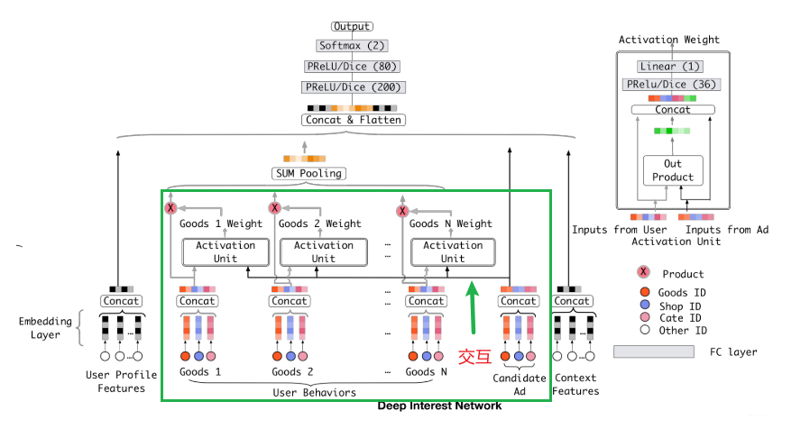


## 基于内容的推荐（TF-IDF）

Term-Frequency,TF 

TF指的是某一个给定的词语在该文件中出现的次数。这个数字通常会被正规化，以防止它偏向长的文件

Inverse Document  Frequency， IDF

表示某一个词语在整个文档集中出现的频率。某一特定词语的IDF，可以由总文件数目除以包含该词语之文件的数目，再将得到的商取对数得到。

**用途：在目标文档中，提取关键词(特征标签)的方法就是将该文档所有词语的TF-IDF计算出来并进行对比，取其中TF-IDF值最大的k个数组成目标文档的特征向量用以表示文档。**

**可用来提取目标文档中，并得到关键词用于计算对于目标文档的权重，并将这些权重组合到一起得到特征向量**

- 基于内容的推荐算法简介
- 基于TF-IDF的特征提取技术
- 基于内容的推荐流程(物品画像 -> 倒排索引 -> 用户画像 -> 产生推荐)
- 物品的冷启动处理（Word2Vec、Doc2Vec）

### 物品画像与推荐流程

物品画像：

1. PGC(应用生成内容): 物品自带的属性，比如电影的标题， 导演，演员，类型， 或者服务提供方设定的属性， 比如短视频话题，微博话题
2. UGC(用户生成内容): 用户在享受服务过程中提供的物品属性， 如用户评论内容， 微博话题等

- 根据PGC/UGC内容构建物品画像
- 根据用户行为记录生成用户画像
- 根据用户画像从物品中寻找最匹配的TOP-N物品进行推荐


## 附录：协同过滤与 LFM 图示

> 与正文 CF / MF 章节呼应，便于对照公式与流程。

### 基本假设

过去兴趣相似的 user, 在未来的兴趣也会相似

相似的user会产生相似的（历史）行为数据


协同过滤：
	基于邻域： 基于用户，基于项目，图扩散

​	基于模型：矩阵分解，关联规则，机器学习

User-CF:

用户相似度：

兴趣度相似度：

### Item-CF 流程图

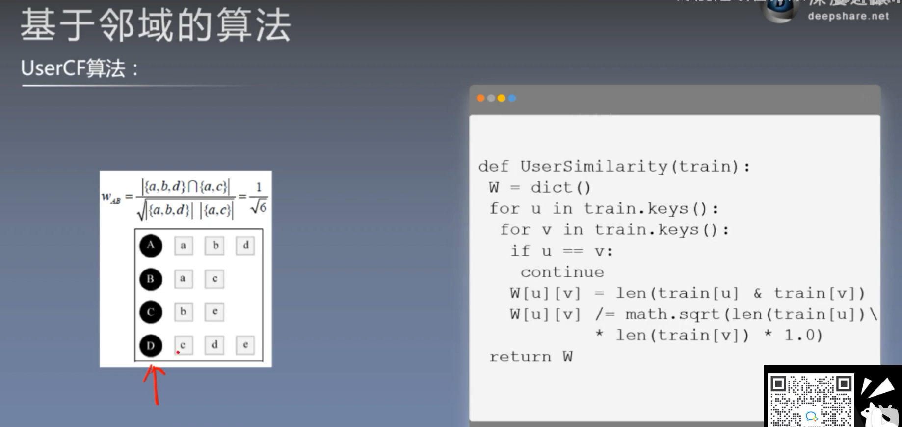

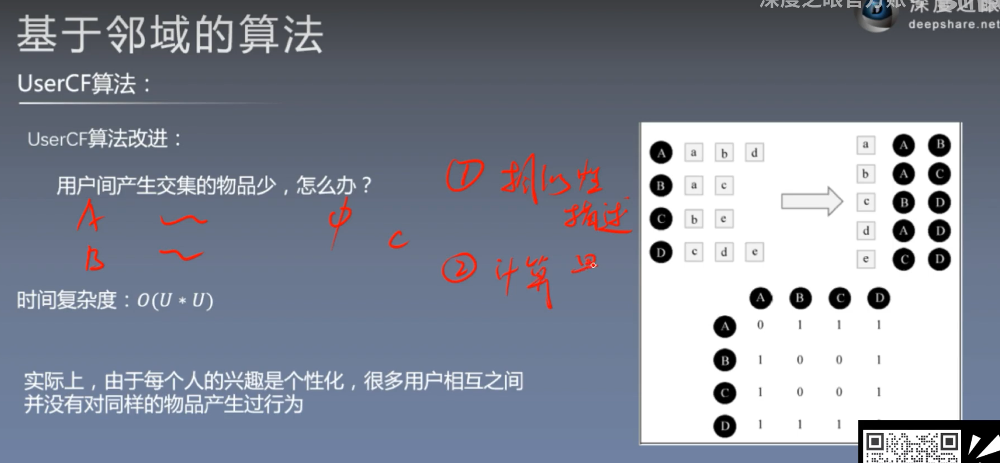

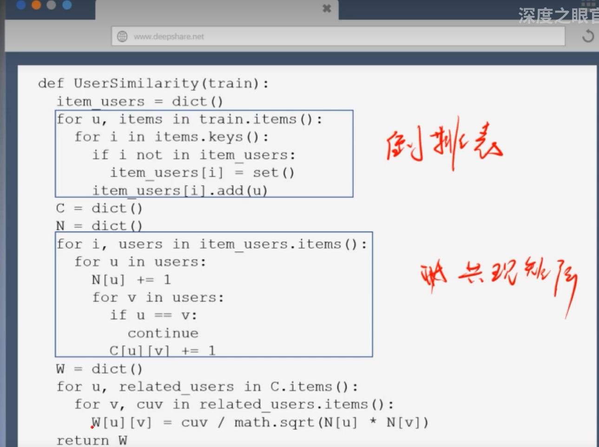

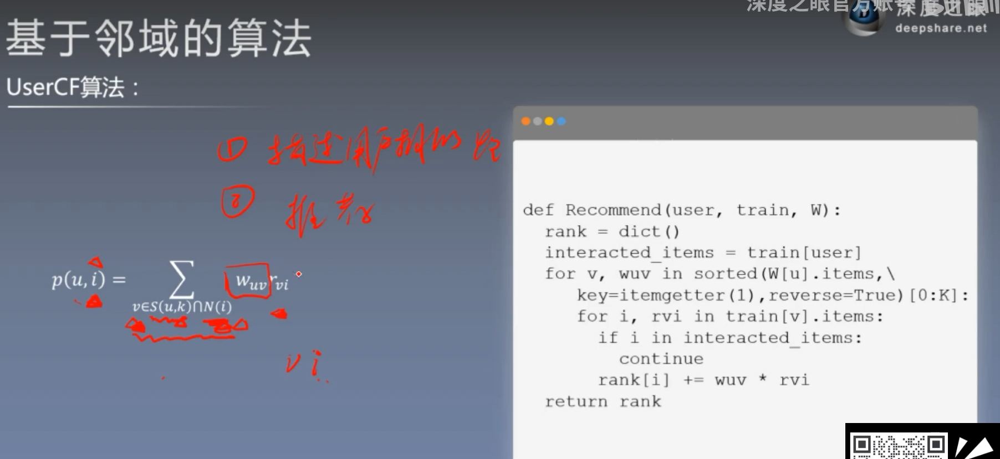


### User-CF 流程图

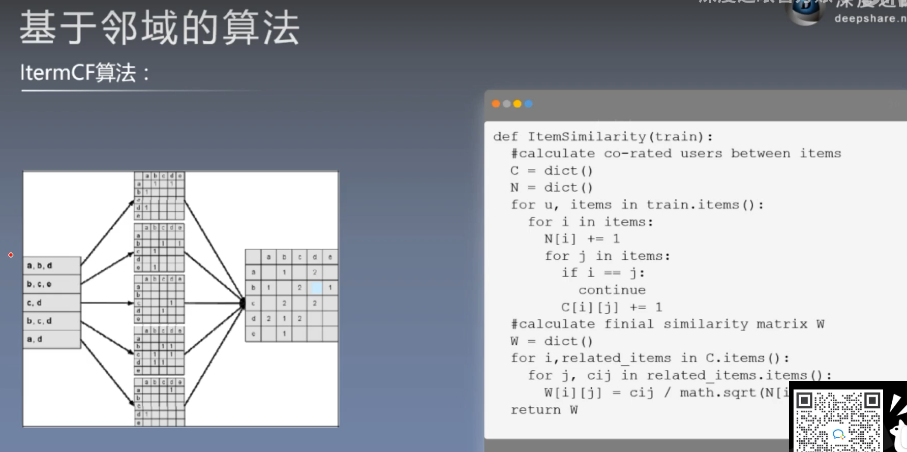


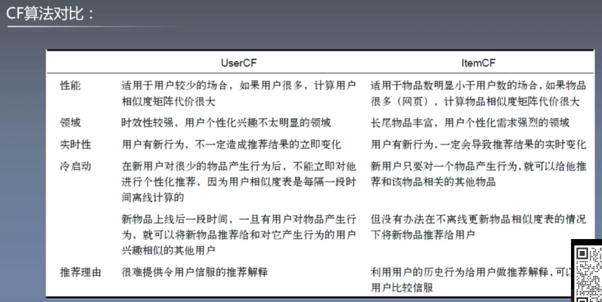

### LFM 公式与推导

latent factor model 

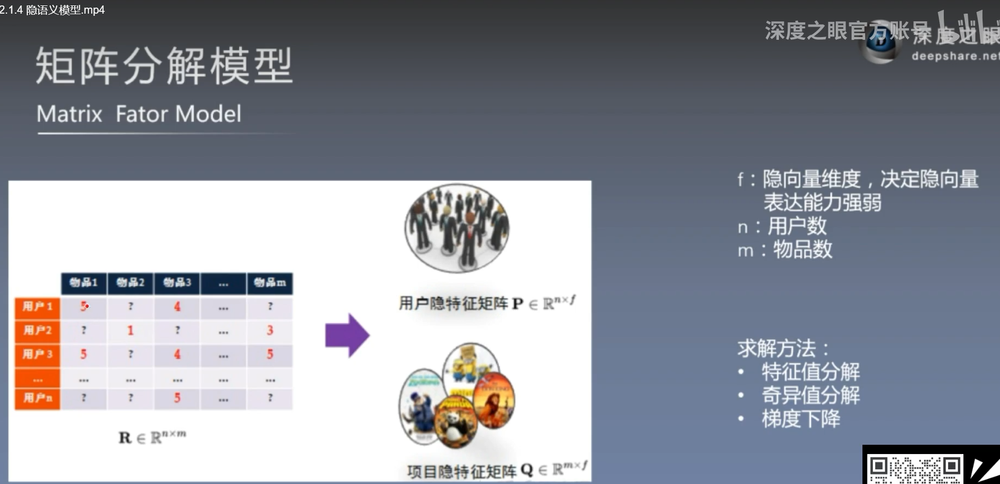

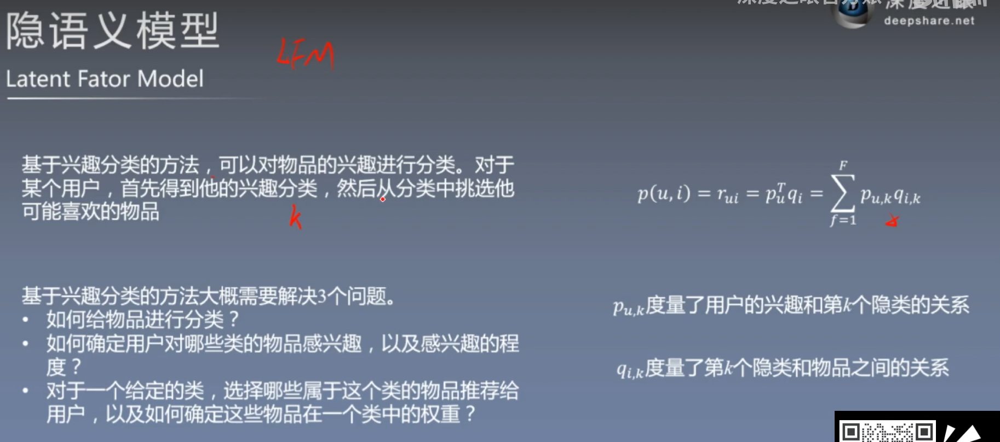

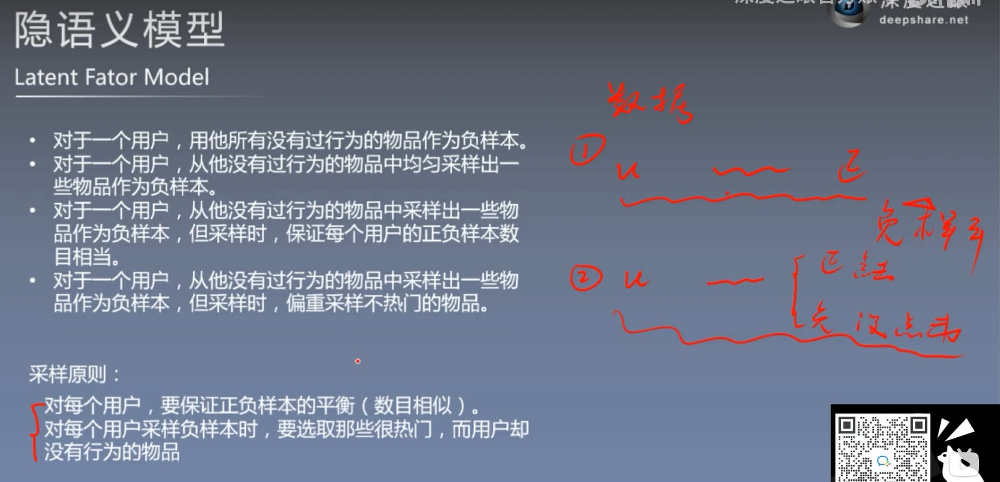


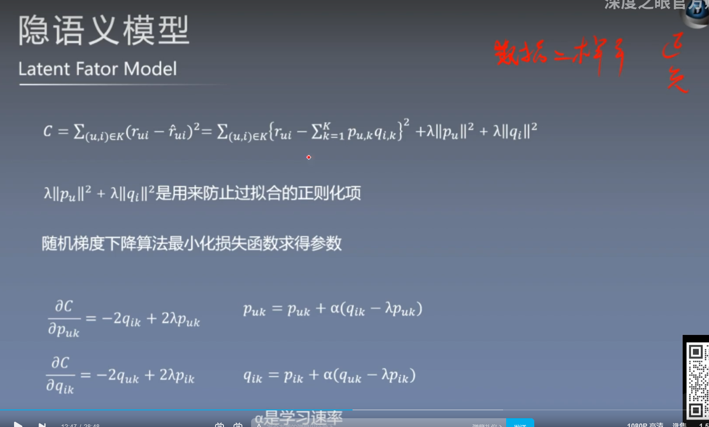


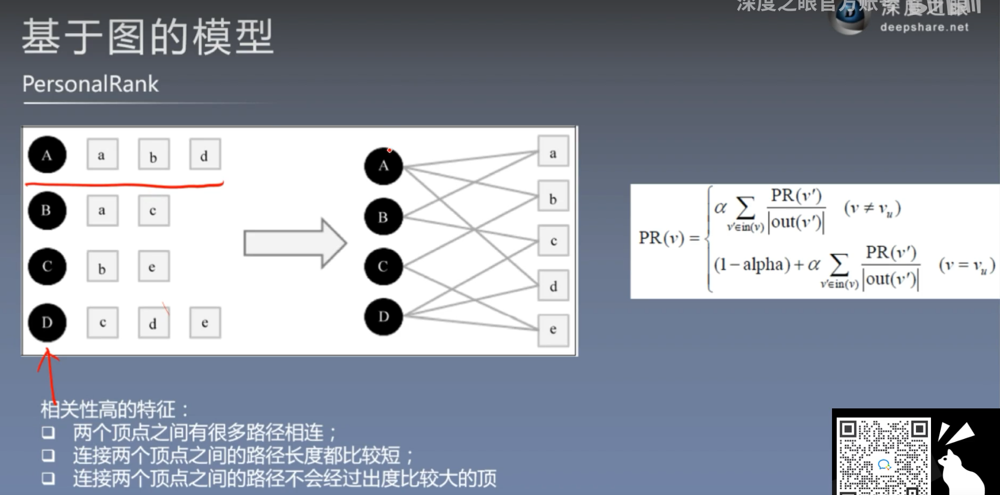


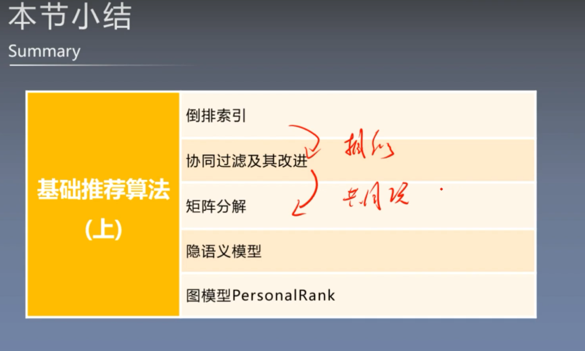


## 召回与排序补充

### 双塔模型

训练目标：

- point-wise
- pairwise
- list-wise

推荐排序阶段（Ranking）。

《Real-time Personalization using Embeddings for Search Ranking at Airbnb》