# Microsoft Azure 笔记

## 目录

- [云模式：IaaS / PaaS / SaaS](#云模式iaas--paas--saas)
- [Azure 基础概念](#azure-基础概念)
- [虚拟机规模集（VMSS）](#虚拟机规模集vmss)
- [案例：电子商务网站](#案例电子商务网站灾备与弹性)
- [Azure SKU 与资源选型](#azure-sku-与资源选型)
- [AKS 网络与子网规划](#aks-网络与子网规划)
- [AKS 服务暴露类型](#aks-服务暴露类型)
- [AKS 端到端部署](#aks-端到端部署traefik--app-gateway)
- [AKS 专用集群](#aks-专用集群)

---

## 云模式：IaaS / PaaS / SaaS

公有云上的IaaS、PaaS与SaaS划分如下：

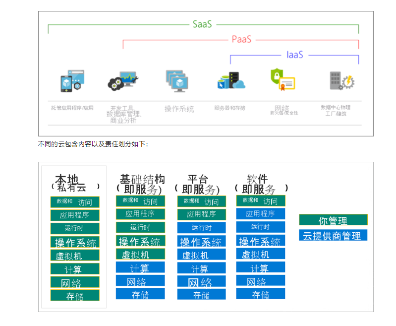

## Azure 基础概念

### 层级管理（资源 → 资源组 → 订阅 → 管理组）

Azure的资源、资源组、订阅、管理组四个层级：

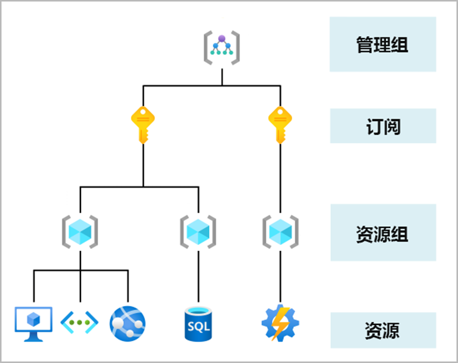

- 资源：资源是你创建的服务的实例，如虚拟机、存储或 SQL 数据库。
- 资源组：资源合并成为资源组，资源组充当在其中部署和管理 Azure 资源（如 Web 应用、数据库和存储帐户）的逻辑容器。
- 订阅：订阅将用户帐户和这些用户帐户创建的资源组合在一起。对于每个订阅，你可以创建和使用的资源量有限制或配额。组织可以使用订阅来管理成本，或者由用户、团队或项目创建的资源。
- 管理组：这些组有助于你管理多个订阅的访问、策略和合规性。管理组中的所有订阅都会自动继承应用于管理组的条件。

### 管理工具（门户 / Cloud Shell / PowerShell / CLI）

若要充分利用 Azure，需要一种方法来与 Azure 环境、管理组、订阅、资源组、资源等进行交互。Azure 提供了多个用于管理环境的工具，包括：

- Azure 门户
- Azure PowerShell
- Azure 命令行界面 (CLI)

#### **Azure 门户**

Azure门户是基于 Web 的统一控制台，提供可替代命令行工具的方法。通过 Azure 门户，可以使用图形用户界面来管理 Azure 订阅。方法：

- ·生成、管理和监视一切内容，从简单的 Web 应用到复杂的云部署
- ·创建自定义仪表板以有序地显示资源
- ·配置辅助功能选项以提供最佳体验

#### **Azure Cloud Shell**

Azure Cloud Shell 是基于浏览器的 shell 工具，可用于使用 shell 创建、配置和管理 Azure 资源。Azure Cloud Shell 支持 Azure PowerShell 和 Azure 命令行接口 (CLI)，后者是 Bash shell。

你可以经 Azure 门户通过选择 Cloud Shell 图标访问 Azure Cloud Shell：

Azure Cloud Shell 具有多个特征，使它成为支持你管理 Azure 的独特产品/服务。其中的部分特征包括：

- ·它是基于浏览器的 shell 体验，无需本地安装或配置。
- ·它已经过 Azure 凭据身份验证，因此，登录时本质上知道你是谁以及你拥有哪些权限。
- ·你可以选择最熟悉的 shell；Azure Cloud Shell 支持 Azure PowerShell 和使用 Bash 的 Azure CLI。


**Azure PowerShell**

Azure PowerShell 是一种 shell，开发人员、DevOps 和 IT 专业人员可用于运行名为 command-lets (cmdlet) 的命令。这些命令调用 Azure REST API 来执行 Azure 中的管理任务。可以独立运行 cmdlet 来处理一次性更改，也可以将它们组合在一起，以帮助协调复杂的操作，例如：

- ·单个资源或多个已连接资源的例程设置、清除和维护。
- ·通过命令式编程部署可能包含数十个，或者数百个资源的整个基础结构。
- 捕获脚本中的命令可使进程可重复和自动化。

#### **Azure CLI**

Azure CLI 在功能上等效于 Azure PowerShell，主要区别是命令的语法。Azure PowerShell 使用 PowerShell 命令，而 Azure CLI 使用 Bash 命令。

Azure CLI 提供处理离散任务或通过代码协调复杂操作的相同优势。它还可在 Windows、Linux 和 Mac 平台上以及通过 Azure Cloud Shell 进行安装。

由于 Azure PowerShell 与基于 Bash 的 Azure CLI 之间的功能和访问的相似性，它主要取决于你最熟悉的语言。


```shell
# 登录到Azure
az login
# 设置默认的资源组和AKS集群名称
RESOURCE_GROUP=myResourceGroup
AKS_NAME=myAKSCluster

# 创建资源组
az group create --name $RESOURCE_GROUP --location eastus

# 创建AKS集群
az aks create --resource-group $RESOURCE_GROUP --name $AKS_NAME --node-count 1 --enable-addons monitoring --generate-ssh-keys
# 获取AKS集群的认证凭据
az aks get-credentials --resource-group $RESOURCE_GROUP --name $AKS_NAME
```

**Azure Application Gateway**：应用交付控制器（ADC），提供负载均衡、SSL 终止、WAF 等。

### Azure Marketplace 十大类别

- 计算
- 网络
- 存储
- 移动
- 数据库
- Web
- 物联网(IoT)
- 大数据
- AI
- DevOps

#### **计算**

计算服务通常是众多公司迁移到 Azure 平台的主要原因之一。Azure 提供了一系列用于托管应用程序和服务的选项。下面是 Azure 中的计算服务的一些示例。

- Azure 虚拟机：Azure 中托管的 Windows 或Linux 虚拟机 (VM)。
- Azure 虚拟机规模集：缩放在 Azure 中托管的 Windows VM 或Linux VM。
- Azure Kubernetes 服务：运行容器化服务的VM 的群集管理。
- Azure Service Fabric：在 Azure 或本地运行的分布式系统平台。
- Azure Batch：适用于并行和高性能计算应用程序的托管服务。
- Azure 容器实例：容器化应用在 Azure 上运行，无需预配服务器或 VM。
- Azure Functions：事件驱动的无服务器计算服务。

#### **网络**

Azure 网络的关键功能是连接计算机资源并提供对应用程序的访问。Azure 中的网络功能包括一系列选项，可将外部世界与全球 Azure 数据中心的服务和功能相连。

下面是 Azure 中的网络服务的一些示例。

- Azure 虚拟网络：将 VM 连接到传入虚拟专用网络 (VPN) 连接。
- Azure 负载均衡器：平衡应用程序或服务终结点的入站和出站连接。
- Azure 应用程序网关：优化应用程序服务器场传递，同时提高应用程序安全性。
- Azure VPN 网关：通过高性能 VPN 网关访问 Azure 虚拟网络。
- Azure DNS：提供超快 DNS 响应和超高域可用性。
- Azure 内容分发网络：在全球范围内为客户提供高带宽内容。
- Azure DDoS 防护：保护 Azure 托管的应用程序免遭分布式拒绝服务 (DDoS) 攻击。
- Azure 流量管理器：在全球的 Azure 区域间分布网络流量。
- Azure ExpressRoute：通过高带宽的专用安全连接连接到Azure。
- Azure 网络观察程序：使用基于场景的分析，监视和诊断网络问题。
- Azure 防火墙：实现具有无限制可扩展性的高度安全和高度可用的防火墙。
- Azure 虚拟 WAN：创建连接本地和远程站点的统一的广域网(WAN)。

在Azure中国的北区和东区，分别有两个虚拟网络：Vnet1和Vnet2。

Vnet1的网段是：10.0.0.0/16；Vnet2的网段是：20.0.0.0/16； 

Vnet1中有一个subnet，网段是：10.0.0.1.0/24；Vnet2也有一个subnet，网段是：20.0.1.0/24； 

- Vnet1-subnet1中有个虚拟机VM1，IP是10.0.1.4;
- Vnet2-subnet1中有个虚拟机VM2，IP是20.0.1.4;

我们如何让VM1和VM2进行通讯？

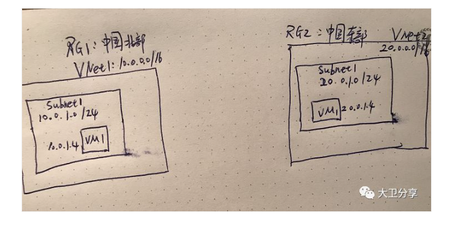

第一步，在两个Vnet中创建subnet gateway：

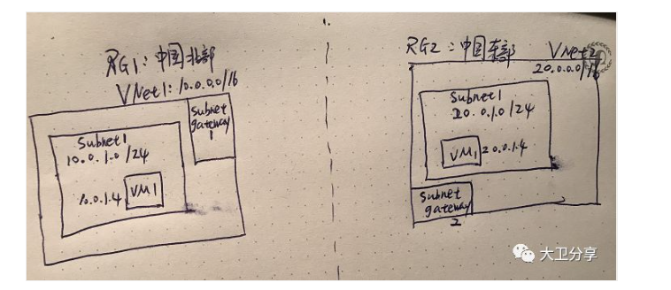

第二步，为两个跨Region的通讯准备两个public IP：

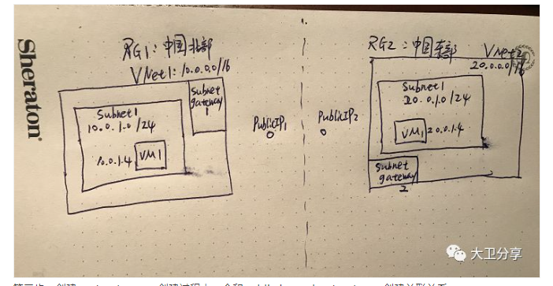

第三步，创建vnet gateway，创建过程中，会和public ip、subnet gateway创建关联关系。

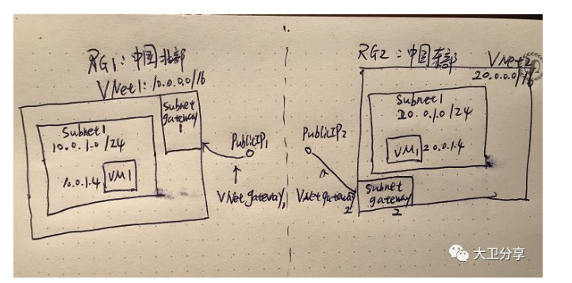

第四步：创建vnet  gateway之间的connection。

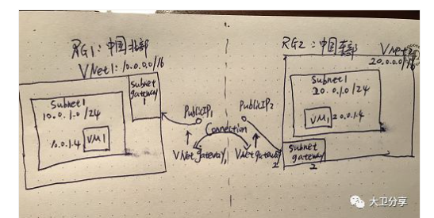

至此，分别位于两个区域的两个VM，就可以通过通讯了。当然，需要VM上的Network interface的Network security group放行相关的网络策略。


#### **存储**

Azure 主要提供四种存储服务。

- Azure Blob 存储：用于存储大型对象（例如视频文件或位图）的服务。
- Azure 文件存储：可以像文件服务器那样访问并管理的文件共享。
- Azure 队列存储：用于排队并在应用程序间可靠地传递消息的数据存储。
- Azure 表存储：表存储是一项在云中存储非关系结构化数据（也称为结构化NoSQL 数据）的服务，它提供具有无架构设计的键/属性存储。


这些服务全都拥有多个共同特征：

- 持久且高度可用，包含冗余和复制选项。
- 通过自动加密和基于角色的访问控制实现安全性。
- 可通过几乎无限制的存储进行缩放。
- 托管型，可为你处理维护问题和任何严重问题。
- 可通过 HTTP 或 HTTPS 在全球任意位置访问。

Azure提供的存储服务有几种类型：Blob、Files、Tables、Queues。

- Blob是对象存储。适合存放：图片、视频、文件、日志文件、大数据等。
- Files是文件存储。为应用提供文件系统的服务。
- Tables是为非结构化数据提供存储的，它是一个Key-Value的方式，支持NOSQL，不支持RDBMS。
- Queues用于存放通过http/s协议发请求类服务的查询消息。
- Disk storage：为VM提供高性能的持久存储，包含SSD和HDD。

Azure的存储服务中，有一个很重要的概念：Storage Account。它是Azure存储服务的namespaces。

Storage Account的复制技术有6种：

- LRS（Locally Redundant Storage）：数据三个副本都存在于一个Region。
- ZRS（Zero-Redundant Storage）:数据的三个副本跨1-2个region。
- GRS（Geo-Redundant storage）:数据六个副本，三个在第一个region，另外三个在第二个region。第二个region的数据是静态不能被修改的（在主备region发生切换前，第二个region的数据不可读写）。
- RA-GRS（Read-Access Geo-Redundant storage ）：在GRS基础上，第二个 region的数据是可读的。
- 异地区域冗余存储 (GZRS)
- 读取访问异地区域冗余存储 (RA-GZRS)

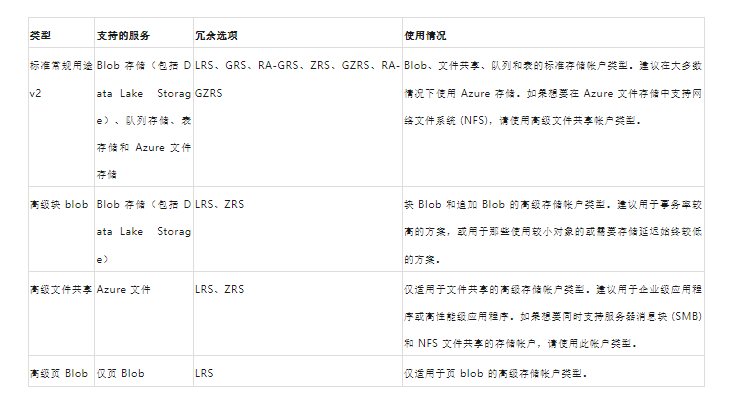

具体使用：

在创建storage account的时候，可以指定存储的复制技术：

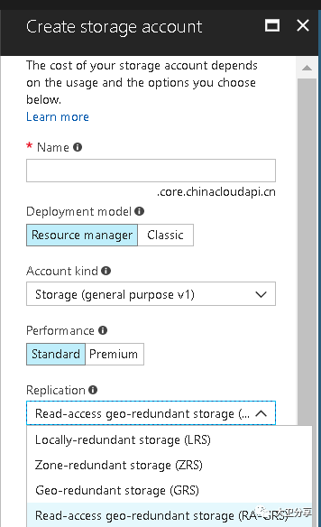


接下来，在创建好的Storage Account中，选择Blob Service：

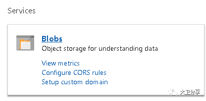

然后创建一个container（方便按照存储内容的细分。如可以有日志、大数据等类型的数据，就可以分成不同的container）：

用户或客户端应用程序通过 HTTP/HTTPS 可以从世界任何地方访问 Blob 存储中的对象。Blob 存储中的对象可以通过 Azure 存储 REST API、Azure PowerShell、Azure CLI 或 Azure 存储客户端库访问。

Azure 存储帐户是所有 Azure Blob 存储的顶级容器。存储帐户为你的 Azure 存储数据提供了一个唯一的命名空间，可以从世界上的任何位置通过 HTTP 或 HTTPS 访问该命名空间。

##### 存储帐户的类型

Azure 存储提供两个性能级别的存储帐户（标准和高级）。每个性能级别支持不同的功能，并且有其自己的定价模型。

- 标准：这是标准的常规用途 v2 帐户，建议用于大多数使用 Azure 存储的场景。
- 高级：高级帐户使用固态硬盘提供更高性能。如果创建高级帐户，则可以在三个帐户类型（块 blob、页 blob 或文件共享）之间进行选择。

下表介绍了 Microsoft 为大多数使用 Blob 存储的方案建议的存储帐户类型。

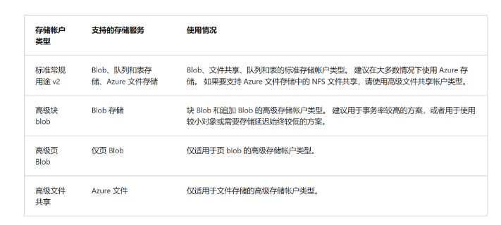

我们登陆Azure，创建存储账户，可以看到性能菜单有标准和高级两种：

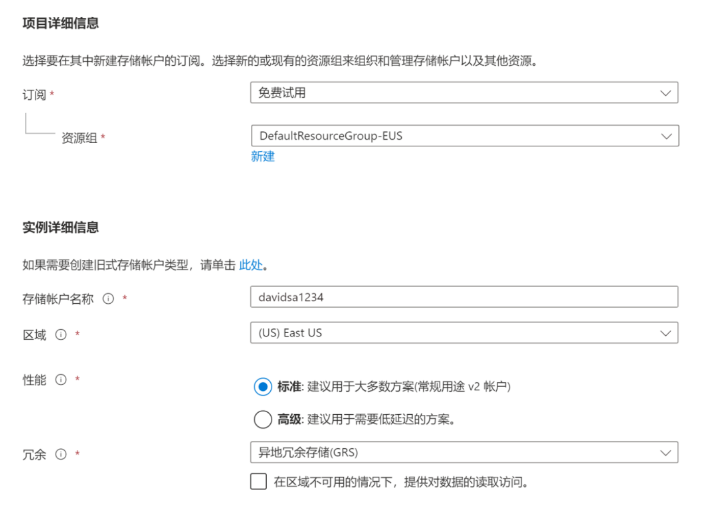

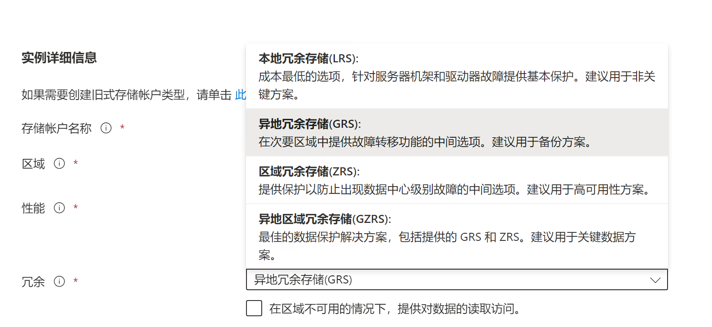

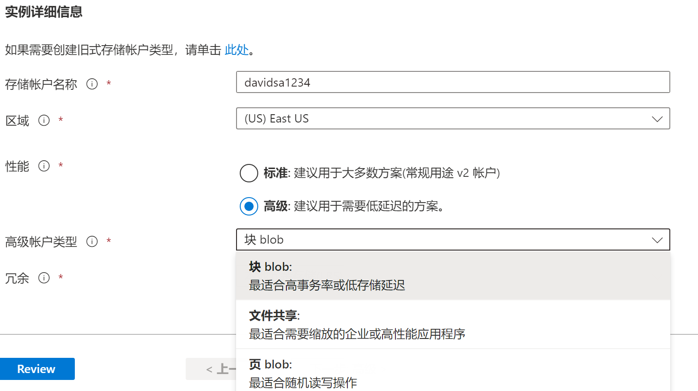

##### 块 Blob 数据的访问层 

Azure 存储提供不同的选项，适用于根据使用模型访问块 Blob 数据。Azure 存储中的每个访问层都针对特定的数据使用模式进行了优化。根据需要选择适当的访问层以后，即可以最经济有效的方式存储块 Blob 数据。

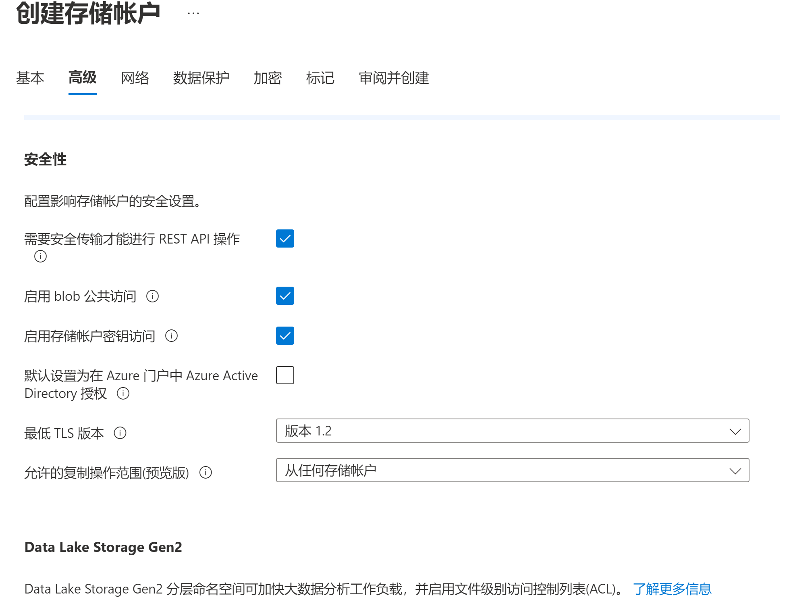

可用的访问层包括：

- 热访问层，已针对存储帐户中频繁访问的对象进行优化。热层的存储成本最高，但访问成本最低。新的存储帐户默认在热层中创建。
- 冷访问层，已针对存储不常访问且存储时间至少为 30 天的大量数据进行优化。与热层相比，冷层的存储成本较低，访问成本较高。
- 存档层，仅适用于单个块 Blob。存档层已针对可以容忍数小时的检索延迟且会保留在存档层至少 180 天的数据进行优化。存档层是用于存储数据的最经济高效的选项，但访问这些数据的开销比访问热层或冷层中的数据要高一些。


**三.Blob存储的三种资源.**

Blob 存储提供了三种类型的资源：

存储账户>容器> blob

- 存储帐户
- 存储帐户中的容器
- 容器中的 Blob

##### 容器

容器对一组 blob 进行组织，类似于文件系统中的目录。一个存储帐户可以包含无限数量的容器，一个容器可以存储无限数量的 Blob。容器名称必须小写。

##### Blob

- 块 Blob ：存储文本和二进制数据，最多约为 4.7 TB。块 Blob 由可以分别管理的数据块构成。

- 与块 Blob 一样，追加 Blob 也由块构成，但针对追加操作进行了优化。追加 Blob 非常适用

  于诸如记录来自虚拟机的数据之类的场景。

- 页 Blob：用于存储最大 8 TB 的随机访问文件。页 blob 存储虚拟硬盘 (VHD) 文件并作为

  Azure 虚拟机的磁盘。

Azure 存储提供一整套安全性功能，这些功能相辅相成，帮助开发人员构建安全的应用程序：

- 所有写入 Azure 存储的数据（包括元数据），都使用存储服务加密 (SSE) 进行自动加密。

- Azure 存储支持使用 Azure Active Directory (Azure AD) 和基于角色的访问控制 (RBAC) 进行资源管理操作和数据操作，如下所示：

- - 可以将作用域为存储帐户的 RBAC 角色分配给安全主体，并使用 Azure AD 为密钥管

    理之类的资源管理操作授权。

  - 支持通过 Azure AD 集成执行 blob 和队列数据操作。可以将范围为订阅、资源组、存储帐户或单个容器或队列的 RBAC 角色分配给 Azure 资源的某个安全主体或托管标识。

- 在应用程序和 Azure 之间传输数据时，可以使用客户端加密、HTTPS 或 SMB 3.0 来保护数据。

- Azure 虚拟机使用的 OS 和数据磁盘可使用 Azure 磁盘加密进行加密。

- 在 Azure 存储中，可以使用共享访问签名授予数据对象的委派访问权限。

Azure 存储始终会存储数据的多个副本，以防范各种计划内和计划外的事件，包括暂时性的硬件故障、网络中断或断电、大范围自然灾害等。冗余可确保即使遇到故障，存储帐户也能达到其可用性和持久性目标。

在确定最适合自己方案的冗余选项时，请考虑如何在较低成本与较高可用性之间做出取舍。可帮助你确定应选择哪种冗余选项的因素包括：

- 如何在主要区域中复制数据
- 是否要将你的数据复制到地理上距主要区域较远的另一个区域，以防范区域性灾难
- 应用程序是否要求在主要区域出于任何原因而不可用时，能够对次要区域中复制的数据进行读取访问

##### 主要区域中的冗余

Azure 存储帐户中的数据在主要区域中始终复制三次。Azure 存储为在主要区域中复制数据的方式提供两个选项。

- 本地冗余存储 (LRS)：在主要区域中的单个物理位置同步复制数据三次。LRS 是成本最低的复制选项，但不建议对需要高可用性或持续性的应用程序使用此选项。
- 区域冗余存储 (ZRS)：在主区域中的三个 Azure 可用性区域同步复制数据。对于需要高可用性的应用程序，Microsoft 建议在主要区域中使用 ZRS，并复制到次要区域。

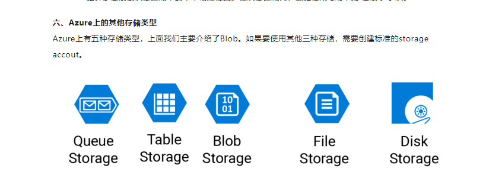


#### **移动**

借助 Azure，开发人员能够快速、轻松地为 iOS、Android 和 Windows 应用创建移动后端服务。以往耗时且会增加项目风险的功能现在都可轻松地包括其中，例如添加企业登录信息，然后连接到 SAP、Oracle、SQL Server 和 SharePoint 等本地资源。

此服务的其他功能包括：

- 离线数据同步。
- 连接到本地数据。
- 广播推送通知。
- 根据业务需求进行自动缩放。

#### **数据库**

Azure 提供了多个数据库服务来存储各种数据类型和卷。并且通过全球连接，这些数据立即就能供用户使用。

- Azure Cosmos DB：支持NoSQL 选项的全球分布式数据库。
- Azure SQL 数据库：具有自动缩放、完备智能和可靠安全性的完全托管关系数据库。
- Azure Database for MySQL：具有高可用性和高安全性的完全托管且可缩放的MySQL 关系数据库。
- Azure Database for PostgreSQL：具有高可用性和高安全性的完全托管且可缩放的PostgreSQL 关系数据库。
- Azure 虚拟机上的SQL Server：在云中托管企业SQL Server 应用的服务。
- Azure Synapse Analytics：在每个缩放级别具有完备安全性而没有额外费用的完全托管数据仓库。
- Azure 数据库迁移服务：将数据库迁移到云而无需更改应用程序代码的服务。
- 用于Redis 的Azure 缓存：完全托管服务缓存常用的静态数据以降低数据和应用程序延迟。
- Azure Database for MariaDB：具有高可用性和高安全性的完全托管且可缩放的MariaDB 关系数据库

#### **Web**

拥有出色的 Web 体验对于当今商业世界而言至关重要。Azure 包含对生成和托管 Web 应用以及基于 HTTP 的 Web 服务的一流支持。以下 Azure 服务侧重于 Web 托管。

- Azure 应用服务：快速创建功能强大的基于Web 的云应用。
- Azure 通知中心：从任何后端向任何平台发送推送通知。
- Azure API 管理：安全且大规模地向开发人员、合作伙伴和员工发布API。
- Azure 认知搜索：部署这项完全托管的搜索即服务。
- Azure 应用服务的Web 应用功能：大规模创建和部署任务关键型Web 应用。
- Azure SignalR 服务：轻松添加实时Web 功能。

#### **IoT**

人们能够访问比以往更多的信息。个人数字助手使智能手机应运而生，现在还出现了智能手表、智能恒温器和智能冰箱。个人电脑曾经是标准配置。现在的互联网接纳任何能够联机访问宝贵信息的物品。设备获取信息并进行中继以执行数据分析的这种能力被称为 IoT。

许多服务可以为 Azure 上的 IoT 提供帮助并推动生成端到端解决方案。

- IoT Central:完全托管的全球IoT 服务型软件(SaaS) 解决方案，借助此解决方案可轻松连接、监视以及管理大规模的IoT 资产。
- Azure IoT 中心:在数百万个IoT 设备之间提供安全通信并对其进行监视的消息中心。
- IoT Edge: 完全托管的服务，可将数据分析模型直接推送到IoT 设备上，使其能够快速响应状态更改而无需咨询基于云的AI 模型。

#### **大数据**

数据有各种格式和大小。当我们谈论大数据时，我们指的是大量数据。来自天气系统、通信系统、基因组研究、成像平台和许多其他方案的数据可产生数百 GB 的数据。这一数据量使得分析和制定决策变得困难。它的数量通常十分巨大，以至于传统形式的处理和分析已不再合适。

现在已经开发了开源集群技术来处理这些大型数据集。Azure 支持各种技术和服务，以提供大数据的分析解决方案。

- Azure Synapse Analytics：使用基于云的企业数据仓库大规模运行分析，该仓库可利用大规模并行处理快速运行 PB 级数据的复杂查询。
- Azure HDInsight：使用云中Hadoop 群集的托管群集处理大量数据。
- Azure Databricks：将基于Apache Spark 的协作式分析服务与Azure 中的其他大数据服务集成。

#### **AI**

在云计算的背景下，AI 的运行基于各种服务，其核心是机器学习。机器学习是一项数据科研技术，可以让计算机根据现有的数据来预测将来的行为、结果和趋势。使用机器学习，计算机可以在无需显式编程的情况下进行学习。

机器学习的预测可让应用和设备变得更智能。例如，当你进行在线购买时，机器学习将根据你购买的产品来帮助建议你可能喜欢的其他产品。或者，当你刷信用卡时，机器学习会将交易与交易数据库进行比较，帮助检测欺诈行为。当吸尘器机器人打扫房间时，机器学习可帮助它确定作业是否已完成。

以下是 Azure 中最常见的一些 AI 和机器学习服务类型。

- Azure 机器学习服务：基于云的环境，可用于开发、训练、测试、部署、管理和跟踪机器学习模型。它可以为你自动生成并自动调整模型。它让你可以先在本地计算机上开始训练，然后横向扩展到云。
- Azure 机器学习工作室：协作式可视化工作区，可在其中使用预建的机器学习算法和数据处理模块来生成、测试和部署机器学习解决方案。一组密切相关的产品是认知服务。可以在应用程序中使用这些预生成 API 解决复杂问题。
- 影像：使用图像处理算法，智能识别、捕获、索引和调节图片及视频。
- 语音：将语音音频转换为文本、使用语音进行验证，或在应用中添加说话人辨识功能。
- 知识映射：映射复杂信息和数据，以处理智能推荐和语义搜索等任务。
- 必应搜索：将必应搜索API 添加到应用中，并利用单一API 调用梳理数十亿网页、图像、视频和新闻的能力。
- 自然语言处理：允许应用使用预建脚本处理自然语言、评估情绪及学习如何识别用户想要的内容。


#### **DevOps**

DevOps 将人员、流程和技术汇集在一起，通过自动化软件交付来为用户持续提供价值。借助 Azure DevOps，可以创建、生成和发布管道，为应用程序提供持续集成、交付和部署。你可以集成存储库和应用程序测试、执行应用程序监视，以及使用生成项目。还可以使用积压工作项进行跟踪、自动化基础结构部署以及集成一系列第三方工具和服务（例如 Jenkins 和 Chef）。所有这些功能以及更多功能都与 Azure 紧密集成，可为应用程序提供一致、可重复的部署，使生成和发布流程变得精简。

- Azure DevOps：使用开发协作工具，例如高性能管道、免费专用Git 存储库、可配置看板，以及各种自动化和基于云的负载测试。以前称为 Visual Studio Team Services。
- Azure 开发测试实验室：快速创建按需Windows 和Linux 环境，以直接从部署管道测试或演示应用程序。

## 虚拟机规模集（VMSS）

管理大规模虚拟机十分不易，尤其是在使用模式不尽相同以及对应用程序的需求存在波动时。你希望能够调整虚拟机资源以满足需求。同时，你可能希望保持虚拟机配置的一致性，以确保应用程序的稳定性。实现这些目标意味着可以保持吞吐量和响应能力，同时最大程度降低持续运行大量虚拟机的成本。

## 案例：电子商务网站（灾备与弹性）

用到的技术：

Traffic Manager，使用目的：将客户端发过来的请求进行流量分发。默认都分发到主站点。

Virtual Network，使用目的：用于网络隔离。

Virtual Machines，使用目的：承载应用。

Azure AD Service，使用目的：故障切换后，用户信息、密码、权限等不变。

LoadBalancer：使用目的：应用的负载均衡。

Express Route，使用目的：构建On-Premises和Azure Cloud之间的隧道。

Availability Set：用于保证VM的高可用。

Scale Sets，使用目的：让虚拟机实现弹性伸缩。

Site Recovery，使用目的：主站点发生灾难时，自动触发灾难恢复。

Storage Backup，使用目的：将主站点的SQL Server数据备份到备站点。

Blob Storage，使用目的：用于Azure上存放SQL Server归档数据。

Disk storage，使用目的：为SQL Server提供存储空间。


## Azure SKU 与资源选型

参考：[Azure SKU 说明（微信）](https://mp.weixin.qq.com/s/h9PhONGhDHcmCxGOkgMbOA)


在Azure中，SKU（Stock Keeping Unit，库存单位）是用于标识Azure服务或资源的特定配置的唯一标识符。SKU包含了该资源的定价层级、性能特征和其他配置选项。不同的SKU表示同一类型资源的不同版本或配置选项，用户可以根据需求选择合适的SKU。

### 主要特征

- **定价层级**：不同SKU对应不同的定价。例如，某些SKU可能属于“标准”层级，而其他的可能属于“高级”层级。
- **性能特征**：SKU定义了资源的性能特征，如存储大小、处理器类型、内存大小等。
- **区域可用性**：某些SKU可能只在特定的区域可用。
- **功能特性**：不同SKU可能提供不同的功能或限制。

### 示例

#### 1. **虚拟机SKU**

在Azure中，虚拟机有多种SKU，每种SKU定义了虚拟机的大小和性能特征。

- **Standard_B2s**：2 个vCPU，4 GB内存，适用于小型到中型应用工作负载。
- **Standard_D2s_v3**：2 个vCPU，8 GB内存，适用于通用工作负载。
- **Standard_E64i_v3**：64 个vCPU，432 GB内存，适用于内存密集型应用。

#### 2. **存储SKU**

Azure存储账户也有不同的SKU。

- **Standard_LRS**（本地冗余存储）：数据在单个数据中心内进行复制。
- **Standard_GRS**（异地冗余存储）：数据在主要区域和辅助区域的两个数据中心内进行复制。
- **Premium_LRS**（本地冗余存储）：高性能的存储，适用于需要高吞吐量和低延迟的应用。

#### 3. **数据库SKU**

Azure SQL数据库有不同的SKU，表示不同的服务层级和性能。

- **Basic**：适用于轻量工作负载。
- **Standard**：适用于典型的业务应用。
- **Premium**：适用于高性能需求的应用。

### 如何选择合适的SKU

选择合适的SKU取决于以下几个因素：

1. **性能需求**：根据应用所需的处理能力、内存大小、存储性能等选择合适的SKU。
2. **预算**：根据预算选择合适的定价层级，确保在成本可控的范围内满足需求。
3. **功能需求**：确定是否需要特定的功能或服务层级，比如异地冗余存储或高性能计算。
4. **区域可用性**：检查所选SKU是否在目标部署区域内可用。

### 示例配置

以下是创建一个使用特定SKU的资源示例：

#### 创建虚拟机

使用Azure CLI创建一个虚拟机，指定SKU为`Standard_B2s`：

```
az vm create /
  --resource-group myResourceGroup /
  --name myVM /
  --image UbuntuLTS /
  --size Standard_B2s /
  --admin-username azureuser /
  --generate-ssh-keys
```

#### 创建存储账户

使用Azure CLI创建一个存储账户，指定SKU为`Standard_LRS`：

```
az storage account create /
  --name mystorageaccount /
  --resource-group myResourceGroup /
  --location eastus /
  --sku Standard_LRS
```

### 总结

Azure SKU定义了Azure资源的特定配置、性能和定价。通过选择合适的SKU，用户可以确保资源配置符合应用需求，同时保持成本可控。了解不同SKU的特性和差异，有助于做出更明智的选择。


## AKS 网络与子网规划

在Azure中，使用虚拟网络（VNet）来部署Azure Kubernetes Service（AKS）集群时，需要特别注意子网的大小配置。这句话的意思是，在为AKS集群配置Azure VNet子网时，子网的IP地址范围必须足够大，以便容纳所有的集群组件（如节点和Pod），具体取决于你选择的是覆盖网络（Overlay Network）还是平面网络（Flat Network）。以下是对这两种网络模式的解释以及子网大小配置的建议。

### 1. 网络模式概述

#### 覆盖网络（Overlay Network）

在覆盖网络模式下，Pod的IP地址是从一个独立的CIDR范围分配的，这个范围与VNet子网的IP地址范围是分开的。Pod间通信通过覆盖网络进行，通常使用网络插件（如 Flannel、Calico）来实现。

- **优点**：更灵活，IP地址管理更加独立。
- **缺点**：引入了一层额外的网络开销，可能影响网络性能。

#### 平面网络（Flat Network）

在平面网络模式下，Pod的IP地址直接从VNet子网的IP地址范围分配，Pod和节点共享同一个子网。Pod间的通信通过VNet路由直接进行，没有额外的网络层。

- **优点**：网络性能更高，因为没有额外的网络层。
- **缺点**：需要更大的子网IP地址范围，以容纳所有Pod和节点。

### 2. 子网大小的影响

子网的大小（CIDR范围）直接影响到能容纳的节点和Pod的数量。如果子网太小，可能导致IP地址耗尽，限制了集群的扩展性。

#### 覆盖网络下的子网大小

在覆盖网络模式下，节点的IP地址从VNet子网中分配，而Pod的IP地址从单独的CIDR范围分配。子网的大小主要考虑节点的数量。

- 例子：假设你有一个VNet子网 `10.0.0.0/24`（256个IP地址），可以容纳约250个节点。

#### 平面网络下的子网大小

在平面网络模式下，节点和Pod的IP地址都从VNet子网中分配，因此子网必须足够大以容纳所有节点和Pod。

- 例子：假设你有一个VNet子网 `10.0.0.0/16`（65536个IP地址），这既可以容纳节点，也可以容纳大量的Pod。

### 3. 配置建议

#### 覆盖网络模式

1. **VNet子网**：考虑到仅节点需要IP地址，通常子网范围可以较小。
2. **Pod CIDR**：单独配置一个较大的CIDR范围，适用于Pod的IP地址分配。

```bashaz aks create /
  --resource-group myResourceGroup /
  --name myAKSCluster /
  --network-plugin azure /
  --vnet-subnet-id <subnetResourceId> /
  --pod-cidr 10.244.0.0/16 /
  --service-cidr 10.0.0.0/16
```

#### 平面网络模式

1. **VNet子网**：子网范围需要足够大，以容纳所有节点和Pod。

```bashaz aks create /
  --resource-group myResourceGroup /
  --name myAKSCluster /
  --network-plugin azure /
  --vnet-subnet-id <subnetResourceId> /
  --docker-bridge-address 172.17.0.1/16 /
  --dns-service-ip 10.0.0.10 /
  --service-cidr 10.0.0.0/16
```

### 总结

为了确保Azure VNet子网足够大以适应AKS集群，需要根据网络模式（覆盖网络或平面网络）进行适当的配置。覆盖网络模式下，节点和Pod的IP地址分配独立，因此子网只需考虑节点数量。而平面网络模式下，子网需要同时容纳节点和Pod，因此需要更大的子网范围。通过合理配置子网大小，可以确保AKS集群的正常运行和扩展性。

## AKS 服务暴露类型

### ClusterIP

ClusterIP 创建在 AKS 群集中使用的内部 IP 地址。 ClusterIP 服务适用于支持群集中其他工作负载的*仅内部应用程序*。 如果未显式指定服务的类型，则默认使用 ClusterIP。


### NodePort

NodePort 在基础节点上创建端口映射，该映射允许使用节点 IP 地址和端口直接访问应用程序。


### LoadBalancer

LoadBalancer 创建 Azure 负载均衡器资源、配置外部 IP 地址并将请求的 Pod 连接到负载均衡器后端池。 为允许客户流量发送到应用程序，要在所需端口上创建负载均衡规则。


对于入站流量的 HTTP 负载均衡，另一个选项是使用[入口控制器](https://learn.microsoft.com/zh-cn/azure/aks/concepts-network-ingress#ingress-controllers)

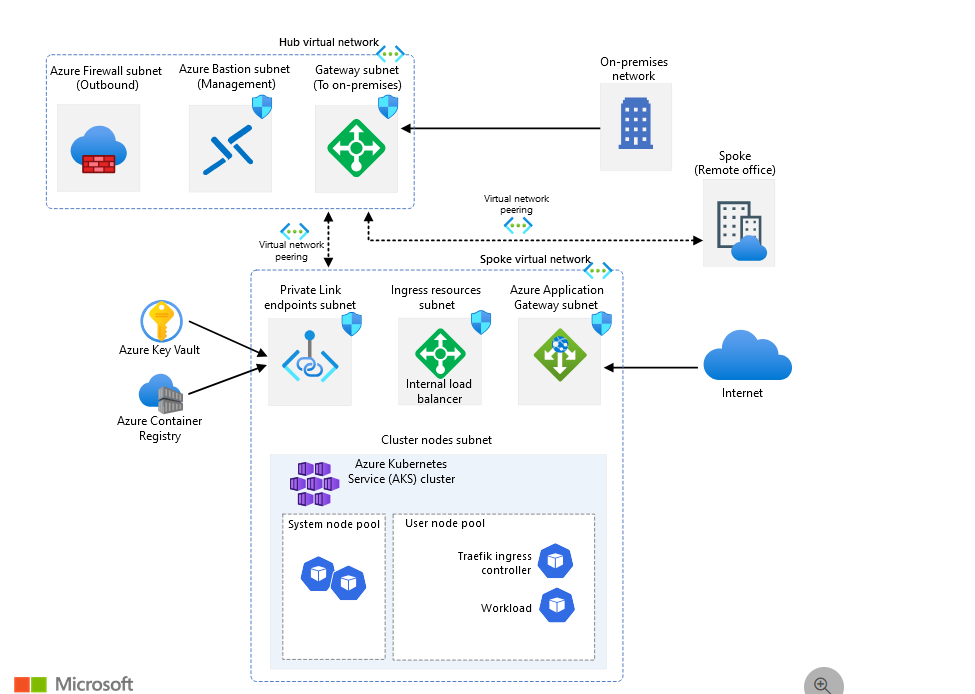

```shell
Azure应用程序网关是一个功能强大的Web流量负载均衡器，运行在第7层，能够优化和保护Web应用。启用Web应用程序防火墙（WAF）的应用程序网关v2 SKU提供了增强的安全性和性能。应用程序网关配置了公共前端IP地址，用于接收和处理用户请求，并需要部署在一个专用子网中，以确保其网络流量的独立性和管理的便捷性。

创建资源组
az group create --name myResourceGroup --location eastus
创建虚拟网络和子网
sh
复制代码
az network vnet create --resource-group myResourceGroup --name myVNet --address-prefix 10.0.0.0/16 --subnet-name myAGSubnet --subnet-prefix 10.0.1.0/24
创建公共IP地址
sh
复制代码
az network public-ip create --resource-group myResourceGroup --name myAGPublicIP
创建应用程序网关

az network application-gateway create /
  --resource-group myResourceGroup /
  --name myAppGateway /
  --sku WAF_v2 /
  --capacity 2 /
  --vnet-name myVNet /
  --subnet myAGSubnet /
  --public-ip-address myAGPublicIP /
  --frontend-port 80 /
  --http-settings-cookie-based-affinity Enabled /
  --routing-rule-type Basic /
  --web-application-firewall-mode Detection

```
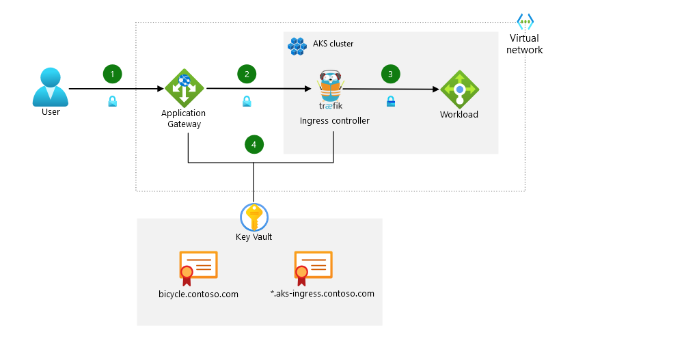

在Azure上从头开始搭建一个Kubernetes集群并配置流量管理的过程包括几个主要步骤：创建Azure资源、部署Kubernetes集群、安装Ingress Controller、配置Application Gateway、以及设置负载均衡和流量路由。下面是一个从头开始的详细步骤指南：

## AKS 端到端部署（Traefik + App Gateway）

### 1. 创建资源组和虚拟网络

#### 1.1 创建资源组

首先，创建一个资源组来组织所有的Azure资源：

```bash
az group create --name myResourceGroup --location eastus
```

#### 1.2 创建虚拟网络和子网

创建一个虚拟网络和子网以供Kubernetes集群使用：

```bashaz network vnet create /
  --resource-group myResourceGroup /
  --name myVNet /
  --address-prefix 10.0.0.0/16 /
  --subnet-name mySubnet /
  --subnet-prefix 10.0.1.0/24
```

### 2. 部署Azure Kubernetes Service (AKS)

#### 2.1 创建AKS集群

使用Azure CLI创建一个AKS集群：

```bashaz aks create /
  --resource-group myResourceGroup /
  --name myAKSCluster /
  --node-count 3 /
  --enable-addons monitoring /
  --generate-ssh-keys /
  --vnet-subnet-id $(az network vnet subnet show --resource-group myResourceGroup --vnet-name myVNet --name mySubnet --query id -o tsv)
```

- `--node-count 3`：指定节点数。根据需求可以调整。
- `--enable-addons monitoring`：启用监控插件。
- `--vnet-subnet-id`：指定虚拟网络子网ID。

#### 2.2 获取AKS凭证

获取AKS集群凭证以便通过`kubectl`命令管理集群：

```bash
az aks get-credentials --resource-group myResourceGroup --name myAKSCluster
```

### 3. 安装Ingress Controller（例如Traefik）

#### 3.1 使用Helm安装Traefik

首先，安装Helm（Kubernetes的包管理工具），然后使用它来安装Traefik：

```bashhelm repo add traefik https://helm.traefik.io/traefik
helm repo update

helm install traefik traefik/traefik /
  --namespace kube-system /
  --create-namespace /
  --set deployment.replicas=2 /
  --set service.type=LoadBalancer
```

### 4. 配置Azure Application Gateway

#### 4.1 创建公共IP地址

创建一个公共IP地址，用于Application Gateway：

```
az network public-ip create --resource-group myResourceGroup --name myAppGatewayPublicIP --sku Standard
```

#### 4.2 创建Application Gateway

创建并配置Application Gateway：

```bashaz network application-gateway create /
  --resource-group myResourceGroup /
  --name myAppGateway /
  --sku WAF_v2 /
  --capacity 2 /
  --vnet-name myVNet /
  --subnet mySubnet /
  --public-ip-address myAppGatewayPublicIP /
  --frontend-port 80 /
  --http-settings-cookie-based-affinity Enabled /
  --routing-rule-type Basic /
  --web-application-firewall-mode Detection
```

### 5. 配置负载均衡和流量路由

#### 5.1 创建一个示例应用

创建一个简单的示例应用，以便测试流量路由。以下是一个简单的Nginx部署示例：

```yamlapiVersion: apps/v1
kind: Deployment
metadata:
  name: nginx
spec:
  replicas: 2
  selector:
    matchLabels:
      app: nginx
  template:
    metadata:
      labels:
        app: nginx
    spec:
      containers:
        - name: nginx
          image: nginx
          ports:
            - containerPort: 80
---
apiVersion: v1
kind: Service
metadata:
  name: nginx
spec:
  selector:
    app: nginx
  ports:
    - protocol: TCP
      port: 80
      targetPort: 80
  type: ClusterIP
```

应用这个配置：

```bash
kubectl apply -f nginx-deployment.yaml
```

#### 5.2 创建Ingress资源

创建一个Ingress资源，将流量路由到你的服务：

```yamlapiVersion: networking.k8s.io/v1
kind: Ingress
metadata:
  name: nginx-ingress
  annotations:
    traefik.ingress.kubernetes.io/router.entrypoints: "web,websecure"
spec:
  rules:
    - host: your-domain.example.com
      http:
        paths:
          - path: /
            pathType: Prefix
            backend:
              service:
                name: nginx
                port:
                  number: 80
```

应用Ingress配置：

```bash
kubectl apply -f nginx-ingress.yaml
```

### 6. 验证和监控

#### 6.1 验证配置

通过访问Application Gateway的公共IP地址（在Azure门户中获取），你应该能够看到你的应用程序。

#### 6.2 监控和日志

在Azure门户中查看Application Gateway和AKS的监控数据和日志，以确保一切正常运行。

### 总结

通过以上步骤，你可以从头开始在Azure上搭建一个完整的Kubernetes环境，配置Traefik作为Ingress Controller，并通过Azure Application Gateway和内部负载均衡器来管理流量。这种架构提供了高可用性和灵活性，同时确保了流量的有效管理和安全。

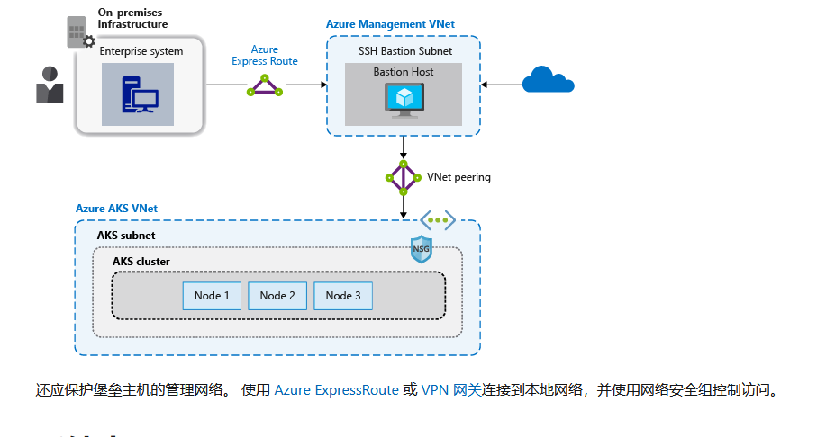


## AKS 专用集群

- [网络拓扑与连接（CAF）](https://learn.microsoft.com/zh-cn/azure/cloud-adoption-framework/scenarios/app-platform/aks/network-topology-and-connectivity?source=recommendations)

AKS 群集 IP 可见性可以是公共的，也可以是专用的。[专用群集](https://learn.microsoft.com/zh-cn/azure/aks/private-clusters)通过专用 IP 地址（而非公共 IP 地址）公开 Kubernetes API。