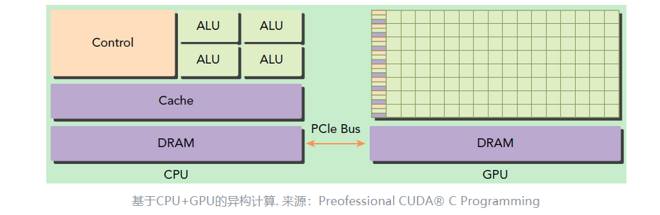
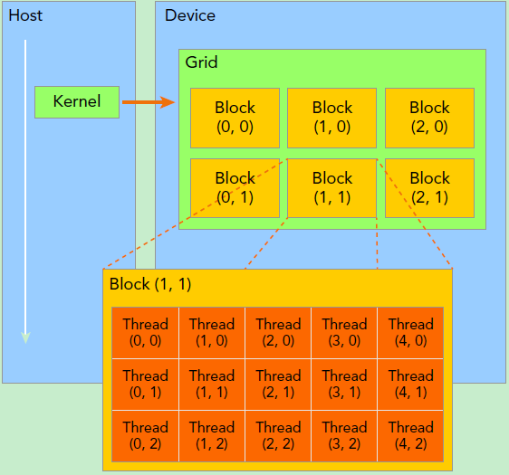
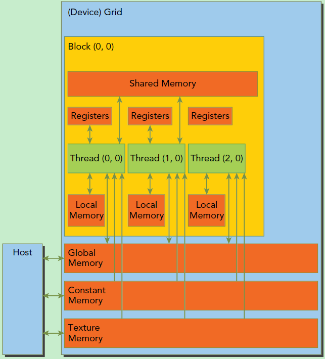
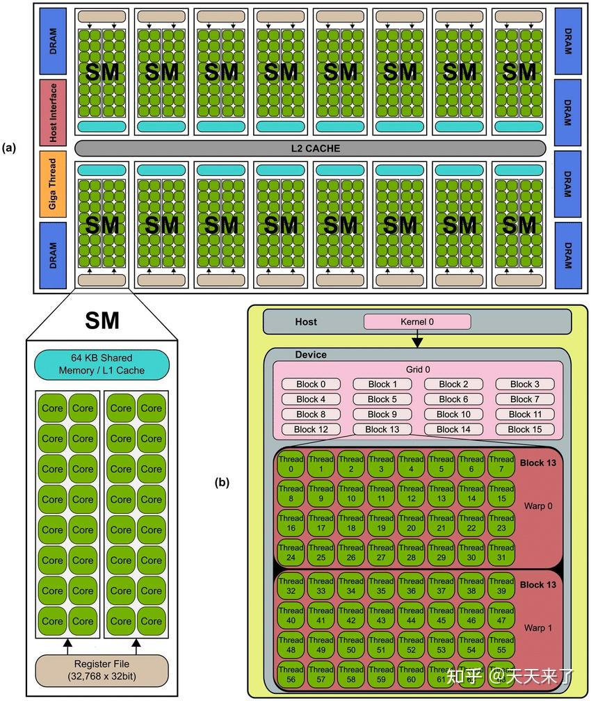
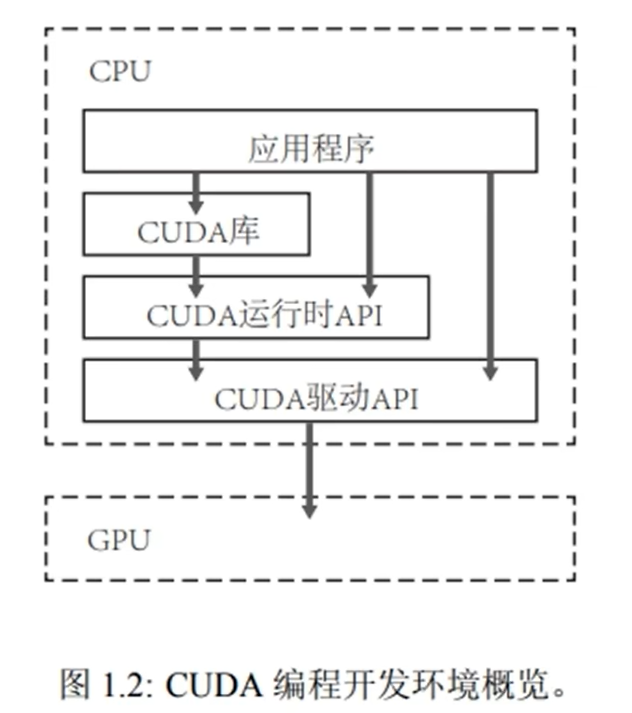
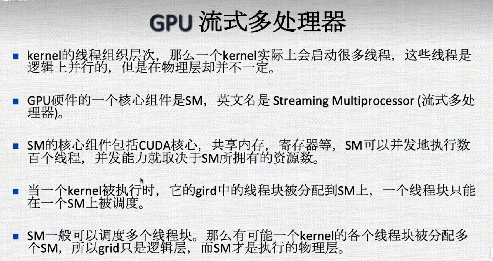
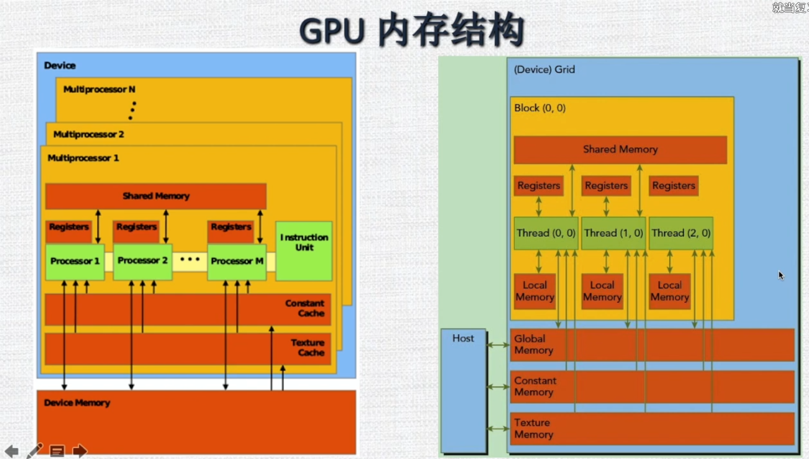
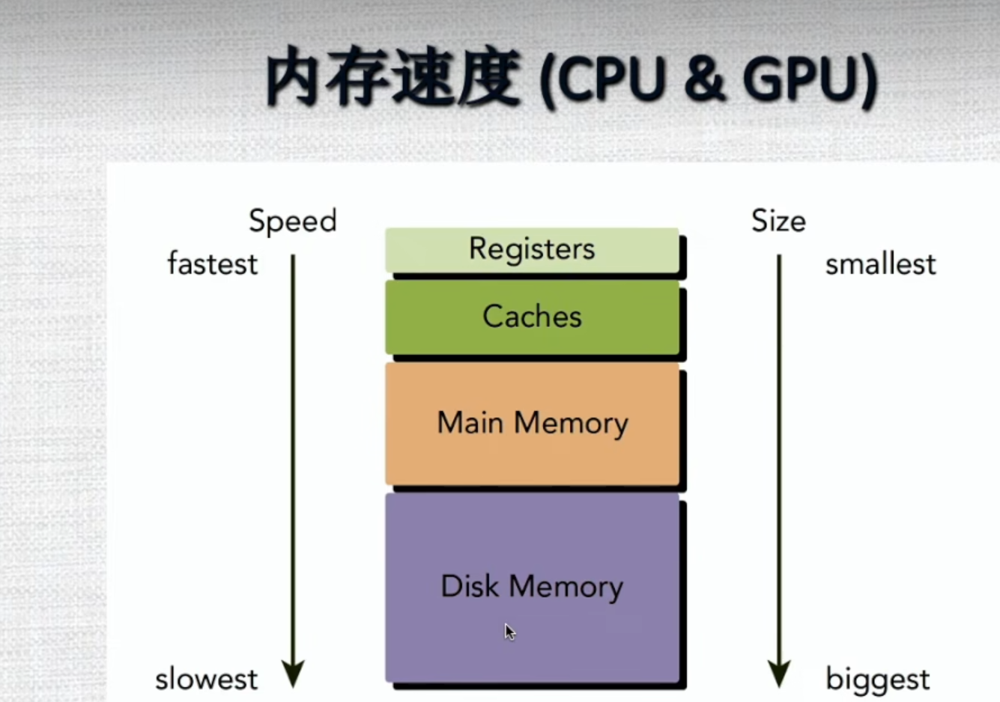
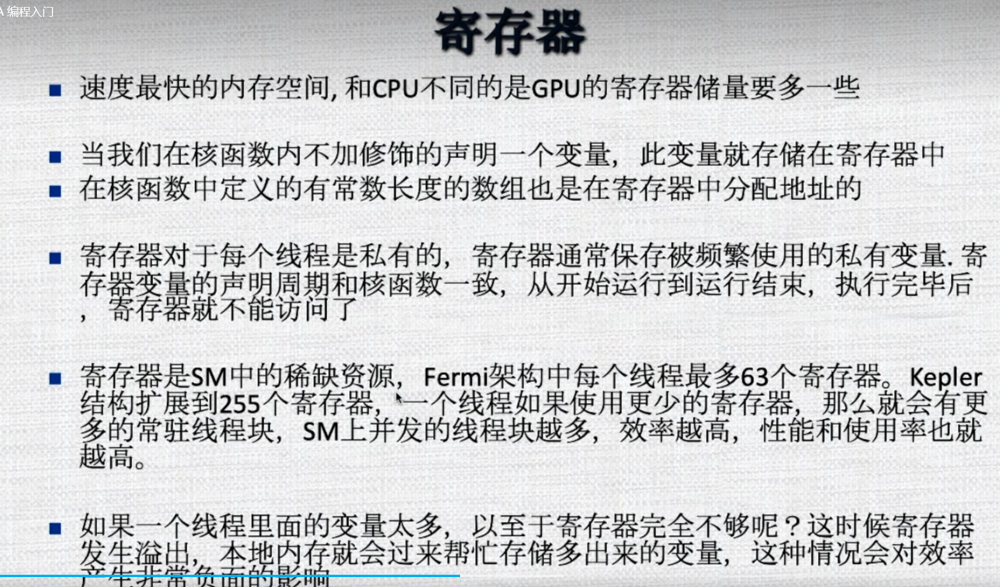

> CUDA / GPU 编程笔记。源：`Desktop/2024/14-largemode.md`（GPU 部分）。图片：`../img/`。

# CUDA 编程

## 目录

- [Host 与 Device](#host-与-device)
- [经典 CUDA 流程](#经典-cuda-流程)
- [Grid / Block / Warp](#grid--block--warp)
- [内存与 SM](#内存与-sm)
- [示例与环境](#示例与环境)
- [自定义算子（PyTorch）](#自定义-cuda-算子pytorch)

---

## Host 与 Device

CPU所在位置称为为主机端（host），而GPU所在位置称为设备端（device），如下图所示。



host:  cpu+memory 

device: GPU+Memory 

classic cuda procedure :

1. 分配host内存，并进行数据初始化；
2. 分配device内存，并从host将数据拷贝到device上；
3. 调用CUDA的核函数在device上完成指定的运算；
4. 将device上的运算结果拷贝到host上；
5. 释放device和host上分配的内存。

grid: 网格 同一个网格上的线程share 相同的全局内存空间

blok: 线程块 一个线程块包含多个线程

Warp: 线程束

Thread : 线程

kernel ： run code on device :  一般called kernel function 核函数

GPU中的各级缓存以及各种内存是可以软件控制的，在编程时我们可以手动指定变量存储的位置。**具体而言，这些内存包括寄存器、共享内存、常量内存、全局内存等**


```c
dim3 grid(3, 2);
dim3 block(5, 3);
kernel_fun<<< grid, block >>>(prams...);
```



由一个内核启动所产生的所有线程统称一个网格（Grid），同一网格中的所有线程共享相同的全局内存空间。向下一级，一个网格由多个线程块（Block）构成。再下一级，一个线程块由一组线程（Thread）构成。

**线程网格和线程块从逻辑上代表了一个核函数的线程层次结构，这种组织方式可以帮助我们有效地利用资源，优化性能**



1. 每个thread: 都有自己private local memory
2. 每个线程块有包含共享内存（Shared Memory）,可以被线程块中所有线程共享，其生命周期与线程块一致。此外，所有的线程都可以访问全局内存（Global Memory）
3. 还可以访问一些只读内存块：常量内存（Constant Memory）和纹理内存（Texture Memory）

Register： **寄存器是GPU上运行速度最快的内存空间**

Shared Memory： ，**共享内存是GPU上可受用户控制的一级缓存**。**当存在着数据的重复利用时，**

Gloab memory: **全局内存是GPU中最大、延迟最高并且最常使用的内存。**全局内存类似于CPU的系统内存。在编程中对全局内存访问的优化以最大化程度提高全局内存的数据吞吐量是十分重要的。


thread，block，grid，warp是软件上的（CUDA）概念。

GPU hardware structure： 硬件概念

gpu actual is a SM 阵列， 每个SM 有N个计算核

SM： Streaming-MultiProcessor 

SP:  Streaming Process  Cuda Core



每个SM： 都有自己Register， Shared memory 和缓存数据

并且拥有很多Core资源，可以同时执行多个线程，可以说SM是GPU中的可独立计算单元

开Warp Scheduler调度器：

sm:  采用的是SIMT （Single-instruction multiple-thread, 单指令多线程架构），基本的执行单元是线程束 warp, 


cuda 运行时API：




```
gpu 是异构模型，需求区分，host, device 上的代码， 在cuda 中通过函数类型的限定词区分：
host , device 
__global__ :  定义的kernel 是异步的
__device__ :  
__host__: 

thread : 需要2个内置的坐标变量（blockidx , threadidx） 来唯一标识，都是dim3的变量，
threadidx 包含3个值： threadidx.x threaidx.y threadidx.z 
blockidx  包含3个值： blockidx.x , blockidx.y , blockidx.z 

notic: 一个线程块的线程是放在同一个流式多处理器SM 


```



GPU 内存类型：



每个线程都有自己的私有本地内存： local memory 

每个线程块包含共享内存 share memory, 可用被线程块中所有的线程共享，其生命周期与线程块一致

所有的线程都可以访问全局内存： gloabl memory 

访问一些只读内存块， 常量内存 constant memory 和纹理内存 texute memeory 

L1 cache , L2 cache 



可编程内存： 

不可编程内存： 对用户不开放的， L1 ,L2 Cache , 



cpu memory 

stack : 编译器自动划分

heap: 堆 ： user 自己分配和释放

C： malloc ,calloc ,free 

c++ : new delete

```powershell
wmic path win32_VideoController get name
nvidia-smi


C:\Program Files (x86)\Microsoft Visual Studio\2019\Community\VC\Tools\MSVC\14.28.29910\bin\Hostx64\x64

C:\Program Files (x86)\Microsoft Visual Studio\2019\Community\VC\Tools\MSVC\14.28.29910\bin\Hostx64\x86

https://blog.csdn.net/weixin_44115162/article/details/143326734
```

## 示例与环境

```markdown
cuda 环境搭建：
1. NVIDIA GPU Computing Toolkit
2. install Visual Studio 2022   (MSVC) /gcc n
3. CMake 
4. Cuda 
nvcc -v
nvidia-smi

#编译
nvcc -o file file.cu


```

```c++
#include <stdio.h>
__global__ void hello_from_GPU()
{
    printf("hello from GPU \n");

}
int main(void) {
    hello_from_GPU<<<2, 2>>>();
    cudaDeviceSynchronize();
    return 0;
}


//demo2  传入参数
#include "cuda_runtime.h"
#include "device_launch_parameters.h"
#include <stdio.h>
#include <Windows.h>
__global__ void Add(int i, int j)
{
    int count;
    count = i + j;
    printf("\nNum is %d\n", count);
}
int main(void)
{
    Add<<<1, 1>>>(10, 15);
    cudaDeviceReset();//重置CUDA设备释放程序占用的资源
    system("pause");
    return 0;
}
```

cuda 编程运行步骤：

1. host (cpu) 划分内存，并且初始化操作数
2. 在device （gpu） 分配相应的内存
3. 传输操作数到GPU 
4. GPU 运算， cpu 围观
5. 从GPU 读取数据回CPU， 方便后续处理
6. 释放内存

```c++
#include <stdio.h>
#include <assert.h>
#include <stdlib.h> // 包含stdlib.h以使用malloc和free
#include <cuda_runtime.h> // 包含cuda_runtime.h以使用CUDA API
#include <cuda.h> // 包含cuda.h以使用CUDA错误检查等
#define VECTOR_LENGTH 10000 
#define MAX_ERR 1e-4

__global__ void vector_add(float* out, float* a, float* b, int n)
{
    for (int i = 0; i < n; i++)
    {
        out[i] = a[i] + b[i];
    }
}

int main()
{
    float* a, * b, * out;
    float* d_a, * d_b, * d_out;

    //===================步骤1===================
    // Allocate memory on CPU
    a = (float*)malloc(sizeof(float) * VECTOR_LENGTH);
    b = (float*)malloc(sizeof(float) * VECTOR_LENGTH);
    out = (float*)malloc(sizeof(float) * VECTOR_LENGTH);

    // data initializtion
    for (int i = 0; i < VECTOR_LENGTH; i++)
    {
        a[i] = 3.0f;
        b[i] = 0.14f;
    }
    //===================步骤1===================

    //===================步骤2===================
    // Allocate memory on GPU
    cudaMalloc((void**)&d_a, sizeof(float) * VECTOR_LENGTH);
    cudaMalloc((void**)&d_b, sizeof(float) * VECTOR_LENGTH);
    cudaMalloc((void**)&d_out, sizeof(float) * VECTOR_LENGTH);
    //===================步骤2===================

    //===================步骤3===================
    // copy operator to GPU
    cudaMemcpy(d_a, a, sizeof(float) * VECTOR_LENGTH, cudaMemcpyHostToDevice);
    cudaMemcpy(d_b, b, sizeof(float) * VECTOR_LENGTH, cudaMemcpyHostToDevice);
    //===================步骤3===================

    //===================步骤4===================
    // GPU do the work, CPU waits
    vector_add<<<1, 1>>>(d_out, d_a, d_b, VECTOR_LENGTH);
    //===================步骤4===================

    //===================步骤5===================
    // Get results from the GPU
    cudaMemcpy(out, d_out, sizeof(float) * VECTOR_LENGTH,
        cudaMemcpyDeviceToHost);

    // Test the result
    for (int i = 0; i < VECTOR_LENGTH; i++)
    {
        assert(fabs(out[i] - a[i] - b[i]) < MAX_ERR);
    }
    printf("out[0] is %f\n", out[0]);
    printf("PASSED\n");
    //===================步骤5===================

    //===================步骤6===================
    // Free the memory
    cudaFree(d_a);
    cudaFree(d_b);
    cudaFree(d_out);
    free(a);
    free(b);
    free(out);
    //===================步骤6===================
}
```


```c++
%%writefile exercise01.cu
#include <stdio.h>
#include <assert.h>

#define MAX_ERR 0.1
#define MULTI_TIMES_RUN 1

__global__ void vector_dot_product(float *result, float *vector_a, float *vector_b, int vertor_length) 
{
    extern __shared__ float temp[];
 
    int index = threadIdx.x;    // index offset of this thread
    int stride = blockDim.x;    // stride step of each iteration

    // so if threadIdx.x=0, and blockDim.x=10,
    // then this thread is responsible for calculating temp[0], temp[10], temp[20]
    // similiarly, the following thread will calculate temp[1], temp[11], temp[21]
    for(int i = index; i < vertor_length; i += stride)
    {
        temp[i] = vector_a[i] * vector_b[i];
    }
 
    __syncthreads(); // synchronize all threads
 
    // The accumulation only needs to happen at thread_0
    if (threadIdx.x == 0)
    {
        float sum = 0;
        for (int i = 0; i < vertor_length; i++)
        {
            sum += temp[i];
        }
        *result=sum;
    }
}

int main(int argc, char *argv[])
{
    float *vector_a, *vector_b, *result;
    float *d_vector_a, *d_vector_b, *d_result;
    int list_of_thread_num[]={1,64,128,256,512,1024};
    int list_of_vector_length[]={100,200,1000,2000,10000};
    int thread_num = 1;
    int vector_length = 1000;
 
     if( argc == 3 ) {
      //printf("The argument supplied is %s\n", argv[1]);
      int arg1 = atoi(argv[1]);  //argv[0] is the program name
                                //atoi = ascii to int
      int arg2 = atoi(argv[2]);              
      
      vector_length = list_of_vector_length[arg1];
      thread_num = list_of_thread_num[arg2];
    }
    else if( argc > 2 ) {
      printf("Too many arguments supplied.\n");
    }
    else {
      printf("One argument expected.\n");
      
    }

    // Allocate memory on CPU
    vector_a = (float*)malloc(sizeof(float) * vector_length);
    vector_b = (float*)malloc(sizeof(float) * vector_length);
    result = (float*)malloc(sizeof(float));

    // data initializtion
    for(int i = 0; i < vector_length; i++)
    {
        vector_a[i] = 0.1f;
        vector_b[i] = 0.9f;
    }

    // Allocate memory on GPU
    cudaMalloc((void**)&d_vector_a, sizeof(float) * vector_length);
    cudaMalloc((void**)&d_vector_b, sizeof(float) * vector_length);
    cudaMalloc((void**)&d_result, sizeof(float));

    // copy operator to GPU
    cudaMemcpy(d_vector_a, vector_a, sizeof(float) * vector_length, cudaMemcpyHostToDevice);
    cudaMemcpy(d_vector_b, vector_b, sizeof(float) * vector_length, cudaMemcpyHostToDevice);

    // GPU do the work, CPU waits
#if MULTI_TIMES_RUN
    for(int i=0; i< 10; i++)
    {
#endif
        vector_dot_product<<<1,thread_num,sizeof(float) * vector_length>>>(d_result, d_vector_a, d_vector_b, vector_length);
#if MULTI_TIMES_RUN
    }
 #endif
 
    // Get results from the GPU
    cudaMemcpy(result, d_result, sizeof(float), 
               cudaMemcpyDeviceToHost);
 
    // Test the result
    //assert(fabs(*result - vector_length*2*3.14) < MAX_ERR);
    
    // you only need them for checking if the math is correct
     printf("result[0] = %f\n", result[0]);
    // printf("PASSED\n");

    // Free the memory
    cudaFree(d_vector_a);
    cudaFree(d_vector_b);
    cudaFree(d_result);
    free(vector_a);
    free(vector_a);
    free(result);

}
```


grammer:

```c++
一般的函数定义 void  function();
cuda的函数定义 __global__ void function();

global:主机呼叫，设备执行
host:主机呼叫，主机执行   
device:设备呼叫，设备执行
执行一般c函数  funtion();
执行cuda函数   function<<>> ();
```


feature： 

1. 层次结构来组织线程
2. 通过层次结构来组织内存的访问

cpu-> 1个核只支持1到2个的硬件线程。 而GPU 可以支持成百上千个并发线程

grid:  线程网格

block: 线程块

warp: 线程束

thread:  线程

GPU中的各级缓存以及各种内存是可以软件控制的，在编程时我们可以手动指定变量存储的位置。**具体而言，这些内存包括寄存器、共享内存、常量内存、全局内存等**

由1个核函数启动所产生的的所有线程统称1个网格： grid 

**线程网格和线程块从逻辑上代表了一个核函数的线程层次结构，这种组织方式可以帮助我们有效地利用资源，优化性能**

memory:

1. register 寄存器
2. shared memory 共享内存
3. global memory 全局内存

**寄存器是GPU上运行速度最快的内存空间**，通常其带宽为8TB/s左右，延迟为1个时钟周期。核函数中声明的一个没有其他修饰符的自变量，通常就存储在寄存器中。


**共享内存是GPU上可受用户控制的一级缓存**。共享内存类似于CPU的缓存，不过与CPU的缓存不同，GPU的共享内存可以有CUDA内核直接编程控制。由于共享内存是片上内存，所以与全局内存相比，它具有更高的带宽与更低的延迟，通常其带宽为1.5TB/s左右

https://zhuanlan.zhihu.com/p/361467248  demo

https://www.cnblogs.com/aiguona/p/9449668.html  d emo 

https://github.com/huiscliu/tutorials

https://zhuanlan.zhihu.com/p/346910129

https://zhuanlan.zhihu.com/p/346910129

https://zhuanlan.zhihu.com/p/97044592

https://github.com/SuperChange001/CUDA_Learning

## 自定义 CUDA 算子（PyTorch）

内置算子：

自定义算子：

 **自定义算子的创建步骤**
创建自定义算子需要遵循一定的步骤，大致如下：

- **定义函数**：首先，我们需要定义一个Python函数，该函数将作为自定义算子的核心逻辑。这个函数将接受输入张量并返回计算结果。
- **注册算子**：然后，我们需要使用`torch.nn.Module`的`register_backward_hook`或`register_forward_hook`方法将这个函数注册为自定义算子。需要注意的是，我们通常使用前向钩子，因为它可以捕获更多的计算信息。
- **实现前向和后向函数**：为了使自定义算子能够正确地参与到自动求导中，我们需要实现前向和后向函数。前向函数描述了如何根据输入计算输出，而后向函数则描述了如何根据梯度计算输入的梯度。
- **编译与运行**：完成上述步骤后，我们可以编译PyTorch程序并运行以测试自定义算子的正确性。
  **3. 注意事项与最佳实践**
  在开发自定义算子的过程中，有一些关键点需要特别注意：
- **性能优化**：自定义算子的性能至关重要，尤其是在处理大规模数据时。我们应尽量使用CUDA进行GPU加速，并确保算法的时间复杂度和空间复杂度都是可接受的。
- **内存管理**：PyTorch的tensor操作涉及到大量的内存分配和释放。不恰当的内存管理可能导致内存泄漏或频繁的垃圾回收，从而降低程序性能。因此，我们应确保在合适的时机释放不再使用的内存。
- **兼容性考虑**：当我们开发的应用需要与未来版本的PyTorch兼容时，需要特别注意API的变化和未来的发展方向。同时，对于不同的硬件平台（如CPU、GPU或TPU），也需要考虑其差异和优化。
- **[文档](https://cloud.baidu.com/product/doc.html)与测试**：对于自定义算子，应提供详尽的文档说明其使用方法和注意事项。同时，为确保代码的稳定性和可靠性，必须进行充分的测试，包括单元测试和集成测试。
  通过深入理解PyTorch的底层机制，我们可以开发出高效的自定义算子，从而在深度学习的研究和应用中获得更大的自由度和灵活性。随着PyTorch的不断演进，我们相信未来的研究者与工程师们将能够利用这些强大的工具解决更多复杂的任务。

环境搭建：

nvidia-smi

C:\Program Files\NVIDIA GPU Computing Toolkit\CUDA\v10.0

C:\Program Files\NVIDIA GPU Computing Toolkit\CUDA\v10.0\lib\x64

C:\Program Files\NVIDIA GPU Computing Toolkit\CUDA\v10.0\libnvvp

C:\Program Files\NVIDIA GPU Computing Toolkit\CUDA\v10.0\bin

https://visualstudio.microsoft.com/zh-hans/downloads/#build-tools-for-visual-studio-2019

https://cloud.tencent.com/developer/article/1810416


open Source ：