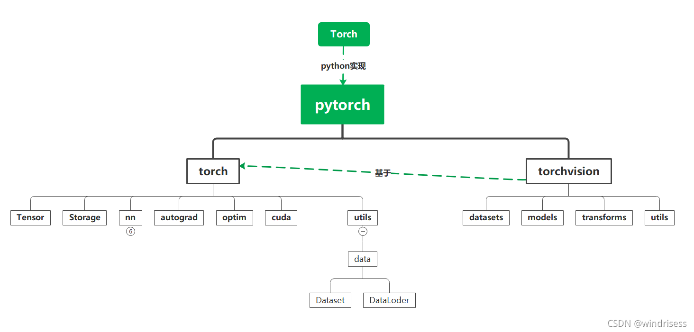
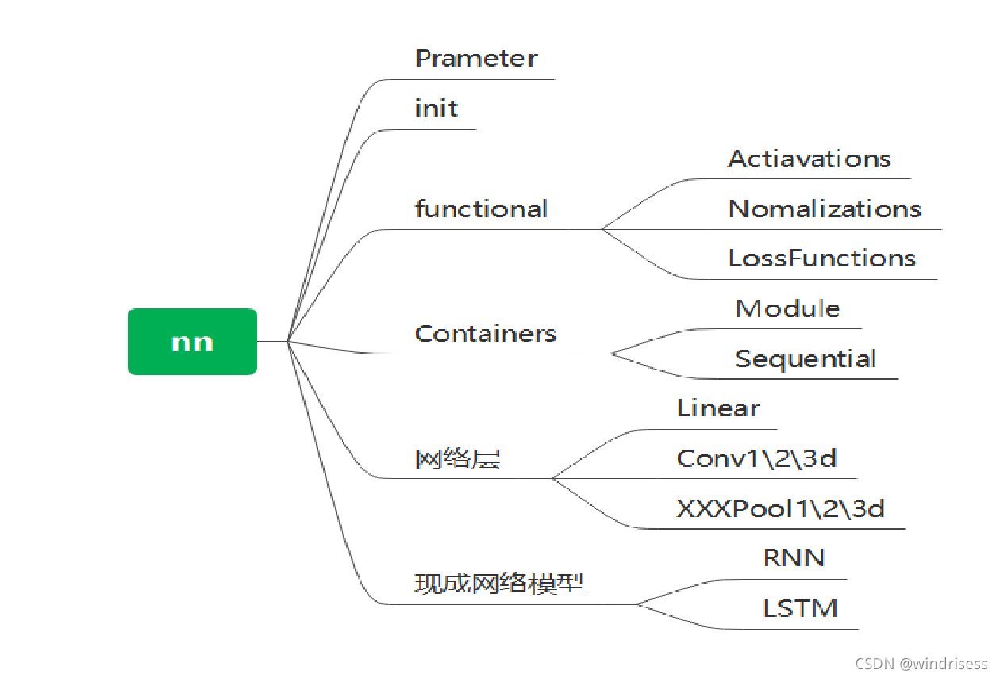
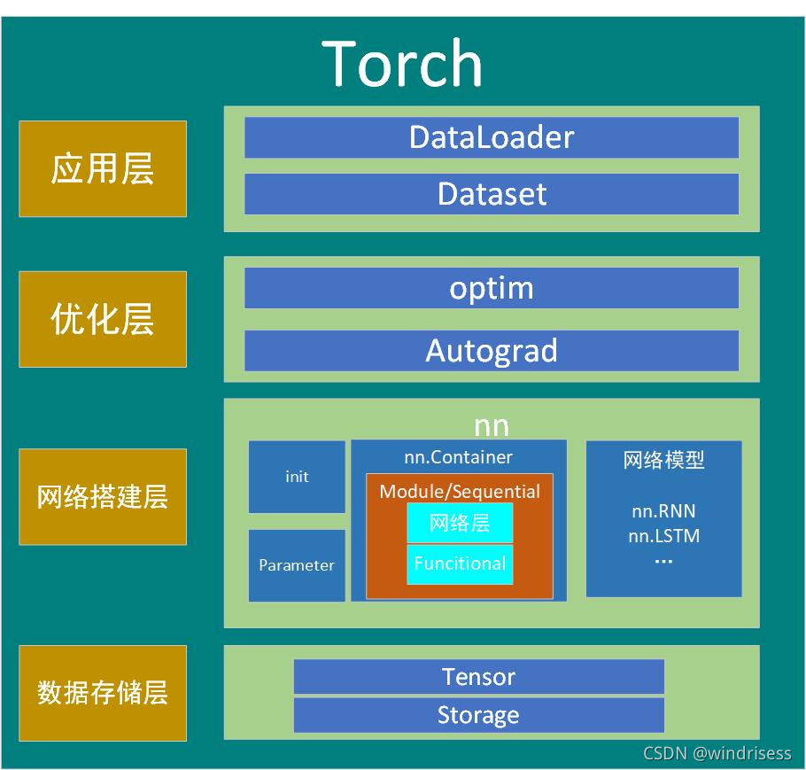
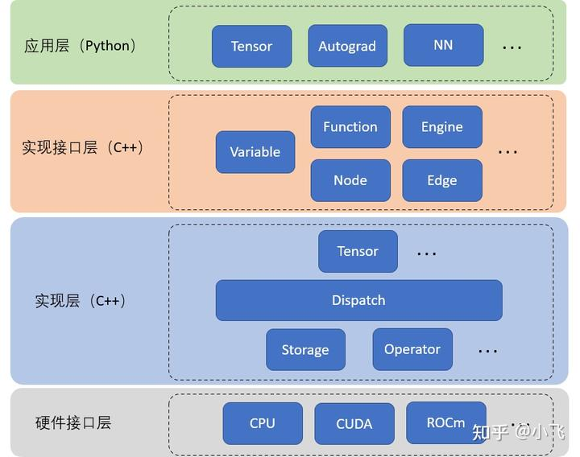
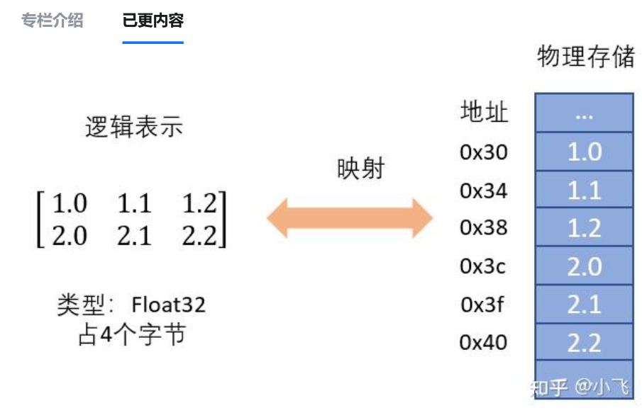
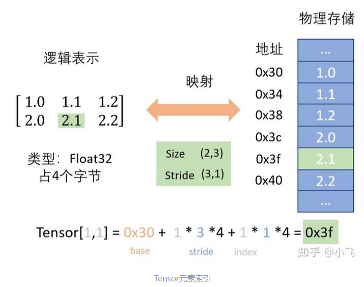
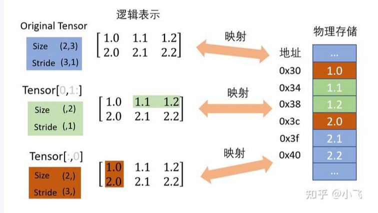
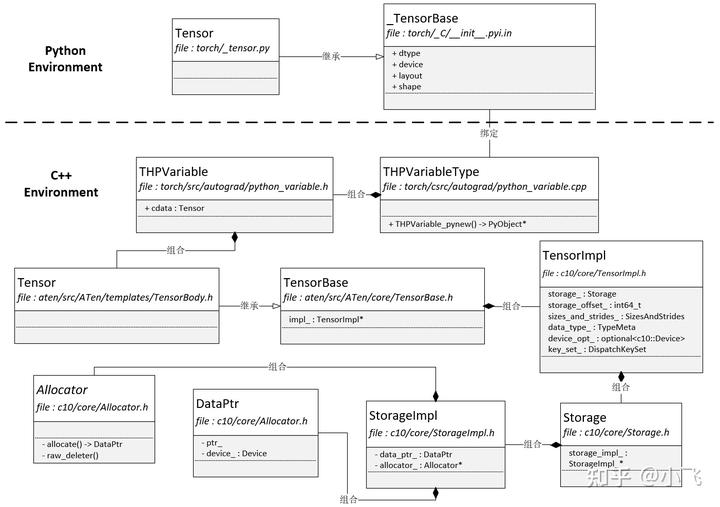
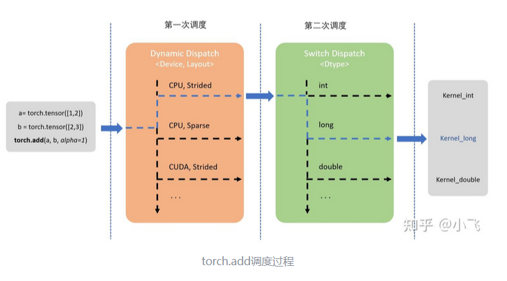
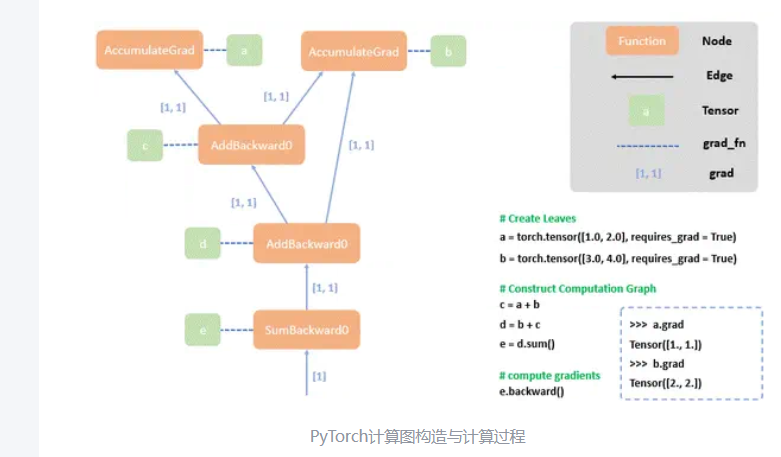

> PyTorch GPU 架构与张量/算子。源：`Desktop/2024/14-largemode.md`。图片：`../img/`。Autograd 深入见 [4-torch.md](../7-Programming/4-torch.md)。

# PyTorch GPU 栈

## 目录

- [概览](#概览)
- [四层架构](#四层架构)
- [源码目录](#torch-source-code)
- [Tensor 与 Storage](#tensor--向量)
- [算子](#operator-算子)
- [AutoGrad](#autograd)

---

## 概览

代码架构

aten : A tensor Library 

torch: 前端代码  前端指的是 PyTorch 的 Python 接口

后端指的是 PyTorch 的底层 C++ 引擎，它负责执行前端指定的计算。后端引擎使用张量表示计算图的节点和边，并使用高效的线性代数运算和卷积运算来执行计算。

torch 支持GPU 加速Tensor 计算

类似磁带 forfward backward 的梯度自动计算 AutoGrad 

PyTorch的Autograd系统是创建了一个动态的计算图，用户只需要关注前向计算网络搭建，PyTorch会自动根据动态计算图去反向计算梯度并更新网络权重

一共将PyTorch分成了四层，分别是:

**应用层（Python）**。这应该是大家最熟悉的层，主要涉及到张量，Autograd以及神经网络。该层所有的源码都是由Python编写，这也符合前面所说的PyTorch设计思想-——将C++框架集成到Python里

**实现接口层（C++）**。该层的主要功能我认为有两个：

- **Python 扩展**。通过Python提供的C API将Python应用层与C++实现层绑定起来，使用户在享受Python语言提供的便捷优势时也可以同时享受到C++语言提供的性能优势
- **Autograd系统实现**。 PyTorch并没有在实现层中实现Autograd系统。在此层中PyTorch定义了动态有向图的基本组件Node和Edge，以及在此基础上封装了Function类和Engine类来实现Autograd

**实现层（C++）**。该层是PyTorch的核心层，定义了PyTorch运行过程中的核心库, 包括**Tensor的具体实现**，**算子实现**（前向与后向运算）以及**动态调度系统**（Tensor的布局，硬件设备，数据类型）。Storage类主要是针对不同硬件数据存储的一种抽象。

**硬件接口层**。该层主要是硬件厂商基于自家硬件推出的运算接口

### torch source code ：

torch:

- csrc
  -  :  C++源码，Python绑定C++的相关code都在这个目录里面，同时也包含了对PyTorch核心库的一些封装，对应我们架构图中的实现接口层
  - **csrc/autograd**：梯度自动计算系统的C++实现
  - **autograd**：梯度自动计算系统的Python前端源码，包含torch中支持的所有自动求导算子
  - **nn**：建立在autograd系统上的神经网络库，包含了深度学习中常用的一些基础神经网络层
  - **optim**：机器学习中用到的优化算法库
- aten **a ten**sor library”的缩写，对应我们结构图中的实现层。从名字上也能知道，这个库设计之初主要是为Tensor服务。因为在实现接口层下面，所以这里的Tensor并不支持autograd
  - **src/Aten/core**：aten的核心基础库。目前这个库里面的代码正在逐渐地迁移到c10目录下面
  - **src/Aten/native**：PyTorch的算子库，这个目录下面的算子都是CPU的算子。对于一些专门CPU指令优化的算子会在子目录里面
  - **src/Aten/native/cuda**：cuda算子实现
  - **tools**：PyTorch中很多相似源码都是脚本通过模板自动生成的，这个文件夹下面就放着自动生成代码的脚本

​	所有非**csrc**文件夹下的内容都是标准的Python模块，对应我们架构图中的应用层

memory 是一块可供寻址的存储单元

### Tensor :  向量

1. **Tensor需要支持随机访问。**这很重要，因为在Python中Tensor是支持索引（index）和切片（slice）操作的，支持随机访问可以让我们快速的找到需要的数据，提高我们数据访问效率
2. **Tensor的大小是固定的**。当我们创建了一个Tensor的时候，它的大小就已经确定了，我们可以修改其上的任意元素，就是不能增加元素来修改它的大小。如果要修改其大小，我们必须根据其大小创建一个新的Tensor，将旧的Tensor上的数据复制过去

PyTorch引入了一个叫做步伐（Stride）的概念，其本质上是逻辑索引的一个相对距离，表明当你从某个元素沿着某一维度移动一个元素时的距离

每个切片操作都开辟一个新的内存空间，那势必会降低程序的运行效率以及造成内存空间浪费，所以PyTorch引入了一个叫做视图的概念，所有的视图都会共享相同的内存空间，而Stride就是创建新Tesnor视图的关键所在

pytorch 将Tensor 物理存储抽象成1个Storage类，与逻辑表示解耦，这样可以建立Tensor 视图和物理视图存储storage 之间的多对1 的关系，

storage 是1个声明类，（interface），其实现在StorageImpl 中：

StoragImpl : 2个核心：

1. data_ptr : 其指向数据实际存储的内存空间。在类DataPtr中包含了Device相关的成员变量
2. **allocator_**。其是一个内存分配器。Allocator是一个抽象类，所有派生类必须实现allocate和raw_deleter两个抽象函数

PyTorch的Tensor除了用Storage类来管理物理存储外，还在Tensor中定义了很多相关的元信息。比如我们前面说到的size，stride以及dtye，这些信息都存在TensorImpl类中的**sizes_and_strides_**以及**data_type_**中

**key_set_**中保存的是PyTorch对Tensor的layout，device以及dtype相关的调度信息

PyTorch在C++实现层中实现了算子（Operator），那Operator是如何和Tensor绑定的了?

PyTorch创建了一个**TensorBody.h**的模板文件, 在该文件中创建了一个继承基类TesnorBase的类Tensor。TensorBase基类中封装了所有和Tensor存储相关的细节

### Operator 算子

Tensor就仅仅是PyTorch世界中一个个孤立的点，无法引起任何波澜。今天就让我们一起来重新认识下PyTorch的算子，学习其内部的机制原理

- **狭义的算子（Kernel）**。对Tensor执行的基本操作集合，包括四则运算，数学函数，甚至是对Tensor元数据的修改，如维度压缩（squeeze），维度修改（reshape）等
- **广义的算子（Function）**。PyTorch中算子模块的具体实现，涉及到调度模块，Kernel模块，求导模块以及代码自动生成模块。

狭义的算子称之为核（Kernel） 

torch.add :

### AutoGrad

kernal 函数与导 Derivative  

Kernel和Derivative作为算子最核心的两个基础模块

chain rule : 链式求导

Pytorch 动态图：

Node/Vertex  Edge 

PyTorch来说，其构造的计算图是一个自下而上的有向无环图，图中的每个节点代表一个算子的导函数，而Tensor就是在这张图中流动的数据

在图构造过程中，图先开始从叶子节点一直构造到根节点，对应着算子前向计算过程；在图计算过程中，图从根节点开始将梯度一直传播到叶子节点，对应着算子反向求导过程

算子的导函数命名规则是“OperationName + Backward + Index:

对于Add算子，“AddBackward0”就是其导函数之一

而Tensor可以通过其**grad_fn**属性查找到其在图上对应的节点，即导函数，通过**backward方法从其图上对应的节点开始向叶子节点传播梯度。**

https://pic1.zhimg.com/v2-916053f6c729b13ce1addad61df01326_b.webp

https://www.zhihu.com/column/c_1556947351318720512

https://zhuanlan.zhihu.com/p/598044604

https://www.zhihu.com/people/e-han-jia-gou-shi/search?keyword=torch&pathBefore=%2Forg%2Fe-han-jia-gou-shi%2Fposts

https://blog.csdn.net/xzpdxz?type=blog

[https://www.zhihu.com/column/c_1556947351318720512](https://www.zhihu.com/column/c_1556947351318720512)

https://www.bookstack.cn/read/source-code-reading-notes/kubernetes-README.md