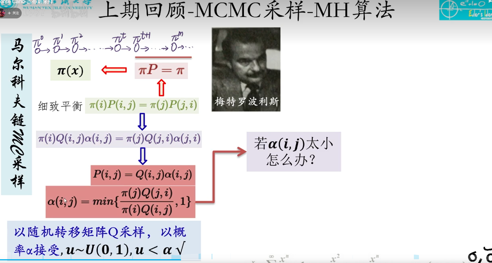

# Math

## 采样：MCMC 系列学习笔记

> 整理自刘建平 Pinard 博客园「MCMC 四篇」系列（2017-03）。原文为学习底稿，公式与流程与原文一致；表述做了压缩与分层，便于复习。
>
> | 篇目 | 链接 |
> | --- | --- |
> | (一) 蒙特卡罗方法 | https://www.cnblogs.com/pinard/p/6625739.html |
> | (二) 马尔科夫链 | https://www.cnblogs.com/pinard/p/6632399.html |
> | (三) MCMC 与 M-H 采样 | https://www.cnblogs.com/pinard/p/6638955.html |
> | (四) Gibbs 采样 | https://www.cnblogs.com/pinard/p/6645766.html |
>
> 配套代码：[mcmc_2.ipynb](https://github.com/ljpzzz/machinelearning/blob/master/mathematics/mcmc_2.ipynb)、[mcmc_3_4.ipynb](https://github.com/ljpzzz/machinelearning/blob/master/mathematics/mcmc_3_4.ipynb)

### 0. 为什么要学 MCMC

**MCMC** = **M**onte **C**arlo + **M**arkov **C**hain。名字里两个 MC 分别对应：

1. **蒙特卡罗**：用随机样本做期望/积分/求和的近似。
2. **马尔科夫链**：构造一条链，使其**平稳分布**等于目标分布 \(\pi\)，从而「走链」得到 \(\pi\) 的样本。

应用：分解机、RBM、贝叶斯推断、主题模型等，凡是要从复杂分布抽样或做期望近似，常会用到 MCMC。

学习顺序：**先会 MC 求积分 → 再懂 Markov 链收敛 → 再学如何造转移矩阵（M-H / Gibbs）**。

---

### 一、蒙特卡罗方法

#### 1.1 问题：难算的积分

求 \(\theta = \int_a^b f(x)\,dx\)。若 \(f\) 的原函数不好求，可在 \([a,b]\) 上随机取点，用样本均值近似：

\[
\theta \approx \frac{b-a}{n}\sum_{i=0}^{n-1} f(x_i)
\]

这隐含 \(x\) 在 \([a,b]\) 上**均匀**。若 \(x\) 并不均匀，近似会偏得很厉害。

#### 1.2 一般形式：重要性采样

若已知 \(x\) 的密度 \(p(x)\)（\(p(x)>0\) 在积分域上），则

\[
\theta = \int_a^b f(x)\,dx = \int_a^b \frac{f(x)}{p(x)} p(x)\,dx \approx \frac{1}{n}\sum_{i=0}^{n-1}\frac{f(x_i)}{p(x_i)},\quad x_i \sim p(x)
\]

均匀分布时 \(p(x)=1/(b-a)\)，上式退化为 \(\frac{b-a}{n}\sum f(x_i)\)。

**关键**：蒙特卡罗先要能从 \(p(x)\) **抽样**。

#### 1.3 常见分布怎么抽样

- \(U(0,1)\) 易用（如线性同余）。
- 许多连续/离散分布可由 \(U(0,1)\) **变换**得到（如 Box–Muller 生成二维正态）。
- NumPy / scikit-learn 等可直接采样常见分布。

**困难**：目标 \(p(x)\) 非常见分布时，不好直接采样。

#### 1.4 接受-拒绝采样（Accept-Reject）

选易采样的 **proposal** \(q(x)\) 和常数 \(k\)，使 \(p(x) \le k q(x)\) 处处成立。

1. 从 \(q\) 采 \(z_0\)；
2. 从 \(U(0,\, k q(z_0))\) 采 \(u\)；
3. 若 \(u \le p(z_0)\) 则接受 \(z_0\)，否则拒绝，重复。

接受样本 \(z_0,\ldots,z_{n-1}\) 后，蒙特卡罗估计：

\[
\frac{1}{n}\sum_{i=0}^{n-1}\frac{f(z_i)}{p(z_i)}
\]

思路：用「好采的 \(q\) + 拒绝规则」模拟「难采的 \(p\)」。

#### 1.5 蒙特卡罗仍不够用的场景

1. 只有 \(p(x\mid y)\)、\(p(y\mid x)\)，**联合** \(p(x,y)\) 难写 → 接受-拒绝不好设 \(q\)。
2. 高维 \(p(x_1,\ldots,x_n)\)，找合适的 \(q\) 和 \(k\) 很难。

→ 需要 **马尔科夫链** 来产生复杂分布的样本（下一篇）。

---

### 二、马尔科夫链

#### 2.1 定义（一阶马尔科夫性）

\[
P(X_{t+1}\mid X_{t-2}, X_{t-1}, X_t,\ldots) = P(X_{t+1}\mid X_t)
\]

转移概率 \(P(i,j)=P(X_{t+1}=j\mid X_t=i)\) 组成矩阵 \(P\)。例：三状态股市模型

\[
P=\begin{pmatrix}
0.9 & 0.075 & 0.025 \\
0.15 & 0.8 & 0.05 \\
0.25 & 0.25 & 0.5
\end{pmatrix}
\]

（牛市 / 熊市 / 横盘，见原文维基示例图。）

#### 2.2 平稳分布：与初值无关

设当前分布为行向量 \(\pi^{(t)}\)，则 \(\pi^{(t+1)}=\pi^{(t)} P\)。

Pinard 用 \(P\) 数值实验：无论从 \([0.3,0.4,0.3]\) 还是 \([0.7,0.1,0.2]\) 出发，约 60 步后都趋于 **\([0.625,\,0.3125,\,0.0625]\)**，与初始分布无关。

\(P^n\) 在 \(n\ge 6\) 后各行也稳定为该向量 → 与平稳分布一致。

**结论（遍历链）**：非周期、任意两状态连通时，\(\lim_{n\to\infty} P_{ij}^n=\pi(j)\) 与 \(i\) 无关；\(\pi\) 满足

\[
\pi(j)=\sum_i \pi(i)P(i,j),\quad \pi P=\pi,\quad \sum_j\pi(j)=1
\]

\(\pi\) 称为**平稳分布**。离散、连续状态均成立（连续时用转移核）。

**术语**（原文解释）：

| 概念 | 含义 |
| --- | --- |
| 非周期 | 状态不按固定周期循环；对状态 \(i\)，\(d=\gcd\{n\ge1: P_{ii}^n>0\}\)，\(d=1\) 为非周期 |
| 连通 | 有限步可从任一状态到达任一状态 |

#### 2.3 基于马尔科夫链的采样（若已知 \(P\)）

若已有平稳分布 \(\pi\) 对应的转移 \(P\)：

1. 输入 \(P\)，burn-in 次数 \(n_1\)，样本数 \(n_2\)；
2. 从简单分布采 \(x_0\)；
3. 对 \(t=0,\ldots,n_1+n_2-1\)：从 \(P(x\mid x_t)\) 采 \(x_{t+1}\)；
4. 丢弃前 \(n_1\) 步，取 \((x_{n_1},\ldots,x_{n_1+n_2-1})\) 作为 \(\pi\) 的样本，用于蒙特卡罗。

**遗留问题**：给定目标 \(\pi\)，如何构造 \(P\)？→ MCMC / M-H / Gibbs。

---

### 三、MCMC 采样与 M-H 采样

#### 3.1 细致平稳条件

对非周期链，若对所有 \(i,j\)：

\[
\pi(i)P(i,j)=\pi(j)P(j,i)
\]

则 \(\pi\) 是 \(P\) 的平稳分布（求和即 \(\pi P=\pi\)）。

随机选一个 \(Q\) 往往**不**满足 \(\pi(i)Q(i,j)=\pi(j)Q(j,i)\)。

#### 3.2 MCMC：用接受率 \(\alpha\) 修正 \(Q\)

引入 \(\alpha(i,j)\in[0,1]\)，令

\[
\pi(i)Q(i,j)\alpha(i,j)=\pi(j)Q(j,i)\alpha(j,i)
\]

一种取法是 \(\alpha(i,j)=\pi(j)Q(j,i)\)（未归一化到 1 的版本），定义

\[
P(i,j)=Q(i,j)\alpha(i,j)
\]

与接受-拒绝采样类似：**常见 \(Q\) + 接受/拒绝 → 目标 \(P\)**。

**MCMC 算法**：

1. 输入 \(Q\)、目标 \(\pi\)、\(n_1\)、\(n_2\)；
2. 采 \(x_0\)；
3. 对每步 \(t\)：
   - 从 \(Q(x\mid x_t)\) 得候选 \(x_*\)；  
   - \(u\sim U(0,1)\)；  
   - 若 \(u<\alpha(x_t,x_*)=\pi(x_*)Q(x_*,x_t)\) 则 \(x_{t+1}=x_*\)，否则 \(x_{t+1}=x_t\)；
4. 取 burn-in 后的样本集。

**缺点**：\(\alpha\) 可能很小（如 0.1），大量拒绝，\(n_1\) 要极大，链难收敛。

#### 3.3 M-H（Metropolis–Hastings）

在仍满足细致平稳的前提下，把接受率**放大**（不超过 1）：

\[
\alpha(i,j)=\min\left\{1,\ \frac{\pi(j)Q(j,i)}{\pi(i)Q(i,j)}\right\}
\]

**M-H 算法**（与 MCMC 相同框架，仅第 3 步 c 改用上式 \(\alpha\)）。

若 \(Q\) **对称**（\(Q(i,j)=Q(j,i)\)），则

\[
\alpha(i,j)=\min\left\{1,\ \frac{\pi(j)}{\pi(i)}\right\}
\]

→ 只需未归一化的 \(\pi\) 比值，不必算归一化常数。



#### 3.4 M-H 小例子（原文）

目标：\(N(3,2)\)；提议：以当前点为均值、方差 1 的正态。对称 \(Q\) 下用 \(\alpha=\min(1,\pi(x_*)/\pi(x_t))\)。代码见 [mcmc_3_4.ipynb](https://github.com/ljpzzz/machinelearning/blob/master/mathematics/mcmc_3_4.ipynb)。

#### 3.5 M-H 在高维下的两大难题（原文）

1. \(\frac{\pi(j)Q(j,i)}{\pi(i)Q(i,j)}\) 计算贵；\(\alpha<1\) 时仍常拒绝。
2. **联合** \(\pi(x_1,\ldots,x_d)\) 难写，**全条件** \(p(x_i\mid x_{-i})\) 好写。

→ **Gibbs 采样**（下一篇）。

---

### 四、Gibbs 采样

#### 4.1 思路：用全条件分布当转移

二维 \(\pi(x_1,x_2)\)。固定 \(x_1=x_1^{(1)}\) 时，在直线 \(x_1=\text{常数}\) 上用条件分布 \(\pi(x_2\mid x_1^{(1)})\) 作转移，可证任意两点满足细致平稳（原文由 \(\pi(A)\pi(x_2^{(2)}\mid x_1^{(1)})=\pi(B)\pi(x_2^{(1)}\mid x_1^{(1)})\) 推出）。  
同理固定 \(x_2\) 时用 \(\pi(x_1\mid x_2)\)。

构造转移：只沿某一坐标轴移动，概率为对应全条件；跨轴移动概率为 0（单次只改一维）。

#### 4.2 二维 Gibbs 流程

1. 输入 \(\pi(x_1,x_2)\) 或 \(P(x_2\mid x_1)\)、\(P(x_1\mid x_2)\)，\(n_1\)、\(n_2\)；
2. 随机初始化 \((x_1^{(0)}, x_2^{(0)})\)；
3. 对 \(t=0,\ldots,n_1+n_2-1\)：
   - 从 \(P(x_2\mid x_1^{(t)})\) 采 \(x_2^{(t+1)}\)；  
   - 从 \(P(x_1\mid x_2^{(t+1)})\) 采 \(x_1^{(t+1)}\)；
4. burn-in 后的二元组即为样本。

轨迹示意（坐标轴轮换）：

\[
(x_1^{(1)},x_2^{(1)})\to(x_1^{(1)},x_2^{(2)})\to(x_1^{(2)},x_2^{(2)})\to\cdots
\]

常用实现是**轮换坐标轴**；也可随机选轴，但轮换更常见。

#### 4.3 多维 Gibbs

对 \(\pi(x_1,\ldots,x_n)\)，每轮依次更新每一维：

\[
x_i^{(t+1)} \sim P\left(x_i \mid x_1^{(t+1)},\ldots,x_{i-1}^{(t+1)}, x_{i+1}^{(t)},\ldots,x_n^{(t)}\right)
\]

与 **坐标下降** 类似：Lasso 固定 \(n-1\) 维求一维极值；Gibbs 固定 \(n-1\) 维对一维**抽样**。

#### 4.4 二维正态实例（原文）

\(\mu=(5,-1)\)，\(\Sigma=\begin{pmatrix}1&1\\1&4\end{pmatrix}\)。用二元正态的闭式全条件 \(P(x_1\mid x_2)\)、\(P(x_2\mid x_1)\) 交替采样。代码见 [mcmc_3_4.ipynb](https://github.com/ljpzzz/machinelearning/blob/master/mathematics/mcmc_3_4.ipynb)。

#### 4.5 Gibbs 与 M-H 的关系（原文小结）

- Gibbs 可视为 M-H 的**特例**：全条件作提议时接受率为 1，**无需算 \(\alpha\)**，高维下更常用；Pinard 写「通常意义上的 MCMC 采样多指 Gibbs」，指的是工程实践中的主流，并非 MCMC 只有 Gibbs。
- **至少二维**才能「固定其余维、抽当前维」；**一维**仍用 M-H。
- **MCMC 系列闭环**：Gibbs/M-H 产生 \(\pi\) 的样本 → 蒙特卡罗用样本做求和/期望。

---

### 五、速查对照

| 方法 | 何时用 | 核心操作 |
| --- | --- | --- |
| 蒙特卡罗 + 已知 \(p(x)\) | 能直接抽样 | \(\frac{1}{n}\sum f(x_i)/p(x_i)\) |
| 接受-拒绝 | 有 \(p\le kq\) | 从 \(q\) 采 + 拒绝 |
| 马尔科夫链采样 | 已知 \(P\) 且 \(\pi P=\pi\) | 沿 \(P\) 随机游走 |
| MCMC / M-H | 只知 \(\pi\)（或未归一化） | 提议 \(Q\) + \(\alpha\) |
| Gibbs | 全条件好写、\(d\ge 2\) | 逐维从 \(p(x_i\mid x_{-i})\) 抽样 |

**Burn-in**：前 \(n_1\) 步丢弃，只保留链接近 \(\pi\) 之后的样本 \(n_2\) 个。

---

### 六、自测与延伸

- [ ] 手推：细致平稳 → \(\pi P=\pi\)
- [ ] 手推：M-H 的 \(\alpha=\min\{1,\frac{\pi(j)Q(j,i)}{\pi(i)Q(i,j)}\}\) 为何仍满足细致平稳
- [ ] 跑通 `mcmc_2.ipynb`：验证 \(P^n\) 与平稳分布
- [ ] 跑通 `mcmc_3_4.ipynb`：M-H 一维正态、Gibbs 二维正态

---

## 信息论：熵、条件熵、互信息与交叉熵

离散随机变量为主（连续情形把求和换成积分，熵可能为微分熵）。默认对数底为 **2**（单位 **bit**）；底为 **e** 时为 **nat**。差一个常数因子，大小关系与推导不变。

### 1. 熵（Entropy）

**定义**：随机变量 \(X\) 的分布 \(p(x)=P(X=x)\) 的 Shannon 熵

\[
H(X) = -\sum_{x} p(x)\,\log p(x) = \mathbb{E}_{X\sim p}[-\log p(X)]
\]

**含义**：按最优编码，平均每个 outcome 至少需要 \(H(X)\) bit 才能无损描述 \(X\)；也是**不确定性**的度量——分布越「平」，熵越大。

**性质（常用）**

| 性质 | 公式 / 说明 |
| --- | --- |
| 非负 | \(H(X)\ge 0\) |
| 确定性 | 若某 \(x_0\) 满足 \(p(x_0)=1\)，则 \(H(X)=0\) |
| 上界 | \(|\mathcal{X}|=n\) 时，\(H(X)\le \log n\)，等号当且仅当均匀分布 |
| 链式（多变量） | \(H(X_1,\ldots,X_n)=\sum_i H(X_i\mid X_1,\ldots,X_{i-1})\) |

**二元熵**（抛硬币）：\(H(X)= -p\log p - (1-p)\log(1-p)\)，在 \(p=0.5\) 取最大 \(\log 2\)。

---

### 2. 联合熵与条件熵

**联合熵**

\[
H(X,Y) = -\sum_{x,y} p(x,y)\,\log p(x,y)
\]

**条件熵**：已知 \(X\) 后，\(Y\) 还剩多少不确定性

\[
H(Y\mid X) = \sum_{x} p(x)\, H(Y\mid X=x) = -\sum_{x,y} p(x,y)\,\log p(y\mid x)
\]

其中 \(H(Y\mid X=x) = -\sum_y p(y\mid x)\log p(y\mid x)\)。

**核心恒等式**

\[
H(X,Y) = H(X) + H(Y\mid X) = H(Y) + H(X\mid Y)
\]

读法：\(Y\) 的总不确定性 = \(X\) 的不确定 + 给定 \(X\) 后 \(Y\) 仍不确定的部分。条件熵 **不会** 大于边际熵：\(H(Y\mid X)\le H(Y)\)（知道 \(X\) 不会增加对 \(Y\) 的不确定）。

**例**：\(X\) 为天气，\(Y\) 为是否带伞。\(H(Y\mid X)\) 通常远小于 \(H(Y)\)，因为天气强预测是否带伞。

---

### 3. 互信息（Mutual Information）

**定义**

\[
I(X;Y) = H(X) - H(X\mid Y) = H(Y) - H(Y\mid X) = H(X) + H(Y) - H(X,Y)
\]

**含义**：\(X\) 与 \(Y\) **共享**的信息量；知道 \(Y\) 能平均减少多少关于 \(X\) 的不确定性（对称）。

**与 KL 散度**：若 \(p(x,y)\) 为真联合，\(p(x)p(y)\) 为独立假设下的联合，则

\[
I(X;Y) = D_{\mathrm{KL}}\bigl(p(x,y)\,\|\,p(x)p(y)\bigr) \ge 0
\]

等号当且仅当 \(X\) 与 \(Y\) 独立。

**性质**

- \(I(X;Y)=I(Y;X)\ge 0\)
- 独立 \(\Rightarrow I(X;Y)=0\)（离散情形逆命题也成立）
- **数据处理不等式**：\(X\to Y\to Z\) 形成 Markov 链时，\(I(X;Z)\le I(X;Y)\)

**与机器学习**

| 场景 | 关系 |
| --- | --- |
| 决策树 ID3 | 分裂特征 \(A\) 的 **信息增益** \(= I(Y;\,A) = H(Y)-H(Y\mid A)\) |
| 特征选择 | 最大化 \(I(Y;\,X_j)\) 或条件互信息 \(I(Y;\,X_j\mid X_{-j})\) |
| 聚类 / 表示学习 | 希望表示 \(Z\) 保留关于输入的信息：\(I(X;Z)\) 大 |

---

### 4. 交叉熵（Cross-Entropy）

**定义**：真实分布 \(p\)，模型或近似分布 \(q\)（同一支撑上 \(q(x)>0\)）

\[
H(p,\,q) = -\sum_{x} p(x)\,\log q(x) = \mathbb{E}_{X\sim p}[-\log q(X)]
\]

**不是**对称的：一般 \(H(p,q)\ne H(q,p)\)。

**与熵、KL 的关系**

\[
H(p,\,q) = H(p) + D_{\mathrm{KL}}(p\,\|\,q)
\]

- \(H(p)\)：用 \(p\) 自己的编码长度（理论下界）。
- \(D_{\mathrm{KL}}(p\,\|\,q)\ge 0\)：用 \(q\) 去编码 \(p\) 的**额外**代价；\(p=q\) 时为 0。
- 因此 **\(H(p,q)\ge H(p)\)**，等号当且仅当 \(p=q\)（几乎处处）。

**相对熵（KL 散度）**

\[
D_{\mathrm{KL}}(p\,\|\,q) = \sum_x p(x)\log\frac{p(x)}{q(x)} = H(p,q) - H(p)
\]

（\(p\) 固定时，最小化交叉熵等价于最小化 KL。）

---

### 5. 四者关系一图

```text
        H(X,Y)
       /      \
   H(X)        H(Y)
       \      /
    I(X;Y) = H(X)-H(X|Y) = H(Y)-H(Y|X)

条件：H(X,Y) = H(X)+H(Y|X)

交叉熵（固定真实 p）：
H(p,q) = H(p) + KL(p||q)  ≥  H(p)
```

---

### 6. 分类损失：为何常用交叉熵

多类标签 **one-hot** 为 \(p\)（真实类 \(k\) 上 \(p(k)=1\)，其余为 0），模型输出 softmax 为 \(q_\theta\)。样本损失

\[
\ell = -\log q_\theta(y) = H(p,\,q_\theta)
\]

对 \(p\) 为 one-hot 时，\(H(p)=0\)，故最小化交叉熵 = 最小化 \(D_{\mathrm{KL}}(p\,\|\,q_\theta)\)。在 i.i.d. 假设下，**最小化训练集平均交叉熵等价于极大似然**（见 `2-machine-learning.md` 面试题 §7）。

**与互信息的联系（直观）**：好的分类器让 \(q_\theta(y\mid x)\) 接近 \(p(y\mid x)\)，等价于在给定 \(x\) 下减少 \(Y\) 的条件熵；特征 \(X\) 与标签 \(Y\) 的互信息 \(I(X;Y)\) 给出了「可预测性」的上界。

---

### 7. 交叉熵之外：训练里常见的「熵系」目标

交叉熵解决的是：**固定真实分布 \(p\)，让模型 \(q_\theta\) 去逼近 \(p\)**（等价于最小化 \(D_{\mathrm{KL}}(p\,\|\,q_\theta)\)）。工程里还会用到下面几类——有的仍是交叉熵/ KL 的变体，有的是**最大化熵**或**最大化互信息**。

#### 7.1 与交叉熵等价或只差常数

| 名称 | 形式 | 说明 |
| --- | --- | --- |
| 负对数似然 NLL | \(-\log q_\theta(y\mid x)\) | one-hot 分类时与单样本交叉熵相同 |
| 最小化 KL | \(D_{\mathrm{KL}}(p\,\|\,q_\theta)\) | \(p\) 固定时 \(= H(p,q_\theta)-H(p)\)，优化方向与 CE 一致 |
| 二元交叉熵 BCE | \(-y\log q-(1-y)\log(1-q)\) | 多标签 / 二分类 sigmoid；仍是「真实 Bernoulli \(p\) vs 模型 \(q\)」的 CE |

#### 7.2 交叉熵的「改进版」（仍基于 \(H(p,q)\)）

**标签平滑（Label Smoothing）**  
把 one-hot 换成软标签 \(\tilde{p}(k)=(1-\varepsilon)\mathbb{1}_{k=y}+\varepsilon/K\)，最小化 \(H(\tilde{p},\,q_\theta)\)。  
效果：防止 logits 过于自信，等价于给目标分布**人为加一点熵**。

**类别加权 / Focal Loss**  
加权 CE：\(-w_y\log q_\theta(y)\)；Focal：\(-(1-q_\theta(y))^\gamma\log q_\theta(y)\)。  
不是新熵定义，而是**重加权**困难样本；思想来自类别不平衡（笔记里的 Focal Loss）。

**知识蒸馏**  
用教师分布 \(p_T\)（软标签）代替 one-hot：\(H(p_T,\,q_S)\)。  
学生拟合的是**高熵的软目标**，而不只是 0/1。

**Softmax + 温度**  
\(q_i \propto \exp(z_i/T)\)，\(T>1\) 时分布更平、熵更大，蒸馏/校准常用。

#### 7.3 用「对称 / 有界」散度代替单向 KL

| 散度 | 定义（离散） | 特点 |
| --- | --- | --- |
| **KL** \(D_{\mathrm{KL}}(p\,\|\,q)\) | \(\sum p\log(p/q)\) | 与 CE 一体；**不对称**，\(q\to 0\) 且 \(p>0\) 时爆炸 |
| **反向 KL** \(D_{\mathrm{KL}}(q\,\|\,p)\) | \(\sum q\log(q/p)\) |  mode-seeking vs forward KL 的 mean-seeking（生成模型里两种 ELBO 取向） |
| **JS 散度** | \(\frac12 D_{\mathrm{KL}}(p\|m)+\frac12 D_{\mathrm{KL}}(q\|m)\)，\(m=\frac{p+q}{2}\) | **对称**，有界 \([0,\log 2]\)（log 底 2）；GAN 早期 JSD 与 MLE 的桥梁 |

优化时：**\(p\) 固定 → 最小化 CE / forward KL** 最常见；需要对称或稳定训练时再考虑 JS 等。

#### 7.4 最大化熵（MaxEnt）与熵正则

| 场景 | 目标 | 含义 |
| --- | --- | --- |
| 最大熵模型 | 在约束 \(\mathbb{E}_p[f_j(x)]\) 下 **最大化** \(H(p)\) | 得到指数族 \(p(x)\propto \exp(\sum \lambda_j f_j(x))\)；与 MEM 笔记一致 |
| 策略熵奖励（RL） | \(J = \mathbb{E}[R] + \beta H(\pi(\cdot\mid s))\) | 鼓励探索，避免策略过早塌缩到确定性 |
| 置信度惩罚 | 训练分类器时 **最大化** 预测熵 \(H(q_\theta)\)（或等价正则） | 与 label smoothing 类似，抑制过拟合 |

这里是**越大越好**的熵项，与「最小化交叉熵」方向相反，常作为**正则项**加在损失里。

#### 7.5 最大化互信息（不是交叉熵，但同属信息论优化）

| 方法 | 思想 |
| --- | --- |
| **InfoNCE / 对比学习** | 用噪声对比估计 **\(I(X;Z)\)** 的下界；正样本对拉近、负样本推远 |
| **VAE 的 ELBO** | \(\mathbb{E}[\log p(x|z)] - D_{\mathrm{KL}}(q(z|x)\|p(z))\)：重建项 + 对 latent 的 KL（约束后验不要偏离先验太远） |
| **IB / 深度 IB** | 在 \(I(X;Y)\) 与压缩 \(I(X;Z)\) 之间折中 |

#### 7.6 广义熵（理论扩展，优化较少直接用）

**Rényi 熵** \(H_\alpha(X)=\frac{1}{1-\alpha}\log\sum_x p(x)^\alpha\)：\(\alpha\to 1\) 退化为 Shannon 熵。  
**Tsallis 熵** \(S_q=\frac{1-\sum p^q}{q-1}\)：非广延系统、部分物理统计用。  
机器学习主流程里 **Shannon 熵 + KL/CE** 仍占绝对多数；Rényi 在聚类、信息瓶颈推广里偶尔出现。

#### 7.7 怎么选（速记）

```text
分类默认     → 交叉熵 / NLL（= 最小化 KL(p||q)）
过自信/不平衡 → label smoothing、加权 CE、Focal
软标签/蒸馏   → H(p_teacher, q_student)
探索/先验     → 最大化 H(π) 或 MaxEnt 约束
表示学习     → 最大化 I(X;Z)（InfoNCE 等）
要对称散度   → JS（或 Wasserstein 等，已非熵）
```

---

### 8. 自测

- [ ] 证明 \(H(Y\mid X)\le H(Y)\)
- [ ] 证明 \(I(X;Y)=0\) 当且仅当 \(X,Y\) 独立（离散）
- [ ] 对二元变量手算 \(H(X)\)、\(H(Y\mid X)\)、\(I(X;Y)\)
- [ ] 说明：为何 ID3 选「信息增益最大」的特征等价于 \(I(Y;A)\) 最大
- [ ] 比较：最小化 \(H(p,q)\) 与最小化 \(D_{\mathrm{KL}}(q\,\|\,p)\) 在生成模型里行为差异（mode vs mean）
