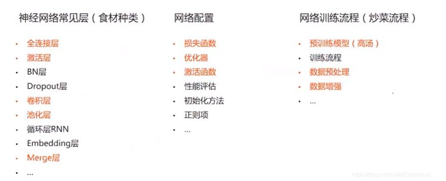
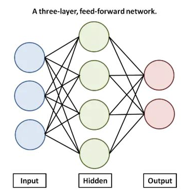
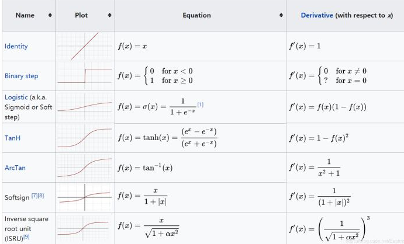
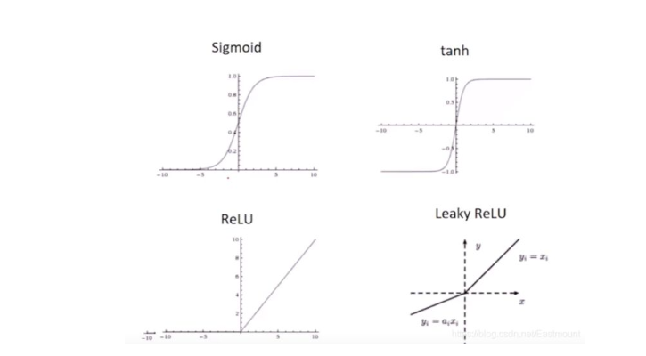
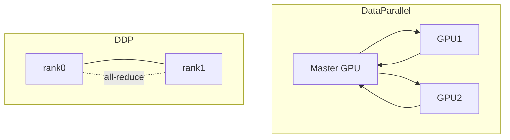
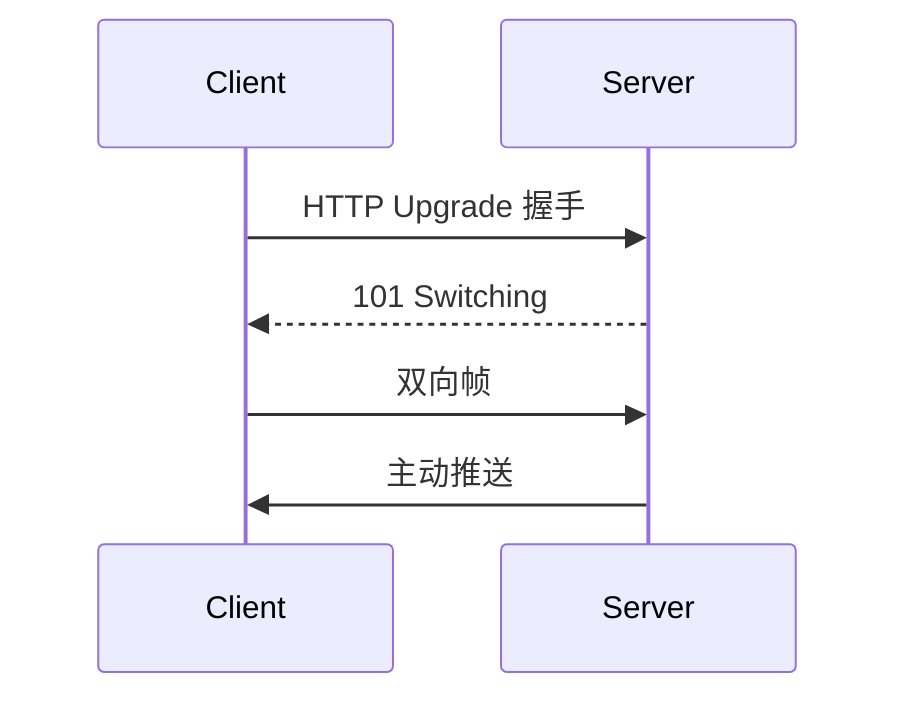

# 深度学习笔记

网络结构、PyTorch 分布式训练、优化器与学习率、混合精度及 Python 并发基础。架构图路径为 `../img/`（若本地无图，见各节 Mermaid 补充）。

## 目录

- [基础概念](#基础概念)
- [PyTorch 分布式训练](#pytorch-分布式训练)
- [自动混合精度 AMP](#自动混合精度-amp)
- [WebSocket 简述](#websocket-简述)
- [目标检测补充](#目标检测补充)
- [优化器与学习率](#优化器与学习率)
- [Python 并发基础](#python-并发基础)
- [参考资料](#参考资料)

## 基础概念

深度学习网络通常包含以下模块（总览图：`../img/image-20220508112545595.png`）：

- **常见层**：全连接、激活、BN、Dropout、卷积、池化、RNN、Embedding、Merge 等
- **网络配置**：损失、优化器、激活函数、评估指标、初始化、正则
- **训练流程**：预训练、数据预处理（归一化 / Embedding）、增强（翻转、旋转、色彩 jitter 等）



### 全连接层（Fully Connected）

隐藏层的输入和输出都有关联，即全连接层的每一个结点都与上一层的所有结点相连，用来把前边提取到的特征综合起来。由于其全相连的特性，一般全连接层的参数也是最多的。



### 激活函数（Activation）

引入非线性。常见：ReLU、Leaky ReLU、Sigmoid、Tanh、Softmax、ELU、Softplus。

| 场景 | 常用选择 |
| --- | --- |
| 隐藏层 | ReLU / Tanh / Softplus |
| 多类分类 | Softmax（输出概率） |
| 二分类输出 | Sigmoid |
| 回归输出 | 线性（无激活或 Identity） |



常用的激活函数Sigmoid、tanh、ReLU、Leaky ReLU曲线如下图所示：



优化器与学习率调度见 [专章](#优化器与学习率)。

---

## PyTorch 分布式训练

| | DP | DDP |
| --- | --- | --- |
| 进程 | 单进程多线程 | 多进程（每 GPU 一进程） |
| 范围 | 单机多卡 | 单机 / 多机 |
| 梯度 | 主卡聚合 | AllReduce 同步 |



### 数据并行

数据并行的操作要求我们将数据划分成多份，然后发送给多个 GPU 进行并行的计算。

1. 第一个方法是采用 nn.parallel 中的几个函数，分别实现的功能如下所示：
2. 复制(Replicate)：将模型拷贝到多个 GPU 上；
3. 分发(Scatter)：将输入数据根据其第一个维度(通常就是 batch 大小)划分多份，并传送到多个 GPU 上；
4. 收集(Gather)：从多个 GPU 上传送回来的数据，再次连接回一起；
5. 并行的应用(parallel_apply)：将第三步得到的分布式的输入数据应用到第一步中拷贝的多个模型上

```

# Replicate module to devices in device_ids
replicas = nn.parallel.replicate(module, device_ids)
# Distribute input to devices in device_ids
inputs = nn.parallel.scatter(input, device_ids)
# Apply the models to corresponding inputs
outputs = nn.parallel.parallel_apply(replicas, inputs)
# Gather result from all devices to output_device
result = nn.parallel.gather(outputs, output_device)

```

并行加载数据：

从磁盘读取输入数据开始，加载数据涉及四个步骤：

1. 将数据从磁盘加载到主机
2. 将数据从可分页内存传输到主机上的固定内存。请参阅[此](https://www.telesens.co/2019/02/16/efficient-data-transfer-from-paged-memory-to-gpu-using-multi-threading/ "此")有关分页和固定的内存更多信息。
3. 将数据从固定内存传输到GPU
4. 在 GPU 上 forward / backward

`DataLoader`：`num_workers>0` 多进程加载；`pin_memory=True` 锁页内存加速拷贝。

**DP 训练要点**：各卡 forward → 主卡归约梯度 → 更新后广播权重。**NCCL** 等通信库可接近线性加速。

nn.DataParallel 会默认占用可见的全部 GPU

CUDA_VISIBLE_DEVICES=1,2,3  python main.py

DataParallel 的单进程控制多 GPU 不同

DDP：


与 DataParallel 的单进程控制多 GPU 不同，在 distributed 的帮助下，我们只需要编写一份代码，torch 就会自动将其分配给n个进程，分别在 n 个 GPU 上运行。不再有主GPU，每个GPU执行相同的任务。对每个GPU的训练都是在自己的过程中进行的。每个进程都从磁盘加载其自己的数据。分布式数据采样器可确保加载的数据在各个进程之间不重叠。损失函数的前向传播和计算在每个GPU上独立执行。因此，不需要收集网络输出。在反向传播期间，梯度下降在所有GPU上均被执行，从而确保每个GPU在反向传播结束时最终得到平均梯度的相同副本。

对比DataParallel，DistributedDataParallel的区别和优势如下

区别：DDP通过多进程实现的。也就是说操作系统会为每个GPU创建一个进程,从而避免了Python解释器GIL带来的性能开销。而DataParallel()是通过单进程控制多线程来实现的。

优势：

1、每个进程对应一个独立的训练过程，且只对梯度等少量数据进行信息交换。

在每次迭代中，每个进程具有自己的 optimizer ，并独立完成所有的优化步骤，进程内与一般的训练无异。

在各进程梯度计算完成之后，各进程需要将梯度进行汇总平均，然后再由 rank=0 的进程，将其 broadcast 到所有进程。之后，各进程用该梯度来独立的更新参数。（而 DataParallel是梯度汇总到gpu0，反向传播更新参数，再广播模型参数给其他的gpu）  。DDP由于各进程中的模型，初始参数一致 (初始时刻进行一次 broadcast)，而每次用于更新参数的梯度也一致，因此，各进程的模型参数始终保持一致。

而在 DataParallel 中，全程维护一个 optimizer，对各 GPU 上梯度进行求和，而在主 GPU 进行参数更新，之后再将模型参数 broadcast 到其他 GPU。

相较于 DataParallel，torch.distributed 传输的数据量更少，因此速度更快，效率更高。

2、每个进程包含独立的解释器和 GIL。

一般使用的Python解释器CPython：是用C语言实现Pyhon，是目前应用最广泛的解释器。全局锁使Python在多线程效能上表现不佳，全局解释器锁（Global Interpreter Lock）是Python用于同步线程的工具，使得任何时刻仅有一个线程在执行。

由于每个进程拥有独立的解释器和 GIL，消除了来自单个 Python 进程中的多个执行线程，模型副本或 GPU 的额外解释器开销和 GIL-thrashing ，因此可以减少解释器和 GIL 使用冲突。这对于严重依赖 Python runtime 的 models 而言，比如说包含 RNN 层或大量小组件的 models 而言，这尤为重要。

3、为什么尽管增加了复杂性，但还是考虑使用DistributedDataParallel而不是DataParallel：

如果模型太大而无法容纳在单个 GPU 上，则必须使用模型并行将其拆分到多个 GPU 中。 DistributedDataParallel与模型并行一起使用； DataParallel目前没有。
DataParallel是单进程，多线程，并且只能在单台机器上运行，而DistributedDataParallel是多进程，并且适用于单机和多机训练。 因此，即使在单机训练中，数据足够小以适合单机，DistributedDataParallel仍比DataParallel快。 DistributedDataParallel还预先复制模型，而不是在每次迭代时复制模型，并避免了全局解释器锁定。
如果您的两个数据都太大而无法容纳在一台计算机和上，而您的模型又太大了以至于无法安装在单个 GPU 上，则可以将模型并行(跨多个 GPU 拆分单个模型）与DistributedDataParallel结合使用。 在这种情况下，每个DistributedDataParallel进程都可以并行使用模型，而所有进程都将并行使用数据。

4.1 Pytorch 分布式使用流程
Pytorch 中分布式的基本使用流程如下：

在使用 distributed 包的任何其他函数之前，需要使用 init_process_group 初始化进程组，同时初始化 distributed 包。
如果需要进行小组内集体通信，用 new_group 创建子分组
创建分布式并行模型 DDP(model, device_ids=device_ids)
为数据集创建 Sampler
使用启动工具 torch.distributed.launch 在每个主机上执行一次脚本，开始训练
使用 destory_process_group() 销毁进程组

group： 即进程组。默认情况下，只有一个组，这个可以先不管，一直用默认的就行。一个 job 即为一个组，也即一个 world。

当需要进行更加精细的通信时，可以通过 new_group 接口，使用 word 的子集，创建新组，用于集体通信等。

world_size ： 表示全局并行进程个数。
**`rank`** ： 表现当前进程的序号，用于进程间通讯，表征进程优先级。`rank = 0` 的主机为 `master` 节点。同时，rank=0的进程就是master进程

**`local_rank`** ：这是每台机子上的进程的序号，进程内，`GPU` 编号，**非显式参数**，由 `torch.distributed.launch` 内部指定。比方说， `rank = 3，local_rank = 0` 表示第 `3` 个进程内的第 `1` 块 `GPU`。

举个栗子 ：4台机器(每台机器8张卡)进行分布式训练
通过 init_process_group() 对进程组进行初始化
初始化后 可以通过 get_world_size() 获取到 world_size
在该例中为32， 即有32个进程，其编号为0-31,即rank的取值范围， 可以通过 get_rank() 函数可以进行获取。 在每台机器上，local rank均为0-8，这是 local_rank 与 rank 的区别， local_rank 会对应到实际的 GPU ID 上
(单机多任务的情况下注意CUDA_VISIBLE_DEVICES的使用
控制不同程序可见的GPU devices)

**1、torch.utils.data.distributed.DistributedSampler 的使用**

在多机多卡情况下分布式训练数据的读取也是一个问题，不同的卡读取到的数据应该是不同的。dataparallel的做法是直接将batch切分到不同的卡，这种方法对于多机来说不可取，因为多机之间直接进行数据传输会严重影响效率。于是有了利用sampler确保dataloader只会load到整个数据集的一个特定子集的做法。DistributedSampler就是做这件事的。它为每一个子进程划分出一部分数据集，以避免不同进程之间数据重复

注意：在 DataParallel 中，batch size 设置必须为单卡的 n 倍，因为一个batch的数据会被主GPU分散为minibatch给其他GPU，但是在 DistributedDataParallel 内，batch size 设置于单卡一样即可，因为各个GPU对应的进程独立从磁盘中加载数据。

# 自己的数据获取

dataset = MyDataset(input_size, data_size)

# 使用 DistributedSampler

train_sampler = torch.utils.data.distributed.DistributedSampler(dataset)

trainloader = DataLoader(dataset=dataset,
                         pin_memory=true,
                         shuffle=(train_sampler is None),   # 使用分布式训练 shuffle 应该设置为 False
                         batch_size=args.batch_size,
                         num_workers=args.workers,

主机中的内存，有两种存在方式，一是锁页，二是不锁页，锁页内存存放的内容在任何情况下都不会与主机的虚拟内存进行交换（注：虚拟内存就是硬盘），而不锁页内存在主机内存不足时，数据会存放在虚拟内存中。显卡中的显存全部是锁页内存,当计算机的内存充足的时候，可以设置pin_memory=True。当系统卡住，或者交换内存使用过多的时候，设置pin_memory=False。因为pin_memory与电脑硬件性能有关，pytorch开发者不能确保每一个炼丹玩家都有高端设备，因此pin_memory默认为False。

BatchNorm之类的层在其计算中使用了整个批次统计信息，因此无法仅使用一部分批次在每个GPU上独立进行操作。 PyTorch提供SyncBatchNorm作为BatchNorm的替换/包装模块，该模块使用跨GPU划分的整个批次计算批次统计信息。

```

model = Model()
# 把模型移到对应的gpu
# 定义并把模型放置到单独的GPU上，需要在调用`model=DDP(model)`前做
model.to(device)
 
# 引入SyncBN，这句代码，会将普通BN替换成SyncBN。
model = torch.nn.SyncBatchNorm.convert_sync_batchnorm(model)
 
# GPU 数目大于 1 才有必要分布式训练
if torch.cuda.device_count() > 1:
    model = torch.nn.parallel.DistributedDataParallel(model,
                                                      device_ids=[local_rank],
                                                      output_device=local_rank)
```

**并行程序启动**

torch.distributed.launch为我们触发了n个train.py 的 GPU进程(PID)，n就是我们将要使用的GPU或者需要开启的进程数数量。train.py会并行地n个运行。torch.distributed.launch 会给模型分配一个args.local_rank的参数，也可以通过torch.distributed.get_rank()获取进程id。

main函数的第一个 rank 变量会被 mp.spawn 函数自动填充，可以充当 local_rank 来用

https://blog.csdn.net/ytusdc/article/details/122091284?utm_medium=distribute.pc_relevant.none-task-blog-2~default~baidujs_baidulandingword~default-0-122091284-blog-119767365.235^v38^pc_relevant_sort&spm=1001.2101.3001.4242.1&utm_relevant_index=1

关闭当前显卡的所有任务

```
nvidia-smi | grep python | awk '{print $5}' | cut -d . -f1 | xargs -n1 kill -9
```

## 自动混合精度（AMP）

Automatic Mixed Precision：前向/反向中部分算子用 FP16/BF16，关键累加仍用 FP32（`torch.cuda.amp.autocast` + `GradScaler`）。

| 优点 | 风险 |
| --- | --- |
| 省显存、提速（Tensor Core） | FP16 溢出、舍入误差 |

---

## WebSocket 简述

* HTTP 请求一般包含的 `头部信息比较多`，其中有效的数据可能只占很小的一部分，导致带宽浪费；
* 服务器被动接收浏览器的请求然后响应，数据没有更新时仍然要接收并处理请求，导致 `服务器 CPU 占用`；

WebSocket 的出现可以对应解决上述问题：

* WebSocket 的头部信息少，通常只有 2Bytes 左右，能节省带宽；
* WebSocket 支持服务端主动推送消息，更好地支持实时通信；

### WHAT：WebSocket 是什么？

WebSocket 是基于 TCP 的一种新的应用层网络协议。它实现了浏览器与服务器全双工通信，即允许服务器主动发送信息给客户端。因此，在 WebSocket 中，浏览器和服务器只需要完成一次握手，两者之间就直接可以创建持久性的连接，并进行双向数据传输，客户端和服务器之间的数据交换变得更加简单。



reference:

https://juejin.cn/post/7086021621542027271

https://www.ruanyifeng.com/blog/2017/05/websocket.html


## 目标检测补充

| 类型 | 方法 |
| --- | --- |
| 传统 | DPM / HOG + SVM |
| 后处理 | NMS、Soft-NMS、Weighted-NMS |

https://blog.csdn.net/moxibingdao/article/details/125353910

---

## 优化器与学习率

沿 \(-\nabla L\) 更新参数（极大化则沿 \(+\nabla L\)）。

### BGD

全数据一次更新，慢但梯度方向稳。

### SGD

单样本：\(\theta\leftarrow\theta-\alpha\nabla J(\theta;x_i,y_i)\)。学习率敏感、易震荡。

### Mini-batch

\(\theta\leftarrow\theta-\alpha\frac{1}{m}\sum_{i=1}^m\nabla J(\theta;x_i,y_i)\)（PyTorch 默认）。

### 动量优化法

**加速梯度下降**

当我们将一个小球从山上滚下来，没有阻力时，它的动量会越来越大，但是如果遇到了阻力，速度就会变小，动量优化法就是借鉴此思想，使得梯度方向在不变的维度上，参数更新变快，梯度有所改变时，更新参数变慢，这样就能够加快收敛并且减少动荡

### Momentum

假设 mt 表示t时刻的动量， μ 表示动量因子，通常取值0.9或者近似值，在SGD的基础上增加动量，则参数更新公式如下：

$$
mt+1=μ⋅mt+α⋅▽θJ(θ) \\
θt+1=θt−mt+1
$$

在梯度方向改变时，momentum能够降低参数更新速度，从而减少震荡；在梯度方向相同时，momentum可以加速参数更新， 从而加速收敛。( 与mt方向相同的时候，相加变得更大，更新更快 )

### NAG（Nesterov accelerated gradient）

momentum保留了上一时刻的梯度 ▽θJ(θ) ，对其没有进行任何改变，NAG是momentum的改进，在梯度更新时做一个矫正，具体做法就是在当前的梯度 ▽θJ(θ) 上添加上一时刻的动量 μ⋅mt ，梯度改变为 ▽θJ(θ−μ⋅mt) 。

$$
mt+1=μ⋅mt+α⋅▽θJ(θ−μ⋅mt) \\
θt+1=θt−mt+1
$$

加上nesterov项后，梯度在大的跳跃后，进行计算对当前梯度进行校正.

### 自适应学习率

### AdaGrad

全局学习率$\delta$, 一般会选择 δ=0.01 ; 一个极小的常量 ϵ ，通常取值10e-8,目的是为了分母为0; 梯度加速变量(gradient accumulation variable) r 。


r:  前t 时刻的梯度平方和， 随着训练， r 变大， 分母表大， 学习率逐渐减少

**缺点：**

* 仍需要手工设置一个全局学习率 δ , 如果 δ 设置过大的话，会使regularizer过于敏感，对梯度的调节太大
* 中后期，分母上梯度累加的平方和会越来越大，使得参数更新量趋近于0，使得训练提前结束，无法学习

### Adadelta

Adagrad会累加之前所有的梯度平方，而Adadelta只累加固定大小的项，并且也不直接存储这些项，仅仅是近似计算对应的平均值

### RMSprop

https://blog.csdn.net/weixin_39228381/article/details/108511882

RMSProp算法修改了AdaGrad的梯度平方和累加为指数加权的移动平均，使得其在非凸设定下效果更好。设定参数：全局初始率 δ , 默认设为0.001; decay rate ρ ,默认设置为0.9,一个极小的常量 ϵ ，通常为10e-6


通过累计各个变量的梯度的平方r，然后用每个变量的梯度除以r，即可有效缓解变量间的梯度差异。（其实就是把每个变量 归一化了）

### Adam: Adaptive Moment Estimation

自适应[矩估计](https://so.csdn.net/so/search?q=%E7%9F%A9%E4%BC%B0%E8%AE%A1&spm=1001.2101.3001.7020)

[推导](https://blog.csdn.net/BeiErGeLaiDe/article/details/126059488)

[adam算法适用](https://blog.csdn.net/weixin_42869502/article/details/115028439?spm=1001.2101.3001.6661.1&utm_medium=distribute.pc_relevant_t0.none-task-blog-2%7Edefault%7ECTRLIST%7ERate-1-115028439-blog-119888296.t5_landing_title_tags_v2&depth_1-utm_source=distribute.pc_relevant_t0.none-task-blog-2%7Edefault%7ECTRLIST%7ERate-1-115028439-blog-119888296.t5_landing_title_tags_v2&utm_relevant_index=1)

### 动态学习率（Scheduler）

[学习率调度综述](https://blog.csdn.net/ayiya_Oese/article/details/120704261)

### CosineAnnealingLR

余弦退火学习率

torch.optim.lr_scheduler.CosineAnnealingLR(optimizer, T_max, eta_min=0, last_epoch=-1, verbose=False)

余弦退火学习率，T_max为半周期，每经过2*T_max之后lr回到原来的值，eta_min与optimizer的lr作比较，大的为最大值，小的为最小值，从lr到eta_min按余弦更新

T_max：经过多少个iter，学习率达到最大值
eta_min：学习率最小值

### CosineAnnealingWarmRestarts：带热重启的余弦退火

torch.optim.lr_scheduler.CosineAnnealingWarmRestarts(optimizer, T_0, T_mult=1, eta_min=0, last_epoch=-1, verbose=False)

### StepLR

StepLR：阶梯学习率。每隔相同 `step_size`更新一次 `lr`，改变 `gamma`倍。

torch.optim.lr_scheduler.StepLR(optimizer, step_size, gamma=0.1, last_epoch=-1, verbose=False)

### MultiStepLR

MultiStepLR：多阶梯学习率。`milestones`对应位置更新一次 `lr`，改变 `gamma`倍。( 在对应的某个位置跟新 lr)

而MultiStepLR是为milestones提供一个list，每到milestones的一个元素更新一次lr。

torch.optim.lr_scheduler.MultiStepLR(optimizer, milestones, gamma=0.1, last_epoch=-1, verbose=False)

### ExponentialLR：

指数学习率。每次更新为 `lr *= gamma  `

torch.optim.lr_scheduler.ExponentialLR(optimizer, gamma, last_epoch=-1, verbose=False)

### ReduceLROnPlateau

### CyclicLR

循环学习率策略在每批之后改变学习率。应在批次用于训练后调用步骤

### LambdaLR

torch.optim.lr_scheduler.LambdaLR(optimizer, lr_lambda, last_epoch=-1, verbose=False)

### 并行训练实现索引

1. [nn.DataParallel](https://github.com/tczhangzhi/pytorch-distributed/blob/master/dataparallel.py)
2. [torch.distributed / DDP](https://github.com/tczhangzhi/pytorch-distributed/blob/master/distributed.py)
3. [torch.multiprocessing](https://github.com/tczhangzhi/pytorch-distributed/blob/master/multiprocessing_distributed.py)
4. [Apex](https://github.com/tczhangzhi/pytorch-distributed/blob/master/apex_distributed.py)
5. [Horovod](https://github.com/tczhangzhi/pytorch-distributed/blob/master/horovod_distributed.py)

---

## Python 并发基础

**阻塞** ：  程序未得到所需计算资源时被挂起的状态

**A调用B，A会被挂起，一直等待B的结果，什么都不能干** 。

非阻塞：

程序在等待某操作过程中，自身不被阻塞，可以继续运行干别的事情，则称该程序在该操作上是非阻塞的。

**A调用B，A自己不用被挂起来等待B的结果，A可以去干其他的事情**

同步：

**A调用B，此时只有等B有了结果才返回**

异步：

为完成某个任务，不同程序单元之间过程中无需通信协调，也能完成任务的方式。

**A调用B，B立即返回，无需等待。等B处理完之后再告诉A结果**

并发

并行

**并行是为了利用多核加速多任务的完成；并发是为了让独立的子任务能够尽快完成；非阻塞是为了提高程序的整体运行效率，而异步是组织非阻塞任务的方式。**

### 异步编程

**以进程、线程、协程、函数/方法作为执行任务程序的基本单位，结合回调、事件循环、信号量等机制，以提高程序整体执行效率和并发能力的编程方式。**

异步框架都将异步编程模型简化：一次只允许处理一个事件。因此关于异步的讨论基本上都集中在了单线程中。

异步编程的异步调度必须要“足够小”，不能耗时太久。

合理的用异步编程的方式可以提高 cpu 的利用率，提高程序效率

**当进程数量大于CPU核心数的时候，进程切换是必须的**：

CPU从一个进程切换到另一个进程的时候，需要把旧进程运行时的寄存器状态，内存状态都保存好，然后再将另一个进程之前保存的数据恢复

除了GIL之外，所有的多线程还有通病。它们是被OS调度，调度策略是抢占式的，以保证同等优先级的线程都有均等的执行机会，那带来的问题是：并不知道下一时刻是哪个线程被运行

**多线程最主要的问题还是竞态条件。**

---

## 参考资料

- [华为开发者：优化器](https://developer.huawei.com/consumer/cn/forum/topic/0202744487054880144?fid=0101592429757310384)
- [PyTorch 分布式（CSDN）](https://blog.csdn.net/ytusdc/article/details/122091284)
- [WebSocket（阮一峰）](https://www.ruanyifeng.com/blog/2017/05/websocket.html)
- [tczhangzhi/pytorch-distributed](https://github.com/tczhangzhi/pytorch-distributed)
