# 强化学习（RL）

> 自 [`3-KG.md`](./3-KG.md) 拆出的 Q-Learning、MDP、DQN、PPO 等笔记。图片路径为 `../img/`。

## 目录

- [强化学习](#强化学习)
- [Q-Learning 与 SARSA](#q-learning)
- [强化学习笔记（1）——概述](#强化学习笔记1概述)
- [马尔可夫决策过程](#马尔可夫决策过程)

---

## 强化学习

| 维度 | 分类 |
| --- | --- |
| 是否建模环境 | Model-Free / Model-Based |
| 策略形式 | Value-Based（Q、SARSA）/ Policy-Based / Actor-Critic |
| 是否回合制 | Monte Carlo / TD / 资格迹 |

https://www.bilibili.com/video/BV1fN41197ES/?vd_source=ae11379595599a1cedeb268c109fc9bb

https://github.com/QiangLong2017/Deep-Reiforcement-Learning

基本知识

https://blog.csdn.net/qq_41773233/article/details/114435113

https://www.zhihu.com/column/c_1358130156557664256

Reinforcement Learning 

分类：

不理解环境 Model-Free RL

理解环境  Model-Based RL

基于概率 policy-Based RL 

基于价值 Value-Based RL 

回合更新

单步更新

在线学习

离线学习

- Actor-Critc
- Q  Learning
- Sarsa
- Policy Gradients

openAI gym

Tkinter

#### Q-Learning

agent : 智能体

environment  : 环境

envirnoment : observation reward 

state:  状态  就是智能体**观察**到的当前环境的**部分或者全部特征**。 

Pi  策略  pilicy
$$
\pi(a|s) = P(A=a|S=s)
$$

**状态空间**就是智能体能够观察到的特征数量。

环境的特征可能有许多，但只有智能体能够观察到的特征才算是状态。所以我们也用Observation（观察的英文）表示状态。

未来是充满不确定性的，不确定性既包含在我们的策略，也包含在环境之中

action: 行为

reward 矩阵 R :  状态为行，行为为列的

状态转移：

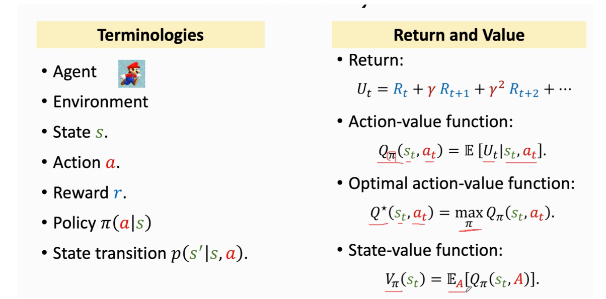

value function  is a prediction of future reward 

Q-value function gives expected total reward  

不确定性来自两个方面：1.智能体的行动选择（策略）。2.环境的不确定性。

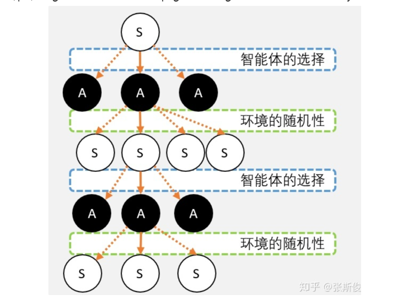

 在强化学习中，我们会用奖励R作为智能体学习的引导，期望智能体获得尽可能多的奖励。

但更多的时候，我们并不能单纯通过R来衡量一个动作的好坏

我们必须用长远的眼光来看待问题。我们要把未来的奖励也计算到当前状态下，再进行决策。

为了方便，我们希望可以有一种方法衡量我做出每种选择价值。这样，我只要看一下标记，以后的事情我也不用理了，我选择那个动作价值更大，就选那个动作就可以了。

 评估**动作**的价值，我们称为**Q值**，它代表了智能体选择这个动作后，一直到最终状态**奖励总和**的**期望**； 

评估**状态**的价值，我们称为**V值**：它代表了智能体在这个状态下，一直到最终状态的**奖励总和**的**期望**。

**V值是会根据不同的策略有所变化的！**

与V值不同，Q值和策略并没有直接相关，而与环境的状态转移概率相关，而环境的状态转移概率是不变的。

构建一个Q 矩阵：表示agent 从经验中学到的知识

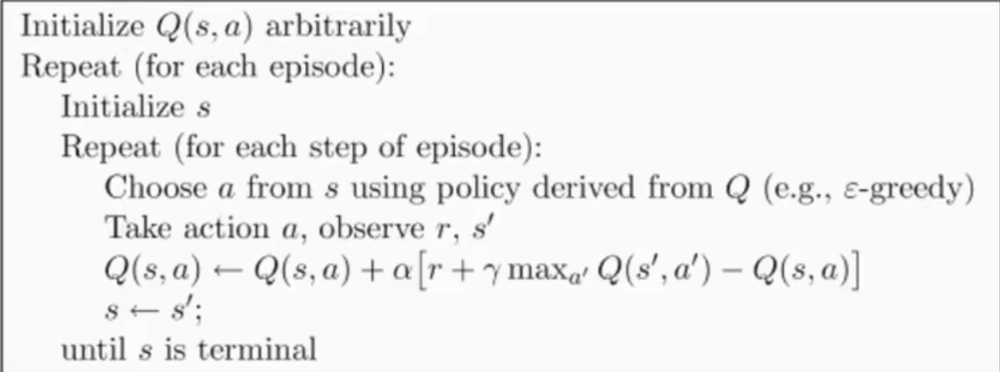

#### SARSA

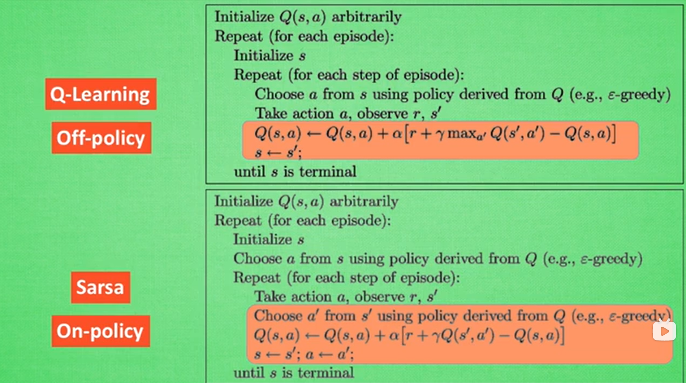

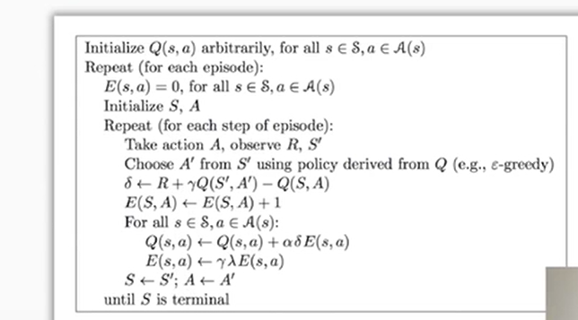

~~~
https://zhuanlan.zhihu.com/c_1215667894253830144

~~~

DQN 

TD算法存在两个缺点：

~~~
1： waste of experience    
丢弃
2： correlated updates 
Consecutive state 连续状态   strongly correlate which is bad 

~~~

DQN：

1. 记忆库
2. 神经网络计算Q值
3. 暂时冻结q_target参数 切断相关性

优化过程：

Experience Replay : 经验回放

Prioritizedd Experience Replay  优先经验回放

Use importance sampling instead of uniform sampling .  根据重要程度进行采样

~~~
重要程度进行排序 ： TD error  
big TD  error ->high probability  >small learning rate 

SumTree 排序  提高排序效率
叶子节点是存的P 重要程度值 
https://zhuanlan.zhihu.com/p/47578210

https://zhuanlan.zhihu.com/p/47578210
https://www.zhihu.com/people/echooo-49/posts?page=3
~~~

SumTree 算法：

~~~

~~~

Double DQN ： 在选择动作的时候使用

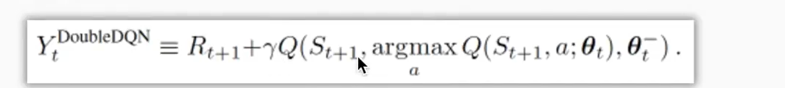

时间序列预测统计方法：

ARIMA是一种非常流行的时间序列预测统计方法

### 强化学习笔记（1）——概述

    1. 强化学习
    2. 序列决策过程简介
    3. Agents的类型

1. 强化学习

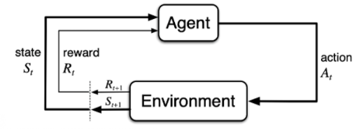

    强化学习的两大主体：agent和environment
    强化学习讨论的问题是一个智能体(agent) 怎么在一个复杂不确定的环境(environment)里面去极大化它能获得的奖励。
    当前的 agent 去跟环境交互，你就会得到一堆观测。你可以把每一个观测看成一个轨迹(trajectory).一场游戏叫做一个 episode(回合)或者trial(试验)。
    有效动作的集合经常被称为动作空间(action space)，动作空间分为离散动作空间(discrete action spaces)和连续动作空间(continuous action spaces)。
    对于一个强化学习 agent，它可能有一个或多个如下的组成成分：
    
    首先 agent 有一个 策略函数(policy function)，agent 会用这个函数来选取下一步的动作。
    然后它也可能生成一个价值函数(value function)。我们用价值函数来对当前状态进行估价，它就是说你进入现在这个状态，可以对你后面的收益带来多大的影响。当这个价值函数大的时候，说明你进入这个状态越有利。
    另外一个组成成分是模型(model)。模型表示了 agent 对这个环境的状态进行了理解，它决定了这个世界是如何进行的。它由两个部分组成：概率和奖励函数。
    
    强化学习中，探索 和利用 是两个很核心的问题，如何平衡两者的关系非常重要

2. 序列决策过程简介

    历史是观测(observation)、行为、奖励的序列：
    在这里插入图片描述
    你可以把整个游戏的状态看成关于这个历史的函数：
    在这里插入图片描述
    环境有自己的函数 S t e = f e ( H t ) S_{t}^{e}=f^{e}\left(H_{t}\right) Ste=fe(Ht)来更新状态，在 agent 的内部也有一个函数 S t a = f a ( H t ) S_{t}^{a}=f^{a}\left(H_{t}\right) Sta=fa(Ht)来更新状态。

    当 agent 的状态跟环境的状态等价的时候，我们就说这个环境是 full observability,在这种情况下面，强化学习通常被建模成一个 Markov decision process(MDP)的问题.
    当 agent 只能看到部分的观测，我们就称这个环境是部分可观测的(partially observed)。在这种情况下面，强化学习通常被建模成一个 POMDP 的问题。部分可观测马尔可夫决策过程(Partially Observable Markov Decision Processes, POMDP)。POMDP 可以用一个 7 元组描述：(S,A,T,R,Ω,O,γ)，其中 S 表示状态空间，为隐变量，A 为动作空间，T(s’|s,a)为状态转移概率，R为奖励函数，Ω(o∣s,a) 为观测概率，O 为观测空间，γ 为折扣系数。

3. Agents的类型

    根据 agent 学习的东西不同，我们可以把 agent 进行归类：

    基于价值的 agent(value-based agent)。
    这一类 agent 显式地学习的是价值函数，
    隐式地学习了它的策略。策略是从我们学到的价值函数里面推算出来的。基于价值迭代的强化学习算法有 Q-learning、 Sarsa 等
    基于策略的 agent(policy-based agent)。
    这一类 agent 直接去学习 policy，就是说你直接给它一个状态，它就会输出这个动作的概率。
    在基于策略的 agent 里面并没有去学习它的价值函数。基于策略迭代的强化学习算法有策略梯度算法等
    把 value-based 和 policy-based 结合起来就有了 Actor-Critic agent。这一类 agent 把它的策略函数和价值函数都学习了，然后通过两者的交互得到一个最佳的行为。

    agent 到底有没有学习这个环境模型来分类：

    第一种是 model-based(有模型)RL agent，它通过学习这个状态的转移来采取动作。
    另外一种是 model-free(免模型)RL agent，它没有去直接估计这个状态的转移，也没有得到环境的具体转移变量。它通过学习价值函数和策略函数进行决策。Model-free 的模型里面没有一个环境转移的模型。

### 马尔可夫决策过程

    0. 前言
    1. 马尔可夫过程（Markov Process，MP）
    2. 马尔可夫奖励过程（Markov Reward Process，MRP）
        2.1 迭代法计算状态价值函数 V V V
        2.2 蒙特卡罗法计算状态价值函数 V V V
        2.3 动态规划法计算状态价值函数 V V V
        2.4 时序差分学习法计算状态价值函数 V V V
    3. 马尔可夫决策过程（Markov Decision Process，MDP）
        3.1 MDP中的策略policy
        3.2 MDP和MRP之间的区别
        3.3 MDP的价值函数
        3.4 贝尔曼期望等式（Bellman Expectation Equation）
        3.5 备份图（backup diagram）
        3.6 预测和控制问题
            3.6.1 解决预测问题
            3.6.2 解决控制问题

0. 前言

在马尔可夫决策过程中，它的环境是全部可以观测的(fully observable)。但是很多时候环境里面有些量是不可观测的，但是这个部分观测的问题也可以转换成一个 MDP 的问题。
在介绍马尔可夫决策过程(Markov Decision Process，MDP)之前，先给大家梳理一下马尔可夫过程(Markov Process，MP)、马尔可夫奖励过程(Markov Reward Processes，MRP)。这两个过程是马尔可夫决策过程的基础。
1. 马尔可夫过程（Markov Process，MP）

    如果一个状态转移是符合马尔可夫的，那就是说一个状态的下一个状态只取决于它当前状态，而跟它当前状态之前的状态都没有关系。

    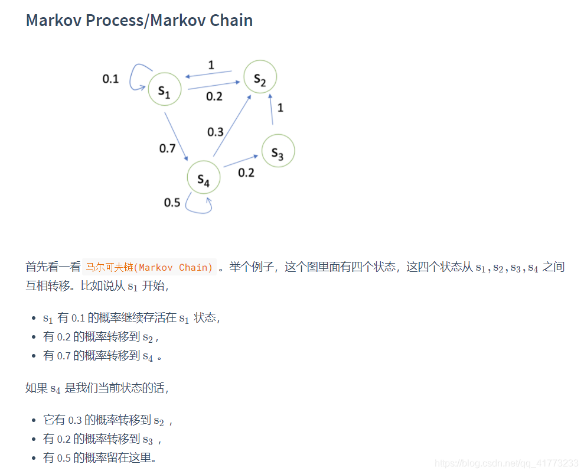

    我们可以用状态转移矩阵(State Transition Matrix) P 来描述状态转移 p ( s t + 1 = s ′ ∣ s t = s )

    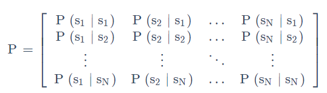

2. 马尔可夫奖励过程（Markov Reward Process，MRP）

马尔可夫奖励过程(Markov Reward Process, MRP) 是马尔可夫链再加上了一个奖励函数。

1. Horizon是指一个回合的长度（每个回合最大的时间步数），它是由有限个步数决定的。
2. Return(回报) 说的是把奖励进行折扣后所获得的收益。Return 可以定义为奖励的逐步叠加，如下式所示：

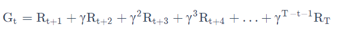

Rt+1代表从状态   st转移到 st+1得到的奖励

Gt代表在状态 st下能获得的折扣回报

这里有一个叠加系数，越往后得到的奖励，折扣得越多。这说明我们其实更希望得到现有的奖励，未来的奖励就要把它打折扣。

有了 return 过后，就可以定义一个状态的价值了，就是`state value function`。对于 MRP，state value function 被定义成是 return 的期望，如下式所示:

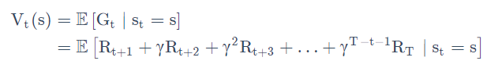

Gt是之前定义的 discounted return，我们这里取了一个期望，期望就是说从这个状态开始，你有可能获得多大的价值。discount factor 可以作为强化学习 agent 的一个超参数来进行调整，然后就会得到不同行为的 agent。

2.1 迭代法计算状态价值函数 V 

在使用迭代法之前，需要从价值函数里面推导出 Bellman Equation（贝尔曼等式），如下所示
在这里插入图片描述

想要推导贝尔曼等式，在此之前需要得到Law of Total Expectation(全期望公式)，即：
在这里插入图片描述
其中：

    V ( s t + 1 ) V(s_{t+1}) V(st+1)代表在状态 s t + 1 s_{t+1} st+1下的状态价值函数
    G t + 1 G_{t+1} Gt+1代表在状态 s t + 1 s_{t+1} st+1下的折扣回报（discounted return）。从 s t + 1 s_{t+1} st+1转移到 s t + 2 s_{t+2} st+2的奖励 R t + 2 R_{t+2} Rt+2开始算起，后面乘以折扣因子再相加。

证明过程：
在这里插入图片描述

因此全期望公式说的是，在状态 s t s_{t} st下，下一状态 s t + 1 s_{t+1} st+1的状态价值函数 V ( s t + 1 ) V(s_{t+1}) V(st+1)（它本身就是一个期望）的期望，等于，在状态 s t s_{t} st下，下一状态 s t + 1 s_{t+1} st+1的折扣回报 G t + 1 G_{t+1} Gt+1（它不是一个期望）的期望。（推导过程省略）
如何理解全期望公式？表面上看，好像 G t + 1 G_{t+1} Gt+1比 V ( s t + 1 ) V(s_{t+1}) V(st+1)计算更简洁，计算得到了优化，实际上，在计算 E [ G t + 1 ∣ s t ] \mathrm{E}\left[\mathrm{G}_{\mathrm{t}+1} \mid \mathrm{s}_{\mathrm{t}}\right] E[Gt+1∣st]的时候仍然要考虑状态 s t s_{t} st转移到状态 s t + 1 s_{t+1} st+1的概率和状态 s t + 1 s_{t+1} st+1转移到状态 s t + 2 s_{t+2} st+2的概率，因为 G t + 1 G_{t+1} Gt+1并不是状态 s t + 1 s_{t+1} st+1一个确定的折扣奖励，而是一个随机变量。全期望公式只是形式上得到了简化，但是实际在计算的时候，还是没有得到简化。

接下来，就可以得到贝尔曼等式了。
贝尔曼等式：定义了当前状态价值函数与未来状态价值函数的关系
在这里插入图片描述
其中：

    s’可以看成未来的所有状态。
    转移 P(s’|s)是指从当前状态转移到未来状态的概率。
    V(s’)代表的是未来某一个状态的价值。我们从当前这个位置开始，有一定的概率去到未来的所有状态，所以我们要把这个概率也写上去，这个转移矩阵也写上去，然后我们就得到了未来状态，然后再乘以一个 γ，这样就可以把未来的奖励打折扣。
    第二部分可以看成是未来奖励的折扣总和(Discounted sum of future reward)。

推导过程如下：
在这里插入图片描述
基于贝尔曼等式，可以写出所有状态的状态价值函数 V ( s i ) V(s_i) V(si)之间的关系：
在这里插入图片描述
修改为矩阵形式：
在这里插入图片描述
因此，只要知道每个状态的即时奖励 R R R与状态间的转移矩阵 P P P，那么就可以求出每个状态的状态价值函数 V V V。但是迭代法需要对矩阵求逆，对于大型矩阵的求逆会非常耗时，所以这种方法只适用于状态数较少的情况。
2.2 蒙特卡罗法计算状态价值函数 V V V

根据状态价值函数 V V V的定义，一个状态的 V V V是当前状态的折扣奖励期望，因此蒙特卡罗法就从当前状态出发，生成很多轨迹，然后计算这些轨迹的折扣奖励，将这些奖励加和后取平均，只要选取的轨迹足够多，那么就可以认为这就是 V V V的值。
在这里插入图片描述
2.3 动态规划法计算状态价值函数 V V V

我们也可以用这个动态规划的办法，一直去迭代它的 Bellman equation，让它最后收敛，就得到了状态价值函数 V V V。

在这里插入图片描述
2.4 时序差分学习法计算状态价值函数 V V V

时序差分学习(Temporal-Difference Learning)的办法。 Temporal-Difference Learning 叫 TD Leanring，它是动态规划和蒙特卡罗的一个结合。
3. 马尔可夫决策过程（Markov Decision Process，MDP）

相对于 MRP，马尔可夫决策过程(Markov Decision Process)多了一个 decision，其它的定义跟 MRP 都是类似的:

    这里多了一个决策，多了一个动作。
    状态转移也多了一个条件，变成了 P ( s t + 1 = s ′ ∣ s t = s , a t = a ) P\left(s_{t+1}=s^{\prime} \mid s_{t}=s, a_{t}=a\right) P(st+1=s′∣st=s,at=a)。未来的状态不仅是依赖于你当前的状态 s s s，也依赖于在当前状态 agent 采取的这个动作 a a a。
    对于这个价值函数，它也是多了一个条件，多了一个你当前的动作，变成了 R ( s t = s , a t = a ) = E [ r t ∣ s t = s , a t = a ] R\left(s_{t}=s, a_{t}=a\right)=\mathbb{E}\left[r_{t} \mid s_{t}=s, a_{t}=a\right] R(st=s,at=a)=E[rt∣st=s,at=a]。你当前的状态以及你采取的动作会决定你在当前可能得到的奖励多少。

3.1 MDP中的策略policy

    Policy 定义了在某一个状态应该采取什么样的动作。
    知道当前状态过后，我们可以把当前状态带入 policy function，然后就会得到一个概率，即：
    π ( a ∣ s ) = P ( a t = a ∣ s t = s ) \pi(a \mid s)=P\left(a_{t}=a \mid s_{t}=s\right) π(a∣s)=P(at=a∣st=s)
    假设这个概率函数应该是稳定的(stationary)
    另外这个策略也可能是确定的，它有可能是直接输出一个值，告诉你当前应该采取什么样的动作，而不是一个动作的概率。

加了策略policy π \pi π的MDP和没加策略的MRP是有关系的，即：只要对所有动作得到的奖励进行加权平均，如下所示：
在这里插入图片描述
3.2 MDP和MRP之间的区别

下图中左边是MP过程（或者是MRP过程，加了一个奖励而已），右边是MDP过程
在这里插入图片描述
3.3 MDP的价值函数

    仿照MRP中的状态价值函数的定义，可以类似地定义MDP中的价值函数：
    在这里插入图片描述
    我们通过对policy 进行采样来得到一个期望，那么就可以计算出它的价值函数。
    
    这里我们另外引入了一个 Q 函数(Q-function)。Q 函数也被称为 action-value function。Q 函数定义的是在某一个状态采取某一个动作，它有可能得到的这个 return 的一个期望。
    在这里插入图片描述
    对 Q 函数 q π ( s , a ) \rm q^{\pi}(s,a) qπ(s,a)中的动作进行加和，就可以得到价值函数 v π ( s ) \rm v^{\pi}(s) vπ(s)，即：
    在这里插入图片描述
    
    Q 函数的 Bellman equation：
    在这里插入图片描述

3.4 贝尔曼期望等式（Bellman Expectation Equation）

我们可以把状态-价值函数和 Q 函数拆解成两个部分：即时奖励(immediate reward) 和后续状态的折扣价值(discounted value of successor state)。

比如，对于状态价值函数 v π ( s ) \rm v^{\pi}(s) vπ(s)，有：
在这里插入图片描述
比如，对于Q函数 q π ( s , a ) \rm q^{\pi}(s,a) qπ(s,a)，有：
在这里插入图片描述
上面两个就是Bellman Expectation Equation的第一种形式。
当然，根据前述的 v π ( s ) \rm v^{\pi}(s) vπ(s)与 q π ( s , a ) \rm q^{\pi}(s,a) qπ(s,a)的实际含义，可以得到两者的数学关系：
在这里插入图片描述
或：
在这里插入图片描述
两式相互代入，可以得到Bellman Expectation Equation的第二种形式：
在这里插入图片描述
在这里插入图片描述
3.5 备份图（backup diagram）

如下所示的为状态价值函数 v π ( s ) \rm v^{\pi}(s) vπ(s)备份图，图中的 r \rm r r是 γ \gamma γ。
在这里插入图片描述

    这些操作将价值信息从一个状态（或状态-动作对）的后继状态（或状态-动作对）转移回它。
    每一个空心圆圈代表一个状态，每一个实心圆圈代表一个状态-动作对。

上图很形象地说明了下面这个公式
在这里插入图片描述
注意 R ( s , a ) R(s,a) R(s,a)代表在状态s下采取动作a后（转移到状态 s ′ s' s′）得到的单步奖励期望，即： R ( s , a ) = E [ R t + 1 ∣ s t = s , a t = a ] \rm R(s,a) = \mathbb{E}\left[\mathbf{R}_{\mathrm{t}+1} \mid \mathrm{s}_{\mathrm{t}}=\mathrm{s}, \mathrm{a}_{\mathrm{t}}=\mathrm{a}\right] R(s,a)=E[Rt+1∣st=s,at=a]。

如下所示的为Q函数 q π ( s , a ) \rm q^{\pi}(s,a) qπ(s,a)备份图，图中的 r \rm r r是 γ \gamma γ。
在这里插入图片描述

    第一层加和是先把这个叶子节点从黑色节点推到这个白色的节点，进了它的这个状态。
    当我们到达某一个状态过后，再对这个白色节点进行一个加和，这样就把它重新推回到当前时刻的一个 Q 函数。

在这里插入图片描述

3.6 预测和控制问题

MDP 的 prediction 和 control 是 MDP 里面的核心问题。
这两者的区别就在于：预测问题是给定一个 policy，我们要确定它的 value function 是多少，这也称为policy evaluation问题；而控制问题是在没有 policy 的前提下，我们要确定最优的 value function 以及对应的决策方案。
在强化学习中，我们通过解决预测问题，进而解决控制问题。

------------------------------------------------

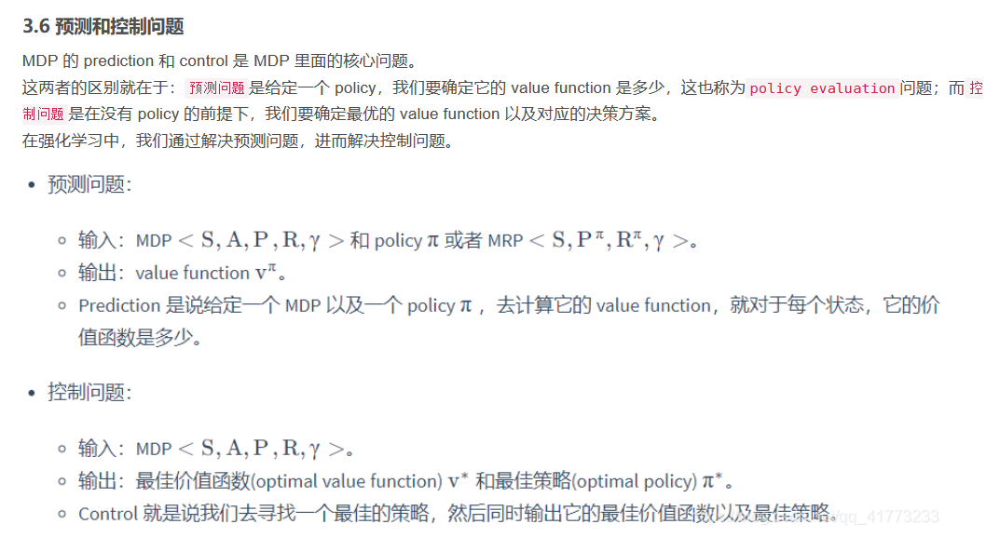

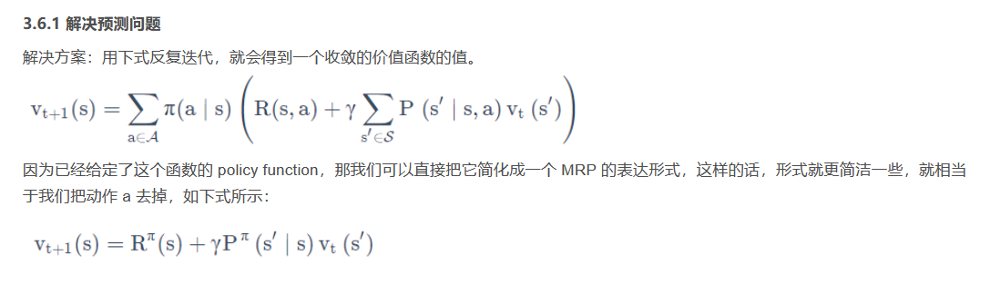

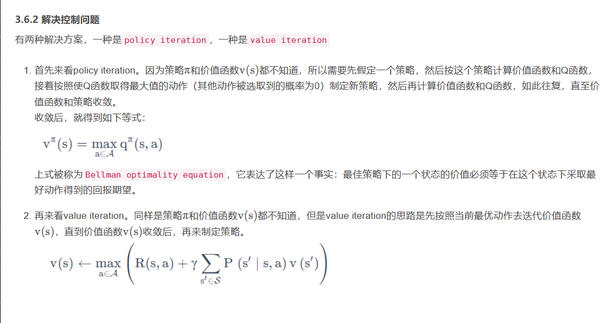

原文链接：https://blog.csdn.net/qq_41773233/article/details/114435113

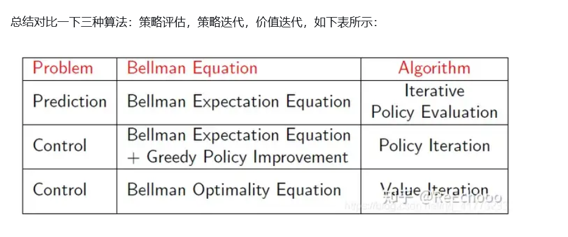

MC法、TD法、DP法的区别

圈表示状态， 点表示动作

**MC算法:深度采样学习**。一次学习完整经历，使用实际收获更新状态预估价值，如下图所示：

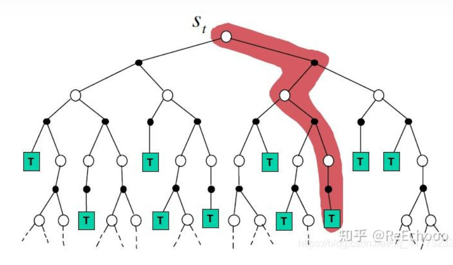

**TD算法:浅层采样学习**。经历可不完整，使用后续状态的预估状态价值预估收获再更新当前状态价值，如下图所示。

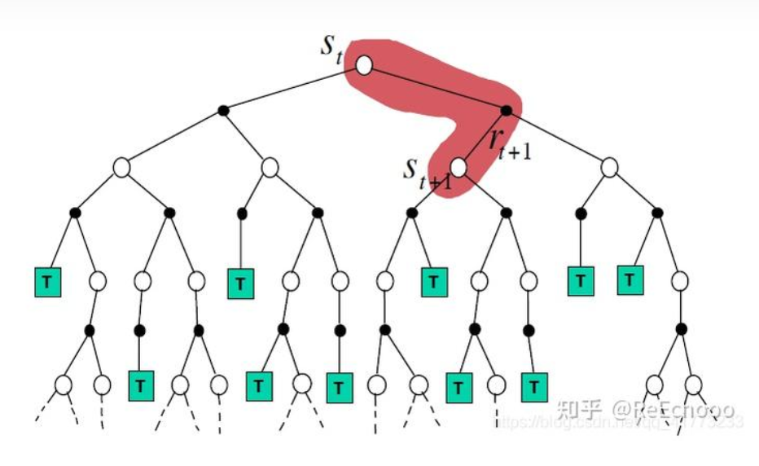

**DP算法:浅层全宽度(采样)学习**。依据模型，全宽度地使用后续状态预估价值来更新当前状态价值，如下图所示。

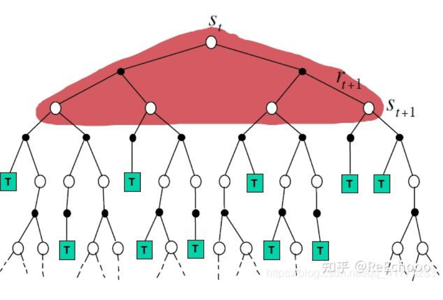

综合上述三种学习方法的特点，可以小结如下︰当使用单个采样，同时不经历完整的状态序列更新价值的算法是TD学习;当使用单个采样，但依赖完整状态序列的算法是MC学习;当考虑全宽度采样，但对每一个采样经历只考虑后续一个状态时的算法是DP学习;如果既考虑所有状态转移的可能性，同时又依赖完整状态序列的，那么这种算法是穷举(exhausive search)法。需要说明的是:DP利用的是整个MDP问题的模型，也就是状态转移概率，虽然它并不实际利用采样经历，但它利用了整个模型的规律，因此也被认为是全宽度(full width)采样的。

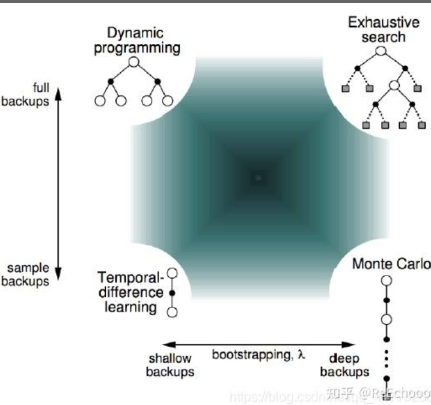

n步时序差分学习：

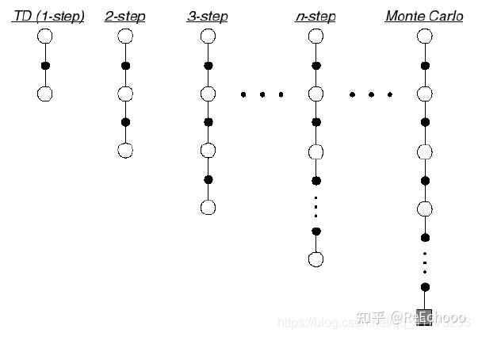

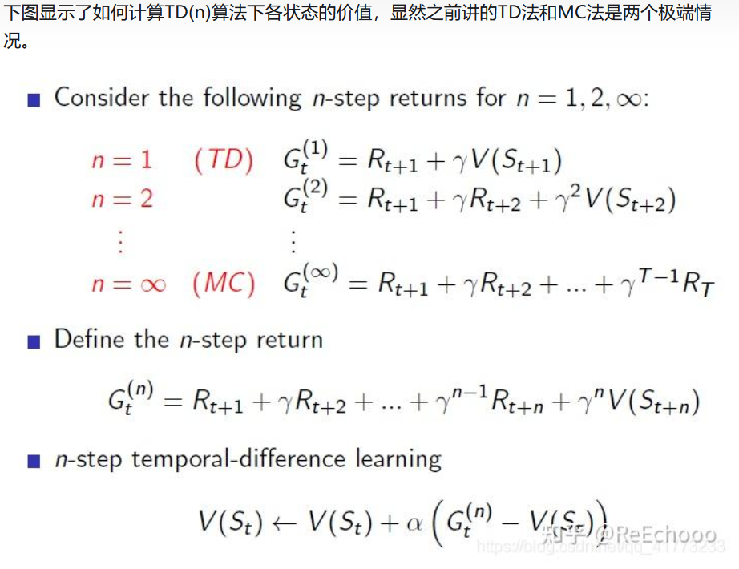

 那么在实际应用中，n取多少？n是一个超参，需要自己调！

进一步地，还可以在不增加计算复杂度的情况下，综合考虑各种步数的预测，引入一个新的参数 lamda ，并定义为   **收获**，其计算公式为：

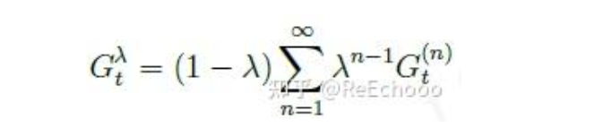

PPO和之前讲过的DDPG，都是基于策略梯度的强化学习算法，但它们之间还是有一定的区别。

- PPO是在线学习算法，而DDPG是离线学习算法。PPO算法在每一步中都会更新策略参数，而DDPG算法则是先收集一段轨迹，然后再进行学习。
- PPO算法使用了近端比率裁剪损失，用于限制策略更新幅度，而DDPG算法则使用了Q-learning，用于学习状态动作值函数。
- PPO算法可以用于离散动作空间和连续动作空间，而DDPG算法只能用于连续动作空间。

总体而言，PPO算法更加稳定，可以用于离散动作空间和连续动作空间，而DDPG算法则适用于连续动作空间。

策略梯度算法的核心思想是，通过最大化期望回报来优化策略：

PPO算法的核心思想是限制策略更新幅度，以达到稳定、高效的训练结果。具体来说，PPO算法使用了两个[损失函数](https://zhida.zhihu.com/search?q=损失函数&zhida_source=entity&is_preview=1)：第一个损失函数是近端比率裁剪损失，用于限制策略更新幅度；第二个损失函数是[价值函数](https://zhida.zhihu.com/search?q=价值函数&zhida_source=entity&is_preview=1)损失，用于优化策略。两个损失函数的加权和就是PPO算法的总损失函数。

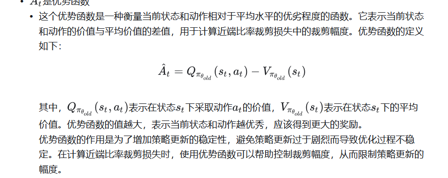

