# 生成模型

> 自 [`3-KG.md`](./3-KG.md) 拆出的 AE/VAE/GAN、Normalizing Flow、Diffusion 及 FID/CLIP 等笔记。图片路径为 `../img/`。

## 目录

- [生成模型](#生成模型)
- [Encoder–Decoder 族](#encoderdecoder-族)
- [Normalizing Flow](#normalizing-flow)
- [Diffusion（扩散模型）](#diffusion扩散模型)
- [评价指标](#评价指标)
- [概念讲解（Diffusion）](#概念讲解)
- [DALL·E 2 / Stable Diffusion](#dalle-2--stable-diffusion)

---

## 生成模型

生成模型是指能够随机生成观测数据的模型，尤其是在给定某些隐含参数的条件下。它给观测值和标注数据序列指定一个联合概率分布

### Encoder–Decoder 族

#### AutoEncoder（AE）

自编码器

目的： 降维，和去噪生，和图像生成

idea: 直接使用神经网络对input 数据进行映射，得到output向量（作为从数据中提取的特征）

AE:  是一种利用反向传播的算法，使得输出值 = 输入值得神经网络

​		encoder : h = f(x)  将输入数据压缩成潜在空间特征

​		decoder: r = g(h)

​		g(f(x)) =r  = x (与原x 相近)

​		其中 h 的维度 比x 小(相当于降维 PCA )

学习过程：  L（x, g(f(x))） ,  MSE 

如果 decoder 是线性的，且L是均方误差，则自编码器会学习出PCA相同的子空间

#### 正则编码器

1. 稀疏自编码器

   加入稀疏惩罚项，让自编码器的input结果稀疏，编码器网络隐藏层第$$[Math Processing Error]i$$ 个神经元的平均激活度为所有训练样本的激活函数均值，记为$$[Math Processing Error]\widehat{p_i}$$,p 是人工指定的活跃点

    						$$[Math Processing Error]L(x,g(f(x))+\Omega{(h)}$$

使得交叉熵构造惩罚项：

​						$$[Math Processing Error]\Omega(h) = \sum^n_i (pln{p \over \widehat p_i} +(1-p)ln{ 1-p \over 1- \widehat p_i})$$

去噪编码器 (Denosing AutoEncoder , DAE)

收缩自编码器（Contractinve Autoencoder ,CAE）

#### VAE

(Variational Auto-encoder , VAE)

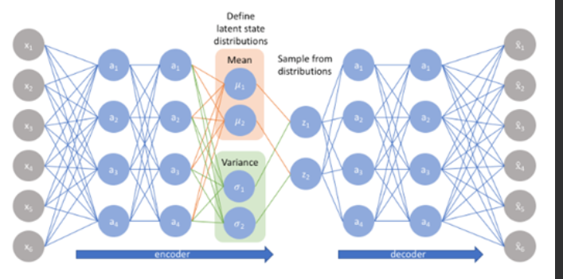

$$[Math Processing Error]希望构建一个隐变量Z，生成目标函数x，但是只能看到x,只要推出Z的特征，（贝叶斯概率)$$

看到x,要推出Z的特征：

​		$$[Math Processing Error]p(z|x) = {p(x|z)p(z)\over p(x)} \tag{1}$$

​									$$[Math Processing Error]p(x)= \int P(x|z)P(z)dz \tag{2}$$

VAE : (变化+贝叶斯)，使用q(z|x) 来近似p(z|x)

​										$$[Math Processing Error] min KL(q(z|x)|| p(x|z))$$

通过 $$[Math Processing Error]max E_{q(t|x)}logP(x|z)-KL(q(z|x)||p(z))$$ , 来最小化。

https://blog.csdn.net/smileyan9/article/details/107362252

https://blog.csdn.net/cloudless_sky/article/details/123697481

#### GAN

~~~
https://www.bilibili.com/video/BV1Bg4y187WC?spm_id_from=333.337.search-card.all.click

https://developer.huawei.com/consumer/cn/forum/topic/0202744487054880144?fid=0101592429757310384

https://zhuanlan.zhihu.com/p/28853704 gan 的证明
~~~

GANs（Generativeadversarial networks）对抗式生成网络

- Generative：生成式模型
- Adversarial：采取对抗的策略
- Networks：网络

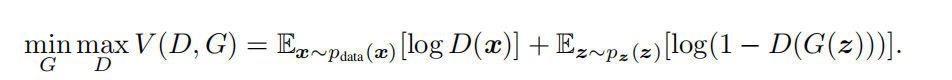

整个公式的具体含义如下：

- 式子由两项构成，x表示真实图片，z表示输入G网络的噪声，而G(z)表示G网络生成的图片。
- D(x)表示D网络判断**真实图片是否真实**的概率（因为x就是真实的，所以对于D来说，这个值越接近1越好）。
- D(G(z))是**D网络判断G生成的图片是否真实的概率。**
- G的目的：G应该希望自己生成的的图片越接近真实越好。
- D的目的：D的能力越强，D(x)应该越大，D(G(x))应该越小，这时V(D,G)会变大，因此式子对于D来说是求最大（max_D）。
- trick：为了前期加快训练，生成器的训练可以把log(1-D(G(z)))换成-log(D(G(z)))损失函数。

 GAN图片生成:

**第一步（左图）**：希望判决器尽可能地分开真实数据和我生成的数据。那么，怎么实现呢？我的真实数据就是input1（Real World  images），我生成的数据是input2（Generator）。input1的正常输出是1，input2的正常输出是0，对于一个判决器（Discriminator）而言，我希望它判决好，首先把生成器固定住（虚线T），然后生成一批样本和真实数据混合给判决器去判断。此时，经过训练的判决器变强，即固定生成器且训练判决器。

**第二步（右图）**：固定住判决器（虚线T），我想办法去混淆它，刚才经过训练的判决器很厉害，此时我们想办法调整生成器，从而混淆判别器，即通过固定判决器并调整生成器，使得最后的输出output让生成的数据也输出1（第一步为0）

~~~python
GAN的核心就是这些，再简单总结下，即：
    步骤1是在生成器固定的时候，我让它产生一批样本，然后让判决器正确区分真实样本和生成样本。（生成器标签0、真实样本标签1）
    步骤2是固定判决器，通过调整生成器去尽可能的瞒混判决器，所以实际上此时训练的是生成器。（生成器的标签需要让判决器识别为1，即真实样本）
    
for 迭代 in range(迭代总数):
    for batch in range(batch_size):
        新batch = input1的batch + input2的batch (batch加倍)
        for 轮数 in range(判别器中轮数):
           步骤一 训练D
        步骤二 训练G
        
https://www.infoq.cn/article/2w5ew5i3g*vkgc5elqgy
    
~~~

~~~
https://reiinakano.github.io
https://reiinakano.com/
~~~

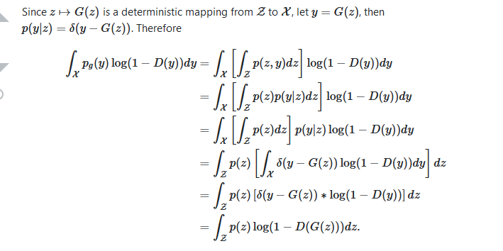

https://blog.csdn.net/weixin_43334693/article/details/135271954?spm=1001.2101.3001.6650.2&utm_medium=distribute.pc_relevant.none-task-blog-2%7Edefault%7ECTRLIST%7ERate-2-135271954-blog-105175097.235%5Ev43%5Epc_blog_bottom_relevance_base6&depth_1-utm_source=distribute.pc_relevant.none-task-blog-2%7Edefault%7ECTRLIST%7ERate-2-135271954-blog-105175097.235%5Ev43%5Epc_blog_bottom_relevance_base6&utm_relevant_index=5

https://www.bilibili.com/video/BV1Up411R7Lk?p=4&vd_source=ae11379595599a1cedeb268c109fc9bb

### Normalizing Flow

https://blog.csdn.net/m0_56942491/article/details/136346491

https://www.bilibili.com/video/BV1C4411A7o3/?from=search&seid=7904061540301133082&vd_source=c06477a064079dc916ffc3a3b940bb0f

### Diffusion（扩散模型）

噪声的添加过程中，每一步都要保持尽量相同的噪声扩散幅度。图片前期的分布非常均匀，添加一些噪声便可以将[原始分布](https://www.zhihu.com/search?q=原始分布&search_source=Entity&hybrid_search_source=Entity&hybrid_search_extra={"sourceType"%3A"article"%2C"sourceId"%3A"610012156"})改变，但到后期，需要添加更多的噪声，方可保证噪声扩散幅度相同（有趣的比喻，水中加糖，为了使糖的甜味增长相同，后期需要加更多的糖）。

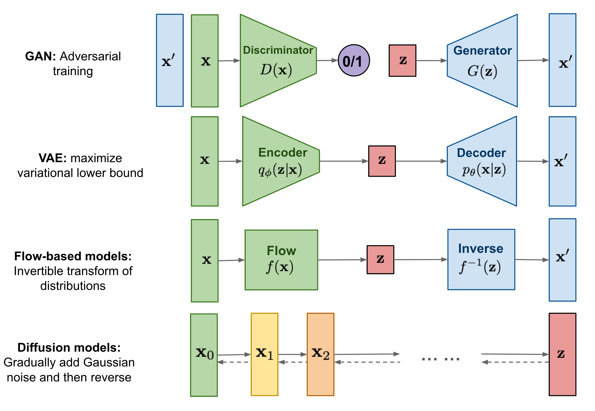

[*Diffusion* Model （李宏毅阅读笔记）](https://zhuanlan.zhihu.com/p/638698344)

## 评价指标

### Frechet Inception Distance（FID）

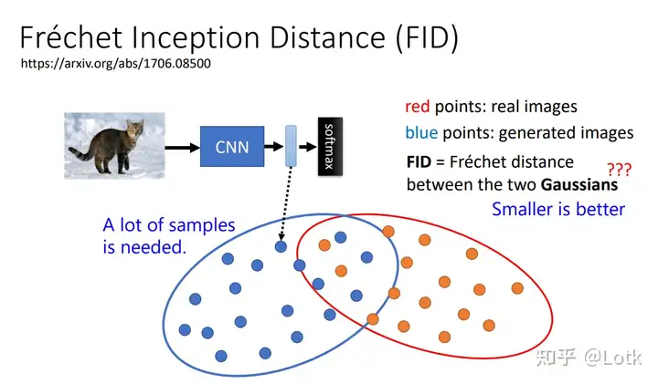

FID评价指标

首先需要一个训练好的分类器，然后比较生成图片与真实图片representation之间的距离，距离越小越好，这需要大量图片来测量。

### Contrastive Language-Image Pre-Training（CLIP）

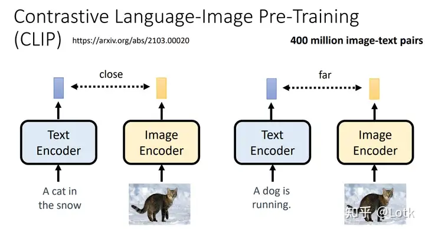

CLIP Score评价指标

使用CLIP模型根据对应的文字描述来判断生成图像的质量。

## 概念讲解

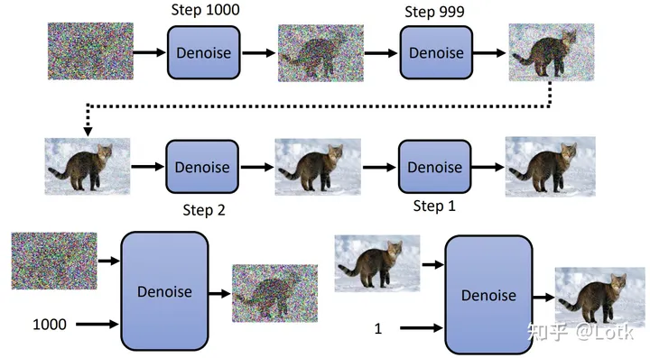

图一：Diffusion Model的运作

不同时序使用的是同一个denoise模型，但是因为输入图片的状态有很大的不同，所以需要把step本身也输入到denoise模型，让它知道当前图片的去噪状况。Denoise模型的具体结构如图2所示。

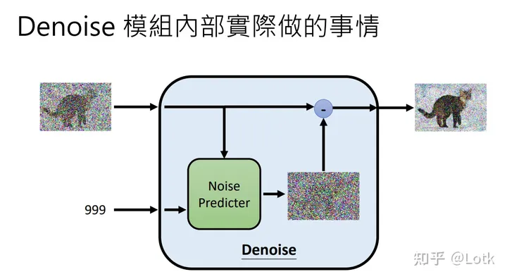

图二：Denoise模块内部情况

Denoise模块中存在一个Predicter，它用来预测输入图片的噪声，再用要被denoise的图片减去噪声就可以得到denoise之后的图片了。

那么这个Noise Predicter如何训练呢？在训练时，我们首先需要根据原始无噪声的图片认为生成Predicter的噪声GT。GT具体的生成方法见图三。

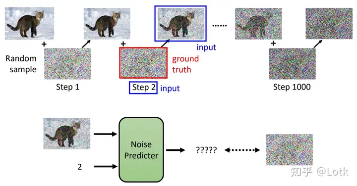

图三：噪声的生成与Predicter的训练

与denoise相反，在生成GT时我们一步步的对无噪声图片添加噪声，每一步添加的噪声就是GT。在训练Predictor时，当前的step以及加噪之后的图片是模型的输入，添加的噪声就是当前step的GT。

但是我们都知道，diffusion模型的一个重要功能就是可以根据文字描述生成图片，那么这段文字描述应该怎么传到模型呢？其实很简单，和step数一样，直接输入给Noise Predictor就可以了。

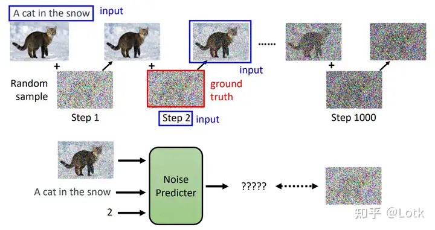

图四：text-to-image

### text-to-image框架

既然说到了text-to-image，那么我们不妨先来看看整个框架，如图五所示。

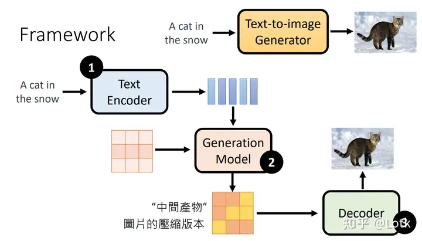

图五：text-to-image framework

从这个framework中可以看出，文字是没有办法直接输入到模型中的，首先需要一个encoder（GPT,BERT）将文本编码成token，再和噪声一起输入到生成模型（也就是diffusion模型），得到的中间产物最后通过一个decoder生成最终的图像。**其中decoder的训练数据可以不需要标签。**

Decoder的输入有两种情况，一种是denoise图片的压缩版本（imagen），一种是latent representation（stable  diffusion）。对于前者非常简单，只需要拿很多downsample的图片来训练就可以了。对于后者需要训练一个auto  encoder，把decoder拿出来用，如图六所示。

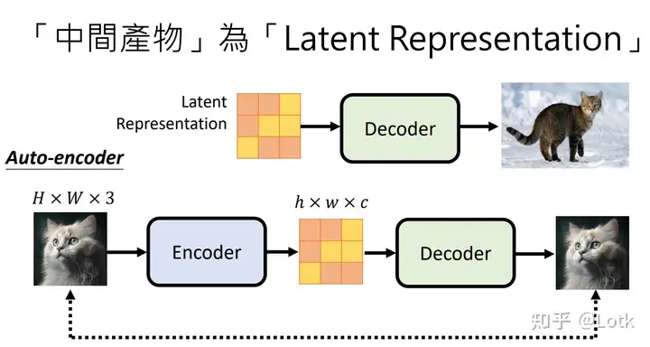

图六：中间产物为latent representation

对于framework中的生成模型，noise加在中间产物（latent representation）上而不是原始图像上。  

### 训练（加噪）过程

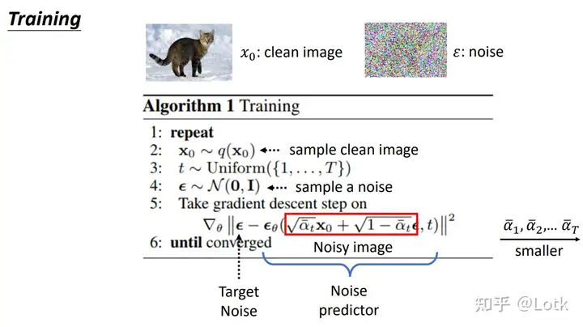

图七：Diffusion的训练

第5行是唯一需要解释的地方， 

 是干净的图片，  是前面说的Noise Predictor，它的输入包括加噪声之后的图像（红色框）以及时序  ， 

 是训练的target也就是添加的噪声。它其实与前面我们提到的一步步加噪的过程不一样，而是一次就可以了。

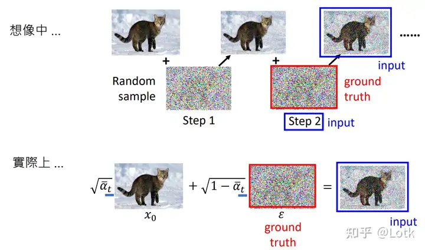

图八：DDPM

### 推理（去噪）过程

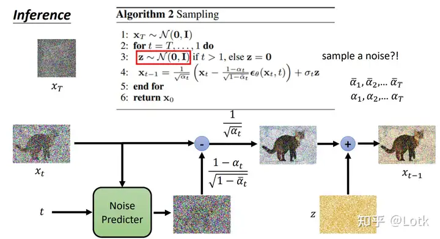

图九：Diffusion的推理

Diffusion的推理符合我们最开始对Diffusion的印象，需要一步步的把图片从完全的噪声 

 恢复到干净的图片  。其中伪代码比较难理解的点首先是第三行的额外噪声  ，其次是第四行中各个相乘的系数。第四行代码中的  和 

 将在后面解释。

### 数学推理

生成模型的本质是用网络生成一组图像的分布，这个分布与真实图片的分布越接近越好。那么如何判断两组分布是否足够接近呢？这里通常会使用**Maximum Likelihood Estimation。**

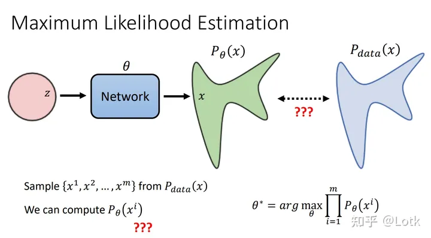

图十：Maximum Likelihood Estimation

图十表示最优的模型参数 

 要求模型生成从原始数据分布 中采样得到的  到 

 的乘积概率最大。对式子进行化简，可以得到一个关于KL的式子，如图十一所示。

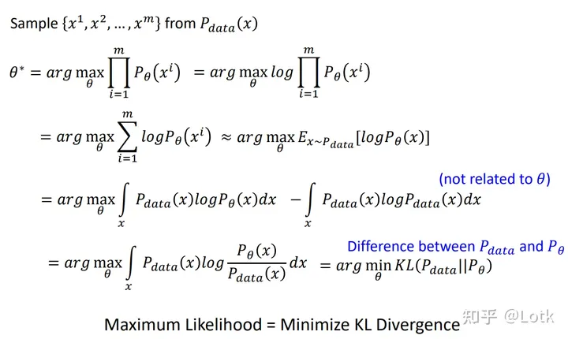

图十一：图像生成的目标

这个式子中的 

 是真实数据的分布，我们需要求的东西就变成了  。那么 

 怎么求呢？下面给出推导公式如图十二。

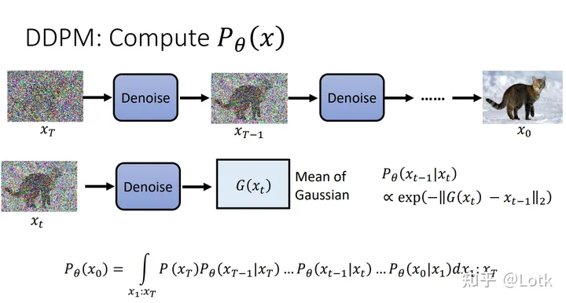

图十二：DDPM计算P_\theta 

这样我们就知道了 

 怎么求，由图十我们知道越大越好，因此这里我们的目标就是让

最大。那么如何求它的最大值呢？

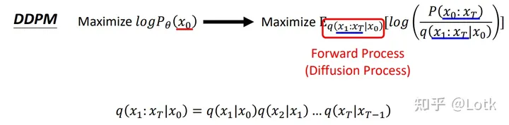

图十三：DDPM最大化P

图十三中的 

 表示diffusion的前向加噪过程。接下来的问题就是如何求  以及  。

非常容易求得，根据加噪的步骤我们就可以知道。

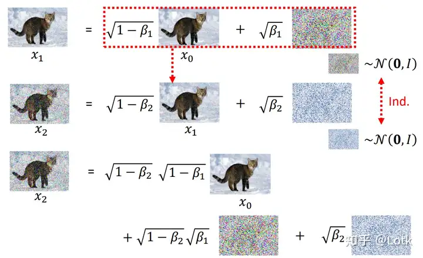

图十四：DDPM一步步添加噪声

如图十四所示，其实这样类推就可以得到

的关系式。但是我们发现，如果每次计算到t都需要采样t次高斯噪声，那么这样是很麻烦的。其实多次独立的采样噪声等价于采样一次噪声。

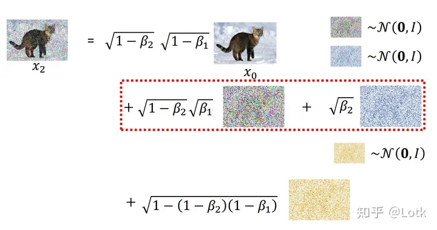

图十五：采样噪声的合并

由此可以得到

的关系式图十六。

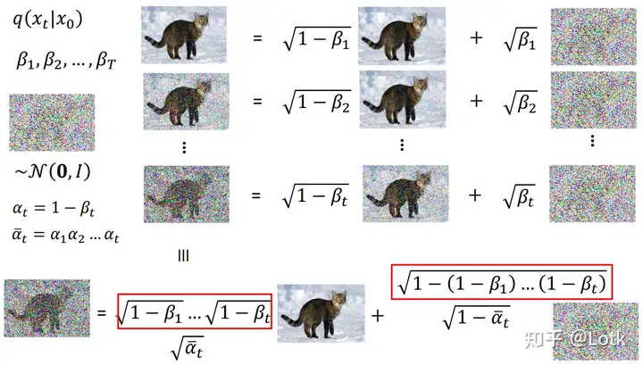

图十六

其中还包括了对 

 和 

 的解释。根据图十三我们知道要最大化的式子，接下来就是对这个式子进行化简：

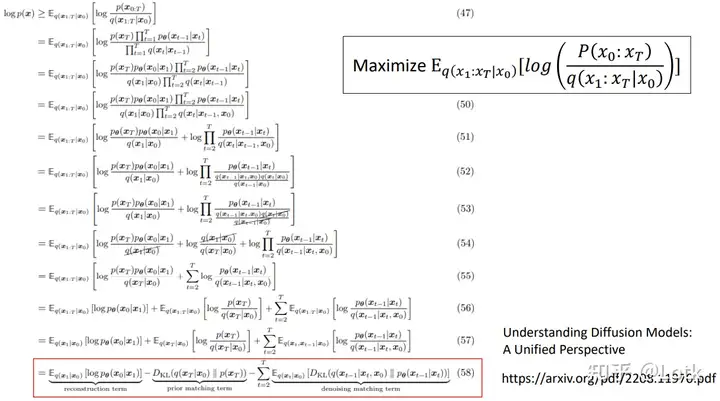

图十七：优化目标的化简

接下来的问题就是化简图十七的式子。

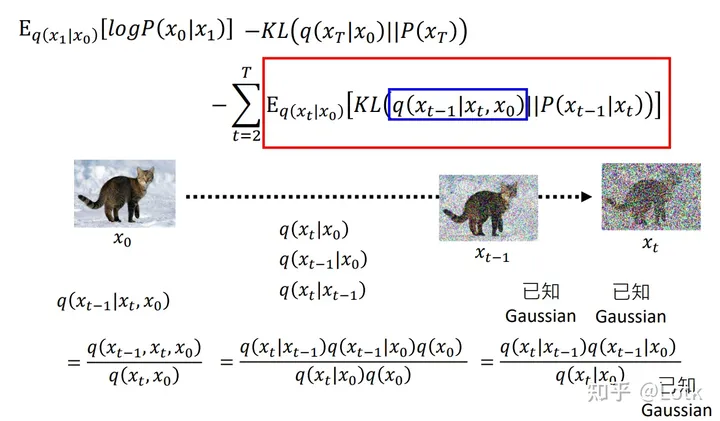

图十八

我们首先对式子中蓝色框的式子进行化简。我们知道 

 表示的是前向过程，我们将前向过程中所有的产物都视为高斯分布的，根据图十六的式子我们可以用高斯分布的表达式来表达 

 。

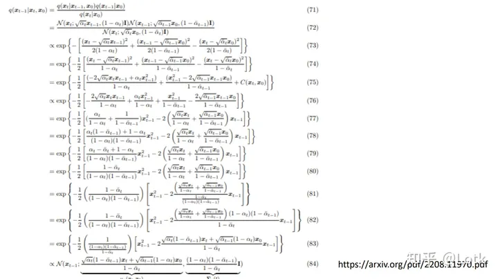

图十九

根据图十九我们就可以得到

 的均值与方差。

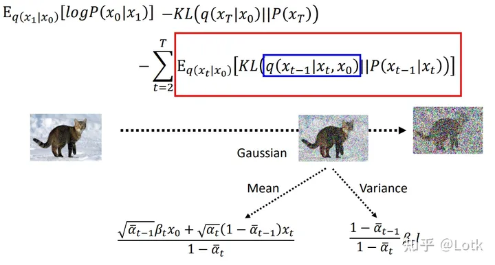

图二十：均值与方差分别只与x0和xt有关，与xt-1无关

对于红色框的式子，我们的目标是让 

 的均值与  的均值最接近。这是因为前者的均值与方差都是固定的（与  无关），后者的均值取决于Noise Predictor，方差同样是固定的。因此Predictor的作用就是在给定输入  和 

 的时候让输出的噪声的分布与前者的均值最接近。

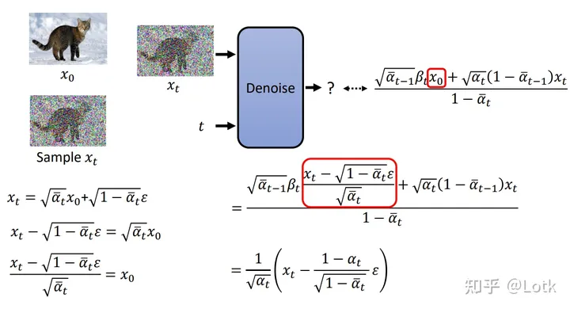

图二十一：Predictor的目标

对均值进行化简，就可以得到最终我们Predictor预测的目标。这与前面图九的目标相同。

### reference

https://github.com/YangLing0818/RPG-DiffusionMaster

### DALL·E 2 / Stable Diffusion

Stable Diffusion：潜空间扩散 + U-Net，开源文生图代表。

Reference：

https://blog.csdn.net/m0_66015895/article/details/132511722 [flow]

https://kexue.fm/archives/5253

https://www.cnblogs.com/yifanrensheng/p/13586468.html

