# 计算机视觉（CV）

> 自 [`3-KG.md`](./3-KG.md) 拆出的 CNN、检测/OCR、形态学、二值运算与图像增强等笔记。图片路径多为 `../img/`（部分为 `../Note/pic/`）。

## 目录

- [计算机视觉](#计算机视觉)
- [经典模型](#经典模型)
- [OCR 与检测](#ocr-与检测)
- [图像基本运算](#图像基本运算)
- [形态学](#形态学)
- [二值图像的逻辑运算](#二值图像的逻辑运算)
- [图像增强](#图像增强)

---

## 计算机视觉

### 经典模型

#### CNN

CNN在文本上的应用：

关键词：  关键短语，  -》 局部性

关键信息可在不同的位置出现 -》 平移性

适当去除一些文字内容不影响语义理解， 可缩性

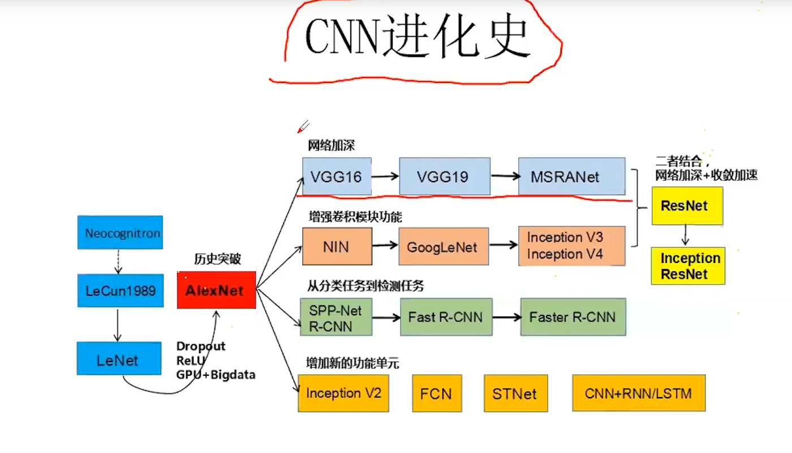

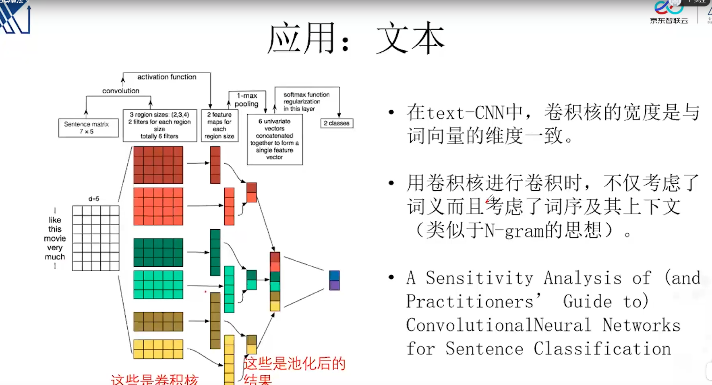


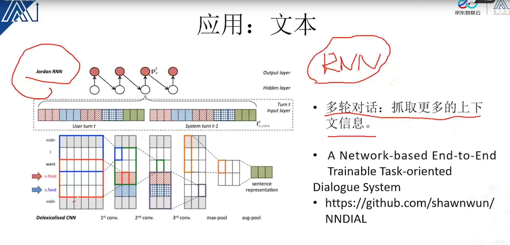


| 模型 | 要点 |
| --- | --- |
| LeNet-5 | 早期手写体 CNN |
| AlexNet | 更深网络、ReLU、Dropout、数据增广、GPU 训练 |
| ResNet | 残差连接，缓解深层退化 |
| CapsNet | 胶囊网络，向量神经元 |
| MobileViT | 轻量 CNN + ViT 混合 |
| ViT | 纯 Transformer 做图像 patch 序列 |
| Swin | 层次化窗口注意力 |

### OCR 与检测

| 模型 | 用途 |
| --- | --- |
| Faster R-CNN | 两阶段目标检测 |
| YOLO | 单阶段实时检测 |

### 图像基本运算

https://blog.csdn.net/asialee_bird/article/details/109463084

霍夫梯度法，

https://www.zhihu.com/search?q=%E5%9B%BE%E5%83%8F%E5%88%86%E5%89%B2%E6%9C%89%E4%BB%80%E4%B9%88%E7%94%A8&utm_content=search_suggestion&type=content

## 形态学

膨胀，腐蚀，开启，闭合

集合的交，并，补，差，反射，平移 

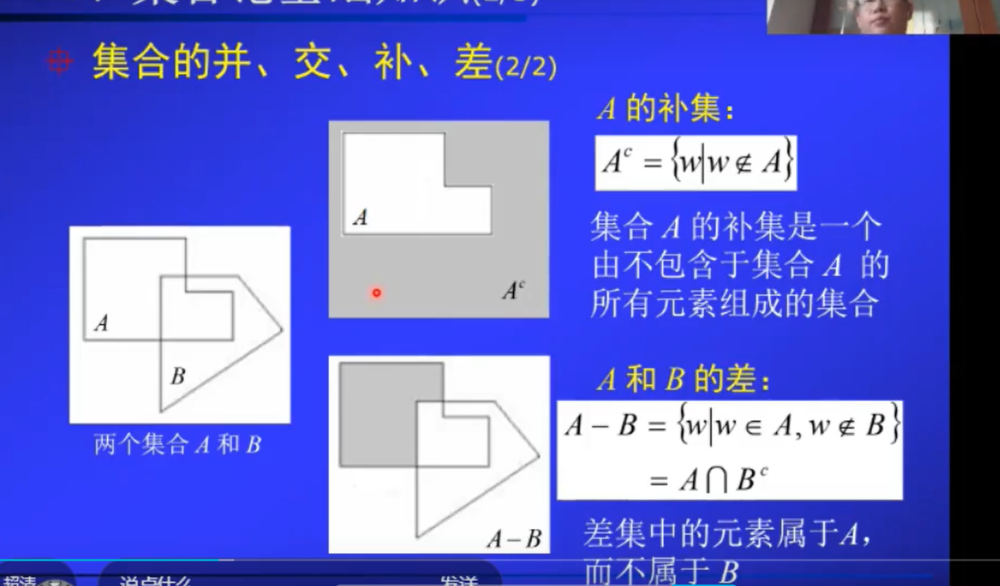


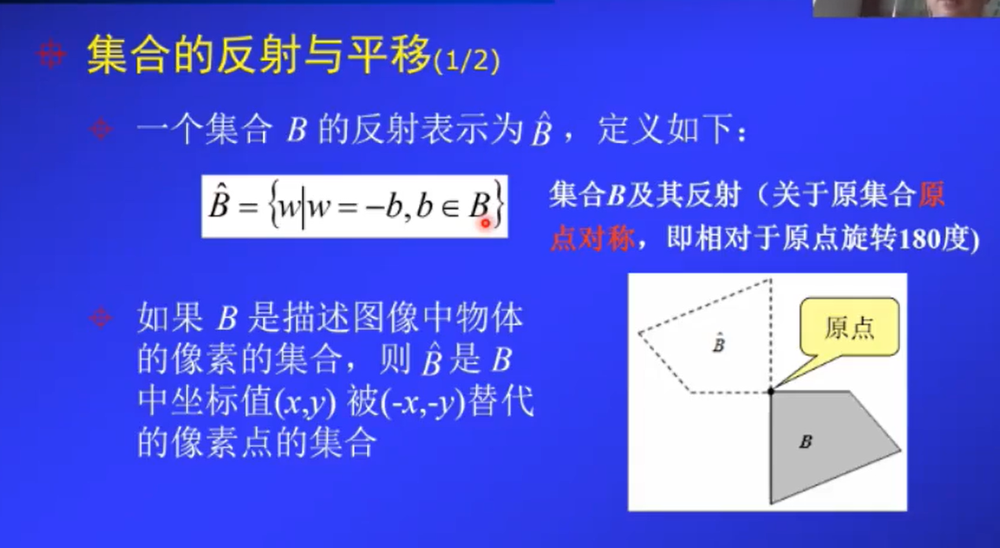


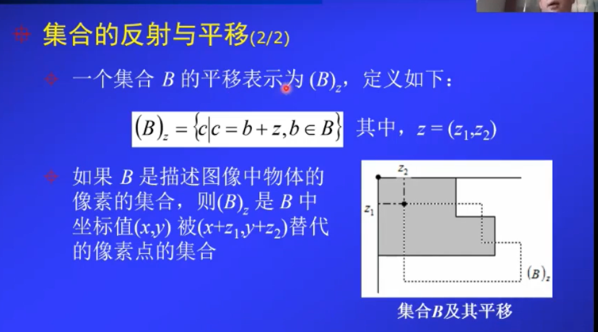

## 二值图像的逻辑运算 

not

and

or 

xor

前景 背景

目标检测：

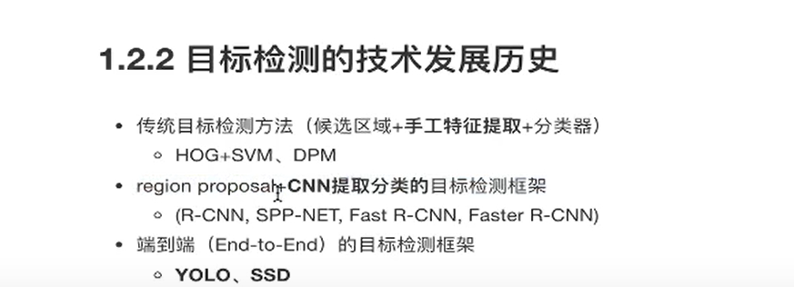

分类算法：


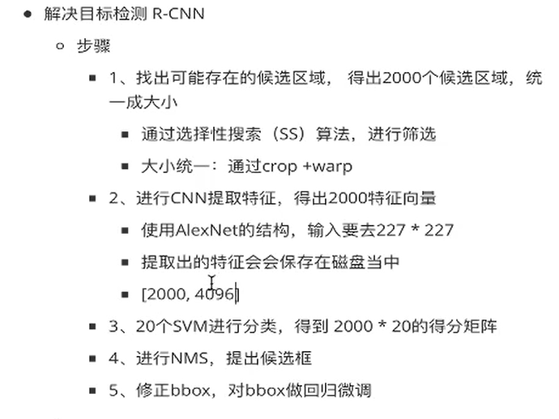


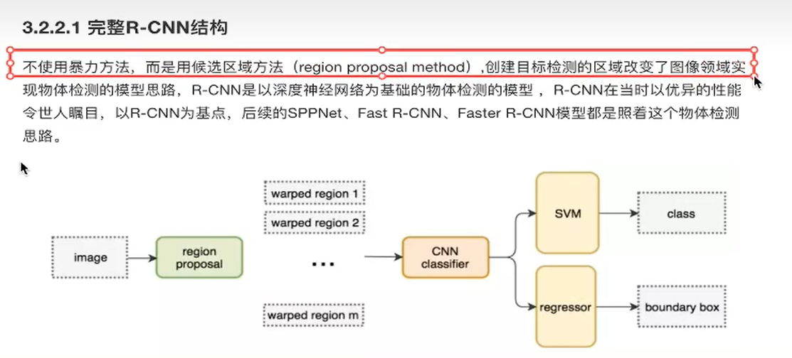

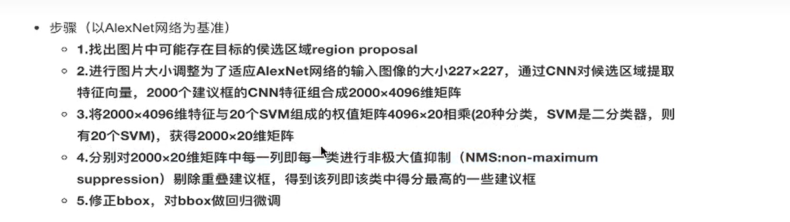

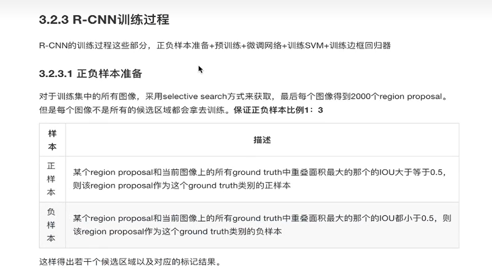

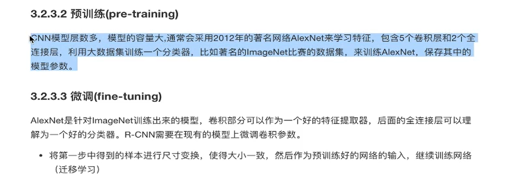

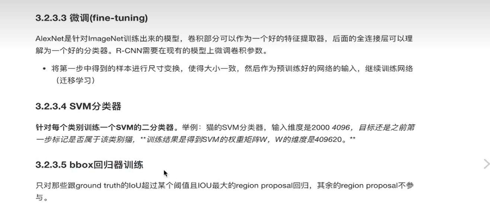

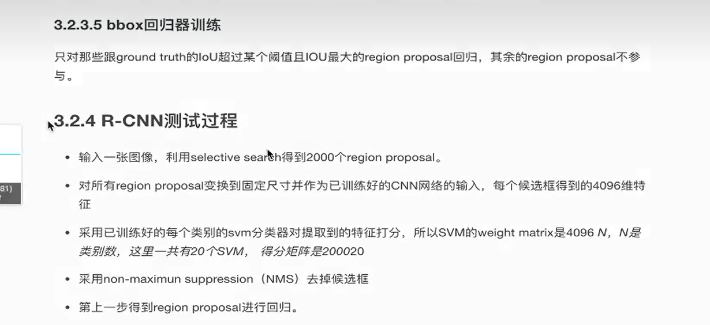

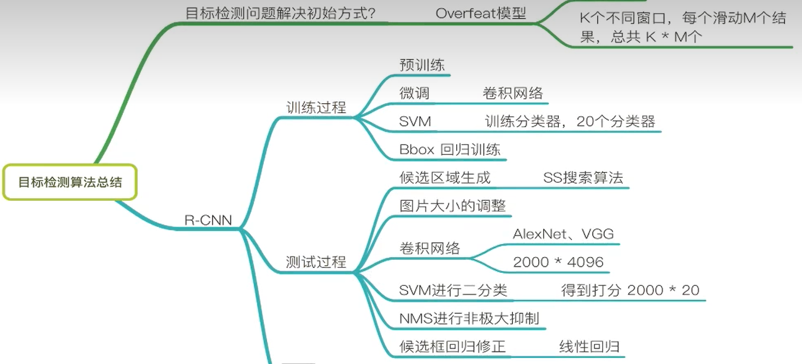

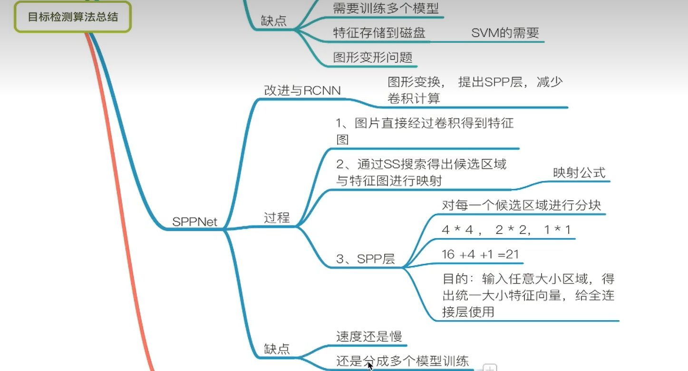

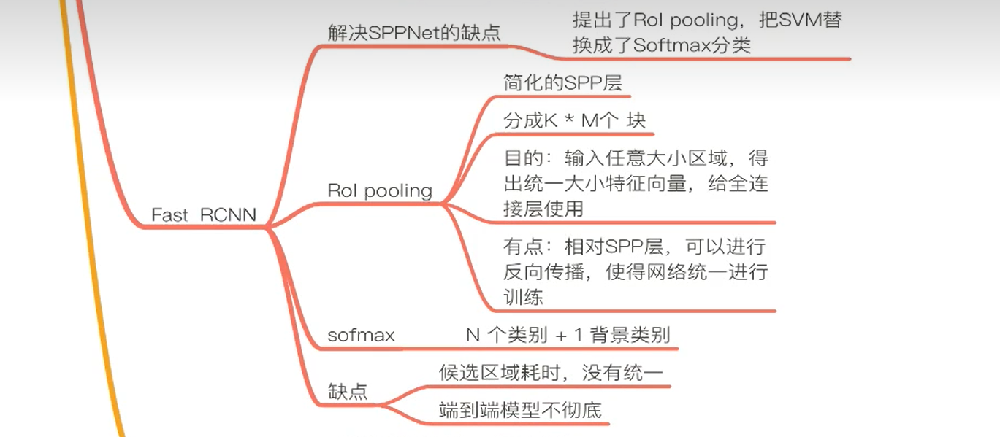

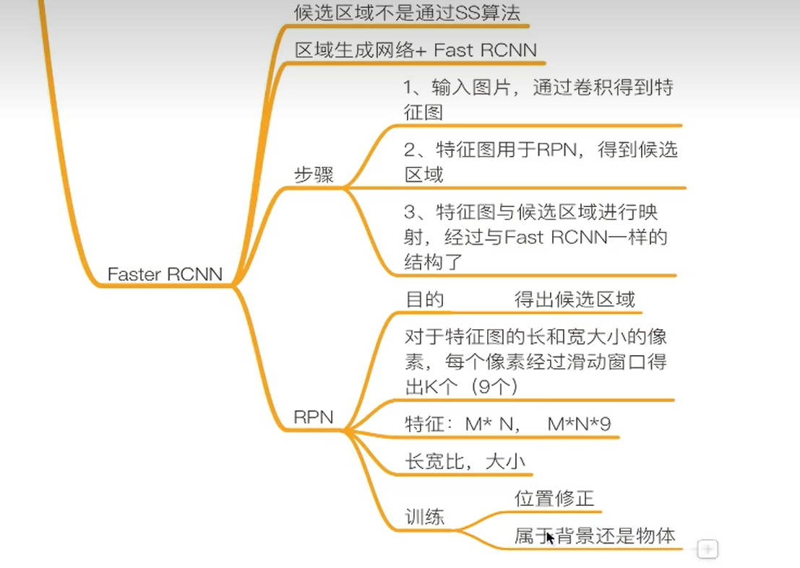

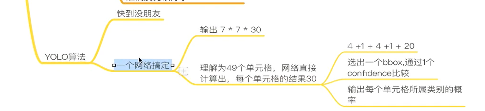

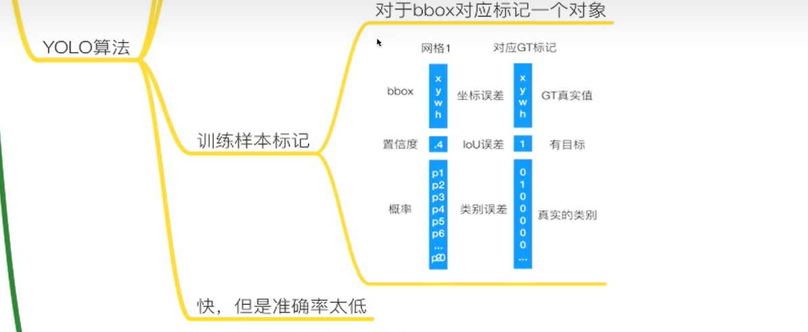

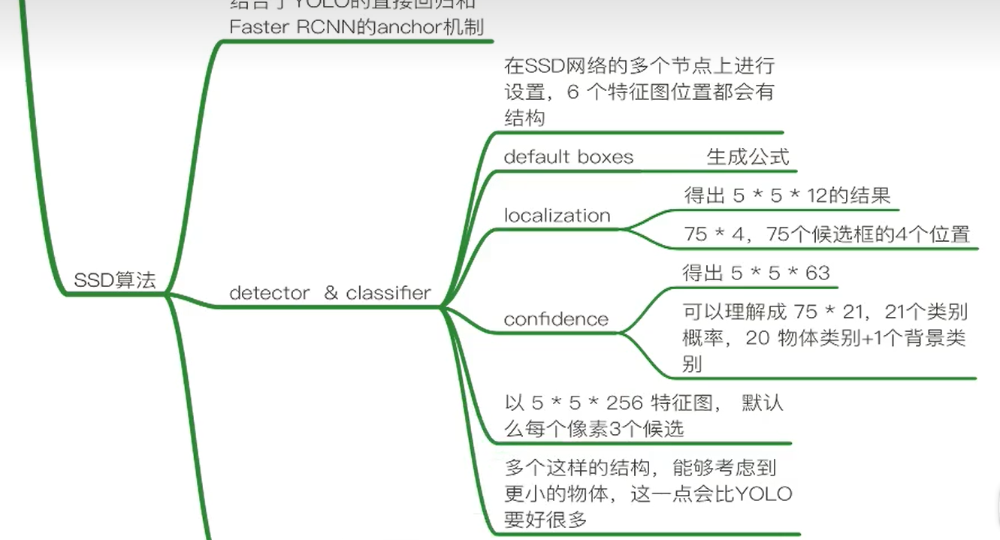

### 图像增强

**常用几何 / 色彩增强**：缩放与长宽比扭曲、翻转、色域扰动。

**参考仓库**：zycskylove / ObjectDetectionAssistant / yolov5 检测相关（原笔记链接）。


```python
# 1. 图片预处理（随机改变明暗、对比度、颜色等）
import numpy as np
import cv2
from PIL import Image, ImageEnhance
import random

# 随机改变亮暗、对比度和颜色等
def random_distort(img):
    # 随机改变亮度
    def random_brightness(img, lower=0.5, upper=1.5):
        e = np.random.uniform(lower, upper)
        return ImageEnhance.Brightness(img).enhance(e)
    # 随机改变对比度
    def random_contrast(img, lower=0.5, upper=1.5):
        e = np.random.uniform(lower, upper)
        return ImageEnhance.Contrast(img).enhance(e)
    # 随机改变颜色
    def random_color(img, lower=0.5, upper=1.5):
        e = np.random.uniform(lower, upper)
        return ImageEnhance.Color(img).enhance(e)

    ops = [random_brightness, random_contrast, random_color]
    np.random.shuffle(ops)

    img = Image.fromarray(img)
    img = ops[0](img)
    img = ops[1](img)
    img = ops[2](img)
    img = np.asarray(img)

    return img

# 2. 随机填充
def random_expand(img,
        gtboxes,
        max_ratio=4.,
        fill=None,
        keep_ratio=True,
        thresh=0.5):
    if random.random() > thresh:
        return img, gtboxes

    if max_ratio < 1.0:
        return img, gtboxes

    h, w, c = img.shape
    ratio_x = random.uniform(1, max_ratio)
    if keep_ratio:
        ratio_y = ratio_x
    else:
        ratio_y = random.uniform(1, max_ratio)
    oh = int(h * ratio_y)
    ow = int(w * ratio_x)
    off_x = random.randint(0, ow - w)
    off_y = random.randint(0, oh - h)

    out_img = np.zeros((oh, ow, c))
    if fill and len(fill) == c:
        for i in range(c):
            out_img[:, :, i] = fill[i] * 255.0

    out_img[off_y:off_y + h, off_x:off_x + w, :] = img
    gtboxes[:, 0] = ((gtboxes[:, 0] * w) + off_x) / float(ow)
    gtboxes[:, 1] = ((gtboxes[:, 1] * h) + off_y) / float(oh)
    gtboxes[:, 2] = gtboxes[:, 2] / ratio_x
    gtboxes[:, 3] = gtboxes[:, 3] / ratio_y

    return out_img.astype('uint8'), gtboxes
# 3. 随机裁剪（注意勿裁掉过多目标，需同步变换 bbox）
# 详见：https://blog.csdn.net/qq_20491295/article/details/109312771
```

**检测增强参考仓库**：YOLOv5 检测助手等（原笔记 GitHub 链接）。

