# Kubernetes 笔记

Kubernetes 集群原理、服务网格、Ingress/Traefik、kubeadm 搭建、client-go 等。实验机命令见 [`VMWare.md`](VMWare.md)。OpenStack / Ambari / Azure 见下方独立笔记。

## 目录

| 部分 | 跳转 |
| --- | --- |
| [基础接口](#kubernetes-基础接口) | CRI / CNI / CSI / CRD、Controller vs Operator |
| [Istio](#istio) | 安装、Bookinfo、流量管理 |
| [Gateway API](#gateway-api) | CRD、RBAC |
| [Ingress 与 Traefik](#ingress-与-traefik) | Middleware、TraefikService、部署 |
| [kubeadm 集群](#kubeadm-搭建-k8s-集群) | Master/Node、CNI、Dashboard |
| [相关专题](#相关专题独立笔记) | OpenStack、Ambari、Azure |
| [附录](#附录) | Docker 脚本、Deployment 模板 |
| [Go client-go](#go-生态client-go--cobra) | Informer、GVR/GVK |
| [Consul](#consul) | 注册中心 |

---

## Kubernetes 基础接口

| 接口 | 说明 |
| --- | --- |
| **CRI** | 容器运行时 gRPC：`RuntimeService`、`ImageService`；kubelet 为 Client，运行时监听 Unix socket |
| **CNI** | 容器网络：CNCF 规范与插件；负责创建/删除容器时的网络分配 |
| **CSI** | 容器存储接口 |
| **CRD** | `CustomResourceDefinition` 扩展 API |

**Controller vs Operator**：控制原生资源常称 Controller；控制 CRD 常称 Operator。脚手架：**KubeBuilder**。

## Istio

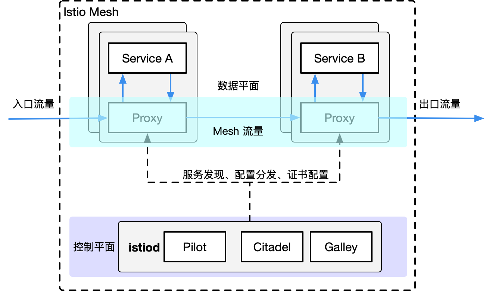

Pilot：为 Envoy 提供了服务发现，流量管理和智能路由（AB 测试、金丝雀发布等），以及错误处理（超时、重试、熔断）功能。

Citadel：为服务之间提供认证和证书管理，可以让服务自动升级成 TLS 协议。

Galley：Galley 是 Istio 的配置验证、提取、处理和分发组件。它负责将其余的 Istio 组件与从底层平台（例如 Kubernetes）获取用户配置的细节隔离开来。

- 为 HTTP、gRPC、WebSocket 和 TCP 流量自动负载均衡。
- 通过丰富的路由规则、重试、故障转移和故障注入对流量行为进行细粒度控制。
- 可插拔的策略层和配置 API，支持访问控制、速率限制和配额。
- 集群内（包括集群的入口和出口）所有流量的自动化度量、日志记录和追踪。
- 在具有强大的基于身份验证和授权的集群中实现安全的服务间通信。

#### 流量管理

Istio 简单的规则配置和流量路由允许您控制服务之间的流量和 API 调用过程。

Istio 简化了服务级属性（如熔断器、超时和重试）的配置，并且让它轻而易举的执行重要的任务（如 A/B 测试、金丝雀发布和按流量百分比划分的分阶段发布）

Istio 目前支持：

- Kubernetes 上的服务部署
- 基于 Consul 的服务注册
- 服务运行在独立的虚拟机上


```bash
curl -L https://istio.io/downloadIstio | sh -
export PATH="$PATH:/home/wang_boyang/istio/istio-1.21.2/bin"
curl -L https://github.com/istio/istio/releases/download/1.21.2/istio-1.21.2-linux-amd64.tar.gz -o istio-1.21.2-linux-amd64.tar.gzls

wget https://storage.googleapis.com/istio-release/releases/1.17.8/istio-1.17.8-linux-amd64.tar.gz
# 发布版本
https://istio.io/latest/docs/releases/supported-releases/#support-status-of-istio-releases

vim /etc/profile
export PATH="/home/istio/istio-1.21.2/bin:$PATH"


# 安装
istioctl manifest apply --set profile=demo
# 打标签
kubectl label namespace default istio-injection=enabled
kubectl  apply -f <(istioctl kube-inject -f bookinfo.yml )
kubectl get services

kubectl exec -it $(kubectl get pod -l app=ratings -o jsonpath='{.items[0].metadata.name}') -c ratings -- curl productpage:9080/productpage | grep -o "<title>.*</title>"


watch -n 1 curl -o /dev/null -s -w %{http_code} http://192.168.5.21:32109/productpage

https://juejin.cn/post/7116400234711744525#heading-41docker
```

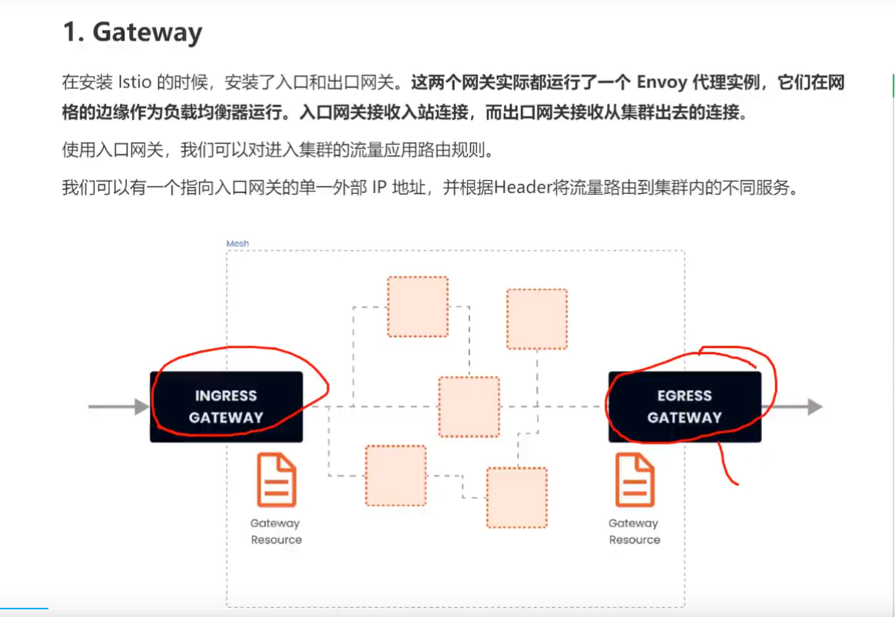


## Gateway API

Gateway API（之前叫 Service API）是由 SIG-NETWORK 社区管理的开源项目，[项目地址](https://gateway-api.sigs.k8s.io/)

Ingress 资源对象不能很好的满足网络需求，很多场景下 Ingress 控制器都需要通过定义 annotations 或者 crd  来进行功能扩展，这对于使用标准和支持是非常不利的，新推出的 Gateway API 旨在通过可扩展的面向角色的接口来增强服务网络。

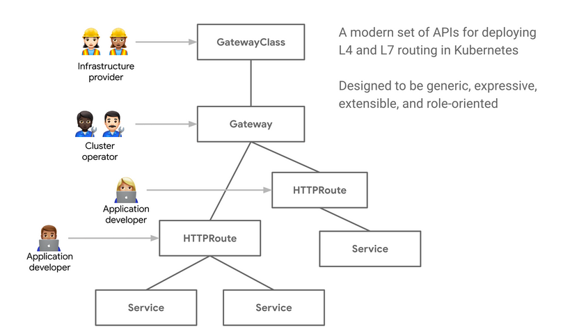

Gateway API 是 Kubernetes 中的一个 API 资源集合，包括 GatewayClass、Gateway、HTTPRoute、TCPRoute、Service 等，这些资源共同为各种网络用例构建模型。

2 部署

### 2.1 crd

内容较长，直接复制 [官网yaml](https://doc.traefik.io/traefik/v2.5/reference/dynamic-configuration/kubernetes-gateway/#definitions)

```bash
[root@k8s-node1 traefik]# kubectl apply -f  gateway-api-crd.yml
customresourcedefinition.apiextensions.k8s.io/gatewayclasses.networking.x-k8s.io created
customresourcedefinition.apiextensions.k8s.io/gateways.networking.x-k8s.io created
customresourcedefinition.apiextensions.k8s.io/httproutes.networking.x-k8s.io created
customresourcedefinition.apiextensions.k8s.io/tcproutes.networking.x-k8s.io created
customresourcedefinition.apiextensions.k8s.io/tlsroutes.networking.x-k8s.io created
```

bash

### 2.2 rbac

```yaml
---
apiVersion: rbac.authorization.k8s.io/v1
kind: ClusterRole
metadata:
  name: gateway-role
rules:
  - apiGroups:
      - ""
    resources:
      - services
      - endpoints
      - secrets
    verbs:
      - get
      - list
      - watch
  - apiGroups:
      - networking.x-k8s.io
    resources:
      - gatewayclasses
      - gateways
      - httproutes
      - tcproutes
      - tlsroutes
    verbs:
      - get
      - list
      - watch
  - apiGroups:
      - networking.x-k8s.io
    resources:
      - gatewayclasses/status
      - gateways/status
      - httproutes/status
      - tcproutes/status
      - tlsroutes/status
    verbs:
      - update

---
apiVersion: rbac.authorization.k8s.io/v1
kind: ClusterRoleBinding
metadata:
  name: gateway-controller

roleRef:
  apiGroup: rbac.authorization.k8s.io
  kind: ClusterRole
  name: gateway-role
subjects:
  - kind: ServiceAccount
    name: traefik-ingress-controller
    namespace: default
```

yaml

应用 yaml

```bash
[root@k8s-node1 traefik]# kubectl apply -f gateway-api-rbac.yml
clusterrole.rbac.authorization.k8s.io/gateway-role created
clusterrolebinding.rbac.authorization.k8s.io/gateway-controller created
```


## Ingress 与 Traefik

```bash
#查看pod ip:
kubectl get pods -o wide | grep hello
hello-d7cf556b-lb56v   1/1     Running   3 (11h ago)   7d18h   10.233.96.15   k8smaster   <none>           <none>

curl 10.233.96.15:8080
#查看service, 分配了一个cluster_ip
kubectl get service -o wide | grep hello
hello           ClusterIP   10.233.3.134    <none>        8080/TCP                                                                  7d18h   app=hello
curl 10.233.3.134:8080


```


### traefik

Traefik 是一个为了让部署微服务更加便捷而诞生的现代 HTTP 反向代理、负载均衡工具。 它支持多种后台 ([Docker](https://www.docker.com/), [Swarm](https://docs.docker.com/swarm), [Kubernetes](http://kubernetes.io/), [Marathon](https://mesosphere.github.io/marathon/), [Mesos](https://github.com/apache/mesos), [Consul](https://www.consul.io/), [Etcd](https://coreos.com/etcd/), [Zookeeper](https://zookeeper.apache.org/), [BoltDB](https://github.com/boltdb/bolt), Rest API, file…) 来自动化、动态的应用它的配置文件设置。

它是一个边缘路由器，它会拦截外部的请求并根据逻辑规则选择不同的操作方式，这些规则决定着这些请求到底该如何处理。Traefik 提供自动发现能力，会实时检测服务，并自动更新路由规则。

请求首先会连接到`entrypoints`，然后分析这些请求是否与定义的`rules`匹配，如果匹配，则会通过一系列`middlewares`，再到对应的`services`:

- Providers
- Entrypoints
- Routers
- Services
- Middlewares

`Providers`是基础组件，Traefik的配置发现是通过它来实现的，它可以是协调器，容器引擎，云提供商或者键值存储

`Entrypoints`是`Traefik`的网络入口，它定义接收请求的接口，以及是否监听TCP或者UDP

`Routers`主要用于分析请求，并负责将这些请求连接到对应的服务上去，在这个过程中，Routers还可以使用Middlewares来更新请求，比如在把请求发到服务之前添加一些Headers

`Services`负责配置如何到达最终将处理传入请求的实际服务

`Middlewares`:用来修改请求或者根据请求来做出一些判断（authentication, rate limiting, headers, ...），中间件被附件到路由上，是一种在请求发送到你的**服务**之前（或者在服务的响应发送到[客户端](https://www.zhihu.com/search?q=客户端&search_source=Entity&hybrid_search_source=Entity&hybrid_search_extra={"sourceType"%3A"answer"%2C"sourceId"%3A"2244863446"})之前）调整请求的一种方法。

#### Traefik CRD 资源

[官方文档](https://doc.traefik.io/traefik/routing/providers/kubernetes-crd/)

traefik 通过自定义资源实现了对 traefik 资源的创建和管理，支持的 crd 资源类型如下所示：

| kind                                                         | 功能                         |
| ------------------------------------------------------------ | ---------------------------- |
| [IngressRoute](https://doc.traefik.io/traefik/routing/providers/kubernetes-crd/#kind-ingressroute) | HTTP 路由配置                |
| [Middleware](https://doc.traefik.io/traefik/routing/providers/kubernetes-crd/#kind-middleware) | HTTP 中间件配置              |
| [TraefikService](https://doc.traefik.io/traefik/routing/providers/kubernetes-crd/#kind-traefikservice) | HTTP 负载均衡/流量复制配置   |
| [IngressRouteTCP](https://doc.traefik.io/traefik/routing/providers/kubernetes-crd/#kind-ingressroutetcp) | TCP 路由配置                 |
| [MiddlewareTCP](https://doc.traefik.io/traefik/routing/providers/kubernetes-crd/#kind-middlewaretcp) | TCP 中间件配置               |
| [IngressRouteUDP](https://doc.traefik.io/traefik/routing/providers/kubernetes-crd/#kind-ingressrouteudp) | UDP 路由配置                 |
| [TLSOptions](https://doc.traefik.io/traefik/routing/providers/kubernetes-crd/#kind-tlsoption) | TLS 连接参数配置             |
| [TLSStores](https://doc.traefik.io/traefik/routing/providers/kubernetes-crd/#kind-tlsstore) | TLS 存储配置                 |
| [ServersTransport](https://doc.traefik.io/traefik/routing/providers/kubernetes-crd/#kind-serverstransport) | traefik 与后端之间的传输配置 |


Traefik: **创建路由规则**

1. 原生Ingress写法
2. 使用CRD IngressRoute方式
3. 使用GatewayAPI的方式

#### Middleware

kubernetes 中使用 Traefik ingress 的 Middleware 实现重定向、白名单、用户认证、限流、熔断、压缩、自定义 error 页等操作            

[官方文档](https://doc.traefik.io/traefik/middlewares/overview/)

Traefik Middlewares 是一个处于路由和后端服务之前的中间件，在外部流量进入  Traefik，且路由规则匹配成功后，将流量发送到对应的后端服务前，先将其发给中间件进行一系列处理（类似于过滤器链  Filter，进行一系列处理），例如，**添加 Header 头信息、鉴权、流量转发、处理访问路径前缀、IP  白名单等等，经过一个或者多个中间件处理完成后，再发送给后端服务，这个就是中间件的作用**。

Traefik 内置了很多不同功能的 Middleware，主要是针对 HTTP 和 TCP，这里挑选几个比较常用的进行演示。

##### 1.1 重定向 -redirectScheme

[官方文档](https://doc.traefik.io/traefik/middlewares/http/redirectscheme/)

定义一个 ingressroute，包含一个自动将 http 跳转到 https 的中间件

```yaml
apiVersion: traefik.containo.us/v1alpha1
kind: IngressRoute
metadata:
  name: myapp2
spec:
  entryPoints:
  - web
  routes:
  - match: Host(`myapp2.test.com`)
    kind: Rule
    services:
    - name: myapp2
      port: 80
    middlewares:
    - name: redirect-https-middleware   # 指定使用RedirectScheme中间件，完成http强制跳转至https
---
apiVersion: traefik.containo.us/v1alpha1
kind: Middleware
metadata:
  name: redirect-https-middleware
spec:
  redirectScheme:
    scheme: https   # 自动跳转到 https
```


测试，可以看到访问 http 自动 307 重定向到了 https

```bash
[root@k8s-node1 ~]# curl -I http://myapp2.test.com
HTTP/1.1 307 Temporary Redirect
Location: https://myapp2.test.com/
Date: Wed, 19 Apr 2023 07:58:34 GMT
Content-Length: 18
Content-Type: text/plain; charset=utf-8
```

##### 1.2 去除请求路径前缀 -stripPrefix

[官方文档](https://doc.traefik.io/traefik/middlewares/http/stripprefix/)

假设现在有这样一个需求，当访问 `http://myapp.test.com/v1` 时，流量调度至 myapp1。当访问 `http://myapp.test.com/v2` 时，流量调度至 myapp2。这种需求是非常常见的，在 NGINX 中，我们可以配置多个 Location 来定制规则，使用 Traefik  也可以这么做。但是定制不同的前缀后，由于应用本身并没有这些前缀，导致请求返回 404，这时候我们就需要对请求的 path 进行处理。

创建一个 IngressRoute，并设置两条规则，根据不同的访问路径代理至相对应的 service

```yaml
apiVersion: traefik.containo.us/v1alpha1
kind: IngressRoute
metadata:
  name: myapp
spec:
  entryPoints:
  - web
  routes:
  - match: Host(`myapp.test.com`) && PathPrefix(`/v1`)
    kind: Rule
    services:
    - name: myapp1
      port: 80
    middlewares:
    - name: prefix-url-middleware
  - match: Host(`myapp.test.com`) && PathPrefix(`/v2`)
    kind: Rule
    services:
    - name: myapp2
      port: 80
    middlewares:
    - name: prefix-url-middleware
---
apiVersion: traefik.containo.us/v1alpha1
kind: Middleware
metadata:
  name: prefix-url-middleware
spec:
  stripPrefix: # 去除前缀的中间件 stripPrefix，指定将请求路径中的v1、v2去除。
    prefixes: 
      - /v1
      - /v2
```


部署测试

```bash
[root@k8s-node1 ~]# curl http://myapp.test.com/v1
Hello MyApp | Version: v1 | <a href="hostname.html">Pod Name</a>
[root@k8s-node1 ~]# curl http://myapp.test.com/v2
Hello MyApp | Version: v2 | <a href="hostname.html">Pod Name</a>

[root@k8s-node1 ~]# kubectl logs -l app=myapp1 | tail -2
# 未添加插件的访问路径为 /v1/ 
10.244.36.64 - - [19/Apr/2023:08:02:03 +0000] "GET /v1/ HTTP/1.1" 404 169 "-" "curl/7.29.0" "1.1.1.1"
# 添加插件后的访问路径为 /
10.244.36.64 - - [19/Apr/2023:08:04:31 +0000] "GET / HTTP/1.1" 200 65 "-" "curl/7.29.0" "1
```

##### 1.3 白名单 -IPWhiteList

[官方文档](https://doc.traefik.io/traefik/middlewares/http/ipwhitelist/)

为提高安全性，通常情况下一些管理员界面会设置 ip 访问白名单，只希望个别用户可以访问。

示例

```yaml
apiVersion: traefik.containo.us/v1alpha1
kind: IngressRoute
metadata:
  name: myapp
spec:
  entryPoints:
  - web
  routes:
  - match: Host(`myapp1.test.com`) 
    kind: Rule
    services:
    - name: myapp1
      port: 80
    middlewares:
    - name: ip-white-list-middleware
---
apiVersion: traefik.containo.us/v1alpha1
kind: Middleware
metadata:
  name: ip-white-list-middleware
spec:
  ipWhiteList:
    sourceRange:
      - 127.0.0.1/32
      - 1.1.1.253
```

测试

```bash
# 白名单外主机
[root@k8s-node1 ~]# curl -I http://myapp1.test.com
HTTP/1.1 403 Forbidden

# 白名单内主机
Admin@BJLPT0152 MINGW64 ~
$ ipconfig | grep 1.1.1.253
   IPv4 地址 . . . . . . . . . . . . : 1.1.1.253

Admin@BJLPT0152 MINGW64 ~
$ curl -i  http://myapp1.test.com
Hello MyApp | Version: v1 | <a href="hostname.html">Pod Name</a>
```

##### 1.4 基础用户认证 -basicAuth

[官方文档](https://doc.traefik.io/traefik/middlewares/http/basicauth/)

通常企业安全要求规范除了要对管理员页面限制访问 ip 外，还需要添加账号密码认证，而 traefik 默认没有提供账号密码认证功能，此时就可以通过 BasicAuth 中间件完成用户认证，只有认证通过的授权用户才可以访问页面。

安装 htpasswd 工具生成密码文件

```bash
[root@k8s-node1 ~]# yum install -y httpd
[root@k8s-node1 ~]# htpasswd -bc basic-auth-secret-lvbibir lvbibir 123
Adding password for user lvbibir
[root@k8s-node1 ~]# kubectl create secret generic basic-auth-lvbibir --from-file=basic-auth-secret-lvbibir
secret/basic-auth-lvbibir created
```

bash

创建 ingressroute，使用 basicAuth 中间件

```yaml
apiVersion: traefik.containo.us/v1alpha1
kind: IngressRoute
metadata:
  name: myapp
spec:
  entryPoints:
  - web
  routes:
  - match: Host(`myapp1.test.com`) 
    kind: Rule
    services:
    - name: myapp1
      port: 80
    middlewares:
    - name: basic-auth-middleware
---
apiVersion: traefik.containo.us/v1alpha1
kind: Middleware
metadata:
  name: basic-auth-middleware
spec:
  basicAuth:
    secret: basic-auth-lvbibir
```

yaml

访问测试，可以看到弹出界面提示需要输入用户名和密码，输入后回车显示正常页面

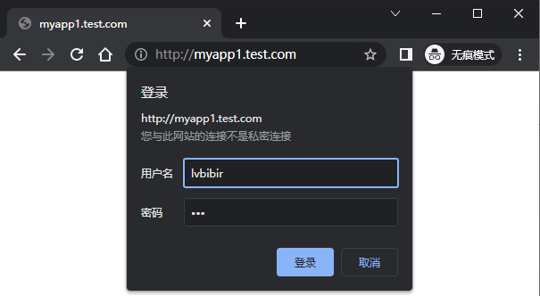

##### 1.5 修改请求/响应头信息 -headers

[官方文档](https://doc.traefik.io/traefik/middlewares/http/headers/)

为了提高业务的安全性，安全团队会定期进行漏洞扫描，其中有些 web 漏洞就需要通过修改响应头处理，traefik 的 Headers 中间件不仅可以修改返回客户端的响应头信息，还能修改反向代理后端 service 服务的请求头信息。

例如对 `https://myapp2.test.com` 提高安全策略，强制启用 HSTS

HSTS：即 HTTP 严格传输安全响应头，收到该响应头的浏览器会在 63072000s（约 2  年）的时间内，只要访问该网站，即使输入的是 http，浏览器会自动跳转到 https。（HSTS 是浏览器端的跳转，之前的 HTTP 重定向到  HTTPS 是服务器端的跳转）

创建 ingressRoute 和 headers 中间件

```yaml
apiVersion: traefik.containo.us/v1alpha1
kind: IngressRoute
metadata:
  name: myapp2-tls
spec:
  entryPoints:
  - web
  - websecure
  routes:
  - match: Host(`myapp2.test.com`)
    kind: Rule
    services:
    - name: myapp2
      port: 80 
    middlewares:
      - name: hsts-header-middleware
  tls:
    secretName: myapp2-tls         # 指定tls证书名称
---
apiVersion: traefik.containo.us/v1alpha1
kind: Middleware
metadata:
  name: hsts-header-middleware
spec:
  headers:
    customResponseHeaders:
      Strict-Transport-Security: 'max-age=63072000'
```

yaml

访问测试

```bash
[root@k8s-node1 ~]# curl -kI https://myapp2.test.com
HTTP/1.1 200 OK
Accept-Ranges: bytes
Content-Length: 65
Content-Type: text/html
Date: Wed, 19 Apr 2023 08:37:07 GMT
Etag: "5a9251f0-41"
Last-Modified: Sun, 25 Feb 2018 06:04:32 GMT
Server: nginx/1.12.2
Strict-Transport-Security: max-age=63072000   # headers 插件添加的响应头
```

bash

##### 1.6 限流 -rateLimit

[官方文档](https://doc.traefik.io/traefik/middlewares/http/ratelimit/)

在实际生产环境中，流量限制也是经常用到的，它可以用作安全目的，比如可以减慢暴力密码破解的速率。通过将传入请求的速率限制为真实用户的典型值，并标识目标 URL 地址 (通过日志)，还可以用来抵御 DDOS 攻击。更常见的情况，该功能被用来保护下游应用服务器不被同时太多用户请求所压垮。

创建 ingressRoute 和 rateLimit 中间件

```yaml
apiVersion: traefik.containo.us/v1alpha1
kind: IngressRoute
metadata:
  name: myapp1
spec:
  entryPoints:
  - web
  routes:
  - match: Host(`myapp1.test.com`)
    kind: Rule
    services:
    - name: myapp1  
      port: 80   
    middlewares:
      - name: rate-limit-middleware
---
apiVersion: traefik.containo.us/v1alpha1
kind: Middleware
metadata:
  name: rate-limit-middleware
spec: 
  rateLimit:    # 指定 1s 内请求数平均值不大于 10 个，高峰最大值不大于 50 个。
    burst: 10
    average: 50
```

yaml

压力测试，使用 ab 工具进行压力测试，一共请求 100 次，每次并发 10。测试结果失败的请求为 72 次，总耗时 0.409 秒

```bash
[root@k8s-node1 ~]# ab -n 100 -c 10 "http://myapp1.test.com/"

Concurrency Level:      10
Time taken for tests:   0.409 seconds
Complete requests:      100
Failed requests:        72
   (Connect: 0, Receive: 0, Length: 72, Exceptions: 0)
Non-2xx responses:      72
```

bash

##### 1.7 熔断 -circuitBreaker

[官方文档](https://doc.traefik.io/traefik/middlewares/http/circuitbreaker/)

服务熔断的作用类似于保险丝，当某服务出现不可用或响应超时的情况时，为了防止整个系统出现雪崩，暂时停止对该服务的调用。

熔断器三种状态

- Closed：关闭状态，所有请求都正常访问。
- Open：打开状态，所有请求都会被降级。traefik 会对请求情况计数，当一定时间内失败请求百分比达到阈值，则触发熔断，断路器会完全打开。
- Recovering：半开恢复状态，open 状态不是永久的，打开后会进入休眠时间。随后断路器会自动进入半开状态。此时会释放部分请求通过，若这些请求都是健康的，则会完全关闭断路器，否则继续保持打开，再次进行休眠计时

服务熔断原理 (断路器的原理)

统计用户在指定的时间范围（默认 10s）之内的请求总数达到指定的数量之后，如果不健康的请求 (超时、异常)  占总请求数量的百分比（50%）达到了指定的阈值之后，就会触发熔断。触发熔断，断路器就会打开 (open),此时所有请求都不能通过。在 5s  之后，断路器会恢复到半开状态 (half open)，会允许少量请求通过，如果这些请求都是健康的，那么断路器会回到关闭状态  (close).如果这些请求还是失败的请求,断路器还是恢复到打开的状态 (open).

traefik 支持的触发器

- NetworkErrorRatio：网络错误率
- ResponseCodeRatio：状态代码比率
- LatencyAtQuantileMS：分位数的延迟（以毫秒为单位）

创建 ingressRoute ，添加 circuitBreaker 中间件，指定 50% 的请求比例响应时间大于 1MS 时熔断。

```yaml
apiVersion: traefik.containo.us/v1alpha1
kind: IngressRoute
metadata:
  name: myapp1
spec:
  entryPoints:
  - web
  routes:
  - match: Host(`myapp1.test.com`)
    kind: Rule
    services:
    - name: myapp1  
      port: 80   
    middlewares:
      - name: circuit-breaker-middleware
---
apiVersion: traefik.containo.us/v1alpha1
kind: Middleware
metadata:
  name: circuit-breaker-middleware
spec:
  circuitBreaker:
    expression: LatencyAtQuantileMS(50.0) > 1
```

yaml

压力测试，一共请求 1000 次，每次并发 100 次。触发熔断机制，测试结果失败的请求为 999 次，总耗时 1.742 秒。

```bash
[root@k8s-node1 traefik]# ab -n 1000 -c 100  "http://myapp1.test.com/"
Concurrency Level:      100
Time taken for tests:   1.742 seconds
Complete requests:      1000
Failed requests:        999
   (Connect: 0, Receive: 0, Length: 2, Exceptions: 0)
Write errors:           0
Non-2xx responses:      999
```

bash

##### 1.8 自定义错误页 -errorPages

[官方文档](https://doc.traefik.io/traefik/middlewares/http/errorpages/)

在实际的业务中，肯定会存在 `4XX` `5XX` 相关的错误异常，如果每个应用都开发一个单独的错误页，无疑大大增加了开发成本，traefik 同样也支持自定义错误页，但是需要注意的是，错误页面不是由 traefik 存储处理，而是通过定义中间件，将错误的请求重定向到其他的页面。

首先，我们先创建一个应用。这个 web 应用的功能是：

- 当请求 / 时，返回状态码为 200
- 当请求 /400 时，返回 400 状态码
- 当请求 /500 时，返回 500 状态码

创建 deployment svc

```yaml
apiVersion: apps/v1
kind: Deployment
metadata:
  name: flask
spec:
  selector:
    matchLabels:
      app: flask
  template:
    metadata:
      labels:
        app: flask
    spec:
      containers:
      - name: flask
        image: cuiliang0302/request-code:v2.0
        imagePullPolicy: IfNotPresent
        resources:
          limits:
            memory: "128Mi"
            cpu: "500m"
        ports:
        - containerPort: 5000
---
apiVersion: v1
kind: Service
metadata:
  name: flask
spec:
  type: ClusterIP
  selector:
    app: flask
  ports:
  - port: 5000
    targetPort: 5000
```

yaml

创建 ingressRoute

```yaml
apiVersion: traefik.containo.us/v1alpha1
kind: IngressRoute
metadata:
  name: flask
spec:
  entryPoints:
  - web
  routes:
  - match: Host(`flask.test.com`)
    kind: Rule
    services:
    - name: flask  
      port: 5000 
```

yaml

访问测试，模拟 400 500 错误

```bash
[root@k8s-node1 ~]# curl -I http://flask.test.com
HTTP/1.1 200 OK

[root@k8s-node1 ~]# curl -I http://flask.test.com/400
HTTP/1.1 400 Bad Request

[root@k8s-node1 ~]# curl -I http://flask.test.com/500
HTTP/1.1 500 Internal Server Error

[root@k8s-node1 ~]# curl -I http://flask.test.com/404
HTTP/1.1 404 Not Found
```

bash

现在提出一个新的需求，当我访问 flask 项目时，如果错误码为 400，返回 myapp1 的页面，如果错误码为 500，返回 myapp2 的页面 (前提是 myapp1 和 myapp2 服务已创建)。

创建 errors 中间件

```yaml
apiVersion: traefik.containo.us/v1alpha1
kind: Middleware
metadata:
  name: errors5
spec:
  errors:
    status:
      - "500-599"
    # query: /{status}.html   # 可以为每个页面定义一个状态码，也可以指定5XX使用统一页面返回
    query : /                 # 指定返回myapp2的请求路径
    service:
      name: myapp2
      port: 80
---
apiVersion: traefik.containo.us/v1alpha1
kind: Middleware
metadata:
  name: errors4
spec:
  errors:
    status:
      - "400-499"
    # query: /{status}.html   # 可以为每个页面定义一个状态码，也可以指定5XX使用统一页面返回
    query : /                 # 指定返回myapp1的请求路径
    service:
      name: myapp1
      port: 80
```

yaml

修改 ingressRoute

```yaml
apiVersion: traefik.containo.us/v1alpha1
kind: IngressRoute
metadata:
  name: flask
spec:
  entryPoints:
  - web
  routes:
  - match: Host(`flask.test.com`)
    kind: Rule
    services:
    - name: flask  
      port: 5000
    middlewares:
      - name: errors4
      - name: errors5
```

yaml

访问测试，可以看到 400 页面和 500 页面已经成功重定向了

```bash
[root@k8s-node1 ~]# curl http://flask.test.com/
<!DOCTYPE html>
<html lang="en">
<head>
    <meta charset="UTF-8">
    <title>flask</title>
</head>
<body>
<h1>hello flask</h1>

</body>
</html>

[root@k8s-node1 ~]# curl http://flask.test.com/400
Hello MyApp | Version: v1 | <a href="hostname.html">Pod Name</a>

[root@k8s-node1 ~]# curl http://flask.test.com/500
Hello MyApp | Version: v2 | <a href="hostname.html">Pod Name</a>
```

bash

##### 1.9 数据压缩 -compress

[官方文档](https://doc.traefik.io/traefik/middlewares/http/compress/)

有时候客户端和服务器之间会传输比较大的报文数据，这时候就占用较大的网络带宽和时长。为了节省带宽，加速报文的响应速速，可以将传输的报文数据先进行压缩，然后再进行传输，traefik 也同样支持数据压缩。

traefik 默认只对大于 1024 字节，且请求标头包含 `Accept-Encoding gzip` 的资源进行压缩。可以指定排除特定类型不启用压缩或者根据内容大小来决定是否压缩。

继续使用上面创建的 flask 应用，现在创建中间件并修改 ingressRoute，使用默认配置策略即可。

```yaml
apiVersion: traefik.containo.us/v1alpha1
kind: IngressRoute
metadata:
  name: flask
spec:
  entryPoints:
  - web
  routes:
  - match: Host(`flask.test.com`)
    kind: Rule
    services:
    - name: flask  
      port: 5000
    middlewares:
      - name: compress
---
apiVersion: traefik.containo.us/v1alpha1
kind: Middleware
metadata:
  name: compress
spec:
  compress: {}  
```

yaml

访问测试

html 文件小于 1024 字节，未开启压缩

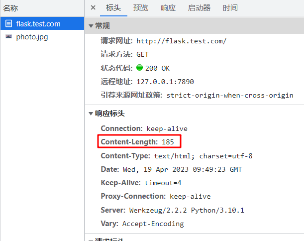

图片资源大于 1024 字节，开启了压缩

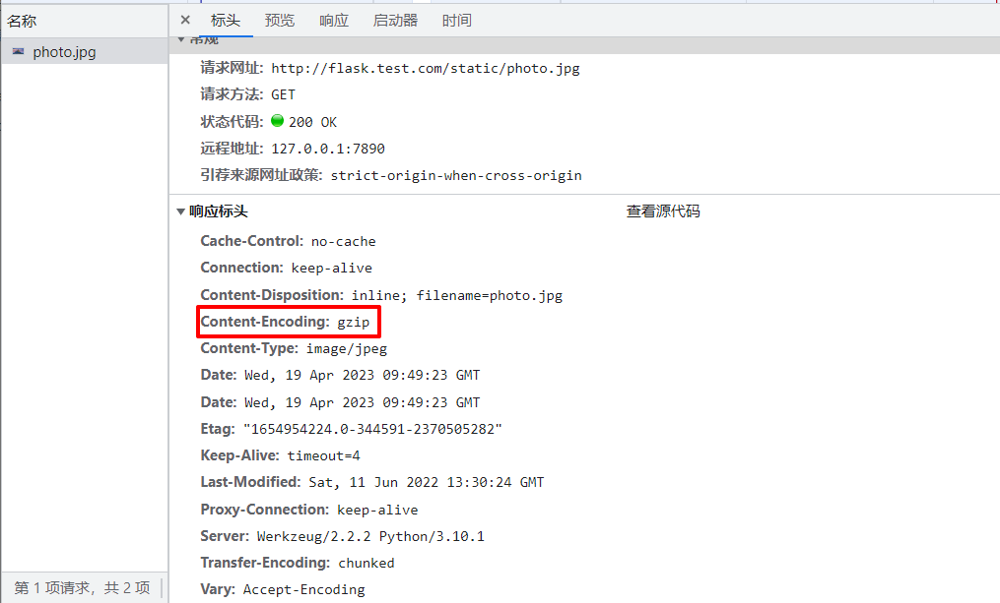

以上


#### 2:TraefikService 

kubernetes 中使用 Traefik ingress 的 TraefikService 实现加权轮询、灰度发布、流量复制、会话保持(粘性会话)等功能            

traefik 的路由规则就可以实现 4 层和 7 层的基本负载均衡操作，使用 [IngressRoute](https://doc.traefik.io/traefik/routing/providers/kubernetes-crd/#kind-ingressroute) [IngressRouteTCP](https://doc.traefik.io/traefik/routing/providers/kubernetes-crd/#kind-ingressroutetcp) [IngressRouteUDP](https://doc.traefik.io/traefik/routing/providers/kubernetes-crd/#kind-ingressrouteudp) 资源即可。但是如果想要实现 `加权轮询、流量复制` 等高级操作，traefik 抽象出了一个 [TraefikService](https://doc.traefik.io/traefik/routing/providers/kubernetes-crd/#kind-traefikservice) 资源。此时整体流量走向为：外部流量先通过 entryPoints 端口进入 traefik，然后由 IngressRoute/IngressRouteTCP/IngressRouteUDP 匹配后进入 `TraefikService`，在 `TraefikService` 这一层实现加权轮循和流量复制，最后将请求转发至 kubernetes 的 service。

除此之外 traefik 还支持 7 层的粘性会话、健康检查、传递请求头、响应转发、故障转移等操作。

##### 2: 灰度发布 (加权轮询)

[官方文档](https://doc.traefik.io/traefik/routing/services/#weighted-round-robin-service)

灰度发布也称为金丝雀发布，让一部分即将上线的服务发布到线上，观察是否达到上线要求，主要通过加权轮询的方式实现。

创建 traefikService 和 inressRoute 资源，实现 wrr 加权轮询

```yaml
apiVersion: traefik.containo.us/v1alpha1
kind: IngressRoute
metadata:
  name: ingressroutewrr
  namespace: default
spec:
  entryPoints:
    - web
  routes:
  - match: Host(`myapp.test.com`) && PathPrefix(`/`)
    kind: Rule
    services:
    - name: wrr
      namespace: default
      kind: TraefikService
---
apiVersion: traefik.containo.us/v1alpha1
kind: TraefikService
metadata:
  name: wrr
  namespace: default
spec:
  weighted:
    services:
      - name: myapp1    
        port: 80
        weight: 1          # 定义权重
        kind: Service      # 可选，默认就是 Service 
      - name: myapp2
        port: 80     
        weight: 2
```

yaml

测试结果如下，可以看到每 3 次访问会有 1 次流量落到 v1 应用， 2 次流量落到 v2 应用

```bash
[root@k8s-node1 ~]# for i in {1..9}; do curl http://myapp.test.com && sleep 1; done
Hello MyApp | Version: v1 | <a href="hostname.html">Pod Name</a>
Hello MyApp | Version: v2 | <a href="hostname.html">Pod Name</a>
Hello MyApp | Version: v2 | <a href="hostname.html">Pod Name</a>
Hello MyApp | Version: v1 | <a href="hostname.html">Pod Name</a>
Hello MyApp | Version: v2 | <a href="hostname.html">Pod Name</a>
Hello MyApp | Version: v2 | <a href="hostname.html">Pod Name</a>
Hello MyApp | Version: v1 | <a href="hostname.html">Pod Name</a>
Hello MyApp | Version: v2 | <a href="hostname.html">Pod Name</a>
Hello MyApp | Version: v2 | <a href="hostname.html">Pod Name</a>
```

bash

##### 3 会话保持 (粘性会话)

[官方文档](https://doc.traefik.io/traefik/routing/services/#servers)

> 会话保持功能依赖加权轮询功能

当我们使用 traefik 的负载均衡时，默认情况下轮循多个 k8s 的 service  服务，如果用户对同一内容的多次请求，可能被转发到了不同的后端服务器。假设用户发出请求被分配至服务器 A，保存了一些信息在 session  中，该用户再次发送请求被分配到服务器 B，要用之前保存的信息，若服务器 A 和 B 之间没有 session 粘滞，那么服务器 B  就拿不到之前的信息，这样会导致一些问题。traefik  同样也支持粘性会话，可以让用户在一次会话周期内的所有请求始终转发到一台特定的后端服务器上。

创建 traefikervie 和 ingressRoute，实现基于 cookie 的会话保持

```yaml
apiVersion: traefik.containo.us/v1alpha1
kind: IngressRoute
metadata:
  name: ingressroute-sticky
  namespace: default
spec:
  entryPoints:
    - web
  routes:
  - match: Host(`myapp.test.com`) && PathPrefix(`/`)
    kind: Rule
    services:
    - name: sticky
      namespace: default
      kind: TraefikService
---
apiVersion: traefik.containo.us/v1alpha1
kind: TraefikService
metadata:
  name: sticky
  namespace: default
spec:
  weighted:
    services:
      - name: myapp1
        port: 80
        weight: 1          # 定义权重
      - name: myapp2
        port: 80
        weight: 2
    sticky:                 # 开启粘性会话
      cookie:               # 基于cookie区分客户端      
        name: test-cookie   # 指定客户端请求时，包含的cookie名称
```

yaml

客户端访问测试，携带 cookie

```yaml
[root@k8s-node1 ~]# for i in {1..5}; do curl -b "test-cookie=default-myapp2-80" http://myapp.test.com; done
Hello MyApp | Version: v2 | <a href="hostname.html">Pod Name</a>
Hello MyApp | Version: v2 | <a href="hostname.html">Pod Name</a>
Hello MyApp | Version: v2 | <a href="hostname.html">Pod Name</a>
Hello MyApp | Version: v2 | <a href="hostname.html">Pod Name</a>
Hello MyApp | Version: v2 | <a href="hostname.html">Pod Name</a>

[root@k8s-node1 ~]# for i in {1..5}; do curl -b "test-cookie=default-myapp1-80" http://myapp.test.com; done
Hello MyApp | Version: v1 | <a href="hostname.html">Pod Name</a>
Hello MyApp | Version: v1 | <a href="hostname.html">Pod Name</a>
Hello MyApp | Version: v1 | <a href="hostname.html">Pod Name</a>
Hello MyApp | Version: v1 | <a href="hostname.html">Pod Name</a>
Hello MyApp | Version: v1 | <a href="hostname.html">Pod Name</a>
```

yaml

##### 4 流量复制

[官方文档](https://doc.traefik.io/traefik/routing/services/#mirroring-service)

所谓的流量复制，也称为镜像服务是指将请求的流量按规则复制一份发送给其它服务，并且会忽略这部分请求的响应，这个功能在做一些压测或者问题复现的时候很有用。

创建 traefikService 和 ingressRoute

```yaml
apiVersion: traefik.containo.us/v1alpha1
kind: IngressRoute
metadata:
  name: ingressroute-mirror
  namespace: default
spec:
  entryPoints:
    - web
  routes:
  - match: Host(`myapp.test.com`) && PathPrefix(`/`) 
    kind: Rule
    services:
    - name: mirror-from-service         
      namespace: default
      kind: TraefikService
---
apiVersion: traefik.containo.us/v1alpha1
kind: TraefikService
metadata:
  name: mirror-from-service
  namespace: default
spec:
  mirroring:
    name: myapp1       # 发送 100% 的请求到 myapp1
    port: 80
    mirrors:
      - name: myapp2   # 然后复制 10% 的请求到 myapp2
        port: 80
        percent: 10,
```

yaml

测试如下，可以看到只有 `myapp1` 应用会有数据返回

```bash
[root@k8s-node1 ~]# for i in {1..20}; do curl http://myapp.test.com && sleep 1; done
Hello MyApp | Version: v1 | <a href="hostname.html">Pod Name</a>
Hello MyApp | Version: v1 | <a href="hostname.html">Pod Name</a>
Hello MyApp | Version: v1 | <a href="hostname.html">Pod Name</a>
.......
```

bash

`myapp2` 应用同样收到了请求，与预期相同，收到了 10% 的流量，

```bash
[root@k8s-node1 ~]# kubectl logs -l app=bar
....
10.244.36.64 - - [20/Apr/2023:07:04:33 +0000] "GET / HTTP/1.1" 200 65 "-" "curl/7.29.0" "1.1.1.1"
10.244.36.64 - - [20/Apr/2023:07:04:43 +0000] "GET / HTTP/1.1" 200 65 "-" "curl/7.29.0" "1.1.1.1"
```

bash


#### 3:Traefik 部署

https://www.lvbibir.cn/posts/tech/kubernetes-traefik-1-deploy/#21-crd-rbac-serviceaccount

traefik 是支持 helm 部署的，但是查看 helm 包的 value.yaml 配置发现总共有 500  多行配置，当需要修改配置项或者对 traefik 做一下自定义配置时，并不灵活。如果只是使用 traefik 的基础功能，推荐使用 helm  部署。如果想深入研究使用 traefik 的话，推荐使用自定义方式部署。

crd:

```bash
[root@k8s-node1 ~]# mkdir /opt/traefik
[root@k8s-node1 ~]# cd /opt/traefik
[root@k8s-node1 traefik]# wget https://raw.githubusercontent.com/traefik/traefik/v2.9/docs/content/reference/dynamic-configuration/kubernetes-crd-definition-v1.yml
[root@k8s-node1 traefik]# kubectl apply -f kubernetes-crd-definition-v1.yml
```

rbac:

```bash
[root@k8s-node1 traefik]# wget https://raw.githubusercontent.com/traefik/traefik/v2.9/docs/content/reference/dynamic-configuration/kubernetes-crd-rbac.yml
[root@k8s-node1 traefik]# kubectl apply -f kubernetes-crd-rbac.yml
clusterrole.rbac.authorization.k8s.io/traefik-ingress-controller created
clusterrolebinding.rbac.authorization.k8s.io/traefik-ingress-controller created
```

serviceaccount.yml:

```yaml
apiVersion: v1
kind: Namespace
metadata:
  name: traefik
---
apiVersion: v1
kind: ServiceAccount
metadata:
  namespace: traefik
  name: traefik-ingress-controller
---
apiVersion: rbac.authorization.k8s.io/v1
kind: ClusterRoleBinding
metadata:
  name: traefik-ingress-controller
roleRef:
  apiGroup: rbac.authorization.k8s.io
  kind: ClusterRole
  name: traefik-ingress-controller
subjects:
  - kind: ServiceAccount
    name: traefik-ingress-controller
    namespace: traefik
    
    
    
    
    
    
```

#### configmap

在 Traefik 中有三种方式定义静态配置：在配置文件中、在命令行参数中、通过环境变量传递，由于 Traefik 配置很多，通过 CLI 定义不是很方便，一般时候选择将其配置选项放到配置文件中，然后存入 ConfigMap，将其挂入 traefik 中。

`configmap.yml` 文件内容：

```yaml
apiVersion: v1
kind: ConfigMap
metadata:
  name: traefik-config
  namespace: traefik
data:
  traefik.yaml: |-
    global:
      checkNewVersion: false    # 周期性的检查是否有新版本发布
      sendAnonymousUsage: false # 周期性的匿名发送使用统计信息
    serversTransport:
      insecureSkipVerify: true  # Traefik忽略验证代理服务的TLS证书
    api:
      insecure: true            # 允许HTTP 方式访问API
      dashboard: true           # 启用Dashboard
      debug: false              # 启用Debug调试模式
    metrics:
      prometheus:               # 配置Prometheus监控指标数据，并使用默认配置
        addRoutersLabels: true  # 添加routers metrics
        entryPoint: "metrics"   # 指定metrics监听地址
    entryPoints:
      web:
        address: ":80"          # 配置80端口，并设置入口名称为 web
        forwardedHeaders: 
          insecure: true        # 信任所有的forward headers
      websecure:
        address: ":443"         # 配置443端口，并设置入口名称为 websecure
        forwardedHeaders: 
          insecure: true
      traefik:
        address: ":9000"        # 配置9000端口为 dashboard 的端口，不设置默认值为 8080
      metrics:
        address: ":9100"        # 配置9100端口，作为metrics收集入口
      tcpep:
        address: ":9200"        # 配置9200端口，作为tcp入口
      udpep:
        address: ":9300/udp"    # 配置9300端口，作为udp入口
    providers:
      kubernetesIngress: ""     # 启用 Kubernetes Ingress 方式来配置路由规则
      kubernetesGateway: ""     # 启用 Kubernetes Gateway API
      kubernetesCRD:            # 启用Kubernetes CRD方式来配置路由规则
        ingressClass: ""        # 指定traefik的ingressClass名称
        allowCrossNamespace: true   #允许跨namespace
        allowEmptyServices: true    #允许空endpoints的service
    log:
      filePath: "/etc/traefik/logs/traefik.log" # 设置调试日志文件存储路径，如果为空则输出到控制台
      level: "DEBUG"            # 设置调试日志级别
      format: "json"          # 设置调试日志格式
    accessLog:
      filePath: "/etc/traefik/logs/access.log" # 设置访问日志文件存储路径，如果为空则输出到 stdout 和 stderr
      format: "json"          # 设置访问调试日志格式
      bufferingSize: 0          # 设置访问日志缓存行数
      fields:                   # 设置访问日志中的字段是否保留（keep保留、drop不保留）
        defaultMode: keep       # 设置默认保留访问日志字段
        names:                  # 针对访问日志特别字段特别配置保留模式
          ClientUsername: drop
          StartUTC: drop        # 禁用日志timestamp使用UTC
        headers:                # 设置Header中字段是否保留
          defaultMode: keep     # 设置默认保留Header中字段
          names:                # 针对Header中特别字段特别配置保留模式
            # User-Agent: redact# 可以针对指定agent
            Authorization: drop
            Content-Type: keep    
```

设置节点 label，用于控制在哪些节点部署 Traefik，这里我们使用 k8s-node1(master) 节点作为边缘节点部署

```bash
kubectl label node k8s-node1  IngressProxy=true
```

使用 DeamonSet 或者 Deployment 均可，此处使用 Deployment 方式部署 Traefik，调度至含有 IngressProxy=true 的边缘节点

同时使用 `podAntiAffinity` 避免多个 traefik 实例运行在同一节点造成单点故障.

```
kubectl apply -f deployment.yml
```

```yaml
apiVersion: apps/v1
kind: Deployment
metadata:
  name: traefik
  namespace: traefik
  labels:
    app: traefik
spec:
  replicas: 1
  selector:
    matchLabels:
      app: traefik
  template:
    metadata:
      name: traefik
      labels:
        app: traefik
    spec:
      affinity:
        podAntiAffinity:
          requiredDuringSchedulingIgnoredDuringExecution:
          - labelSelector:
              matchExpressions:
              - key: app
                operator: In
                values:
                - traefik
            topologyKey: "kubernetes.io/hostname"
    spec:
      serviceAccountName: traefik-ingress-controller
      terminationGracePeriodSeconds: 5         # 等待容器优雅退出的时长
      tolerations:                             # 设置容忍所有污点，防止节点被设置污点
        - operator: "Exists"
      nodeSelector:                            # 设置node筛选器，在特定label的节点上启动
        IngressProxy: "true"                   # 调度至IngressProxy: "true"的节点
      containers:
      - name: traefik
        image: traefik:v2.9
        env:
        - name: KUBERNETES_SERVICE_HOST       # 手动指定k8s api,避免网络组件不稳定。
          value: "1.1.1.1"
        - name: KUBERNETES_SERVICE_PORT_HTTPS # API server端口
          value: "6443"
        - name: KUBERNETES_SERVICE_PORT       # API server端口
          value: "6443"
        - name: TZ                            # 指定时区
          value: "Asia/Shanghai"
        ports:
          - name: web
            containerPort: 80
          - name: websecure
            containerPort: 443
          - name: dashboard
            containerPort: 9000               # Traefik Dashboard 端口
          - name: metrics
            containerPort: 9100
          - name: tcpep
            containerPort: 9200               # tcp端口
          - name: udpep
            containerPort: 9300               # udp端口
        securityContext:                      # 只开放网络权限
          capabilities:
            drop:
              - ALL
            add:
              - NET_BIND_SERVICE
        args:
          - --configfile=/etc/traefik/config/traefik.yaml
        volumeMounts:
        - mountPath: /etc/traefik/config
          name: config
        - mountPath: /etc/traefik/logs
          name: logdir
        - mountPath: /etc/localtime
          name: timezone
          readOnly: true
        resources:
          requests:
            memory: "5Mi"
            cpu: "10m"
          limits:
            memory: "256Mi"
            cpu: "1000m"
      volumes:
        - name: config                         # traefik配置文件
          configMap:
            name: traefik-config
        - name: logdir                         # traefik日志目录
          hostPath:
            path: /var/log/traefik
            type: "DirectoryOrCreate"
        - name: timezone                       # 挂载时区文件
          hostPath:
            path: /etc/localtime
            type: File
```

service `kubectl apply -f service.yml`

```yaml
apiVersion: v1
kind: Service
metadata:
  labels:
    app: traefik
  name: traefik             # 实际提供服务的 service, 使用 NodePort 模式
  namespace: traefik
spec:
  type: NodePort
  selector:
    app: traefik
  ports:
  - name: web
    protocol: TCP
    port: 80
    targetPort: 80
    nodePort: 80
  - name: websecure
    protocol: TCP
    port: 443
    targetPort: 443
    nodePort: 443
  - name: dashboard
    protocol: TCP
    port: 9000
    targetPort: 9000
    nodePort: 9000
  - name: tcpep
    protocol: TCP
    port: 9200
    targetPort: 9200
    nodePort: 9200
  - name: udpep
    protocol: UDP
    port: 9300
    targetPort: 9300
    nodePort: 9300
---
apiVersion: v1
kind: Service
metadata:
  labels:
    app: traefik-metrics
  name: traefik-metrics           # metrics 用于给集群内的 prometheus 提供数据
  namespace: traefik
spec:
  selector:
    app: traefik
  ports:
  - name: metrics
    protocol: TCP
    port: 9100
    targetPort: 9100
```

验证：

```bash
[root@k8s-node1 traefik]# kubectl get pod,cm,sa,svc -n traefik |grep traefik
pod/traefik-69bd67497f-v27qp   1/1     Running   0          12m
configmap/traefik-config     1      7d5h
serviceaccount/traefik-ingress-controller   1         7d5h
service/traefik          NodePort    10.101.142.158   <none>        80:80/TCP,443:443/TCP,9000:9000/TCP,9200:9200/TCP,9300:9300/UDP   11m
service/traefik-metrics   ClusterIP   10.98.89.13      <none>        9100/TCP                                                          12m
```

可以直接通过 http://1.1.1.1:9000 访问到 dashboard

其他配置：

2.5.1 强制使用 TLS v1.2+

[官方文档](https://doc.traefik.io/traefik/user-guides/crd-acme/#force-tls-v12)

如今，TLS v1.0 和 v1.1 因为存在安全问题，现在已被弃用。为了保障系统安全，所有入口路由都应该强制使用 TLS v1.2 或更高版本。

```bash
[root@k8s-node1 traefik]# tee traefik-tlsoption.yml <<-'EOF'
apiVersion: traefik.containo.us/v1alpha1
kind: TLSOption
metadata:
  name: default
  namespace: traefik
spec:
  minVersion: VersionTLS12
  cipherSuites:
    - TLS_ECDHE_RSA_WITH_AES_256_GCM_SHA384   # TLS 1.2
    - TLS_ECDHE_RSA_WITH_CHACHA20_POLY1305    # TLS 1.2
    - TLS_AES_256_GCM_SHA384                  # TLS 1.3
    - TLS_CHACHA20_POLY1305_SHA256            # TLS 1.3
  curvePreferences:
    - CurveP521
    - CurveP384
  sniStrict: true
EOF
[root@k8s-node1 traefik]# kubectl apply -f traefik-tlsoption.yml
tlsoption.traefik.containo.us/default created
```

bash

### 2.5.2 日志切割

官方并没有日志轮换的功能，但是 traefik 收到 `USR1` 信号后会重建日志文件，因此可以通过 `logrotate` 实现日志轮换

```bash
mkdir -p /etc/logrotate.d/traefik
tee /etc/logrotate.d/traefik/config <<-'EOF'
/var/log/traefik/*.log {
  daily
  rotate 15
  missingok
  notifempty
  compress
  dateext
  dateyesterday
  dateformat .%Y-%m-%d
  create 0644 root root
  postrotate
   docker kill --signal="USR1" $(docker ps | grep traefik |grep -v pause| awk '{print $1}')
  endscript
 }
EOF
```

bash

创建定时任务

```bash
crontab -e
0 0 * * * /usr/sbin/logrotate -f /etc/logrotate.d/traefik/config >/dev/null 2>&1
```

bash

## 2.6 多控制器

有的业务场景下可能需要在一个集群中部署多个 traefik，例如：避免单个 traefik 配置规则过多导致加载处理缓慢。每个  namespace 部署一个 traefik。或者 traefik 生产与测试环境区分等场景，需要不同的实例控制不同的 IngressRoute 资源对象，要实现该功能有两种方法

### 2.6.1 annotations 注解筛选

首先在 traefik 配置文件中的 providers 下增加 Ingressclass 参数，指定具体的值

```yaml
    providers:
      kubernetesCRD:            # 启用Kubernetes CRD方式来配置路由规则
        ingressClass: "traefik-v2.9" # 指定traefik的ingressClass实例名称
        allowCrossNamespace: true   #允许跨namespace
        allowEmptyServices: true    #允许空endpoints的service
```

yaml

接下来在 IngressRoute 资源对象中的 annotations 参数中添加 `kubernetes.io/ingress.class: traefik-v2.9` 即可

```yaml
apiVersion: traefik.containo.us/v1alpha1
kind: IngressRoute
metadata:
  name: dashboard
  namespace: traefik
  annotations:
    kubernetes.io/ingress.class: traefik-v2.9 #  因为静态配置文件指定了ingressclass，所以这里的annotations 要指定，否则访问会404
spec:
  entryPoints:
    - web
  routes:
    - match: Host(`traefik.test.com`)
      kind: Rule
      services:
        - name: api@internal
          kind: TraefikService
          namespace: traefik
```

yaml

### 2.6.2 label 标签选择器筛选

首先在 traefik 配置文件中的 providers 下增加 labelSelector 参数，指定具体的标签键值。

```yaml
    providers:
      kubernetesCRD:            # 启用Kubernetes CRD方式来配置路由规则
        # ingressClass: "traefik-v2.9"    # 指定traefik的ingressClass名称
        labelSelector: "app=traefik-v2.9" # 通过标签选择器指定traefik标签 
        allowCrossNamespace: true   #允许跨namespace
        allowEmptyServices: true    #允许空endpoints的service
```

yaml

然后在 IngressRoute 资源对象中添加 labels 标签选择器，选择 `app: traefik-v2.9` 这个标签即可

```yaml
apiVersion: traefik.containo.us/v1alpha1
kind: IngressRoute
metadata:
  name: dashboard
  labels:     # 通过标签选择器，该IngressRoute资源由配置了app=traefik-v2.9的traefik处理
    app: traefik-v2.9
  # annotations:
    # kubernetes.io/ingress.class: traefik-v2.9
spec:
  entryPoints:
    - web
  routes:
    - match: Host(`traefik.test.com`)
      kind: Rule
      services:
        - name: api@internal
          kind: TraefikService
          namespace: traefik
```

yaml

以上

```yaml
apiVersion: networking.k8s.io/v1
kind: Ingress
metadata:
  name: hello-ingress
  namespace: default
  annotations:
    #kubernetes.io/ingress.class: traefik-v2.9
    traefik.ingress.kubernetes.io/router.entrypoints: web
spec:
  rules:
  - host: hello.by.com
    http:
      paths:
      - pathType: Prefix
        path: /
        backend:
          service:
            name: hello
            port:
              number: 8080
```

```yaml
apiVersion: traefik.containo.us/v1alpha1
kind: IngressRoute
metadata:
  name: hello
  namespace: default
  annotations:
    kubernetes.io/ingress.class: traefik-v2.9 #  因为静态配置文件指定了ingressclass，所以这里的annotations 要指定，否则访问会404
spec:
  entryPoints:
    - web
  routes:
  - match: Host(`192.168.5.21`)
    kind: Rule
    services:
    - name: hello
      port: 8080

```


```bash
#gateway
kubectl apply -f https://raw.githubusercontent.com/kubernetes-sigs/gateway-api/release-VERSION/config/crd.yaml
```


configmap:

```yaml
apiVersion: v1
kind: ConfigMap
metadata:
  name: traefik-config
  namespace: default
data:
  traefik.yml: |-
    global:
      checkNewVersion: false
      sendAnonymousUsage: false
    log:
      level: DEBUG
    api:
      insecure: true # 仅用于测试环境，生产环境请禁用
    entryPoints:
      web:
        address: ":80"
      websecure:
        address: ":443"
    providers:
      kubernetesCRD: {}
    # 更多 Traefik 配置...
    #     #
    #         # # 若有 TLS 配置，可以添加到 ConfigMap 中：
    #             # # tls:
    #                 # #   stores:
    #                     # #     default:
    #                         # #       defaultCertificate:
    #                             # #         certFile: "/ssl/tls.crt"
    #                                 # #         keyFile: "/ssl/tls.key"
    #

```

serviceAccount:

```yaml
kind: ClusterRole
apiVersion: rbac.authorization.k8s.io/v1
metadata:
  name: traefik-ingress-controller
  namespace: default
rules:
  - apiGroups: [""]
    resources: ["services","endpoints","secrets"]
    verbs: ["get","list","watch"]
  - apiGroups: ["extensions","networking.k8s.io"]
    resources: ["ingresses","ingressclasses"]
    verbs: ["get","list","watch"]
  - apiGroups: ["extensions","networking.k8s.io"]
    resources: ["ingresses/status"]
    verbs:  ["update"]
 # - apiGroups: ["traefik.containo.us"]
 #   #  resources: ["middlewares"]
 #      # verbs: ["get","list","watch"]
 #       # - apiGroups: ["traefik.containo.us"]
 #         #  resources: ["ingressroutes"]
 #            # verbs: ["get","list","watch"]
 #

---
apiVersion: v1
kind: ServiceAccount
metadata:
  name: traefik-ingress-controller
  namespace: default

---
kind: ClusterRoleBinding
apiVersion: rbac.authorization.k8s.io/v1
metadata:
  name: traefik-ingress-controller
roleRef:
  apiGroup: rbac.authorization.k8s.io
  kind: ClusterRole
  name: traefik-ingress-controller
subjects:
  - kind: ServiceAccount
    name: traefik-ingress-controller
    namespace: default

```

deployment

```yaml
apiVersion: v1
kind: Service
metadata:
  name: traefik-ingress-service
  namespace: default
spec:
  selector:
    app: traefik
  ports:
    - name: web
      port: 80
      targetPort: web
      nodePort: 31888
    - name: dashboard
      port: 8080
      targetPort: dashboard
      nodePort: 31889
  type: NodePort

---
apiVersion: apps/v1
kind: Deployment
metadata:
  name:  traefik-ingress-controller
  labels:
    app: traefik
  namespace: default
spec:
  replicas: 1
  selector:
    matchLabels:
      app: traefik
  template:
    metadata:
      labels:
        app: traefik
    spec:
      serviceAccountName: traefik-ingress-controller
      containers:
        - name: traefik
          image: traefik:latest
          imagePullPolicy: IfNotPresent
          args:
            - --api.insecure
            - --providers.kubernetesingress
          volumeMounts:
          - name: traefik-config
            mountPath: /etc/traefik/config
            readOnly: true
          ports:
            - name: web
              containerPort: 80
            - name: dashboard
              containerPort: 8080
            - name: websecure
              containerPort: 443
          resources:
            limits:
              cpu: 2000m
              memory: 1024Mi
            requests:
              cpu: 1000m
              memory: 1024Mi
          securityContext:
            capabilities:
              drop:
                - ALL
              add:
                - NET_BIND_SERVICE
      volumes:
        - name: traefik-config
          configMap:
          name: traefik-config
```


## kubeadm 搭建 K8s 集群

Kubeadm 概述

- `kubeadm` 是 `Kubernetes` 项目自带的及集群构建工具，负责执行构建一个最小化的可用集群以及将其启动等的必要基本步骤，`kubeadm` 是 `Kubernetes` 集群全生命周期的管理工具，可用于实现集群的部署、升级、降级及拆除。`kubeadm` 部署 `Kubernetes` 集群是将大部分资源以 `pod` 的方式运行，例如（`kube-proxy`、`kube-controller-manager`、`kube-scheduler`、`kube-apiserver`、`flannel`) 都是以 `pod` 方式运行。
- `Kubeadm` 仅关心如何初始化并启动集群，余下的其他操作，例如安装 `Kubernetes Dashboard`、监控系统、日志系统等必要的附加组件则不在其考虑范围之内，需要管理员自行部署。
- `Kubeadm` 集成了 `Kubeadm init` 和 `kubeadm join` 等工具程序，其中 `kubeadm init` 用于集群的快速初始化，其核心功能是部署 Master 节点的各个组件，而 `kubeadm join` 则用于将节点快速加入到指定集群中，它们是创建 `Kubernetes` 集群最佳实践的“快速路径”。另外，`kubeadm token` 可于集群构建后管理用于加入集群时使用的认证令牌（`token`)，而 `kubeadm reset` 命令的功能则是删除集群构建过程中生成的文件以重置回初始状态。

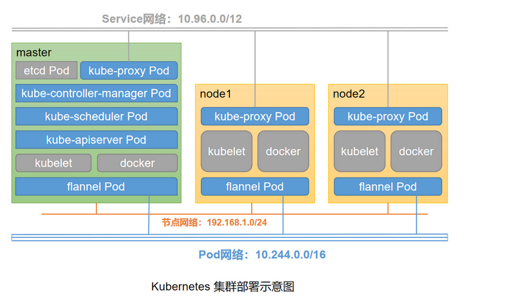

基于 `centos7.9`，`docker-ce-20.10.18`，`kubelet-1.22.3-0`

部署 Kubernetes 集群需要满足每个节点至少满足 2 核 CPU、2G 内存和 30GB 硬盘且都可以访问外网

### 前期准备

| 角色      | IP      |
| --------- | ------- |
| k8s-node1 | 1.1.1.1 |
| k8s-node2 | 1.1.1.2 |
| k8s-node3 | 1.1.1.3 |

```bash
# 关闭防火墙
systemctl stop firewalld
systemctl disable firewalld

# 关闭selinux
sed -i 's/enforcing/disabled/' /etc/selinux/config  # 永久
setenforce 0  # 临时

# 关闭swap
swapoff -a  # 临时
vim /etc/fstab  # 永久, 注释掉swap分区相关行

# 设置主机名
hostnamectl set-hostname <hostname>

# 添加hosts
cat >> /etc/hosts << EOF
1.1.1.1 k8s-node1
1.1.1.2 k8s-node2
1.1.1.3 k8s-node3
EOF

# 将桥接的IPv4流量传递到iptables的链
cat > /etc/sysctl.d/k8s.conf << EOF
net.bridge.bridge-nf-call-ip6tables = 1
net.bridge.bridge-nf-call-iptables = 1
EOF
sysctl --system  # 生效

# 时间同步
timedatectl set-timezone Asia/Shanghai
yum install ntpdate -y
ntpdate time.windows.com
```

### docker

Kubernetes 默认 CRI（容器运行时）为 Docker，因此先安装 Docker。

```bash
wget https://mirrors.aliyun.com/docker-ce/linux/centos/docker-ce.repo -O /etc/yum.repos.d/docker-ce.repo
yum list docker-ce --show-duplicates
yum install docker-ce-20.10.23-3.el7.x86_64

mkdir /etc/docker
cat > /etc/docker/daemon.json << EOF
{
  "registry-mirrors": [
    "http://hub-mirror.c.163.com",
    "https://docker.mirrors.ustc.edu.cn",
    "https://jc0srqak.mirror.aliyuncs.com"
  ],
  "exec-opts": ["native.cgroupdriver=systemd"]
}
EOF

systemctl daemon-reload
systemctl enable docker && systemctl start docker
docker info

```

### 1:kubeadm/kubelet/kubectl

添加阿里云 YUM 软件源

```bash
cat > /etc/yum.repos.d/kubernetes.repo << EOF
[kubernetes]
name=Kubernetes
baseurl=https://mirrors.aliyun.com/kubernetes/yum/repos/kubernetes-el7-x86_64
enabled=1
gpgcheck=0
repo_gpgcheck=0
gpgkey=https://mirrors.aliyun.com/kubernetes/yum/doc/yum-key.gpg https://mirrors.aliyun.com/kubernetes/yum/doc/rpm-package-key.gpg
EOF
```

```bash
yum install -y kubelet-1.22.3 kubeadm-1.22.3 kubectl-1.22.3
systemctl enable kubelet
systemctl start kubelet
```

### 2:Kubernetes Master

在 1.1.1.1（Master）执行

```bash
kubeadm init \
--apiserver-advertise-address=1.1.1.1 \
--kubernetes-version v1.22.3 \
--service-cidr=10.96.0.0/12 \
--pod-network-cidr=10.244.0.0/16 \
--ignore-preflight-errors=all \
--image-repository registry.aliyuncs.com/google_containers 
```

- –apiserver-advertise-address 集群通告地址
- –kubernetes-version K8s 版本，与上面安装的一致
- –service-cidr 集群内部虚拟网络，Pod 统一访问入口
- –pod-network-cidr Pod 网络，与下面部署的 CNI 网络组件 yaml 中保持一致
- –ignore-preflight-errors=all，跳过一些错误
- –image-repository 由于默认拉取镜像地址 k8s.gcr.io 国内无法访问，这里指定阿里云镜像仓库地址

或者使用配置文件引导：

```bash
cat > kubeadm.conf << EOF
apiVersion: kubeadm.k8s.io/v1beta2
kind: ClusterConfiguration
kubernetesVersion: v1.22.3
imageRepository: registry.aliyuncs.com/google_containers 
networking:
  podSubnet: 10.244.0.0/16 
  serviceSubnet: 10.96.0.0/12 
EOF

kubeadm init --config kubeadm.conf --ignore-preflight-errors=all  
```

拷贝 kubectl 使用的连接 k8s 认证文件到默认路径：

```bash
mkdir -p $HOME/.kube
sudo cp -i /etc/kubernetes/admin.conf $HOME/.kube/config
sudo chown $(id -u):$(id -g) $HOME/.kube/config
```

```bash
#查看 k8s 集群状态
kubectl get cs
NAME                 STATUS      MESSAGE                                                                                       ERROR
scheduler            Unhealthy   Get "http://127.0.0.1:10251/healthz": dial tcp 127.0.0.1:10251: connect: connection refused
controller-manager   Healthy     ok                                                                      
etcd-0               Healthy     {"health":"true","reason":""}   

vim /etc/kubernetes/manifests/kube-scheduler.yaml
# 注释掉 --port=0 ，scheduler会自动重启，稍等一小会状态变为正常

kubectl get cs
NAME                 STATUS    MESSAGE                         ERROR
scheduler            Healthy   ok
controller-manager   Healthy   ok
etcd-0               Healthy   {"health":"true","reason":""}
```

### 3: Kubernetes Node

在 192.168.150.102/103（Node）执行。

向集群添加新节点，执行在 kubeadm init 输出的 kubeadm join 命令：

```bash
kubeadm join 1.1.1.1:6443 --token esce21.q6hetwm8si29qxwn \
--discovery-token-ca-cert-hash sha256:00603a05805807501d7181c3d60b478788408cfe6cedefedb1f97569708be9c5
```

默认 token 有效期为 24 小时，当过期之后，该 token 就不可用了。这时就需要重新创建 token，操作如下

```bash
kubeadm token create
kubeadm token list

openssl x509 -pubkey -in /etc/kubernetes/pki/ca.crt | openssl rsa -pubin -outform der 2>/dev/null | openssl dgst -sha256 -hex | sed 's/^.* //'
63bca849e0e01691ae14eab449570284f0c3ddeea590f8da988c07fe2729e924

kubeadm join 1.1.1.1:6443 --token nuja6n.o3jrhsffiqs9swnu --discovery-token-ca-cert-hash 
sha256:63bca849e0e01691ae14eab449570284f0c3ddeea590f8da988c07fe2729e924
```

###  4:部署容器网络 (cni)

Calico 是一个纯三层的数据中心网络方案，Calico 支持广泛的平台，包括 Kubernetes、OpenStack 等。

Calico 在每一个计算节点利用 Linux Kernel 实现了一个高效的虚拟路由器（ vRouter） 来负责数据转发，而每个 vRouter 通过 BGP 协议负责把自己上运行的 workload 的路由信息向整个 Calico 网络内传播。

此外，Calico 项目还实现了 Kubernetes 网络策略，提供 ACL 功能。

[quickstart](https://docs.projectcalico.org/getting-started/kubernetes/quickstart)

[版本对照表](https://docs.tigera.io/archive/v3.23/getting-started/kubernetes/requirements)，在此页面可以看到 calico 每个版本支持的 kubernetes 的版本

安装 calico

```bash
wget --no-check-certificate https://docs.tigera.io/archive/v3.23/manifests/calico.yaml
```

修改 Pod 网络和网卡识别参数，Pod 网络与前面 kubeadm init 指定的一样

```bash
[root@k8s-node1 ~]# vim calico.yaml
# 修改位置：DaemonSet.spec.template.spec.containers.env
# 新增如下四行
- name: CALICO_IPV4POOL_CIDR
  value: "10.244.0.0/16"
- name: IP_AUTODETECTION_METHOD
  value: interface=bond*,ens* #网卡名根据实际情况修改

kubectl apply -f calico.yaml
kubectl get pods -n kube-system

# 所有Pod起来后，节点状态应该都是Ready状态了
[root@k8s-node1 ~]# kubectl get nodes
NAME        STATUS   ROLES                  AGE    VERSION
k8s-node1   Ready    control-plane,master   153m   v1.22.3
k8s-node2   Ready    <none>                 151m   v1.22.3
k8s-node3   Ready    <none>                 151m   v1.22.3
```

### 5:metric-server

cadvisor 负责提供数据，已集成到 k8s 中

Metrics-server 负责数据汇总，需额外安装

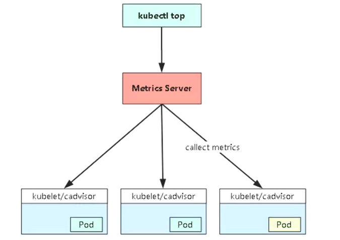

```bash
wget --no-check-certificate https://github.com/kubernetes-sigs/metrics-server/releases/download/v0.6.0/components.yaml 
mv components.yaml metrics-server.yaml
```

修改：

```yaml
      containers:
      - args:
        - --cert-dir=/tmp
        - --secure-port=4443
        - --kubelet-preferred-address-types=InternalIP # 第一处修改
        - --kubelet-use-node-status-port
        - --metric-resolution=15s
        - --kubelet-insecure-tls # 第二处修改
        image: registry.aliyuncs.com/google_containers/metrics-server:v0.6.0 # 第三处修改
        imagePullPolicy: IfNotPresent
```

- ```
  --kubelet-insecure-tls
  ```

  - 不验证 kubelet 自签的证书

- `–kubelet-preferred-address-types=InternalIP

  - Metrics-server 连接 cadvisor 默认通过主机名即 node 的名称进行连接，而 Metric-server 作为 pod 运行在集群中默认是无法解析的，所以这里修改成通过节点 ip 连接

部署 metrics-server：

```bash
[root@k8s-node1 ~]# kubectl apply -f metrics-server.yaml
[root@k8s-node1 ~]# kubectl get pods -n kube-system -l k8s-app=metrics-server
NAME                              READY   STATUS    RESTARTS   AGE
metrics-server-7f66b69ff6-bkfqg   1/1     Running   0          59s
[root@k8s-node1 ~]# kubectl top nodes
NAME        CPU(cores)   CPU%   MEMORY(bytes)   MEMORY%
k8s-node1   226m         11%    2004Mi          54%
k8s-node2   97m          4%     1047Mi          28%
k8s-node3   98m          4%     1096Mi          29%
```

### 6：测试 kubernetes 集群

- 验证 Pod 工作
- 验证 Pod 网络通信
- 验证 DNS 解析

在 Kubernetes 集群中创建一个 pod，验证是否正常运行：

```bash
kubectl create deployment nginx --image=nginx
kubectl expose deployment nginx --type=NodePort --port=80  --target-port=80
[root@k8s-node1 ~]# kubectl get pod,deploy,svc
NAME                         READY   STATUS    RESTARTS   AGE
pod/nginx-6799fc88d8-57bqd   1/1     Running   0          10m

NAME                    READY   UP-TO-DATE   AVAILABLE   AGE
deployment.apps/nginx   1/1     1            1           10m

NAME                 TYPE        CLUSTER-IP       EXTERNAL-IP   PORT(S)        AGE
service/kubernetes   ClusterIP   10.96.0.1        <none>        443/TCP        170m
service/nginx        NodePort    10.102.188.108   <none>        80:30954/TCP   2m31s
```

访问地址：http://1.1.1.1:30954，端口是固定的，ip 可以是集群内任一节点的 ip

### 7：部署 Dashboard

```bash
wget https://raw.githubusercontent.com/kubernetes/dashboard/v2.4.0/aio/deploy/recommended.yaml
```

默认 Dashboard 只能集群内部访问，修改 Service 为 NodePort 类型，暴露到外部：

```bash
vi recommended.yaml
...
kind: Service
apiVersion: v1
metadata:
  labels:
    k8s-app: kubernetes-dashboard
  name: kubernetes-dashboard
  namespace: kubernetes-dashboard
spec:
  ports:
    - port: 443
      targetPort: 8443
      nodePort: 30001
  selector:
    k8s-app: kubernetes-dashboard
  type: NodePort
...

kubectl apply -f recommended.yaml

kubectl get pods -n kubernetes-dashboard
NAME                                         READY   STATUS    RESTARTS   AGE
dashboard-metrics-scraper-6b4884c9d5-gl8nr   1/1     Running   0          13m
kubernetes-dashboard-7f99b75bf4-89cds        1/1     Running   0          13m
```

创建 service account 并绑定默认 cluster-admin 管理员集群角色：

```bash
# 创建用户
kubectl create serviceaccount dashboard-admin -n kube-system
# 用户授权
kubectl create clusterrolebinding dashboard-admin --clusterrole=cluster-admin --serviceaccount=kube-system:dashboard-admin
# 获取用户Token
kubectl describe secrets -n kube-system $(kubectl -n kube-system get secret | awk '/dashboard-admin/{print $1}')
```


## 相关专题（独立笔记）

- [OpenStack（Kolla-Ansible）](OpenStack-Kolla.md) — 单节点/集群部署、Horizon、实例
- [Ambari 2.7.5 + HDP 3.1.5](Ambari-HDP.md)
- [Azure 基础](Azure.md)

---

## 附录

### 存储方案 · Ceph

（占位，待补充 Ceph 与 K8s 存储类笔记。）

### Docker 镜像导入导出

```bash
#!/bin/bash
docker images > images.txt
awk '{print $1}' images.txt > images_cut.txt
sed -i '1d' images_cut.txt
while read LINE
do
docker save $LINE > ${LINE//\//_}.train.tar
echo ok
done < images_cut.txt
echo finish
```

```bash
#!/bin/bash
while read LINE
do
docker  load -i $LINE
echo ok
done < tarname.txt
echo finish
```


### Deployment 模板示例（Helm 风格占位符）

```yaml
apiVersion: apps/v1
kind: Deployment
metadata:
  name: {{.name}}
  namespace: {{.namespace}}
  labels:
    app: {{.name}}
    language: {{.language}}
spec:
  minReadySeconds: 10
  replicas: {{.replicas}}
  selector:
    matchLabels:
      app: {{.name}}
  strategy:
    rollingUpdate:
      maxSurge: 1
      maxUnavailable: 1
    type: RollingUpdate
  template:
    metadata:
      labels:
        app: {{.name}}
        language: {{.language}}
    spec:
      imagePullSecrets:
      - name:  {{.imagesecret}}
      containers:
      - image: {{.image}}{{if .command}}
        command: {{range $k,$v := .command}}
        - {{$v}}{{end}}{{end}}{{if .args}}
        args: {{range $k,$v := .args}}
        - {{$v}}{{end}}{{end}}
        imagePullPolicy: IfNotPresent
        name: {{.name}}
        ports: {{range $k, $v := .ports}}
        - containerPort: {{$v.port}}{{end}}
        resources:
          requests:
            memory: {{.memory}}
          limits:
            memory: {{.maxMemory}}
        env:
        - name: ENV
          value: prod
        - name: POD_NAME
          valueFrom:
            fieldRef:
              apiVersion: v1
              fieldPath: metadata.name
        - name: POD_NAMESPACE
          valueFrom:
            fieldRef:
              apiVersion: v1
              fieldPath: metadata.namespace
        - name: INSTANCE_IP
          valueFrom:
            fieldRef:
              apiVersion: v1
              fieldPath: status.podIP
        - name: NODE_NAME
          valueFrom:
            fieldRef:
              apiVersion: v1
              fieldPath: spec.nodeName
        volumeMounts:
        - name: tz-config
          mountPath: /etc/localtime
      volumes:
      - name: "tz-config"
        hostPath:
          path: "/usr/share/zoneinfo/Asia/Shanghai"
          
          
          
```


## Go 生态（client-go / Cobra）

### client-go

### GVR GVK

GVR:  无组名资源组（核心资源组 Core group） 和有组名资源组

- 有组名资源组

  /api/apps/v1/deployments

  apps: 分组  v1: 版本 deployments 资源

- 无组名资源组

  /api/v1/pods

  v1: 版本  pods : resources

在一般接口调用的时候，只需要知道GVR，通过GVR操作对应的资源。

GVK， 信息可以获取资源对象的GVR， GVK与GVR的映射叫做RestMapper

RestMapper 主要作用，是ListerWather , 根据Schema 定义的类型GVK 解析出GVR，向ApiServer发起http请求获取资源，然后watch


### Informer:

informer 负责与kubernets ApiServer 进行watch 操作， watch 的资源可以是k8s 内置资源对象，也可以是CRD。

informer 是一个带有本地缓存以及索引的核心工具包，当请求为`查询操作`的时候，会优先从本地缓存中查找数据，而更新，创建，删除操作，则会根据事件通知写入到队列DeltaFIFO,同时对应的事件处理后，更新本地缓存，使本地缓存与ETCD的数据保持一致。

List-Watch:

​	是k8s 中异步消息通知机制，确保消息的实时性，顺序性，可靠性

List 是http 短连接实现，watch 是基于http 长链路实现

- Reflector:  使用List-watch 来保证本地缓存数据，准确性和一致性，list 对应资源的全量数据，watch负责变化的数据，watch 指定的k8s 资源，当watch 资源发生变化的时候，触发变更事件，Added, Updated 和Deleted 事件，并将资源对象变化事件存放到本地队列DeltaFIFO中
- DeltaFIFO : 是一个增量队列，记录资源变化的过程，Reflector 是队列的生产者。这个组件可拆分成2部分，FIFO就是一个队列，2： Delta 是一个资源对象存储，保存存储对象的消费类型，比如Added, Updated , Deleted 
- Indexer: 用来存储资源对象并自带索引功能的本地存储，Reflector 从DeltaFIFO 中将消费出来的资源对象存储到indexer, indexer 与ETCD中数据完全保存一致，从而client-go 可用本地读取，减少k8s api-server 的数据交互能力


#### Reflector: 

用来监听指定资源的组件，当资源发送变化的时候，例如增加，更新，删除操作的时候，会以事件的形式存入到本地队列，然后对应的方法处理。Reflector 核心部分就是List-watch

Reflector 核心逻辑：

1. list ,调用List 方法获取全部资源数据，转换为资源列表，然后保存到本地缓存
2. 定时同步：定时器定时触发同步数据，定时更新缓存数据，在refelector 的结构体对象中，可以配置定时同步的周期时间
3. watch: 监听资源的变化，并且调用对应的事件处理函数进行处理

Reflector 组件对于数据的更新同步，都是基于ResourceVersion 来进行的，每个资源对象会有ResourceVersion 这个属性，当数据发生变化的时候，ResourceVersion 将会与递增的形式进行更新，这样就确保了变更事件的顺序性。

watch 资源对象的时候，ResourceVersion可用根据我们的需求，进行配置

ResourceVersion 没有设置，从最新版本进行监听

ResourceVersion 设置为0， 则从任意版本进行监听

ResourceVersion 从指定版本进行监听


#### DeltaFIFO

FIFO: 负载Reflector 传递过来的事件，并将其按照顺序存储，然后等待事件的处理函数进行处理，同时若出现多个相同的事件，则只会处理一次

Delta: 有2个属性 Type 和object

Type: 表示这个事件的类型， 比如说 Added ,Updated 

Obeject: 是一个interface 类型， 它表示一个k8s 具体资源对象

#### Indexer

indexer 本身是一个存储，同时在存储的基础上扩展了索引功能

- IndexFunc : 索引函数，用于计算一个资源对象的索引值列表，可用根据其定义其他的，比如label标签，annotation 等属性来生成索引值列表

- index: 存储数据 ，要查找某个命名空间下的pod, 那就要让pod 按照其命名空间进行索引，对应的index 类型就是map[namespace] sets.pod

- indexers : 存储索引器 ,key 为索引器名称， value 为索引器的实现函数  map[“namespace”] MetaNamespaceIndexFunc

- indices: 存储缓冲器, key 为索引器名称， value 为缓存数据 map[“namespace”] map[namespace] sets.pod

SharedInformer:

主要负责2大类功能：

1. 缓存我们关注的资源对象的最新状态数据
2. 根据资源对象的变化事件来通知我们注册的处理方法


workqueue:

通用队列


### Cobra

```
cobra: 3部分组成
commands : 命令
arguments: 参数
flags: 标志

http://docs.kubernetes.org.cn/750.html
https://kubernetes.io/zh-cn/docs/concepts/overview/working-with-objects/names/
git clone https://github.com/apicat/apicat.git
```

## Consul

consul是hashicorp公司推出的开源工具，用于实现分布式系统的服务发现与配置。  与其它分布式服务注册与发现方案相比，consul的方案更“一站式”，  内置了服务注册与发现框架、分布一致性协议实现、健康检查、key/value存储、多数据中心方案，不再需要依赖其它工具（比如zookeeper等),使用起来也比较简单。 consul使用go语言编写，因此具有天然可移值性（支持linux,windows,mac  os); 安装包仅包仿一个可执行文件，方便部署，与docker等轻量级容器可无缝配合

**consul特性：**

1. raft算法
2. 服务发现
3. 健康检查
4. key/value存储
5. 多数据中心
6. 支持http和dns协议接口
7. 官方提供web管理办面

常见注册中心

netfix eureka

alibaba nacos

hashicorp consul

apache zookeeper

coreos etcd

cncf coredns

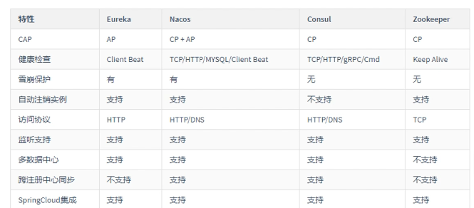

## 注册中心-cap定理

CAP定理：

指的是在一个分布式系统中，

Consistency（一致性）、 

Availability（可用性）、

Partition tolerance（分区容错性），三者不可同时获得

其中：

一致性（C）：所有节点都可以访问到最新的数据

可用性（A）：每个请求都是可以得到响应的，不管请求是成功还是失败

分区容错性（P）：除了全部整体网络故障，其他故障都不能导致整个系统不可用

CAP理论就是说在分布式存储系统中，最多只能实现上面的两点。

而由于当前的网络硬件肯定会出现延迟丢包等问题，所以分区容忍性是我们必须需要实现的。

所以我们只能在一致性和可用性之间进行权衡

CA： 如果不要求P（不允许分区），则C（强一致性）和A（可用性）是可以保证的。但放弃P的同时也就意味着放弃了系统的扩展性，也就是分布式节点受限，没办法部署子节点，这是违背分布式系统设计的初衷的

CP: 如果不要求A（可用），每个请求都需要在服务器之间保持强一致，而P（分区）会导致同步时间无限延长(也就是等待数据同步完才能正常访问服务)，一旦发生网络故障或者消息丢失等情况，就要牺牲用户的体验，等待所有数据全部一致了之后再让用户访问系统

AP：要高可用并允许分区，则需放弃一致性。一旦分区发生，节点之间可能会失去联系，为了高可用，每个节点只能用本地数据提供服务，而这样会导致全局数据的不一致性。

Zookeeper：CP设计，保证了一致性，集群搭建的时候，某个节点失效，则会进行选举行的leader，或者半数以上节点不可用，则无法提供服务，因此可用性没法满足

Eureka：AP原则，无主从节点，一个节点挂了，自动切换其他节点可以使用，去中心化

结论：

分布式系统中P,肯定要满足，所以只能在CA中二选一

没有最好的选择，最好的选择是根据业务场景来进行架构设计

如果要求一致性，则选择zookeeper/Nacos，如金融行业 CP

如果要求可用性，则Eureka/Nacos，如电商系统 AP

CP ： 适合支付、交易类，要求数据强一致性，宁可业务不可用，也不能出现脏数据

AP: 互联网业务，比如信息流架构，不要求数据强一致，更想要服务可用

**dev:用于开发，以下两种用于生产环境**

**client:客户端，无状态，将http和dns接口请求**转发给局域网内的服务端集群，它只是一个代理的角色。 

server:服务端 ，保存配置信息，高可用集群，每个数据中心的server数据推荐为3个或5个

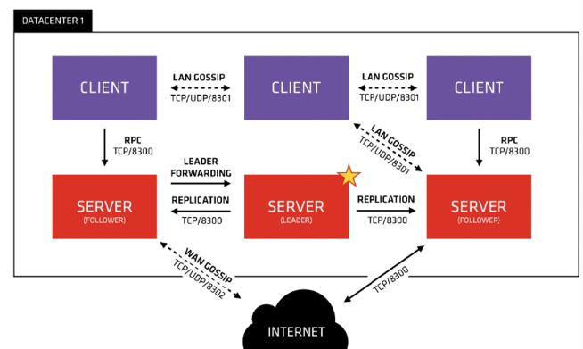


上图是一个简单的consul cluster架构，consul  cluster有server和client两种角色，不管是server还是client,统称为agent,consul  client是相对无状态的，只负责转发rpc到server，资源开销很少.server是一个有一组扩展功能的代理，这些功能包括参与raft选举，维护集群状态，响应rpc查询，与其它数据中心交互wan gossip和转发查询给leader或远程数据中心。 

每个数据中心，client和server是混合的。一般建有3-5台server.这是基于有故障情况下的可用性和性能之间的权衡结果，因为越多的机器加入达成共识越慢，server之初间会选择出一个leader.**然而并不限制client的数量**，一般建议一个服务对应一个client,它们可以很容易的扩展到数千或者数万台，在开发的时候我们绑定一组服务注册中心中的客户端 即可。 

producer：服务提供者

consumer:服务消费者


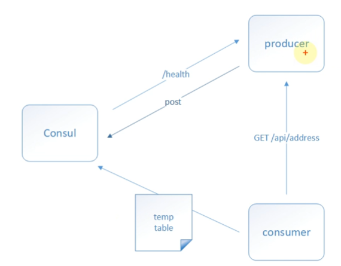

服务发现及注册：

producer启动时，会将自己的ip/host等信息通过发送请求告知consul,consul接收到producer的注册信息后，每隔10秒（默认）会向producer发送一个健康检查的请求，检查producer是否处于可用状态，防止consumer调到不可用的服务；

服务调用

当consumer请求product时，会先从consul中拿存储的producer服务的ip和port的临时表（temp  table),从表中任选一个producer的ip和port,然后根据这个ip和port,发送访问请求;此表只包含通过健康检查的producer信息，并且每隔10秒更新。。


```
apiVersion: v1
kind: Service
metadata:
  name: {{.name}}
  namespace: {{.namespace}}
  annotations:
    sidecar.istio.io/inject: "false"
  labels:
    app: {{.name}}
spec:
  ports: {{range $k,$v := .ports}}
    - port: {{$v.port}}
      name: {{$v.name}}
      protocol: {{$v.protocol}}{{end}}
  {{if eq .resourceType "service"}}selector:
    app: {{.name}}{{end}}
---
```

```
apiVersion: apps/v1
kind: Deployment
metadata:
  name: {{.name}}
  namespace: {{.namespace}}
  labels:
    app: {{.name}}
    language: {{.language}}
spec:
  minReadySeconds: 10
  replicas: {{.replicas}}
  selector:
    matchLabels:
      app: {{.name}}
  strategy:
    rollingUpdate:
      maxSurge: 1
      maxUnavailable: 1
    type: RollingUpdate
  template:
    metadata:
      labels:
        app: {{.name}}
        language: {{.language}}
    spec:
      imagePullSecrets:
      - name:  {{.imagesecret}}
      containers:
      - image: {{.image}}{{if .command}}
        command: {{range $k,$v := .command}}
        - {{$v}}{{end}}{{end}}{{if .args}}
        args: {{range $k,$v := .args}}
        - {{$v}}{{end}}{{end}}
        imagePullPolicy: IfNotPresent
        name: {{.name}}
        ports: {{range $k, $v := .ports}}
        - containerPort: {{$v.port}}{{end}}
        resources:
          requests:
            memory: {{.memory}}
          limits:
            memory: {{.maxMemory}}
        env:
        - name: ENV
          value: prod
        - name: POD_NAME
          valueFrom:
            fieldRef:
              apiVersion: v1
              fieldPath: metadata.name
        - name: POD_NAMESPACE
          valueFrom:
            fieldRef:
              apiVersion: v1
              fieldPath: metadata.namespace
        - name: INSTANCE_IP
          valueFrom:
            fieldRef:
              apiVersion: v1
              fieldPath: status.podIP
        - name: NODE_NAME
          valueFrom:
            fieldRef:
              apiVersion: v1
              fieldPath: spec.nodeName
        volumeMounts:
        - name: tz-config
          mountPath: /etc/localtime
      volumes:
      - name: "tz-config"
        hostPath:
          path: "/usr/share/zoneinfo/Asia/Shanghai"
```

```

apiVersion: networking.k8s.io/v1
kind: Ingress
metadata:
  name: {{.name}}
  namespace: {{.namespace}}
  annotations:
    traefik.ingress.kubernetes.io/router.entrypoints: web
spec:
  rules:{{range $k, $v := .rules}}
  - host: {{$v.domain}}
    http:
      paths:{{range $val := $v.paths}}
      - pathType: Prefix
        path: /
        backend:
          service:
            name: {{$val.serviceName}}
            port:
              number: {{$val.port}}{{end}}{{end}}
---

```


## 参考资料

- 实验机部署：[`VMWare.md`](VMWare.md)（KubeKey / Harbor / Jenkins）
- OpenStack：[`OpenStack-Kolla.md`](OpenStack-Kolla.md)
- Ambari/HDP：[`Ambari-HDP.md`](Ambari-HDP.md)
- Azure：[`Azure.md`](Azure.md)
- [Istio 发布与支持版本](https://istio.io/latest/docs/releases/supported-releases/)
- [kubeadm 官方文档](https://kubernetes.io/docs/reference/setup-tools/kubeadm/)

