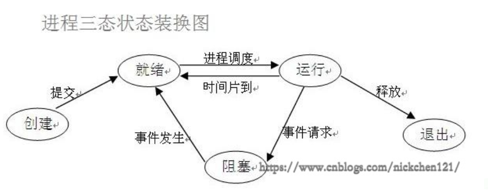

# 计算机基础 · 进程与线程

## 目录

- [进程概念](#进程的概念)
- [进程调度](#进程调度)
- [并行与并发](#并行与并发)
- [进程状态](#进程状态)
- [同步 / 异步与阻塞 / 非阻塞](#同步与异步)
- [守护进程](#守护进程)
- [进程锁与 IPC](#进程锁与-ipc)
- [multiprocessing.Process](#multiprocessingprocess)

---

## 基本概念

### 进程的概念

1. 进程是一个实体。每一个进程都有它自己的地址空间，一般情况下，包括文本区域（text region）、数据区域（data region）和堆栈（stack region）。文本区域存储处理器执行的代码；数据区域存储变量和进程执行期间使用的动态分配的内存；堆栈区域存储着活动过程调用的指令和本地变量。
2. 进程是一个「执行中的程序」。程序是一个没有生命的实体，只有处理器赋予程序生命时（操作系统执行之），它才能成为一个活动的实体，我们称其为进程。

**进程的特征：**

- **动态性**：进程是程序在多道程序系统中的一次执行过程，动态产生、动态消亡。
- **并发性**：任何进程都可以同其他进程一起并发执行。
- **独立性**：进程是能独立运行的基本单位，也是系统分配资源和调度的独立单位。
- **异步性**：进程间相互制约，具有执行的间断性，按各自独立、不可预知的速度推进。
- **结构特征**：进程由程序、数据和进程控制块（PCB）三部分组成。

**进程与程序的区别：**

| | 程序 | 进程 |
| --- | --- | --- |
| 性质 | 静态：指令和数据的有序集合 | 动态：在处理机上的一次执行过程 |
| 生命周期 | 可长期保存 | 有生命期，暂时 |
| 存在 | 软件资料 | 运行中的实例 |

### 进程调度

| 算法 | 要点 |
| --- | --- |
| **FCFS** | 先来先服务；利于长作业/进程，不利于短作业与 I/O 繁忙型 |
| **SJ/PF（短作业优先）** | 短作业（进程）优先；对长作业不利，紧迫性无法保证，长度需估算 |
| **RR（时间片轮转）** | 等待时间与服务时间成比例；适用于可抢占资源（如 CPU），不用于含不可抢占资源的作业调度 |
| **多级反馈队列** | 多就绪队列、优先级递减、时间片递增；新进程进最高优先级队列，未完成则降级；高优先级队列空才调度低优先级；可抢占 |

**多级反馈队列要点：**

1. 多个就绪队列，优先级从高到低；优先级越高，时间片越小（常设为下一级的一半或倍数关系）。
2. 新进程进入第一队列末尾 FCFS；一个时间片内未完成则转入下一队列末尾，长作业最终在第 n 队列以 RR 方式运行。
3. 仅当第 1～(i-1) 队列均空时才调度第 i 队列；运行中若有更高优先级进程到达，可抢占当前 CPU。

### 并行与并发

- **并行**：微观上同一时刻多个程序在多个处理器上同时执行（资源够用，如多核 CPU）。
- **并发**：宏观上一段时间内「看起来同时」；资源有限时交替使用（如单核上多 session）。

### 进程状态



受调度控制，进程常见状态：

1. **就绪（Ready）**：已获除 CPU 外必要资源，获处理机即可执行。
2. **运行（Running）**：已获得处理机，正在执行。
3. **阻塞（Blocked）**：等待事件（I/O、缓冲区、信号等）而无法执行，放弃处理机。

### 同步与异步

- **同步**：任务 B 依赖任务 A 时，须等 A 完成 B 才算完成；任务序列可靠，状态一致。
- **异步**：通知依赖方即可继续，不等待其真正完成；整体任务可算完成，但被依赖方结果不确定。

### 阻塞与非阻塞

与线程/进程**等待消息通知**时的状态有关（与同步/异步正交，可组合）：

| | 阻塞 | 非阻塞 |
| --- | --- | --- |
| **同步** | 同步阻塞 | 同步非阻塞 |
| **异步** | 异步阻塞 | 异步非阻塞 |

### 守护进程

- 随**主进程**结束而结束；进程间相互独立，主进程代码结束，守护进程即终止。
- 须在 `start()` **之前**设置 `daemon=True`。
- 守护进程**不能再创建子进程**，否则：`AssertionError: daemonic processes are not allowed to have children`。

### 进程锁与 IPC

**Lock**：多进程改同一块数据时串行化，保证安全但变慢。

目标：既共享数据又减少手工加锁 → `multiprocessing` 的 **IPC（队列、管道等）** 消息传递是更推荐的方向；仍应尽量少做进程间通信，需要时用进程安全工具。

```python
from multiprocessing import Process, Lock

lock = Lock()
lock.acquire()
# ...
lock.release()
```

### multiprocessing.Process

**参数：**

| 参数 | 说明 |
| --- | --- |
| `group` | 未使用，始终 `None` |
| `target` | 子进程要执行的可调用对象 |
| `args` | 位置参数元组 |
| `kwargs` | 关键字参数字典 |
| `name` | 子进程名称 |

**方法：**

- `start()`：启动进程（内部调用 `run()` → `target`）
- `run()`：默认执行 `target`；直接 `run()` 时在主进程同步执行，**不能**被 `join()` 当作子进程等待
- `terminate()`：强制终止，可能僵尸子进程、锁未释放导致死锁
- `is_alive()`：是否仍在运行
- `join(timeout=None)`：主线程等待子进程结束（须由 `start()` 启动）

**属性：**

- `daemon`：默认 `False`；`True` 为守护进程，父进程结束则终止，且不能再建子进程
- `name`、`pid`、`exitcode`（运行时 `None`；若为 `-N` 表示被信号 N 终止）
- `authkey`：进程间通信身份验证键（了解即可）

并发提高 I/O 利用，但**多进程共享同一数据**易引发安全或顺序问题；尽量避免通信，必要时用队列等安全机制。

### Manager（待补充）

进程间共享 `list` / `dict` 等可使用 `multiprocessing.Manager`（笔记此处未写完，可后续补 `Manager().dict()` 等示例）。
