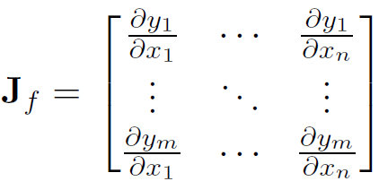
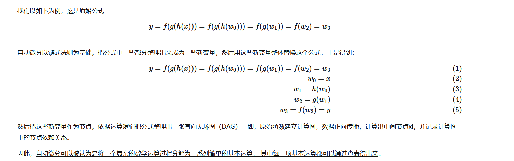
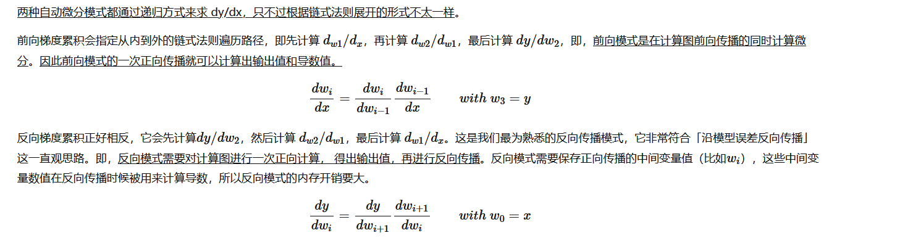
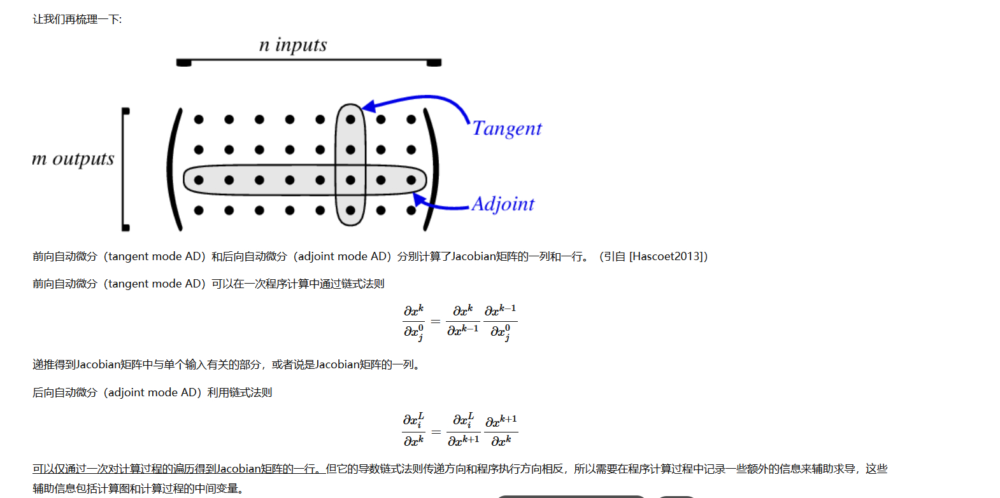
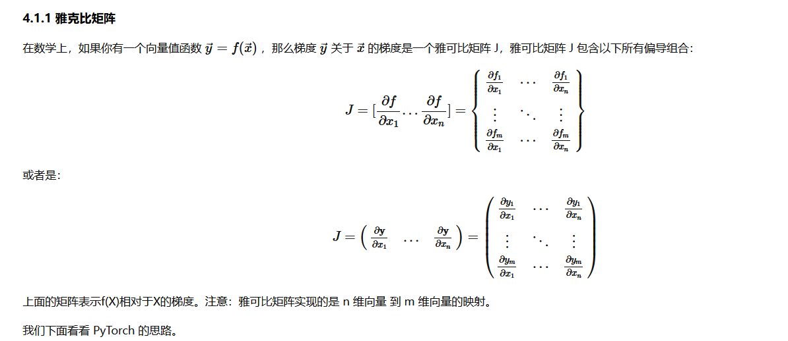
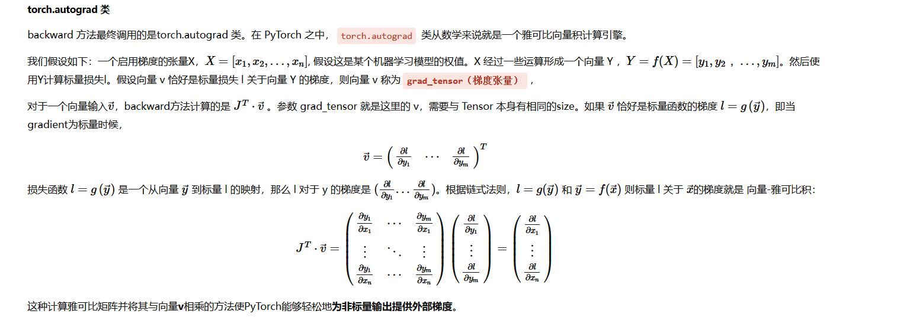
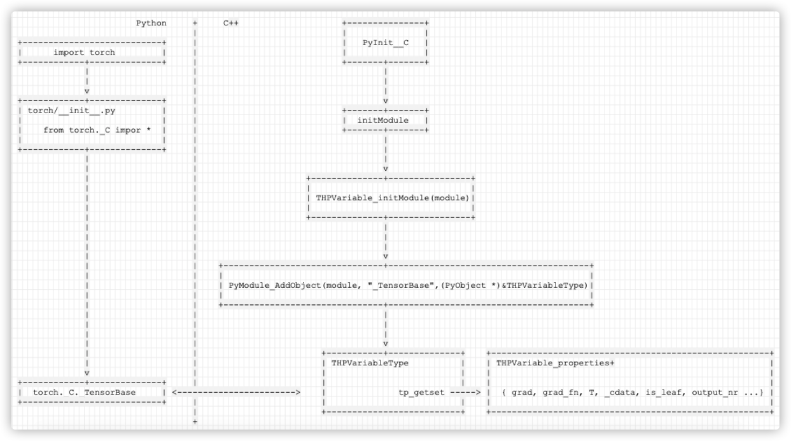
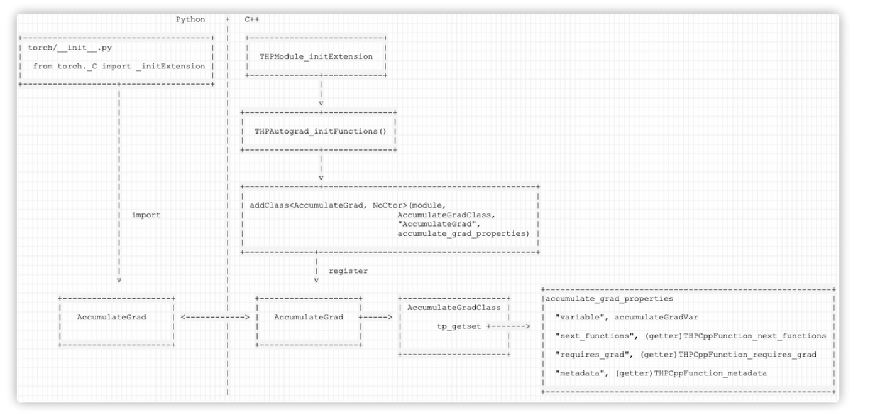

> PyTorch 源码 / Autograd。源：`Desktop/2024/17-Torch Source Code.md`。图片：`../img/`。GPU 架构见 [18-GPU/2-pytorch-gpu.md](../18-GPU/2-pytorch-gpu.md)。

# PyTorch 源码笔记（Autograd）

## 目录

- [Autograd 与自动微分](#1-autograd-与自动微分)
  - [训练流程与框架关注点](#训练流程与框架关注点)
  - [导数、梯度与梯度下降](#导数梯度与梯度下降)
  - [四种求导方式](#四种求导方式)
  - [链式法则与 Jacobian](#链式法则与-jacobian)
  - [前向模式 vs 反向模式](#前向模式-vs-反向模式)
  - [计算图](#计算图)
  - [PyTorch autograd](#pytorch-autograd)
  - [Tensor 与 C++/Python 扩展](#tensor-与-cpython-扩展)
- [参考链接](#参考链接)

---

## 1. Autograd 与自动微分

### 自动微分的历史

- 论文：[Automatic Differentiation in Machine Learning: a Survey (arXiv:1502.05767)](https://arxiv.org/pdf/1502.05767)

### 训练流程与框架关注点

深度学习典型流程：

1. 依据模型搭建计算图。
2. 依据输入计算损失函数。
3. 计算损失对模型参数的导数。
4. 用梯度下降等方法更新参数，使损失最小化。

| 术语 | 含义 |
| --- | --- |
| 前向传播（forward propagation） | 搭建计算图（依赖关系）并计算损失 |
| 反向传播（backpropagation） | 依据损失对参数求导 |

框架核心问题：

- 反向传播时的**自动梯度计算与更新**。
- **GPU** 上的高效计算。

**自动微分（AD，Automatic Differentiation）**：对复杂函数（多层复合）在某点求导数、梯度、Hessian 等；介于数值微分与符号微分之间，用有向图式计算求微分值。

**机器学习**：从数据中学习模式与趋势，改进输入到输出的预估函数。

**深度学习**：由网络自行学习/组合特征，减轻传统 ML 中繁重的特征工程。

常见符号：**损失 / 代价函数**；**权重 w、偏置 b**。「学习」即不断调整 w、b，使损失最小。

### 导数、梯度与梯度下降

> 导数描述函数在某点的**变化率**；在点 \(x_0\) 处即为该点切线斜率。

梯度是向量：函数在该点沿梯度方向变化最快，模为最大变化率。

**梯度下降**思路：随机初始化 w、b，迭代地根据输出与标签的误差，沿损失对参数的负梯度方向更新，直至收敛。典型步骤：

1. 初始化 w、b。
2. 对每个训练样本：前向算输出 → 算损失 → 得到该样本对 w、b 的梯度。
3. 对所有样本的梯度求平均 \(\nabla w\)、\(\nabla b\)。
4. 更新：\(w \leftarrow w - \nabla w\)，\(b \leftarrow b - \nabla b\)。
5. 重复直至收敛。

### 四种求导方式

| 方式 | 说明 |
| --- | --- |
| 手动微分（Manual） | 链式法则推公式，再代入数值 |
| 数值微分（Numerical） | 用导数定义直接近似 |
| 符号微分（Symbolic） | 对表达式求解析导函数，再代入数值 |
| **自动微分（Automatic）** | 对基本算子做符号微分，保留中间结果，再链式组合；可隐藏求导细节，并与循环/分支等控制流结合 |

若目标可导，优化依赖一阶（梯度）或二阶（Hessian）信息；**AD 用程序自动推导 Jacobian（或其块）**，数学基础是链式法则与雅可比矩阵。

- **数值微分**：一开始就代入数值近似。
- **符号微分**：先解析求导，最后再算数。
- **自动微分**：基本算子符号求导 + 数值前向 + 中间结果 + 整体链式求导。

### 链式法则与 Jacobian

1. **链式求导**
2. **Jacobian（雅可比矩阵）**：多元函数一阶偏导按一定方式排成的矩阵；输入 \(x \in \mathbb{R}^n\)、输出 \(y \in \mathbb{R}^m\) 时，描述 n 维到 m 维的局部线性逼近；输入维数等于输出维数时，行列式形式常称雅可比行列式。



### 自动微分的本质

微分计算本质是**有限可微算子的组合**：程序无论多复杂，底层都是加减乘除与 exp/log/三角等初等运算；AD 先对基本算子应用符号微分，代入数值并保留中间结果，再对整体应用链式法则。

#### 计算模式

- **前向模式**（Forward / tangent mode）：沿输入方向传播导数。
- **反向模式**（Reverse / adjoint mode）：一次前向 + 一次反向得到所有参数梯度；框架将操作存为 **DAG 计算图**（函数与变量的关系），是深度学习框架的核心设计之一。







**前向模式的局限**：

- 一次前向只能高效求**一个**自变量的偏导；ML 参数量常达 \(10^6\) 级。
- 输入 n、输出 m 时，要对每个输入遍历一遍计算图；**n ≫ m**（典型神经网络）时重复 n 遍不可接受。

1986 年 Hinton 等提出用**反向传播**训练神经网络（Rumelhart et al.），即反向模式 AD 在深度学习中的大规模应用。

### 前向模式 vs 反向模式

**反向模式**：一次前向 + 一次反向即可得到所有参数梯度；需保存计算图（DAG）。

| 维度关系 | 更合适模式 |
| --- | --- |
| 输出维 > 输入维 | 前向模式往往更合适 |
| 输出维 ≪ 输入维（多参数） | **反向模式**时间复杂度更低 |

**内存与 inplace**：前向模式可同步得到节点值与导数，但多输入需多次计算。反向模式中间偏导只算一次，但需**额外存储**激活等中间结果；inplace 操作会破坏反传所需的历史值，需谨慎使用。

### 计算图

1. 由原始函数建立 DAG。
2. 前向传播：算中间节点，记录依赖。
3. 反向传播：从输出遍历图，求输出对各节点的导数。

### PyTorch autograd

反向传播主要由 `autograd` 实现，基础包括：

- **数学**：复合函数、链式法则、Jacobian。
- **工程**：由 **Tensor** 构成的计算图（DAG）。





说明：Jacobian 可理解为损失 **L** 对所有权重的偏导排列。

```python
import torch

x = torch.tensor(1.0, requires_grad=True)
b = torch.tensor(2.0, requires_grad=True)
z = x ** 3 + b
z.backward()
print(z, x.grad, b.grad)

x = torch.randn(2, 2, dtype=torch.double, requires_grad=True)
y = torch.randn(2, 2, dtype=torch.double, requires_grad=True)

def fn():
    return x ** 2 + y * x + y ** 2

gradient = torch.ones(2, 2)
torch.autograd.backward(fn(), gradient, inputs=[x, y])
print(x.grad)
print(y.grad)
```

### Tensor 与 C++/Python 扩展

C++ 侧导出 `TensorBase`；Python 通过扩展模块加载共享库。

`import torch` **→** `_TensorBase` **大致路径**：

```text
import torch
  → torch/__init__.py: from torch._C import *
  → PyInit__C / initModule
  → THPVariable_initModule
  → PyModule_AddObject(module, "_TensorBase", &THPVariableType)
  → torch._C._TensorBase  (tp_getset: grad, grad_fn, is_leaf, ...)
```



**Autograd /** `AccumulateGrad` **扩展**：

```text
torch/__init__.py: from torch._C import _initExtension
  → THPModule_initExtension
  → THPAutograd_initFunctions()
  → register AccumulateGrad 等
  → Python 侧 torch.autograd.AccumulateGrad 与 C++ 类对接
```



---

## 参考链接

- [自动微分（一）— rossiXYZ 博客](https://www.cnblogs.com/rossiXYZ/p/15395742.html)
- [PyTorch Autograd 源码阅读 — rossiXYZ 博客](https://www.cnblogs.com/rossiXYZ/p/15526431.html)
