# 面试编程题 · 算法整理

## 目录

- [一、基础算法（数据结构 / LeetCode）](#一基础算法数据结构--leetcode)
- [1.5 Python 算法专题（Alg-python）](#15-python-算法专题alg-python)
- [二、算法总结（STL / DP 等）](#二算法总结stl--dp-等)
- [三、剑指 Offer](#三剑指-offer)

---

## 一、基础算法（数据结构 / LeetCode）

基础算法_1

https://github.com/youngyangyang04/leetcode-master

## **数组：**

数组是存放在连续内存空间上的相同类型数据的集合


需要两点注意的是

- 数组下标都是从0开始的。
- 数组内存空间的地址是连续的

& 取地址符号

删除： 

要知道数组的元素在内存地址中是连续的，不能单独删除数组中的某个元素，只能覆盖。

## 链表：

链表是一种通过指针串联在一起的线性结构

每一个节点由数据域和指针域组成（存放指向下一个节点的指针），最后一个节点的指针域指向null（空指针的意思）入口点称为列表的头结点也就是head。

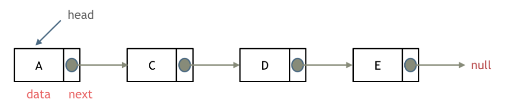

### 链表的类型

#### 单链表

#### 双链表：

每一个节点有两个指针域，一个指向下一个节点，一个指向上一个节点。

双链表 既可以向前查询也可以向后查询。

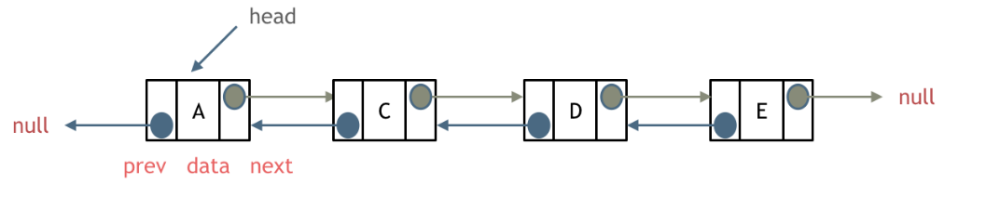

#### 循环链表

循环链表，就是链表首尾相连。循环链表可以用来解决约瑟夫环问题。

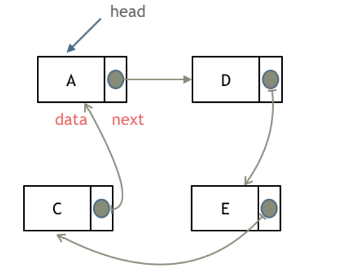

### 链表的存储方式

数组是在内存中是连续分布的，但是链表在内存中可不是连续分布的。

### 链表的定义

```c++
// 单链表
struct ListNode {
    int val;  // 节点上存储的元素
    ListNode *next;  // 指向下一个节点的指针
    ListNode(int x) : val(x), next(NULL) {}  // 节点的构造函数
};

```

#### 删除节点

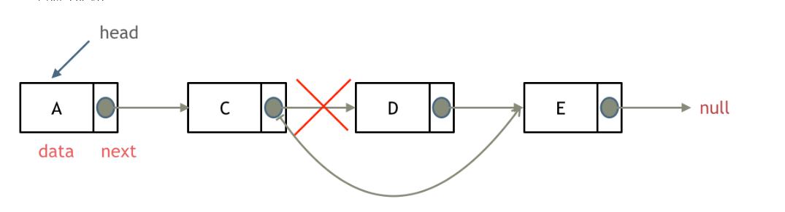

注意释放删除节点的内存

#### 添加节点

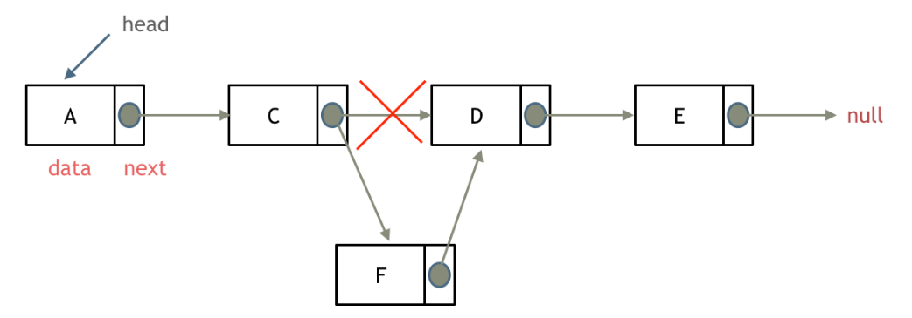

|      | 插入/删除（时间复杂度） | 查询 | 适用常见                         |
| ---- | ----------------------- | ---- | -------------------------------- |
| 数组 | O(n)                    | O(1) | 数据量固定，频繁查询，较少增删   |
| 链表 | O(1)                    | O(n) | 数据量不固定，频繁增删，较少查询 |

#### 1:	移除链表元素

题意：删除链表中等于给定值 val 的所有节点。

示例 1：
输入：head = [1,2,6,3,4,5,6], val = 6
输出：[1,2,3,4,5]

- **直接使用原来的链表来进行删除操作。**
- **设置一个虚拟头结点在进行删除操作。**

```c++
class Solution {
public:
    ListNode* removeElements(ListNode* head, int val) {
        // 删除头结点
        while (head != NULL && head->val == val) { // 注意这里不是if
            ListNode* tmp = head;
            head = head->next;
            delete tmp;
        }
        // 删除非头结点
        ListNode* cur = head;
        while (cur != NULL && cur->next!= NULL) {
            if (cur->next->val == val) {
                ListNode* tmp = cur->next;
                cur->next = cur->next->next;
                delete tmp;
            } else {
                cur = cur->next;
            }
        }
        return head;
    }
};
```

**设置一个虚拟头结点在进行移除节点操作：**

```c++
class Solution {
public:
    ListNode* removeElements(ListNode* head, int val) {
        ListNode * pre = new ListNode(0) ; //设置一个头节点 
        pre->next = head ;
        ListNode *cur =pre ;
        while(cur->next!=NULL ){ 
            if(cur->next->val == val){
                ListNode *tmp = cur->next ;
                cur->next = cur->next->next ;
                delete tmp ;
            }
            else 
               cur = cur->next ;
        }
        return pre->next;  

    }
};
```

python:

```python
# Definition for singly-linked list.
# class ListNode:
#     def __init__(self, val=0, next=None):
#         self.val = val
#         self.next = next
class Solution:
    def removeElements(self, head: ListNode, val: int) -> ListNode:
        dummy_head = ListNode(next=head) #添加一个虚拟节点
        cur = dummy_head
        while(cur.next!=None):
            if(cur.next.val == val):
                cur.next = cur.next.next #删除cur.next节点
            else:
                cur = cur.next
        return dummy_head.next
```

#### 2:	设计链表

在链表类中实现这些功能：

- get(index)：获取链表中第 index 个节点的值。如果索引无效，则返回-1。
- addAtHead(val)：在链表的第一个元素之前添加一个值为 val 的节点。插入后，新节点将成为链表的第一个节点。
- addAtTail(val)：将值为 val 的节点追加到链表的最后一个元素。
- addAtIndex(index,val)：在链表中的第 index 个节点之前添加值为 val 的节点。如果 index 等于链表的长度，则该节点将附加到链表的末尾。如果 index 大于链表长度，则不会插入节点。如果index小于0，则在头部插入节点。
- deleteAtIndex(index)：如果索引 index 有效，则删除链表中的第 index 个节点。

```c++
class MyLinkedList {
public:
    // 定义链表节点结构体
    struct LinkedNode {
        int val;
        LinkedNode* next;
        LinkedNode(int val):val(val), next(nullptr){}
    };

    // 初始化链表
    MyLinkedList() {
        _dummyHead = new LinkedNode(0); // 这里定义的头结点 是一个虚拟头结点，而不是真正的链表头结点
        _size = 0;
    }

    // 获取到第index个节点数值，如果index是非法数值直接返回-1， 注意index是从0开始的，第0个节点就是头结点
    int get(int index) {
        if (index > (_size - 1) || index < 0) {
            return -1;
        }
        LinkedNode* cur = _dummyHead->next;
        while(index--){ // 如果--index 就会陷入死循环
            cur = cur->next;
        }
        return cur->val;
    }

    // 在链表最前面插入一个节点，插入完成后，新插入的节点为链表的新的头结点
    void addAtHead(int val) {
        LinkedNode* newNode = new LinkedNode(val);
        newNode->next = _dummyHead->next;
        _dummyHead->next = newNode;
        _size++;
    }

    // 在链表最后面添加一个节点
    void addAtTail(int val) {
        LinkedNode* newNode = new LinkedNode(val);
        LinkedNode* cur = _dummyHead;
        while(cur->next != nullptr){
            cur = cur->next;
        }
        cur->next = newNode;
        _size++;
    }

    // 在第index个节点之前插入一个新节点，例如index为0，那么新插入的节点为链表的新头节点。
    // 如果index 等于链表的长度，则说明是新插入的节点为链表的尾结点
    // 如果index大于链表的长度，则返回空
    void addAtIndex(int index, int val) {
        if (index > _size) {
            return;
        }
        LinkedNode* newNode = new LinkedNode(val);
        LinkedNode* cur = _dummyHead;
        while(index--) {
            cur = cur->next;
        }
        newNode->next = cur->next;
        cur->next = newNode;
        _size++;
    }

    // 删除第index个节点，如果index 大于等于链表的长度，直接return，注意index是从0开始的
    void deleteAtIndex(int index) {
        if (index >= _size || index < 0) {
            return;
        }
        LinkedNode* cur = _dummyHead;
        while(index--) {
            cur = cur ->next;
        }
        LinkedNode* tmp = cur->next;
        cur->next = cur->next->next;
        delete tmp;
        _size--;
    }

    // 打印链表
    void printLinkedList() {
        LinkedNode* cur = _dummyHead;
        while (cur->next != nullptr) {
            cout << cur->next->val << " ";
            cur = cur->next;
        }
        cout << endl;
    }
private:
    int _size;
    LinkedNode* _dummyHead;

};
```

python:

```python
# 单链表
class Node:
    
    def __init__(self, val):
        self.val = val
        self.next = None


class MyLinkedList:

    def __init__(self):
        self._head = Node(0)  # 虚拟头部节点
        self._count = 0  # 添加的节点数

    def get(self, index: int) -> int:
        """
        Get the value of the index-th node in the linked list. If the index is invalid, return -1.
        """
        if 0 <= index < self._count:
            node = self._head
            for _ in range(index + 1):
                node = node.next
            return node.val
        else:
            return -1

    def addAtHead(self, val: int) -> None:
        """
        Add a node of value val before the first element of the linked list. After the insertion, the new node will be the first node of the linked list.
        """
        self.addAtIndex(0, val)

    def addAtTail(self, val: int) -> None:
        """
        Append a node of value val to the last element of the linked list.
        """
        self.addAtIndex(self._count, val)

    def addAtIndex(self, index: int, val: int) -> None:
        """
        Add a node of value val before the index-th node in the linked list. If index equals to the length of linked list, the node will be appended to the end of linked list. If index is greater than the length, the node will not be inserted.
        """
        if index < 0:
            index = 0
        elif index > self._count:
            return

        # 计数累加
        self._count += 1

        add_node = Node(val)
        prev_node, current_node = None, self._head
        for _ in range(index + 1):
            prev_node, current_node = current_node, current_node.next
        else:
            prev_node.next, add_node.next = add_node, current_node

    def deleteAtIndex(self, index: int) -> None:
        """
        Delete the index-th node in the linked list, if the index is valid.
        """
        if 0 <= index < self._count:
            # 计数-1
            self._count -= 1
            prev_node, current_node = None, self._head
            for _ in range(index + 1):
                prev_node, current_node = current_node, current_node.next
            else:
                prev_node.next, current_node.next = current_node.next, None


# 双链表
# 相对于单链表, Node新增了prev属性
class Node:
    def __init__(self, val):
        self.val = val
        self.prev = None
        self.next = None
class MyLinkedList:
    def __init__(self):
        self._head, self._tail = Node(0), Node(0)  # 虚拟节点
        self._head.next, self._tail.prev = self._tail, self._head
        self._count = 0  # 添加的节点数
    def _get_node(self, index: int) -> Node:
        # 当index小于_count//2时, 使用_head查找更快, 反之_tail更快
        if index >= self._count // 2:
            # 使用prev往前找
            node = self._tail
            for _ in range(self._count - index):
                node = node.prev
        else:
            # 使用next往后找
            node = self._head   
            for _ in range(index + 1):
                node = node.next
        return node

    def get(self, index: int) -> int:
        """
        Get the value of the index-th node in the linked list. If the index is invalid, return -1.
        """
        if 0 <= index < self._count:
            node = self._get_node(index)
            return node.val
        else:
            return -1

    def addAtHead(self, val: int) -> None:
        """
        Add a node of value val before the first element of the linked list. After the insertion, the new node will be the first node of the linked list.
        """
        self._update(self._head, self._head.next, val)

    def addAtTail(self, val: int) -> None:
        """
        Append a node of value val to the last element of the linked list.
        """
        self._update(self._tail.prev, self._tail, val)

    def addAtIndex(self, index: int, val: int) -> None:
        """
        Add a node of value val before the index-th node in the linked list. If index equals to the length of linked list, the node will be appended to the end of linked list. If index is greater than the length, the node will not be inserted.
        """
        if index < 0:
            index = 0
        elif index > self._count:
            return
        node = self._get_node(index)
        self._update(node.prev, node, val)

    def _update(self, prev: Node, next: Node, val: int) -> None:
        """
            更新节点
            :param prev: 相对于更新的前一个节点
            :param next: 相对于更新的后一个节点
            :param val:  要添加的节点值
        """
        # 计数累加
        self._count += 1
        node = Node(val)
        prev.next, next.prev = node, node
        node.prev, node.next = prev, next

    def deleteAtIndex(self, index: int) -> None:
        """
        Delete the index-th node in the linked list, if the index is valid.
        """
        if 0 <= index < self._count:
            node = self._get_node(index)
            # 计数-1
            self._count -= 1
            node.prev.next, node.next.prev = node.next, node.prev
```

#### 3:	反转链表

##### 双指针法

```c++
class Solution {
public:
    ListNode* reverseList(ListNode* head) {
        ListNode* temp; // 保存cur的下一个节点
        ListNode* cur = head;
        ListNode* pre = NULL;
        while(cur) {
            temp = cur->next;  // 保存一下 cur的下一个节点，因为接下来要改变cur->next
            cur->next = pre; // 翻转操作
            // 更新pre 和 cur指针
            pre = cur;
            cur = temp;
        }
        return pre;
    }
};
```

##### 递归法

```c++
class Solution {
public:
    ListNode* reverseList(ListNode* head) {
        ListNode* temp; // 保存cur的下一个节点
        ListNode* cur = head;
        ListNode* pre = NULL;
        while(cur) {
            temp = cur->next;  // 保存一下 cur的下一个节点，因为接下来要改变cur->next
            cur->next = pre; // 翻转操作
            // 更新pre 和 cur指针
            pre = cur;
            cur = temp;
        }
        return pre;
    }
};
```

python:

```python
#双指针
# Definition for singly-linked list.
# class ListNode:
#     def __init__(self, val=0, next=None):
#         self.val = val
#         self.next = next
class Solution:
    def reverseList(self, head: ListNode) -> ListNode:
        cur = head   
        pre = None
        while(cur!=None):
            temp = cur.next # 保存一下 cur的下一个节点，因为接下来要改变cur->next
            cur.next = pre #反转
            #更新pre、cur指针
            pre = cur
            cur = temp
        return pre
```

#### 4:	两两交换链表中的节点

给定一个链表，两两交换其中相邻的节点，并返回交换后的链表。

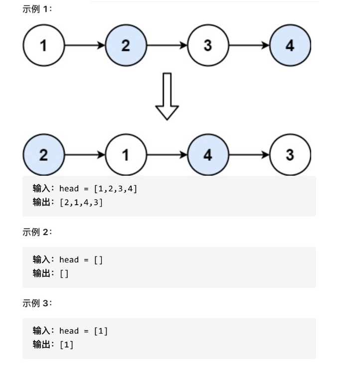

```c++
class Solution {
public:
    ListNode* swapPairs(ListNode* head) {
        if(!head || head->next==NULL)
            return head ;
        ListNode *pre = new ListNode(0) ; // 设置一个虚拟头结点
        pre->next = head ;
        ListNode *cur = pre ;       // 将虚拟头结点指向head，这样方面后面做删除操作
        while(cur->next !=NULL&& cur->next->next !=NULL ){
            ListNode * tmp = cur->next ;  // 记录临时节点
            ListNode * tmp2 = cur->next->next->next ; // 记录临时节点

            cur->next =cur->next->next ;  //交换节点，后一个节点提前
            cur->next->next = tmp ;    // 前一个节点后移

            cur->next->next->next = tmp2 ;
            cur = cur->next->next ;  // cur移动两位，准备下一轮交换
        }
        return pre->next ;
    }
};
```

python:

```python
class Solution:
    def swapPairs(self, head: ListNode) -> ListNode:
        dummy = ListNode(0) #设置一个虚拟头结点
        dummy.next = head
        cur = dummy
        while cur.next and cur.next.next: 
            tmp = cur.next #记录临时节点
            tmp1 = cur.next.next.next #记录临时节点
            cur.next = cur.next.next          #步骤一
            cur.next.next = tmp               #步骤二
            cur.next.next.next = tmp1         #步骤三
            cur = cur.next.next #cur移动两位，准备下一轮交换
        return dummy.next
```

#### 5:	删除链表的倒数第N个节点

题目链接：https://leetcode-cn.com/problems/remove-nth-node-from-end-of-list/

给你一个链表，删除链表的倒数第 n 个结点，并且返回链表的头结点

输入：head = [1,2,3,4,5], n = 2 输出：[1,2,3,5] 示例 2：

输入：head = [1], n = 1 输出：[] 示例 3：

输入：head = [1,2], n = 1 输出：[1]

双指针的经典应用:

如果要删除倒数第n个节点，让fast移动n步，然后让fast和slow同时移动，直到fast指向链表末尾。删掉slow所指向的节点就可以了。

```c++
class Solution {
public:
    ListNode* removeNthFromEnd(ListNode* head, int n) {
        if(!head)
            return head ;
        ListNode *pre = new ListNode(0) ;
        pre->next  = head ;
         ListNode *fast= pre ;
        ListNode  *slow = pre ;
        while(n-- && fast){
            fast = fast->next ;
        }
        fast = fast->next ;  // fast再提前走一步，因为需要让slow指向删除节点的上一个节点
        while(fast!=NULL && slow){
             fast  =fast->next ;
             slow = slow->next ; 
        }
        slow->next = slow->next->next ;
        return pre->next ; 
    }
};
```

python:

```python
# Definition for singly-linked list.
# class ListNode:
#     def __init__(self, val=0, next=None):
#         self.val = val
#         self.next = next
class Solution:
    def removeNthFromEnd(self, head: ListNode, n: int) -> ListNode:
        head_dummy = ListNode()
        head_dummy.next = head

        slow, fast = head_dummy, head_dummy
        while(n!=0): #fast先往前走n步
            fast = fast.next
            n -= 1
        while(fast.next!=None):
            slow = slow.next
            fast = fast.next
        #fast 走到结尾后，slow的下一个节点为倒数第N个节点
        slow.next = slow.next.next #删除
        return head_dummy.next
```

#### 5：链表相交

给定两个（单向）链表，判定它们是否相交并返回交点。请注意相交的定义基于节点的引用，而不是基于节点的值。换句话说，如果一个链表的第k个节点与另一个链表的第j个节点是同一节点（引用完全相同），则这两个链表相交。

```c++
 ListNode* curA = headA;
        ListNode* curB = headB;
        int lenA = 0, lenB = 0;
        while (curA != NULL) { // 求链表A的长度
            lenA++;
            curA = curA->next;
        }
        while (curB != NULL) { // 求链表B的长度
            lenB++;
            curB = curB->next;
        }
        curA = headA;
        curB = headB;
        // 让curA为最长链表的头，lenA为其长度
        if (lenB > lenA) {
            swap (lenA, lenB);
            swap (curA, curB);
        }
        // 求长度差
        int gap = lenA - lenB;
        // 让curA和curB在同一起点上（末尾位置对齐）
        while (gap--) {
            curA = curA->next;
        }
        // 遍历curA 和 curB，遇到相同则直接返回
        while (curA != NULL) {
            if (curA == curB) {
                return curA;
            }
            curA = curA->next;
            curB = curB->next;
        }
        return NULL;
```

python：

```python
# Definition for singly-linked list.
# class ListNode:
#     def __init__(self, x):
#         self.val = x
#         self.next = None
class Solution:
    def getIntersectionNode(self, headA: ListNode, headB: ListNode) -> ListNode:
        lengthA,lengthB = 0,0
        curA,curB = headA,headB
        while(curA!=None): #求链表A的长度
            curA = curA.next
            lengthA +=1
        while(curB!=None): #求链表B的长度
            curB = curB.next
            lengthB +=1
        curA, curB = headA, headB
        if lengthB>lengthA: #让curA为最长链表的头，lenA为其长度
            lengthA, lengthB = lengthB, lengthA
            curA, curB = curB, curA
        gap = lengthA - lengthB #求长度差
        while(gap!=0): 
            curA = curA.next #让curA和curB在同一起点上
            gap -= 1
        while(curA!=None):
            if curA == curB:
                return curA
            else:
                curA = curA.next
                curB = curB.next
        return None
```

#### 6: 环形链表II

给定一个链表，返回链表开始入环的第一个节点。 如果链表无环，则返回 null。为了表示给定链表中的环，使用整数 pos 来表示链表尾连接到链表中的位置（索引从 0 开始）。 如果 pos 是 -1，则在该链表中没有环。

```c++
class Solution {
public:
    ListNode *detectCycle(ListNode *head) {
        ListNode* fast = head;
        ListNode* slow = head;
        while(fast != NULL && fast->next != NULL) {
            slow = slow->next;
            fast = fast->next->next;
            // 快慢指针相遇，此时从head 和 相遇点，同时查找直至相遇
            if (slow == fast) {
                ListNode* index1 = fast;
                ListNode* index2 = head;
                while (index1 != index2) {
                    index1 = index1->next;
                    index2 = index2->next;
                }
                return index2; // 返回环的入口
            }
        }
        return NULL;
    }
};
```

python:

```python
lass Solution:
    def detectCycle(self, head: ListNode) -> ListNode:
        slow, fast = head, head
        while fast and fast.next:
            slow = slow.next
            fast = fast.next.next
            # 如果相遇
            if slow == fast:
                p = head
                q = slow
                while p!=q:
                    p = p.next
                    q = q.next
                #你也可以return q
                return p
        return None
```

## 哈希表

哈希表中关键码就是数组的索引下表，然后通过下表直接访问数组中的元素，如下图所示：

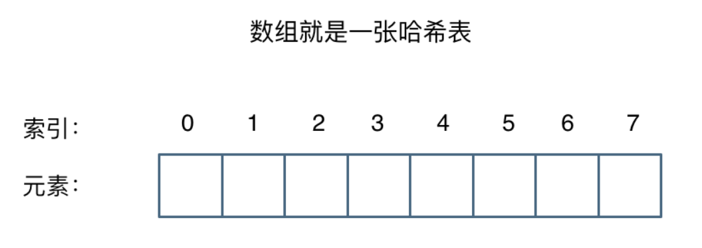

**一般哈希表都是用来快速判断一个元素是否出现集合里。**

### 哈希函数

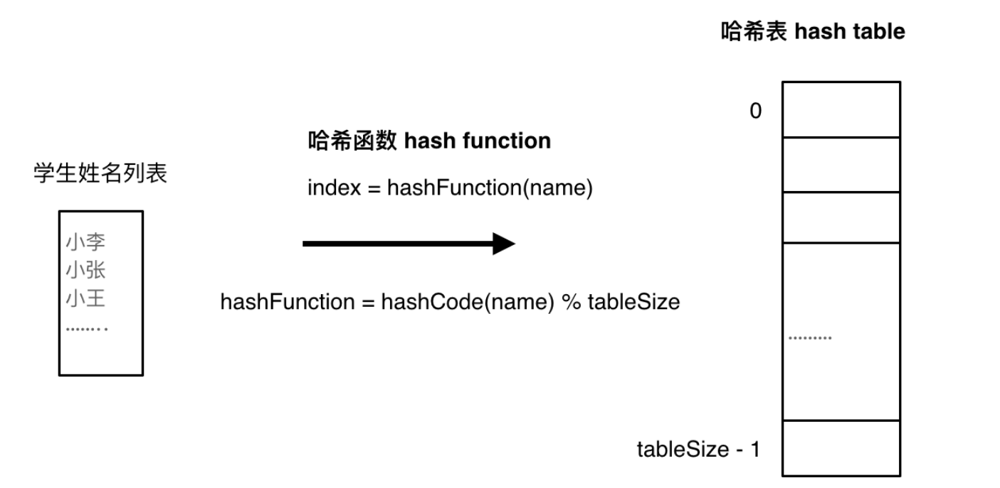

### 哈希碰撞

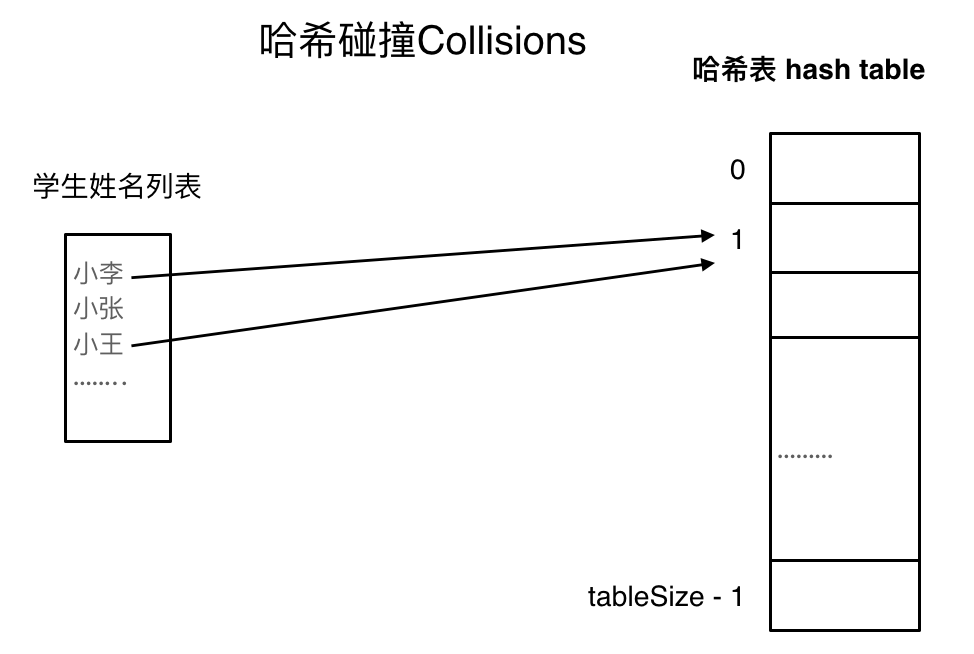

### 拉链法

刚刚小李和小王在索引1的位置发生了冲突，发生冲突的元素都被存储在链表中。 这样我们就可以通过索引找到小李和小王了

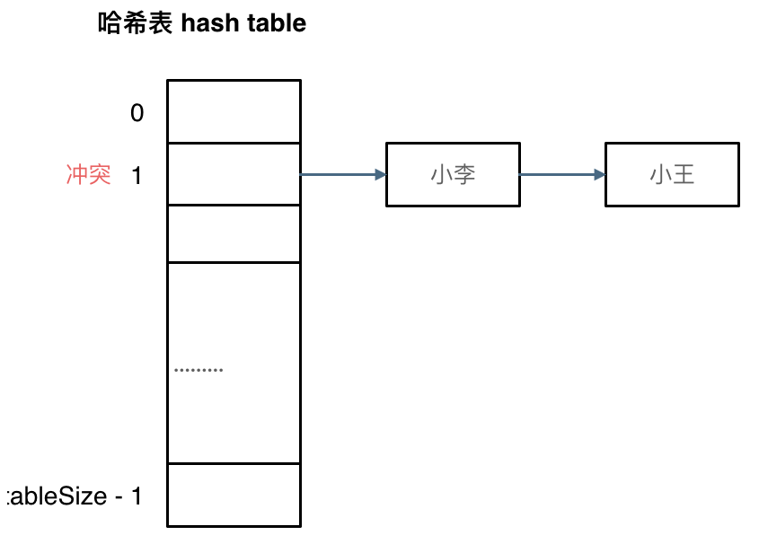

（数据规模是dataSize， 哈希表的大小为tableSize）

其实拉链法就是要选择适当的哈希表的大小，这样既不会因为数组空值而浪费大量内存，也不会因为链表太长而在查找上浪费太多时间。

使用线性探测法，一定要保证tableSize大于dataSize。 我们需要依靠哈希表中的空位来解决碰撞问题。

例如冲突的位置，放了小李，那么就向下找一个空位放置小王的信息。所以要求tableSize一定要大于dataSize ，要不然哈希表上就没有空置的位置来存放 冲突的数据了。如图所示：

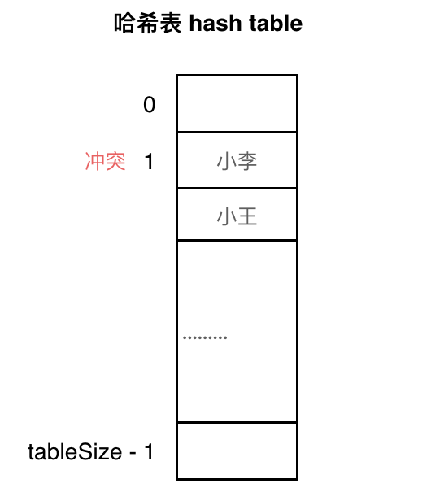

### 常见的三种哈希结构

- 数组
- set （集合）
- map(映射)

在C++中，set 和 map 分别提供以下三种数据结构，其底层实现以及优劣如下表所示：

#### set

| 集合               | 底层实现 | 是否有序 | 数值是否可以重复 | 能否更改数值 | 查询效率 | 增删效率 |
| ------------------ | -------- | -------- | ---------------- | ------------ | -------- | -------- |
| std::set           | 红黑树   | 有序     | 否               | 否           | O(logn)  | O(logn)  |
| std::multiset      | 红黑树   | 有序     | 是               | 否           | O(logn)  | O(logn)  |
| std::unordered_set | 哈希表   | 无序     | 否               | 否           | O(1)     | O(1)     |

std::unordered_set底层实现为哈希表

**std::set 和std::multiset 的底层实现是红黑树，红黑树是一种平衡二叉搜索树，所以key值是有序的，但key不可以修改，改动key值会导致整棵树的错乱，所以只能删除和增加。**

当我们要使用集合来解决哈希问题的时候，优先使用unordered_set，因为它的查询和增删效率是最优的，如果需要集合是有序的，那么就用set，如果要求不仅有序还要有重复数据的话，那么就用multiset。

#### map

| 映射               | 底层实现 | 是否有序 | 数值是否可以重复 | 能否更改数值 | 查询效率 | 增删效率 |
| ------------------ | -------- | -------- | ---------------- | ------------ | -------- | -------- |
| std::map           | 红黑树   | key有序  | key不可重复      | key不可修改  | O(logn)  | O(logn)  |
| std::multimap      | 红黑树   | key有序  | key可重复        | key不可修改  | O(logn)  | O(logn)  |
| std::unordered_map | 哈希表   | key无序  | key不可重复      | key不可修改  | O(1)     | O(1)     |

std::unordered_map 底层实现为哈希表，std::map 和std::multimap 的底层实现是红黑树。同理，std::map 和std::multimap 的key也是有序的（这个问题也经常作为面试题，考察对语言容器底层的理解）。

那么再来看一下map ，在map 是一个key value 的数据结构，map中，对key是有限制，对value没有限制的，因为key的存储方式使用红黑树实现的。

#### 1：有效的字母异位词

数组就是简单的哈希表，但是数组的大小可不是无限开辟的

给定两个字符串 s 和 t ，编写一个函数来判断 t 是否是 s 的字母异位词。

示例 1: 输入: s = "anagram", t = "nagaram" 输出: true

示例 2: 输入: s = "rat", t = "car" 输出: false

**说明:** 你可以假设字符串只包含小写字母。

https://leetcode-cn.com/problems/valid-anagram/

```
class Solution {
public:
    bool isAnagram(string s, string t) {
        int record[26] = {0};
        for (int i = 0; i < s.size(); i++) {
            // 并不需要记住字符a的ASCII，只要求出一个相对数值就可以了
            record[s[i] - 'a']++;
        }
        for (int i = 0; i < t.size(); i++) {
            record[t[i] - 'a']--;
        }
        for (int i = 0; i < 26; i++) {
            if (record[i] != 0) {
                // record数组如果有的元素不为零0，说明字符串s和t 一定是谁多了字符或者谁少了字符。
                return false;
            }
        }
        // record数组所有元素都为零0，说明字符串s和t是字母异位词
        return true;
    }
};
```

python：

```
class Solution:
    def isAnagram(self, s: str, t: str) -> bool:
        record = [0] * 26
        for i in range(len(s)):
            #并不需要记住字符a的ASCII，只要求出一个相对数值就可以了
            record[ord(s[i]) - ord("a")] += 1
        print(record)
        for i in range(len(t)):
            record[ord(t[i]) - ord("a")] -= 1
        for i in range(26):
            if record[i] != 0:
                #record数组如果有的元素不为零0，说明字符串s和t 一定是谁多了字符或者谁少了字符。
                return False
        return True

```

#### 2：两个数组的交集

https://leetcode-cn.com/problems/intersection-of-two-arrays/

题意：给定两个数组，编写一个函数来计算它们的交集。

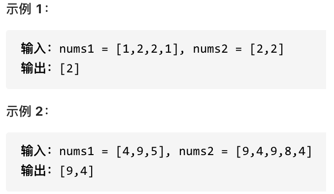

**说明：** 输出结果中的每个元素一定是唯一的。 我们可以不考虑输出结果的顺序。

```c++
class Solution {
public:
    vector<int> intersection(vector<int>& nums1, vector<int>& nums2) {
        unordered_set<int> result_set; // 存放结果
        unordered_set<int> nums_set(nums1.begin(), nums1.end());
        for (int num : nums2) {
            // 发现nums2的元素 在nums_set里又出现过
            if (nums_set.find(num) != nums_set.end()) {
                result_set.insert(num);   // set 自动去重
            }
        }
        return vector<int>(result_set.begin(), result_set.end());
    }
};
```

python：

```python
class Solution:
    def intersection(self, nums1: List[int], nums2: List[int]) -> List[int]:
        result_set = set()
        set1 = set(nums1)
        for num in nums2:
            if num in set1:
                result_set.add(num) # set1里出现的nums2元素 存放到结果
        return result_set
```

#### 3：快乐数

https://leetcode-cn.com/problems/happy-number/

编写一个算法来判断一个数 n 是不是快乐数。

「快乐数」定义为：对于一个正整数，每一次将该数替换为它每个位置上的数字的平方和，然后重复这个过程直到这个数变为 1，也可能是 无限循环 但始终变不到 1。如果 可以变为 1，那么这个数就是快乐数。

如果 n 是快乐数就返回 True ；不是，则返回 False 。

**示例：**

输入：19
输出：true
解释：
1^2 + 9^2 = 82
8^2 + 2^2 = 68
6^2 + 8^2 = 100
1^2 + 0^2 + 0^2 = 1

```c++
class Solution {
public:
    // 取数值各个位上的单数之和
    int getSum(int n) {
        int sum = 0;
        while (n) {
            sum += (n % 10) * (n % 10);
            n /= 10;
        }
        return sum;
    }
    bool isHappy(int n) {
        unordered_set<int> set;
        while(1) {
            int sum = getSum(n);
            if (sum == 1) {
                return true;
            }
            // 如果这个sum曾经出现过，说明已经陷入了无限循环了，立刻return false
            if (set.find(sum) != set.end()) {
                return false;
            } else {
                set.insert(sum);
            }
            n = sum;
        }
    }
};

```

python:

```python
class Solution:
    def isHappy(self, n: int) -> bool:
        set_ = set()
        while 1:
            sum_ = self.getSum(n)
            if sum_ == 1:
                return True
            #如果这个sum曾经出现过，说明已经陷入了无限循环了，立刻return false
            if sum_ in set_:
                return False
            else:
                set_.add(sum_)
            n = sum_
            
    #取数值各个位上的单数之和
    def getSum(self, n):
        sum_ = 0
        while n > 0:
            sum_ += (n%10) * (n%10)
            n //= 10
        return sum_
```

#### 4: 两数之和

https://leetcode-cn.com/problems/two-sum/

给定一个整数数组 nums 和一个目标值 target，请你在该数组中找出和为目标值的那 两个 整数，并返回他们的数组下标。

你可以假设每种输入只会对应一个答案。但是，数组中同一个元素不能使用两遍。

给定 nums = [2, 7, 11, 15], target = 9

因为 nums[0] + nums[1] = 2 + 7 = 9

所以返回 [0, 1]

```c++
class Solution {
public:
    vector<int> twoSum(vector<int>& nums, int target) {
        std::unordered_map <int,int> map;
        for(int i = 0; i < nums.size(); i++) {
            auto iter = map.find(target - nums[i]);
            if(iter != map.end()) {
                return {iter->second, i};
            }
            map.insert(pair<int, int>(nums[i], i));
        }
        return {};
    }
};
```

python:

```
class Solution:
    def twoSum(self, nums: List[int], target: int) -> List[int]:
        hashmap={}
        for ind,num in enumerate(nums):
            hashmap[num] = ind
        for i,num in enumerate(nums):
            j = hashmap.get(target - num)
            if j is not None and i!=j:
                return [i,j]
```

#### 5: 三数之和

https://leetcode-cn.com/problems/3sum/

给你一个包含 n 个整数的数组 nums，判断 nums 中是否存在三个元素 a，b，c ，使得 a + b + c = 0 ？请你找出所有满足条件且不重复的三元组。

**注意：** 答案中不可以包含重复的三元组。

示例：

给定数组 nums = [-1, 0, 1, 2, -1, -4]，

满足要求的三元组集合为： [ [-1, 0, 1], [-1, -1, 2] ]

```c++
两层for循环就可以确定 a 和b 的数值了，可以使用哈希法来确定 0-(a+b) 是否在 数组里出现过，其实这个思路是正确的，但是我们有一个非常棘手的问题，就是题目中说的不可以包含重复的三元组。
把符合条件的三元组放进vector中，然后在去去重，这样是非常费时的，很容易超时，也是这道题目通过率如此之低的根源所在。
去重的过程不好处理，有很多小细节，如果在面试中很难想到位。
时间复杂度可以做到O(n^2)，但还是比较费时的，因为不好做剪枝操作。
大家可以尝试使用哈希法写一写，就知道其困难的程度了。
哈希法C++代码:
class Solution {
public:
    vector<vector<int>> threeSum(vector<int>& nums) {
        vector<vector<int>> result;
        sort(nums.begin(), nums.end());
        // 找出a + b + c = 0
        // a = nums[i], b = nums[j], c = -(a + b)
        for (int i = 0; i < nums.size(); i++) {
            // 排序之后如果第一个元素已经大于零，那么不可能凑成三元组
            if (nums[i] > 0) {
                continue;
            }
            if (i > 0 && nums[i] == nums[i - 1]) { //三元组元素a去重
                continue;
            }
            unordered_set<int> set;
            for (int j = i + 1; j < nums.size(); j++) {
                if (j > i + 2
                        && nums[j] == nums[j-1]
                        && nums[j-1] == nums[j-2]) { // 三元组元素b去重
                    continue;
                }
                int c = 0 - (nums[i] + nums[j]);
                if (set.find(c) != set.end()) {
                    result.push_back({nums[i], nums[j], c});
                    set.erase(c);// 三元组元素c去重
                } else {
                    set.insert(nums[j]);
                }
            }
        }
        return result;
    }
};
双指针:
class Solution {
public:
    vector<vector<int>> threeSum(vector<int>& nums) {
        vector<vector<int>> result;
        sort(nums.begin(), nums.end());
        // 找出a + b + c = 0
        // a = nums[i], b = nums[left], c = nums[right]
        for (int i = 0; i < nums.size(); i++) {
            // 排序之后如果第一个元素已经大于零，那么无论如何组合都不可能凑成三元组，直接返回结果就可以了
            if (nums[i] > 0) {
                return result;
            }
            // 错误去重方法，将会漏掉-1,-1,2 这种情况
            /*
            if (nums[i] == nums[i + 1]) {
                continue;
            }
            */
            // 正确去重方法
            if (i > 0 && nums[i] == nums[i - 1]) {
                continue;
            }
            int left = i + 1;
            int right = nums.size() - 1;
            while (right > left) {
                // 去重复逻辑如果放在这里，0，0，0 的情况，可能直接导致 right<=left 了，从而漏掉了 0,0,0 这种三元组
                /*
                while (right > left && nums[right] == nums[right - 1]) right--;
                while (right > left && nums[left] == nums[left + 1]) left++;
                */
                if (nums[i] + nums[left] + nums[right] > 0) {
                    right--;
                } else if (nums[i] + nums[left] + nums[right] < 0) {
                    left++;
                } else {
                    result.push_back(vector<int>{nums[i], nums[left], nums[right]});
                    // 去重逻辑应该放在找到一个三元组之后
                    while (right > left && nums[right] == nums[right - 1]) right--;
                    while (right > left && nums[left] == nums[left + 1]) left++;

                    // 找到答案时，双指针同时收缩
                    right--;
                    left++;
                }
            }

        }
        return result;
    }
};
```

python:

```
class Solution:
    def threeSum(self, nums):
        ans = []
        n = len(nums)
        nums.sort()
        for i in range(n):
            left = i + 1
            right = n - 1
            if nums[i] > 0:
                break
            if i >= 1 and nums[i] == nums[i - 1]:
                continue
            while left < right:
                total = nums[i] + nums[left] + nums[right]
                if total > 0:
                    right -= 1
                elif total < 0:
                    left += 1
                else:
                    ans.append([nums[i], nums[left], nums[right]])
                    while left != right and nums[left] == nums[left + 1]: left += 1
                    while left != right and nums[right] == nums[right - 1]: right -= 1
                    left += 1
                    right -= 1
        return ans
```

#### 6：四数相加II

https://leetcode-cn.com/problems/4sum-ii/

给定四个包含整数的数组列表 A , B , C , D ,计算有多少个元组 (i, j, k, l) ，使得 A[i] + B[j] + C[k] + D[l] = 0。

为了使问题简单化，所有的 A, B, C, D 具有相同的长度 N，且 0 ≤ N ≤ 500 。所有整数的范围在 -2^28 到 2^28 - 1 之间，最终结果不会超过 2^31 - 1 。

**例如:**

输入: A = [ 1, 2] B = [-2,-1] C = [-1, 2] D = [ 0, 2] 输出: 2 **解释:** 两个元组如下:

1. (0, 0, 0, 1) -> A[0] + B[0] + C[0] + D[1] = 1 + (-2) + (-1) + 2 = 0
2. (1, 1, 0, 0) -> A[1] + B[1] + C[0] + D[0] = 2 + (-1) + (-1) + 0 = 0

```c++
本题解题步骤：
首先定义 一个unordered_map，key放a和b两数之和，value 放a和b两数之和出现的次数。
遍历大A和大B数组，统计两个数组元素之和，和出现的次数，放到map中。
定义int变量count，用来统计a+b+c+d = 0 出现的次数。
在遍历大C和大D数组，找到如果 0-(c+d) 在map中出现过的话，就用count把map中key对应的value也就是出现次数统计出来。
最后返回统计值 count 就可以了
class Solution {
public:
    int fourSumCount(vector<int>& A, vector<int>& B, vector<int>& C, vector<int>& D) {
        unordered_map<int, int> umap; //key:a+b的数值，value:a+b数值出现的次数
        // 遍历大A和大B数组，统计两个数组元素之和，和出现的次数，放到map中
        for (int a : A) {
            for (int b : B) {
                umap[a + b]++;
            }
        }
        int count = 0; // 统计a+b+c+d = 0 出现的次数
        // 在遍历大C和大D数组，找到如果 0-(c+d) 在map中出现过的话，就把map中key对应的value也就是出现次数统计出来。
        for (int c : C) {
            for (int d : D) {
                if (umap.find(0 - (c + d)) != umap.end()) {
                    count += umap[0 - (c + d)];
                }
            }
        }
        return count;
    }
};

```

python:

```
class Solution(object):
    def fourSumCount(self, nums1, nums2, nums3, nums4):
        """
        :type nums1: List[int]
        :type nums2: List[int]
        :type nums3: List[int]
        :type nums4: List[int]
        :rtype: int
        """
        # use a dict to store the elements in nums1 and nums2 and their sum
        hashmap = dict()
        for n1 in nums1:
            for n2 in nums2:
                if n1 + n2 in hashmap:
                    hashmap[n1+n2] += 1
                else:
                    hashmap[n1+n2] = 1
        
        # if the -(a+b) exists in nums3 and nums4, we shall add the count
        count = 0
        for n3 in nums3:
            for n4 in nums4:
                key = - n3 - n4
                if key in hashmap:
                    count += hashmap[key]
        return count
```

#### 6: 赎金信

https://leetcode-cn.com/problems/ransom-note/

给定一个赎金信 (ransom) 字符串和一个杂志(magazine)字符串，判断第一个字符串 ransom 能不能由第二个字符串 magazines 里面的字符构成。如果可以构成，返回 true ；否则返回 false。

(题目说明：为了不暴露赎金信字迹，要从杂志上搜索各个需要的字母，组成单词来表达意思。杂志字符串中的每个字符只能在赎金信字符串中使用一次。)

**注意：**

你可以假设两个字符串均只含有小写字母。

canConstruct("a", "b") -> false canConstruct("aa", "ab") -> false canConstruct("aa", "aab") -> true

```c++
那么第一个思路其实就是暴力枚举了，两层for循环，不断去寻找，代码如下：
// 时间复杂度: O(n^2)
// 空间复杂度：O(1)
class Solution {
public:
    bool canConstruct(string ransomNote, string magazine) {
        for (int i = 0; i < magazine.length(); i++) {
            for (int j = 0; j < ransomNote.length(); j++) {
                // 在ransomNote中找到和magazine相同的字符
                if (magazine[i] == ransomNote[j]) {
                    ransomNote.erase(ransomNote.begin() + j); // ransomNote删除这个字符
                    break;
                }
            }
        }
        // 如果ransomNote为空，则说明magazine的字符可以组成ransomNote
        if (ransomNote.length() == 0) {
            return true;
        }
        return false;
    }
};

哈希解法
// 时间复杂度: O(n)
// 空间复杂度：O(1)
class Solution {
public:
    bool canConstruct(string ransomNote, string magazine) {
        int record[26] = {0};
        for (int i = 0; i < magazine.length(); i++) {
            // 通过recode数据记录 magazine里各个字符出现次数
            record[magazine[i]-'a'] ++;
        }
        for (int j = 0; j < ransomNote.length(); j++) {
            // 遍历ransomNote，在record里对应的字符个数做--操作
            record[ransomNote[j]-'a']--;
            // 如果小于零说明ransomNote里出现的字符，magazine没有
            if(record[ransomNote[j]-'a'] < 0) {
                return false;
            }
        }
        return true;
    }
};
```

python:

```
class Solution(object):
    def canConstruct(self, ransomNote, magazine):
        """
        :type ransomNote: str
        :type magazine: str
        :rtype: bool
        """
        
        # use a dict to store the number of letter occurance in ransomNote
        hashmap = dict()
        for s in ransomNote:
            if s in hashmap:
                hashmap[s] += 1
            else:
                hashmap[s] = 1
        
        # check if the letter we need can be found in magazine
        for l in magazine:
            if l in hashmap:
                hashmap[l] -= 1
        
        for key in hashmap:
            if hashmap[key] > 0:
                return False
        return True
```

---

> 以下段落自 `C:\Users\Mrwang\Desktop\2024\9-Program.md` 的 **Alg-python** 部分并入（回溯 / 组合 / DP / 排序 / 并查集 / 树 / 链表练习；**剑指 Offer** 见本文第三节，未重复收录）。

## 1.5 Python 算法专题（Alg-python）

### 回溯

```python
# 回溯算法框架
result = []
path =  []
def backtrack(路径 , 选择列表):
    if 满足条件:
        result.append(路径)
        return
    for 选择  in 选择列表:
        做选择
        batcktrack(路径,选择列表)
        回溯 撤销选择
        
组合问题：N个数⾥⾯按⼀定规则找出k个数的集合
切割问题：⼀个字符串按⼀定规则有⼏种切割⽅式
⼦集问题：⼀个N个数的集合⾥有多少符合条件的⼦集
排列问题：N个数按⼀定规则全排列，有⼏种排列⽅式
棋盘问题：N皇后，解数独等等
```
### 组合

```python
#1:  n个 数 选择 k 个的所有组合
res = []
path = []
def backtracking(n,k, start_index):
    if len(path) == k:
        res.append(path.copy())
        return 
    for i in range(start_index, n+2-(k-len(path))):
        path.append(i)   # 处理节点 
        print(path)
        backtracking(n,k,i+1)  # 递归
        path.pop()  # 回溯 ，撤销处理的节点 

backtracking(4,3,1)

# 2: 所有数字的正整数和  k个数相加和为 n   数字为1-9  ，数字可以重复
res = []
path = []
Sum= 0 
def backtracking(n ,k , star_index ,Sum):
    if Sum > n :  # 减枝操作 
        return   
    if len(path) == k :
        if Sum == n:
            res.append(path.copy())
        return 
    for i in range(star_index,9): #for i in range(1,9): 可以有重复 
        Sum +=i 
        path.append(i)
        backtracking(n,k , i+1 ,Sum)  # 递归
        Sum -=i   # 回溯 
        path.pop() 
backtracking(7,3,1,0)
print(res)

""" 
3: 找出所有相加之和为 n 的 k 个数的组合。组合中只允许含有 1 - 9 的正整数，并且每种组合中不存在重复的数字。
"""
def backtrack(n,k,start):
    if len(path) == k:
        if sum(path) == n:
            res.append(deepcopy(path))
        return 
    for i in range(start,10): # 可以在这里进行剪枝操作   n-(k-len(path)) >=0 
        pass
    for i in range(start,10-(k-len(path)+1)+1):
        path.append(i)
        backtrack(n,k,i+1)
        path.pop()
res = []
path = []       
# backtrack(9,3,1)
# print(res)

"""  
4: 给定⼀个⽆重复元素的数组 candidates 和⼀个⽬标数 target ，找出 candidates 中所有可以使数字和为target 的组合。
""" 
def backtrack2(candidates: list , target: int, start, n,visited):
    if sum(path) >target:
        return 
    if sum(path) == target:
        tmp = deepcopy(path)
        if tmp not in res :
            res.append(tmp)
        return
    for i in range(start ,n):
        #used[i - 1] == true，说明同⼀  树⽀  candidates[i - 1]使⽤过
        #used[i - 1] == false，说明同⼀ 树层  candidates[i - 1]使⽤过
        
        # 要对同⼀树层使⽤过的元素进⾏跳过
        if visited[i-1]== False  and candidates[i]== candidates[i-1] and i >0:
            continue
        path.append(candidates[i])
        visited[i] = True
        backtrack2(candidates,target,i+1,n,visited)# 可以取重复的数字 
        path.pop()
        visited[i] = False 
res = []
path = []
visited = []
candidates =  [10,1,2,7,6,1,5]
# 要先排序 
candidates = sorted(candidates)
for i in range(len(candidates)):
    visited.insert(i,False)
target = 8
backtrack2(candidates,target,0,len(candidates),visited)
print(visited)
print(res)
```
### DP

#### 斐波拉契 数组 ， 爬楼梯

```python
N = 4
dp = [0]*(N+1)
dp[0] = 0 
dp[1] =1 
for i in range(2,N+1):
    dp[i] = dp[i-1] +dp[i-2]
print(dp[N])

# 节约内存
dp  = [0] *2
dp[0] = 0 
dp[1] = 1
for i in range(2,N+1):
    tmp = dp[0]+dp[1]
    dp[0] =dp[1]
    dp[1] = tmp
# 递归
def fib(N):
    if N <2 :
        return N
    return fib(N-1) + fib(N-2)
print(fib(4))

# 爬楼梯 就是⼀步⼀个台阶，两个台阶，三个台阶，直到 m个台阶，有多少种⽅法爬到n阶楼顶

N = 4
m = 2
dp = [0]*(N+1)
dp[0] = 1
for i in range(1,N+1):
    for j in range(1,m+1):
        if i-j>=0:
            dp[i] +=dp[i-j]
print(dp[N])

# 使⽤最⼩花费爬楼梯
"""
数组的每个下标作为⼀个阶梯，第 i 个阶梯对应着⼀个⾮负数的体⼒花费值 cost[i]（下标从 0 开始）。每当你爬上⼀个阶梯你都要花费对应的体⼒值，⼀旦⽀付了相应的体⼒值，你就可以选择向上爬⼀个阶梯或者爬两个阶梯。 请你找出达到楼层顶部的最低花费。在开始时，你可以选择从下标为 0 或 1 的元素作为初始阶梯
""""
cost = [1, 100, 1, 1, 1, 100, 1, 1, 100, 1]
N = len(cost)
dp = [0]*(N+1)
dp[0] =cost[0]
dp[1] = cost[1]
for i in range(2,N):
    dp[i] = min(dp[i-1],dp[i-2])+cost[i]
print(dp[N-1])
dp[0] = 0
dp[1] = 0 
for i in range(2,N+1):
    dp[i] = min(dp[i-1]+cost[i-1],dp[i-2]+cost[i-2])
print(dp[N])  
```
### Sort

#### bubble_sort

```python
#bubble_sort 
nums = [5,-1,8,3,15]
def bubble_sort(nums :list):
    n = len(nums)
    if n <=1 :
        return  nums
    for i in range(n):
        for j in range(n-i-1):
            if nums[j] >nums[j+1]:
                nums[j],nums[j+1] =nums[j+1],nums[j]
bubble_sort(nums)
print(nums)
```
#### merger_sort

```python
def merger_sort(nums):
    if len(nums)<= 1:  # 注意递归结束条件 
        return
    # 确定分界点
    mid = len(nums) //2  # //2 取整
    L = nums[:mid]
    R = nums[mid:]
    merger_sort(L)   # 先左边 再 右边 最后两边比较 合并
    merger_sort(R)
    i = j = k = 0
    while i < len(L) and j <len(R):
        if L[i] <=R[j]:
            nums[k] =L[i]
            i +=1
            k+=1
        else :
            nums[k] =R[j]
            j +=1
            k+=1
    while i< len(L): # 左边没循环完，加在后边
        nums[k] =L[i]
        i +=1
        k+=1
    while j < len(R):# 右边没循环完，加在后边
        nums[k] =R[j]
        j+=1
        k+=1
merger_sort(nums)
print(nums)
```
#### quick_sort

```python
# way1 
def quick_sort(nums,left,right):
    if left >= right:
        return
    flag = nums[left]
    i = left
    j = right
    while i <j :
        while nums[j] >flag and i <j :
            j -=1
        nums[i] = nums[j] 
        while nums[i] <=flag and i <j :
            i +=1
        nums[j] = nums[i]
    nums[i] = flag
    quick_sort(nums, left ,i-1)
    quick_sort(nums,i+1,right)
    
quick_sort(nums,0,len(nums)-1)
print(nums)
# way2 
def parttion(nums,left ,right):
    if left >= right:
        return left
    flag = nums[left]
    i = left
    j = right
    while i < j :
        while i < j and nums[j] >= flag :
            j -=1
        nums[i] = nums[j]
        while i < j and nums[i] < flag:
            i +=1
        nums[j] = nums[i]
    nums[i] =flag
    return i
def quick_sort2(nums,left, right):
    if left < right:
        index = parttion(nums , left ,right)
        quick_sort2(nums,left,index-1)
        quick_sort2(nums,index +1 , right)
quick_sort2(nums, 0 ,len(nums)-1)
print(nums)
```
#### 堆排序 

1. 小根堆
2. 大根堆

```python
# 小根堆排序 
def heapify(arr,n, i):
    smaller = i
    lson = 2*i +1
    rson = 2*i +2
    if lson < n and arr[lson] < arr[smaller]:
        smaller = lson
    if rson < n and arr[rson] <arr[smaller]:
        smaller = rson
    if smaller!=i:
        arr[i],arr[smaller] = arr[smaller],arr[i]
        heapify(arr, n ,smaller)
def heap_sort(arr):
    n = len(arr)
    for i in range(int(n/2)-1,-1,-1):
        heapify(arr,n,i)
    for i in range(n-1, 0,-1):
        arr[i],arr[0] =arr[0],arr[i]
        heapify(arr,i,0)
arr = [2,3,8,1,3,9,10]
print(arr)    
heap_sort(arr)      
print(arr)   

# 大根堆排序 
# 维护堆  大顶堆  根节点 > 左右孩子节点 
def heapify(arr , n , i):
    largest = i
    lson = 2*i +1
    rson = 2*i +2 
    if lson < n and arr[lson] >arr[largest]:
        largest = lson 
    if rson < n  and arr[rson] >arr[largest]:
        largest = rson
    if i !=largest:
        arr[largest],arr[i] =arr[i],arr[largest]
        heapify(arr,n,largest)
def heap_sort(arr):
    n = len(arr)
    # 建堆 从最后那个叶子节点开始 
    for i in range(int(n/2)-1,-1,-1):
        heapify(arr,n,i)
    # 根节点和最后一个叶子节点交换 
    for i in range(n-1,0,-1):
        arr[i],arr[0]= arr[0],arr[i] # 这个位置固定不变 
        heapify(arr,i,0)
arr = [2,3,8,1,3,9,10]
print(arr)    
heap_sort(arr)      
print(arr)  

```
### Top-k

/# top k 问题

1 ：排序  nlogn

2 ：局部排序 冒泡 n*k

3 : 堆排序 只找到topk ,不排序top k nlogk  n个元素扫一遍，运气差每次都要入堆调整，调整时间为堆的高度

  快速排序 

```python
# top k 问题：
nums = [5,-1,8,3,15]
print(nums)
def parttion2(nums ,left, right):
    if left >=right:
        return left
    flag = nums[left]
    i = left
    j = right
    while i < j :
        while i <j and nums[j] >=flag:
            j -=1
        nums[i] =nums[j]
        while i <j  and nums[i] <flag:
            i+=1
        nums[j] = nums[i]
    nums[i] =flag
    return i 

def select_top_k(nums , k ):
    if len(nums)< 0 or len(nums) <k :
        return 
    index = parttion2(nums, 0 ,len(nums)-1)
    while index != k :
        if index <k:
            index = parttion2(nums,index+1,len(nums)-1)
        else :
            index = parttion2(nums,0,index-1)
    return nums[index]
e = select_top_k(nums,1)
print(e)

# 堆排序，选择第k大数
def heapify(arr ,  n , i ):
    largest = i
    lson = 2*i +1
    rson = 2*i +2
    if lson < n and arr[lson] > arr[largest]:
        largest =lson
    if rson < n and arr[rson] >arr[largest]:
        largest = rson
    if i != largest :
        arr[largest],arr[i] = arr[i],arr[largest]
        heapify(arr,n,largest)
def heap_sort_k(arr, k ):
    n = len(arr)
    if n <k :
        return
    # 建立堆
    for i in range(int(n/2)-1,-1,-1):
        heapify(arr,n,i)
    for i in range(n-1,0,-1):
        arr[i],arr[0] = arr[0],arr[i]
        heapify(arr,i,0)
        k-=1
        if k==0:
            return arr[i]
arr = [2,3,8,1,3,9,10]
k =heap_sort_k(arr,5)      
print(k)
print(arr)         

```
### Union Query

```python
"""
并查集
"""
##### 查找节点node的根节点函数
def find_root(node, parent):
    if parent[node] == -1:  # node节点的父节点就是它自己时，说明它自己就是根节点
        return node
    else:  # node的父节点不是就一层一层向上找父节点
        return find_root(parent[node], parent)
    
##### 合并两个节点x,y的函数, 该函数返回1表示成功合并，返回0表示合并失败。
# 当合并的两个点正好在同一个集合里就会合并失败
def union(x, y, parent, rank):
    # 分别找x,y节点的根
    x_root, y_root = find_root(x, parent), find_root(y, parent)

    # 两节点的根不同，可合并;两节点的根相同会形成环，不可合并
    if x_root == y_root:
        return 0
    else:
        # parent[x_root] = y_root 在拼接时不能直接拼接了，要加入rank比较
        if rank[x_root] > rank[y_root]:
            parent[y_root] = x_root
        elif rank[x_root] < rank[y_root]:
            parent[x_root] = y_root
        else:  # 两个相等的情况时，一个作为另一个的父节点，作为父节点的的深度需增加
            parent[x_root] = y_root
            rank[y_root] += 1
        return 1


if __name__ == "__main__":
    print("输入节点个数：")
    n =5
    relations = [[1,3], [1,2], [3,2], [2,4], [3,5]]
    edges =[[1,3], [1,2], [3,2], [2,4], [3,5]]
    queries = [[1,5], [1,4], [4,5], [4,2]]
    print("输入边条数：")
    # 6个节点的父节点列表的初始化
    parent = [-1 for i in range(n+1)]
    
    # parent = [1,4,1,4,-1,-1] 这三行试一试find_root递归写的对不对
    # print(find_root(2, parent))
    # print(find_root(4, parent))

    # 添加一个rank列表，用来存放每个节点到该节点所在树的根节点的深度，初始化为0
    rank = [0 for i in range(n+1)]

    #### 根据事例中的图写一段测试代码
#     edges = []
#     for times in range(line_num):
#          edges.append([int(i) for i in input().split(' ')])
    # 以上获得所有输入信息
    # 将所有信息添加到图中,合并节点，判断是否形成环
    for line in edges:
        x, y = line[0], line[1]
        union(x, y, parent, rank)
    print(find_root(1,3))
        
  

"""
测试输入
6
6
0 1
1 2
1 3
2 5
2 4
3 4
另一测试例
6
5
0 1
1 2
1 3
2 5
3 4
"""

```
### Tree

```python
from collections import deque
from queue import Queue

class TreeNode:
    res = []
    def __init__(self ,x):
        self.val = x 
        self.left  = None
        self.right = None
    def pre_traver(self ,tree:TreeNode):
        if tree == None:
            return 
        print(tree.val)
        self.pre_traver(tree.left)
        self.pre_traver(tree.right)
    def level_traver(self,root:TreeNode): # 树的层次遍历 
        que = Queue()
        if tree is not None :
            que.put(root)
        res = []
        while not que.empty():
            size =que.qsize()
            tmp  = []
            for i i in range(size):
                node = que.get() #获得队头元素 ， 出队
                tmp.append(node)
                if node.left is not None:
                    que.put(node.left)
                if node.right is not None:
                    que.put(node.right)
            res.append(tmp)
        return res 
    def dfs_level(self,root:TreeNode):
        if root is None:
            return root
        stack= deque()
        stack.append(root)
        while  not stack.empty():
            node = stack.pop()
  

```
### LinkList

```python
class Node(object):
    """创建单个结点类"""
    def __init__(self, data):
        self.data = data
        self.next = None
class SingleLinkedList(object):
    """创建一个单链表"""
    def __init__(self):
        self.head = None
    def is_empty(self):
        """判断链表是否为空"""
        return self.head is None
    def add_last(self, data):
        """在链表的尾部添加元素"""
        node = Node(data)
        if self.is_empty():
            self.head = node
        else:
            cur = self.head
            while cur.next is not None:
                cur = cur.next
            cur.next = node
    def traversal(self):
        """遍历整个链表"""
        cur = self.head
        while cur is not None:
            print(cur.data)
            cur = cur.next
def mergeTwoLists(l1, l2):
        """
        :type l1: ListNode
        :type l2: ListNode
        :rtype: ListNode
        """
        h = Node(-1)
        cur = h
        cur1 = l1
        cur2 = l2
        while cur1 != None and cur2 != None:
            if cur1.data <= cur2.data:
                cur.next = cur1
                cur1 = cur1.next
            else:
                cur.next = cur2
                cur2 = cur2.next
            cur = cur.next
        if cur1 != None:
            cur.next = cur1
        if cur2 != None:
            cur.next = cur2
        return h.next
if __name__ == '__main__':
    n = int(input())
    head1 = list( map(int ,input().strip().split(' ')))
    m = int(input())
    head2 = list( map(int ,input().strip().split(' ')))
    list1 = SingleLinkedList()
    list2 = SingleLinkedList()
    for  i in head1:
        list1.add_last(i)
    for  i in head2:
        list2.add_last(i)
   
    res = mergeTwoLists(list1.head,list2.head)
    while res is not None:
        print(res.data,end='')
        print(' ',end='')
        res = res.next
class ListNode(object):
    def __init__(self ,x):
        self.val= x
        self.next =None
    def add_last(self, data):
        """在链表的尾部添加元素"""
        node = ListNode(data)
        if self.is_empty():
            self.head = node
        else:
            cur = self.head
            while cur.next is not None:
                cur = cur.next
            cur.next = node


class Solution:
    def mergeTwoLists(self, l1, l2):
        """
        :type l1: ListNode
        :type l2: ListNode
        :rtype: ListNode
        """
        h = ListNode(-1)
        cur = h

        cur1 = l1
        cur2 = l2

        while cur1 != None and cur2 != None:
            if cur1.val <= cur2.val:
                cur.next = cur1
                cur1 = cur1.next
            else:
                cur.next = cur2
                cur2 = cur2.next
            cur = cur.next
        
        if cur1 != None:
            cur.next = cur1

        if cur2 != None:
            cur.next = cur2
        return h.next


#先定一个node的类
class Node():                 
    #value + next
    def __init__ (self, value = None, next = None):
        self._value = value
        self._next = next
    def getValue(self):
        return self._value
    def getNext(self):
        return self._next
    def setValue(self,new_value):
        self._value = new_value
    def setNext(self,new_next):
        self._next = new_next
#实现Linked List及其各类操作方法
class LinkedList():
    def __init__(self):      #初始化链表为空表
        self._head = Node() 
        self._tail = None
        self._length = 0
    #检测是否为空
    def isEmpty(self):
        return self._head == None  
    #add在链表前端添加元素:O(1)
    def add(self,value):
        newnode = Node(value,None)    #create一个node（为了插进一个链表）
        newnode.setNext(self._head)   
        self._head = newnode
    #append在链表尾部添加元素:O(n)
    def append(self,value):
        newnode = Node(value)
        if self.isEmpty():
            self._head = newnode   #若为空表，将添加的元素设为第一个元素
        else:
            current = self._head
            while current.getNext() != None:
                current = current.getNext()   #遍历链表
            current.setNext(newnode)   #此时current为链表最后的元素
    #search检索元素是否在链表中    
    def search(self,value):
        current=self._head
        foundvalue = False
        while current != None and not foundvalue:
            if current.getValue() == value:
                foundvalue = True
            else:
                current=current.getNext()
        return foundvalue
    #index索引元素在链表中的位置
    def index(self,value):
        current = self._head
        count = 0
        found = None
        while current != None and not found:
            count += 1
            if current.getValue()==value:
                found = True
            else:
                current=current.getNext()
        if found:
            return count
        else:
            raise ValueError ('%s is not in linkedlist'%value)
    #remove删除链表中的某项元素
    def remove(self,value):
        current = self._head
        pre = None
        while current!=None:
            if current.getValue() == value:
                if not pre:
                    self._head = current.getNext()
                else:
                    pre.setNext(current.getNext())
                break
            else:
                pre = current
                current = current.getNext()
    #insert链表中插入元素
    def insert(self,pos,value):
        if pos <= 1:
            self.add(value)
        elif pos > self.size():
            self.append(value)
        else:
            temp = Node(value)
            count = 1
            pre = None
            current = self._head
            while count < pos:
                count += 1
                pre = current
                current = current.getNext()
            pre.setNext(temp)
            temp.setNext(current)        
```

---

## 二、算法总结（STL / DP 等）

## stl模板

```
STL有六大组件，但主要包含容器、迭代器和算法三个部分。
容器（Containers）：
迭代器（Iterators）：
算法（Algorithms）:
容器（Containers）
序列式容器（Sequence containers）
向量（vector）、双端队列（deque）、列表（list），此外你也可以把 string 和 array 当做一种序列式容器。
关联式容器（Associative containers）:
STL提供了四个关联式容器：集合（set）、多重集合（multiset）、映射（map）和多重映射（multimap）

STL序列容器：vector、string、deque、list
STL关联容器：set、multiset、map、multimap
STL适配容器：stack、queue、priority_queue

```

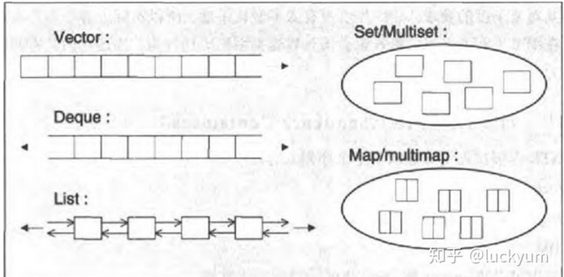

## **vector**:

动态数组，它的随机访问快，在中间插入和删除慢，但在末端插入和删除快。

**特点**

拥有一段连续的内存空间，并且起始地址不变

优点：支持随机访问，即 [] 操作和 .at()，所以查询效率高。

缺点：当向其头部或中部插入或删除元素时，为了保持原本的相对次序，插入或删除点之后的所有元素都必须移动，所以插入的效率比较低。

## **deque**

是由一段一段的定量连续空间构成

- 按页或块来分配存储器的，每页包含固定数目的元素。
- deque 是 list 和 vector 的折中方案。兼有 list 的优点，也有vector 随机线性访问效率高的优点。

优点：支持随机访问，即 [] 操作和 .at()，所以查询效率高；可在双端进行 pop，push。

缺点：不适合中间插入删除操作；占用内存多。

## **List**

由双向链表（doubly linked list）实现而成，元素也存放在堆中，每个元素都是放在一块内存中，他的内存空间可以是不连续的，

**特点**

- 没有空间预留习惯，所以每分配一个元素都会从内存中分配，每删除一个元素都会释放它占用的内存。
- 在哪里添加删除元素性能都很高，不需要移动内存，当然也不需要对每个元素都进行构造与析构了，所以常用来做随机插入和删除操作容器。

**优缺点和适用场景**

优点：内存不连续，动态操作，可在任意位置插入或删除且效率高。

缺点：不支持随机访问。

## **set**

- set 中的元素都是排好序的，集合中没有重复的元素;
- map 和 set 的插入删除效率比用其他序列容器高，因为对于关联容器来说，不需要做内存拷贝和内存移动

优点：使用平衡二叉树实现，便于元素查找，且保持了元素的唯一性，以及能自动排序。

缺点：每次插入值的时候，都需要调整红黑树，效率有一定影响。

## **map**

由红黑树实现，其元素都是 “键值/实值” 所形成的一个对组（key/value pairs)。每个元素有一个键，是排序准则的基础。每一个键只能出现一次，不允许重复。

- 自动建立 Key - value 的对应。key 和 value 可以是任意你需要的类型。
- 根据 key 值快速查找记录，查找的复杂度基本是 O(logN)，如果有 1000 个记录，二分查找最多查找 10次(1024)。
- 增加和删除节点对迭代器的影响很小，除了那个操作节点，对其他的节点都没有什么影响。
- 对于迭代器来说，可以修改实值，而不能修改 key。

**容器配接器**

**stack**  容器对元素采取 LIFO（后进先出）的管理策略。

**queue**  容器对元素采取 FIFO（先进先出）

**priority_queue**  器中的元素可以拥有不同的优先权。

**各容器的特点总结**

- vector 头部与中间插入和删除效率较低，在尾部插入和删除效率高，支持随机访问。
- deque 是在头部和尾部插入和删除效率较高，支持随机访问，但效率没有 vector 高。
- list 在任意位置的插入和删除效率都较高，但不支持随机访问。
- set 由红黑树实现，其内部元素依据其值自动排序，每个元素值只能出现一次，不允许重复，且插入和删除效率比用其他序列容器高。
- map 可以自动建立 Key - value 的对应，key 和 value 可以是任意你需要的类型，根据 key 快速查找记录。

在实际使用过程中，到底选择这几种容器中的哪一个，应该根据遵循以下原则：

1、如果需要高效的随机存取，不在乎插入和删除的效率，使用 vector。

2、如果需要大量的插入和删除元素，不关心随机存取的效率，使用 list。

3、如果需要随机存取，并且关心两端数据的插入和删除效率，使用 deque。

4、如果打算存储数据字典，并且要求方便地根据 key 找到 value，一对一的情况使用 map，一对多的情况使用 multimap。

5、如果打算查找一个元素是否存在于某集合中，唯一存在的情况使用 set，不唯一存在的情况使用 multiset。

**各容器的共性**

各容器一般来说都有下列函数：默认构造函数、复制构造函数、析构函数、empty()、max_size()、size()、operator=、operator<、operator<=、operator>、operator>=、operator==、operator!=、swap()。

顺序容器和关联容器都共有下列函数：

- `begin()` ：返回容器第一个元素的迭代器指针；
- `end()`：返回容器最后一个元素后面一位的迭代器指针；
- `rbegin()`：返回一个逆向迭代器指针，指向容器最后一个元素；
- `rend()`：返回一个逆向迭代器指针，指向容器首个元素前面一位；
- `clear()`：删除容器中的所有的元素；
- `erase(it)`：删除迭代器指针it处元素。

#### 1: **queue的函数使用：**

#include

- push(x) 将x压入队列的末端
- pop() 弹出队列的第一个元素(队顶元素)，注意此函数并不返回任何值
- front() 返回第一个元素(队顶元素)
- back() 返回最后被压入的元素(队尾元素)
- empty() 当队列为空时，返回true
- size() 返回队列的长度

#### 2: priority_queue

优先队列容器与队列一样，只能从队尾插入元素，从队首删除元素,可以重载“<”操作符来重新定义比较规则。　　

- empty() 如果队列为空返回真
- pop() 删除队顶元素
- push() 加入一个元素
- size() 返回优先队列中拥有的元素个数
- top() 返回优先队列队顶元素（队列中的front()变成了top()）

```c++
priority_queue<int> q;	//通过操作，按照元素从大到小的顺序出队priority_queue<int,vector<int>,greater<int> > q;	 //通过操作，按照元素从小到大的顺序出队*
2.自定义优先级：
 struct cmp {     
　　operator bool ()(int x, int y)     
　　{        
　　　　 return　x > y; // x小的优先级高       //也可以写成其他方式，如： return p[x] > p[y];表示p[i]小的优先级高
　　}
};
priority_queue<int, vector<int>, cmp>q;    //定义方法
//其中，第二个参数为容器类型。第三个参数为比较函数。  
struct node {     
　　int x, y;     
　　friend bool operator < (node a, node b)     
　　{         
　　　　return a.x > b.x;    //结构体中，x小的优先级高     
　　}
};
priority_queue<node>q;   //定义方法
```

#### 3： stack

```
stack< int > stk ;
stk.push()
stk.top()
stk.pop()
stl.size()
```

```
定义栈的数据结构，请在该类型中实现一个能够得到栈中所含最小元素的min函数（时间复杂度应为O（1））
思想： 添加一个辅助栈，保存最小值
class Solution {
public:
    public :
    stack<int> s1 ;
    stack<int> s2 ;
    void push(int value) {
        s1.push(value);
        if(s2.empty() || s2.top()>value)
            s2.push(value) ;
    }
    void pop() {
        int tmp = s1.top() ;
        s1.pop() ;
        if(s2.top() == tmp)
            s2.pop() ;
    }
    int top() {
        return s1.top() ;
    }
    int min() {
      return  s2.top();
    }
};

输入两个整数序列，第一个序列表示栈的压入顺序，请判断第二个序列是否可能为该栈的弹出顺序。假设压入栈的所有数字均不相等。例如序列1,2,3,4,5是某栈的压入顺序，序列4,5,3,2,1是该压栈序列对应的一个弹出序列，但4,3,5,1,2就不可能是该压栈序列的弹出序列。（注意：这两个序列的长度是相等的）
用一个辅助栈存 入栈序列 ，当这个辅助栈顶的元素 == 弹出序列第1个元素 ， 辅助栈出栈 ， 弹出序列右移1位
如果辅助栈为空 ， 这个弹出序列是true 
class Solution {
public:
    bool IsPopOrder(vector<int> pushV,vector<int> popV) {
        stack<int> tmp ;
        int i = 0 ;
        int j = 0 ;
        for(i = 0 ;i< pushV.size() ; i++){
            tmp.push(pushV[i]) ;
            while(!tmp.empty() && tmp.top() == popV[j]){
                tmp.pop() ;
                j++ ;
            }
        }
       return tmp.empty() ;
     
    }
};
```

#### 4： vector

```
vector<int> nums ;
vector<bool> vis ;  
nums.assign(n, 0) ;   // 初始化
vis.assign(n ,false) ;
back()
vector<int >  vec ;
vec.push_back()   在数组的最后添加一个数据
vec.pop_back 去掉数组的最后一个数据
vec.at(i) 得到编号位置的数据
vec.begin() 得到数组头的指针
vec.end()
vec.rbegin() 将vector反转后的开始指针返回(其实就是原来的end-1)
vec.rend() 将vector反转构的结束指针返回(其实就是原来的begin-1)
erase 删除指针指向的数据项
empty 判断vector是否为空
vec.clear();清除容器中所有数据
sort(vec.begin(),vec.end());//从小到大
reverse(vec.begin(),vec.end());//从大到小 
bool compare(int a,int b) 
{ 
    return a< b; //升序排列，如果改为return a>b，则为降序 
} 
sort(a,a+20,compare);
1: vector<int> v_new(v_copy)
2: v_new.swap(v_copy)
3: v_new.assign(v_copy.begin(),v_copy.end()) 
4: 
vector<int>::iterator it  ; //声明迭代器
for(it = v_copy.begin(); it!=v_copy.end(); i++)
v_new.push_back(it) ;
back() 
auto pointer = res.begin() ;
index = 5  ;  //指针后移5位
std::advance(pointer,index)
vector< vector<int>  > map(rows ,vecot<int>(cols , 0 )) ;
```

#### 5: map unordered_map

```
map：
map.find()
如果key存在，则find返回key对应的迭代器，如果key不存在，则find返回unordered_map::end。因此可以通过
优点：
有序性，这是map结构最大的优点，其元素的有序性在很多应用中都会简化很多的操作
红黑树，内部实现一个红黑书使得map的很多操作在lgn的时间复杂度下就可以实现，因此效率非常的高
缺点： 空间占用率高，因为map内部实现了红黑树，虽然提高了运行效率，但是因为每一个节点都需要额外保存父节点、孩子节点和红/黑性质，使得每一个节点都占用大量的空间
适用处：对于那些有顺序要求的问题，用map会更高效一些
unordered_map：
优点： 因为内部实现了哈希表，因此其查找速度非常的快
缺点： 哈希表的建立比较耗费时间
适用处：对于查找问题，unordered_map会更加高效一些，因此遇到查找问题，常会考虑一下用unordered_map
unordered_map<char , int > mp ;
int FirstNotRepeatingChar(string str) {
unordered_map<char, int > mp ;
for(const char ch : str){
++mp[ch] ;
}
for(int i = 0 ;i<str.length();i++){
if(mp[str[i]]==1)
return i ;
}
return -1 ;
}
使用count，返回的是被查找元素的个数。如果有，返回1；否则，返回0。注意，map中不存在相同元素，所以返回值只能是1或0。
```

#### 6： set

```
set<int > res ;
set.insert(val) ; //插入 值
set.count(val) ;  // 统计val 值得个数

```

```
//1.定义和初始化
     vector<int> vec1;    //默认初始化，vec1为空
     vector<int> vec2(vec1);  //使用vec1初始化vec2
     vector<int> vec3(vec1.begin(),vec1.end());//使用vec1初始化vec2
     vector<int> vec4(10);    //10个值为0的元素
     vector<int> vec5(10,4);  //10个值为4的元素
  
     //2.常用操作方法
     vec1.push_back(100);            //尾部添加元素
     int size = vec1.size();         //元素个数
     bool isEmpty = vec1.empty();    //判断是否为空
     cout<<vec1[0]<<endl;        //取得第一个元素
     vec1.insert(vec1.end(),5,3);    //从vec1.back位置插入5个值为3的元素
     vec1.pop_back();              //删除末尾元素
     vec1.erase(vec1.begin(),vec1.begin()+2);//删除vec1[0]-vec1[2]之间的元素，不包括vec1[2]其他元素前移
    cout<<(vec1==vec2)?true:false;  //判断是否相等==、！=、>=、<=...
     vector<int>::iterator iter = vec1.begin();    //获取迭代器首地址
    vector<int>::const_iterator c_iter = vec1.begin();   //获取const类型迭代器
    vec1.clear();                 //清空元素
  
     //3.遍历
     //下标法
    int length = vec1.size();
     for(int i=0;i<length;i++)
     {
        cout<<vec1[i];
     }
     cout<<endl<<endl;
     //迭代器法
    vector<int>::iterator iter = vec1.begin();
     for(;iter != vec1.end();iter++)
     {
        cout<<*iter;
     }
```

list,list是stl实现的双向链表，与向量vector想比，它允许快速的插入和删除，但是随机访问却是比较慢，需要添加头文件#include

主要的操作

```
//1.定义和初始化
    list<int> lst1;          //创建空list
    list<int> lst2(3);       //创建含有三个元素的list
    list<int> lst3(3,2); //创建含有三个元素为2的list
    list<int> lst4(lst2);    //使用lst2初始化lst4
    list<int> lst5(lst2.begin(),lst2.end());  //同lst4
 
    //2.常用操作方法
    lst1.assign(lst2.begin(),lst2.end());  //分配值,3个值为0的元素
    lst1.push_back(10);                    //末尾添加值
    lst1.pop_back();                   //删除末尾值
    lst1.begin();                      //返回首值的迭代器
    lst1.end();                            //返回尾值的迭代器
    lst1.clear();                      //清空值
    bool isEmpty1 = lst1.empty();          //判断为空
    lst1.erase(lst1.begin(),lst1.end());                        //删除元素
    lst1.front();                      //返回第一个元素的引用
    lst1.back();                       //返回最后一个元素的引用
    lst1.insert(lst1.begin(),3,2);         //从指定位置插入个3个值为2的元素
    lst1.rbegin();                         //返回第一个元素的前向指针
    lst1.remove(2);                        //相同的元素全部删除
    lst1.reverse();                        //反转
    lst1.size();                       //含有元素个数
    lst1.sort();                       //排序
    lst1.unique();                         //删除相邻重复元素
 
    //3.遍历
    //迭代器法
    for(list<int>::const_iterator iter = lst1.begin();iter != lst1.end();iter++)
    {
       cout<<*iter;
    }
```

eque
　　deque容器类与vector类似，支持随机访问和快速插入和删除，与vector不同，deque还支持从开始端插入数据：push_front。其余的类似vector操作方法的使用.

### **3:关联容器的介绍**

1）map的介绍

　　c++map容器提供一个键值对(key/value)容器，map与multimap差别仅仅在于multimap允许一个键对应多个值。需要包含头文件#include。对于迭代器来说，可以修改实值，而不能修改key。map会根据key自动排序.

常用操作如下：

```
//1.定义和初始化
    map<int,string> map1;                  //空map
   
    //2.常用操作方法
    map1[3] = "Saniya";                    //添加元素
    map1.insert(map<int,string>::value_type(2,"Diyabi"));//插入元素
    //map1.insert(pair<int,string>(1,"Siqinsini"));
    map1.insert(make_pair<int,string>(4,"V5"));
    string str = map1[3];                  //根据key取得value，key不能修改
    map<int,string>::iterator iter_map = map1.begin();//取得迭代器首地址
    int key = iter_map->first;             //取得key
    string value = iter_map->second;       //取得value
    map1.erase(iter_map);                  //删除迭代器数据
    map1.erase(3);                         //根据key删除value
    map1.size();                       //元素个数
    map1.empty();                       //判断空
    map1.clear();                      //清空所有元素
 
    //3.遍历
    for(map<int,string>::iterator iter = map1.begin();iter!=map1.end();iter++)
    {
       int keyk = iter->first;
       string valuev = iter->second;
    }
```

2)set集合
set的含义是集合，它是一个有序的容器，里面的元素都是排序好的支持插入、删除、查找等操作，就像一个集合一样，所有的操作都是严格在logn时间内完成，效率非常高。set和multiset的区别是：set插入的元素不能相同，但是multiset可以相同，set默认是自动排序的，使用方法类似list。

### 4：**几种容器的比较**

1)vector

内部数据结构：数组。

在末尾增加或者删除元素所需时间与元素数目无关，在中间或者开头增加或者删除元素所需时间是随元素数目呈线性变化。

2):deque

内部数据结构是：数组

随机访问每个元素，所需要的时间为常量。在开头和末尾增加元素所需时间与元素数目无关，在中间增加或删除所需时间随元素数目呈线性变化。

3)list

内部数据结构：双向环状链表

不能随机访问一个元素，可双向遍历，在开头，末尾和中间的任何地方增加或者删除元素所需时间都是常量。

4)set

键和值相等。

键唯一

元素默认按升序排列、

5)map

键唯一，

元素默认按键的升序排列

**5：关于迭代器失效的问题、小心使用STL中的erase**

```
#include "stdafx.h"
#include<iostream>
#include<vector>
using namespace std;
int main()
{
    vector<int> vect;
    for(int i = 0; i < 10; i++ )
    {
        vect.push_back(i);
    }
    vector<int>::iterator iter = vect.begin();
    for(; iter != vect.end(); iter++ )
    {
        if( *iter % 2 == 0 )
        {
            vect.erase(iter);
        }
    }
    return 0;
}
```

## 2-1 字符串

to_string(12)  // 数字转string

 string s="123";
 s.push_back('4') ;

#include

string s = to_string(123456) ;

strlen(s)  求字符串的长度

strcpy(destination , sources)  字符串的复制 

const char *c_str(); 
 c_str()函数返回一个指向正规C字符串的指针常量, 内容与本string串相同. 
 这是为了与c语言兼容，在c语言中没有string类型，故必须通过string类对象的成员函数c_str()把string 对象转换成c中的字符串样式。 

1.c_str是一个内容为字符串指向字符数组的临时指针； 
 2.c_str返回的是一个可读不可改的常指针；

```
char c[20]; 
string s="1234"; 
strcpy(c,s.c_str()); 

char *strcat(char *dest, const char *src)
dest -- 指向目标数组，该数组包含了一个 C 字符串，且足够容纳追加后的字符串。
src -- 指向要追加的字符串，该字符串不会覆盖目标字符串
该函数返回一个指向最终的目标字符串 dest 的指针。 
```

```
汇编语言中有一种移位指令叫做循环左移（ROL），现在有个简单的任务，就是用字符串模拟这个指令的运算结果。对于一个给定的字符序列S，请你把其循环左移K位后的序列输出。例如，字符序列S=”abcXYZdef”,要求输出循环左移3位后的结果，即“XYZdefabc”。是不是很简单？OK，搞定它！
class Solution {
public:
    string LeftRotateString(string str, int n) {
        if(str.size() == 0)
            return "" ;
         reverse(str.begin(),str.end()) ; //反转整个字符串
        reverse(str.begin(), str.end()  - n) ; // 翻转前半部分
        reverse(str.end() - n, str.end()) ; // 翻转后半部分
        return str ;
    }
};
"nowcoder. a am I"
"I am a nowcoder."
class Solution {
public:
    string ReverseSentence(string str) {
        string res ;
        string temp ;
        for(auto c : str){
            if(c ==' '){
                res  =temp + ' ' + res ;
                temp  ="" ;
            }
            else{
                temp +=c ;
            }
        }
        res = temp + ' '+res ;
        res = res.substr(0,res.size() -1) ;
        return res ;
    }
};
```

## 按位 <<  >> | ^ $

```
补码
计算机中存整数n是用补码存的。
如果n为正数，则原码=反码=补码
如果n为负数，则补码=反码+1 
a + b 
class Solution {
public:
    int Add(int num1, int num2)
    {
        while (num2 != 0) {
            // 负数左移会在低位补1，所以转化为无符号整数
            int c = ((unsigned int)(num1 & num2)) << 1; 
            num1 ^= num2;
            num2 = c;
        }
        return num1;
    }
};

2:  字符串转成数字
int num = atoi(str.c_str()) ;
```

## 1-DP

### 最大子序和

给定一个整数数组 nums ，找到一个具有最大和的连续子数组（子数组最少包含一个元素），返回其最大和。

示例:
输入: [-2,1,-3,4,-1,2,1,-5,4]
输出: 6
解释: 连续子数组 [4,-1,2,1] 的和最大，为 6。

**dp[i]：包括下标i之前的最大连续子序列和为dp[i]**。

dp[i]只有两个方向可以推出来：

* dp[i - 1] + nums[i]，即：nums[i]加入当前连续子序列和
* nums[i]，即：从头开始计算当前连续子序列和

一定是取最大的，所以dp[i] = max(dp[i - 1] + nums[i], nums[i]);

```
暴力解法的思路，第一层for 就是设置起始位置，第二层for循环遍历数组寻找最大值
时间复杂度：O(n^2)
空间复杂度：O(1
class Solution {
public:
    int maxSubArray(vector<int>& nums) {
        int result = INT32_MIN;
        int count = 0;
        for (int i = 0; i < nums.size(); i++) { // 设置起始位置
            count = 0;
            for (int j = i; j < nums.size(); j++) { // 每次从起始位置i开始遍历寻找最大值
                count += nums[j];
                result = count > result ? count : result;
            }
        }
        return result;
    }
};
```

```
way2: 贪心算法
如果 -2 1 在一起，计算起点的时候，一定是从1开始计算，因为负数只会拉低总和，这就是贪心贪的地方！
局部最优：当前“连续和”为负数的时候立刻放弃，从下一个元素重新计算“连续和”，因为负数加上下一个元素 “连续和”只会越来越小。
class Solution {
public:
    int maxSubArray(vector<int>& nums) {
        int result = INT32_MIN;
        int count = 0;
        for (int i = 0; i < nums.size(); i++) {
            count += nums[i];
            if (count > result) { // 取区间累计的最大值（相当于不断确定最大子序终止位置）
                result = count;
            }
            if (count <= 0) count = 0; // 相当于重置最大子序起始位置，因为遇到负数一定是拉低总和
        }
        return result;
    }
};
```

```
way3: 动态规划：
class Solution {
public:
    int maxSubArray(vector<int>& nums) {
        if (nums.size() == 0) return 0;
        vector<int> dp(nums.size(), 0); // dp[i]表示包括i之前的最大连续子序列和
        dp[0] = nums[0];
        int result = dp[0];
        for (int i = 1; i < nums.size(); i++) {
            dp[i] = max(dp[i - 1] + nums[i], nums[i]); // 状态转移公式
            if (dp[i] > result) result = dp[i]; // result 保存dp[i]的最大值
        }
        return result;
    }
};
```

### 不同路径

一个机器人位于一个 m x n 网格的左上角 （起始点在下图中标记为 “Start” ）。

机器人每次只能向下或者向右移动一步。机器人试图达到网格的右下角（在下图中标记为 “Finish” ）。

问总共有多少条不同的路径？

输入：m = 3, n = 7
输出：28

示例 2：
输入：m = 2, n = 3
输出：3
解释：
从左上角开始，总共有 3 条路径可以到达右下角。

1. 向右 -> 向右 -> 向下
2. 向右 -> 向下 -> 向右
3. 向下 -> 向右 -> 向右

这道题目，刚一看最直观的想法就是用图论里的深搜，来枚举出来有多少种路径。

```
way1 : DFS 深度搜索
class Solution {
private:
    int dfs(int i, int j, int m, int n) {
        if (i > m || j > n) return 0; // 越界了
        if (i == m && j == n) return 1; // 找到一种方法，相当于找到了叶子节点
        return dfs(i + 1, j, m, n) + dfs(i, j + 1, m, n);
    }
public:
    int uniquePaths(int m, int n) {
        return dfs(1, 1, m, n);
    }
};
```

```
动态规划
机器人从(0 , 0) 位置触发，到(m - 1, n - 1)终点。
按照动规五部曲来分析：
1. 确定dp数组（dp table）以及下标的含义
dp[i][j] ：表示从（0 ，0）出发，到(i, j) 有dp[i][j]条不同的路径。
2. 确定递推公式
想要求dp[i][j]，只能有两个方向来推导出来，即dp[i - 1][j] 和 dp[i][j - 1]。
此时在回顾一下 dp[i - 1][j] 表示啥，是从(0, 0)的位置到(i - 1, j)有几条路径，dp[i][j - 1]同理。
那么很自然，dp[i][j] =  dp[i - 1][j] + dp[i][j - 1]，因为dp[i][j]只有这两个方向过来。
3. dp数组的初始化
如何初始化呢，首先dp[i][0]一定都是1，因为从(0, 0)的位置到(i, 0)的路径只有一条，那么dp[0][j]也同理。
所以初始化代码为：
for (int i = 0; i < m; i++) dp[i][0] = 1;
for (int j = 0; j < n; j++) dp[0][j] = 1;
class Solution {
public:
    int uniquePaths(int m, int n) {
        vector<vector<int>> dp(m, vector<int>(n, 0));
        for (int i = 0; i < m; i++) dp[i][0] = 1;
        for (int j = 0; j < n; j++) dp[0][j] = 1;
        for (int i = 1; i < m; i++) {
            for (int j = 1; j < n; j++) {
                dp[i][j] = dp[i - 1][j] + dp[i][j - 1];
            }
        }
        return dp[m - 1][n - 1];
    }
};
```

### 不同路径 II：

一个机器人位于一个 m x n 网格的左上角 （起始点在下图中标记为“Start” ）。

机器人每次只能向下或者向右移动一步。机器人试图达到网格的右下角（在下图中标记为“Finish”）。现在考虑网格中有障碍物。那么从左上角到右下角将会有多少条不同的路径？

```
class Solution {
public:
    int uniquePathsWithObstacles(vector<vector<int>>& obstacleGrid) {
        int m = obstacleGrid.size();
        int n = obstacleGrid[0].size();
        vector<vector<int>> dp(m, vector<int>(n, 0));
        for (int i = 0; i < m && obstacleGrid[i][0] == 0; i++) 
            dp[i][0] = 1;
        for (int j = 0; j < n && obstacleGrid[0][j] == 0; j++)
            dp[0][j] = 1;
        for (int i = 1; i < m; i++) {
            for (int j = 1; j < n; j++) {
                if (obstacleGrid[i][j] == 1) 
                continue;
                dp[i][j] = dp[i - 1][j] + dp[i][j - 1];
            }
        }
        return dp[m - 1][n - 1];
    }
};
```

### 爬楼梯

假设你正在爬楼梯。需要 n 阶你才能到达楼顶。每次你可以爬 1 或 2 个台阶。你有多少种不同的方法可以爬到楼顶呢？

```
// 版本一
class Solution {
public:
    int climbStairs(int n) {
        if (n <= 1) return n; // 因为下面直接对dp[2]操作了，防止空指针
        vector<int> dp(n + 1);
        dp[1] = 1;
        dp[2] = 2;
        for (int i = 3; i <= n; i++) { // 注意i是从3开始的
            dp[i] = dp[i - 1] + dp[i - 2];
        }
        return dp[n];
    }
};
```

### 爬楼梯 升级：

这道题目还可以继续深化，就是一步一个台阶，两个台阶，三个台阶，直到 m个台阶，有多少种方法爬到n阶楼顶。

```
dp[i]有几种来源，dp[i - 1]，dp[i - 2]，dp[i - 3] 等等，即：dp[i - j]
那么递推公式为：dp[i] += dp[i - j]
class Solution {
public:
    int climbStairs(int n) {
        vector<int> dp(n + 1, 0);
        dp[0] = 1;
        for (int i = 1; i <= n; i++) {
            for (int j = 1; j <= m; j++) { // 把m换成2，就可以AC爬楼梯这道题
                if (i - j >= 0) dp[i] += dp[i - j];
            }
        }
        return dp[n];
    }
};
```

### 编辑距离

给你两个单词 word1 和 word2，请你计算出将 word1 转换成 word2 所使用的最少操作数 。

你可以对一个单词进行如下三种操作：

* 插入一个字符
* 删除一个字符
* 替换一个字符

```
示例 1：
输入：word1 = "horse", word2 = "ros"
输出：3
```

1. 确定dp数组（dp table）以及下标的含义

**dp[i][j] 表示以下标i-1为结尾的字符串word1，和以下标j-1为结尾的字符串word2，最近编辑距离为dp[i][j]**。

在确定递推公式的时候，首先要考虑清楚编辑的几种操作，整理如下：

* if (word1[i - 1] == word2[j - 1])
  * 不操作
* if (word1[i - 1] != word2[j - 1])
  * 增删换

```
class Solution {
public:
    int minDistance(string word1, string word2) {
        vector<vector<int>> dp(word1.size() + 1, vector<int>(word2.size() + 1, 0));
        for (int i = 0; i <= word1.size(); i++) dp[i][0] = i;
        for (int j = 0; j <= word2.size(); j++) dp[0][j] = j;
        for (int i = 1; i <= word1.size(); i++) {
            for (int j = 1; j <= word2.size(); j++) {
                if (word1[i - 1] == word2[j - 1]) {
                    dp[i][j] = dp[i - 1][j - 1];
                }
                else {
                    dp[i][j] = min({dp[i - 1][j - 1], dp[i - 1][j], dp[i][j - 1]}) + 1;
                }
            }
        }
        return dp[word1.size()][word2.size()];
    }
};
```

### 不同的子序列

给定一个字符串 s 和一个字符串 t ，计算在 s 的子序列中 t 出现的个数。

字符串的一个 子序列 是指，通过删除一些（也可以不删除）字符且不干扰剩余字符相对位置所组成的新字符串。（例如，"ACE" 是 "ABCDE" 的一个子序列，而 "AEC" 不是）

```
class Solution {
public:
    int numDistinct(string s, string t) {
        vector<vector<uint64_t>> dp(s.size() + 1, vector<uint64_t>(t.size() + 1));
        for (int i = 0; i < s.size(); i++) dp[i][0] = 1;
        for (int j = 1; j < t.size(); j++) dp[0][j] = 0;
        for (int i = 1; i <= s.size(); i++) {
            for (int j = 1; j <= t.size(); j++) {
                if (s[i - 1] == t[j - 1]) {
                    dp[i][j] = dp[i - 1][j - 1] + dp[i - 1][j];
                } else {
                    dp[i][j] = dp[i - 1][j];
                }
            }
        }
        return dp[s.size()][t.size()];
    }
};
```

### 判断子序列

给定字符串 s 和 t ，判断 s 是否为 t 的子序列。

字符串的一个子序列是原始字符串删除一些（也可以不删除）字符而不改变剩余字符相对位置形成的新字符串。（例如，"ace"是"abcde"的一个子序列，而"aec"不是）。

```
class Solution {
public:
    bool isSubsequence(string s, string t) {
        vector<vector<int>> dp(s.size() + 1, vector<int>(t.size() + 1, 0));
        for (int i = 1; i <= s.size(); i++) {
            for (int j = 1; j <= t.size(); j++) {
                if (s[i - 1] == t[j - 1]) 
                	dp[i][j] = dp[i - 1][j - 1] + 1;
                else 
                	dp[i][j] = dp[i][j - 1];
            }
        }
        if (dp[s.size()][t.size()] == s.size()) return true;
        return false;
    }
};
```

### 最长递增子序列

给你一个整数数组 nums ，找到其中最长严格递增子序列的长度。

子序列是由数组派生而来的序列，删除（或不删除）数组中的元素而不改变其余元素的顺序。例如，[3,6,2,7] 是数组 [0,3,1,6,2,2,7] 的子序列。

```
示例 1：
输入：nums = [10,9,2,5,3,7,101,18]
输出：4
解释：最长递增子序列是 [2,3,7,101]，因此长度为 4 
class Solution {
public:
    int lengthOfLIS(vector<int>& nums) {
        if (nums.size() <= 1) return nums.size();
        vector<int> dp(nums.size(), 1);
        int result = 0;
        for (int i = 1; i < nums.size(); i++) {
            for (int j = 0; j < i; j++) {
                if (nums[i] > nums[j]) dp[i] = max(dp[i], dp[j] + 1);
            }
            if (dp[i] > result) result = dp[i]; // 取长的子序列
        }
        return result;
    }
};
```

### 最长连续递增序列

给定一个未经排序的整数数组，找到最长且 连续递增的子序列，并返回该序列的长度。

```
输入：nums = [1,3,5,4,7]
输出：3
解释：最长连续递增序列是 [1,3,5], 长度为3。
class Solution {
public:
    int findLengthOfLCIS(vector<int>& nums) {
        if (nums.size() == 0) return 0;
        int result = 1;
        vector<int> dp(nums.size() ,1);
        for (int i = 0; i < nums.size() - 1; i++) {
            if (nums[i + 1] > nums[i]) { // 连续记录
                dp[i + 1] = dp[i] + 1;
            }
            if (dp[i + 1] > result) result = dp[i + 1];
        }
        return result;
    }
};
```

### 最长回文子序列

给定一个字符串 s ，找到其中最长的回文子序列，并返回该序列的长度。可以假设 s 的最大长度为 1000 。

示例 1:
输入: "bbbab"
输出: 4
一个可能的最长回文子序列为 "bbb

```
class Solution {
public:
    int longestPalindromeSubseq(string s) {
        vector<vector<int>> dp(s.size(), vector<int>(s.size(), 0));
        for (int i = 0; i < s.size(); i++) dp[i][i] = 1;
        for (int i = s.size() - 1; i >= 0; i--) {
            for (int j = i + 1; j < s.size(); j++) {
                if (s[i] == s[j]) {
                    dp[i][j] = dp[i + 1][j - 1] + 2;
                } else {
                    dp[i][j] = max(dp[i + 1][j], dp[i][j - 1]);
                }
            }
        }
        return dp[0][s.size() - 1];
    }
};
```

### 最长重复子数组

给两个整数数组 A 和 B ，返回两个数组中公共的、长度最长的子数组的长度。

```
输入：
A: [1,2,3,2,1]
B: [3,2,1,4,7]
输出：3
解释：
长度最长的公共子数组是 [3, 2, 1] 。
class Solution {
public:
    int findLength(vector<int>& A, vector<int>& B) {
        vector<vector<int>> dp (A.size() + 1, vector<int>(B.size() + 1, 0));
        int result = 0;
        for (int i = 1; i <= A.size(); i++) {
            for (int j = 1; j <= B.size(); j++) {
                if (A[i - 1] == B[j - 1]) {
                    dp[i][j] = dp[i - 1][j - 1] + 1;
                }
                if (dp[i][j] > result) result = dp[i][j];
            }
        }
        return result;
    }
};
```

### 最长公共子序列

给定两个字符串 text1 和 text2，返回这两个字符串的最长公共子序列的长度。

```
输入：text1 = "abcde", text2 = "ace"      
输出：3          
解释：最长公共子序列是 "ace"，它的长度为 3。     
class Solution {
public:
    int longestCommonSubsequence(string text1, string text2) {
        vector<vector<int>> dp(text1.size() + 1, vector<int>(text2.size() + 1, 0));
        for (int i = 1; i <= text1.size(); i++) {
            for (int j = 1; j <= text2.size(); j++) {
                if (text1[i - 1] == text2[j - 1]) {
                    dp[i][j] = dp[i - 1][j - 1] + 1;
                } else {
                    dp[i][j] = max(dp[i - 1][j], dp[i][j - 1]);
                }
            }
        }
        return dp[text1.size()][text2.size()];
    }
};
```

### 最长无重复的子串

```
class Solution {
public:
    /**
     * 
     * @param arr int整型vector the array
     * @return int整型
     */
    int maxLength(vector<int>& arr) {
        /*
        set去重
双指针left、right标记中间段无重复字串的左右两端
遍历字符串，当右指针超过字符串标记位，停止遍历，每次查询一个字符后，
进行判断，如果无重复，right++；若重复，消除arr【left】，left++；
        */
        // write code here
        set<int> s ;
        int n = arr.size() ;
        int left = 0 ;
        int right = 0 ;
        int  res =0 ;
        while(right<n){
            if(s.count(arr[right])==0){ //判断arr[right] 元素是否在s中
                s.insert(arr[right]) ;
                right ++ ;
            }
            else{
                s.erase(arr[left]) ;
                left ++ ;
            }
            res = res >s.size()? res : s.size() ;
        }
      return res;

    }
};
```

## 背包问题：

### 一维01背包

```
void test_2_wei_bag_problem1() {
    vector<int> weight = {1, 3, 4};
    vector<int> value = {15, 20, 30};
    int bagWeight = 4;
    // 二维数组
    vector<vector<int>> dp(weight.size() + 1, vector<int>(bagWeight + 1, 0));
    // 初始化
    for (int j = bagWeight; j >= weight[0]; j--) {
        dp[0][j] = dp[0][j - weight[0]] + value[0];
    }

    // weight数组的大小 就是物品个数
    for(int i = 1; i < weight.size(); i++) { // 遍历物品
        for(int j = 0; j <= bagWeight; j++) { // 遍历背包容量
            if (j < weight[i]) dp[i][j] = dp[i - 1][j];
            else dp[i][j] = max(dp[i - 1][j], dp[i - 1][j - weight[i]] + value[i]);
        }
    }

    cout << dp[weight.size() - 1][bagWeight] << endl;
}

int main() {
    test_2_wei_bag_problem1();
}
```

**采用滚动数组**

```
void test_1_wei_bag_problem() {
    vector<int> weight = {1, 3, 4};
    vector<int> value = {15, 20, 30};
    int bagWeight = 4;
    // 初始化
    vector<int> dp(bagWeight + 1, 0);
    for(int i = 0; i < weight.size(); i++) { // 遍历物品
        for(int j = bagWeight; j >= weight[i]; j--) { // 遍历背包容量
            dp[j] = max(dp[j], dp[j - weight[i]] + value[i]);
        }
    }
    cout << dp[bagWeight] << endl;
}
int main() {
    test_1_wei_bag_problem();
}
```

### 多重背包

有N种物品和一个容量为V 的背包。第i种物品最多有Mi件可用，每件耗费的空间是Ci ，价值是Wi 。求解将哪些物品装入背包可使这些物品的耗费的空间 总和不超过背包容量，且价值总和最大。

每件物品最多有Mi件可用，把Mi件摊开，其实就是一个01背包问题了。

```
void test_multi_pack() {
    vector<int> weight = {1, 3, 4};
    vector<int> value = {15, 20, 30};
    vector<int> nums = {2, 3, 2};
    int bagWeight = 10;
    for (int i = 0; i < nums.size(); i++) {
        while (nums[i] > 1) { // nums[i]保留到1，把其他物品都展开
            weight.push_back(weight[i]);
            value.push_back(value[i]);
            nums[i]--;
        }
    }

    vector<int> dp(bagWeight + 1, 0);
    for(int i = 0; i < weight.size(); i++) { // 遍历物品
        for(int j = bagWeight; j >= weight[i]; j--) { // 遍历背包容量
            dp[j] = max(dp[j], dp[j - weight[i]] + value[i]);
        }
        for (int j = 0; j <= bagWeight; j++) {
            cout << dp[j] << " ";
        }
        cout << endl;
    }
    cout << dp[bagWeight] << endl;

}
int main() {
    test_multi_pack();
}
```

### 完全背包

有N件物品和一个最多能背重量为W的背包。第i件物品的重量是weight[i]，得到的价值是value[i] 。**每件物品都有无限个（也就是可以放入背包多次）**，求解将哪些物品装入背包里物品价值总和最大。

```
// 先遍历物品，在遍历背包
void test_CompletePack() {
    vector<int> weight = {1, 3, 4};
    vector<int> value = {15, 20, 30};
    int bagWeight = 4;
    vector<int> dp(bagWeight + 1, 0);
    for(int i = 0; i < weight.size(); i++) { // 遍历物品
        for(int j = weight[i]; j <= bagWeight; j++) { // 遍历背包容量
            dp[j] = max(dp[j], dp[j - weight[i]] + value[i]);
        }
    }
    cout << dp[bagWeight] << endl;
}
int main() {
    test_CompletePack();
}

```

### 买卖股票的最佳时机

给定一个数组 prices ，它的第 i 个元素 prices[i] 表示一支给定股票第 i 天的价格。

你只能选择 某一天 买入这只股票，并选择在 未来的某一个不同的日子 卖出该股票。设计一个算法来计算你所能获取的最大利润。

```
示例 1：
输入：[7,1,5,3,6,4]
输出：5
解释：在第 2 天（股票价格 = 1）的时候买入，在第 5 天（股票价格 = 6）的时候卖出，最大利润 = 6-1 = 5 。注意利润不能是 7-1 = 6, 因为卖出价格需要大于买入价格；同时，你不能在买入前卖出股票。
way1 : 暴力
class Solution {
public:
    int maxProfit(vector<int>& prices) {
        int result = 0;
        for (int i = 0; i < prices.size(); i++) {
            for (int j = i + 1; j < prices.size(); j++){
                result = max(result, prices[j] - prices[i]);
            }
        }
        return result;
    }
};
```

```
way2 :贪心
class Solution {
public:
    int maxProfit(vector<int>& prices) {
        int low = INT_MAX;
        int result = 0;
        for (int i = 0; i < prices.size(); i++) {
            low = min(low, prices[i]);  // 取最左最小价格
            result = max(result, prices[i] - low); // 直接取最大区间利润
        }
        return result;
    }
};
```

```
way3: 
// 版本一
class Solution {
public:
    int maxProfit(vector<int>& prices) {
        int len = prices.size();
        if (len == 0) return 0;
        vector<vector<int>> dp(len, vector<int>(2));
        dp[0][0] -= prices[0];
        dp[0][1] = 0;
        for (int i = 1; i < len; i++) {
            dp[i][0] = max(dp[i - 1][0], -prices[i]);
            dp[i][1] = max(dp[i - 1][1], prices[i] + dp[i - 1][0]);
        }
        return dp[len - 1][1];
    }
};
```

### 买卖股票的最佳时机II

示例 2:  
输入: [1,2,3,4,5]  
输出: 4  
解释: 在第 1 天（股票价格 = 1）的时候买入，在第 5 天 （股票价格 = 5）的时候卖出, 这笔交易所能获得利润 = 5-1 = 4 。注意你不能在第 1 天和第 2 天接连购买股票，之后再将它们卖出。因为这样属于同时参与了多笔交易，你必须在再次购买前出售掉之前的股票。

注意：你不能同时参与多笔交易（你必须在再次购买前出售掉之前的股票）。

```
这正是因为本题的股票可以买卖多次！所以买入股票的时候，可能会有之前买卖的利润即：dp[i - 1][1]，所以dp[i - 1][1] - prices[i]。
class Solution {
public:
    int maxProfit(vector<int>& prices) {
        int len = prices.size();
        vector<vector<int>> dp(len, vector<int>(2, 0));
        dp[0][0] -= prices[0];
        dp[0][1] = 0;
        for (int i = 1; i < len; i++) {
            dp[i][0] = max(dp[i - 1][0], dp[i - 1][1] - prices[i]); // 注意这里是和1. 买卖股票的最佳时机唯一不同的地方。
            dp[i][1] = max(dp[i - 1][1], dp[i - 1][0] + prices[i]);
        }
        return dp[len - 1][1];
    }
};
```

### 买卖股票的最佳时机III

给定一个数组，它的第 i 个元素是一支给定的股票在第 i 天的价格。设计一个算法来计算你所能获取的最大利润。你最多可以完成 两笔 交易。注意：你不能同时参与多笔交易（你必须在再次购买前出售掉之前的股票）

```
示例 1:
输入：prices = [3,3,5,0,0,3,1,4]
输出：6
解释：在第 4 天（股票价格 = 0）的时候买入，在第 6 天（股票价格 = 3）的时候卖出，这笔交易所能获得利润 = 3-0 = 3 。随后，在第 7 天（股票价格 = 1）的时候买入，在第 8 天 （股票价格 = 4）的时候卖出，这笔交易所能获得利润 = 4-1 = 3。

```

```
// 版本一
class Solution {
public:
    int maxProfit(vector<int>& prices) {
        if (prices.size() == 0) return 0;
        vector<vector<int>> dp(prices.size(), vector<int>(5, 0));
        dp[0][1] = -prices[0];
        dp[0][3] = -prices[0];
        for (int i = 1; i < prices.size(); i++) {
            dp[i][0] = dp[i - 1][0];
            dp[i][1] = max(dp[i - 1][1], dp[i - 1][0] - prices[i]);
            dp[i][2] = max(dp[i - 1][2], dp[i - 1][1] + prices[i]);
            dp[i][3] = max(dp[i - 1][3], dp[i - 1][2] - prices[i]);
            dp[i][4] = max(dp[i - 1][4], dp[i - 1][3] + prices[i]);
        }
        return dp[prices.size() - 1][4];
    }
};
```

### 买卖股票的最佳时机IV

```
给定一个整数数组 prices ，它的第 i 个元素 prices[i] 是一支给定的股票在第 i 天的价格。
设计一个算法来计算你所能获取的最大利润。你最多可以完成 k 笔交易。
注意：你不能同时参与多笔交易（你必须在再次购买前出售掉之前的股票）。
示例 1：
输入：k = 2, prices = [2,4,1]
输出：2
解释：在第 1 天 (股票价格 = 2) 的时候买入，在第 2 天 (股票价格 = 4) 的时候卖出，这笔交易所能获得利润 = 4-2 = 2。
class Solution {
public:
    int maxProfit(int k, vector<int>& prices) {

        if (prices.size() == 0) return 0;
        vector<vector<int>> dp(prices.size(), vector<int>(2 * k + 1, 0));
        for (int j = 1; j < 2 * k; j += 2) {
            dp[0][j] = -prices[0];
        }
        for (int i = 1;i < prices.size(); i++) {
            for (int j = 0; j < 2 * k - 1; j += 2) {
                dp[i][j + 1] = max(dp[i - 1][j + 1], dp[i - 1][j] - prices[i]);
                dp[i][j + 2] = max(dp[i - 1][j + 2], dp[i - 1][j + 1] + prices[i]);
            }
        }
        return dp[prices.size() - 1][2 * k];
    }
};
```

### 最佳买卖股票时机含冷冻期

```
给定一个整数数组，其中第 i 个元素代表了第 i 天的股票价格 。​
设计一个算法计算出最大利润。在满足以下约束条件下，你可以尽可能地完成更多的交易（多次买卖一支股票）:
你不能同时参与多笔交易（你必须在再次购买前出售掉之前的股票）。
卖出股票后，你无法在第二天买入股票 (即冷冻期为 1 天)。
示例:
输入: [1,2,3,0,2]
输出: 3
解释: 对应的交易状态为: [买入, 卖出, 冷冻期, 买入, 卖出]
class Solution {
public:
    int maxProfit(vector<int>& prices) {
        int n = prices.size();
        if (n == 0) return 0;
        vector<vector<int>> dp(n, vector<int>(4, 0));
        dp[0][0] -= prices[0]; // 持股票
        for (int i = 1; i < n; i++) {
            dp[i][0] = max(dp[i - 1][0], max(dp[i - 1][3], dp[i - 1][1]) - prices[i]);
            dp[i][1] = max(dp[i - 1][1], dp[i - 1][3]);
            dp[i][2] = dp[i - 1][0] + prices[i];
            dp[i][3] = dp[i - 1][2];
        }
        return max(dp[n - 1][3],max(dp[n - 1][1], dp[n - 1][2]));
    }
};
```

## 2-链表问题

### 链表定义：

```
// 单链表
struct ListNode {
    int val;  // 节点上存储的元素
    ListNode *next;  // 指向下一个节点的指针
    ListNode(int x) : val(x), next(NULL) {}  // 节点的构造函数
};
```

### 链表相交

给定两个（单向）链表，判定它们是否相交并返回交点。请注意相交的定义基于节点的引用，而不是基于节点的值。换句话说，如果一个链表的第k个节点与另一个链表的第j个节点是同一节点（引用完全相同），则这两个链表相交。

```
输入：listA = [4,1,8,4,5], listB = [5,0,1,8,4,5]
输出：Reference of the node with value = 8
class Solution {
public:
    ListNode *getIntersectionNode(ListNode *headA, ListNode *headB) {
        ListNode* curA = headA;
        ListNode* curB = headB;
        int lenA = 0, lenB = 0;
        while (curA != NULL) { // 求链表A的长度
            lenA++;
            curA = curA->next;
        }
        while (curB != NULL) { // 求链表B的长度
            lenB++;
            curB = curB->next;
        }
        curA = headA;
        curB = headB;
        // 让curA为最长链表的头，lenA为其长度
        if (lenB > lenA) {
            swap (lenA, lenB);
            swap (curA, curB);
        }
        // 求长度差
        int gap = lenA - lenB;
        // 让curA和curB在同一起点上（末尾位置对齐）
        while (gap--) {
            curA = curA->next;
        }
        // 遍历curA 和 curB，遇到相同则直接返回
        while (curA != NULL) {
            if (curA == curB) {
                return curA;
            }
            curA = curA->next;
            curB = curB->next;
        }
        return NULL;
    }
};
```

### 反转链表

```
class Solution {
public:
    ListNode* reverseList(ListNode* head) {
        ListNode* temp; // 保存cur的下一个节点
        ListNode* cur = head;
        ListNode* pre = NULL;
        while(cur) {
            temp = cur->next;  // 保存一下 cur的下一个节点，因为接下来要改变cur->next
            cur->next = pre; // 翻转操作
            // 更新pre 和 cur指针
            pre = cur;
            cur = temp;
        }
        return pre;
    }
};
递归化：
class Solution {
public:
    ListNode* reverse(ListNode* pre,ListNode* cur){
        if(cur == NULL) return pre;
        ListNode* temp = cur->next;
        cur->next = pre;
        // 可以和双指针法的代码进行对比，如下递归的写法，其实就是做了这两步
        // pre = cur;
        // cur = temp;
        return reverse(cur,temp);
    }
    ListNode* reverseList(ListNode* head) {
        // 和双指针法初始化是一样的逻辑
        // ListNode* cur = head;
        // ListNode* pre = NULL;
        return reverse(NULL, head);
    }
};
```

### 移除链表元素

题意：删除链表中等于给定值 val 的所有节点。

```
class Solution {
public:
    ListNode* removeElements(ListNode* head, int val) {
        // 删除头结点
        while (head != NULL && head->val == val) { // 注意这里不是if
            ListNode* tmp = head;
            head = head->next;
            delete tmp;
        }
        // 删除非头结点
        ListNode* cur = head;
        while (cur != NULL && cur->next!= NULL) {
            if (cur->next->val == val) {
                ListNode* tmp = cur->next;
                cur->next = cur->next->next;
                delete tmp;
            } else {
                cur = cur->next;
            }
        }
        return head;
    }
};
```

### 环形链表II

题意：
给定一个链表，返回链表开始入环的第一个节点。 如果链表无环，则返回 null。

为了表示给定链表中的环，使用整数 pos 来表示链表尾连接到链表中的位置（索引从 0 开始）。 如果 pos 是 -1，则在该链表中没有环。

```
/**
 * Definition for singly-linked list.
 * struct ListNode {
 *     int val;
 *     ListNode *next;
 *     ListNode(int x) : val(x), next(NULL) {}
 * };
 */
class Solution {
public:
    ListNode *detectCycle(ListNode *head) {
        ListNode* fast = head;
        ListNode* slow = head;
        while(fast != NULL && fast->next != NULL) {
            slow = slow->next;
            fast = fast->next->next;
            // 快慢指针相遇，此时从head 和 相遇点，同时查找直至相遇
            if (slow == fast) {
                ListNode* index1 = fast;
                ListNode* index2 = head;
                while (index1 != index2) {
                    index1 = index1->next;
                    index2 = index2->next;
                }
                return index2; // 返回环的入口
            }
        }
        return NULL;
    }
};
```

### 两两交换链表中的节点

给定一个链表，两两交换其中相邻的节点，并返回交换后的链表。你不能只是单纯的改变节点内部的值，而是需要实际的进行节点交换。

```
class Solution {
public:
    ListNode* swapPairs(ListNode* head) {
        ListNode* dummyHead = new ListNode(0); // 设置一个虚拟头结点
        dummyHead->next = head; // 将虚拟头结点指向head，这样方面后面做删除操作
        ListNode* cur = dummyHead;
        while(cur->next != nullptr && cur->next->next != nullptr) {
            ListNode* tmp = cur->next; // 记录临时节点
            ListNode* tmp1 = cur->next->next->next; // 记录临时节点

            cur->next = cur->next->next;    // 步骤一
            cur->next->next = tmp;          // 步骤二
            cur->next->next->next = tmp1;   // 步骤三

            cur = cur->next->next; // cur移动两位，准备下一轮交换
        }
        return dummyHead->next;
    }
};

```

### 删除链表的倒数第N个节点

```
给你一个链表，删除链表的倒数第 n 个结点，并且返回链表的头结点。
进阶：你能尝试使用一趟扫描实现吗？
class Solution {
public:
    ListNode* removeNthFromEnd(ListNode* head, int n) {
        ListNode* dummyHead = new ListNode(0);
        dummyHead->next = head;
        ListNode* slow = dummyHead;
        ListNode* fast = dummyHead;
        while(n-- && fast != NULL) {
            fast = fast->next;
        }
        fast = fast->next; // fast再提前走一步，因为需要让slow指向删除节点的上一个节点
        while (fast != NULL) {
            fast = fast->next;
            slow = slow->next;
        }
        slow->next = slow->next->next;
        return dummyHead->next;
    }
};
```

### 链表有环问题

```
//第一种方法，将所有的遍历过的节点用某个结构存储起来，然后每遍历一个节点，都在这个结构中查找是否遍历过，如果找到有重复，则说明该链表存在循环；如果直到遍历结束，则说明链表不存在循环。这个结构我们可以使用hash来做，hash中存储的值为节点的内存地址，这样查找的操作所需时间为O(1)，遍历操作需要O(n)，hash表的存储空间需要额外的O(n)。所以整个算法的时间复杂度为O(n)，空间复杂度为O(n)
class Solution {
public:
    bool hasCycle(ListNode *head) {
      set<ListNode *> hash_map ;
        ListNode *p = head ;
        while(p!=nullptr){
            if(hash_map.count(p))
                return true ;
            hash_map.insert(p);
            p = p->next ;
                
        }
        return false ;
    }
};
// 解法2 ： 快慢指针  慢指针每次前进一步 ，快指针前进2步
class Solution {
public:
    bool hasCycle(ListNode *head) {
        if(head==nullptr||head->next==nullptr)return false;
        ListNode *slow=head,*fast=head->next;
        //链表多长？
        while(slow!=fast){
            if(fast==nullptr||slow==nullptr||fast->next==nullptr)return false;
            slow=slow->next;
            fast=fast->next->next;
        }
        return true;
    }
};
```

### 链表反转问题

```
//  pre : 前一指针 p 临时指针 cur : 当前指针
class Solution {
public:
    ListNode* ReverseList(ListNode* pHead) {
        ListNode *p,*pre ;
        p = nullptr ;
        pre = nullptr;
        ListNode *cur = pHead ;
        while(cur){
            p = cur->next ;  // 临时保存 cur->next 位置
            cur->next= pre  ; //头插法
            pre = cur ;
            cur = p ;
        }
        return pre ;
    }
};
```

## 3-二叉树问题

### 二叉树深度

```
int getDepth(TreeNode* node) {
    if (node == NULL) return 0;
    return 1 + max(getDepth(node->left), getDepth(node->right));
}
```

### 二叉树节点数量

```
int countNodes(TreeNode* root) {
    if (root == NULL) return 0;
    return 1 + countNodes(root->left) + countNodes(root->right);
}
```

### 翻转一棵二叉树

```
class Solution {
public:
    TreeNode* invertTree(TreeNode* root) {
        if (root == NULL) return root;
        swap(root->left, root->right);  // 中
        invertTree(root->left);         // 左
        invertTree(root->right);        // 右
        return root;
    }
};
深度优先遍历
class Solution {
public:
    TreeNode* invertTree(TreeNode* root) {
        if (root == NULL) return root;
        stack<TreeNode*> st;
        st.push(root);
        while(!st.empty()) {
            TreeNode* node = st.top();              // 中
            st.pop();
            swap(node->left, node->right);
            if(node->right) st.push(node->right);   // 右
            if(node->left) st.push(node->left);     // 左
        }
        return root;
    }
};
C++代码如下迭代法（前序遍历）
class Solution {
public:
    TreeNode* invertTree(TreeNode* root) {
        stack<TreeNode*> st;
        if (root != NULL) st.push(root);
        while (!st.empty()) {
            TreeNode* node = st.top();
            if (node != NULL) {
                st.pop();
                if (node->right) st.push(node->right);  // 右
                if (node->left) st.push(node->left);    // 左
                st.push(node);                          // 中
                st.push(NULL);
            } else {
                st.pop();
                node = st.top();
                st.pop();
                swap(node->left, node->right);          // 节点处理逻辑
            }
        }
        return root;
    }
};
广度优先遍历
class Solution {
public:
    TreeNode* invertTree(TreeNode* root) {
        queue<TreeNode*> que;
        if (root != NULL) que.push(root);
        while (!que.empty()) {
            int size = que.size();
            for (int i = 0; i < size; i++) {
                TreeNode* node = que.front();
                que.pop();
                swap(node->left, node->right); // 节点处理
                if (node->left) que.push(node->left);
                if (node->right) que.push(node->right);
            }
        }
        return root;
    }
};

```

### 二叉树的所有路径

给定一个二叉树，返回所有从根节点到叶子节点的路径。

说明: 叶子节点是指没有子节点的节点。

```
class Solution {
private:

    void traversal(TreeNode* cur, vector<int>& path, vector<string>& result) {
        path.push_back(cur->val);
        // 这才到了叶子节点
        if (cur->left == NULL && cur->right == NULL) {
            string sPath;
            for (int i = 0; i < path.size() - 1; i++) {
                sPath += to_string(path[i]);
                sPath += "->";
            }
            sPath += to_string(path[path.size() - 1]);
            result.push_back(sPath);
            return;
        }
        if (cur->left) {
            traversal(cur->left, path, result);
            path.pop_back(); // 回溯
        }
        if (cur->right) {
            traversal(cur->right, path, result);
            path.pop_back(); // 回溯
        }
    }

public:
    vector<string> binaryTreePaths(TreeNode* root) {
        vector<string> result;
        vector<int> path;
        if (root == NULL) return result;
        traversal(root, path, result);
        return result;
    }
};

```

### 左叶子之和

计算给定二叉树的所有左叶子之和。

```
class Solution {
public:
    int sumOfLeftLeaves(TreeNode* root) {
        if (root == NULL) return 0;

        int leftValue = sumOfLeftLeaves(root->left);    // 左
        int rightValue = sumOfLeftLeaves(root->right);  // 右
                                                        // 中
        int midValue = 0;
        if (root->left && !root->left->left && !root->left->right) { // 中
            midValue = root->left->val;
        }
        int sum = midValue + leftValue + rightValue;
        return sum;
    }
};
```

### 遍历

1 :  左右交换  递归版本  先序遍历

```
作给定的二叉树，将其变换为源二叉树的镜像。 
way 1 : 
TreeNode* Mirror(TreeNode* R) {
        // write code here
        if(R==NULL)
            return NULL;
        Mirror(R->left) ;   // 先序遍历 
        TreeNode *temp = R->left;
        R->left = R->right;
        R->right = temp;
        Mirror(R->left) ;   // 左子树和右子树已近交换 。 
        return R ;
    }
    
way2 : 
TreeNode* Mirror(TreeNode* pRoot) {
        if(pRoot==nullptr) return NULL;
        TreeNode* tmp = pRoot->left;
        pRoot->left = Mirror(pRoot->right);
        pRoot->right = Mirror(tmp);
        return pRoot;
        // write code here
    }
    

```

2：   BFS  层次遍历 在出队哪里操作  

```
 TreeNode* Mirror(TreeNode* root) {
        // write code here
         if(!root)
             return NULL ;
        queue<TreeNode*> que ;
        que.push(root) ;
        while(!que.empty()){
            TreeNode * tmp = que.front() ;
            que.pop() ;
            // 层次遍历的操作  左右交换   以后的变形都在这个位置 
            TreeNode *left = tmp->left ;
            tmp->left = tmp->right ;
            tmp->right = left ;
            if(tmp->left)
                que.push(tmp->left) ;
            if(tmp->right)
                que.push(tmp->right) ;
        }
        return root  ; 
    }
```

3： DFS  在每次访问节点的时候，就将左右孩子交换 

```
 TreeNode* Mirror(TreeNode* root) {
        // write code here
         if(!root)
             return NULL ;
        stack<TreeNode*> st ;
        st.push(root) ;
        while(!st.empty()){
            TreeNode * tmp = st.top() ;
            st.pop() ;
            // 层次遍历的操作
            TreeNode *left = tmp->left ;
            tmp->left = tmp->right ;
            tmp->right = left ;
            if(tmp->left)
                st.push(tmp->left) ;
            if(tmp->right)
                st.push(tmp->right) ;
        }
        return root  ; 
    }
```

### 后序二叉搜索树

```
输入一个整数数组，判断该数组是不是某二叉搜索树的后序遍历的结果。如果是则返回true,否则返回false。假设输入的数组的任意两个数字都互不相同。（ps：我们约定空树不是二叉搜素树）

二叉搜索树的特点：  左孩子 -> 父亲节点-> 右孩子
数组最后一个数字就是根节点 ， 左右子树的分界点 ，与根节点相比较。
class Solution {
public:
    vector<int >seq ;
    bool VerifySquenceOfBST(vector<int> sequence) {
        seq = sequence ;
        if(seq.empty())
            return false ;
        return dfs( 0, seq.size()-1) ;
            
    }
    bool dfs( int l ,int r){
        if(l>=r)  // 当左边大于右边 
            return true; 
        int father = seq[r] ;
        int k = l ;   //分界点  k 左边的都小于fater 
        while(k<r && seq[k]<father)
            k++ ;
        for(int i= k; i<r ;i++)  // k 右边的都大于father 
            if(seq[i]<father)
                return false ;
        return dfs(l,k-1) &&dfs( k,  r-1);
    }
};

特点：遍历的时候，如果遇到比最后一个元素大的节点，就说明它的前面都比最后一个元素小，该元素后面的所有值都必须大于最后一个值，这两个条件必须都要满足。否则就说明该序列不是二叉树后序遍历。
例子： 2 4 3 6 8 7 5 这是一个正确的后序遍历
这个例子的特点就是:最后一个元素是 5 ，首先遍历数组，当遍历到6的时候，6前面的值都小于5，如果在6后面的值有一个小于5就不是后序遍历，所以一旦在遍历的时候遇到比最后一个元素的值索引，那么之后的所有元素都必须大于5，否则就不是后序遍历序列。

class Solution {
public:
    vector<int >seq ;
    bool VerifySquenceOfBST(vector<int> sequence) {
       int n =sequence.size()-1; 
       int begin = 0 ;
        if(sequence.empty())
            return false ;
        while(n){
            while( sequence[begin]< sequence[n])
                begin++ ;
            while(sequence[begin]>sequence[n])
                begin++ ;
            if(begin< n)
                return false ;
            n -- ;
            begin = 0 ;
        }
        return true ;
    }
};
```

二叉树的深度：

1: 递归 树为空 return 0 else return max( 左子树 ，右子树) +1 

2： 层次遍历  level +1 ;

二叉树路径 等于某个数的和

```
输入一颗二叉树的根节点和一个整数，按字典序打印出二叉树中结点值的和为输入整数的所有路径。路径定义为从树的根结点开始往下一直到叶结点所经过的结点形成一条路径
class Solution {
public:
    vector<vector<int >>res ;
        vector<int > path ;
    vector<vector<int> > FindPath(TreeNode* root,int expectNumber) {
        dfs(root,  expectNumber);
        return res ;
        
    }
    void dfs(TreeNode *root , int expectNumber){
        if(!root)
            return ;
        expectNumber -=root->val ;
        path.push_back(root->val) ; //找到了叶节点，确定一条路径
        if(expectNumber==0 && !root->left&&!root->right)
            res.push_back(path) ;
        dfs(root->left,  expectNumber);
        dfs(root->right,  expectNumber);
        path.pop_back() ; // 当在叶节点 ，不为0 。这个节点退回
        
        
    }
};
```

### 中序非递归遍历 的 应用 寻找第k个最小数

```
class Solution {
public:
    TreeNode* KthNode(TreeNode* pRoot, int k) {
        if(!pRoot)
            return nullptr ;
        stack<TreeNode *> sta ;
        TreeNode * tmp  = pRoot;
        while(!sta.empty() || tmp){
            while(tmp){
                sta.push(tmp) ;
                tmp = tmp->left ;
            }
            TreeNode * node = sta.top() ;
            if(--k == 0)
                return node ;
            sta.pop() ;
            tmp = node->right ;
        }
        return NULL ;
    }

};
```

## 4-回溯算法

```
void backtracking(参数) {
    if (终止条件) {
        存放结果;
        return;
    }
    for (选择：本层集合中元素（树中节点孩子的数量就是集合的大小）) {
        处理节点;
        backtracking(路径，选择列表); // 递归
        回溯，撤销处理结果
    }
}
```

### 子集

给定一组不含重复元素的整数数组 nums，返回该数组所有可能的子集（幂集）。

```
示例: 输入: nums = [1,2,3]
输出:
[[3], [1],[2],[1,2,3],[1,3]， [2,3], [1,2],[]]
class Solution {
private:
    vector<vector<int>> result;
    vector<int> path;
    void backtracking(vector<int>& nums, int startIndex) {
        result.push_back(path); // 收集子集
        if (startIndex >= nums.size()) { // 终止条件可以不加
            return;
        }
        for (int i = startIndex; i < nums.size(); i++) {
            path.push_back(nums[i]);
            backtracking(nums, i + 1);
            path.pop_back();
        }
    }
public:
    vector<vector<int>> subsets(vector<int>& nums) {
        result.clear();
        path.clear();
        backtracking(nums, 0);
        return result;
    }
};
```

### 子集II

给定一个可能包含重复元素的整数数组 nums，返回该数组所有可能的子集（幂集）。

说明：解集不能包含重复的子集。示例:
输入: [1,2,2]
输出:
[ [2],[1], [1,2,2] , [2,2], [1,2],[] ]

```
class Solution {
private:
    vector<vector<int>> result;
    vector<int> path;
    void backtracking(vector<int>& nums, int startIndex, vector<bool>& used) {
        result.push_back(path);
        for (int i = startIndex; i < nums.size(); i++) {
            // used[i - 1] == true，说明同一树支candidates[i - 1]使用过
            // used[i - 1] == false，说明同一树层candidates[i - 1]使用过
            // 而我们要对同一树层使用过的元素进行跳过
            if (i > 0 && nums[i] == nums[i - 1] && used[i - 1] == false) {
                continue;
            }
            path.push_back(nums[i]);
            used[i] = true;
            backtracking(nums, i + 1, used);
            used[i] = false;
            path.pop_back();
        }
    }
public:
    vector<vector<int>> subsetsWithDup(vector<int>& nums) {
        result.clear();
        path.clear();
        vector<bool> used(nums.size(), false);
        sort(nums.begin(), nums.end()); // 去重需要排序
        backtracking(nums, 0, used);
        return result;
    }
};
```

### 组合

给定两个整数 n 和 k，返回 1 ... n 中所有可能的 k 个数的组合。

```
示例:
输入: n = 4, k = 2
输出:[[2,4],[3,4],[2,3],[1,2],[1,3],[1,4],]
class Solution {
private:
    vector<vector<int>> result; // 存放符合条件结果的集合
    vector<int> path; // 用来存放符合条件结果
    void backtracking(int n, int k, int startIndex) {
        if (path.size() == k) {
            result.push_back(path);
            return;
        }
        for (int i = startIndex; i <= n; i++) {
            path.push_back(i); // 处理节点 
            backtracking(n, k, i + 1); // 递归
            path.pop_back(); // 回溯，撤销处理的节点
        }
    }
public:
    vector<vector<int>> combine(int n, int k) {
        result.clear(); // 可以不写
        path.clear();   // 可以不写
        backtracking(n, k, 1);
        return result;
    }
};
剪枝优化
class Solution {
private:
    vector<vector<int>> result;
    vector<int> path;
    void backtracking(int n, int k, int startIndex) {
        if (path.size() == k) {
            result.push_back(path);
            return;
        }
        for (int i = startIndex; i <= n - (k - path.size()) + 1; i++) { // 优化的地方
            path.push_back(i); // 处理节点
            backtracking(n, k, i + 1);
            path.pop_back(); // 回溯，撤销处理的节点
        }
    }
public:
    vector<vector<int>> combine(int n, int k) {
        backtracking(n, k, 1);
        return result;
    }
};

```

### 组合总和

给定一个无重复元素的数组 candidates 和一个目标数 target ，找出 candidates 中所有可以使数字和为 target 的组合。candidates 中的数字可以无限制重复被选取。

```
所有数字（包括 target）都是正整数。
解集不能包含重复的组合。 
示例 1： 输入：candidates = [2,3,6,7], target = 7, 所求解集为： [ [7], [2,2,3] ]
// 版本一
class Solution {
private:
    vector<vector<int>> result;
    vector<int> path;
    void backtracking(vector<int>& candidates, int target, int sum, int startIndex) {
        if (sum > target) {
            return;
        }
        if (sum == target) {
            result.push_back(path);
            return;
        }

        for (int i = startIndex; i < candidates.size(); i++) {
            sum += candidates[i];
            path.push_back(candidates[i]);
            backtracking(candidates, target, sum, i); // 不用i+1了，表示可以重复读取当前的数
            sum -= candidates[i];
            path.pop_back();
        }
    }
public:
    vector<vector<int>> combinationSum(vector<int>& candidates, int target) {
        result.clear();
        path.clear();
        backtracking(candidates, target, 0, 0);
        return result;
    }
};

减枝：
class Solution {
private:
    vector<vector<int>> result;
    vector<int> path;
    void backtracking(vector<int>& candidates, int target, int sum, int startIndex) {
        if (sum == target) {
            result.push_back(path);
            return;
        }

        // 如果 sum + candidates[i] > target 就终止遍历
        for (int i = startIndex; i < candidates.size() && sum + candidates[i] <= target; i++) {
            sum += candidates[i];
            path.push_back(candidates[i]);
            backtracking(candidates, target, sum, i);
            sum -= candidates[i];
            path.pop_back();

        }
    }
public:
    vector<vector<int>> combinationSum(vector<int>& candidates, int target) {
        result.clear();
        path.clear();
        sort(candidates.begin(), candidates.end()); // 需要排序
        backtracking(candidates, target, 0, 0);
        return result;
    }
};
```

### 组合总和II

给定一个数组 candidates 和一个目标数 target ，找出 candidates 中所有可以使数字和为 target 的组合。

candidates 中的每个数字在每个组合中只能使用一次。

```
说明： 所有数字（包括目标数）都是正整数。 解集不能包含重复的组合。 
示例 1: 输入: candidates = [10,1,2,7,6,1,5], target = 8, 所求解集为: [ [1, 7], [1, 2, 5], [2, 6], [1, 1, 6] ]

class Solution {
private:
    vector<vector<int>> result;
    vector<int> path;
    void backtracking(vector<int>& candidates, int target, int sum, int startIndex, vector<bool>& used) {
        if (sum == target) {
            result.push_back(path);
            return;
        }
        for (int i = startIndex; i < candidates.size() && sum + candidates[i] <= target; i++) {
            // used[i - 1] == true，说明同一树支candidates[i - 1]使用过
            // used[i - 1] == false，说明同一树层candidates[i - 1]使用过
            // 要对同一树层使用过的元素进行跳过
            if (i > 0 && candidates[i] == candidates[i - 1] && used[i - 1] == false) {
                continue;
            }
            sum += candidates[i];
            path.push_back(candidates[i]);
            used[i] = true;
            backtracking(candidates, target, sum, i + 1, used); // 和39.组合总和的区别1，这里是i+1，每个数字在每个组合中只能使用一次
            used[i] = false;
            sum -= candidates[i];
            path.pop_back();
        }
    }
public:
    vector<vector<int>> combinationSum2(vector<int>& candidates, int target) {
        vector<bool> used(candidates.size(), false);
        path.clear();
        result.clear();
        // 首先把给candidates排序，让其相同的元素都挨在一起。
        sort(candidates.begin(), candidates.end());
        backtracking(candidates, target, 0, 0, used);
        return result;
    }
};
```

### 组合总和III

```分割回文串
找出所有相加之和为 n 的 k 个数的组合。组合中只允许含有 1 - 9 的正整数，并且每种组合中不存在重复的数字。
说明：所有数字都是正整数。解集不能包含重复的组合。 
示例 1: 输入: k = 3, n = 7 输出: [[1,2,4]]
示例 2: 输入: k = 3, n = 9 输出: [[1,2,6], [1,3,5], [2,3,4]]
class Solution {
private:
    vector<vector<int>> result; // 存放结果集
    vector<int> path; // 符合条件的结果
    // targetSum：目标和，也就是题目中的n。
    // k：题目中要求k个数的集合。
    // sum：已经收集的元素的总和，也就是path里元素的总和。
    // startIndex：下一层for循环搜索的起始位置。
    void backtracking(int targetSum, int k, int sum, int startIndex) {
        if (path.size() == k) {
            if (sum == targetSum) result.push_back(path);
            return; // 如果path.size() == k 但sum != targetSum 直接返回
        }
        for (int i = startIndex; i <= 9; i++) {
            sum += i; // 处理
            path.push_back(i); // 处理
            backtracking(targetSum, k, sum, i + 1); // 注意i+1调整startIndex
            sum -= i; // 回溯
            path.pop_back(); // 回溯
        }
    }
public:
    vector<vector<int>> combinationSum3(int k, int n) {
        result.clear(); // 可以不加
        path.clear();   // 可以不加
        backtracking(n, k, 0, 1);
        return result;
    }
};

class Solution {
private:
    vector<vector<int>> result; // 存放结果集
    vector<int> path; // 符合条件的结果
    void backtracking(int targetSum, int k, int sum, int startIndex) {
        if (sum > targetSum) { // 剪枝操作
            return; // 如果path.size() == k 但sum != targetSum 直接返回
        }
        if (path.size() == k) {
            if (sum == targetSum) result.push_back(path);
            return;
        }
        for (int i = startIndex; i <= 9 - (k - path.size()) + 1; i++) { // 剪枝
            sum += i; // 处理
            path.push_back(i); // 处理
            backtracking(targetSum, k, sum, i + 1); // 注意i+1调整startIndex
            sum -= i; // 回溯
            path.pop_back(); // 回溯
        }
    }

public:
    vector<vector<int>> combinationSum3(int k, int n) {
        result.clear(); // 可以不加
        path.clear();   // 可以不加
        backtracking(n, k, 0, 1);
        return result;
    }
};
```

### 递增子序列

给定一个整型数组, 你的任务是找到所有该数组的递增子序列，递增子序列的长度至少是2。

示例:输入: [4, 6, 7, 7] 输出: [[4, 6], [4, 7], [4, 6, 7], [4, 6, 7, 7], [6, 7], [6, 7, 7], [7,7], [4,7,7]]

```
// 版本一
class Solution {
private:
    vector<vector<int>> result;
    vector<int> path;
    void backtracking(vector<int>& nums, int startIndex) {
        if (path.size() > 1) {
            result.push_back(path);
            // 注意这里不要加return，要取树上的节点
        }
        unordered_set<int> uset; // 使用set对本层元素进行去重
        for (int i = startIndex; i < nums.size(); i++) {
            if ((!path.empty() && nums[i] < path.back())
                    || uset.find(nums[i]) != uset.end()) {
                    continue;
            }
            uset.insert(nums[i]); // 记录这个元素在本层用过了，本层后面不能再用了
            path.push_back(nums[i]);
            backtracking(nums, i + 1);
            path.pop_back();
        }
    }
public:
    vector<vector<int>> findSubsequences(vector<int>& nums) {
        result.clear();
        path.clear();
        backtracking(nums, 0);
        return result;
    }
};
其实用数组来做哈希，效率就高了很多。
// 版本二
class Solution {
private:
    vector<vector<int>> result;
    vector<int> path;
    void backtracking(vector<int>& nums, int startIndex) {
        if (path.size() > 1) {
            result.push_back(path);
        }
        int used[201] = {0}; // 这里使用数组来进行去重操作，题目说数值范围[-100, 100]
        for (int i = startIndex; i < nums.size(); i++) {
            if ((!path.empty() && nums[i] < path.back())
                    || used[nums[i] + 100] == 1) {
                    continue;
            }
            used[nums[i] + 100] = 1; // 记录这个元素在本层用过了，本层后面不能再用了
            path.push_back(nums[i]);
            backtracking(nums, i + 1);
            path.pop_back();
        }
    }
public:
    vector<vector<int>> findSubsequences(vector<int>& nums) {
        result.clear();
        path.clear();
        backtracking(nums, 0);
        return result;
    }
};
```

### 全排列

```
给定一个 没有重复 数字的序列，返回其所有可能的全排列。
示例: 输入: [1,2,3] 输出: [ [1,2,3], [1,3,2], [2,1,3], [2,3,1], [3,1,2], [3,2,1] ]
class Solution {
public:
    vector<vector<int>> result;
    vector<int> path;
    void backtracking (vector<int>& nums, vector<bool>& used) {
        // 此时说明找到了一组
        if (path.size() == nums.size()) {
            result.push_back(path);
            return;
        }
        for (int i = 0; i < nums.size(); i++) {
            if (used[i] == true) continue; // path里已经收录的元素，直接跳过
            used[i] = true;
            path.push_back(nums[i]);
            backtracking(nums, used);
            path.pop_back();
            used[i] = false;
        }
    }
    vector<vector<int>> permute(vector<int>& nums) {
        result.clear();
        path.clear();
        vector<bool> used(nums.size(), false);
        backtracking(nums, used);
        return result;
    }
};
```

### 全排列 II

给定一个可包含重复数字的序列 nums ，按任意顺序 返回所有不重复的全排列。

示例 1： 输入：nums = [1,1,2] 输出： [[1,1,2], [1,2,1], [2,1,1]]

示例 2： 输入：nums = [1,2,3] 输出：[[1,2,3],[1,3,2],[2,1,3],[2,3,1],[3,1,2],[3,2,1]]

```
class Solution {
private:
    vector<vector<int>> result;
    vector<int> path;
    void backtracking (vector<int>& nums, vector<bool>& used) {
        // 此时说明找到了一组
        if (path.size() == nums.size()) {
            result.push_back(path);
            return;
        }
        for (int i = 0; i < nums.size(); i++) {
            // used[i - 1] == true，说明同一树支nums[i - 1]使用过
            // used[i - 1] == false，说明同一树层nums[i - 1]使用过
            // 如果同一树层nums[i - 1]使用过则直接跳过
            if (i > 0 && nums[i] == nums[i - 1] && used[i - 1] == false) {
                continue;
            }
            if (used[i] == false) {
                used[i] = true;
                path.push_back(nums[i]);
                backtracking(nums, used);
                path.pop_back();
                used[i] = false;
            }
        }
    }
public:
    vector<vector<int>> permuteUnique(vector<int>& nums) {
        result.clear();
        path.clear();
        sort(nums.begin(), nums.end()); // 排序
        vector<bool> used(nums.size(), false);
        backtracking(nums, used);
        return result;
    }
};
```

### 解数独

编写一个程序，通过填充空格来解决数独问题。一个数独的解法需遵循如下规则： 数字 1-9 在每一行只能出现一次。 数字 1-9 在每一列只能出现一次。 数字 1-9 在每一个以粗实线分隔的 3x3 宫内只能出现一次。 空白格用 '.' 表示。

```
class Solution {
private:
bool backtracking(vector<vector<char>>& board) {
    for (int i = 0; i < board.size(); i++) {        // 遍历行
        for (int j = 0; j < board[0].size(); j++) { // 遍历列
            if (board[i][j] != '.') continue;
            for (char k = '1'; k <= '9'; k++) {     // (i, j) 这个位置放k是否合适
                if (isValid(i, j, k, board)) {
                    board[i][j] = k;                // 放置k
                    if (backtracking(board)) return true; // 如果找到合适一组立刻返回
                    board[i][j] = '.';              // 回溯，撤销k
                }
            }
            return false;                           // 9个数都试完了，都不行，那么就返回false
        }
    }
    return true; // 遍历完没有返回false，说明找到了合适棋盘位置了
}
bool isValid(int row, int col, char val, vector<vector<char>>& board) {
    for (int i = 0; i < 9; i++) { // 判断行里是否重复
        if (board[row][i] == val) {
            return false;
        }
    }
    for (int j = 0; j < 9; j++) { // 判断列里是否重复
        if (board[j][col] == val) {
            return false;
        }
    }
    int startRow = (row / 3) * 3;
    int startCol = (col / 3) * 3;
    for (int i = startRow; i < startRow + 3; i++) { // 判断9方格里是否重复
        for (int j = startCol; j < startCol + 3; j++) {
            if (board[i][j] == val ) {
                return false;
            }
        }
    }
    return true;
}
public:
    void solveSudoku(vector<vector<char>>& board) {
        backtracking(board);
    }
};
```

### 分割回文串

给定一个字符串 s，将 s 分割成一些子串，使每个子串都是回文串。

返回 s 所有可能的分割方案。

示例: 输入: "aab" 输出: [ ["aa","b"], ["a","a","b"] ]

```
class Solution {
private:
    vector<vector<string>> result;
    vector<string> path; // 放已经回文的子串
    void backtracking (const string& s, int startIndex) {
        // 如果起始位置已经大于s的大小，说明已经找到了一组分割方案了
        if (startIndex >= s.size()) {
            result.push_back(path);
            return;
        }
        for (int i = startIndex; i < s.size(); i++) {
            if (isPalindrome(s, startIndex, i)) {   // 是回文子串
                // 获取[startIndex,i]在s中的子串
                string str = s.substr(startIndex, i - startIndex + 1);
                path.push_back(str);
            } else {                                // 不是回文，跳过
                continue;
            }
            backtracking(s, i + 1); // 寻找i+1为起始位置的子串
            path.pop_back(); // 回溯过程，弹出本次已经填在的子串
        }
    }
    bool isPalindrome(const string& s, int start, int end) {
        for (int i = start, j = end; i < j; i++, j--) {
            if (s[i] != s[j]) {
                return false;
            }
        }
        return true;
    }
public:
    vector<vector<string>> partition(string s) {
        result.clear();
        path.clear();
        backtracking(s, 0);
        return result;
    }
};
```

### 复原IP地址

给定一个只包含数字的字符串，复原它并返回所有可能的 IP 地址格式。

有效的 IP 地址 正好由四个整数（每个整数位于 0 到 255 之间组成，且不能含有前导 0），整数之间用 '.' 分隔。

例如："0.1.2.201" 和 "192.168.1.1" 是 有效的 IP 地址，但是 "0.011.255.245"、"192.168.1.312" 和 "192.168@1.1" 是 无效的 IP 地址。

```
class Solution {
private:
    vector<string> result;// 记录结果
    // startIndex: 搜索的起始位置，pointNum:添加逗点的数量
    void backtracking(string& s, int startIndex, int pointNum) {
        if (pointNum == 3) { // 逗点数量为3时，分隔结束
            // 判断第四段子字符串是否合法，如果合法就放进result中
            if (isValid(s, startIndex, s.size() - 1)) {
                result.push_back(s);
            }
            return;
        }
        for (int i = startIndex; i < s.size(); i++) {
            if (isValid(s, startIndex, i)) { // 判断 [startIndex,i] 这个区间的子串是否合法
                s.insert(s.begin() + i + 1 , '.');  // 在i的后面插入一个逗点
                pointNum++;
                backtracking(s, i + 2, pointNum);   // 插入逗点之后下一个子串的起始位置为i+2
                pointNum--;                         // 回溯
                s.erase(s.begin() + i + 1);         // 回溯删掉逗点
            } else break; // 不合法，直接结束本层循环
        }
    }
    // 判断字符串s在左闭又闭区间[start, end]所组成的数字是否合法
    bool isValid(const string& s, int start, int end) {
        if (start > end) {
            return false;
        }
        if (s[start] == '0' && start != end) { // 0开头的数字不合法
                return false;
        }
        int num = 0;
        for (int i = start; i <= end; i++) {
            if (s[i] > '9' || s[i] < '0') { // 遇到非数字字符不合法
                return false;
            }
            num = num * 10 + (s[i] - '0');
            if (num > 255) { // 如果大于255了不合法
                return false;
            }
        }
        return true;
    }
public:
    vector<string> restoreIpAddresses(string s) {
        result.clear();
        if (s.size() > 12) return result; // 算是剪枝了
        backtracking(s, 0, 0);
        return result;
    }
};
```

### 电话号码的字母组合

给定一个仅包含数字 2-9 的字符串，返回所有它能表示的字母组合。

给出数字到字母的映射如下（与电话按键相同）。注意 1 不对应任何字母。

```
// 版本一
class Solution {
private:
    const string letterMap[10] = {
        "", // 0
        "", // 1
        "abc", // 2
        "def", // 3
        "ghi", // 4
        "jkl", // 5
        "mno", // 6
        "pqrs", // 7
        "tuv", // 8
        "wxyz", // 9
    };
public:
    vector<string> result;
    string s;
    void backtracking(const string& digits, int index) {
        if (index == digits.size()) {
            result.push_back(s);
            return;
        }
        int digit = digits[index] - '0';        // 将index指向的数字转为int
        string letters = letterMap[digit];      // 取数字对应的字符集
        for (int i = 0; i < letters.size(); i++) {
            s.push_back(letters[i]);            // 处理
            backtracking(digits, index + 1);    // 递归，注意index+1，一下层要处理下一个数字了
            s.pop_back();                       // 回溯
        }
    }
    vector<string> letterCombinations(string digits) {
        s.clear();
        result.clear();
        if (digits.size() == 0) {
            return result;
        }
        backtracking(digits, 0);
        return result;
    }
};
```

## 5-算法模板

### 二分查找法

```
class Solution {
public:
    int searchInsert(vector<int>& nums, int target) {
        int n = nums.size();
        int left = 0;
        int right = n; // 我们定义target在左闭右开的区间里，[left, right)  
        while (left < right) { // 因为left == right的时候，在[left, right)是无效的空间
            int middle = left + ((right - left) >> 1);
            if (nums[middle] > target) {
                right = middle; // target 在左区间，因为是左闭右开的区间，nums[middle]一定不是我们的目标值，所以right = middle，在[left, middle)中继续寻找目标值
            } else if (nums[middle] < target) {
                left = middle + 1; // target 在右区间，在 [middle+1, right)中
            } else { // nums[middle] == target
                return middle; // 数组中找到目标值的情况，直接返回下标
            }
        }
        return right;
    }
};
```

### KMP

```
void kmp(int* next, const string& s){
    next[0] = -1;
    int j = -1;
    for(int i = 1; i < s.size(); i++){
        while (j >= 0 && s[i] != s[j + 1]) {
            j = next[j];
        }
        if (s[i] == s[j + 1]) {
            j++;
        }
        next[i] = j;
    }
}
```

二叉树 

```
struct TreeNode {
    int val;
    TreeNode *left;
    TreeNode *right;
    TreeNode(int x) : val(x), left(NULL), right(NULL) {}
};
```

### 深度优先遍历（递归）

### 前序遍历（根左右）

```
void traversal(TreeNode* cur, vector<int>& vec) {
    if (cur == NULL) return;
    vec.push_back(cur->val);    // 根 ，同时也是处理节点逻辑的地方
    traversal(cur->left, vec);  // 左
    traversal(cur->right, vec); // 右
}
```

### 中序遍历（左根右）

```
void traversal(TreeNode* cur, vector<int>& vec) {
    if (cur == NULL) return;
    traversal(cur->left, vec);  // 左
    vec.push_back(cur->val);    // 根 ，同时也是处理节点逻辑的地方
    traversal(cur->right, vec); // 右
}
```

### 后序遍历（左右根）

```
void traversal(TreeNode* cur, vector<int>& vec) {
    if (cur == NULL) return;
    traversal(cur->left, vec);  // 左
    traversal(cur->right, vec); // 右
    vec.push_back(cur->val);    // 根 ，同时也是处理节点逻辑的地方
}
```

### 深度优先遍历（迭代法）

### 前序遍历 非递归

```
vector<int> preorderTraversal(TreeNode* root) {
    vector<int> result;
    stack<TreeNode*> st;
    if (root != NULL) st.push(root);
    while (!st.empty()) {
        TreeNode* node = st.top();
        if (node != NULL) {
            st.pop();
            if (node->right) st.push(node->right);  // 右
            if (node->left) st.push(node->left);    // 左
            st.push(node);                          // 中
            st.push(NULL);                          
        } else {
            st.pop();
            node = st.top();
            st.pop();
            result.push_back(node->val);            // 节点处理逻辑
        }
    }
    return result;
}

```

### 中序非递归

```
vector<int> inorderTraversal(TreeNode* root) {
    vector<int> result; // 存放中序遍历的元素
    stack<TreeNode*> st;
    if (root != NULL) st.push(root);
    while (!st.empty()) {
        TreeNode* node = st.top();
        if (node != NULL) {
            st.pop(); 
            if (node->right) st.push(node->right);  // 右
            st.push(node);                          // 中
            st.push(NULL); 
            if (node->left) st.push(node->left);    // 左
        } else {
            st.pop(); 
            node = st.top(); 
            st.pop();
            result.push_back(node->val);            // 节点处理逻辑
        }
    }
    return result;
}
```

### 后序遍历 非递归

```
vector<int> postorderTraversal(TreeNode* root) {
    vector<int> result;
    stack<TreeNode*> st;
    if (root != NULL) st.push(root);
    while (!st.empty()) {
        TreeNode* node = st.top();
        if (node != NULL) {
            st.pop();
            st.push(node);                          // 中
            st.push(NULL);
            if (node->right) st.push(node->right);  // 右
            if (node->left) st.push(node->left);    // 左

        } else {
            st.pop();
            node = st.top();
            st.pop();
            result.push_back(node->val);            // 节点处理逻辑
        }
    }
    return result;
}
```

### 层次遍历 广度优先遍历（队列）

```
vector<vector<int>> levelOrder(TreeNode* root) {
    queue<TreeNode*> que;
    if (root != NULL) que.push(root);
    vector<vector<int>> result;
    while (!que.empty()) {
        int size = que.size();
        vector<int> vec;
        for (int i = 0; i < size; i++) {// 这里一定要使用固定大小size，不要使用que.size()
            TreeNode* node = que.front();
            que.pop();
            vec.push_back(node->val);   // 节点处理的逻辑
            if (node->left) que.push(node->left);
            if (node->right) que.push(node->right);
        }
        result.push_back(vec);
    }
    return result;
}
```

### 用栈实现队列

```
push(x) -- 将一个元素放入队列的尾部。
pop() -- 从队列首部移除元素。
peek() -- 返回队列首部的元素。
empty() -- 返回队列是否为空。
class MyQueue {
public:
    stack<int> stIn;
    stack<int> stOut;
    /** Initialize your data structure here. */
    MyQueue() {

    }
    /** Push element x to the back of queue. */
    void push(int x) {
        stIn.push(x);
    }

    /** Removes the element from in front of queue and returns that element. */
    int pop() {
        // 只有当stOut为空的时候，再从stIn里导入数据（导入stIn全部数据）
        if (stOut.empty()) {
            // 从stIn导入数据直到stIn为空
            while(!stIn.empty()) {
                stOut.push(stIn.top());
                stIn.pop();
            }
        }
        int result = stOut.top();
        stOut.pop();
        return result;
    }

    /** Get the front element. */
    int peek() {
        int res = this->pop(); // 直接使用已有的pop函数
        stOut.push(res); // 因为pop函数弹出了元素res，所以再添加回去
        return res;
    }

    /** Returns whether the queue is empty. */
    bool empty() {
        return stIn.empty() && stOut.empty();
    }
};

```

### 用队列实现栈

* push(x) -- 元素 x 入栈
* pop() -- 移除栈顶元素
* top() -- 获取栈顶元素
* empty() -- 返回栈是否为空

```
class MyStack {
public:
    queue<int> que1;
    queue<int> que2; // 辅助队列，用来备份
    /** Initialize your data structure here. */
    MyStack() {
    }
    /** Push element x onto stack. */
    void push(int x) {
        que1.push(x);
    }
    /** Removes the element on top of the stack and returns that element. */
    int pop() {
        int size = que1.size();
        size--;
        while (size--) { // 将que1 导入que2，但要留下最后一个元素
            que2.push(que1.front());
            que1.pop();
        }
        int result = que1.front(); // 留下的最后一个元素就是要返回的值
        que1.pop();
        que1 = que2;            // 再将que2赋值给que1
        while (!que2.empty()) { // 清空que2
            que2.pop();
        }
        return result;
    }
    /** Get the top element. */
    int top() {
        return que1.back();
    }
    /** Returns whether the stack is empty. */
    bool empty() {
        return que1.empty();
    }
};
```

### LRU

```
from collections import OrderedDict
class LRUCache(OrderedDict):
    """

    """
    def __init__(self,capacity):
        self.capacity = capacity
        self.cache = OrderedDict()
    def get(self,key):
        if key in self.cache:
            value = self.cache.pop(key)
            self.cache[key] =value
        else :
            value = None
        return value
    def set(self,key ,value):
        if key in self.cache:
            value = self.cache.pop(key)
            self.cache[key] = value
        else :
            if len(self.cache) == self.capacity:
                self.cache.popitem(last=False)
                self.cache[key] =value
            else:
                self.cache[key] = value
c = LRUCache(5)
for i in range(5, 10):
    c.set(i, 10 * i)
print(c.cache, c.cache.keys() )
c.get(5)
c.get(7)
print(c.cache, c.cache.keys())
c.set(10, 100)
print(c.cache, c.cache.keys())
c.set(9, 44)
print( c.cache, c.cache.keys())
```

---

## 三、剑指 Offer

### 1：二维数组的查找

在一个二维数组中（每个一维数组的长度相同），每一行都按照从左到右递增的顺序排序，每一列都按照从上到下递增的顺序排序。请完成一个函数，输入这样的一个二维数组和一个整数，判断数组中是否含有该整数。 

```
[[1,2,8,9], [2,4,9,12],[4,7,10,13],[6,8,11,15]]
给定 target = 7，返回 true。 
# -*- coding:utf-8 -*-
class Solution:
    # array 二维列表
    def Find(self, target, array):
        # write code here
        m = len(array)
        n = len(array[0])-1
         
        if m == 0 or m==0:
            return False
        row = 0
        while row < m and n >=0:
            if target == array[row][n]:
                return True
            if array[row][n]>target:
                n = n-1
                continue
            if array[row][n]<target:
                row +=1
                continue
        return False
       
```

### 2: 空格替换

请实现一个函数，将一个字符串中的每个空格替换成“%20”。例如，当字符串为We Are Happy.则经过替换之后的字符串为We%20Are%20Happy。

```
#include <iostream>
using namespace std;
class Solution {
public:
    string replaceSpace(string s) {
        // write code here
        string str = "%20" ;
        string res = "" ;
        for(int i = 0 ;i< s.size() ;i++){
             res +=(s[i]== ' ')? str:string(1,s[i]) ;
        }
        return res ;  
    }
};
```

### 3：从尾到头打印链表

输入一个链表，按链表从尾到头的顺序返回一个ArrayList。

```
vector<int> printListFromTailToHead(ListNode* head) {
    vector<int> ret;
    while (head) {
        ret.push_back(head->val);
        head = head->next;
    }       
    std::reverse(ret.begin(), ret.end());
    return ret;
}
反转链表
vector<int> printListFromTailToHead(ListNode* head) {
    ListNode* pre = nullptr;
    ListNode* cur = head;
    ListNode temp = cur;
    while (cur) {
        temp = cur->next; //需要现保存一下，不然断开了就找不到了
        cur->next = pre;
        pre = cur; // pre 和 cur分别向右边平移
        cur = temp;
    }
    vector<int> ret;
    while (pre) {
        ret.push_back(pre->val);
        pre = pre->next;
    }
    return ret;
}
```

### 4：重建二叉树

输入某二叉树的前序遍历和中序遍历的结果，请重建出该二叉树。假设输入的前序遍历和中序遍历的结果中都不含重复的数字。例如输入前序遍历序列{1,2,4,7,3,5,6,8}和中序遍历序列{4,7,2,1,5,3,8,6}，则重建二叉树并返回。

```
/**
 * Definition for binary tree
 * struct TreeNode {
 *     int val;
 *     TreeNode *left;
 *     TreeNode *right;
 *     TreeNode(int x) : val(x), left(NULL), right(NULL) {}
 * };
 */
class Solution {
public:
    unordered_map<int , int > pos ;
    TreeNode* reConstructBinaryTree(vector<int> pre,vector<int> vin) {
//         int n = pre.size() ;
//         if(n == 0)
//             return NULL ;
//         vector<int>  pl ,pr ,vl ,vr ;
//         int  gen = 0  ;  //root 节点   ，分成左右两边 ， 添加到 pl rl, pr,vr
        
//         TreeNode *root = new TreeNode(pre[0]) ;
//         for(  ; gen< n ;gen++){
//             if(vin[gen] == pre[0]){
//                 break ;
//             }
//         }
//         for(int i = 0 ; i< gen ;i++){
//             vl.push_back(vin[i]) ;
//             pl.push_back(pre[i+1]) ;
//         }
//         for(int j = gen+1 ;j< n ;j++){
//             vr.push_back(vin[j]) ;
//             pr.push_back(pre[j]) ;
//         }
//         // 继续递归 
//         root->left = reConstructBinaryTree(pl ,vl) ;
//         root->right = reConstructBinaryTree(pr, vr) ;
//         return root ;
        int n = pre.size() ;
        for(int i = 0 ;i< n ;i ++){
            pos[vin[i]] = i ;
        }
        return dfs(pre,  vin,  0, n-1, 0, n-1) ;
    }
    TreeNode *dfs(vector<int>  pre , vector<int> vin , int pl, int pr, int vl ,int vr)
    {
        if(pl > pr)
            return NULL ;
        TreeNode * root = new TreeNode(pre[pl]) ;
        // 左子树的长度为 k 
        int k = pos[pre[pl]] -vl ;
        root->left = dfs(pre ,vin , pl+1 , pl+k ,vl ,vl+k -1) ;
        root->right = dfs(pre ,vin , pl+k +1 , pr ,vl+k+1 ,vr) ;
        return root ;
    }
};
```

### 5：用两个栈实现队列

用两个栈来实现一个队列，完成队列的Push和Pop操作。 队列中的元素为int类型

```
class Solution
{
public:
    void push(int node) {
        while(!stack2.empty()){
            stack1.push(stack2.top()) ;
            stack2.pop() ;
        }
        stack1.push(node) ;
    }
    int pop() {
        while(!stack1.empty()){
           stack2.push( stack1.top() ) ;
           stack1.pop() ;
        }
        
        int res = stack2.top() ;
        stack2.pop() ;
        return res; 
    }
private:
    stack<int> stack1;
    stack<int> stack2; 
};
```

### 6： 旋转数组的最小数字

把一个数组最开始的若干个元素搬到数组的末尾，我们称之为数组的旋转。输入一个非递减排序的数组的一个旋转，输出旋转数组的最小元素。NOTE：给出的所有元素都大于0，若数组大小为0，请返回0。

```
class Solution {
public:
    int minNumberInRotateArray(vector<int> rotateArray) {
        int n = rotateArray.size();
        for(int i = 0 ; i < n-1 ; i++){
            if(rotateArray[i] >rotateArray[i+1])
                return rotateArray[i+1] ;    
        }
        return 0 ; 
    }
};
```

### 7： 斐波拉契数列

```
class Solution {
public:
    int Fibonacci(int n) {
        if(n==0 || n ==1)
            return n ;
        int  a = 0 ;
        int  b =1 ;
        int c ;
         for(int i=2 ;i<n+1 ;i++){
          c = a +b ;
          a = b ;
          b = c ;
        }
        return c;
    }
};
```

### 8：跳台阶

一只青蛙一次可以跳上1级台阶，也可以跳上2级。求该青蛙跳上一个n级的台阶总共有多少种跳法（先后次序不同算不同的结果）。

```
class Solution {
public:
    int jumpFloor(int number) {
        if(number==1)
            return 1 ;
        if(number==2)
            return 2 ;
        return jumpFloor(number-1)+jumpFloor(number-2);
    }
};
```

### 9： 变态跳台阶

一只青蛙一次可以跳上1级台阶，也可以跳上2级……它也可以跳上n级。求该青蛙跳上一个n级的台阶总共有多少种跳法。

```
class Solution {
public:
    int jumpFloorII(int number) {
        if(number  ==1 )
            return 1 ;
        int fn = 1 ;
        for(int i =2; i<=number ;i++)
            fn = fn*2 ;
        return fn ;
    }
};
```

### 10： 矩形覆盖

 我们可以用2*1的小矩形横着或者竖着去覆盖更大的矩形。请问用n个2*1的小矩形无重叠地覆盖一个2*n的大矩形，从同一个方向看总共有多少种不同的方法？ 

   比如n=3时，2*3的矩形块有3种不同的覆盖方法(从同一个方向看)

```
class Solution {
public:
    int rectCover(int number) {
        if(number ==1)
            return 1 ;
        if(number == 2 )
            return 2 ;
        int f1 = 1 ;
        int f2 = 2 ;
        int f3 ;
        for(int i = 1 ;i<= number-2;i++ ){
            f3 = f1 + f2 ;
            f1 = f2 ;
            f2 = f3 ;
        }
            return f3 ;
    }
};
```

### 11： 二进制中1的个数

输入一个整数，输出该数32位二进制表示中1的个数。其中负数用补码表示。

```
方法1:除2取模法。
int val; // input data
int ans = 0;
while (val != 0) {
    int tmp = val % 2;
    if (tmp == 1) ++ans;
    val /= 2;
}
方法2:二进制移位法
class Solution {
public:
     int  NumberOf1(int n) {
         int res = 0 ;
         while(n!=0){
            res ++ ;
             n = n & (n-1) ;
         }
         return res ;
     }
};
```

### 12： 数值的整数次方

给定一个double类型的浮点数base和int类型的整数exponent。求base的exponent次方。

保证base和exponent不同时为0。不得使用库函数，同时不需要考虑大数问题，也不用考虑小数点后面0的位数。

```
class Solution {
public:
    double Power(double base, int exponent) {
        double res =1;
        if(base ==0)
            return 0 ;
        int e = exponent >0?exponent : -exponent ;
        for(int i =1 ;i<= e;i++){
            res *= base;
        }
        return exponent>0 ?res : 1/res ;
    }
};
```

### 13： 调整数组顺序使奇数位于偶数前面

输入一个整数数组，实现一个函数来调整该数组中数字的顺序，使得所有的奇数位于数组的前半部分，所有的偶数位于数组的后半部分，并保证奇数和奇数，偶数和偶数之间的相对位置不变。

```
class Solution {
public:
    vector<int> reOrderArray(vector<int>& array) {
        // write code here
        vector<int > res1 ,res2 ;
        int n = array.size() ;
        for(int i =0 ;i< n ;i++){
            if(array[i]%2==0){
                res1.push_back(array[i]);
            }
            else{
                res2.push_back(array[i]) ;
            }
        } 
        for(int i =0 ;i<res1.size() ;i++)
            res2.push_back(res1[i]) ;
        return  res2; 
    }
};
```

### 14： 链表中倒数第k个节点

  输入一个链表，输出该链表中倒数第k个结点。 如果该链表长度小于k，请返回空。 

```
/**
 * struct ListNode {
 *	int val;
 *	struct ListNode *next;
 *	ListNode(int x) : val(x), next(nullptr) {}
 * };
 */
class Solution {
public:
    ListNode* FindKthToTail(ListNode* pHead, int k) {
        // write code here
        ListNode * fast , *slow  ;
        fast = slow = pHead ;
        while(k--){
            if(fast==NULL)
            return NULL; 
             fast = fast->next ;
        }
        while(fast){
            fast = fast ->next ;
            slow = slow->next ;
        }
        return slow ;
    }
};
```

### 15： 反转链表

输入一个链表，反转链表后，输出新链表的表头

```
way1: 构建链表
class Solution {
public:
    ListNode* ReverseList(ListNode* pHead) {
        if (!pHead) return nullptr;
        vector<ListNode*> v;
        while (pHead) {
            v.push_back(pHead);
            pHead = pHead->next;
        }
        reverse(v.begin(), v.end()); // 反转vector，也可以逆向遍历
        ListNode *head = v[0];
        ListNode *cur = head;
        for (int i=1; i<v.size(); ++i) { // 构造链表
            cur->next = v[i]; // 当前节点的下一个指针指向下一个节点
            cur = cur->next; // 当前节点后移
        }
        cur->next = nullptr; // 切记最后一个节点的下一个指针指向nullptr
        return head;
    }
};
wa2: 
class Solution {
public:
    ListNode* ReverseList(ListNode* pHead) {
        ListNode *pre = nullptr;
        ListNode *cur = pHead;
        ListNode *nex = nullptr; // 这里可以指向nullptr，循环里面要重新指向
        while (cur) {
            nex = cur->next;
            cur->next = pre;
            pre = cur;
            cur = nex;
        }
        return pre;
    }
};
```

### 16： 合并两个排列的链表

输入两个单调递增的链表，输出两个链表合成后的链表，当然我们需要合成后的链表满足单调不减规则。

```
/*
struct ListNode {
	int val;
	struct ListNode *next;
	ListNode(int x) :
			val(x), next(NULL) {
	}
};*/
class Solution {
public:
    ListNode* Merge(ListNode* pHead1, ListNode* pHead2) {
        ListNode * res  =  new ListNode(0);
        ListNode * head = res ;
        ListNode * p ; 
        while(pHead1 && pHead2){
            if(pHead1->val < pHead2->val){
                 p =new ListNode(pHead1->val );
                res->next = p ;
                res = p ;
                pHead1 = pHead1->next ;
            }
            else{
                p =new ListNode(pHead2->val );
                res->next = p ;
                res = p ;
                pHead2 = pHead2->next ;
            }
        }
        pHead1 = pHead1!=NULL? pHead1:pHead2 ;
        while(pHead1){
              p =new ListNode(pHead1->val );
                res->next = p ;
                res = p ;
                pHead1 = pHead1->next ;
        }
        return head->next ;
    }
};
```

### 17： 树的字结构

输入两棵二叉树A，B，判断B是不是A的子结构。（ps：我们约定空树不是任意一个树的子结构）

```
/*
struct TreeNode {
	int val;
	struct TreeNode *left;
	struct TreeNode *right;
	TreeNode(int x) :
			val(x), left(NULL), right(NULL) {
	}
};*/
class Solution {
public:
     bool HasSubtree(TreeNode* pRoot1, TreeNode* pRoot2) {
        if(!pRoot2)return false;
        if(!pRoot1)return false;
        bool root = isSubtree(pRoot1, pRoot2);
        if(root)return true;
        else{
            return HasSubtree(pRoot1->left, pRoot2) || HasSubtree(pRoot1->right, pRoot2);
        }
    }
    bool isSubtree(TreeNode* pRoot1, TreeNode* pRoot2) {
        if(!pRoot2)return true;
        if(!pRoot1)return false;
        if(pRoot1->val == pRoot2->val){
            return isSubtree(pRoot1->left, pRoot2->left)&& isSubtree(pRoot1->right, pRoot2->right);
        }else return false;
         
    }
};
```

### 18： 二叉树的镜像

操作给定的二叉树，将其变换为源二叉树的镜像。

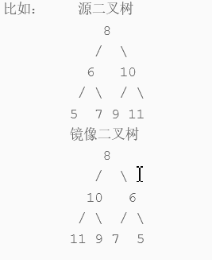

输入：{8,6,10,5,7,9,11}返回值：{8,10,6,11,9,7,5}

```
/**
 * struct TreeNode {
 *	int val;
 *	struct TreeNode *left;
 *	struct TreeNode *right;
 *	TreeNode(int x) : val(x), left(nullptr), right(nullptr) {}
 * };
 */
class Solution {
public:
    TreeNode* Mirror(TreeNode* root) {
        // write code here
         if(!root)
             return NULL ;
        stack<TreeNode*> st ;
        st.push(root) ;
        while(!st.empty()){
            TreeNode * tmp = st.top() ;
            st.pop() ;
            // 层次遍历的操作
            TreeNode *left = tmp->left ;
            tmp->left = tmp->right ;
            tmp->right = left ;
            if(tmp->left)
                st.push(tmp->left) ;
            if(tmp->right)
                st.push(tmp->right) ;
        }
        return root  ; 
    }
};

//
//    if(R==NULL)
//             return NULL;
//         Mirror(R->left) ;   // 先序遍历 
//         TreeNode *temp = R->left;
//         R->left = R->right;
//         R->right = temp;
//         Mirror(R->left) ;   // 左子树和右子树已近交换 。 
//         return R ;
```

### 19： 顺时针打印矩阵

输入一个矩阵，按照从外向里以顺时针的顺序依次打印出每一个数字，例如，如果输入如下4 X 4矩阵： 1 2 3 4 5 6 7 8 9 10 11 12 13 14 15 16 则依次打印出数字1,2,3,4,8,12,16,15,14,13,9,5,6,7,11,10.

```
class Solution {
public:
    vector<int> printMatrix(vector<vector<int> > matrix) {
        // 一定要判断边界条件 
        int rows = matrix.size() ;
        int cols  = matrix[0].size() ;
        vector<int > res ;
        int left= 0 ;
        int right = cols-1 ;
        int low = 0 ;
        int hig = rows -1 ;
         if (rows == 0 || cols == 0)  return res;
        while(left <=right && low <= hig){
            //向右
            for(int i = left ; i <=right ;i++)
                res.push_back(matrix[low][i]) ;
            //向下 
            for(int j =low+1 ;j<= hig ;j++)
                 res.push_back(matrix[j][right]) ;
            // 向左
            if(low <hig ){
                for(int i = right -1 ; i>=left ;i--)
                    res.push_back(matrix[hig][i]);
            }
            // 向上
            if(left<right){
                for(int j=hig -1 ; j>=low +1 ;j--)
                 res.push_back(matrix[j][left]);
            }
            low++ ;
            hig-- ;
            left ++ ;
            right -- ;
        }
  
        return res ;
    }
};
```

### 20： 包含min函数的栈

定义栈的数据结构，请在该类型中实现一个能够得到栈中所含最小元素的min函数（时间复杂度应为O（1））。

```
class Solution {
public:
    public :
    stack<int> s1 ;
    stack<int> s2 ;
    void push(int value) {
        s1.push(value);
        if(s2.empty() || s2.top()>value)
            s2.push(value) ;
    }
    void pop() {
        int tmp = s1.top() ;
        s1.pop() ;
        if(s2.top() == tmp)
            s2.pop() ;
    }
    int top() {
        return s1.top() ;
    }
    int min() {
      return  s2.top();
    }
};
```

### 21： 栈的压入，弹出序列

输入两个整数序列，第一个序列表示栈的压入顺序，请判断第二个序列是否可能为该栈的弹出顺序。假设压入栈的所有数字均不相等。例如序列1,2,3,4,5是某栈的压入顺序，序列4,5,3,2,1是该压栈序列对应的一个弹出序列，但4,3,5,1,2就不可能是该压栈序列的弹出序列。（注意：这两个序列的长度是相等的）

示例1

输入：[1,2,3,4,5],[4,3,5,1,2]

返回值：false

```
class Solution {
public:
    bool IsPopOrder(vector<int> pushV,vector<int> popV) {
        stack<int> tmp ;
        int i = 0 ;
        int j = 0 ;
        for(i = 0 ;i< pushV.size() ; i++){
            tmp.push(pushV[i]) ;
            while(!tmp.empty() && tmp.top() == popV[j]){
                tmp.pop() ;
                j++ ;
            }
        }
       return tmp.empty() ;
     
    }
};
```

### 22： 从上往下打印二叉树

从上往下打印出二叉树的每个节点，同层节点从左至右打印。

```
输入：{5,4,#,3,#,2,#,1}返回值：[5,4,3,2,1]
/*
struct TreeNode {
	int val;
	struct TreeNode *left;
	struct TreeNode *right;
	TreeNode(int x) :
			val(x), left(NULL), right(NULL) {
	}
};*/
class Solution {
public:
    vector<int> PrintFromTopToBottom(TreeNode* root) {
            queue<TreeNode *> que ;
            vector<int > res ;
             if(!root)
                 return res ;
            que.push(root);
            while(!que.empty()){
                TreeNode * node = que.front() ;
                 res.push_back(node->val);
                 que.pop() ;
                if(node->left)
                    que.push(node->left);
                 if(node->right)
                    que.push(node->right);
            }
             return res ;    
    }
};

```

### 23： 二叉搜索树的后序遍历

输入一个整数数组，判断该数组是不是某二叉搜索树的后序遍历的结果。如果是则返回true,否则返回false。假设输入的数组的任意两个数字都互不相同。（ps：我们约定空树不是二叉搜素树）

```
输入：[4,8,6,12,16,14,10]
返回值：true
class Solution {
public:
    vector<int >seq ;
    bool VerifySquenceOfBST(vector<int> sequence) {
       int n =sequence.size()-1; 
       int begin = 0 ;
        if(sequence.empty())
            return false ;
        while(n){
            while( sequence[begin]< sequence[n])
                begin++ ;
            while(sequence[begin]>sequence[n])
                begin++ ;
            if(begin< n)
                return false ;
            n -- ;
            begin = 0 ;
        }
        return true ;
    }
};

```

### 24： 二叉树中和为某一值得路径

输入一颗二叉树的根节点和一个整数，按字典序打印出二叉树中结点值的和为输入整数的所有路径。路径定义为从树的根结点开始往下一直到叶结点所经过的结点形成一条路径

```
/*
struct TreeNode {
	int val;
	struct TreeNode *left;
	struct TreeNode *right;
	TreeNode(int x) :
			val(x), left(NULL), right(NULL) {
	}
};*/
class Solution {
public:
    vector<vector<int >>res ;
        vector<int > path ;
    vector<vector<int> > FindPath(TreeNode* root,int expectNumber) {
        dfs(root,  expectNumber);
        return res ;
        
    }
    void dfs(TreeNode *root , int expectNumber){
        if(!root)
            return ;
        expectNumber -=root->val ;
        path.push_back(root->val) ;
        if(expectNumber==0 && !root->left&&!root->right)
            res.push_back(path) ;
        dfs(root->left,  expectNumber);
        dfs(root->right,  expectNumber);
        path.pop_back() ;
    }
};
```

### 25： 复杂链表的复制

输入一个复杂链表（每个节点中有节点值，以及两个指针，一个指向下一个节点，另一个特殊指针random指向一个随机节点），请对此链表进行深拷贝，并返回拷贝后的头结点。（注意，输出结果中请不要返回参数中的节点引用，否则判题程序会直接返回空）

```
/*
struct RandomListNode {
    int label;
    struct RandomListNode *next, *random;
    RandomListNode(int x) :
            label(x), next(NULL), random(NULL) {
    }
};
*/
class Solution {
public:
    RandomListNode* Clone(RandomListNode* pHead) {
        if(!pHead)
            return NULL ;
        RandomListNode *cur = pHead ;
        // 1 第1步复制 next 
        while(cur){
            RandomListNode *clone = new RandomListNode(cur->label) ;
            clone->next =cur->next ;
            cur->next = clone ;
            cur = clone->next ;
        }
        // 2 ： 第2 步： 复制random
        cur = pHead ;
        while(cur){
            if(cur->random)
                cur->next->random = cur->random->next ; // cur->random 当前节点 -》next当前节点复制的节点
            cur = cur->next->next ;
        }
        RandomListNode  *pre =pHead ;
        cur = pre->next ;
        RandomListNode *res = cur ;
        // 拆开 
        while(cur->next){
            pre->next  = pre->next->next ;
            cur->next = cur->next->next ;
            pre = pre->next ;
            cur = cur->next ;
        }
        pre->next = NULL ;
        return res ;
    }
};
```

### 26： 二叉搜索树与双向链表

输入一棵二叉搜索树，将该二叉搜索树转换成一个排序的双向链表。要求不能创建任何新的结点，只能调整树中结点指针的指向

```
/*
struct TreeNode {
	int val;
	struct TreeNode *left;
	struct TreeNode *right;
	TreeNode(int x) :
			val(x), left(NULL), right(NULL) {
	}
};*/
class Solution {
public:
     TreeNode *pre =NULL ;
    TreeNode* Convert(TreeNode* root) {
        if(root==NULL)
            return NULL ;
        Convert(root->right) ;
        if(pre){
            root->right = pre ;
            pre->left = root ;
        }
        pre =  root ;
        Convert(root->left) ;
        return pre ;
    }   
};
```

### 27： 字符串的排列

输入一个字符串,按字典序打印出该字符串中字符的所有排列。例如输入字符串abc,则按字典序打印出由字符a,b,c所能排列出来的所有字符串abc,acb,bac,bca,cab和cba。

```
class Solution {
public:
    vector<string> res ;
     set<string> tmp ;
    vector<string> Permutation(string str) {
       
        if(str.empty())
            return {}  ;
        perm(0,str) ;
        return vector<string>({tmp.begin() ,tmp.end()});
        
        
    }
    void perm(int pos , string s  ){
        if(pos+1 == s.length()){
             tmp.insert(s) ;
            return ; 
        } 
        // for循环和swap的含义：对于“ABC”，
        // 第一次'A' 与 'A'交换，字符串为"ABC", pos为0， 相当于固定'A'
        // 第二次'A' 与 'B'交换，字符串为"BAC", pos为0， 相当于固定'B'
        // 第三次'A' 与 'C'交换，字符串为"CBA", pos为0， 相当于固定'C
        for(int i = pos ; i<s.length() ;i++){
            swap(s[pos],s[i]) ;
            perm(pos+1, s) ;
            swap(s[pos], s[i]) ;
            // 回溯的原因：比如第二次交换后是"BAC"，需要回溯到"ABC"
            // 然后进行第三次交换，才能得到"CBA"
        }
    }
};
```

### 28： 数组中出现次数超过一半的数字

数组中有一个数字出现的次数超过数组长度的一半，请找出这个数字。例如输入一个长度为9的数组[1,2,3,2,2,2,5,4,2]。由于数字2在数组中出现了5次，超过数组长度的一半，因此输出2。你可以假设数组是非空的，并且给定的数组总是存在多数元素。1<=数组长度<=50000

```
class Solution {
public:
    int MoreThanHalfNum_Solution(vector<int> numbers) {
        unordered_map<int, int > map ;
        int n = numbers.size() ;
        for(int i =0 ;i<n ;i++){
            map[numbers[i]] +=1;
        }
        int res = map[numbers[0]] ;
        int  v = numbers[0] ;
        for(int i = 1 ;i<n ;i++){
            if( map[numbers[i]]> res) {
                 res = map[numbers[i]] ;
                 v = numbers[i];
            }
            
        }
        if(res > n /2)
            return v  ;
        return 0 ; 
    }
};
```

### 29： 最小的k个数

给定一个数组，找出其中最小的K个数。例如数组元素是4,5,1,6,2,7,3,8这8个数字，则最小的4个数字是1,2,3,4。如果K>数组的长度，那么返回一个空的数组

```
输入：[4,5,1,6,2,7,3,8],4 返回值：[1,2,3,4]
class Solution {
public:
    vector<int> GetLeastNumbers_Solution(vector<int> input, int k) {
        vector<int> res ;
        if(k>input.size() || k<=0)
            return res ;
        sort(input.begin(), input.end()) ;
        for(int i = 0 ; i< k ;i++){
             res.push_back(input[i]) ;
        }
        return res ;
    }
};
```

### 30： 连续子数组的最大和

输入一个整型数组，数组里有正数也有负数。数组中的一个或连续多个整数组成一个子数组。求所有子数组的和的最大值。要求时间复杂度为 O(n).

```
输入：[1,-2,3,10,-4,7,2,-5] 返回值：18
说明：
输入的数组为{1,-2,3,10,—4,7,2,一5}，和最大的子数组为{3,10,一4,7,2}，因此输出为该子数组的和 18。
class Solution {
public:
    int FindGreatestSumOfSubArray(vector<int> array) {
        int n  = array.size();
        vector<int> dp(n+1 ,0) ;
        int res =array[0] ; 
        for(int i=0 ;i<n ;i++){
            dp[i] =max(array[i] ,dp[i-1]+array[i]) ;
            res = max(dp[i] ,res ) ;
        }
        return res ;
    }
};
```

### 31： 整数中1出现的次数

输入一个整数 n ，求1～n这n个整数的十进制表示中1出现的次数
 例如，1~13中包含1的数字有1、10、11、12、13因此共出现6次

```
输入：13返回值：6
class Solution {
public:
    int f1(int n ){
        int res = 0 ;
        if(n==1)
            return 1 ;
        while(n){
            int t = n %10 ;
            if(t ==1)
                res ++ ;
            n /=10 ; 
        }
        return res ;
    }
    int NumberOf1Between1AndN_Solution(int n) {
        int sum = 0 ;
        for(int i=1 ;i<=n ;i++){
            sum+=f1(i);
        }
        return  sum ;
    }
};

```

### 32： 把数组排成最小的数

输入一个正整数数组，把数组里所有数字拼接起来排成一个数，打印能拼接出的所有数字中最小的一个。例如输入数组{3，32，321}，则打印出这三个数字能排成的最小数字为321323。

```
输入：[3,32,321]返回值："321323"
# -*- coding:utf-8 -*-
class Solution:
    def PrintMinNumber(self, numbers):
        # write code here
        s=''
        n = len(numbers)
        for i in range(n):
            for j in range(i+1,n):
                s1 = str(numbers[i]) + str(numbers[j])
                s2 = str(numbers[j]) + str(numbers[i])
                s1 = int(s1) 
                s2 = int (s2)
                if s1 > s2 :
                    tmp = numbers[j]
                    numbers[j] = numbers[i]
                    numbers[i] = tmp 
        for item in numbers:
            s += str(item)
        return s 

```

33： 丑数

把只包含质因子2、3和5的数称作丑数（Ugly Number）。例如6、8都是丑数，但14不是，因为它包含质因子7。 习惯上我们把1当做是第一个丑数。求按从小到大的顺序的第N个丑数。

```
输入：7 返回值：8
class Solution {
public:
    int GetUglyNumber_Solution(int index) {
        vector<int> r(1,1) ;
        if(index < 7)
            return index ;
        int i = 0 ;
        int j = 0 ;
        int k = 0 ; 
     
        while(--index){
            int t =min(5*r[k] , min(2*r[i],3*r[j]) );
               r.push_back(t) ;
             if(t==r[i]*2) i++ ;
              if(t==r[j]*3) j++ ;
              if(t==r[k]*5) k++ ;
            
        }
        return r.back();
    }
};
```

### 34： 第一个只出现一次的字符位置

在一个字符串(0<=字符串长度<=10000，全部由字母组成)中找到第一个只出现一次的字符,并返回它的位置, 如果没有则返回 -1（需要区分大小写）.（从0开始计数）

```
输入："google" 返回值：4
class Solution {
public:
    int FirstNotRepeatingChar(string str) {
        unordered_map<char, int > mp ;
        for(const char ch : str){
             ++mp[ch] ;
        }
        for(int i = 0 ;i<str.length();i++){
            if(mp[str[i]]==1)
                return i ;
        }
        return -1 ;
    }
};
```

### 35： 数组中的逆序对

  在数组中的两个数字，如果前面一个数字大于后面的数字，则这两个数字组成一个逆序对。输入一个数组,求出这个数组中的逆序对的总数P。并将P对1000000007取模的结果输出。  即输出P%1000000007 

  对于50%5050%的数据,size≤104size\leq 10^4size≤104
 对于75%7575%的数据,size≤105size\leq 10^5size≤105
 对于100%100100%的数据,size≤2∗105size\leq 2*10^5size≤2∗105

```
输入：[1,2,3,4,5,6,7,0] 返回值：7
1: 暴力
class Solution {
private:
    const int kmod = 1000000007;
public:
    int InversePairs(vector<int> data) {
        int ret = 0;
        int n = data.size();
        for (int i = 0; i < n; ++i) {
            for (int j = i + 1; j < n; ++j) {
                if (data[i] > data[j]) {
                    ret += 1;
                    ret %= kmod;
                }
            }
        }
 
        return ret;
    }
};
2： 并规排序
class Solution {
private:
    const int kmod = 1000000007;
public:
    int InversePairs(vector<int> data) {
        int ret = 0;
        // 在最外层开辟数组
        vector<int> tmp(data.size());
        merge_sort__(data, tmp, 0, data.size() - 1, ret);
        return ret;
    }

    void merge_sort__(vector<int> &arr, vector<int> &tmp, int l, int r, int &ret) {
        if (l >= r) {
            return;
        }

        int mid = l + ((r - l) >> 1);
        merge_sort__(arr, tmp, l, mid, ret);
        merge_sort__(arr, tmp, mid + 1, r, ret);
        merge__(arr, tmp, l, mid, r, ret);
    }

    void merge__(vector<int> &arr, vector<int> &tmp, int l, int mid, int r, int &ret) {
        int i = l, j = mid + 1, k = 0;

        while (i <= mid && j <= r) {
            if (arr[i] > arr[j]) {
                tmp[k++] = arr[j++];
                ret += (mid - i + 1);
                ret %= kmod;
            }
            else {
                tmp[k++] = arr[i++];
            }
        }

        while (i <= mid) {
            tmp[k++] = arr[i++];
        }
        while (j <= r) {
            tmp[k++] = arr[j++];
        }
        for (k = 0, i = l; i <= r; ++i, ++k) {
            arr[i] = tmp[k];
        }
    }

};
```

### 36：两个链表的第1个公共节点

输入两个无环的单链表，找出它们的第一个公共结点。（注意因为传入数据是链表，所以错误测试数据的提示是用其他方式显示的，保证传入数据是正确的）

```
/*
struct ListNode {
	int val;
	struct ListNode *next;
	ListNode(int x) :
			val(x), next(NULL) {
	}
};*/
class Solution {
public:
    ListNode* FindFirstCommonNode( ListNode* pHead1, ListNode* pHead2) {
        ListNode *res ,*tmp ;
        while(pHead1){
            tmp = pHead2 ;
            while(tmp){
                 if(pHead1->val == tmp->val){
                res =  tmp ;
                return res ;
                }
                else tmp = tmp->next ;
            }
            pHead1 = pHead1->next ;  
        }
        return NULL ;
    }
};
```

### 37： 数字在排列数组中出现的次数  二分查找

统计一个数字在升序数组中出现的次数。

```
输入：[1,2,3,3,3,3,4,5],3 返回值：4
class Solution {
public:
    int GetNumberOfK(vector<int> data ,int k) {
        int res = 0 ;
        int n = data.size() ;
        if(0==n)
            return res ;
        int left = 0  ;
        int right = n-1 ;
        while(left<=right){
            int mid = (left + left) /2 ;
            if(data[mid] == k){
                int i = mid-1 ;
                int j = mid +1 ;
                res  =1 ;
                while(data[i]==k){
                     res ++ ;
                    i-- ;
                }
                while(data[j]==k){
                    res ++ ;
                    j++ ;
                }
                return res ;
                
            }
            else if(data[mid]> k){
                right = mid -1 ;
            }
            else{
                left = mid+1 ;
            }
        }
        return res ;
    }
};
```

### 38： 二叉树的深度

输入一棵二叉树，求该树的深度。从根结点到叶结点依次经过的结点（含根、叶结点）形成树的一条路径，最长路径的长度为树的深度。

```
输入：{1,2,3,4,5,#,6,#,#,7}返回值：4
/*
struct TreeNode {
	int val;
	struct TreeNode *left;
	struct TreeNode *right;
	TreeNode(int x) :
			val(x), left(NULL), right(NULL) {
	}
};*/
class Solution {
public:
    int TreeDepth(TreeNode* pRoot) {
         queue<TreeNode *> que ;
         vector<int> visit ;
        if(!pRoot)
            return 0 ;
          int dep = 0 ;
         que.push(pRoot);
        while(!que.empty()){
            int sz = que.size() ;
            while(sz--){
                TreeNode *node = que.front() ;
                que.pop() ;
              if(node->left)
                que.push(node->left) ;
            if(node->right)
                  que.push(node->right) ;
            }
             dep++ ;
        }   
        return dep ;
    }
};
```

### 39： 平衡二叉树

  输入一棵二叉树，判断该二叉树是否是平衡二叉树。 

  在这里，我们只需要考虑其平衡性，不需要考虑其是不是排序二叉树 

  **平衡二叉树**（Balanced Binary Tree），具有以下性质：它是一棵空树或它的左右两个子树的高度差的绝对值不超过1，并且左右两个子树都是一棵平衡二叉树。

```
输入：{1,2,3,4,5,6,7}返回值：true
class Solution {
public:
    bool IsBalanced_Solution(TreeNode* pRoot) {
        if(!pRoot)
            return true ;
        int res = depth(pRoot) ;
        
        return res !=-1;
        
    }
    int  depth(TreeNode * root){
        if(root==NULL )
            return 0 ;
        int left = depth(root->left) ;
        if(left == -1)
            return -1 ;
        int right = depth(root->right) ;
        if(right==-1)
            return -1 ;
        if( abs(left -right)>1)
            return -1 ;
        return 1+(left >right ?left :right) ;
    }
    
};
```

### 40： 数组中只出现一次的数字

一个整型数组里除了两个数字只出现一次，其他的数字都出现了两次。请写程序找出这两个只出现一次的数字。

```
输入：[1,4,1,6]返回值：[4,6]说明：返回的结果中较小的数排在前面 
class Solution {
public:
    vector<int> FindNumsAppearOnce(vector<int>& array) {
        // write code here
        vector<int> res ;
        int n = array.size() ;
        vector<int>map(n,1) ;
        for(int i = 0 ;i <n ; i++){
            int flag = 1 ;
            if(map[i]==0)
                continue ;
            for(int j= i+1 ;j<n ;j++){
                if(array[i]==array[j]){
                    flag = 0 ;
                    map[j] = 0 ;
                    break ;
                }
            }
            if(flag  ==1 )
                res.push_back(array[i]) ;
        }
        return res ;
    }
};
```

### 41： 和为S的连续正数序列

小明很喜欢数学,有一天他在做数学作业时,要求计算出9~16的和,他马上就写出了正确答案是100。但是他并不满足于此,他在想究竟有多少种连续的正数序列的和为100(至少包括两个数)。没多久,他就得到另一组连续正数和为100的序列:18,19,20,21,22。现在把问题交给你,你能不能也很快的找出所有和为S的连续正数序列? Good Luck!

```
输入：9 返回值： [[2,3,4],[4,5]]
class Solution {
public:
    vector<vector<int> > FindContinuousSequence(int sum) {
        vector<vector<int> >  res  ;
        int i , j ;
        for( i = 1 ;i< sum-1 ;i++){
            int temp  = sum ;
             j = i ;
            while(temp>0){
                temp -=j ;
                if(temp == 0){
                    vector<int> r ;
                    for(int k =i ;k<=j ; k++)
                        r.push_back(k) ;
                    res.push_back(r) ;
                    break ;
                }
                 j++ ;
            }
            
        }
       return res ; 
    }
};
```

### 42： 和为S的两个数字

输入一个递增排序的数组和一个数字S，在数组中查找两个数，使得他们的和正好是S，如果有多对数字的和等于S，输出两个数的乘积最小的。

```
输入：[1,2,4,7,11,15],15返回值：[4,11]
class Solution {
public:
    vector<int> FindNumbersWithSum(vector<int> array,int sum) {
        int n = array.size();
        vector<int>res(2,0) ;
        int mul = 999999;
        for(int i = 0 ;i < n ;i++){
            for(int j= i+1 ; j< n ;j++){
                if(sum ==array[i]+array[j]){
                    if(array[i]*array[j]<mul){
                        mul = array[i]*array[j] ;
                        res[0] = array[i] ;
                        res[1] =array[j] ;
                     }
                }
            }
        }
        if(res[0]==0){
            res.pop_back() ;
            res.pop_back() ;
             return res ;
        }     
        return res ;  
    }
};

```

### 43：左旋转字符串

汇编语言中有一种移位指令叫做循环左移（ROL），现在有个简单的任务，就是用字符串模拟这个指令的运算结果。对于一个给定的字符序列S，请你把其循环左移K位后的序列输出。例如，字符序列S=”abcXYZdef”,要求输出循环左移3位后的结果，即“XYZdefabc”。是不是很简单？OK，搞定它！

```
输入："abcXYZdef",3返回值："XYZdefabc"
class Solution {
public:
    string LeftRotateString(string str, int n) {
        if(str.size() == 0)
            return "" ;
        reverse(str.begin(),str.end()) ;
        reverse(str.begin(), str.end()  - n) ;
        reverse(str.end() - n, str.end()) ;
        return str ;
    }
};
```

### 44：翻转单词序列

牛客最近来了一个新员工Fish，每天早晨总是会拿着一本英文杂志，写些句子在本子上。同事Cat对Fish写的内容颇感兴趣，有一天他向Fish借来翻看，但却读不懂它的意思。例如，“nowcoder. a am I”。后来才意识到，这家伙原来把句子单词的顺序翻转了，正确的句子应该是“I am a  nowcoder.”。Cat对一一的翻转这些单词顺序可不在行，你能帮助他么？

```
输入："nowcoder. a am I"返回值："I am a nowcoder."
class Solution {
public:
    string ReverseSentence(string str) {
        string res ;
        string temp ;
        for(auto c : str){
            if(c ==' '){
                res  =temp + ' ' + res ;
                temp  ="" ;
            }
            else{
                temp +=c ;
            }
        }
        res = temp + ' '+res ;
        res = res.substr(0,res.size() -1) ;
        return res ;
    }
};
```

### 45：派克牌顺子

现在有2副扑克牌，从扑克牌中随机五张扑克牌，我们需要来判断一下是不是顺子。
 有如下规则：

1. A为1，J为11，Q为12，K为13，
2. A不能视为14大、小王为
3. 0，0可以看作任意牌

如果给出的五张牌能组成顺子（即这五张牌是连续的）就输出true，否则就输出false。
 例如：给出数据[6,0,2,0,4]
 中间的两个0一个看作3，一个看作5 。即：[6,3,2,5,4]
 这样这五张牌在[2,6]区间连续，输出true
 数据保证每组5个数字，每组最多含有4个零，数组的数取值为 [0, 13]

```
输入：[6,0,2,0,4]返回值：true
#include<algorithm>
class Solution {
public:
    bool IsContinuous( vector<int> numbers ) {
      
      if(numbers.empty())
          return false ;
       sort(numbers.begin() ,numbers.end()) ;
       int i = 0 ;
       int n = numbers.size() ;
        for(int j = 0 ; j<n ;j++){
            if(numbers[j] == 0){
                 i++ ;
                continue ;
            }
            if(j+1 <n && numbers[j]==numbers[j+1])
                return false ;
        }
        return numbers.back() - numbers[i] <5 ;
    }
};

```

### 46：孩子们的游戏（圆圈中最后剩下的数）

每年六一儿童节,牛客都会准备一些小礼物去看望孤儿院的小朋友,今年亦是如此。HF作为牛客的资深元老,自然也准备了一些小游戏。其中,有个游戏是这样的:首先,让小朋友们围成一个大圈。然后,他随机指定一个数m,让编号为0的小朋友开始报数。每次喊到m-1的那个小朋友要出列唱首歌,然后可以在礼品箱中任意的挑选礼物,并且不再回到圈中,从他的下一个小朋友开始,继续0...m-1报数....这样下去....直到剩下最后一个小朋友,可以不用表演,并且拿到牛客名贵的“名侦探柯南”典藏版(名额有限哦!!^_^)。请你试着想下,哪个小朋友会得到这份礼品呢？(注：小朋友的编号是从0到n-1) 

```
输入：5,3返回值：3
class Solution {
public:
    int LastRemaining_Solution(int n, int m) {
          if(n==0)
              return -1 ;
         if(n==1)
             return 0 ;
        else 
            return (LastRemaining_Solution(n-1, m)+m)%n ;
    }
};
```

### 47：求1+2+3+....+n

求1+2+3+...+n，要求不能使用乘除法、for、while、if、else、switch、case等关键字及条件判断语句（A?B:C）。

```
class Solution {
public:
    int Sum_Solution(int n) {
        return n*(n+1) / 2;
    }
};
```

### 48：不用加减乘除做加法

写一个函数，求两个整数之和，要求在函数体内不得使用+、-、*、/四则运算符号。

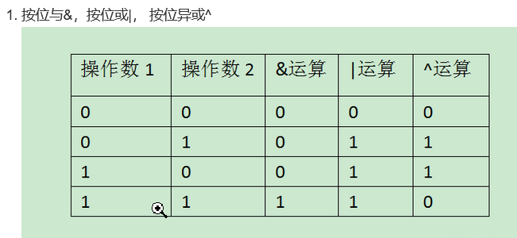

```
class Solution {
public:
    int Add(int num1, int num2) {
       while(num2!=0){
           int c = ((unsigned)(num1 &num2) )<<1 ;
           num1 ^= num2 ;
           num2 = c; 
       }
        return num1 ;
    }
};
```

### 49：把字符串转换成整数

将一个字符串转换成一个整数，要求不能使用字符串转换整数的库函数。        数值为0或者字符串不是一个合法的数值则返回0

```
输入："+2147483647"返回值：2147483647
class Solution {
public:
    int StrToInt(string str) {
        int  res ;
        string temp ;
        int n  =str.size() ;
        int i = 0 ;
        char mark ;
        if(str[0]<='9' && str[0]>='0')
            i =1 ;
        for(auto c :str){
            if(i==0){
             i++ ;
             mark = c ;
               continue ; 
            }
            if(c<='9'&&c >='0'){
                temp +=c;
            }
            else{
                return 0 ;
            }
        }
       res = atoi(temp.c_str());
        if(mark =='-')
            res = -res ;
        return res ;
    }
};
```

### 50：数组中重复的数字

在一个长度为n的数组里的所有数字都在0到n-1的范围内。  数组中某些数字是重复的，但不知道有几个数字是重复的。也不知道每个数字重复几次。请找出数组中任一一个重复的数字。  例如，如果输入长度为7的数组[2,3,1,0,2,5,3]，那么对应的输出是2或者3。存在不合法的输入的话输出-1

```
输入：[2,3,1,0,2,5,3]返回值：2
说明：2或3都是对的 
class Solution {
public:
      替换法：
      数组按照顺序 [a1 ,a2 ,a3, ... an]
      每个位置a[i]  = i  ,  否则就替换 a[i] = a[a[i]] 
       C++ 
       set: 不重复数组
       map:   k-v ++ 当 >1 返回数字
    
    */
    int duplicate(vector<int>& numbers) {
        // write code here
        int n = numbers.size() ;
        for(int i = 0 ;i< n ;i++){
            while(numbers[i]!=i){
                if(numbers[i] == numbers[numbers[i]])
                    return numbers[i];
                 else 
                     swap(numbers[i],numbers[numbers[i]]) ;
            }
        }
        return -1 ;
    }
};
```

### 51： 构建乘积数组

   给定一个数组A[0,1,...,n-1],请构建一个数组B[0,1,...,n-1],其中B中的元素B[i]=A[0]*A[1]*...*A[i-1]*A[i+1]*...*A[n-1]。不能使用除法。（注意：规定B[0] = A[1] * A[2] * ... * A[n-1]，B[n-1] = A[0] * A[1] * ... * A[n-2];） 

```
输入：[1,2,3,4,5]返回值：[120,60,40,30,24]
class Solution {
public:
    vector<int> multiply(const vector<int>& A) {
        vector<int> res ;
        int n = A.size() ;
        if(n<=1)
            return res ;
        for(int i = 0 ; i< n ;i++){
             int temp =1 ;
            for(int j = 0 ;j<n ;j++){
                if(i!=j){
                    temp *=A[j] ;
                }
            }
            res.push_back(temp) ;
        }
        return res ;
    }
};
```

### 52： 正则表达式

请实现一个函数用来匹配包括'.'和'*'的正则表达式。模式中的字符'.'表示任意一个字符，而'*'表示它前面的字符可以出现任意次（包含0次）。  在本题中，匹配是指字符串的所有字符匹配整个模式。例如，字符串"aaa"与模式"a.a"和"ab*ac*a"匹配，但是与"aa.a"和"ab*a"均不匹配

```
输入："aaa","a*a"返回值：true
class Solution {
public:
    bool match(string str, string pattern) {
        // write code here
        int n = str.size() ;
        int m = pattern.size() ;
        vector<vector<bool> > dp(n+1 ,vector<bool>(m+1));
        dp[0][0] = true ;
        for(int i =1 ;i<m+1;i++){
            if(pattern[i-1]=='*')
                dp[0][i] = dp[0][i-2] ;
        }
        for(int i = 1 ;i< n+1;i++){
            for(int j =1 ;j< m+1 ;j++){
              
                 if(pattern[j-1]=='*'){
                     if(str[i-1] == pattern[j-2] || pattern[j-2]=='.')
                           dp[i][j] =dp[i-1][j] || dp[i][j-2];
                    else 
                        dp[i][j] =dp[i][j-2] ;
                }
            }
            return dp[m][n] ;
        }
    }
};
```

### 53： 表示数值的字符串

请实现一个函数用来判断字符串是否表示数值（包括整数和小数）。例如，字符串"+100","5e2","-123","3.1416"和"-1E-16"都表示数值。 但是"12e","1a3.14","1.2.3","+-5"和"12e+4.3"都不是。

```
/*
   参考剑指offer,改动了一些小部分。
    数值可以表示为 A[.[B]]e|E[C]
    其中A 和C 可以带有正负号，B不能带有符号
    A可以没有，B也可以没有，不过在'.'的情况下
    在e|E ，B是必须有的，所以这就是在判断str[index]=='.' 和str[index]=='e'||             
    str[index]=='E'时是使用不同运算符的原因。
    然后分解成两个函数小函数我觉得可读性强一点，毕竟代码给人看的，想看细节的同学
    请移步剑指offer官方书籍。
*/
class Solution {
public:
   
    bool isNumeric(string str) {
        // write code here
        if(str.empty()) return false;
        size_t index=0;
        bool numeric=scanInteger(str,index);
        if(str[index]=='.'){
            ++index;
            bool hasNumbers=scanUnsignedInteger(str,index);
            numeric=hasNumbers || numeric;
        }
        if(str[index]=='e'|| str[index]=='E'){
            ++index;
            numeric=numeric && scanInteger(str,index);
        }
        return numeric && (index==str.size());

    }
    bool scanInteger(string& str,size_t& index){
        if(str[index]=='+'||str[index]=='-')
            ++index;
        return scanUnsignedInteger(str,index);
    }
    bool scanUnsignedInteger(string& str,size_t& index){
        size_t begin=index;
        while(str[index]!='\0' && str[index]>='0'&& str[index]<='9')
            ++index;
        return index>begin;
    }
};
```

### 54： 字符流中第一个不重复的字符

  请实现一个函数用来找出字符流中第一个只出现一次的字符。例如，当从字符流中只读出前两个字符"go"时，第一个只出现一次的字符是"g"。当从该字符流中读出前六个字符“google"时，第一个只出现一次的字符是"l"。 

  后台会用以下方式调用Insert 和 FirstAppearingOnce 函数  

```
class Solution
{
public:
  //Insert one char from stringstream
      queue<char> que ;
      unordered_map<char, int > mp ;
    void Insert(char ch) {
        if(mp.find((ch))==mp.end()){
            que.push(ch) ;
        }
        mp[ch]++ ;
        
    }
  //return the first appearence once char in current stringstream
    char FirstAppearingOnce() {
        while(!que.empty()){
            char ch = que.front() ;
            if(mp[ch]==1)
                return ch ;
            else 
                que.pop() ;
        }
        return '#' ;
    }
};
```

### 55： 链表中环的入口位置

给一个链表，若其中包含环，请找出该链表的环的入口结点，否则，输出null

```
/*
struct ListNode {
    int val;
    struct ListNode *next;
    ListNode(int x) :
        val(x), next(NULL) {
    }
};
*/
class Solution {
public:
    ListNode* EntryNodeOfLoop(ListNode* pHead) {
        ListNode *fast = pHead;
        ListNode *slow  = pHead;
        while(fast && fast->next ){
            fast = fast->next->next ;
            slow = slow->next ;
            if(fast == slow ){
               ListNode * slow2 = pHead ;
                while(slow2!=slow){
                    slow2 = slow2->next ;
                    slow = slow->next ;
                    
                }
                return slow2 ;
            }
        }
        return NULL ;
      }

};
```

### 56： 删除链表中重复的节点

在一个排序的链表中，存在重复的结点，请删除该链表中重复的结点，重复的结点不保留，返回链表头指针。 例如，链表1->2->3->3->4->4->5 处理后为 1->2->5

```
输入：{1,2,3,3,4,4,5}返回值：{1,2,5}
/*
struct ListNode {
    int val;
    struct ListNode *next;
    ListNode(int x) :
        val(x), next(NULL) {
    }
};
*/
class Solution {
public:
    ListNode* deleteDuplication(ListNode* pHead) {
        ListNode *head = new ListNode(0) ;
        head->next = pHead ;
        ListNode *pre = head ;
        ListNode *cur = pHead ;
        while(cur){
             if(cur->next && cur->val == cur->next->val){
                  cur =cur->next ;
                 while(cur->next && cur->val == cur->next->val){
                     cur = cur->next; 
                 }
                 cur = cur->next ;
                 pre->next = cur ;
             }
            else{
                pre = cur ;
                cur = cur->next ;
            }
        }
        return head->next ;
    }
};

```

### 57： 二叉树的下一个节点

给定一个二叉树其中的一个结点，请找出中序遍历顺序的下一个结点并且返回。注意，树中的结点不仅包含左右子结点，同时包含指向父结点的next指针

```
/*
struct TreeLinkNode {
    int val;
    struct TreeLinkNode *left;
    struct TreeLinkNode *right;
    struct TreeLinkNode *next;
    TreeLinkNode(int x) :val(x), left(NULL), right(NULL), next(NULL) {
    }
};
*/
class Solution {
public:
    TreeLinkNode* GetNext(TreeLinkNode* pNode) {
        if(!pNode)
            return pNode ;
        if(pNode->right){
            pNode = pNode->right ;
            while(pNode->left)
                pNode = pNode->left ;
            return pNode ;
        }
        while(pNode->next){
            TreeLinkNode *root = pNode->next ;
            if(root->left ==pNode)
                return root ;
            pNode = pNode->next ;
        }
  return nullptr ; 
    }
};
```

### 58： 对称二叉树

实现一个函数，用来判断一棵二叉树是不是对称的。注意，如果一个二叉树同此二叉树的镜像是同样的，定义其为对称的。

```
输入：{8,6,6,5,7,7,5}返回值：true
class Solution {
public:
    bool isSame(TreeNode *root1, TreeNode *root2) {
        if (!root1 && !root2) return true;
        if (!root1 || !root2) return false;
        return root1->val == root2->val && 
        isSame(root1->left, root2->right) &&
        isSame(root1->right, root2->left);
    }
    bool isSymmetrical(TreeNode* pRoot)
    {
        return isSame(pRoot, pRoot);
    }
};
```

### 59：按之字型打印二叉树

请实现一个函数按照之字形打印二叉树，即第一行按照从左到右的顺序打印，第二层按照从右至左的顺序打印，第三行按照从左到右的顺序打印，其他行以此类推

```
输入：{8,6,10,5,7,9,11} 返回值：[[8],[10,6],[5,7,9,11]]
/*
struct TreeNode {
    int val;
    struct TreeNode *left;
    struct TreeNode *right;
    TreeNode(int x) :
            val(x), left(NULL), right(NULL) {
    }
};
*/
class Solution {
public:
    vector<vector<int> > Print(TreeNode* pRoot) {
        vector<vector<int> > res ;
        if(!pRoot)
            return res;
        queue<TreeNode *> que ;
        que.push(pRoot) ;
        int level = 1 ;
        while(!que.empty()){
            int sz= que.size() ;
            vector<int> tmp ;
            while(sz--){
                TreeNode * node  = que.front() ;
                que.pop() ;
                 tmp.push_back(node->val) ;
            if(node->left) 
                que.push(node->left) ;
            if(node->right)
                que.push(node->right) ;
            }
            ++level ;
            if(level%2==1)
                reverse(tmp.begin(),tmp.end()) ;
            res.push_back(tmp) ;

        }
        return res ;  
    } 
};
```

### 60： 把二叉树打印成多行

从上到下按层打印二叉树，同一层结点从左至右输出。每一层输出一行。

```
输入：{8,6,10,5,7,9,11}返回值：[[8],[6,10],[5,7,9,11]]
/*
struct TreeNode {
    int val;
    struct TreeNode *left;
    struct TreeNode *right;
    TreeNode(int x) :
            val(x), left(NULL), right(NULL) {
    }
};
*/
class Solution {
public:
        vector<vector<int> > Print(TreeNode* pRoot) {
            vector<vector<int> >res ;
            if(!pRoot)
                return res ;
            queue<TreeNode *> que ;
            que.push(pRoot) ;
            while(!que.empty()){
                int sz =que.size() ;
                vector<int> tmp ;
                while(sz--){
                     TreeNode *node = que.front() ;
                      que.pop() ;
                    tmp.push_back(node->val) ;
                    if(node->left)
                        que.push(node->left) ;
                    if(node->right)
                        que.push(node->right) ;
                }
                res.push_back(tmp) ;
            }
            return res ;
        }
};
```

### 61： 序列化二叉树

  请实现两个函数，分别用来序列化和反序列化二叉树 
 二叉树的序列化是指：把一棵二叉树按照某种遍历方式的结果以某种格式保存为字符串，从而使得内存中建立起来的二叉树可以持久保存。序列化可以基于先序、中序、后序、层序的二叉树遍历方式来进行修改，序列化的结果是一个字符串，序列化时通过 某种符号表示空节点（#），以 ！ 表示一个结点值的结束（value!）。二叉树的反序列化是指：根据某种遍历顺序得到的序列化字符串结果str，重构二叉树。

 例如，我们可以把一个只有根节点为1的二叉树序列化为"1,"，然后通过自己的函数来解析回这个二叉树 

```
输入：{8,6,10,5,7,9,11}返回值：{8,6,10,5,7,9,11}
/*
struct TreeNode {
    int val;
    struct TreeNode *left;
    struct TreeNode *right;
    TreeNode(int x) :
            val(x), left(NULL), right(NULL) {
    }
};
*/
class Solution {
public:
    char* Serialize(TreeNode *root) {    
        if(!root)
            return "#" ;
        string  res = to_string(root->val) ;
        res.push_back(',') ;
        char *left = Serialize(root->left) ;
        char * right = Serialize(root->right) ;
        char *tmp = new char[strlen(left)+strlen(right)+res.size()] ;
        strcpy(tmp, res.c_str()) ;
        strcat(tmp,left ) ;
        strcat(tmp, right) ;
        return tmp ;
      }
    TreeNode *decode(char *&str){
        if(*str=='#'){
            str++ ;
            return nullptr ;
        }
        int num = 0 ;
        while(*str!=','){
            num = num *10 +(*str-'0') ;
            str++ ;
        }
        str++ ;
        TreeNode *root = new TreeNode(num) ;
        root->left = decode(str) ;
        root->right = decode(str) ;
        return root ;
    }
    TreeNode* Deserialize(char *str) {
         return decode(str) ;
    }
};

```

### 62： 二叉搜索树的第k个节点

如何得到一个数据流中的中位数？如果从数据流中读出奇数个数值，那么中位数就是所有数值排序之后位于中间的数值。如果从数据流中读出偶数个数值，那么中位数就是所有数值排序之后中间两个数的平均值。我们使用Insert()方法读取数据流，使用GetMedian()方法获取当前读取数据的中位数。

给定一棵二叉搜索树，请找出其中的第k小的TreeNode结点。

```
输入：{5,3,7,2,4,6,8},3返回值：{4}
说明：
按结点数值大小顺序第三小结点的值为4  
/*
struct TreeNode {
    int val;
    struct TreeNode *left;
    struct TreeNode *right;
    TreeNode(int x) :
            val(x), left(NULL), right(NULL) {
    }
};
*/
class Solution {
public:
    int m  ;
    TreeNode *res ;
    void dfs(TreeNode *node){
        if(!node || m<1)
            return ;
        dfs(node->left) ;
        if(m==1)
            res =node  ;
        if(--m>0)
            dfs(node->right) ;
    }
    TreeNode* KthNode(TreeNode* pRoot, int k) {
        res = NULL ;
        m = k;
        dfs(pRoot) ;
        return res ;
    }
};
```

### 63： 数据流中的中位数

```
暴力方法
class Solution {
public:
    #define SCD static_cast<double>
    vector<int> v;
    void Insert(int num)
    {
        v.push_back(num);

    }
    double GetMedian()
    { 
        sort(v.begin(), v.end());
        int sz = v.size();
        if (sz & 1) {
            return SCD(v[sz >> 1]);
        }
        else {
            return SCD(v[sz >> 1] + v[(sz - 1) >> 1]) / 2;
        }
    }

};
插入排序
class Solution {
public:
    #define SCD static_cast<double>
    vector<int> v;
    void Insert(int num)
    {
        if (v.empty()) {
            v.push_back(num);
        }
        else {
            auto it = lower_bound(v.begin(), v.end(), num);
            v.insert(it, num);
        }
    }

    double GetMedian()
    { 
        int sz = v.size();
        if (sz & 1) {
            return SCD(v[sz >> 1]);
        }
        else {
            return SCD(v[sz >> 1] + v[(sz - 1) >> 1]) / 2;
        }
    }

};
方法三：堆
class Solution {
public:
    #define SCD static_cast<double>
    priority_queue<int> min_q; // 大顶推
    priority_queue<int, vector<int>, greater<int>> max_q; // 小顶堆

    void Insert(int num)
    {

        min_q.push(num); // 试图加入到大顶推

        // 平衡一个两个堆
        max_q.push(min_q.top()); 
        min_q.pop();

        if (min_q.size() < max_q.si***_q.push(max_q.top());
            max_q.pop();
        }

    }

    double GetMedian()
    { 
        return min_q.size() > max_q.size() ? SCD(min_q.top()) : SCD(min_q.top() + max_q.top()) / 2;
    }

};
```

### 64： 滑动窗口最大值

给定一个数组和滑动窗口的大小，找出所有滑动窗口里数值的最大值。例如，如果输入数组{2,3,4,2,6,2,5,1}及滑动窗口的大小3，那么一共存在6个滑动窗口，他们的最大值分别为{4,4,6,6,6,5}； 针对数组{2,3,4,2,6,2,5,1}的滑动窗口有以下6个：      {[2,3,4],2,6,2,5,1}，  {2,[3,4,2],6,2,5,1}，      {2,3,[4,2,6],2,5,1}，      {2,3,4,[2,6,2],5,1}， {2,3,4,2,[6,2,5],1}，      {2,3,4,2,6,[2,5,1]}。 

```
输入：[2,3,4,2,6,2,5,1],3  返回值：[4,4,6,6,6,5]
暴力
class Solution {
public:
    vector<int> maxInWindows(const vector<int>& num, unsigned int size)
    {
        vector<int> ret;
        if (num.size() == 0 || size < 1 || num.size() < size) return ret;
        int n = num.size();

        for (int i = 0; i + size - 1 < n; ++i) {
            int j = i + size - 1;
            int max_val = num[j];
            for (int k = i; k < j; ++k) {
                max_val = max(max_val, num[k]);
            }
            ret.push_back(max_val);
        }
        return ret;
    }
};
单调队列
class Solution {
public:
    vector<int> maxInWindows(const vector<int>& num, unsigned int size)
    {
        vector<int> ret;
        if (num.size() == 0 || size < 1 || num.size() < size) return ret;
        int n = num.size();
           deque<int> dq;
           for (int i = 0; i < n; ++i) {
               while (!dq.empty() && num[dq.back()] < num[i]) {
                   dq.pop_back();
               }
               dq.push_back(i);
               // 判断队列的头部的下标是否过期
               if (dq.front() + size <= i) {
                   dq.pop_front();
            }
            // 判断是否形成了窗口
               if (i + 1 >= size) {
                   ret.push_back(num[dq.front()]);
               }
           }
           return ret; 
    }
};

```

### 65：矩阵中的路径

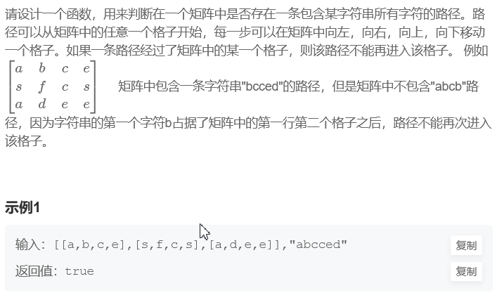

```
出口：
当word 下标走到数组大小，代表找到word
当x,y 超出边界，或该数被访问，或matrix位置字符不与word的位置上的相同 都结束返回false。
if(index == word.size()) return true;
if(x < 0 || x >= matrix.size() || y < 0 || y >= matrix[0].size() || visited[x][y] || word[w_index] != matrix[x][y]) return false;

操作：
visited[x][y] = true;
w_index++;
递归：
dfs(matrix, x + dirt[i], y + dirt[i+1], w_index, word, visited);
回溯：
visited[x][y] = false; 

class Solution {
public:
  vector<int> dirt = {1, 0, -1, 0, 1}; // 定义的方向数组
  bool hasPath(vector<vector<char> >& matrix, string word) {
      vector<vector<bool> > visited(matrix.size(),vector<bool>(matrix[0].size(),0));  //定义与matrix 同样大小的 访问数组

      for(int i = 0; i < matrix.size(); i++){
          for(int j = 0; j < matrix[0].size(); j++){
               if(dfs(matrix, i, j, 0, word, visited))return true;  // 必须对每一个数进行dfs搜索，找到直接返回true
          }
      }
     return false; // 否则返回 false
  }

  bool dfs(vector<vector<char> >& matrix, int x, int y, int w_index, string word, vector<vector<bool> >& visited){
      if(w_index == word.size()) return true; // 当word 下标走到数组大小，代表找到word
// 当x,y 超出边界，或该数被访问，或matrix位置字符不与word的位置上的相同 都结束返回false。
      if(x < 0 || x >= matrix.size() || y < 0 || y >= matrix[0].size() || visited[x][y] ||word[w_index] != matrix[x][y]) return false;
      w_index++; // 该点符合要求 ，word下标后移 标记访问
      visited[x][y] = true;
      bool isExist = false;
      for(int i = 0; i < 4; i++){ // 四个方向递归 且结果||
          isExist = isExist || dfs(matrix, x + dirt[i], y + dirt[i+1], w_index, word, visited);
      }

      visited[x][y] = false; // 有& 是引用 递归结束后需要回溯。

      return isExist; // 返回结果
  }
};
```

### 66：机器人的运动范围

地上有一个rows行和cols列的方格。坐标从 [0,0] 到 [rows-1,cols-1]。一个机器人从坐标0,0的格子开始移动，每一次只能向左，右，上，下四个方向移动一格，但是不能进入行坐标和列坐标的数位之和大于threshold的格子。 例如，当threshold为18时，机器人能够进入方格[35,37]，因为3+5+3+7 = 18。但是，它不能进入方格[35,38]，因为3+5+3+8 = 19。请问该机器人能够达到多少个格子？ 

```
class Solution {
public:
    struct node{
        int x ;
        int y ;
    }  ;
     int dir[5] = {-1, 0, 1, 0, -1};
    int check(int n) {
        int sum = 0;
        while (n) {
            sum += (n % 10);
            n /= 10;
        }
        return sum;
    }
    int movingCount(int threshold, int rows, int cols) {
        if(threshold<=0)
            return 0 ;
        int value = 0 ;
        int maps[rows][cols] ;
        memset(maps, -1, sizeof(maps)) ;
        queue<struct node> que ;
        que.push({0,0}) ;
         maps[0][0] = 1 ;
        while(!que.empty()){
             auto node = que.front() ;
            que.pop() ;
            ++ value ;
            for(int i = 0 ;i<4 ;i++){
                int x = node.x +dir[i];
                int y = node.y +dir[i+1];
                if(x>=0 && x<rows && y>=0 && y<cols && maps[x][y]==-1){
                    if(check(x)+check(y)<=threshold){
                        que.push({x ,y}) ;
                        maps[x][y] =1 ;
                    }
                }
            }
        }
         return value ;
    }
};

```

### 67 减绳子

给你一根长度为n的绳子，请把绳子剪成整数长的m段（m、n都是整数，n>1并且m>1，m<=n），每段绳子的长度记为k[1],...,k[m]。请问k[1]x...xk[m]可能的最大乘积是多少？例如，当绳子的长度是8时，我们把它剪成长度分别为2、3、3的三段，此时得到的最大乘积是18。

```
输入：8返回值：18
class Solution {
public:
    int cutRope(int number) {
        if(number ==2)
            return 1 ;
        if(number ==3)
            return 2 ;
        vector<int> dp(number+1 ,-1) ;
        for(int i =1 ; i<=4 ;i++)
                 dp[i] = i ;
        for(int i =5 ;i<=number ;i++){
            for(int j=1 ;j< i ;j++){
                dp[i] = max(dp[i],j*dp[i-j]) ;
            }
        }
        return dp[number] ;
    }
};
```

### 各种排序

```
#include<iostream>
using namespace std ;
#include<stdlib.h>
#include<time.h>
typedef int datetype ;  // 数据类型
/*****************************************************************************/
            /*  经典排序算法 */
int   insert_sort1( datetype  *Arr,int n ) ;             /*  插入排序  */
void  insert_sort2( datetype *Arr, int n ) ;             /*  插入排序  */
void  select_sort1( datetype *Arr, int n) ;             /*  选择排序  */
void  select_sort2( datetype *Arr,int n ) ;             /*  选择排序2 */
void  Bubblesort(datetype *base ,int n) ;                /*  冒泡排序  */
void Merger_sort(datetype *Arry,int left ,int right)  ;  /*  递归排序  */
int fold_find(datetype *Arr,int low ,int high,int date); /*  折半查找  */
void  quick_sort(datetype *base,int len) ;               /*   快速排序  */
 
 
/*****************************************************************************/
 /* 
            插入排序 （从小到大）
    思想：    Arr[ 0 -n ]
         1）： 从数组第二个位置Arr[i]开始： 与前面元素比较，如果比前一个元素大 ，结束 。   i++ ，继续 1） 否则进入2）
         2) :   数组元素依次后移 a[i++]=aa[i] , 直到 遇到比它小的元素结束 。 然后 到1) ,直到 i =n结束 
  
 */
int insert_sort1(datetype  *base,int n)
{
  int i, j;
  datetype flag ;         // 标志位
  for(i=1;i<n;i++)
  {
     flag=base[i];     
     j=i-1;
     while(flag<base[j]&&j>=0)    //   j>=0 这个条件一定要加上， 这个bug ，我查了很久才发现
     {
       base[j+1]=base[j];
       j--;
     }
     base[j+1]=flag;
  }
}
 
/*   
        插入排序 (优化 ：减少元素位置移动)
*/
 
void  insert_sort2( datetype *Arr, int n)  
{
   int i,j;
   for(i=1;i<n;i++)
   {
     int flag=Arr[i] ;  
	 int pos=0;     
     while(flag>Arr[pos])       // 减少向前搜索 ，主要是数组的移动 。 确定要移动多少位置 
        pos++;
     for(j=i;j>pos;j--)
     {
        Arr[j]=Arr[j-1];
     }
        Arr[pos]=flag ;
   }
}
/*  
    选择排序 :
        思想：   
            每次排序确定一个元素的位置
*/
void  select_sort1( datetype *card, int n)     
{
  int i,j ;
  for(i=0;i<n;i++)
  {
    for(j=i+1;j<n;j++)
    {
       if(card[j]<card[i])
       {
         int t ;
         t=card[j];
         card[j]=card[i];
         card[i]=t;
       }
    }
  }
}
/*  
        选择排序2（改进）
*/
void  select_sort2(datetype *card,int n)  
{
   int i,j ,k；
   datetypet t;
   for(i=0;i<n-1;i++)
   {
       k=i;
       for(j=i+1;j<n;j++)
        if(card[j]<card[i])
            k=j;
        if(k!=i)
        {
          t=card[k];
          card[k]=card[i];
          card[i]=t;
        }
   }
}
/*
    递归排序 :
    思想： 
    1）将数组分成相同两段， Arr1[] ,Arr2[] ,然后 两个数组进行比较， 每比较依次，选出最小的保存到temp []  , 直到一个数组结束，然后把另一个
    数组剩下的元素，直接添加到 temp[] 后。
     2） 对 Arr1 []  Arr2[] 依次进行 1  。
*/
void Merger_sort(datetype *Arry,int left ,int right)                  
{
   if(left==right-1)
    return ;
   int mid=(left+right)/2 ;
   Mergersort(Arry,left,mid);                                     // 递归排序 
   Mergersort(Arry,mid,right);
   int *temp=new int[right-left];                                  //开辟临时数组
   int left_idx=left;
   int right_idx=mid ;
   int  i=0;
   while(left_idx<mid&&right_idx<right)                            //合并 ，依次比较大小 ， 选择 小的
   {
     if(Arry[left_idx]<Arry[right_idx])
        temp[i++]=Arry[left_idx++];
     else 
	 	temp[i++]=Arry[right_idx++];
   }
   while(left_idx<mid)                                   // 数组剩下的元素直接添加到temp [] 后
    temp[i++]=Arry[left_idx++];
   while (right_idx<right)
   temp[i++]=Arry[right_idx++];
   for(int i= 0,idx=left;i<right-left;i++,idx++)
   Arry[idx]=temp[i];
   delete []temp ;
}
 
int fold_find(datetype *Arr,int low ,int high,int date)       /*折半查找 */
{
   int id=-1;
  while(low<=high)
   {
     int middle=(low + high)/ 2 ;
    if(Arr[middle]==date)
    {
        id=middle ;
       return id +1;
    }
       else if(Arr[middle]>date)
    {
       high=middle -1 ;
   }
     else low=middle + 1 ;
   }
 
}
 /*   快速排序  */
void quick_sort(datetype *base,int len)  
 {
    if(len<=1)                     /*  递归终止条件 */
    return ;
    int left_id=0,right_id=0;
    srand((unsigned)time(0));					 //	为rand( )函数初始化随机发生器的启动状态，以产生伪随机数
    int rand_num;
    rand_num=rand()%len ;                        /* 随机选择一个数组作为比较元素 */
    int key = base[rand_num];                   /*关键性元素 ，可以从数组中任意选择 */
    int *left ,*right;
    left = new int [len];
    right =  new int [len];
    for(int i=0;i<len;i++)                      /*拆分 */
    {
       if(base[i]<key)
        left[left_id++]=base[i];
      if(base[i]>key)
      right[right_id++]=base[i];
    }
    quick_sort(left,left_id);                /*1递归  */
    quick_sort(right,right_id);
    int id = 0;
    for(int i=0;i<left_id;i++)
        base[id++]=left[i];
    base[id++]=key ;
    for(int i=0;i<right_id;i++)
       base[id++]=right[i];
    delete [] left ;
    delete [] right ;
 
 
 }
 void Bubblesort(datetype *base ,int n)  /*冒泡排序 */
 {
   int i, j;
   for(i=0;i<n;i++)
   {
     for(j=0;j<n-i;j++)
     {
       if(base[j]>base[j+1])
       {
         int t ;
         t= base [j];
         base[j]=base[j+1];
         base[j+1]=t ;
       }
     }
   }
 }
 
 
 
```
