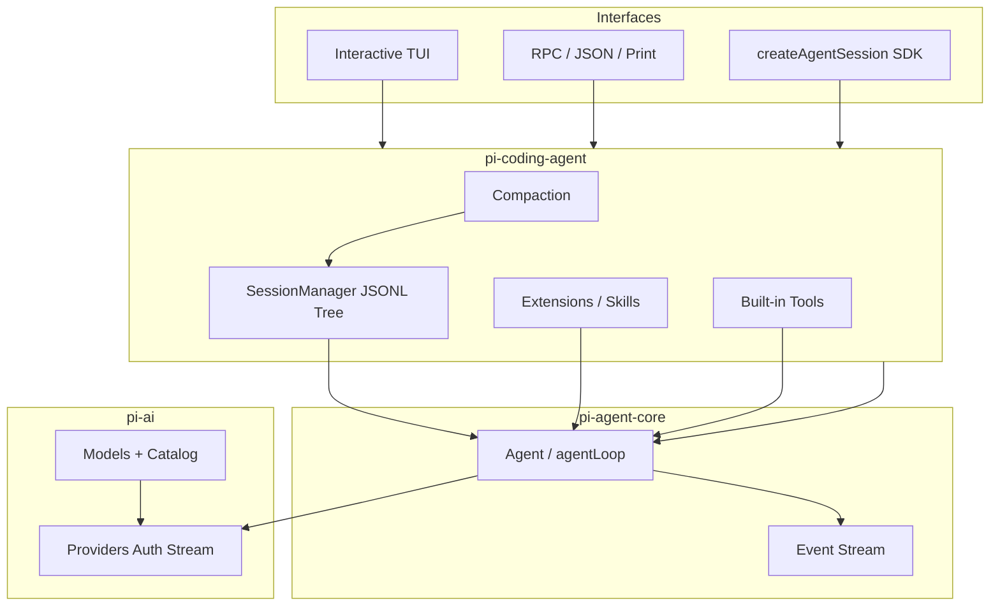

# Pi 项目技术面试解读文档

> 基于本地仓库：`A:\17-workspace\11-Profile-Web\opensource\pi`（上游：[earendil-works/pi](https://github.com/earendil-works/pi) / [pi.dev](https://pi.dev)）  
> 用途：技术面试中的架构讲解、对比 Cursor/Claude Code 类 Agent、以及延伸追问准备。

---

## 1. 一句话定位（Elevator Pitch）

**Pi 是一个「极简、可扩展」的 Agent Harness（智能体运行时底座）**：把「多模型接入」「工具调用循环」「会话持久化」「终端交互」拆成独立 npm 包；默认只做编码 Agent 的坚实核心，子 Agent、Plan Mode 等通过 **Extensions / Pi Packages / Skills** 按需拼装。

与 Cursor、Claude Code 等产品级 IDE Agent 的差别：**Pi 是框架 + CLI，不是 IDE**；哲学是 *Adapt Pi to your workflows, not the other way around*。

---

## 2. 与 Cursor / 通用 Agent 框架的对比（面试高频）

| 维度 | Pi | 典型 IDE Agent（Cursor 等） |
|------|-----|---------------------------|
| 形态 | npm monorepo + `pi` CLI + SDK | 编辑器内嵌 |
| 扩展 | TypeScript Extension 跑在同进程 | Rules、MCP、Skills（各家不同） |
| 子 Agent | 默认无，示例 extension 自装 | 部分产品内置 |
| 权限 | **无内置沙箱**；靠容器/Gondolin 等 | 混合（部分工具受限） |
| 会话 | JSONL 树形 session，可分支 | 多为云端或专有格式 |
| 模型层 | `pi-ai` 统一 40+ Provider | 多为闭源路由 |

**可强调的理解**：Pi 把「Harness」三层拆开——**LLM 层（pi-ai）→ 循环层（pi-agent-core）→ 产品层（pi-coding-agent）→ 可选持久化运行时（pi-durable + chord）**。

---

## 3. Monorepo 包依赖关系（必背）

构建顺序见根 `package.json` 的 `build` 脚本，逻辑依赖大致为：

```
pi-schema, pi-telemetry
    ↓
pi-chord, pi-tui, pi-codemode, pi-mcp
    ↓
pi-ai  （模型目录、catalog、多 Provider 流式 API）
    ↓
pi-durable（实验性：提交前持久化、可恢复）
pi-agent-core（Agent 循环、事件、工具执行）
    ↓
pi-coding-agent（CLI、Session、内置工具、Extensions）
```

### 各包职责速查

| 包名 | 面试怎么说 |
|------|------------|
| **pi-ai** | 统一 LLM API；模型 catalog；鉴权；流式 tool call；thinking；跨 Provider handoff |
| **pi-agent-core** | 有状态 Agent：`prompt/steer/followUp`；`agentLoop`；parallel/sequential 工具；事件流 |
| **pi-coding-agent** | 用户可见产品：`pi` 命令、TUI、JSON/Print/RPC 模式、内置 read/write/bash 等 |
| **pi-tui** | 差分渲染终端 UI，CSI 2026 防闪烁 |
| **pi-durable** | 对话/任务在「展示前」先 commit；进程崩溃可恢复（偏服务端/长任务） |
| **chord** | 跨进程对象运行时（合约、文档、插件热重载）；durable 的文档状态基础 |
| **pi-mcp** | 自研轻量 MCP 客户端（不依赖官方 MCP SDK） |
| **pi-codemode** | QuickJS WASM 沙箱，模型写 JS 批量调工具，减少往返 LLM |
| **pi-schema** | JSON Schema 构建与校验（工具参数类型推导） |

---

## 4. 核心运行机制：Agent Loop（底层原理）

来源：`packages/coding-agent/docs/how-pi-works.md`、`packages/agent/README.md`。

### 4.1 单次 Turn

1. 用户消息进入 **active branch**（当前会话树路径）。
2. 组装请求：system prompt + 分支历史 + 工具定义 + skills 摘要 + 模型参数。
3. Provider **流式**返回 assistant（文本 + tool calls）。
4. 执行工具，写入 tool result。
5. 若还需继续（仍有 tool / steer / follow-up），进入下一 Turn；否则 `agent_end`。

### 4.2 消息两层模型（易考）

- **AgentMessage**：业务层，可扩展自定义 role（declaration merging）。
- **LLM Message**：仅 `user` / `assistant` / `toolResult`。
- 管线：`AgentMessage[]` → `transformContext()`（裁剪/compaction）→ `convertToLlm()` → Provider。

### 4.3 工具执行策略

- 默认 **`parallel`**：参数校验后并行执行；`tool_execution_end` 按完成顺序；**持久化的 toolResult 顺序仍与 assistant 中声明顺序一致**。
- **`sequential`**：全局或单工具 `executionMode`。
- **`beforeToolCall` / `afterToolCall`**：可 block、`terminate: true` 跳过下一轮 LLM（整批都 terminate 才生效）。

### 4.4 Steering vs Follow-up（与 Cursor 的「插队」类似概念）

- **Steering**：当前 assistant turn 及工具跑完后**立即**注入，打断后续自动循环。
- **Follow-up**：Agent 本会停下时排队执行。
- **`abort()`**：停止当前 run，排队消息回编辑器。

### 4.5 关键钩子（SDK/集成向）

| 钩子 | 时机 |
|------|------|
| `prepareRequest` | 每次打模型前（可 reload  canonical session 上下文） |
| `finishTurn` | assistant + 工具结束后、`turn_end` 前（可 `continue` / `end`） |

---

## 5. 会话模型：树形 JSONL（差异化亮点）

- 文件：`~/.pi/agent/sessions/.../*.jsonl`，每行一条 entry，`id` + `parentId` 成**树**。
- **分支**：从任意历史节点继续 = 新 branch，同一文件。
- **Fork/Clone**：复制历史到新 session 文件。
- 版本：v1 线性 → v2 树 → v3（`hookMessage` → `custom`）。
- **`SessionManager`** 是模型上下文的权威来源；直接改 `agent.state.messages` **不能**替代持久化上下文。

**面试话术**：树形 session 支持「尝试另一条修复路径」而不丢主对话，比纯 append-only 更适合 coding agent 实验。

---

## 6. 上下文与 Compaction

两种摘要机制：

| 机制 | 触发 | 目的 |
|------|------|------|
| **Compaction** | token 超阈值或 `/compact` | 压缩远端历史 |
| **Branch summarization** | `/tree` 换分支 | 保留切换分支的语义 |

自动 compaction 条件（默认）：`contextTokens > contextWindow - reserveTokens`（reserve 默认 16384）。

流程要点：倒序累计 token → 保留最近 `keepRecentTokens`（默认 20k）→ LLM 结构化摘要 → 写入 `CompactionEntry` → 后续请求用「摘要 + firstKeptEntryId 之后的消息」。

还会在：多 turn 工具结束后、新用户 prompt 前、context overflow 时尝试 compact-and-retry。

---

## 7. pi-coding-agent：内置工具与扩展

### 7.1 内置工具（`packages/coding-agent/src/core/tools/`）

| 工具 | 作用 |
|------|------|
| read / write / edit | 文件读写与 patch |
| bash / powershell | Shell（可注入 `BashOperations` 做远程执行） |
| grep / find / ls | 代码库导航 |
| codemode（经 pi-codemode） | 脚本批量调工具 |

设计点：`bash.ts` 等使用 **TypeBox schema** + `BashOperations` 接口分离「执行后端」，便于 Gondolin/SSH 扩展；输出有 **truncate** 与 `full_output_path`。

### 7.2 Extensions

- 位置：`~/.pi/agent/extensions/`（全局）、`.pi/extensions/`（项目）、`pi -e ./x.ts`（临时）。
- 能力：`registerTool`、`on(event)`、`registerCommand`、`appendEntry`、MCP、自定义 Provider、自定义 compaction、TUI 渲染。
- **同源进程、同 OS 权限**——面试要问安全时，必须提到 README 的 containerization（Docker / Gondolin micro-VM / OpenShell）。

### 7.3 Skills / Prompt Templates / Themes / Pi Packages

与 Cursor Skills 类似：skills 默认只暴露描述，**完整 SKILL.md 按需加载**；可通过 Pi package（npm/git）分发整套资源。

---

## 8. pi-ai：模型层（面试可深入）

- **Models 集合**：`createModels()` + 按需 `setProvider()`，利于 tree-shaking。
- Catalog：工具调用模型单独目录；`models.generated.ts` 由 `packages/ai/catalog/` 生成（**禁止手改**）。
- 能力：OAuth（Copilot、Codex 等）、动态 Provider（Radius）、流式 partial JSON tool args、thinking level、budget、跨模型 handoff、Faux provider 测 harness。
- 鉴权链：环境变量 → credential store → `getApiKey` 动态刷新。

**与业务无关但必须知道**：聊天 catalog 默认只含支持 **function calling** 的模型（Agent 刚需）。

---

## 9. 运行形态（同一种引擎，多种外壳）

| 模式 | 用途 |
|------|------|
| Interactive TUI | 日常开发 |
| Print | 单次 prompt，输出最终结果 |
| JSON / JSONL | 自动化、管道 |
| RPC | stdin/stdout JSONL 命令，进程外控制 |
| SDK | `createAgentSession()` 进程内嵌入 |

---

## 10. pi-durable + chord（高级 / 架构向）

适合回答「如果要做可恢复、多租户、服务端 Agent」：

- **Durable**：Harness + Conversation + Entry + Task 状态机；**先 commit 再展示**；SQLite/JSONL storage；generation 拥有 tool 子任务。
- **Chord**：合约化对象、跨进程 link、插件热重载、文档事务——给 durable 提供分布式状态语义。

与 coding-agent 的 JSONL session 对比：durable 强调**任务图、子 Agent、busy conversation、telemetry 契约**，API 标注 **Experimental**。

---

## 11. Codemode 与 MCP（工具生态）

- **MCP**：自研 client，stdio / Streamable HTTP / PipeTransport；与 `pi-env` 的 `openProcess` 可组合。
- **Codemode**：QuickJS WASM，嵌套 tool call 不进 LLM 上下文，只回脚本输出——降低 token、适合「读 20 个文件再总结」类任务。

`packages/agent/examples/mcp-codemode` 展示把 MCP + codemode 包成 `AgentTool`。

---

## 12. 工程化与安全（体现你读过仓库）

- Node **22.19+**；TypeScript **strip-only**（无 enum/namespace 等需 emit 的语法）。
- 依赖：**精确 pin**、`min-release-age`、install-lock 固定 pi.dev 安装器传递依赖。
- 测试：`./test.sh` 避免无 key 时跑 e2e；coding-agent suite 用 **faux provider**，不烧真 token。
- **无内置权限系统**——面试安全题的标准答案之一。

---

## 13. 本地开发与验证（结合你的环境）

```powershell
cd A:\17-workspace\11-Profile-Web\opensource\pi
npm install --ignore-scripts
npm run build          # 需要 dist 时
npm run check          # lint + tsc
./test.sh              # 单元测试（Git Bash 或 WSL）
./pi-test.sh           # 从源码跑 pi

# 你已配置的用法（见 1-PI.md）
$env:PATH = "C:\Users\Mrwang\.pi\agent\bin;$env:PATH"
pi --model cursor/composer-2.5
```

源码书参考：[pi-agent-source-book](https://liuqiuyang730.github.io/pi-agent-source-book/chapter-02.html)

---

## 14. 模拟面试题 & 参考答法

### Q1：Pi 和 LangChain / AutoGen 有什么不同？

**答**：Pi 不是「链式编排框架」，而是 **coding agent 专用 harness**：会话树、compaction、TUI、内置文件工具、Extension 生命周期与 pi-ai 多 Provider 是一等公民；扩展用 TS 模块 hook 事件，而非 Graph 节点。更贴近 Claude Code / Aider 类，但开源且可嵌入。

### Q2：一次 tool call 从发起到写入 session 经历什么？

**答**：assistant `message_end` 作为 barrier → `tool_execution_start` → 校验 args → `beforeToolCall` → `execute`（可 `onUpdate` 流式）→ `afterToolCall` → `tool_execution_end` → toolResult 消息 → 可能下一 turn `prepareRequest` → 再打模型。

### Q3：如何保证并行工具时顺序不错乱？

**答**：执行并行，但 **写入 transcript 的 toolResult 顺序对齐 assistant message 中的 tool call 顺序**；事件 `tool_execution_end` 可能按完成先后，UI 需区分「展示顺序」与「持久化顺序」。

### Q4：上下文满了怎么办？

**答**：自动 compaction（保留最近段 + 结构化摘要）；手动 `/compact`；overflow 错误时 compact-and-retry；分支切换用 branch summarization。

### Q5：如何做权限控制？

**答**：Pi 默认无沙箱。Extension 可在 `beforeToolCall` 拦截；生产用 Docker、Gondolin（主机 pi + micro-VM 跑工具）、或 OpenShell。

### Q6：我想在自有产品里嵌入 Pi，怎么走？

**答**：轻量用 `@earendil-works/pi-agent-core` + `pi-ai`；要完整会话/工具/扩展用 `createAgentSession()`；隔离进程用 RPC/CLI JSON 模式。

### Q7：pi-durable 解决什么问题？

**答**：长任务、崩溃恢复、多 conversation/task 图、提交一致性与 telemetry；适合服务端 Agent，而非单纯本地 CLI 会话文件。

### Q8：为什么自研 pi-mcp 而不是用官方 SDK？

**答**：控制依赖面、传输与取消语义、与 pi-env/pipe 集成；coding-agent 需要可测试、可嵌入的薄客户端。

### Q9：Extension 和 Skill 的区别？

**答**：Extension 是可执行 TS（工具、事件、UI）；Skill 主要是 **按需加载的提示词与附属文件**（类似 procedure），减轻 system prompt 体积。

### Q10：Session 树和 Git 分支 analogy？

**答**：每个节点是历史状态；换 `parentId` 延续点创建新 branch，不删旧路径；compaction 在树上插入摘要 entry，原始 entry 仍在文件中。

---

## 15. 建议面试演示路径（3～5 分钟）

1. 画分层图：pi-ai → agent-core → coding-agent（+ optional durable）。
2. 讲清 **Turn 循环 + 事件类型**（`agent_start` → `turn_*` → `tool_execution_*`）。
3. 提 **JSONL 树形 session + compaction** 作为差异化。
4. 提 **Extension 扩展点** 和 **默认真权限 = 用户权限** 的安全立场。
5. 若岗位偏基础设施：补充 **durable/chord** 与 **install-lock 供应链**。

---

## 16. 延伸阅读（仓库内）

| 主题 | 路径 |
|------|------|
| 总览 | `packages/coding-agent/docs/how-pi-works.md` |
| Agent API | `packages/agent/README.md` |
| SDK | `packages/coding-agent/docs/sdk.md` |
| Extensions | `packages/coding-agent/docs/extensions.md` |
| Session 格式 | `packages/coding-agent/docs/session-format.md` |
| Compaction | `packages/coding-agent/docs/compaction.md` |
| 容器化 | `packages/coding-agent/docs/containerization.md` |
| 开发规范 | `AGENTS.md` |

---

## 17. 架构示意图（Mermaid）



---

*文档版本：基于本地 pi monorepo 源码与官方 docs 整理，面试前建议 `git pull` 同步上游变更。*
