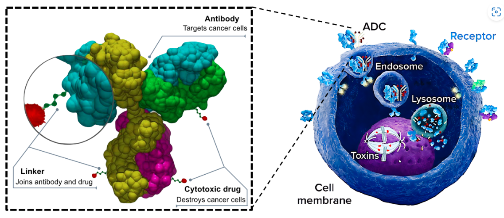
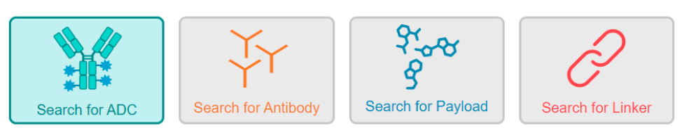
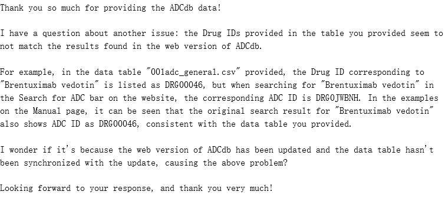
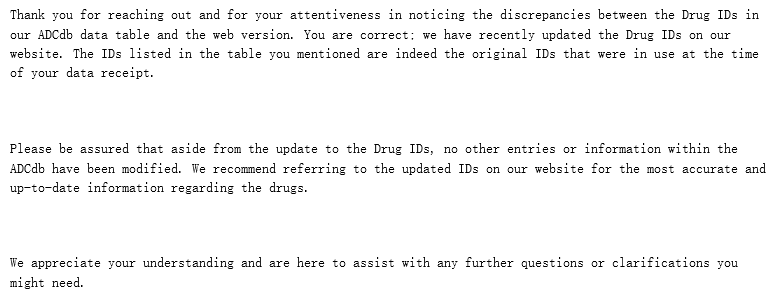

<h1 align="center">ADCdb — 抗体药物偶联物数据库</h1>

[ADCdb 主页](http://adcdb.idrblab.net/)

简介

- Published: *Nucleic Acids Research*, 2024 年 1 月 5 日
- Published online: 2023.10.13
- 更新频率：
- DOI：https://doi.org/10.1093/nar/gkad831

### 数据库内容

#### 1. 概要
> ADC 指 'Antibody-drug conjugates' —— 抗体药物偶联物, 通过一个化学链将具有生物活性的小分子药物连接到单抗上，单抗作为载体将小分子药物靶向运输到目标细胞中. 
    

> 该数据库专注于从多个角度提供ADC信息（`特别是其药物信息和生物活性`），共收集并提供了`6572`个ADC（359个已获得FDA批准或处于临床试验阶段中，501个处于临床前测试阶段，819个具有体内测试数据，1868个具有细胞系/靶点测试数据，3025个没有体内/细胞系/靶点测试数据）及其明确的药物信息。

- Website (http://adcdb.idrblab.net/search/adc_search) 搜索方式：
    

#### 2. 数据获取

数据下载页面(http://adcdb.idrblab.net/download_hide)链接均无效，通过邮件联系作者，`收到以下几个文件：`
1. adc_general.csv
2. adc_activity.csv
3. adc_indication.csv
4. antibody_general.csv
5. antibody_activity.csv
6. payload_general.csv
7. payload_activity.csv
8. linker_general.csv
9. ~~target_general.csv~~ antigen_general.csv
10. reference.csv

发现的一些问题：
1. 有些表格中的数据与其他表格中的数据重复，需对此部分进行清洗； 
2. `target_general.csv`表格中的数据内容实际对应 web 中的 `antigen`数据内容； 
3. 这些数据中的`*_id`与 web 中搜索出来的结果有异，已通过邮件向作者咨询：
    `发送:`
    

    `回复:`

    

    `解决:`
    以`*_name`为索引进行爬虫获取 web 中的最新`*_id`；

