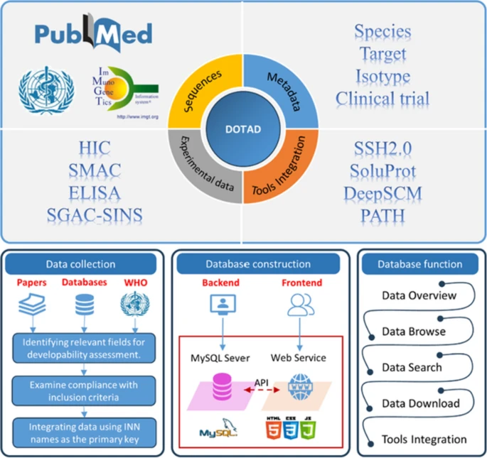
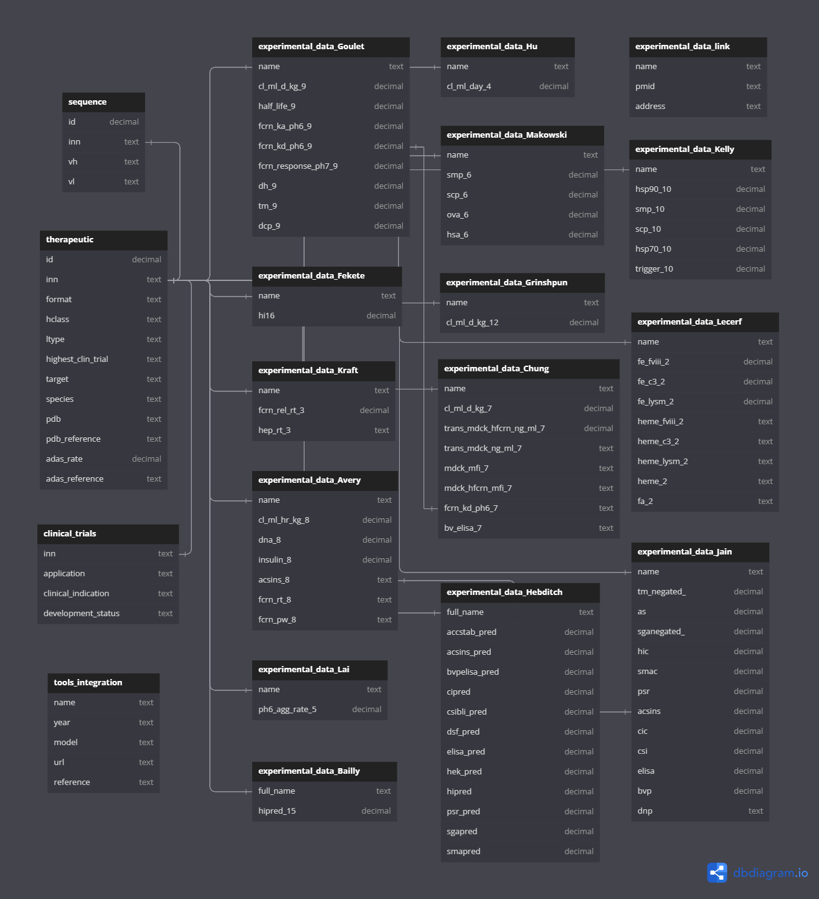

## 数据库列表
|数据库|类型|状态|备注|
|:----|:----|:----|:----|
|alphafold db|预测结构数据库|Done|pdb文件暂时没有入库|
|DOTAD|治疗性抗体可开发性数据库|Doing||

## AlphaFold Protein Structure Database
AlphaFold数据库提供覆盖UniProt（蛋白质序列和注释的标准存储库）的超过 2 亿个蛋白质预测结构，包括人类蛋白质组以及对研究全球健康具有重要意义的 47 种其他关键生物体的蛋白质组结构单独下载。

### 预测结果
 在 0 - 100 范围内生成每个残基的置信度估计值。此置信度度量称为 pLDDT，存储在可供下载的 mmCIF 和 PDB 文件的 B 因子字段中（尽管与 B 因子不同，pLDDT 越高越好）  
- pLDDT > 90 的区域预计将以高精度建模。这些应该适合任何受益于高精度的应用（例如表征结合位点）。
- pLDDT 在 70 到 90 之间的区域预计可以很好地建模（通常是良好的主干预测）。
- pLDDT 在 50 到 70 之间的区域置信度较低，应谨慎对待。
- pLDDT < 50 的区域的 3D 坐标通常具有带状外观，不应被解释。 

### 物种信息
#### 模型生物蛋白质组的压缩预测
|物种|通用名|参考蛋白质组|预测结构|
|:----|:----|:----|:----|
|拟南芥|拟南芥|UP000006548|27,434|
|秀丽隐杆线虫|线虫|UP000001940|19,694|
|白色念珠菌|白色念珠菌|UP000000559|5,974|
|斑马鱼|斑马鱼|UP000000437|24,664|
|盘基网柄菌|网柄菌属|UP000002195|12,622|
|黑腹果蝇|果蝇|UP000000803|13,458|
|大肠杆菌|大肠杆菌|UP000000625|4,363|
|大豆|大豆|UP000008827|55,799|
|智人|人类|UP000005640|23,391|
|詹氏甲烷球菌|詹纳斯奇氏菌|UP000000805|1,773|
|小家鼠|老鼠|UP000000589|21,615|
|水稻|亚洲米饭|UP000059680|43,649|
|褐家鼠|鼠|UP000002494|21,270|
|酿酒酵母|出芽酵母|UP000002311|6,039|
|粟酒裂殖酵母|裂殖酵母|UP000002485|5,128|
|玉米|玉米|UP000007305|39,299|
#### 全球健康蛋白质组的压缩预测
|物种|通用名|参考蛋白质组|预测结构|
|:----|:----|:----|:----|
|荚膜酵母|荚膜酵母|UP000001631|9,199|
|马来丝虫|马来丝虫|UP000006672|8,743|
|空肠弯曲菌|空肠弯曲菌|UP000000799|1,620|
|刚毛藻|刚毛藻|UP000094526|11,170|
|麦地龙龙线虫|麦地龙龙线虫|UP000274756|10,834|
|屎肠球菌|屎肠球菌|UP000325664|2,823|
|佩德罗氏菌|佩德罗氏菌|UP000053029|12,509|
|嗜血杆菌流感|流感嗜血菌|UP000000579|1,662|
|幽门螺杆菌|幽门螺杆菌|UP000000429|1,538|
|肺炎克雷伯菌|肺炎克雷伯菌|UP000007841|5,727|
|婴儿利什曼原虫|婴儿乳杆菌|UP000008153|7,924|
|足菌马杜氏菌|足菌马杜氏菌|UP000078237|9,561|
|麻风分枝杆菌|麻风分枝杆菌|UP000000806|1,602|
|结核分枝杆菌|结核分枝杆菌|UP000001584|3,988|
|溃疡分枝杆菌|溃疡分枝杆菌|UP000020681|9,033|
|淋球菌|淋病奈瑟菌|UP000000535|2,106|
|巴西诺卡氏菌|巴西诺卡氏菌|UP000006304|8,372|

### 文件包含条目  
* accession_ids.csv  
此文件包含在 AlphaFold DB 中具有预测的所有 UniProt 种质的列表。该文件采用 CSV 格式，包含以下列，以逗号分隔：  
    1. UniProt 登录号，例如 A8H2R3  
    2. 第一个残基索引（UniProt 编号），例如 1  
    3. 最后残基索引（UniProt 编号），例如 199  
    4. AlphaFold DB 标识符，例如 AF-A8H2R3-F1  
    5. 最新版本，例如4  
* model_v4.cif   
包含预测蛋白质结构的原子坐标以及一些元数据。此文件格式的有用参考是ModelCIF和 PDBx/mmCIF项目站点。 
* model_v4.pdb
包含预测蛋白质结构的原子坐标和`残基置信度`。

## DOTAD
DOTAD (Database of Therapeutic Antibody Developability)治疗性抗体可开发性数据库汇总了所有可用的治疗性抗体序列数据以及科学文献中的各种可开发性指标，数据来源包括已发表的文献、实验数据和部分预测结果。

### Schema

| 数据类型 |数量| 下载状态| 解析状态|入库|备注|
|:----|:----|:----|:----|:----|:----|
|序列| 12939 |Done|Done|Done| `963个具有INN`(INN国际非药品专利名称)|
|治疗元数据|963|Done|Done|Done|序列来源、靶标和受体识别、格式、mAb同种型和LC类别|
|实验数据|1307|Done|Done|Done|实验测量和计算机预测的生物物理和化学特性，不同来源拆分至单独表|
|临床实验|1250|Done|Done|Done||
|分析工具|58|Done|Done|Done|疏水性、粘性、溶解性、聚集性、免疫原性和翻译后修饰分析工具和对应模型|

### 检测项
|测定|描述|
|:----|:----|
|ACCSTAB|蛋白质稳定性预测指数|
|ACSINS|自相互作用|
|AS|通过 SEC% 单体测量加速稳定性|
|CIC|交叉相互作用色谱法|
|CL|清除率|
|CSI|自相互作用|
|CSIBLI|生物层干涉测量法克隆自相互作用|
|DSF|差示扫描荧光法，蛋白质热稳定性指标|
|ELISA|酶联免疫吸附测定，灵敏度和特异性指标|
|FcRn|新生儿Fc受体|
|Fe+2 *|暴露于亚铁离子后获得 * 的结合|
|HEK|HEK细胞表达滴度|
|Heme *|接触血红素后获得 * 的结合|
|Hep RT|肝素柱上的保留时间|
|HIC|疏水相互作用色谱保留时间|
|MDCK|Madin–Darby canine kidney细胞系|
|PSR|交叉相互作用指标|
|SGAC-SINS|自相互作用指标|
|SMAC|立式单层吸附色谱，特异性相互作用指标|
|Tm|熔点温度，热稳定性指标|

