<h1 align="center">BioGRID — 蛋白质相互作用数据库</h1>

<p align="center">
    编写作者：wu_jiannan /
    编写时间：2024.05.20
</p>

<p align="center">
    <a href='https://thebiogrid.org/'>Website</a> •
    <a href="#一-数据统计">version 4.4.233</a> •
    <a href="#五-network">Network</a> •
    <a href="#四-数据下载">Download</a> •
    <a href="#reference">Publications</a> • 
    <a href="BioGrid_metadata.md">Metadata</a> 
</p>

**简介**

BioGRID (Biological General Repository for Interaction Datasets) 数据库于 *2003* 年建立，是一个相互作用数据集的生物通用存储库，专门存储和管理来自模式生物和人类的遗传和蛋白质相互作用数据。目前，BioGRID 检索了超过 70,000 多篇文献，收集了超过 1,740,000 个相互作用，这些相互作用来自于高通量数据集和个体研究。对于酿酒酵母（*S. cerevisiae*）、裂殖酵母（*S. pombe*）和拟南芥（*A. thaliana*）等模式生物，BioGRID维护着整个文献的完整覆盖，同时正在努力扩展到多种后生动物物种的整合。当前的数据整理工作重点放在特定生物学领域，以便深入了解与人类健康相关的保守网络和通路。
> 生物学家通过对选定的生物物种进行科学研究，用于揭示某种具有普遍规律的生命现象，这种被选定的生物物种就是模式生物。如：豌豆、线虫、果蝇、斑马鱼、小鼠等.

---
## 数据库详情
### 一. 数据统计

- 版本 4.4.233, 截止2024 年 5 月
    > 最新统计请在线查看 - [BioGRID stats](https://wiki.thebiogrid.org/doku.php/statistics#biogrid_database_statistics)

- 该版本检索了 `84,671` 篇文献，涵盖了 `2,770,929` 个蛋白质和基因相互作用、`31,144` 个化合物相互作用和 `1,128,339` 个翻译后修饰。

**数据统计表：**
<a href="#1-physical-and-genetic-interaction-statistics">物理和遗传相互作用</a> 
<a href="#2-chemical-interaction-statistics">化合物相互作用</a>
<a href="#3-post-translational-modification-ptm-statistics">翻译后修饰</a>

#### 1. Physical and Genetic Interaction Statistics

表中统计信息：

| 字段                       | 注释               |
| -------------------------- | ------------------ |
| organism                   | 物种               |
| experiment type            | 实验类型           |
| raw interactions           | 原始相互作用数量   |
| non-redundant interactions | 非冗余相互作用数量 |
| unique genes               | 基因数量           |
| unique publications        | 出版物数量         |

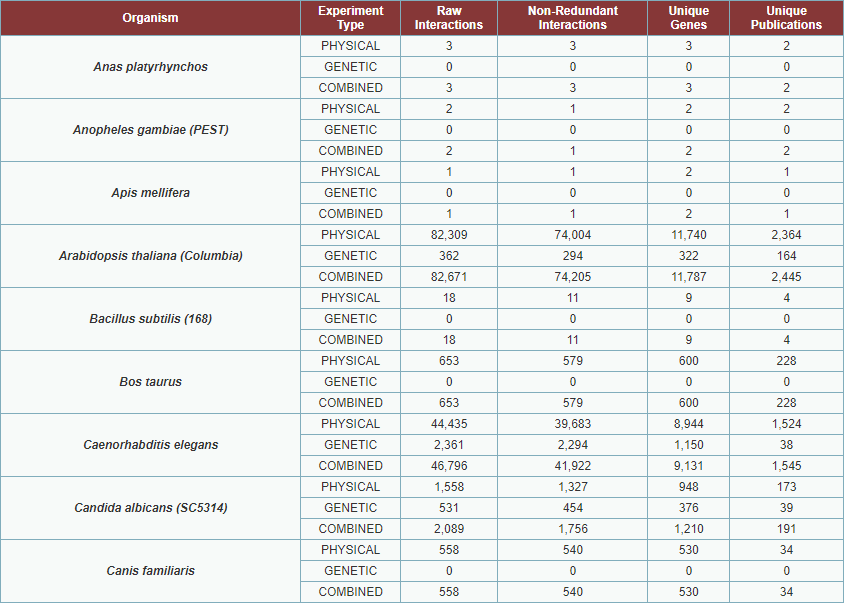
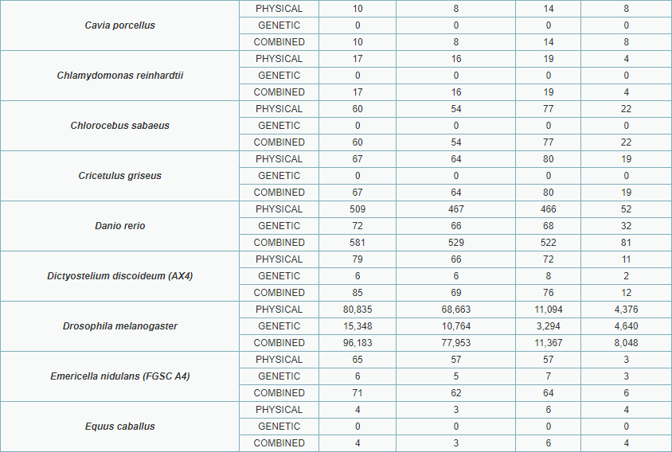
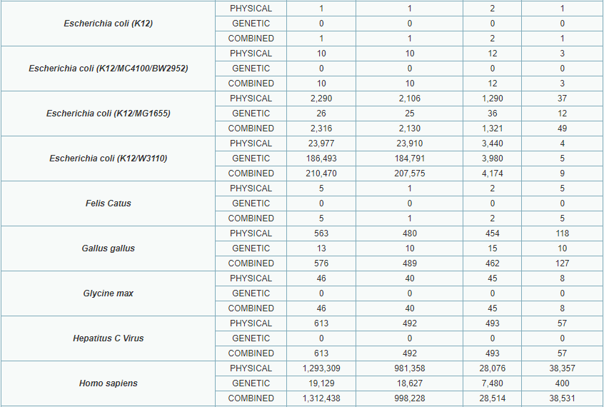
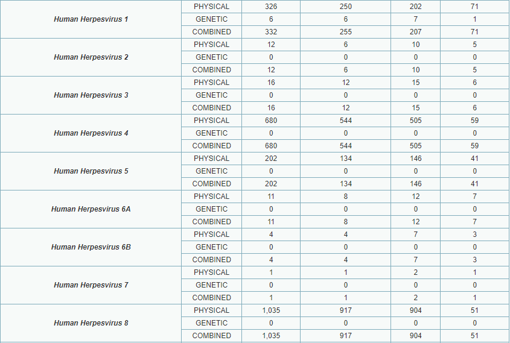
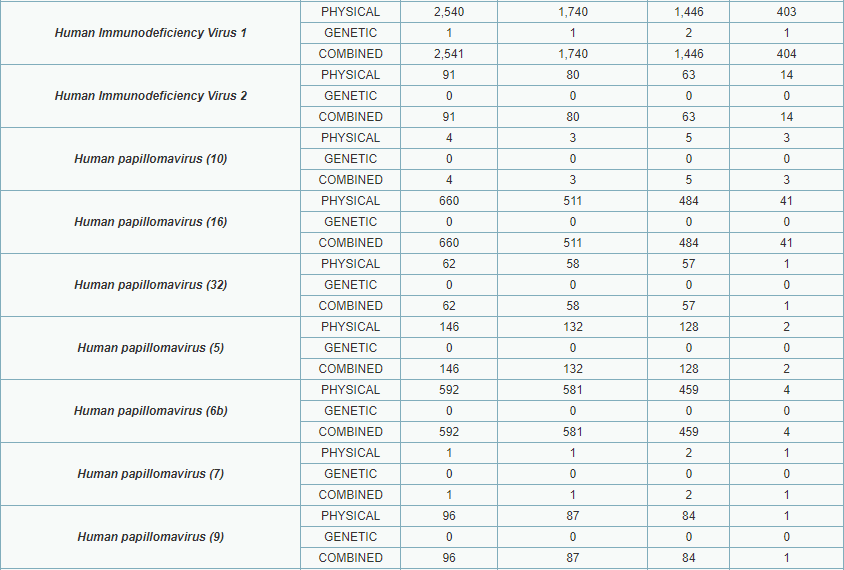
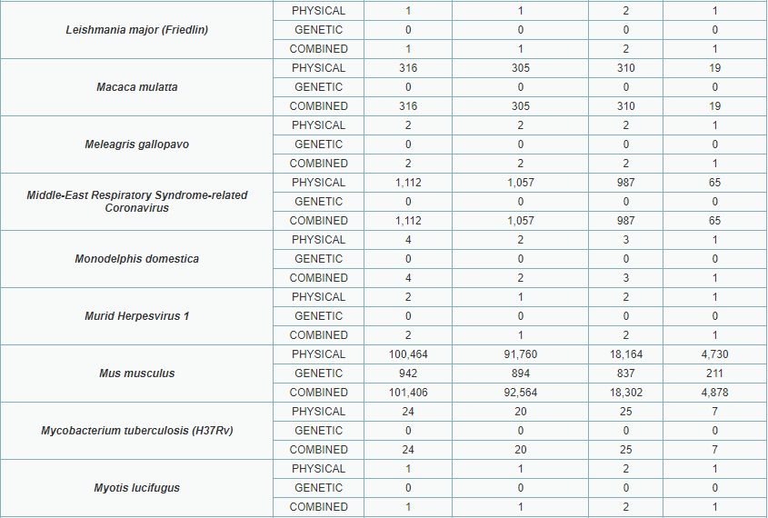
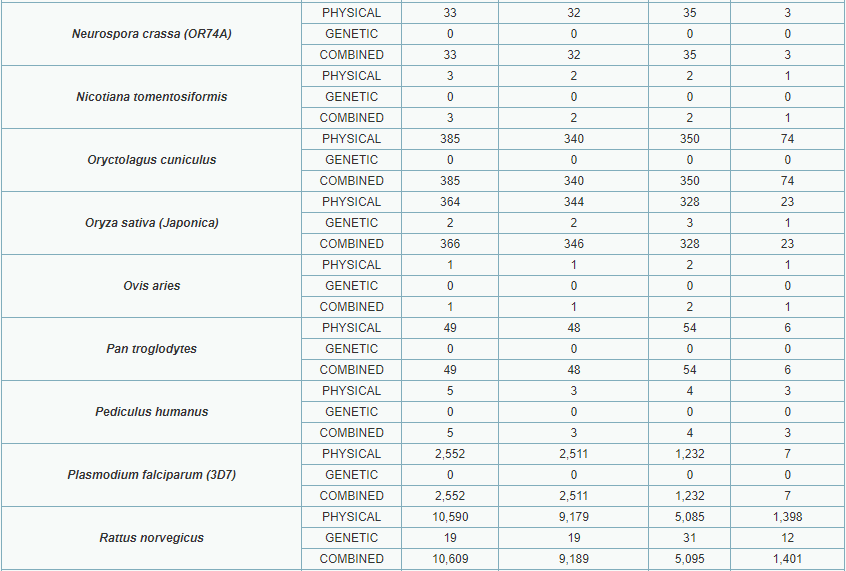
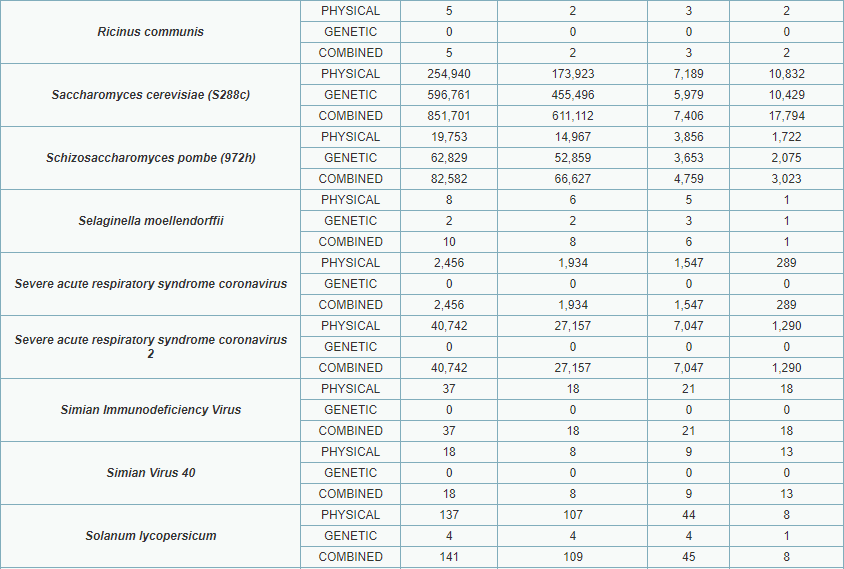
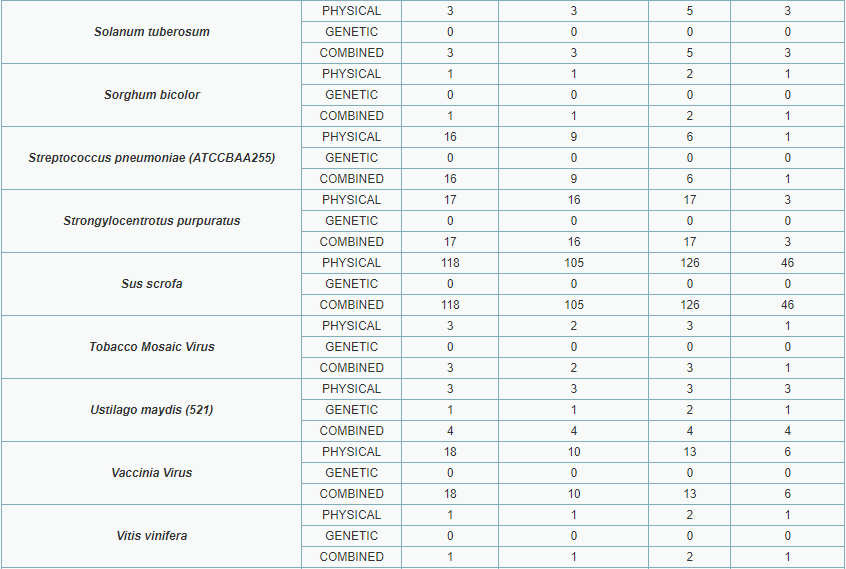
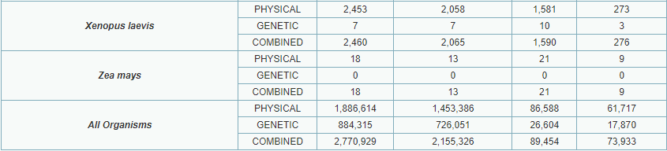

#### 2. Chemical Interaction Statistics

表中统计信息：

| 字段                       | 注释               |
| -------------------------- | ------------------ |
| organism                   | 物种               |
| experiment type            | 实验类型           |
| raw interactions           | 原始相互作用数量   |
| non-redundant interactions | 非冗余相互作用数量 |
| unique genes               | 基因数量           |
| unique publications        | 出版物数量         |
| unique chemicals           | 化合物数据量       |

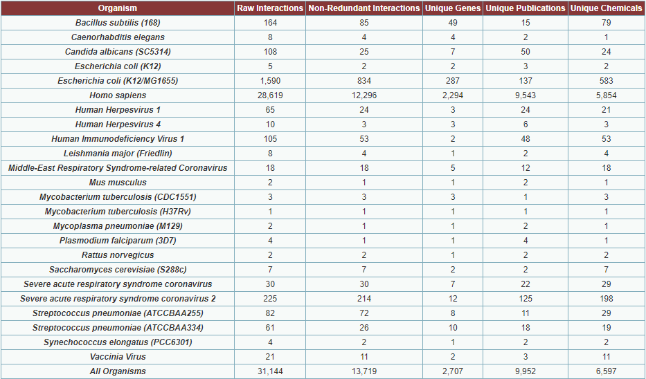

#### 3. Post Translational Modification (PTM) Statistics

表中统计信息：

| 字段                | 注释                                                                                       |
| ------------------- | ------------------------------------------------------------------------------------------ |
| organism            | 物种                                                                                       |
| PTM                 | 翻译后修饰类型，如泛素化（ubiquitination）、苏木化（SUMOylation）、NEDD化（neddylation）等 |
| raw sites           | 原始位点，指蛋白质发生翻译后修饰的特定位置数量                                             |
| nr sites            | 未修饰（non-redundant）位点数量                                                            |
| un-assigned sites   | 尚未确定的位点                                                                             |
| unique proteins     | 蛋白数量                                                                                   |
| unique gene         | 基因数量                                                                                   |
| unique publications | 出版物数量                                                                                 |

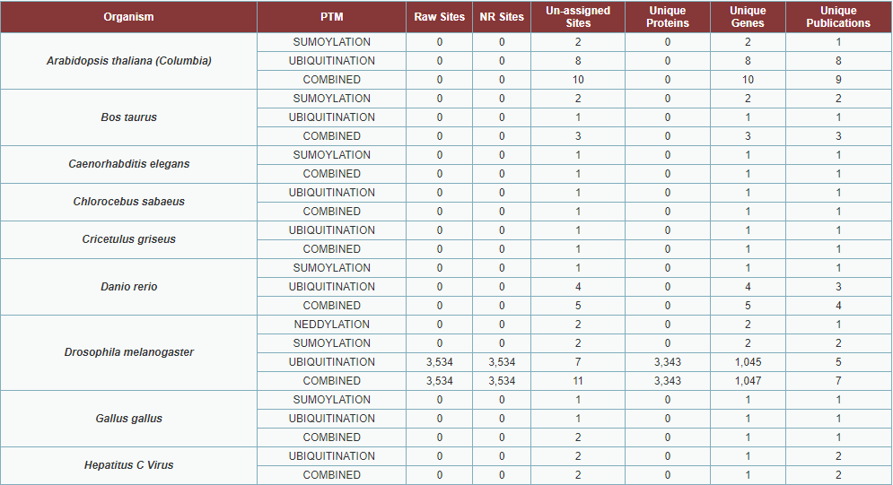
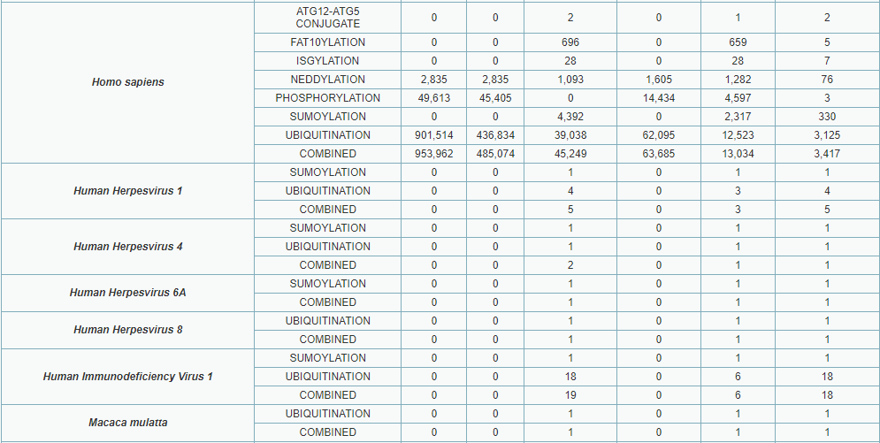
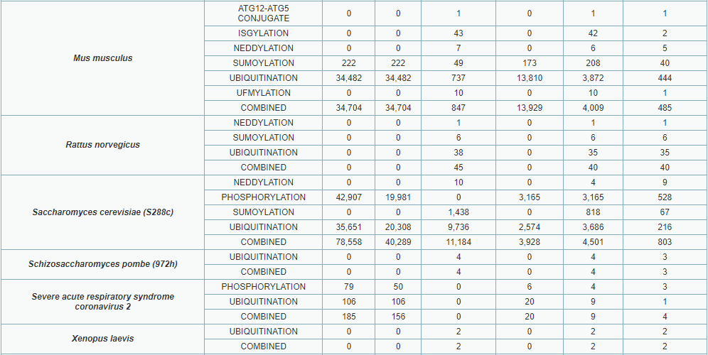
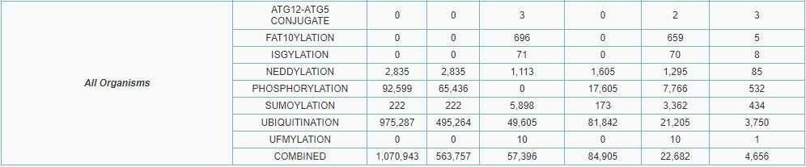

注：上面列出的各个生物体的数量总和可能超过 "ALL Organisms" 中的值，这是因为一些相互作用由于跨物种相互作用而被多次计数。

### 二. 数据支持
#### Experimental Evidence Codes

BioGRID 中的相互作用为两个蛋白质或基因之间的关系，并附有支持相互作用的证据代码和参考文献。术语“相互作用”不仅包括两个蛋白质的直接物理结合，还包括在稳定复合物中的共存和遗传相互作用。不能假定 BioGRID 中报告的相互作用是直接且物理性质的；实验系统定义如下，其表明了两个生物实体之间相互作用的证据性质。还应注意，BioGRID 中的某些相互作用具有不同级别的证据支持。BioGRID 只是整理出版物中的实验结果，不保证任何个别相互作用是真实的、已确立的或是当前社区的共识观点。整理支持相互作用的所有可用证据，使得来自各种来源的正交数据能够被汇总，从而使数据库用户能够自行决定该相互作用的存在和/或生理相关性的可信度。

| type     | name                          | description |
| -------- | ----------------------------- | ----------- |
| Physical | Affinity Capture-Luminescence |
|          | Affinity Capture-MS           |
|          | Affinity Capture-RNA          |
|          | Affinity Capture-Western      |
|          | Biochemical Activity          |
|          | Co-crystal Structure          |
|          | Co-fractionation              |
|          | Co-localization               |
|          | Co-purification               |
|          | Far Western                   |
|          | FRET                          |
|          | PCA                           |
|          | Protein-peptide               |
|          | Protein-RNA                   |
|          | Proximity Label-MS            |
|          | Reconstituted Complex         |
|          | Two-hybrid                    |
| Genetic  | Dosage Growth Defect          |
|          | Dosage Lethality              |
|          | Dosage Rescue                 |
|          | Negative Genetic              |
|          | Phenotypic Enhancement        |
|          | Phenotypic Suppression        |             |
|          | Positive Genetic              |
|          | Synthetic Growth Defect       |
|          | Synthetic Haploinsufficiency  |
|          | Synthetic Lethality           |
|          | Synthetic Rescue              |


### 三. 与 KEGG 数据库的比较


### 四. 数据下载

**BioGRID 提供了公开的可[下载](https://downloads.thebiogrid.org/BioGRID)数据集，包括当前版本、上一版本、已停用的历史版本等对应目录。**

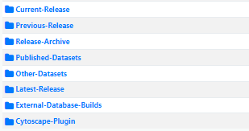

**这里使用脚本下载最新版本：**

```sh
wget https://downloads.thebiogrid.org/Download/BioGRID/Latest-Release/BIOGRID-ALL-LATEST.tab3.zip
```
> 不同文件名及格式文件说明：
    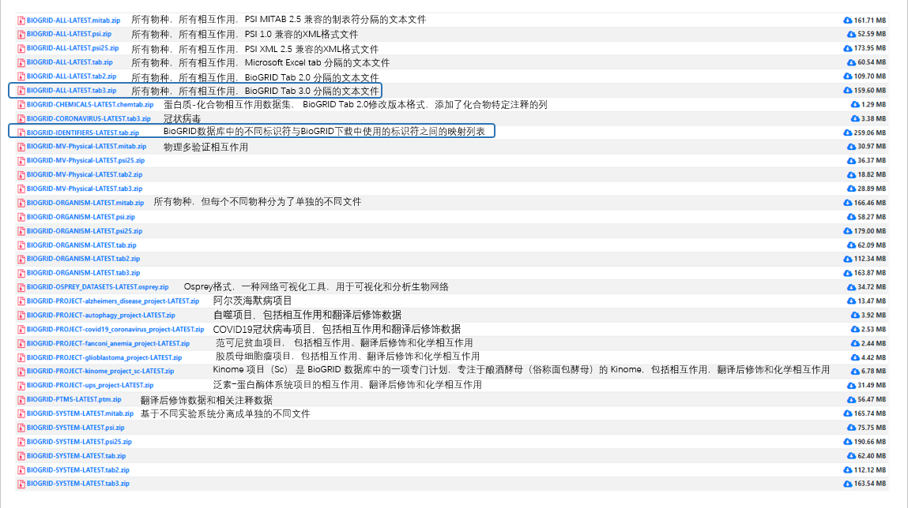

### 五. Network

**根据下载的 BioGRID 数据，绘制的图数据库关系图：**

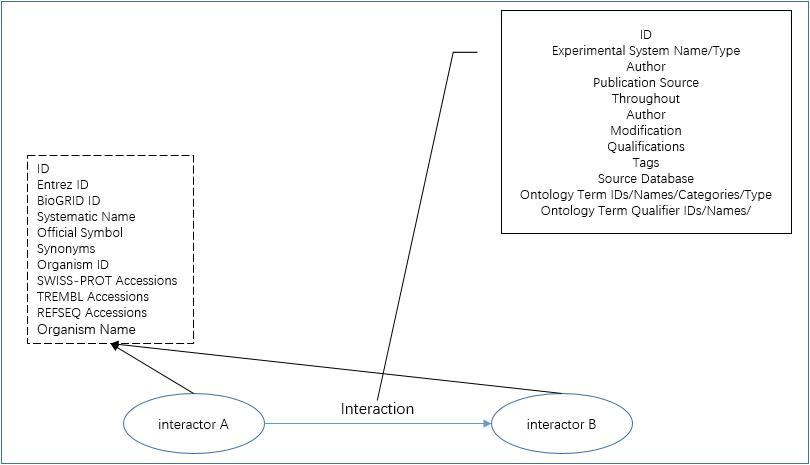

**示例**
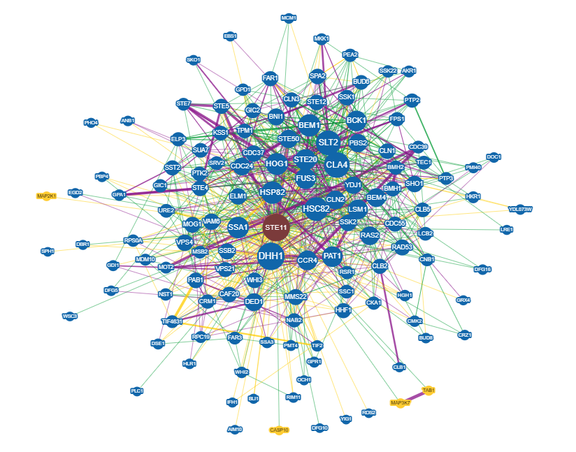
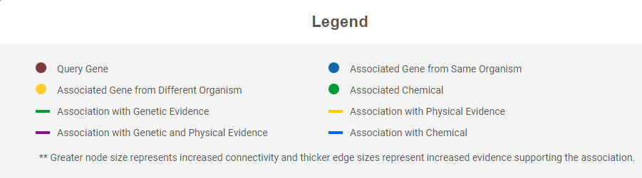

## Reference

- Oughtred R, Rust J, Chang C, Breitkreutz BJ, Stark C, Willems A, Boucher L, Leung G, Kolas N, Zhang F, Dolma S, Coulombe-Huntington J, Chatr-Aryamontri A, Dolinski K, Tyers M. The BioGRID database: A comprehensive biomedical resource of curated protein, genetic, and chemical interactions. Protein Sci. 2020 Oct 18. [ Pubmed ](https://pubmed.ncbi.nlm.nih.gov/33070389/), [ Protein Science ](https://doi.org/10.1002/pro.3978)
- Oughtred R, Stark C, Breitkreutz BJ, Rust J, Boucher L, Chang C, Kolas N, O'Donnell L, Leung G, McAdam R, Zhang F, Dolma S, Willems A, Coulombe-Huntington J, Chatr-Aryamontri A, Dolinski K, Tyers M. The BioGRID interaction database: 2019 update. Nucleic Acids Res. 2019 Jan 8;47(D1):D529-D541 [ Pubmed ](https://www.ncbi.nlm.nih.gov/pubmed/30476227), [ NAR ](https://academic.oup.com/nar/article/47/D1/D529/5204333)
- Chatr-Aryamontri A, Oughtred R, Boucher L, Rust J, Chang C, Kolas NK, O'Donnell L, Oster S, Theesfeld C, Sellam A, Stark C, Breitkreutz BJ, Dolinski K, Tyers M. The BioGRID interaction database: 2017 update. Nucleic Acids Res. 2016 Dec 14;2017(1) [ Pubmed ](https://www.ncbi.nlm.nih.gov/pubmed/27980099), [NAR ](http://nar.oxfordjournals.org/content/45/D1/D369)
- Oughtred R, Chatr-Aryamontri A, Breitkreutz BJ, Chang CS, Rust JM, Theesfeld CL, Heinicke S, Breitkreutz A, Chen D, Hirschman J, Kolas N, Livstone MS, Nixon J, O'Donnell L, Ramage L, Winter A, Reguly T, Sellam A, Stark C, Boucher L, Dolinski K, Tyers M. Use of the BioGRID Database for Analysis of Yeast Protein and Genetic Interactions. Cold Spring Harb Protoc. 2016 Jan 4;2016(1):pdb.prot088880 [ Pubmed ](http://www.ncbi.nlm.nih.gov/pubmed/26729909)
- Oughtred R, Chatr-Aryamontri A, Breitkreutz BJ, Chang CS, Rust JM, Theesfeld CL, Heinicke S, Breitkreutz A, Chen D, Hirschman J, Kolas N, Livstone MS, Nixon J, O'Donnell L, Ramage L, Winter A, Reguly T, Sellam A, Stark C, Boucher L, Dolinski K, Tyers M. BioGRID: A Resource for Studying Biological Interactions in Yeast. Cold Spring Harb Protoc. 2016 Jan 4;2016(1):pdb.top080754 [ Pubmed ](http://www.ncbi.nlm.nih.gov/pubmed/26729913)
- Wildenhain J, Spitzer M, Dolma S, Jarvik N, White R, Roy M, Griffiths E, Bellows DS, Wright GD, Tyers M. Prediction of Synergism from Chemical-Genetic Interactions by Machine Learning. Cell Systems. Dec. 23, 2015, 1(6):383-95. [ Pubmed ](http://www.ncbi.nlm.nih.gov/pubmed/27136353)
- Chatr-Aryamontri A, Breitkreutz BJ, Oughtred R, Boucher L, Heinicke S, Chen D, Stark C, Breitkreutz A, Kolas N, O'Donnell L, Reguly T, Nixon J, Ramage L, Winter A, Sellam A, Chang C, Hirschman J, Theesfeld C, Rust J, Livstone MS, Dolinski K, Tyers M. The BioGRID interaction database: 2015 update. Nucleic Acids Research. Nov. 2014, [ Pubmed ](http://www.ncbi.nlm.nih.gov/pubmed/25428363)
- Sadowski I, Breitkreutz BJ, Stark C, Su TC, Dahabieh M, Raithatha S, Bernhard W, Oughtred R, Dolinski K, Barreto K, Tyers M. The PhosphoGRID Saccharomyces cerevisiae Protein Phosphorylation Site Database: Version 2.0 Update. Database (Oxford) May 2013; [ Pubmed ](http://www.ncbi.nlm.nih.gov/pmc/articles/PMC3653121/)
- Chatr-Aryamontri A, Breitkreutz BJ, Heinicke S, Boucher L, Winter A, Stark C, Nixon J, Ramage L, Kolas N, O'Donnell L, Reguly T, Breitkreutz A, Sellam A, Chen D, Chang C, Rust JM, Livstone MS, Oughtred R, Dolinski K, Tyers M. The BioGRID Interaction Database: 2013 update. Nucleic Acids Res. 2012 Nov 30. [ Pubmed ](http://www.ncbi.nlm.nih.gov/pubmed/23203989)
- Winter AG, Wildenhain J, Tyers M. BioGRID REST Service, BiogridPlugin2 and BioGRID WebGraph: new tools for access to interaction data at BioGRID. Bioinformatics, 2011 Apr 1. [ Pubmed ](http://www.ncbi.nlm.nih.gov/pubmed/21300700)
- Stark C, Breitkreutz BJ, Chatr-Aryamontri A, Boucher L, Oughtred R, Livstone MS, Nixon J, Van Auken K, Wang X, Shi X, Reguly T, Rust JM, Winter A, Dolinski K, Tyers M. The BioGRID Interaction Database: 2011 update. Nucleic Acids Res. 2010 Nov 11. [ Pubmed ](http://www.ncbi.nlm.nih.gov/pubmed/21071413)
- Breitkreutz A, Choi H, Sharom JR, Boucher L, Neduva V, Larsen B, Lin ZY, Breitkreutz BJ, Stark C, Liu G, Ahn J, Dewar-Darch D, Reguly T, Tang X, Almeida R, Qin ZS, Pawson T, Gingras AC, Nesvizhskii AI, Tyers M. A global protein kinase and phosphatase interaction network in yeast. Science. 2010 May 21;328(5981):1043-6. [ Pubmed ](http://www.ncbi.nlm.nih.gov/pubmed/20489023)
- Stark C, Ting-Cheng Su, Breitkreutz A, Lourenco P, Dahabieh M, Breitkreutz BJ, Tyers M, Sadowski I. PhosphoGRID: a database of experimentally verified in vivo protein phosphorylation sites from the budding yeast Saccharomyces cerevisiae. Database. 2010 Jan; Vol. 2010 [ Pubmed ](http://www.ncbi.nlm.nih.gov/pubmed/20428315)
- Salwinski L, Licata L, Winter A, Thorneycroft D, Khadake J, Ceol A, Aryamontri AC, Oughtred R, Livstone M, Boucher L, Botstein D, Dolinski K, Berardini T, Huala E, Tyers M, Eisenberg D, Cesareni G, Hermjakob H. Recurated protein interaction datasets. Nat Methods. 2009 Jan;6(1):39-46. [ Pubmed ](http://www.ncbi.nlm.nih.gov/pubmed/19935838)
- Breitkreutz BJ, Stark C, Reguly T, Boucher L, Breitkreutz A, Livstone M, Oughtred R, Lackner DH, Bähler J, Wood V, Dolinski K, Tyers M. The BioGRID Interaction Database: 2008 update. Nucleic Acids Res. 2008 Jan;36(Database issue):D637-40. Epub 2007 Nov 13. [ Pubmed ](http://www.ncbi.nlm.nih.gov/pubmed/18000002)
- Reguly T, Breitkreutz A, Boucher L, Breitkreutz BJ, Hon GC, Myers CL, Parsons A, Friesen H, Oughtred R, Tong A, Stark C, Ho Y, Botstein D, Andrews B, Boone C, Troyanskya OG, Ideker T, Dolinski K, Batada NN, Tyers M. Comprehensive curation and analysis of global interaction networks in Saccharomyces cerevisiae. J Biol. 2006;5(4):11. Epub 2006 Jun 8. [ Pubmed ](http://www.ncbi.nlm.nih.gov/pubmed/16762047)
- Stark C, Breitkreutz BJ, Reguly T, Boucher L, Breitkreutz A, Tyers M. BioGRID: a general repository for interaction datasets. Nucleic Acids Res. 2006 Jan 1;34(Database issue):D535-9. [ Pubmed ](http://www.ncbi.nlm.nih.gov/pubmed/16381927)
- Breitkreutz BJ, Stark C, Tyers M. The GRID: the General Repository for Interaction Datasets. Genome Biol. 2003;4(3):R23. Epub 2003 Feb 27. [ Pubmed ](http://www.ncbi.nlm.nih.gov/pubmed/12620108)
- Breitkreutz BJ, Stark C, Tyers M. Osprey: a network visualization system. Genome Biol. 2003;4(3):R23. Epub 2003 Feb 27. [ Pubmed ](http://www.ncbi.nlm.nih.gov/pubmed/12620107)

