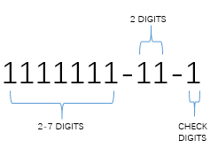
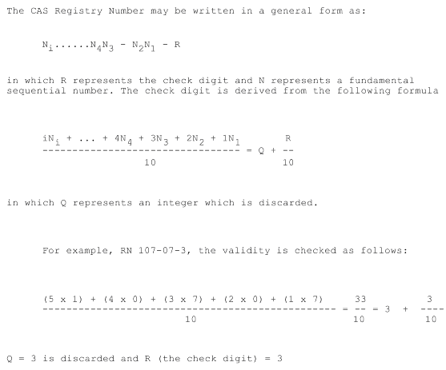

<h1 align="center">CAS — 化学物质标识符</h1>

    编写作者：wu_jiannan /
    编写时间：2024.06.07

    <a href='https://www.cas.org/'>Website</a> •
    <a href="#四-数据下载">Download</a> •
    <a href="CAS_metadata.md">Metadata</a> 

**简介**

CAS号，全称为Chemical Abstracts Service Number（化学文摘服务登记号），是一个独特的数值标识符，用于标识化学物质。它由美国化学文摘社（Chemical Abstracts Service, CAS）分配给每一种公开的化学物质。CAS号是全球公认的化学物质唯一标识符，广泛应用于化学、药学、生物学等领域。

### 一. CAS详情

#### 1. CAS号结构

CAS号最`多可以包含 10 位数字`, 通常由`三部分`组成，以连字符分隔，如下所示：

第一部分：一串数字，2 到 7 位;
第二部分：两位数;
第三部分：一位数，校验位*；

*注：校验数字是根据前面部分的数字通过特定的算法计算得到的，确保CAS号的唯一性和有效性。

#### 2. CAS号应用

- 化学品识别：CAS号可以唯一地标识一种化学物质，避免因不同名称、别名或语言差异导致的混淆。
- 数据库查询：科研人员和化学家可以通过CAS号在化学文摘数据库、专利数据库和其他化学信息资源中查找特定化学物质的信息。
- 法规遵从：CAS号在化学品安全和法规遵从方面起重要作用，如化学品注册、评估和授权（REACH）等法规。
- 学术研究：CAS号广泛用于学术论文、研究报告和化学文献中，帮助研究人员精确引用和交流化学物质信息。

#### 3. 获取CAS号

CAS号可以通过多种方式获取：

- CAS数据库：在Chemical Abstracts Service的官方网站上搜索特定化学物质;
- 科学文献：在相关化学文献、期刊和专利中找到化学物质的CAS;
- 化学品供应商：许多化学品供应商在产品标签和技术文档中提供CAS号；

常用网站介绍：

- [CAS SciFinder](https://www.cas.org/solutions/cas-scifinder-discovery-platform/cas-scifinder-n) 是全世界最大、最全面的化学和科学信息数据库，可以查看所有期刊文献和专利摘要，以及近亿的化学物质记录和CAS号；在`SciFinder`数据库中又包含了多种数据库，如 [CAS REGISTRY数据库](https://www.cas.org/cas-data/cas-registry)，记录了1.92亿多化学物质的化学名、CAS登记号、分子式、化学结构、理化性质等信息；
    `根据机构类型和订阅内容，订阅费用通常在几千美元到几万美元不等；`
- [ChemSpider](http://www.chemspider.com)
    - 英文，已被RSC收购，收录化学品2000多万，支持CAS号，英文名及结构查询

- [ChemExper](http://www.chemexper.com)
    - 英文，支持CAS号，英文名，结构查询及SMILES查询；

- [chemfinder](http://chemfinder.cambridgesoft.com/)
    - 英文，注册后才可免费使用

-  [ichemistry](http://www.ichemistry.cn)   
    - 中文, 是百度搜索里点击率最高的
    - 收录化学品**47万多**，支持CAS号，中文名，英文名，分子式及结构查询(可以免费创建自己的在线试剂库)
    - 化工产品 CAS 登录号大全：从37-82-1 到 2563355-28-0
    - 详情包括：物理化学性质、安全信息、其他信息，供应商

- [ChembLink](https://www.chemblink.com/indexC.htm)
    - 中英文化学品数据库
    - 收录化学品?多， 从 36-88-4 到 2941535-53-9 ，支持CAS号，分子式及供应商查询
    - **收录cas号数量及点击量排名都不如Chemical Book**
    - [网站受欢迎排名](https://www.similarweb.com/website/chemblink.com/competitors/)

- [中科院上海有机化学研究所化学专业数据库](http://chemdb.sgst.cn/ssdb/main/dblogin.asp)
    - 中文，还有一些谱图数据, **收费**；

- [洛克化工网](http://www.lookchem.cn)
    - 中英文，支持CAS号，分子式及供应商查询

- [Chemical Book](https://www.chemicalbook.com/CASDetailList_0.htm) 
    - 中英文
    - 可以使用中文名称,CAS号,英文名称,分子式,分子量等多种方式检索需要的化学品信息资源.
    - 详情包括：物理化学性质、安全信息、应用领域、制备方法、上下游产品信息、MSDS、图谱信息
    - 10-00-4 到 2845127-97-9（23236842）
    
- [元素百科CAS号查询网站](http://cas.b2star.com/)
    - 是化工行业最大的CAS号数据库（cas no，又称cas登录号）, 收录了上百万化学品cas号的cas号大全.
    - 2368007

- [化源网](https://www.chemsrc.com/casindex/)
    - 有中文MSDS

- [杭州智化](https://www.xixisys.com/)
    - 提供400多万中英文MSDS文件(有防爬虫保护)

- [ChemNet](https://cheman.chemnet.com/dict/zd_more.html)
    - 收录了`近180万CAS号`, 但只可获取部分；

### 二. 数据下载

- index下载 —— 已完成 ChemicalBook 网站中的列出的，后续还会补充；
- 信息下载 - 清洗代码已完成，数据下载进行中：
    - CAS base info，包含CAS基本信息和物理化学性质信息 - 清洗代码已完成；
    - CAS详细信息pdf格式文件 - 清洗代码已完成；
    - CAS中文 MSDS pdf格式文件 - 清洗代码已完成；
    - MSDS对应的CBnumber下载 - 需付费，终止；

| 下载内容                       | 来源         | 格式 |
| ------------------------------ | ------------ | ---- |
| CAS index                      | ChemicalBook | txt  |
| CAS 基本信息＋物理化学性质信息 | ChemicalBook | tsv  |
| CAS 完整信息                   | ChemicalBook | pdf  |
| CAS MSDS                       | ChemicalBook | pdf  |
