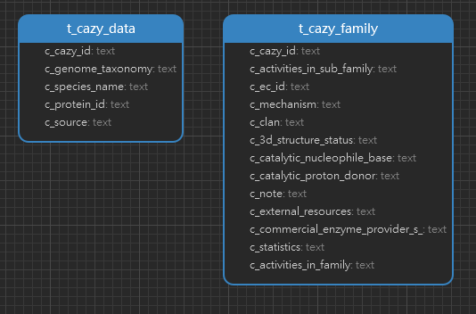

<h1 align="center">CAZy Tables 详情</h1>

#### 一. 数据统计

| 表名          | 行数      |
| ------------- | --------- |
| t_cazy_data   | 3,872,853 |
| t_cazy_family | 809       |

#### 二. ER 图

#### 三. Tables

1. t_cazy_data

    | 字段名          | 注释       | 数据类型 |
    | --------------- | ---------- | -------- |
    | cazy_id         | 酶的索引号 | text     |
    | genome_taxonomy | 基因组分类 | text     |
    | species_name    | 物种名称   | text     |
    | protein_id      | 蛋白id     | text     |
    | source          | 来源       | text     |

2. t_family

    | 字段名                          | 注释             | 数据类型 |
    | ------------------------------- | ---------------- | -------- |
    | c_cazy_id                       | 酶的索引号       | text     |
    | c_activities_in_sub_family      | 亚家族中的活性   | text     |
    | c_ec_id                         | EC id            | text     |
    | c_mechanism                     | 机制             | text     |
    | c_clan                          | 蛋白质家族       | text     |
    | c_3D_structure_status           | 三维结构状态     | text     |
    | c_catalytic_nucleophile_or_base | 催化核苷酸或碱基 | text     |
    | c_catalytic_proton_donor        | 催化质子给予体   | text     |
    | c_note                          | 注释             | text     |
    | c_external_resources            | 外部资源         | text     |
    | c_commercial_enzyme_providers   | 商业酶提供商     | text     |
    | c_statistics                    | 统计数据         | text     |
    | c_activities_in_family          | 家族中的活性     | text     |