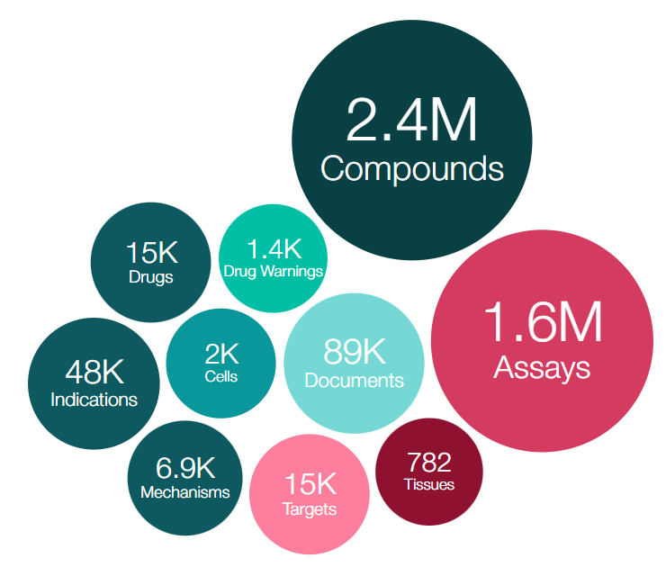
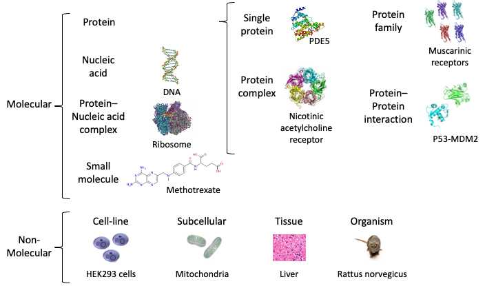
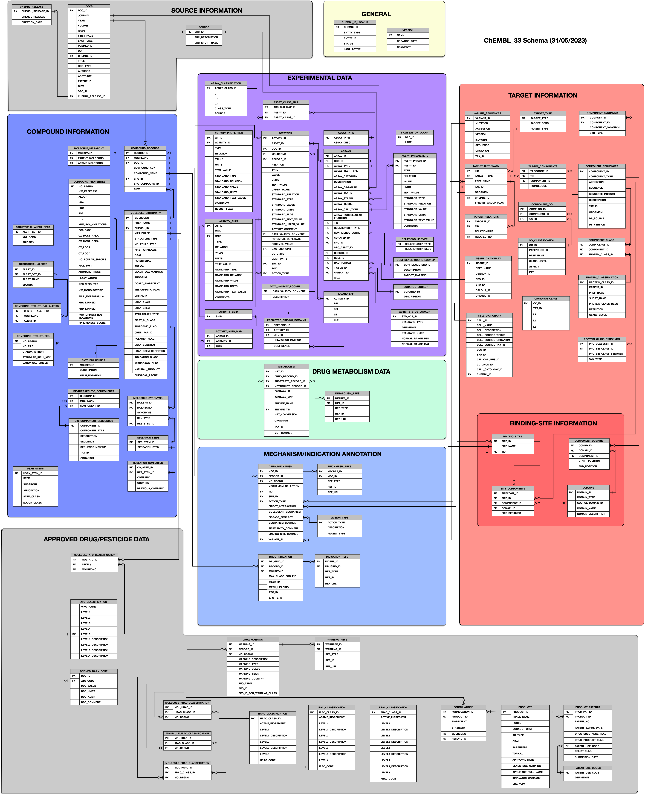

# ChEMBL
## 简介

-   ChEMBL（化合物生物活性数据库）是一个手工校准的`具有药物样性质的生物活性分子`数据库，包含了<u>化合物、药物、靶点、适应症、代谢、细胞、组织、实验数据、文献、专利信息</u>等多个方面的信息。
-   实验数据、序列、细胞、代谢、靶点的数据涉及`各类物种`。




-   数据库包括了处于各个临床阶段的化合物（见下表），还包括了农药（杀真菌剂/FRAC/fungicide，除草剂/HRAC/herbicide，杀虫剂/IRAC/insecticide）。

| ChEMBL 32               | ChEMBL中的定义特征                                     | ChEMBL中的典型特征                                    | ChEMBL中偶尔或缺少的特征                   |
|-------------------------|----------------------------------------------------|---------------------------------------------------|----------------------------------------|
| 临床前化合物（约2.3百万） | 必须具有生物活性数据                                   | 通常是针对靶标的测定。通常来自科学文献或已存储的数据集                                  | 可能有适应症、安全警告或机制信息（如果也是药物）。        |
| 临床候选药物（约14k）       | 必须来自临床候选药物信息源（例如USAN、INN、ClinicalTrials） | 有一个pref_name，可以是可识别的药品名称，也可以是研究代码。可能具有适应症和机制信息。 |通常不具有生物活性数据。不具有安全警告数据。                 |
| 已批准药物（约4k）         | 必须来自已批准药物信息源（例如FDA、WHO ATC、EMA、BNF）   | 有一个pref_name，通常是可识别的药品名称。通常具有适应症和机制信息。可能具有安全警告信息。                   |通常具有生物活性数据（即也是临床前化合物）。可能还是临床候选药物。                |

-   实验数据主要包含以下类别：
    -   结合（B） - 测量化合物与分子靶标结合的数据，例如Ki、IC50、Kd。
    -   功能性（F） - 测量化合物生物效应的数据，例如细胞系中的细胞死亡百分比，大鼠体重。
    -   ADME（A） - 药物代谢动力学数据，例如半衰期（t1/2）、口服生物利用度。
    -   毒性（T） - 测量化合物毒性的数据，例如细胞毒性。
    -   物理化学性质（P） - 在没有生物材料的情况下测量化合物的物理化学性质的实验，例如化学稳定性、溶解度。细节请见[附录1](#附录1details-on-chembl-compound-properties)
    -   未分类（U） - 少量实验无法归类到以上任何一类，例如结合与效力比率。
    
    > ChEMBL为实验到靶点的关系定义了`confidence score`，以反映<u>分配给特定实验的靶点类型（例如：单个蛋白、蛋白家族、细胞系等）以及分配的靶点是该实验的正确靶点的置信度</u>。一个具体的分子靶点（例如：单个蛋白）会有比多蛋白靶点（例如：蛋白家族/复合体）或非分子靶点（例如：细胞系）更高的分数。confidence score的范围从0（尚未筛选的数据条目）到9（单个蛋白靶点被分配了高度的置信度）。分配了非分子靶点类型的实验，例如细胞系或生物体，会获得confidence score为1，而分配了蛋白靶点的实验至少获得confidence score为4。如果在初始映射过程中无法获得正确的靶点，有时会将实验映射到来自不同物种的同源物（confidence较低，即8）。如果靶点蛋白的来源未定义/未知，分配可能默认为人类，但会分配confidence score为8，以反映同源物映射的可能性。

-   靶点主要类别



-   可下载化合物的[SDF文件](https://ftp.ebi.ac.uk/pub/databases/chembl/ChEMBLdb/latest/)（未入库）


## FAQ
### 关于protein varients
-   [How does ChEMBL treat protein variants?](https://chembl.gitbook.io/chembl-interface-documentation/frequently-asked-questions/target-questions#how-does-chembl-treat-protein-variants)
-   ChEMBL将蛋白质映射到UniProt的accession，并且`parent蛋白质和varients将具有相同的ChEMBL_ID`。`varients还映射到一个variant_ID`，用于区分它们与wild-type蛋白质（variant_ID为null）。varients可能包含单个或多个突变，其中包括定义的（例如:单个氨基酸变化）或未定义的（例如:deletion mutants，映射到variant_ID为-1）变化。`variant sequences table`包含了变异残基和序列的详细信息。

### 关于isoforms
-   [How are isoforms treated by ChEMBL?](https://chembl.gitbook.io/chembl-interface-documentation/frequently-asked-questions/target-questions#how-does-chembl-treat-protein-variants)
-   ChEMBL`将同一蛋白质的不同isoform映射到一个UniProt accession上`。有时，研究人员会在单独的实验中测试不同的异构体，在这些情况下，每个isoform将记录一个assay。`isoform的详细信息记录在assay description中`。例如：实验 CHEMBL672502 测试多巴胺受体D2L的结合亲和力，实验 CHEMBL670556 测试多巴胺受体D2S的化合物结合亲和力。`variant sequences table`记录了序列是否为isoform。


## 数据下载
-   dmp format for pg: https://ftp.ebi.ac.uk/pub/databases/chembl/ChEMBLdb/latest/
下载chembl_33_postgresql.tar.gz并导入pg
-   RDF format: https://ftp.ebi.ac.uk/pub/databases/chembl/ChEMBL-RDF/

## 数据组织形式

详见[schema](#schema)，主要包含以下8个部分：

-   general
-   source information
-   compound information
-   target information
    -   binding site information
-   experimental data
-   drug metabolism data
-   metabolism/indication annoatation
-   approved drug/pesticide data

> CHEMBL_ID 作为unique ID被分配给化合物、靶点、实验数据、文献、组织和细胞类型。

> ChEMBL可以和`Uniprot` (COMPONENT_SEQUENCES.ACCESSION，[mapping文件](https://ftp.ebi.ac.uk/pub/databases/chembl/ChEMBLdb/releases/chembl_33/chembl_uniprot_mapping.txt))、`PubChem SID` (COMPOUND_RECORDS.SRC_COMPOUND_ID if SRC_ID=7，[SQL语句参考](#only-extract-the-pubchem-data-from-chembl))交叉引用。

## 数据更新
-   每年更新2-3个release。
-   目前使用官方提供的pg的dmp文件入库，包含了主键和外键信息，因此暂不支持增量更新。

## schema
-   https://ftp.ebi.ac.uk/pub/databases/chembl/ChEMBLdb/releases/chembl_33/chembl_33_schema.png



## metadata
- [官方metadata](https://ftp.ebi.ac.uk/pub/databases/chembl/ChEMBLdb/releases/chembl_33/schema_documentation.html)包含了全部79个table的table info和column info。
- 全部metadata的tsv: 220和202服务器，/fs/xu_xintian/chembl/metadata


## 入库情况
ChEMBL_33已入库

## 附录1：Details on ChEMBL compound properties

[下载附件](https://318940133-files.gitbook.io/~/files/v0/b/gitbook-legacy-files/o/assets%2F-LEybeKogIn-6VllQQKY%2F-M9ZCyyklxBWnDSjmbMZ%2F-M9ZDk1OrQ21hn_Rukxx%2Fproperty_definitions_ChEMBL_26.docx?alt=media&token=f42f3eeb-9c1d-4fbd-8e9f-77a07511e6c9)

## 附录2：SQL examples
### Retrieve all the bioactivity data for bacterial targets

```sql
SELECT md.chembl_id AS compound_chembl_id,
cs.canonical_smiles,
act.standard_type,
act.standard_value,
act.standard_units,
td.chembl_id AS target_chembl_id,
td.organism,   td.pref_name
FROM target_dictionary td
  JOIN assays a ON td.tid = a.tid
  JOIN activities act ON a.assay_id = act.assay_id
  JOIN molecule_dictionary md ON act.molregno = md.molregno
  JOIN compound_structures cs ON md.molregno   = cs.molregno
  JOIN organism_class oc ON td.tax_id = oc.tax_id
    AND oc.L1 = 'Bacteria';
```

### Retrieve activity details for compound and all its salts which have an IC50 bioactivity value in nM against a target of interest

```sql
-- Compound is Sildenafil (CHEMBL192)
-- Target is human PDE5 (CHEMBL1827)
SELECT m.chembl_id AS compound_chembl_id,
s.canonical_smiles,
r.compound_key,
NVL(TO_CHAR(d.pubmed_id),d.doi) AS pubmed_id_or_doi,
a.description                   AS assay_description,
act.standard_type,
act.standard_relation,
act.standard_value,
act.standard_units,
act.activity_comment,
t.chembl_id                    AS target_chembl_id,
t.pref_name                    AS target_name,
t.organism                     AS target_organism
FROM compound_structures s
  RIGHT JOIN molecule_dictionary m ON s.molregno = m.molregno
  JOIN compound_records r ON m.molregno = r.molregno
  JOIN docs d ON r.doc_id = d.doc_id
  JOIN activities act ON r.record_id = act.record_id
  JOIN assays a ON act.assay_id = a.assay_id
  JOIN target_dictionary t ON a.tid = t.tid
    AND t.chembl_id      = 'CHEMBL1827'
    AND m.chembl_id IN
         (SELECT DISTINCT
            m1.chembl_id
          FROM molecule_dictionary m1
            JOIN molecule_hierarchy mh ON mh.molregno = m1.molregno
            JOIN molecule_dictionary m2 ON mh.parent_molregno = m2.molregno
              AND m2.chembl_id = 'CHEMBL192')
    AND act.standard_type = 'IC50'
    AND act.standard_units = 'nM';
```

### Retrieve compounds which are selective to one target over a second target

```sql
-- Compounds which are selective for Human CDK2 (CHEMBL301) over Human CDK5 (CHEMBL4036) 
-- Selectivity is based on comparing binding affinities using IC50 values.  
SELECT md.chembl_id,
cs.canonical_smiles
FROM target_dictionary td
  JOIN assays a ON td.tid = a.tid
  JOIN activities act ON a.assay_id = act.assay_id
  JOIN molecule_dictionary md ON md.molregno = act.molregno
  JOIN compound_structures cs ON md.molregno = cs.molregno
    AND act.standard_relation = '='
    AND act.standard_type     IN ('IC50')
    AND act.standard_units    = 'nM'
    AND act.standard_value    < 50
    AND td.chembl_id          = 'CHEMBL301'
INTERSECT
SELECT md.chembl_id,
cs.canonical_smiles
FROM target_dictionary td
  JOIN assays a ON td.tid = a.tid
  JOIN activities act ON a.assay_id = act.assay_id
  JOIN molecule_dictionary md ON md.molregno = act.molregno
  JOIN compound_structures cs ON md.molregno = cs.molregno
AND act.standard_relation     = '='
AND act.standard_type         IN ('IC50')
AND act.standard_units        = 'nM'
AND act.standard_value        > 200
AND td.chembl_id              = 'CHEMBL4036';
```
### Retrieve target ChEMBL_ID, target_name, target_type, protein accessions and sequences for all protein targets

```sql
SELECT t.chembl_id AS target_chembl_id,
t.pref_name        AS target_name,
t.target_type,
c.accession        AS protein_accession,
c.sequence         AS protein_sequence
FROM target_dictionary t
  JOIN target_type tt ON t.target_type = tt.target_type
  JOIN target_components tc ON t.tid = tc.tid
  JOIN component_sequences c ON tc.component_id = c.component_id
AND tt.parent_type  = 'PROTEIN';
```

### Retrieve PK data from 'Curated Drug Pharmacokinetic Data' source in ChEMBL for drug

```sql
-- Data for levofloxacin
SELECT DISTINCT
  d.title,
  min(decode(ap.standard_type, 'DATASET', nvl(to_char(ap.standard_value), ap.standard_text_value)))         dataset,
  a.assay_id,
  a.description,
  min(decode(actp.standard_type, 'DOSED_COMPOUND_NAME',
             nvl(to_char(actp.standard_value), actp.standard_text_value) || ' ' ||
             actp.standard_units))                                                                          dosed_compound_name,
  min(decode(actp.standard_type, 'DOSE',
             nvl(to_char(actp.standard_value), actp.standard_text_value) || ' ' || actp.standard_units))    dose,
  min(decode(actp.standard_type, 'DOSAGE_FORM',
             nvl(to_char(actp.standard_value), actp.standard_text_value) || ' ' || actp.standard_units))    dosage_form,
  min(decode(actp.standard_type, 'REGIMEN',
             nvl(to_char(actp.standard_value), actp.standard_text_value) || ' ' || actp.standard_units))    regimen,
  min(decode(actp.standard_type, 'ROUTE', nvl(to_char(actp.standard_value), actp.standard_text_value)))     route,
  min(decode(actp.standard_type, 'GENDER', nvl(to_char(actp.standard_value), actp.standard_text_value)))    gender,
  min(decode(actp.standard_type, 'AGE_RANGE', nvl(to_char(actp.standard_value), actp.standard_text_value))) age_range,
  min(decode(actp.standard_type, 'HEALTH_STATUS', nvl(to_char(actp.standard_value),
                                                      actp.standard_text_value)))                           health_status,
  min(decode(actp.standard_type, 'TISSUE', nvl(to_char(actp.standard_value),
                                                      actp.standard_text_value)))                           tissue,
  cr.molregno,
  cr.compound_name,
  act.activity_id,
  act.toid,
  act.standard_type,
  act.standard_relation,
  act.standard_value,
  act.standard_units,
  act.activity_comment
FROM source s
  JOIN compound_records cr ON s.src_id = cr.src_id
  JOIN docs d ON d.doc_id = cr.doc_id
  JOIN activities act ON cr.record_id = act.record_id AND cr.doc_id = act.doc_id
  JOIN activity_properties actp ON act.activity_id = actp.activity_id
  JOIN assays a ON act.assay_id = a.assay_id
  JOIN assay_parameters ap ON a.assay_id = ap.assay_id
                              AND s.src_description = 'Curated Drug Pharmacokinetic Data'
                              AND cr.compound_name LIKE 'LEVOFLOXACIN%'
GROUP BY d.title, a.assay_id, a.description, cr.molregno, cr.compound_name, act.activity_id, act.toid,
  act.standard_type, act.standard_relation, act.standard_value, act.standard_units, act.activity_comment
ORDER BY cr.compound_name, act.toid, act.standard_type;
```

### Retrieve compound activity details for all targets containing a protein of interest

```sql
-- Protein of interest is human M2 muscarinic receptor (P08172) 
SELECT DISTINCT
  m.chembl_id                      AS compound_chembl_id,
  s.canonical_smiles,
  r.compound_key,
  NVL(TO_CHAR(d.pubmed_id), d.doi) AS pubmed_id_or_doi,
  a.description                    AS assay_description,
  act.standard_type,
  act.standard_relation,
  act.standard_value,
  act.standard_units,
  act.activity_comment,
  t.chembl_id                      AS target_chembl_id,
  t.pref_name                      AS target_name,
  t.target_type
FROM compound_structures s
  RIGHT JOIN molecule_dictionary m ON s.molregno = m.molregno
  JOIN compound_records r ON m.molregno = r.molregno
  JOIN docs d ON r.doc_id = d.doc_id
  JOIN activities act ON r.record_id = act.record_id
  JOIN assays a ON act.assay_id = a.assay_id
  JOIN target_dictionary t ON a.tid = t.tid
  JOIN target_components tc ON t.tid = tc.tid
  JOIN component_sequences cs ON tc.component_id = cs.component_id
    AND cs.accession = 'P08172';
```

### Retrieve compound activity details for a target

```sql
 -- Target is Human PDE5 (CHEMBL1827) 
SELECT m.chembl_id AS compound_chembl_id,   
s.canonical_smiles,   
r.compound_key,   
NVL(TO_CHAR(d.pubmed_id),d.doi) AS pubmed_id_or_doi,   
a.description                   AS assay_description,   act.standard_type,   
act.standard_relation,   
act.standard_value,   
act.standard_units,   
act.activity_comment 
FROM chembl.compound_structures s
 RIGHT JOIN chembl.molecule_dictionary m on s.molregno = m.molregno 
 JOIN chembl.compound_records r on m.molregno = r.molregno  
 JOIN chembl.docs d on r.doc_id = d.doc_id 
 JOIN chembl.activities act on r.record_id = act.record_id
 JOIN chembl.assays a on act.assay_id = a.assay_id 
 JOIN chembl.target_dictionary t on a.tid = t.tid 
AND t.chembl_id = 'CHEMBL1827';
```

### Only extract the PubChem data from ChEMBL

```sql
-- The source id for PubChem data is found in the SOURCE table and is ‘7’.
-- Please note that this will bring back over 4,000,000 data points
SELECT DISTINCT
  md.molregno,
  cs.canonical_smiles,
  md.chembl_id,
  act.standard_type,
  act.standard_value,
  act.standard_units
FROM activities act
  JOIN molecule_dictionary md ON act.molregno = md.molregno
  JOIN compound_structures cs ON md.molregno = cs.molregno
  JOIN compound_records cr ON cr.molregno = act.molregno
  JOIN source src ON src.src_id = cr.src_id
    AND src.src_id = '7';
```

###  Extract gene symbols for the target

从component_synonyms table中获取

```sql
select td.chembl_ID as target_chembl_ID, td.organism, td.tax_ID, td.pref_name, cs.component_synonym
from chembl.target_dictionary td
left join chembl.target_components tc on td.tid=tc.tid
left join chembl.component_synonyms cs on tc.component_ID=cs.component_ID
where syn_type = 'GENE_SYMBOL' -- you can include other synonym types if needed
and chembl_ID = 'CHEMBL204' -- Melanocortin receptor 1 as an example
```