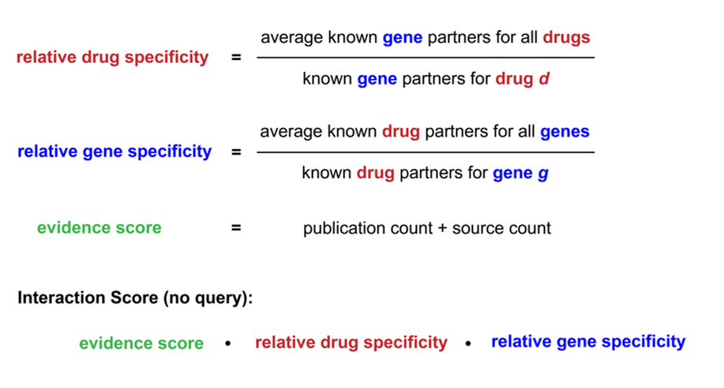
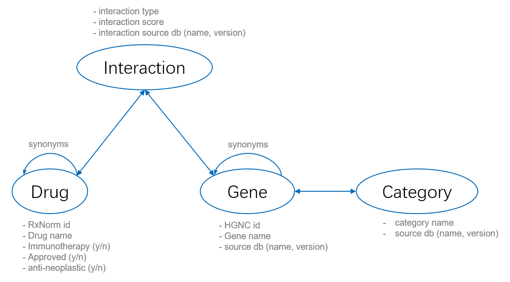
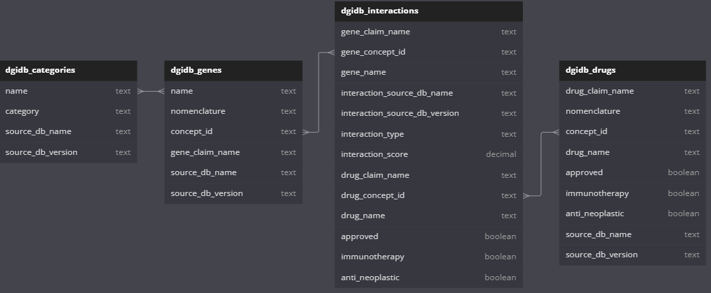
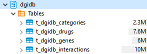

# DGIdb

## 简介
-   DGIdb（药物-基因相互作用数据库）的目标是对`人类基因`进行注释，了解（1）已知`药物-基因相互作用`和（2）`作为靶点的潜力`。
-   通过专家筛选和文本挖掘的组合，DGIdb从DrugBank、PharmGKB、ChEMBL、Drug Target Commons等数据库中挖掘药物-基因相互作用。根据基因所属的基因本体（GO）、人体蛋白质图谱（Human Protein Atlas）、IDG、Hopkins和Groom（2002年）以及Russ和Lampel（2005年）提出的“可药靶基因组”列表，以及其他来源中的分子功能和基因家族，DGIdb将基因分类为潜在可药靶类别。
-   DGIdb整理自[30多个数据库](https://www.dgidb.org/browse/sources)，包含超过<u>10,000个基因</u>和<u>15,000种药物</u>，这些基因和药物涉及<u>50,000多对药物-基因相互作用</u>和<u>41个潜在[可药靶基因类别](#gene_categories)</u>。这些药物-基因相互作用可细分为<u>31个[相互作用类型](#interaction_types_and_directionalities)</u>（例如：抑制剂、激活剂、辅因子、配体、疫苗等），这些相互作用类型可概括为inhibitory和activating两大类。

-   目前，DGIdb`不提供`关于特定`突变`可药靶性的任何信息。

### 关于Interaction Score

DGIdb通过自定义的interaction score衡量药物-基因互作。计算方式见下图。由于interaction score取决于已知会互作的药物和基因数量，以及文献和来源数据库中条目的数量，随着来源数据库的更新和新文献被添加，`interaction score可能会发生变化`。

## 数据下载
https://www.dgidb.org/downloads

## 数据组织形式

## 数据更新
不定期更新 ([更新历史](https://github.com/dgidb/dgidb-v5/releases/))。

## schema

## metadata
### dgidb_categories

| column              | dtype | description                                                                                                        |   |
|---------------------|-------|--------------------------------------------------------------------------------------------------------------------|---|
| c_name              | text  | Gene symbol.                                                                                                       |   |
| c_category          | text  | Gene categories in DGIdb refers to a set of genes belonging to a group that is deemed to be potentially druggable. |   |
| c_source_db_name    | text  | The name of the source database.                                                                                   |   |
| c_source_db_version | text  | The version of the source database.                                                                                |

### dgidb_drugs

| column              | dtype   | description                                       |   |
|---------------------|---------|---------------------------------------------------|---|
| c_drug_claim_name   | text    | Drug claim name in diverse databases.             |   |
| c_nomenclature      | text    | Nomenclature of the drug claim name.              |   |
| c_concept_id        | text    | Unique concept id of the drug. (from RxNorm)      |   |
| c_drug_name         | text    | Name of the drug.                                 |   |
| c_approved          | boolean | Whether the drug is approved or not.              |   |
| c_immunotherapy     | boolean | Whether the drug belongs to immunotherapy or not. |   |
| c_anti_neoplastic   | boolean | Whether the drug is anti-neoplastic or not.       |   |
| c_source_db_name    | text    | The name of the source databases.                 |   |
| c_source_db_version | text    | The version of the source database.               |

### dgidb_genes

| column              | dtype | description                                |   |
|---------------------|-------|--------------------------------------------|---|
| c_name              | text  | The name of the gene.                      |   |
| c_nomenclature      | text  | Nomenclature of the gene claim name.       |   |
| c_concept_id        | text  | Unique concept id of the gene. (from HGNC) |   |
| c_gene_claim_name   | text  | Gene claim name in diverse databases.      |   |
| c_source_db_name    | text  | The name of the source databases.          |   |
| c_source_db_version | text  | The version of the source database.        |

### dgidb_interactions

| column                          | dtype   | description                                       |   |
|---------------------------------|---------|---------------------------------------------------|---|
| c_gene_claim_name               | text    | Gene claim name in diverse databases.             |   |
| c_gene_concept_id               | text    | Unique concept id of the gene. (from HGNC)        |   |
| c_gene_name                     | text    | Name of the gene.                                 |   |
| c_interaction_source_db_name    | text    | The name of the interaction source databases.     |   |
| c_interaction_source_db_version | text    | The version of the interaction source database.   |   |
| c_interaction_type              | text    | The type of the gene-drug interaction.            |   |
| c_interaction_score             | decimal | The interaction score.                            |   |
| c_drug_claim_name               | text    | Drug claim name in diverse databases.             |   |
| c_drug_concept_id               | text    | Unique concept id of the drug. (from RxNorm)      |   |
| c_drug_name                     | text    | Name of the drug.                                 |   |
| c_approved                      | boolean | Whether the drug is approved or not.              |   |
| c_immunotherapy                 | boolean | Whether the drug belongs to immunotherapy or not. |   |
| c_anti_neoplastic               | boolean | Whether the drug is anti-neoplastic or not.       |

## 入库情况
v.5.0.6 (04/04/2024) 已入库。

## 附录：

### Interaction_Types_and_Directionalities

| Interaction Type                | Description                                                                                                                                                                                                                                                                                                                                                                                                     | Directionality | References                                                                       |
|---------------------------------|-----------------------------------------------------------------------------------------------------------------------------------------------------------------------------------------------------------------------------------------------------------------------------------------------------------------------------------------------------------------------------------------------------------------|----------------|----------------------------------------------------------------------------------|
| inverse agonist                 | An inverse agonist interaction occurs when a drug binds to the same target as an agonist, but induces a pharmacological response opposite to that of the agonist.                                                                                                                                                                                                                                               | INHIBITORY     | Wikipedia - Inverse Agonist                                                      |
| ligand                          | In ligand interactions, a drug forms a complex with its target protein to serve a biological function.                                                                                                                                                                                                                                                                                                          |                | Wikipedia - Ligand                                                               |
| activator                       | An activator interaction is when a drug activates a biological response from a target, although the mechanism by which it does so may not be understood.                                                                                                                                                                                                                                                        | ACTIVATING     | DrugBank examples: pubmed:12070353                                               |
| negative modulator              | In a negative modulator interaction, the drug negatively regulates the amount or activity of its target. In contrast to an inhibitory allosteric modulator, this interaction type may not involve any direct binding to the target.                                                                                                                                                                             | INHIBITORY     | Wikipedia - Allosteric Modulator                                                 |
| antibody                        | An antibody interaction occurs when an antibody drug specifically binds the target molecule. Most interactions of this class fall under various natural antibody functions: neutralization, antibody-dependent cell-mediated cytotoxicity (ADCC), complement-dependent cytotoxicity (CDC), or drug delivery carriers.                                                                                           | INHIBITORY     | pubmed:26441475                                                                  |
| adduct                          | An adduct interaction is when a drug-protein adduct forms by the covalent binding of electrophilic drugs or their reactive metabolite(s) to a target protein.                                                                                                                                                                                                                                                   |                | pubmed:16199025                                                                  |
| positive modulator              | In a positive modulator interaction, the drug increases activity of the target enzyme.                                                                                                                                                                                                                                                                                                                          | ACTIVATING     | pubmed:24699297                                                                  |
| agonist                         | An agonist interaction occurs when a drug binds to a target receptor and activates the receptor to produce a biological response.                                                                                                                                                                                                                                                                               | ACTIVATING     | Wikipedia - Agonist                                                              |
| other/unknown                   | This is a label given by the reporting source to an interaction that doesn't belong to other interaction types, as defined by the reporting source.                                                                                                                                                                                                                                                             |                |                                                                                  |
| product of                      | These "interactions" occur when the target gene produces the endogenous drug.                                                                                                                                                                                                                                                                                                                                   |                |                                                                                  |
| suppressor                      | In a suppressor interaction, the drug directly or indirectly affects its target, suppressing a physiological process.                                                                                                                                                                                                                                                                                           | INHIBITORY     | DrugBank examples: pubmed:8386571 pubmed:14967460                                |
| allosteric modulator            | An allosteric modulator interaction occurs when drugs exert their effects on their protein targets via a different binding site than the natural (orthosteric) ligand site.                                                                                                                                                                                                                                     |                | pubmed:24699297                                                                  |
| antisense oligonucleotide       | An antisense oligonucleotide interaction occurs when a complementary RNA drug binds to an mRNA target to inhibit translation by physically obstructing the mRNA translation machinery.                                                                                                                                                                                                                          | INHIBITORY     | pubmed:10228554                                                                  |
| antibody                        | An antibody interaction occurs when an antibody drug specifically binds the target molecule.                                                                                                                                                                                                                                                                                                                    | INHIBITORY     | Wikipedia - Antibody                                                             |
| multitarget                     | In multitarget interactions, drugs achieve a physiological effect through simultaneous interaction with multiple gene targets.                                                                                                                                                                                                                                                                                  |                | pubmed:22768266                                                                  |
| binder                          | A binder interaction has drugs physically binding to their target.                                                                                                                                                                                                                                                                                                                                              |                | DrugBank examples: pubmed:12388666 pubmed:7584665 pubmed:14507470                |
| cleavage                        | Cleavage interactions take place when the drug promotes degeneration of the target protein through cleaving of the peptide bonds.                                                                                                                                                                                                                                                                               | INHIBITORY     | DrugBank examples: pubmed:10666203                                               |
| inhibitory allosteric modulator | In inhibitory allosteric modulator interactions, also called negative allosteric modulator interactions, the drug will inhibit activity of its target enzyme.                                                                                                                                                                                                                                                   | INHIBITORY     | pubmed:24699297                                                                  |
| antagonist                      | An antagonist interaction occurs when a drug blocks or dampens agonist-mediated responses rather than provoking a biological response itself upon binding to a target receptor.                                                                                                                                                                                                                                 | INHIBITORY     | Wikipedia - Receptor Antagonist                                                  |
| blocker                         | Antagonist interactions are sometimes referred to as blocker interactions; examples include alpha blockers, beta blockers, and calcium channel blockers.                                                                                                                                                                                                                                                        | INHIBITORY     | Wikipedia - Receptor Antagonist                                                  |
| cofactor                        | A cofactor is a drug that is required for a target protein's biological activity.                                                                                                                                                                                                                                                                                                                               | ACTIVATING     | Wikipedia - Cofactor                                                             |
| inducer                         | In inducer interactions, the drug increases the activity of its target enzyme.                                                                                                                                                                                                                                                                                                                                  | ACTIVATING     | Wikipedia - Enzyme Inducer                                                       |
| inhibitor                       | In inhibitor interactions, the drug binds to a target and decreases its expression or activity. Most interactions of this class are enzyme inhibitors, which bind an enzyme to reduce enzyme activity.                                                                                                                                                                                                          | INHIBITORY     | Wikipedia - Enzyme Inhibitor                                                     |
| modulator                       | In modulator interactions, the drug regulates or changes the activity of its target. In contrast to allosteric modulators, this interaction type may not involve any direct binding to the target.                                                                                                                                                                                                              |                | Modulators. Segen's Medical Dictionary. (2011). Retrieved online October 9 2015. |
| potentiator                     | In a potentiator interaction, the drug enhances the sensitivity of the target to the target's ligands.                                                                                                                                                                                                                                                                                                          |                | Wikipedia - Potentiator                                                          |
| partial antagonist              | In a partial antagonist interaction, a drug will only partially reduce the amplitude of a functional response at its target receptor, as compared to the reduction of response by a full antagonist.                                                                                                                                                                                                            | INHIBITORY     | pubmed:6188923                                                                   |
| chaperone                       | Pharmacological chaperone interactions occur when substrates or modulators directly bind to a partially folded biosynthetic intermediate to stabilise the protein and allow it to complete the folding process to yield a functional protein.                                                                                                                                                                   | ACTIVATING     | pubmed:17597553                                                                  |
| stimulator                      | In a stimulator interaction, the drug directly or indirectly affects its target, stimulating a physiological response.                                                                                                                                                                                                                                                                                          | ACTIVATING     | DrugBank examples: pubmed:23318685 pubmed:17148649 pubmed:15955613               |
| substrate                       | Substrates are drugs which are metabolized by the protein they are interacting with.                                                                                                                                                                                                                                                                                                                            |                | FDA - Table of Substrates, Inhibitors and Inducers                               |
| vaccine                         | In vaccine interactions, the drugs stimulate or restore an immune response to their target.                                                                                                                                                                                                                                                                                                                     | ACTIVATING     | NCI - Cancer Vaccines                                                            |
| immunotherapy                   | Immunotherapy is used to upregulate or downregulate the immune system to achieve a therapeutic effect in immunological mediated disorders, including immunodeficiencies, hypersensitivity reactions, autoimmune diseases, tissue and organ transplantations, malignancies, inflammatory disorders, infectious diseases, and any other disease, where immunotherapy can improve the quality and life expectancy. |                | https://www.ncbi.nlm.nih.gov/books/NBK519046/                                    |

### Gene_categories
DGIdb中的基因类别是指属于被视为潜在可药靶的群体的一组基因。可药靶基因类别是从多个数据库汇总而来的，其中一些是具有预测性质的。基于序列相似性的预测可能会导致一些假阳性。通过限制特定数据库（例如仅dGene）或要求多个数据库来源的数据达成一致，可获得更严格的gene categories。

| gene_category                            | number_of_genes |
|------------------------------------------|-----------------|
| Druggable Genome                         | 10500           |
| Kinase                                   | 3038            |
| G Protein Coupled Receptor               | 2950            |
| Enzyme                                   | 2901            |
| Clinically Actionable                    | 2417            |
| Transcription Factor                     | 1340            |
| Transporter                              | 933             |
| Protease                                 | 895             |
| Serine Threonine Kinase                  | 800             |
| Ion Channel                              | 698             |
| Cell Surface                             | 682             |
| External Side of Plasma Membrane         | 443             |
| Nuclear Hormone Receptor                 | 342             |
| Tumor Suppressor                         | 258             |
| DNA Repair                               | 250             |
| Protease Inhibitor                       | 205             |
| Transcription Factor Complex             | 201             |
| Protein Phosphatase                      | 196             |
| Tyrosine Kinase                          | 192             |
| Growth Factor                            | 163             |
| Drug Resistance                          | 150             |
| Hormone Activity                         | 98              |
| B30_2 Spry Domain                        | 90              |
| ABC Transporter                          | 61              |
| Transcription Factor Binding             | 57              |
| Neutral Zinc Metallopeptidase            | 57              |
| Cytochrome P450                          | 57              |
| Short Chain Dehydrogenase Reductase      | 53              |
| Phospholipase                            | 42              |
| Phosphatidylinositol 3 Kinase            | 32              |
| Fibrinogen                               | 32              |
| Thioredoxin                              | 30              |
| Histone Modification                     | 27              |
| Myotubularin Related Protein Phosphatase | 16              |
| RNA Directed DNA Polymerase              | 14              |
| Exchanger                                | 14              |
| Lipase                                   | 10              |
| PTEN Family                              | 7               |
| DNA Directed RNA Polymerase              | 2               |
| Lipid Kinase                             | 1               |
