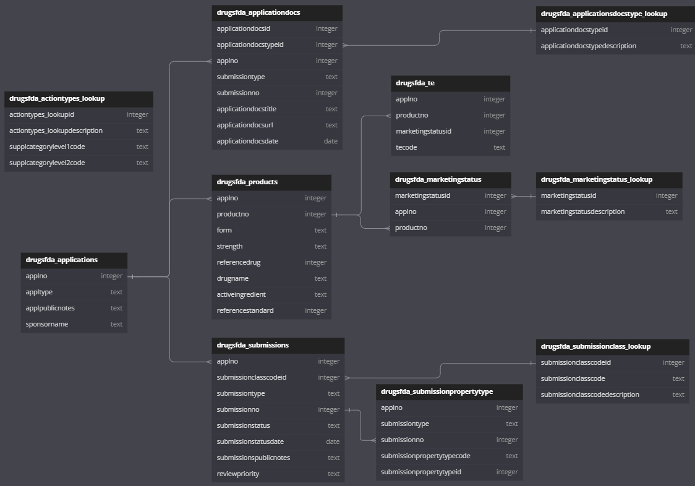
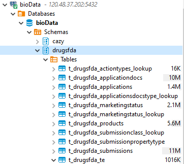
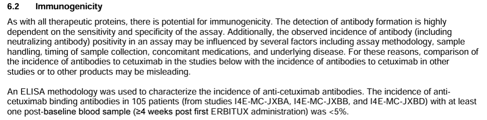
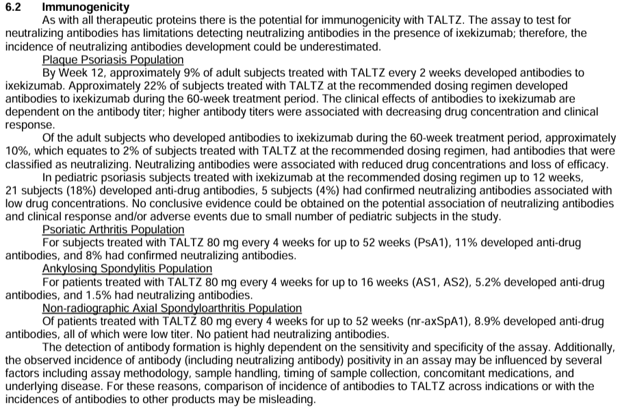
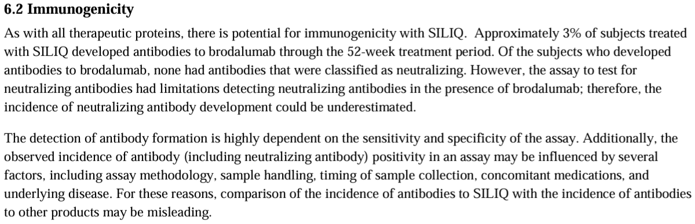
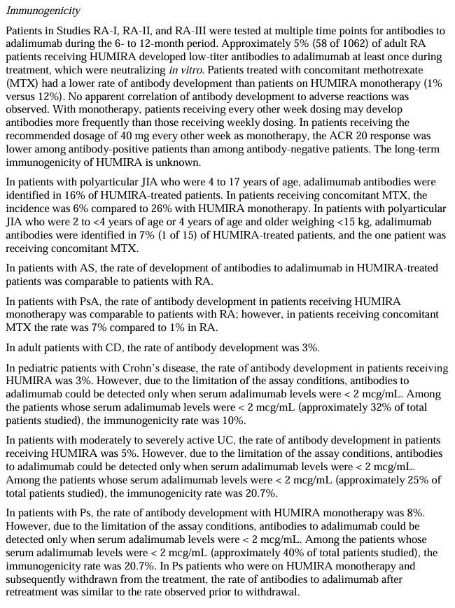
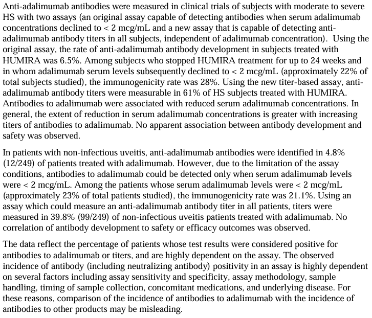

# Drugs@FDA
## 简介
Drugs@FDA 包含自1938年以来美国FDA批准供人类使用的产品信息，包括：
-   处方药品：
    -   品牌药品（例如，CRESTOR、LESCOL XL、LIPITOR、LIVALO、PRAVACHOL、ZOCOR），包括停产的药品和在“提交分类‘Type 6’”下获批的药品
    -   普通药品（例如，阿托伐他汀*），包括停产的药品
    -   许多治疗生物制品（例如，CIMZIA、ENBREL、HUMIRA、REMICADE 和 SIMPONI），包括生物类似药品（例如，AMJEVITA、CYLTEZO、HADLIMA 和 HYRIMOZ）。
    -   医用气体
-   非处方药（OTC）：
    -   品牌药品（例如，ADVIL、MOTRIN）
    -   普通药品（例如，布洛芬）

Drugs@FDA 不包含：疫苗，过敏原产品（例如，用于诊断和治疗的过敏原提取物），用于输注的血液和血液制品，血浆衍生物（例如，白蛋白、静脉免疫球蛋白（IGIV）），细胞和基因治疗产品（例如，KYMRIAH、MACI、YESCARTA、ZOLGENSMA），由CBER根据新药申请（NDA）或与传统新药申请（ANDA）相关的产品（例如，血浆容积扩大剂、血小板添加剂溶液），根据非处方药单方规定销售的非处方药产品。这些产品没有申请（例如，锌巴克替新软膏、盐酸苯海拉明片），膳食补充剂（例如，圣约翰草、维生素E），动物处方和非处方药品，在美国以外销售且未获得美国上市批准的药品和生物制品，正在FDA审批的药品和生物制品（研究性产品）。

用户可在Drugs@FDA中获取：
-   FDA批准用于人类使用的产品的标签
-   治疗等效药品，包括普通药品
-   患者需要了解的产品信息
-   具有特定活性成分的FDA批准产品
-   产品的批准历史，包括批准函和FDA关于产品安全性和有效性的审查

## 数据组织形式
https://www.fda.gov/drugs/drug-approvals-and-databases/drugsfda-data-files

## 数据更新
每周二更新data files。

## 相关名词解释

https://www.accessdata.fda.gov/scripts/cder/daf/index.cfm?event=glossary.page

-   ANDA (Abbreviated New Drug Application)
一份简化新药申请（Abbreviated New Drug Application，ANDA）包含的数据在提交给 FDA 的药物评价与研究中心（Center for Drug Evaluation and Research）下属的通用药品办公室（Office of Generic Drugs）后，可用于审查并最终批准一种仿制药品。通用药品申请被称为“简化”，因为通常不需要包含临床前（动物）和临床（人体）数据来确立安全性和有效性。相反，通用申请人必须从科学上证明其产品是生物等效的（即，与创新药物具有相同的性能）。一经批准，申请人便可生产和销售通用药品，以提供一种安全、有效、低成本的选择给美国公众。

-   简化新药申请（ANDA）号
这是由 FDA 工作人员分配给在美国市场上销售通用药品的每个申请的六位数字编号。

-   活性成分
活性成分是指在诊断、治愈、缓解、治疗或预防疾病，或影响人类或动物体内结构或功能的任何成分。

-   批准历史
批准历史是涉及具有特定 FDA 申请号（NDA、BLA 或 ANDA）的一种药品产品的所有 FDA 行动的时间列表。有超过 50 种批准行动，包括标签变更、新的给药途径和新的用药人群。

-   申请
包括新药申请（NDA），简化新药申请（ANDA）或生物制品许可申请（BLA），参见各自词条。

-   批准信函
批准信函是 FDA 对药品申请（NDA、BLA 或 ANDA）赞助商的官方沟通，允许该产品进行商业营销。

-   生物制品许可申请（BLA）
生物制品根据《公共卫生服务法案》的规定获得上市许可。该法案要求在跨州商业销售制造生物制品的公司为该产品持有许可证。生物制品许可申请是一份提交，其中包含关于生物制品产品的制造工艺、化学成分、药理学、临床药理学和医疗作用的具体信息。如果提供的信息符合FDA的要求，申请将获批准，公司将获得许可证，允许其进行产品营销。

-   生物制品
生物制品包括各种产品，如疫苗、血液和血液成分、变应原、体细胞、基因治疗、组织和重组治疗蛋白质。生物制品可以由糖、蛋白质或核酸组成，或者是这些物质的复杂组合，也可能是细胞和组织等生物实体。生物制品源自各种自然来源 — 人类、动物或微生物 — 并可能通过生物技术方法和其他尖端技术生产。基因和细胞生物制品通常处于生物医学研究的最前沿，可用于治疗各种其他治疗方法无效的医疗条件。一般而言，“药物”一词包括治疗性生物制品。

-   品牌药品
品牌药品是以专有的商标保护名称推广的药品。

-   化学类型
FDA在 Drugs@FDA 中不再使用“化学类型”这个术语。对于新药申请的原始批准，FDA指定“提交类型”。例如，“类型1”表示“新分子实体”。有关更多信息，请参阅“提交分类”。

-   已停产药品

在 Drugs@FDA 中列为“已停产”的产品是批准的产品，从未上市，已停止销售，用于军事用途，仅用于出口，或者因其他原因在停止销售后撤销了批准。

-   剂型
剂型是药物生产和配药的物理形式，如片剂、胶囊或注射剂。

-   药物
药物定义如下:
    -   被官方药典或处方集所承认的物质。
    -   用于诊断、治愈、减轻、治疗疾病或预防疾病的物质。
    -   （非食物）用于影响身体结构或任何功能的物质。
    -   用作药品组成部分但不是器械或器械的组成部分、部件或附件的物质。
    -   生物制品也包含在这个定义中，通常受到相同的法律和法规的覆盖，但在它们的生产过程（化学过程与生物过程的区别）方面存在差异。

-   药品产品
药品产品是包含药物成分的成品剂型，一般而言，但不一定是与其他活性或非活性成分相关联的。

-   FDA 动作日期
动作日期表示 FDA 的监管动作，如原始或补充批准，发生的时间。

-   FDA 申请号码
FDA为在美国市场上市药物的每个申请分配一个唯一号码。申请号码的类型有： NDA（新药申请）、ANDA（简化新药申请）和生物制品许可申请（BLA）。一种药物如果有不同的剂型或给药途径，则可能具有多个申请号码。

-   仿制药（Generic drug）
仿制药在剂量、安全性、强度、服用方式、质量、效果和预期用途方面与品牌药物相同。在批准仿制药产品之前，FDA需要进行许多严格的测试和程序，以确保仿制药可以替代品牌药。FDA根据科学评估对仿制药的“治疗等效性”进行评估。依法，仿制药品必须含有与品牌药品相同的活性成分相同量。被评估为“治疗等效”的药品预期在替代品牌药品时具有相同的效果和无差异。

-   标签
FDA批准的标签是药品产品的官方描述，包括适应症（药物用途）、应该服用的人群、不良事件（副作用）、孕妇、儿童和其他人群的使用说明，以及患者的安全信息。标签通常在药品包装内部找到。

-   营销状态
营销状态表示药品产品在美国如何销售。在Drugs@FDA中，药品产品被确定为：
    -   处方药 （Prescription）
    -   非处方药 （Over-the-counter）
    -   已停产 （Discontinued）
    -   无 （None） - 药品产品被暂时批准

-   用药指南
用药指南包含了关于如何安全使用药品的患者信息。

-   新药申请（NDA）
当一款新药的赞助商认为已经获得足够关于药物安全性和有效性的证据，以满足FDA对营销批准的要求时，赞助商向FDA提交新药申请（NDA）。该申请必须包含从特定技术观点进行审查的数据，包括化学、药理学、医学、生物制剂学和统计学。如果NDA获得批准，该产品就可以在美国市场上销售。出于内部跟踪目的，所有NDA都被分配一个NDA号码。

-   新药申请（NDA）号码
FDA为在美国销售新药的每个申请分配一个六位数号码。如果一种药物具有不同的剂型或给药途径，则可以具有多个申请号码。

-   新分子实体（NME）
新分子实体是一种在任何形式下从未在美国市场上销售过的活性成分。新分子实体是一种不含有先前在联邦食品、药物和化妆品法案第505节下提交的申请中被机构批准的活性基团，或者在美国作为药品进行过销售的活性成分。

-   非处方药（OTC，Over-the-counter）
FDA将非处方药定义为对普通公众安全有效，无需医生处方即可使用的药物。

-   患者包装说明书（PPI，Patient Package Insert）
患者包装说明书包含了患者如何安全使用药品的信息，以帮助患者更好地理解。

-   药品等效物
FDA认为如果药品产品满足以下三个标准，则它们是药品等效物：
    -   它们包含相同的活性成分
    -   其剂型和给药途径相同
    -   其剂量强度或浓度相同
在药品等效物中，药品产品可能在以下特性上有所不同：
    -   形状
    -   释放机制
    -   标签（在某种程度上）
    -   打分
    -   辅料（包括颜色、味道、防腐剂）

-   处方药品
处方药品需要医生授权才能购买。

-   产品编号
每个与新药申请（NDA）、简化新药申请（ANDA）和生物制剂许可申请（BLA）相关的药品产品都分配一个产品编号。如果一种药品产品有多种强度，就有多个产品编号。

-   审查
审查是FDA批准申请的依据。它是由FDA药物申请审查员准备的对临床试验数据和其他信息的综合分析。审查分为医学分析、化学、临床药理学、生物制剂、药理学、统计学和微生物学等部分。

-   审查优先级
新药申请分类系统提供了一种方式来描述新药申请（NDA），并在初始接收和审查过程中为其进行优先排序。有关详情，请参阅FDA/CDER MAPP 6020.3 Rev. 2

-   风险评估与减轻策略（REMS）
风险评估与减轻策略（REMS）是一项管理与药物相关的已知或潜在严重风险的安全计划，并通过管理其安全使用使患者能够继续获得这些药物。

-   参比上市药品（RLD）
参比上市药品（RLD）是已批准的药物产品，新的仿制药与之进行比较以证明它们是生物等效的。寻求批准市场上销售仿制药的药企必须在其简化新药申请（ANDA）中参考参比上市药品。通过指定单个参比上市药品作为所有仿制版本必须证明生物等效的标准，FDA希望避免在仿制药与其品牌对应物之间可能存在的重大差异。

-   给药途径 （Route）
给药途径是将药物用于患者身体某处的途径。

-   强度 （Strength）
药品产品的强度表示每种剂量中活性成分的含量有多少。

-   补充
补充是一种申请，允许公司对已经获得批准的药物申请的产品进行更改。CDER 必须批准所有重要的药物申请变更（例如包装或成分），以确保仍然符合最初为产品设定的条件。

-   提交
提交用于归类与申请相关的支持文档。一个提交属于只有一个特定的申请。每个申请至少必须有一个提交。

-   提交分类
对于原始（ORIG）NDA 提交，分类提供了对新药申请进行分类的方法。提交分类代码，之前称为化学分类代码，被分配为“类型”代码，例如，“类型 1”，新的分子实体（NME）。有关 NDA 分类代码的详细信息可在 MAPP 5018.2 NDA 分类代码中找到，其中包括所有代码及其含义的列表。
对于补充（SUPPL），提交分类描述对 FDA 批准的申请进行的变更种类。例如，变更可能涉及标签、效力（例如，新的剂型或新的适应症）或制造方面。

-   总结审查
总结审查是由 FDA 签署主管进行的关于一个申请的审查，其中包括最终决定是否批准申请的审查。

-   暂时批准
如果一个仿制药品在参考上市药品享有的任何专利或专有权到期之前已准备获得批准，FDA 将向申请人发出暂时批准函。暂时批准函详细说明了与暂时批准相关的情况。FDA 将延迟最终批准仿制药品，直到解决了所有专利或专有权问题。暂时批准不允许申请人销售该仿制药品。

-   治疗性生物制品
治疗性生物制品是源自活性材料（如细胞或组织）的蛋白质，用于治疗或治愈疾病。

-   治疗等效性（TE）
被分类为治疗等效的药品可以替代使用，完全期望替代产品会产生与处方产品相同的临床效果和安全性。只有当药品符合以下标准时，才被认为是治疗等效的：
    -   它们是药物的等效品（含有相同的活性成分；剂型和给药途径；以及剂量）。
    -   它们由 FDA 分配相同的治疗等效代码，以字母“A”开头。要获得字母“A”，FDA 会指定品牌药品或仿制药为参考上市药品（RLD）。
    -   基于药品申请商在 ANDA 中提交以科学方式证明其产品具有生物等效性（即与参考上市药品的表现相同）的数据，分配治疗等效代码。

-   治疗等效（TE）代码
治疗等效评估的编码系统允许用户确定 FDA 是否已将特定批准的产品评定为与其他等效药物治疗等效（第一个字母），并根据 FDA 评估的基础提供额外信息（第二个字母）。示例TE代码：AA、AB、BC。非处方药品不被分配TE代码。
FDA会给药物的等效品分配治疗等效代码。只有当：
    -   药品公司的批准申请包含充分的科学证据，通过体内和/或体外研究，证明该产品与选定的上市参考药品生物等效时。
    -   那些活性成分或剂型中不存在体内生物等效问题的（或可疑的）。
    -   一些药品有多个TE代码。
    -   FDA认为不具有治疗等效性的产品被评为“B”级。

## schema

## metadata
### drugsfda_applications
| column            | dtype   | description     |   |
|-------------------|---------|-----------------|---|
| c_applno          | integer | ApplNo          |   |
| c_appltype        | text    | ApplType        |   |
| c_applpublicnotes | text    | ApplPublicNotes |   |
| c_sponsorname     | text    | SponsorName     |

### drugsfda_applicationsdocstype_lookup
| column                           | dtype   | description                    |   |
|----------------------------------|---------|--------------------------------|---|
| c_applicationdocstypeid          | integer | ApplicationDocsTypeID          |   |
| c_applicationdocstypedescription | text    | ApplicationDocsTypeDescription |

### drugsfda_marketingstatus_lookup
| column                       | dtype   | description                |   |
|------------------------------|---------|----------------------------|---|
| c_marketingstatusid          | integer | MarketingStatusID          |   |
| c_marketingstatusdescription | text    | MarketingStatusDescription |

### drugsfda_marketingstatus
| column              | dtype   | description       |   |
|---------------------|---------|-------------------|---|
| c_marketingstatusid | integer | MarketingStatusID |   |
| c_applno            | integer | ApplNo            |   |
| c_productno         | integer | ProductNo         |

### drugsfda_products
| column              | dtype   | description                                    |   |
|---------------------|---------|------------------------------------------------|---|
| c_applno            | integer | ApplNo                                         |   |
| c_productno         | integer | ProductNo                                      |   |
| c_form              | text    | Form                                           |   |
| c_strength          | text    | Strength                                       |   |
| c_referencedrug     | integer | RLD(reference listed drug). 0:No, 1:Yes, 2:TBD |   |
| c_drugname          | text    | DrugName                                       |   |
| c_activeingredient  | text    | ActiveIngredient                               |   |
| c_referencestandard | integer | RS(reference standard). 0:No, 1:Yes, null:TBD  |

### drugsfda_submissionclass_lookup
| column                           | dtype   | description                    |   |
|----------------------------------|---------|--------------------------------|---|
| c_submissionclasscodeid          | integer | SubmissionClassCodeID          |   |
| c_submissionclasscode            | text    | SubmissionClassCode            |   |
| c_submissionclasscodedescription | text    | SubmissionClassCodeDescription |

### drugsfda_submissionpropertytype
| column                       | dtype   | description                |   |
|------------------------------|---------|----------------------------|---|
| c_applno                     | integer | ApplNo                     |   |
| c_submissiontype             | text    | SubmissionType             |   |
| c_submissionno               | integer | SubmissionNo               |   |
| c_submissionpropertytypecode | text    | SubmissionPropertyTypeCode |   |
| c_submissionpropertytypeid   | integer | SubmissionPropertyTypeID   |

### drugsfda_submissions
| column                   | dtype   | description            |   |
|--------------------------|---------|------------------------|---|
| c_applno                 | integer | ApplNo                 |   |
| c_submissionclasscodeid  | integer | SubmissionClassCodeID  |   |
| c_submissiontype         | text    | SubmissionType         |   |
| c_submissionno           | integer | SubmissionNo           |   |
| c_submissionstatus       | text    | SubmissionStatus       |   |
| c_submissionstatusdate   | date    | SubmissionStatusDate   |   |
| c_submissionspublicnotes | text    | SubmissionsPublicNotes |   |
| c_reviewpriority         | text    | ReviewPriority         |

### drugsfda_te
| column              | dtype   | description       |   |
|---------------------|---------|-------------------|---|
| c_applno            | integer | ApplNo            |   |
| c_productno         | integer | ProductNo         |   |
| c_marketingstatusid | integer | MarketingStatusID |   |
| c_tecode            | text    | TECode            |

### drugsfda_applicationdocs
| column                  | dtype   | description           |   |
|-------------------------|---------|-----------------------|---|
| c_applicationdocsid     | integer | ApplicationDocsID     |   |
| c_applicationdocstypeid | integer | ApplicationDocsTypeID |   |
| c_applno                | integer | ApplNo                |   |
| c_submissiontype        | text    | SubmissionType        |   |
| c_submissionno          | integer | SubmissionNo          |   |
| c_applicationdocstitle  | text    | ApplicationDocsTitle  |   |
| c_applicationdocsurl    | text    | ApplicationDocsURL    |   |
| c_applicationdocsdate   | date    | ApplicationDocsDate   |

### drugsfda_actiontypes_lookup
| column                          | dtype   | description                   |   |
|---------------------------------|---------|-------------------------------|---|
| c_actiontypes_lookupid          | integer | ActionTypes_LookupID          |   |
| c_actiontypes_lookupdescription | text    | ActionTypes_LookupDescription |   |
| c_supplcategorylevel1code       | text    | SupplCategoryLevel1Code       |   |
| c_supplcategorylevel2code       | text    | SupplCategoryLevel2Code       |

## 入库情况
March 19, 2024版本，已入库。

## 有关ADA信息（anti-drug antibody）
-   治疗性蛋白产品的免疫原性检测的FDA文件(2019年1月)：https://www.fda.gov/media/119788/download
> Information on immune responses observed during clinical trials, particularly the incidence of ADA induction or any implications of ADA responses affecting pharmacokinetics, pharmacodynamics, safety, or efficacy, is crucial for any therapeutic protein product development program.  Accordingly, such information, if applicable, should be included in the prescribing information as a subsection of the <b>ADVERSE REACTIONS section entitled Immunogenicity</b>.

-   例1：ERBITUX
    -   Drugs@FDA的applicationdocstypedescription为Label，且applicationdocsdate最新的文件：https://www.accessdata.fda.gov/drugsatfda_docs/label/2021/125084s277s280lbl.pdf

     

-   例2：TALTZ
    -   Drugs@FDA的applicationdocstypedescription为Label，且applicationdocsdate第二新的文件：https://www.accessdata.fda.gov/drugsatfda_docs/label/2021/125521s014lbl.pdf （最新的label文件是药品外包装图）

    

-   例3：SILIQ
    -   Drugs@FDA的applicationdocstypedescription为Label，且applicationdocsdate最新的文件：https://www.accessdata.fda.gov/drugsatfda_docs/label/2017/761032lbl.pdf

    

-   例4：HUMIRA
    -   Drugs@FDA的applicationdocstypedescription为Label，且applicationdocsdate最新的文件：https://www.accessdata.fda.gov/drugsatfda_docs/label/2017/125057s403lbl.pdf 
    -   6.1 Clinical Trials Experience

    

    

