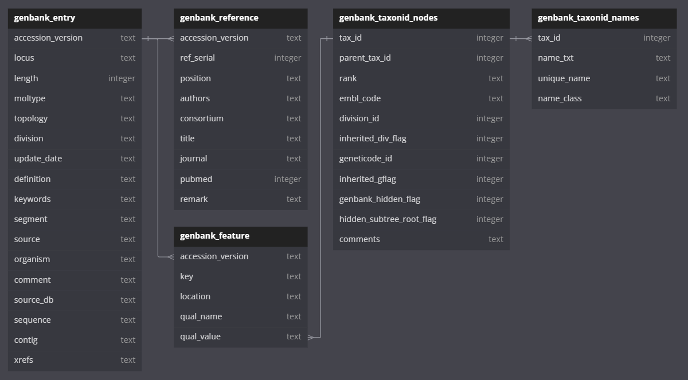
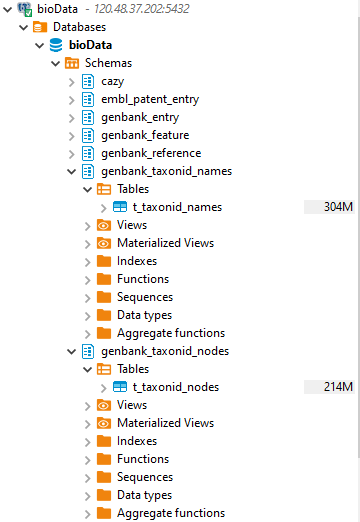
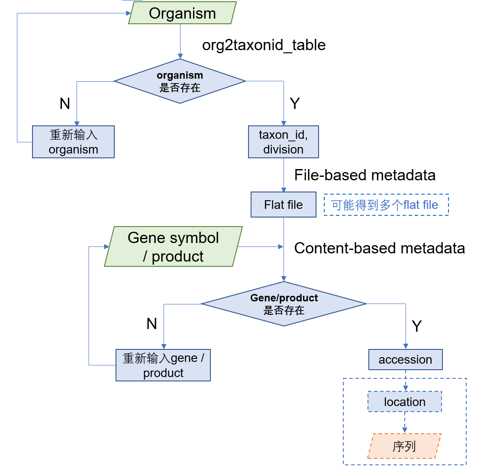
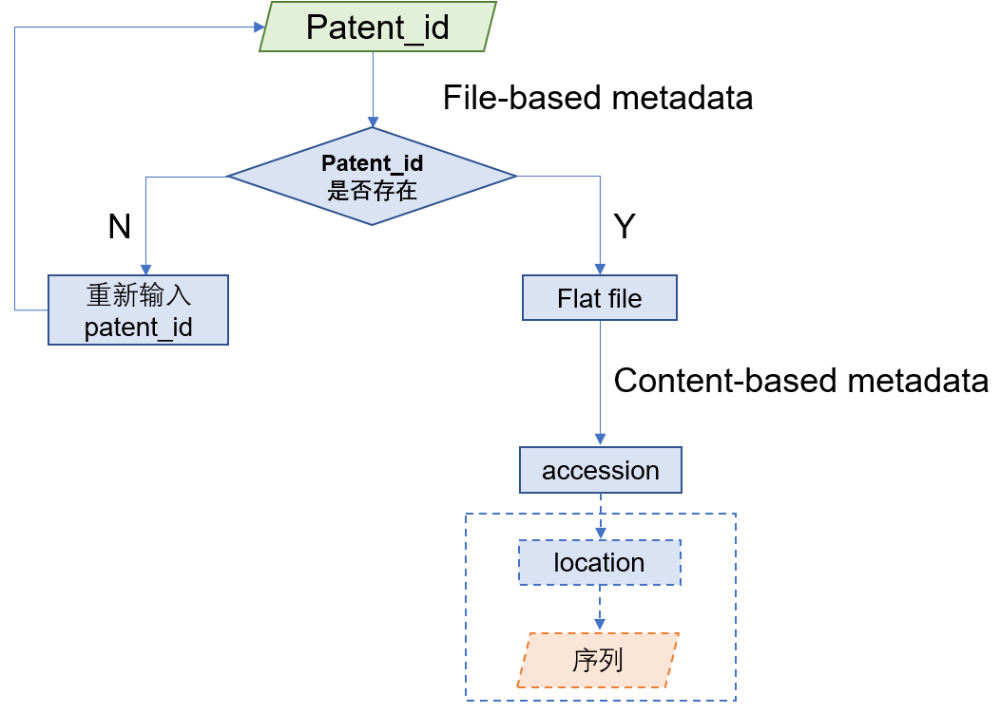
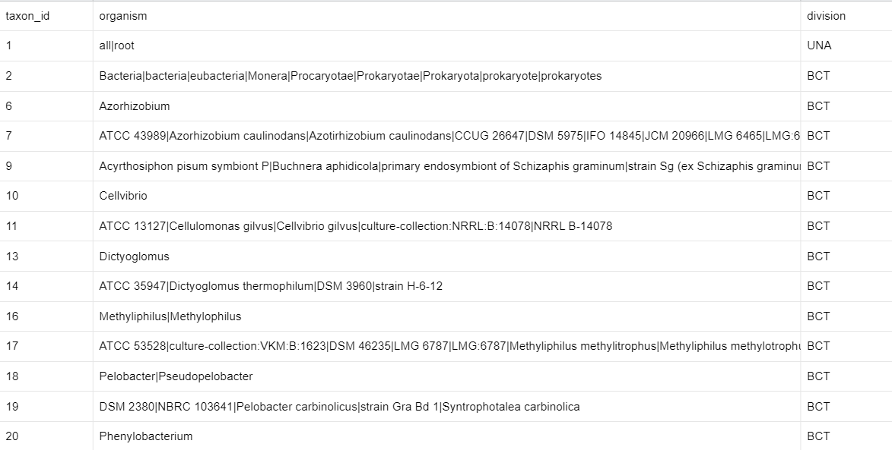
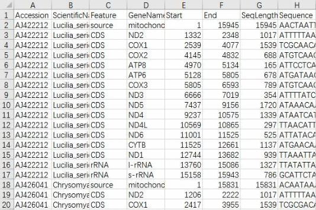

# Genbank metadata
## schema

## metadata
### genbank_entry
| column              | dtype   | description                                                                                                                                                                                      |   |
|---------------------|---------|--------------------------------------------------------------------------------------------------------------------------------------------------------------------------------------------------|---|
| c_accession_version | text    | The accession number + version (ie. AB01234.2).                                                                                                                                                  |
| c_locus             | text    | The name specified after the LOCUS keyword in the GenBank record. This may be the accession number, or a clone id or something else.                                                             |
| c_length            | integer | The size of the record.                                                                                                                                                                          |
| c_moltype           | text    | The type of residues making up the sequence in this record. Normally something like RNA, DNA or PROTEIN, but may be as esoteric as 'ss-RNA circular'.                                            |
| c_topology          | text    | The topology of the sequence (ie. linear).                                                                                                                                                       |
| c_division          | text    | The division this record is stored under in GenBank (ie. PLN -> plants; PRI -> humans, primates; BCT -> bacteria...).                                                                            |
| c_update_date       | text    | The date of submission of the record, in a form like '28-JUL-1998'                                                                                                                               |
| c_definition        | text    | The definition of the record.                                                                                                                                                                    |
| c_keywords          | text    | A list of keywords related to the record.                                                                                                                                                        |
| c_segment           | text    | If the record is one of a series, this is info about which segment this record is (something like '1 of 6').                                                                                     |
| c_source            | text    | The source of material where the sequence came from. Format is 'organism (common name)', not nessary common name.                                                                                |
| c_organism          | text    | The genus and species of the organism (ie. 'Homo sapiens').                                                                                                                                      |
| c_comment           | text    | Text with any kind of comment about the record.                                                                                                                                                  |
| c_source_db         | text    | Information about the database the record came from.                                                                                                                                             |
| c_sequence          | text    | A string with the sequence itself. Should consider limit of length. If string length is more than 1 billion, then the sequence is saved in a file and this column cantains the path of the file. |
| c_contig            | text    | A string of location information for a CONTIG in a RefSeq file.                                                                                                                                  |   |
| c_xrefs             | text    | The genome sequencing project number(s) and other links.                                                                                                                                         |

### genbank_reference
| column              | dtype   | description                                                                                                      |   |
|---------------------|---------|------------------------------------------------------------------------------------------------------------------|---|
| c_accession_version | text    | The accession number + version (ie. AB01234.2). Fill in all the 1st column of the t_reference of the same entry. |
| c_ref_serial        | integer | The number of the reference in the listing of references.                                                        |
| c_position          | text    | The bases in the sequence the reference refers to.                                                               |
| c_authors           | text    | String with all of the authors. Concatenated with ', '.                                                          |
| c_consortium        | text    | Consortium the authors belong to.                                                                                |
| c_title             | text    | The title of the reference.                                                                                      |
| c_journal           | text    | Information about the journal where the reference appeared.                                                      |
| c_pubmed            | integer | The pubmed_id for the reference.                                                                                 |
| c_remark            | text    | Free-form remarks about the reference.                                                                           |

### genbank_feature
| column              | dtype | description                                                                                                      |   |
|---------------------|-------|------------------------------------------------------------------------------------------------------------------|---|
| c_accession_version | text  | The accession number + version (ie. AB01234.2). Fill in all the 1st column of the t_reference of the same entry. |
| c_key               | text  | The key name of the feature (ie. source).                                                                        |
| c_location          | text  | The string specifying the location of the feature.                                                               |
| c_qual_name         | text  | The key name of the qualifier (ie. /organism=).                                                                  |
| c_qual_value        | text  | The value of the qualifier ("Dictyostelium discoideum").                                                         |

### genbank_taxonid_nodes
| column                     | dtype   | description                                       |   |
|----------------------------|---------|---------------------------------------------------|---|
| c_tax_id                   | integer | Node id in GenBank taxonomy database.             |   |
| c_parent_tax_id            | integer | Parent node id in GenBank taxonomy database.      |   |
| c_rank                     | text    | Rank of this node (superkingdom, kingdom, ...).   |   |
| c_embl_code                | text    | Locus-name prefix, not unique.                    |   |
| c_division_id              | integer | Taxonomy database division id.                    |   |
| c_inherited_div_flag       | integer | 1 if node inherits division from parent           |   |
| c_genetic_code_id          | integer | GenBank genetic code id.                          |   |
| c_inherited_gc_flag        | integer | 1 if node inherits genetic code from parent.      |   |
| c_genbank_hidden_flag      | integer | 1 if name is suppressed in GenBank entry lineage. |   |
| c_hidden_subtree_root_flag | integer | 1 if this subtree has no sequence data yet.       |   |
| c_comments                 | text    | Free-text comments and citations.                 |

### genbank_taxonid_names
| column        | dtype   | description                                              |   |
|---------------|---------|----------------------------------------------------------|---|
| c_tax_id      | integer | The id of node associated with this name.                |   |
| c_name_txt    | text    | Name itself.                                             |   |
| c_unique_name | text    | The unique variant of this name if name not unique.      |   |
| c_name_class  | text    | The class of the taxon name (synonym, common name, ...). |

## 入库情况

-   genbank_taxonid_names和genbank_taxonid_nodes已全部入库。
-   genbank_entry，genbank_reference，genbank_feature入库了100个genbank flatfile。

# Genbank metadata example
## Statistics of GenBank division that are not classified by species

| genbank division | special content | flatfile number |
|--------------------------|-----------------|------|
| SYN：合成的序列                | -               | 30   |
| UNA：未注释的序列               | -               | 1    |
| EST：表达序列标签               | -               | 579  |
| PAT：专利序列                 | JOURNAL行含有专利号，专利日期，公司    | 262  |
| STS：序列标签位置序列             | -               | 11   |
| GSS：基因组概览序列              | -               | 270  |
| HTG：高通量基因组序列             | -               | 82   |
| HTC：高通量互补DNA序列           | -               | 8    |
| ENV：环境抽样序列               | -               | 95   |

## V2
### File-based metadata

| FileName      | GBDivision | FilePath                                      | GBRelease       | Organism                                                                                                                                                                                                                                                                                                                                                                                                                                                                                                                                                                                                                                                                                                                                                                                                                                                                                                                                                                                                                                                                                                                                                                                                                                                                                                                                                                                                                                                                                                                                                                                                                                                                 |
|---------------|------------|-----------------------------------------------|-----------------|--------------------------------------------------------------------------------------------------------------------------------------------------------------------------------------------------------------------------------------------------------------------------------------------------------------------------------------------------------------------------------------------------------------------------------------------------------------------------------------------------------------------------------------------------------------------------------------------------------------------------------------------------------------------------------------------------------------------------------------------------------------------------------------------------------------------------------------------------------------------------------------------------------------------------------------------------------------------------------------------------------------------------------------------------------------------------------------------------------------------------------------------------------------------------------------------------------------------------------------------------------------------------------------------------------------------------------------------------------------------------------------------------------------------------------------------------------------------------------------------------------------------------------------------------------------------------------------------------------------------------------------------------------------------------|
| gbpri1.seq.gz | pri        | /fs/xu_xintian/Genbank/download/gbpri1.seq.gz | 259.0(20231215) | Macaca silenus;Loris tardigradus;Pan troglodytes verus;Papio hamadryas;Cheirogaleus major;Eulemur fulvus;Galago senegalensis;Pan troglodytes;Hylobates moloch;Sapajus apella;Eulemur albifrons;Saguinus oedipus;Macaca assamensis;Erythrocebus patas;Plecturocebus moloch;Galago moholi;Saimiri sciureus;Colobus polykomos;Homo sapiens;Hylobates agilis;Otolemur crassicaudatus;Eulemur sanfordi;Hylobates klossii;Aotus azarai boliviensis;Macaca arctoides;Presbytis comata;Hapalemur griseus;Hapalemur aureus;Microcebus rufus;Macaca nemestrina;Macaca mulatta;Hapalemur griseus griseus;Macaca fuscata yakui;Pongo abelii;Cephalopachus bancanus;Papio anubis;Aotus trivirgatus;Nomascus concolor;Perodicticus potto;Lemur catta;Galagoides demidoff;Hapalemur griseus alaotrensis;Prolemur simus;Macaca thibetana;Eulemur fulvus collaris;Symphalangus syndactylus;Trachypithecus cristatus;Leontocebus tripartitus;Saguinus labiatus;Propithecus coquereli;Macaca cyclopis;Daubentonia madagascariensis;Macaca fascicularis;Macaca fuscata;Eulemur fulvus albocollaris;Gorilla gorilla;Nycticebus coucang;Presbytis melalophos;Hylobates lar;Pan paniscus;Cheirogaleus medius;Trachypithecus obscurus;Chlorocebus aethiops;Eulemur flavifrons;Hylobates muelleri;Ateles geoffroyi;Microcebus myoxinus;Propithecus verreauxi verreauxi;Aotus griseimembra;Hylobates pileatus;Pan troglodytes troglodytes;Eulemur coronatus;Eulemur rufus;Ateles paniscus;Pongo pygmaeus;Ateles belzebuth;Eulemur macaco macaco;Callithrix jacchus;Lepilemur leucopus;Eulemur fulvus fulvus;Otolemur garnettii;Eulemur rubriventer;Presbytis femoralis;Varecia variegata variegata |

### Content-based metadata (exclude PAT division)

| version    | organism                           | taxonid       | genes                                                                                                                                                                                                                                                                                                                                                                                                                                                                                                                        |
|------------|------------------------------------|---------------|------------------------------------------------------------------------------------------------------------------------------------------------------------------------------------------------------------------------------------------------------------------------------------------------------------------------------------------------------------------------------------------------------------------------------------------------------------------------------------------------------------------------------|
| LN795817.1 | Paraburkholderia kirstenboschensis | taxon:1245436 | atpD                                                                                                                                                                                                                                                                                                                                                                                                                                                                                                                         |
| LN795818.1 | Paraburkholderia kirstenboschensis | taxon:1245436 | atpD                                                                                                                                                                                                                                                                                                                                                                                                                                                                                                                         |
| LN795819.1 | Paraburkholderia kirstenboschensis | taxon:1245436 | atpD                                                                                                                                                                                                                                                                                                                                                                                                                                                                                                                         |
| LN795820.1 | Paraburkholderia kirstenboschensis | taxon:1245436 | atpD                                                                                                                                                                                                                                                                                                                                                                                                                                                                                                                         |
| LN795821.1 | Paraburkholderia kirstenboschensis | taxon:1245436 | atpD                                                                                                                                                                                                                                                                                                                                                                                                                                                                                                                         |
| LN795822.1 | Mannheimia massilioguelmaensis     | taxon:1604354 | 16S rRNA                                                                                                                                                                                                                                                                                                                                                                                                                                                                                                                     |
| LN795823.1 | Shewanella algae                   | taxon:38313   | 16S rRNA                                                                                                                                                                                                                                                                                                                                                                                                                                                                                                                     |
| LN795824.1 | Staphylococcus saprophyticus       | taxon:29385   | ORF_o1;ORF_o2;ORF_o3;rep1;rep2;rep3;ORF_o4;ORF_o5;ORF_o6;ORF_o7;ORF_o8;ORF_o9;ORF_o10;ORF_o11;ORF_o12;ORF_o13;ORF_o14;ORF_o15;ktrB;ORF_o16;ORF_o17;ORF_o18;ORF_o19;ORF_o20;ORF_o21;ORF_o22;ORF_o23;ORF_o24;ORF_o25;ORF_o26;ORF_o27;lysE;ORF_o28;ORF_o29;ORF_o30;ORF_o31;ORF_o32;ORF_o33;ORF_o34;ORF_o35;ORF_o36;ORF_o37;tcyP;ORF_o38;ORF_o39;ORF_o40;ORF_o41;ORF_o42;ORF_o43;ORF_o44;ORF_o45;ORF_o46;ORF_o47;ORF_o48;ORF_o49;ORF_o50;ORF_o51;ORF_o52;ORF_o53;ORF_o54;ORF_o55;ORF_o56;ORF_o57;ORF_o58;ORF_o59;ORF_o60;erm(44) |
| LN795825.1 | Staphylococcus xylosus             | taxon:1288    | ORF_h1;ORF_h2;whiA;ORF_A;ORF_1;ORF_h3;ORF_h4;ORF_h5;ORF_h6;ORF_h7;ORF_h8;ORF_9;ORF_h9;ORF_h10;ORF_h11;ORF_h12;ORF_11;ORF_h13;ORF_12;ORF_h14;ORF_h15;ORF_h16;rusA;ORF_h17;ORF_19;ORF_20;ORF_21;ORF_22;ORF_23;ORF_24;ORF_25;ORF_26;ORF_27;ORF_28;ORF_29;ORF_30;ORF_31;ORF_32;ORF_33;ORF_34;ORF_35;ORF_36;ORF_37;ORF_38;ORF_39;ORF_40;ORF_41;ORF_42;ORF_43;ORF_44;ORF_h18;ORF_47;ORF_48;ORF_49;erm(44);ORF_h19;ORF_h20;ORF_h21;ORF_h22;ORF_50;ORF_h23;ORF_53;clpP;ORF_h24;ORF_h25                                               |
| LN795892.1 | Jiangella sp. ET1s41               | taxon:1604388 | 16S rRNA                                                                                                                                                                                                                                                                                                                                                                                                                                                                                                                     |
| LN795893.1 | Kribbella sp. ET1s10               | taxon:1604389 | 16S rRNA                                                                                                                                                                                                                                                                                                                                                                                                                                                                                                                     |
| LN795894.1 | Kribbella sp. ET2s56               | taxon:1604390 | 16S rRNA                                                                                                                                                                                                                                                                                                                                                                                                                                                                                                                     |

### Content-based metadata (PAT division)

| version  | organism                    | taxonid    | patent                                 |
|----------|-----------------------------|------------|----------------------------------------|
| A00145.1 | Bos taurus                  | taxon:9913 | GB 2157697-A 1 30-OCT-1985;            |
| A00146.1 | Bos taurus                  | taxon:9913 | GB 2157697-A 3 30-OCT-1985;            |
| A00147.1 | Bos taurus                  | taxon:9913 | GB 2157697-A 5 30-OCT-1985;            |
| A00148.1 | Bos taurus                  | taxon:9913 | GB 2157697-A 7 30-OCT-1985;            |
| A00149.1 | Homo sapiens                | taxon:9606 | GB 2157697-A 9 30-OCT-1985;            |
| A00155.1 | Bacillus sp. (in: Bacteria) | taxon:1409 | GB 2133408-A 1 25-JUL-1984; Ikka Palva |
| A00156.1 | Bacillus sp. (in: Bacteria) | taxon:1409 | GB 2133408-A 2 25-JUL-1984; Ikka Palva |
| A00157.1 | Bacillus sp. (in: Bacteria) | taxon:1409 | GB 2133408-A 3 25-JUL-1984; Ikka Palva |
| A00158.1 | Bacillus sp. (in: Bacteria) | taxon:1409 | GB 2133408-A 4 25-JUL-1984; Ikka Palva |

## V3
### Sequence query workflow
#### non-PAT

<!--  -->

#### PAT

<!--  -->

### Organism2taxonid table

### File-based metadata

| FileName      | GBDivision | FilePath                                      | GBRelease       | Organism/Patent                                                                                                                                                                                                                                                                                                                                                                                                                                                                                                                                                                                                                                                                                                                                                                               |
|---------------|------------|-----------------------------------------------|-----------------|-----------------------------------------------------------------------------------------------------------------------------------------------------------------------------------------------------------------------------------------------------------------------------------------------------------------------------------------------------------------------------------------------------------------------------------------------------------------------------------------------------------------------------------------------------------------------------------------------------------------------------------------------------------------------------------------------------------------------------------------------------------------------------------------------|
| gbpri1.seq.gz | pri        | /fs/xu_xintian/Genbank/download/gbpri1.seq.gz | 259.0(20231215) | 280755;34829;9472;9463;9587;9545;78454;122224;13557;54181;9483;13515;122220;9468;9477;78453;9579;9557;9572;9588;9510;9589;89672;292213;0;9505;9540;9601;122765;30609;122222;9541;122229;31869;9490;9470;54601;143283;9538;1215604;9542;78449;81572;9555;122388;9507;122232;29089;40322;9598;9460;9590;47178;9593;9580;30603;87288;1328070;54602;9515;9544;100475;9523;9597;78452;78451;9534;379532;9465;9509;37011;30611;13514;859983;122225;179089;9447;9606;122219;47177;87289;9521;9551;9600;37012                                                                                                                                                                                                                                                                                         |
| gbuna1.seq.gz | una        | /fs/xu_xintian/Genbank/download/gbuna1.seq.gz | 259.0(20231215) | 1796020;2391;198834;2401;2419500;1516082;2405;2664238;2502152;2419498;2397;1515703;1796019;2185173;1837136;31896;1708500;932710;32644;12908;2419499;2419501;713097;2853804;2389;2502151;2394;2413;2407;382345;2411;1938931;1837134;1837135;2398;1515702;1708506;2395                                                                                                                                                                                                                                                                                                                                                                                                                                                                                                                          |
| gbest1.seq.gz | est        | /fs/xu_xintian/Genbank/download/gbest1.seq.gz | 259.0(20231215) | 5664;157791;3702;186497;664940;31286;5702;5811;4577;3847;40410;0;6293;9606;9823;10116;6182;6183;54126;52705;10090;6279                                                                                                                                                                                                                                                                                                                                                                                                                                                                                                                                                                                                                                                                        |
| gbpat1.seq.gz | pat        | /fs/xu_xintian/Genbank/download/gbpat1.seq.gz | 259.0(20231215) | US 6080588-A;US 5976838-A;US 6383762-A;US 6548482-A;US 6387366-A;US 6319714-A;US 6358695-A;US 6476195-A;EP 0628568-A2;US 6538182-A;EP 0494776-A1;US 6303128-A;US 6458575-A;US 6165713-A;US 6573271-A;WO 9601315-A1;WO 9533771-A1;WO 9012101-A1;US 6159731-A;WO 9606939-A1;US 6210942-A;US 6326204-A;WO 9421791-A1;US 6511699-A;US 6589773-A;US 6190907-A;US 6303118-A;US 5773691-A;US 5948649-A;US 5958699-A;US 6410009-A;US 6509153-A;US 6407208-A;WO 8404537-A1;US 5773580-A;US 6420135-A;US 5792853-A;EP 0070675-A1;US 6103499-A;US 5747271-A;US 5959074-A;US 6346611-A;US 6387657-A;US 6475796-A;US 5849534-A;US 6071731-A;US 6204019-A;US 6451322-A;US 6537792-A;US 6509016-A;US 5831013-A;US 5990083-A;EP 0517292-A1;EP 0251842-A1;US 6368855-A;US 5968826-A;US 5762954-A;WO 9912950-A2 |

### Content-based metadata
#### PAT division

| version  | patent                                                              |
|----------|---------------------------------------------------------------------|
| A00020.1 | EP 0238993-A2 19 30-SEP-1987; BAYER AG                              |
| A00021.1 | EP 0238993-A2 20 30-SEP-1987; BAYER AG                              |
| A00023.1 | EP 0238993-A2 22 30-SEP-1987; BAYER AG                              |
| A00024.1 | EP 0238993-A2 23 30-SEP-1987; BAYER AG                              |
| A00026.1 | EP 0238993-A2 25 30-SEP-1987; BAYER AG                              |
| A00027.1 | EP 0238993-A2 26 30-SEP-1987; BAYER AG                              |
| A00029.1 | EP 0238993-A2 28 30-SEP-1987; BAYER AG                              |
| A00030.1 | EP 0238993-A2 29 30-SEP-1987; BAYER AG                              |
| A00033.1 | EP 0242220-A2 1 21-OCT-1987; NOVO NORDISK A/S; Bagsvaerd, ; Denmark |
| A00035.1 | EP 0242220-A2 3 21-OCT-1987; NOVO NORDISK A/S; Bagsvaerd, ; Denmark |
| A00036.1 | EP 0242220-A2 4 21-OCT-1987; NOVO NORDISK A/S; Bagsvaerd, ; Denmark |
| A00038.1 | EP 0242220-A2 6 21-OCT-1987; NOVO NORDISK A/S; Bagsvaerd, ; Denmark |
| A00039.1 | EP 0242220-A2 7 21-OCT-1987; NOVO NORDISK A/S; Bagsvaerd, ; Denmark |

#### non-PAT division

| version    | taxonid | genes     | product                                             |
|------------|---------|-----------|-----------------------------------------------------|
| AB000931.2 | 9606    | FUT2      |                                                     |
| AB001025.1 | 9606    | hBRR      | brain ryanodine receptor                            |
| AB001103.2 | 9606    |           | H-cadherin                                          |
| AB001104.1 | 9606    |           | hippocalcin-like protein 3                          |
| AB001105.1 | 9606    |           | hippocalcin-like protein 4                          |
| AB001106.1 | 9606    |           | glia maturation factor                              |
| AB001325.1 | 9606    | AQP3      | aquaporin 3                                         |
| AB001328.1 | 9606    | hPEPT1-RF | pH-sensing regulatory factor of peptide transporter |
| AB001342.1 | 9606    |           | DDX10-NUP98 fusion protein type 1                   |
| AB001343.1 | 9606    |           | DDX10-NUP98 fusion protein type 2                   |
| AB001421.1 | 9542    |           | Testis-Specific Protein Y (TSPY)                    |

### Problems
1.  traditional flatfile不包含RefSeq序列，正在下载RefSeq的genomic flatfile。
2.  同一物种+同一gene symbol/product可能会有多条结果，可优先显示RefSeq序列。
3.  目前的metadata可以实现【metadata→accession】的查询（见流程图），但【accession→序列】的文件内部查询仅依靠目前的metadata还不能实现。暂时想到的是将flatfile格式化为类似下图的data.frame后入库，或者通过解析文件内容的脚本实现这一步。

https://cloud.tencent.com/developer/news/325346

# Problems
1.  PAT division的xml中专利信息还需要进一步解析，如：<INSDReference_journal>Patent: EP 0238993-A2 9 30-SEP-1987; BAYER AG</INSDReference_journal>
2.  

# Plan
1.  将traditional flatfile和refseq都转换为xml

