# Genbank调研
## 数据下载
-   https://ftp.ncbi.nih.gov/genbank

## 数据更新
-   每两个月更新一个release
-   目前下载的版本为Release 259.0（2023.12.15），release notes见： https://www.ncbi.nlm.nih.gov/genbank/release/current/
-   数据相对于上一个release的变动可分为：
    
    -   changed: https://ftp.ncbi.nlm.nih.gov/genbank/gbchg.txt.gz
    -   deleted: https://ftp.ncbi.nlm.nih.gov/genbank/gbdel.txt.gz
    -   new: https://ftp.ncbi.nlm.nih.gov/genbank/gbnew.txt.gz

## 数据分类

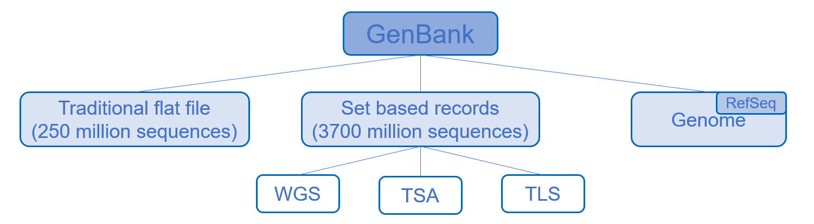

###  （一）Traditional GenBank records
-   即最常见的Genbank数据，当前版本约2.5亿条序列，https://ftp.ncbi.nlm.nih.gov/genbank 中的seq.gz文件

-   文件格式信息：https://www.ncbi.nlm.nih.gov/genbank/release/current/

-   示例及内容解释：https://www.ncbi.nlm.nih.gov/genbank/samplerecord/

-   GenBank发布的每个flatfile都具有相同的格式，由两个部分组成：头部信息和序列条目。
1.  头部信息（header）

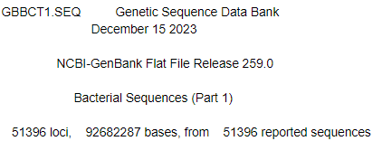

-   第一行包含文件名和数据库名
-   第二行包含当前发布的日期，格式为“日 月 年”。
-   第四行包含当前的GenBank发布号，由主要发布号和版本号组成。
-   第六行包含文件的标题。
-   第八行列出了条目数目、碱基数目和序列报告数目，这些数字在固定位置右对齐。
-   第三、第五、第七和第九行为空行。
2.  序列条目（entry）

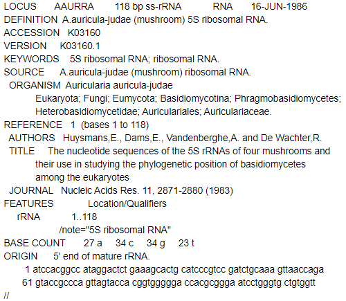

-   LOCUS - 条目的简短助记符名称，用以提示序列的定义。LOCUS 字段包含多个不同的数据元素，包括位置名称（locus name）、序列长度（sequence length）、分子类型（molecule type）、GenBank 分区（division）和修改日期（modification date）。必需的关键字/仅一个记录。
-   DEFINITION - 序列的简明描述。必需的关键字/一个或多个记录。
-   ACCESSION - 主要访问号是分配给每个GenBank序列记录的<b><u>唯一且不变的标识符</u></b>。（在引用GenBank的信息时，请使用此标识符。）必需的关键字/一个或多个记录。
-   VERSION - 一个复合标识符，由主要访问号和与记录中序列数据的当前版本相关联的数字版本号组成。这之后可以选择跟随由NCBI分配给该序列的整数标识符（称为“GI”）。必需的关键字/仅一个记录。（注：从2017年3月起，Flatfile格式中不再展示GI序列标识符）
-   DBLINK - 提供对支持序列记录存在的资源的交叉引用，如项目数据库和NCBI Trace组装归档。可选关键字/一个或多个记录。
-   KEYWORDS - 简短的短语，描述基因产物和其他关于条目的信息。在所有注释条目中是强制性关键字/一个或多个记录。
-   SOURCE - 生物的通用名称或文献中最常用的名称。在所有注释条目中是强制性关键字/一个或多个记录，包含一个子关键字。
    -   ORGANISM - 生物的正式学名（第一行）和分类水平（第二行及后续行）。在所有注释条目中是强制性子关键字/两个或多个记录。
-   REFERENCE - 包含在此条目中报告的所有文章的引用。包括七个子关键字，可以重复。强制性关键字/一个或多个记录。
    -   AUTHORS - 引用的作者列表。可选子关键字/一个或多个记录。
    -   CONSRTM - 列出与引用相关联的联合体的集体名称（例如，国际人类基因组测序联合体），而不是个体作者名称。可选子关键字/一个或多个记录。
    -   TITLE - 引用的完整标题。可选子关键字（除未发表的引用外均有）/一个或多个记录。
    -   JOURNAL - 列出引用的期刊名称、卷、年份和页码。强制性子关键字/一个或多个记录。
    -   PUBMED - 提供引用的PubMed唯一标识符。可选子关键字/一个记录。
    -   REMARK - 指定引用与条目的相关性。可选子关键字/一个或多个记录。
    -   COMMENT - 对其他序列条目的交叉引用，与其他集合的比较，LOCUS名称变更的说明和其他备注。可选关键字/一个或多个记录/可以包含空记录。
-   FEATURES - 包含编码蛋白质和RNA分子的序列部分以及实验确定的具有生物学重要性的位点的信息的表格。可选关键字/一个或多个记录。
    -   CONTIG - 这种行类型提供了关于如何将单个序列记录组合成更大规模的生物对象（如染色体或完整基因组）的信息。与提供实际序列数据不同，CONTIG行上的特殊join()语句提供了组成对象的基础记录的接入号和碱基范围。
    -   ORIGIN - 报告序列的第一个碱基在基因组中的操作位置的规定。在可能的情况下，包括其在较大遗传图谱中的位置。强制性关键字/一个记录。ORIGIN行后面跟着序列数据（多个记录）。

-   // - 条目终止符号。在条目的末尾必有的记录。

###  （二）Set-based (WGS/TSA/TLS) records
当前版本约37亿条序列，这三类数据的metadata：https://www.ncbi.nlm.nih.gov/Traces/wgs/?page=1&view=all

#### WGS数据
- WGS（全基因组随机测序，Whole Genome Shotgun）序列是通过鸟枪法测序得到的<b><u>不完整基因组序列</u></b>。https://ftp.ncbi.nlm.nih.gov/genbank/wgs/
    
    -   每个项目的数据文件按四个字母或六个字母分组。对于四字符项目代码，子目录由每个项目代码系列的第一个字符组成；对于六字符项目代码，子目录使用每个项目代码系列的前三个字母。
    -   该目录包含已提交至 GenBank 序列数据库的项目的多种格式的数据文件

    每个项目可用的 WGS 数据文件可能包括：

        wgs​​.XXXX.(##.)gbff.gz 核苷酸 GenBank flatfile文件
        wgs​​.XXXX.(##.)fsa_nt.gz 核苷酸 FASTA 文件
        wgs​​.XXXX.(##.)qscore.gz 核苷酸质量评分文件

        wgs​​.XXXX.(##.)gnp.gz 蛋白质 GenPept flatfile文件
        wgs​​.XXXX.(##.)fsa_aa.gz 蛋白质 FASTA 文件

        stats.wgs.XXXX 核苷酸统计摘要

        -   其中“XXXX”代表 WGS 项目代码（例如 AAVP 或 AAAABB），'(##.)' 表示文件序列号。
        -   质量评分和 GenPept 文件不是必须的。
        -   stats.wgs.XXXX文件提供每个 WGS 项目状态的摘要，包含的数据有：项目编码、assembly版本号、项目中的重叠群总数量、核苷酸碱基对总数、最大和最小重叠群的长度。

#### TSA数据
- TSA（转录组随机组装，Transcriptome Shotgun Assembly）序列是通过计算组装主要RNA序列数据得到的转录组序列。https://ftp.ncbi.nlm.nih.gov/genbank/tsa/
    -   每个 TSA 项目的数据文件均按稳定的4字母TSA项目代码分组。

    每个 TSA 项目的可用数据文件可能包括：

        tsa.XXXX.##.gbff.gz RNA GenBank flatfile文件
        tsa.XXXX.##.fsa_nt.gz RNA FASTA 文件

        tsa.XXXX.##.gnp.gz 蛋白质GenPept flatfile文件
        tsa.XXXX.##.fsa_aa.gz 蛋白质FASTA文件

        tsa.XXXX.mstr.gbff.gz TSA 主记录GenBank flatfile文件
        stats.tsa.XXXX TSA 统计数据摘要

        -   其中“XXXX”代表四个字母的 TSA 项目代码，“##”代表
        序列文件号。
        -   其中TLS主记录GenBank flatfile文件类似但不完全符合一般的GenBank flatfile文件格式，主要体现在：
            （1）既没有序列数据，也没有 CONTIG join() 语句；

            （2）LOCUS 行上的rc（记录计数）值代表项目中的序列数，而不是碱基对计数；
            
            （3）存在特殊行类型TSA，以提供项目中所有序列的accession范围。

#### TLS数据
- TLS（靶向位点研究，Targeted Locus Study）序列是大规模标记基因测序研究的序列。https://ftp.ncbi.nlm.nih.gov/genbank/tls/
    -   每个 TLS 项目的数据文件均按稳定的4字母TLS项目代码分组。
    
    每个 TLS 项目的可用数据文件可能包括：

        tls.XXXX.##.gbff.gz DNA GenBank flatfile文件
        tls.XXXX.##.fsa_nt.gz DNA FASTA文件

        tls.XXXX.##.gnp.gz 蛋白质GenPept flatfile文件
        tls.XXXX.##.fsa_aa.gz 蛋白质FASTA文件

        tls.XXXX.mstr.gbff.gz TLS主记录GenBank flatfile文件
        stats.tls.XXXX TLS统计摘要

        -   其中“XXXX”代表四个字母的 TLS 项目代码，“##”代表
        文件序列号。
        -   其中TSA主记录GenBank flatfile文件类似但不完全符合一般的GenBank flatfile文件格式，主要体现在：
            （1）既没有序列数据，也没有 CONTIG join() 语句；

            （2）LOCUS 行上的rc（记录计数）值代表项目中的序列数，而不是碱基对计数；
            
            （3）存在特殊行类型TLS，以提供项目中所有序列的accession范围。

###  （三）Genome
包括所有在NCBI的Assembly资源中可获得的<b><u>已测序和组装的基因组</u></b>的序列、注释和metadata。在 https://ftp.ncbi.nlm.nih.gov/genomes/ 中分为refseq，genbank和all三个子目录，all为genbank和refseq assembly的并集。

#### RefSeq
-   人工校正的genome数据，包括已组装的基因组序列和RefSeq注释信息，accession以GCF_起始。<u>所有原核生物和真核生物RefSeq基因组都有注释。</u>RefSeq目录区域包含的生物体数量比GenBank目录区域少，这是因为并非所有基因组assembly都被选中作为RefSeq项目。
-   目前的release包含63317个物种（统计metadata的第7列species_taxid）。
-   metadata：https://ftp.ncbi.nlm.nih.gov/genomes/refseq/assembly_summary_refseq.txt
-   子目录包括：
a. archaea（古菌）
b. bacteria（细菌）
c. fungi（真菌）
d. invertebrate（无脊椎动物）
e. plant（植物）
f. protozoa（原生动物）
g. vertebrate_mammalian（哺乳动物）
h. vertebrate_other（其他脊椎动物）
i. viral（病毒）
j. mitochondrion（线粒体，质粒和质体目录的内容来自RefSeq发布的FTP网站。请参阅https://ftp.ncbi.nlm.nih.gov/refseq/release/README）
-   每个项目路径的规律：
https://ftp.ncbi.nlm.nih.gov/genomes/refseq/[物种大类]/[属名_种加词]/
该目录下有latest_assembly_versions（最新组装版本），annotation_releases（注释信息）和representative（代表性的组装版本）三个主要目录，（部分物种无/representative而是有/reference，如：人类）

-   每个项目的文件命名规律：[assembly accession.version]\_[assembly name]\_[content type].[optional format]
    -   例：latest_assembly_versions子目录下有目录：（representative子目录与此类似）

        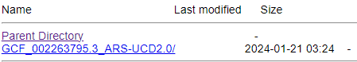

        点击进入后有文件：

        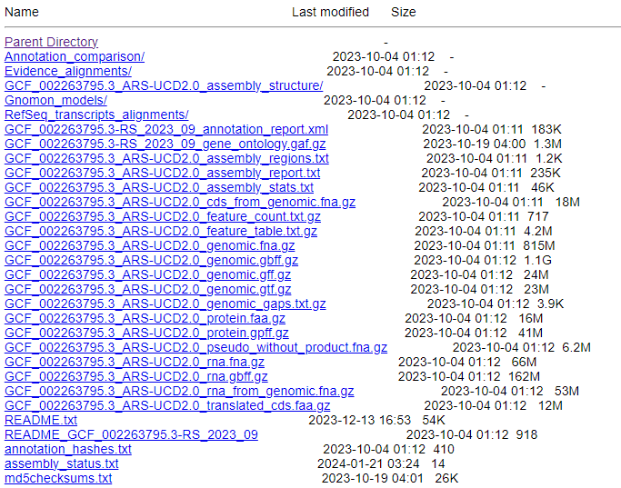
    
    -   例：annotation_releases子目录下有目录：

        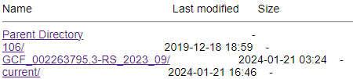

        进入current目录下的唯一目录后有文件：

        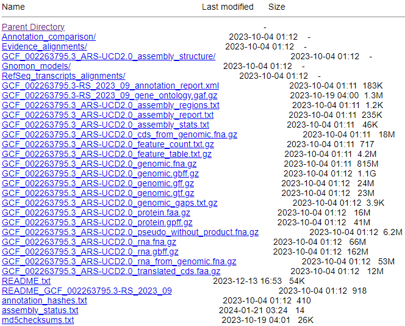

-   常见的文件/目录类型及内容见 https://ftp.ncbi.nlm.nih.gov/genomes/all/README.txt

#### Genbank genome
-   包括已组装基因组序列的初次提交，以及注释信息（如有），accession以GCA_起始。GenBank目录区域包含比RefSeq目录区域更多生物体的基因组序列数据，其中有些assembly是未注释的。
-   目前的release包含123608个物种（统计metadata的第7列species_taxid）。
-   metadata：https://ftp.ncbi.nlm.nih.gov/genomes/genbank/assembly_summary_genbank.txt
-   子目录结构包括：
a. archaea（古菌）
b. bacteria（细菌）
c. fungi（真菌）
d. invertebrate（无脊椎动物）
e. metagenomes（宏基因组）
f. other（其他）- 该目录包括合成基因组
g. plant（植物）
h. protozoa（原生动物）
i. vertebrate_mammalian（哺乳动物）
j. vertebrate_other（其他脊椎动物）
k. viral（病毒）
-   每个项目路径的规律：
https://ftp.ncbi.nlm.nih.gov/genomes/genbank/[物种大类]/[属名_种加词]/latest_assembly_versions/

    （注意：任何拥有超过1,000个组装的物种的all_assembly_versions和latest_assembly_versions目录都为空，需要使用物种目录中的assembly_summary.txt文件第20列中的ftp_path访问assembly。）

-   每个项目的文件命名规律：[assembly accession.version]\_[assembly name]\_[content type].[optional format]
    -   例：latest_assembly_versions子目录下的文件
    
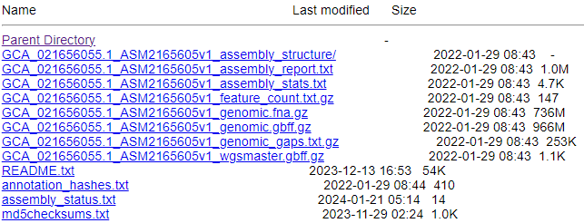

-   常见的文件/目录类型及内容
    -   *_assembly_structure目录：该目录仅在组装具有内部结构时存在。它包含定义组件序列如何组织为支架和/或染色体的AGP文件。其他文件定义支架和染色体如何组织为非核心和其他组装单元，并定义任何替代或修补支架相对于染色体的位置。
    -   *_assembly_report.txt：以制表符分隔的文本文件，用于报告组装中对象的名称、角色和序列访问号.版本。文件头包含了组装的metadata，包括组装名称、组装访问号.版本、组织物种的学名和分类编号、组装提交者以及序列发布日期。
    -   *_assembly_stats.txt：以制表符分隔的文本文件，用于报告组装的统计信息，包括总长度、非间隔长度、contig（连续序列）和scaffold（支架）的数量，contig-N50、scaffold-L50、scaffold-N50、scaffold-N75和scaffold-N90。
    -   *_feature_count.txt.gz：以制表符分隔的文本文件，根据_feature_table.txt.gz文件中报告的数据，报告基因、RNA、CDS和类似特征的数量。
    -   *_genomic.fna.gz：FASTA文件，真核生物中的重复序列被掩盖为小写字母。FASTA标题的格式为序列访问号.版本加上描述。genomic.fna.gz文件包括组装中所有顶层序列（染色体、质粒、细胞器、未定位的支架、未放置的支架以及任何备用位置或补丁支架）。因为它们与染色体序列重复，所以不包括作为染色体一部分的支架序列；这些放置支架的序列在assembly_structure目录下提供。
    -   *_genomic.gbff.gz：flatfile文件，格式见前文。
    -   *_genomic_gaps.txt.gz：以制表符分隔的文本文件，报告顶层基因组序列中所有间隙的坐标。报告的间隙包括AGP文件中指定的间隙，组件序列上注释的间隙，以及序列中运行的连续10个或更多个N。
    -   *_wgsmaster.gbff.gz：组装的全基因组测序(WGS)主文件的GenBank flatfile格式（仅在组装的序列中存在WGS主文件记录时才会出现）。
    -   assembly_status.txt：文本文件，报告了所提供的组装版本的当前状态。同时还会报告任何组装异常情况。每行都遵循 tag=value 的格式。
        -   第一行：status=\<value\>，其中\<value\> 可以是 "latest"、"replaced" 或者 "suppressed" 中的一个。
        -   第二行（如有）：assembly anomaly=\<value\>
其中\<value\> 是一个逗号分隔的组装异常列表，具体描述在以下网页的 "Anomalous assemblies" 部分：https://www.ncbi.nlm.nih.gov/assembly/help/anomnotrefseq/

## 数据格式
1.  GenBank Flatfile【目前下载的是此格式】
2.  Abstract Syntax Notation 1 (ASN.1)

## 附录：
### Genbank division缩写
-   出现地点1：序列条目（entry）中LOCUS行第四个字段。
-   出现地点2：下载的flatfile文件名:，例如：gbpln1125.seq.gz表示Genbank数据库植物、真菌及海藻序列第1125部分
-   有关DIV间的重叠：某一段序列可能既存在于物种相关的DIV中也存在于后面的测序技术相关的DIV中。第1-9个与物种有关的DIV只是方便获取对应的genbank文件，并不能真实反映最新的NCBI Taxonomy。
>Some of the divisions contain sequences from specific groups of organisms, whereas others (EST, GSS, HTG, etc.) contain data generated by specific sequencing technologies from many different organisms. The organismal divisions are historical and do not reflect the current NCBI Taxonomy. Instead, they merely serve as a convenient way to divide GenBank into smaller pieces for those who want to FTP the database. Because of this, and because sequences from a particular organism can exist in technology-based divisions such as EST, HTG, etc., the [NCBI Taxonomy Browser](https://www.ncbi.nlm.nih.gov/taxonomy/) should be used for retrieving all sequences from a particular organism.

1. PRI：灵长目动物序列
2. ROD：啮齿目动物序列
3. MAM：其他哺乳动物序列
4. VRT：其他脊椎动物序列
5. INV：无脊椎动物序列
6. PLN：植物、真菌及海藻序列
7. BCT：细菌序列
8. VRL：病毒序列
9. PHG：噬菌体序列
10. SYN：合成的序列
11. UNA：未注释的序列
12. EST：表达序列标签
13. PAT：专利序列
14. STS：序列标签位置序列
15. GSS：基因组概览序列
16. HTG：高通量基因组序列
17. HTC：高通量互补DNA序列
18. ENV：环境抽样序列

### 关于Accession
-   通常是字母和数字的组合，例如单个字母后面跟着五个数字（例如，U12345）或两个字母后面跟着六个数字（例如，AF123456）。根据序列记录的类型，某些接入号可能会更长。
-   即使在作者的要求下更改了记录中的信息，接入号也不会改变。然而，有时候原始接入号可能会被较新的接入号取代，如果作者进行了新的提交，将之前的序列合并，或者由于某种原因较新的提交取代了早期的记录。
-   来自参考序列数据库（RefSeq）的记录有自己的Accession格式，以两个字母开头，后跟下划线和六个或更多数字。如：NM_002111。

### 关于taxon_id
#### statistics

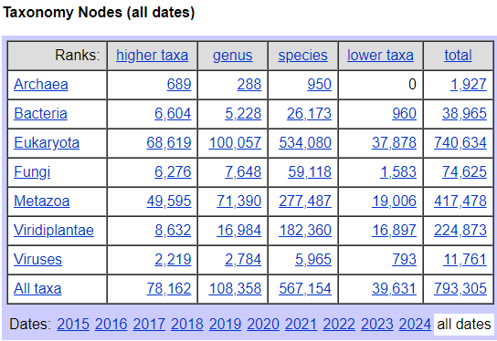

#### dump文件
-   下载地址：https://ftp.ncbi.nih.gov/pub/taxonomy/taxdump_archive/

-   更新频率：每月更新一次。
-   有两种dump文件：new_taxdump_2024-02-01.zip和taxdmp_2024-02-01.zip中的taxon_id数量一致（均为2550738），后者中同一taxon_id对应的物种名多一些，建议使用后者。
 
-   文件组织形式：

    zip文件解压后得到：
        -   citations.dmp
        -   delnodes.dmp
        -   images.dmp
        -   division.dmp（division与division_id的对应关系）
        -   gencode.dmp
        -   merged.dmp
        -   <b>names.dmp（taxon_id与物种名的对应关系）</b>
        -   nodes.dmp（NCBI Taxonomy tree, 连接division_id与taxon_id，还包含parent taxon_id）
        -   readme.txt
 
-   names.dump文件包含了以下四列：
        -   <b>tax_id      （taxon_id，同一taxon_id可含有不同name class的物种名，见下图）</b>
        -   <b>name_txt        （物种名）</b>
        -   unique name     （如物种名唯一则此列为空，不唯一则列出the unique variant of this name）
        -   name class      （对物种名的分类）

    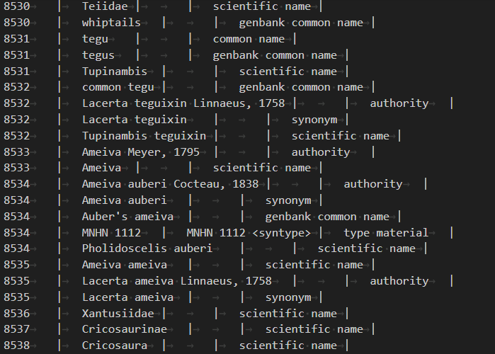

    name class列有以下12种，当name class列为authority时，names.dump包含了发现者及发现时间信息

    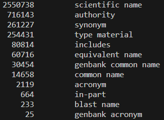

    

