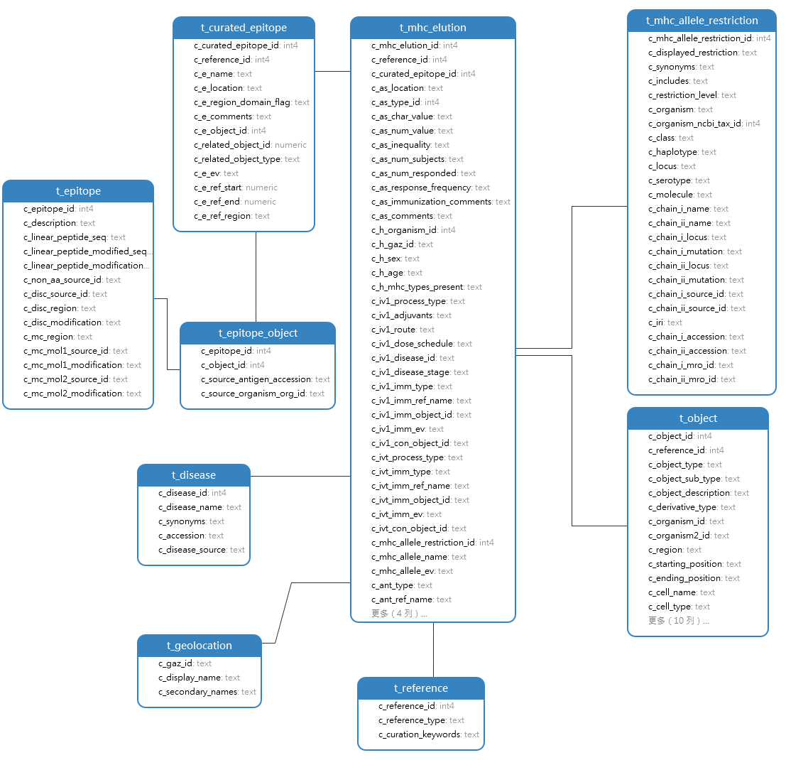
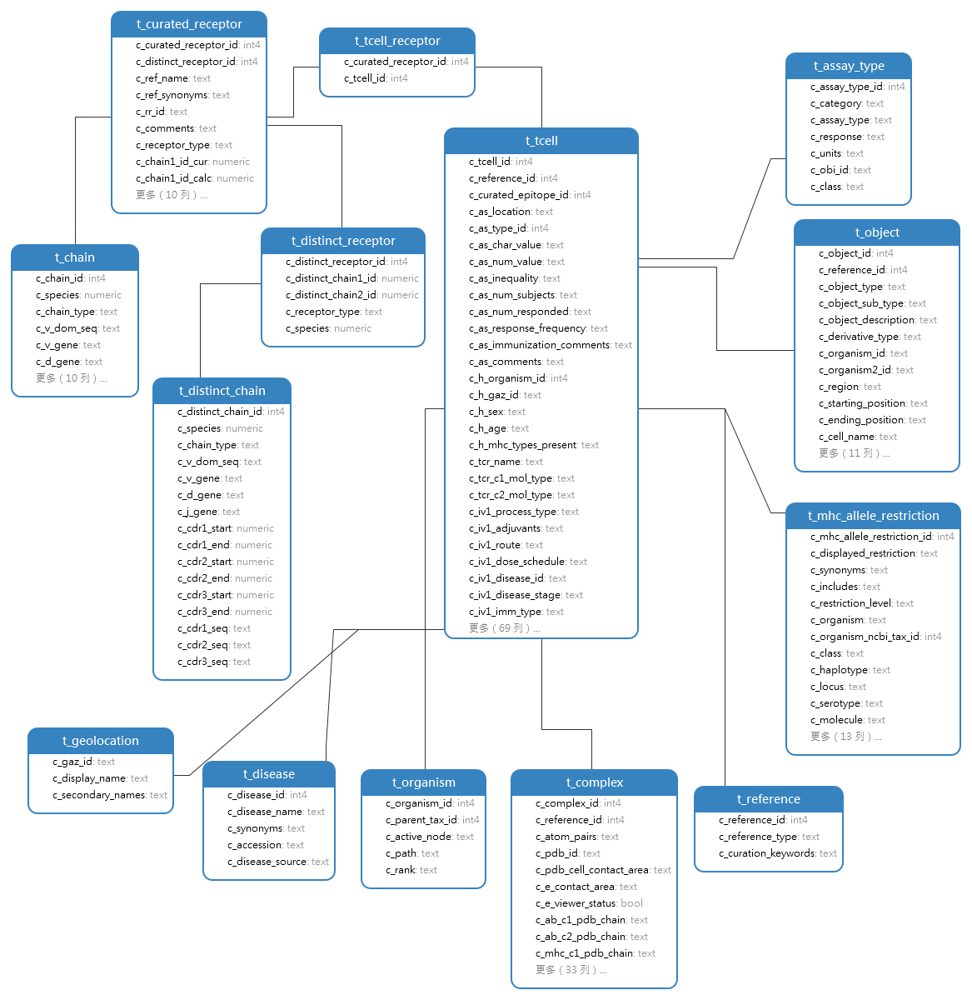
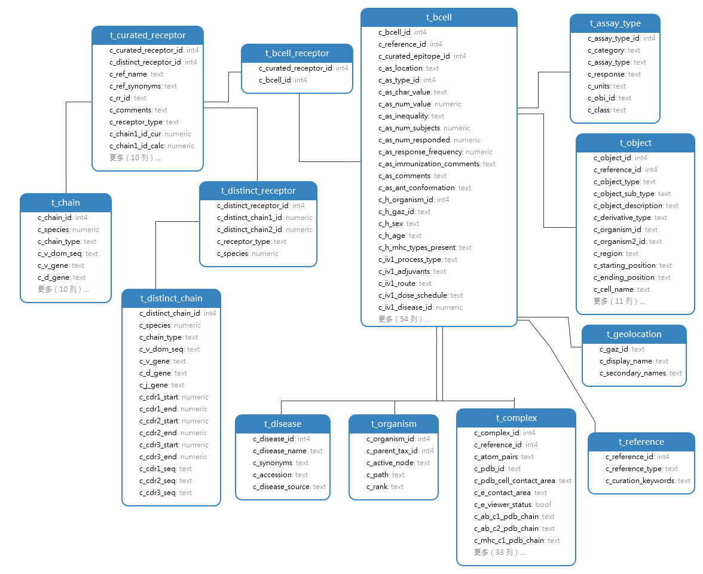
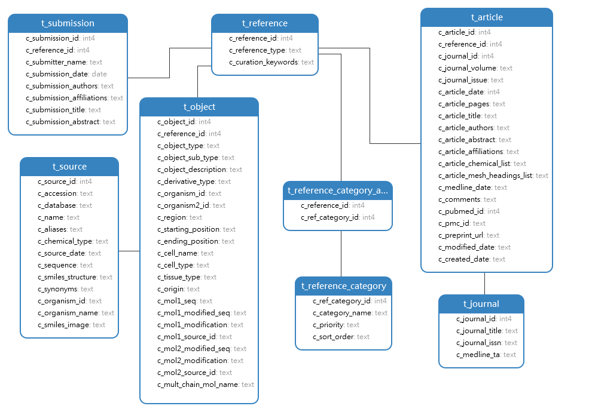

# IEDB 数据库调研

IEDB（Immune Epitope Database and Analysis Resource）是一个专注于提供免疫表位相关数据和分析工具的综合性数据库资源。该数据库由免疫表位数据库小组（Immune Epitope Database Group）负责维护，旨在支持疫苗设计、免疫病理学研究和免疫疗法的开发。IEDB 包含了丰富的免疫表位数据，包括抗原、抗体、T 细胞表位等，为研究人员提供了重要的资源和工具。

## 数据来源
- [IEDB](https://www.iedb.org/database_export_v3.php)
### 官方也根据常用实体，提供了连接好的数据表：
- [Epitope](https://www.iedb.org/downloader.php?file_name=doc/epitope_full_v3_tsv.zip)
- [T-cell](https://www.iedb.org/downloader.php?file_name=doc/tcell_full_v3_tsv.zip)
- [B-cell](https://www.iedb.org/downloader.php?file_name=doc/bcell_full_v3_tsv.zip)
- [MHC-Eluted-Ligands](https://www.iedb.org/downloader.php?file_name=doc/mhc_ligand_full_tsv.zip)

### 官方数据库文档
官方提供的 [IEDB 数据库文档](https://help.iedb.org/hc/en-us/article_attachments/115000188571) 详细介绍了 IEDB 数据库的内容和结构，包括完整的实体关系图（ER 图）。虽然文档的更新时间较早，但它仍然是理解数据库结构的有用资源，尽管一些数据表模式的改动可能未及时更新。
## 数据模型
IEDB 数据库主要包含以下几个模块：
- MHC Eluted Ligands
- MHC Binding
- T Cell
- B Cell
- Reference

### MHC Eluted Ligands
MHC Eluted Ligands 模块通过主要组织相容性复合物洗脱配体检测（MHC Eluted Ligands assay），研究和识别与 MHC 分子结合的抗原肽（配体）。这些抗原肽对于理解免疫应答、开发疫苗和免疫疗法具有重要意义。该模块的主要实体包括 Epitope、MHC、Disease 和 Host 等。
在数据库中的ER图如下：

### MHC Binding
MHC Binding （主要组织相容性复合物结合检测）是一种用于研究和预测抗原肽与MHC分子结合亲和力的方法。这些数据对于预测抗原肽的免疫原性、设计疫苗等具有重要意义。
由于此类实验仅检测抗原肽与MHC分子的结合亲和力，因此数据信息相较于MHC Eluted Ligands 较少，主要包括Epitope、MHC等实体。部分数据有Complex信息，表示抗原肽与MHC分子的结合复合物。

### T Cell
T Cell 模块主要包含与 T 细胞相关的数据，包括 T 细胞表位、T 细胞受体和 T 细胞克隆等。这些数据对于理解 T 细胞介导的免疫应答和疫苗设计等方面非常重要。T Cell 数据相对复杂，除了 T 细胞数据外，还包括抗原、MHC 等实体，以及宿主疾病和感染源信息。此外，T 细胞数据还涵盖 T 细胞类型、抗原递程、体内/体外过程等信息。
在数据库中的ER图如下：

### B Cell
B Cell 数据模块主要包含了与B细胞相关的数据，包括B细胞表位、B细胞受体等。这些数据可用于理解和训练B细胞抗体抗原识别等。其数据结构与T细胞数据类似，主要包括抗原、BCR等实体。其中部分数据(5037条)有Complex信息，表示抗原与BCR的结合复合物PDB结构。

### Reference
数据库中大部分数据实体表中都会有reference_id，而reference来源主要来源于文献和数据库submission，分别对应表article和submission。
其中部分数据实体object还会有source_id，其对应的source表中的数据信息主要来源于其他数据库，如NCBI、Uniprot等，其中的accession对应其他数据库中的id
在数据库中的ER图如下：

