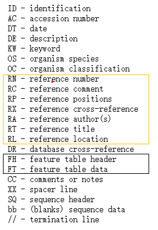
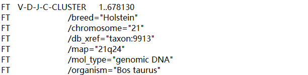
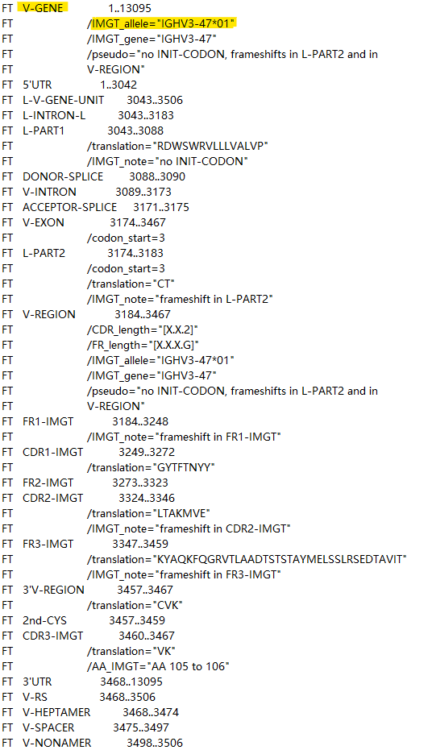

<h1 align="center">IMGT——国际免疫遗传学信息系统</h1>

[IMGT主页](https://www.imgt.org/)

简介

- Published: 
- 更新频率：
- DOI: 

IMGT（the international ImMunoGeneTics information system）于1989年建立, 
是国际知名的免疫相关基因与蛋白质信息系统.

IMGT提供免疫相关的基因组学、蛋白质组学、遗传学及蛋白质二维和三维结构等数据，其
数据的精准性和一致性由IMGT-ONTOLOGY来保证。IMGT-ONTOLOGY是第一套也是目前唯一
一套针对免疫遗传学和免疫信息学所发展和提出的本体论。

目前，IMGT广泛用于抗体设计、分析、优化、改造及相关生物技术的研究和开发。

### 数据库内容

#### 1. 子数据库

- IMGT中Ig相关数据资源可分为4类，分别由下列`7个子数据库`存储和管理：

    | 类别             | 数据库                                     | 注释                                                                                                                        | 数量                             |
    | ---------------- | ------------------------------------------ | --------------------------------------------------------------------------------------------------------------------------- | -------------------------------- |
    | 序列数据库       | IMGT/LIGM-DB                               | 来自 `361` 个物种的 IG 和 TR 核苷酸序列，其序列全部来自于EMBL*                                                              | 251,480                          |
    |                  | IMGT/PRIMER-DB                             | 来自 11 个物种的 IG 和 TR 寡核苷酸（引物），适用于正常和病理情况下的IG和TCR的表达研究、单链抗体、噬菌体展示、基因芯片设计   | 1,864                            |
    |                  | IMGT/CLL-DB                                | 主要收集来自慢性淋巴细胞性白血病患者的IG序列，`需要提交注册才能使用`                                                        | -                                |
    |                  | IMGT/MHC-DB                                | 人类主要组织相容性复合物（HLA）的专门数据库，数据存储在IPD数据库                                                            |
    | 基因数据库       | IMGT/GENE-DB                               | 人类、小鼠、大鼠和兔等`38`个物种的 IG 和 TR 基因（国际命名法 ）序列                                                         | 11,179个基因 和 15,401个等位基因 |
    | 结构数据库       | IMGT/3Dstructure-DB 和 IMGT/2Dstructure-DB | 收录IG 抗体, TR, MH 和 RPI的空间结构及相关信息                                                                              | 8,751                            |
    | 单克隆抗体数据库 | IMGT/mAb-DB                                | 收录已上市及临床试验中的单克隆抗体（IG、mAb）、免疫用融合蛋白(CPCA)、临床用复合蛋白及临床适应症中免疫系统相关蛋白质(RPI) 等 | 1,489                            |

    *注：EMBL不仅包括核酸序列，还包括基因组、微阵列基因表达、蛋白质序列和注释等多种生物学数据。EMBL是三大常用核酸数据库（EMBL、GenBank、DDBJ）之一，其中DDBJ是日本DNA数据库，GenBank收集了超过100,000种不同生物体的世界各地实验室产生的序列，是所有可公开获得的核苷酸序列及其蛋白质翻译的开放数据库。为了达到最佳的同步性，每天DDBJ/EMBL/GenBank之间都要交换最新的数据。(GenBank 是全球最大的公共基因序列数据库之一，由NCBI维护。它包含了来自各种生物物种的数百万条基因序列数据，包括DNA序列、RNA序列和蛋白质序列。GenBank 还提供了与这些序列相关的注释信息，如基因功能、表达模式和突变等。)

- 可下载资源包含内容：
  
  - IMGT/LIGM-DB
      - imgt.dat.Z —— `IMGT/LIGM-DB sequences (flat-file)`
      - imgt.fasta.Z —— IMGT/LIGM-DB sequences (fasta)
      - imgtblast.nXX —— IMGT/LIGM-DB sequences (BLAST)
      - imgtrefseq.fasta —— `IMGT/GENE-DB reference sequences (fasta)`
      - imgtrefseq.nXX —— IMGT/GENE-DB reference sequences (BLAST)
      - accessionNumber.lst —— accession numbers

  - IMGT/GENE-DB
     IMGT/GENE-DB reference sequences in FASTA format 
     - `List` of IMGT/GENE-DB `genes`：基因列表
     - IMGTGENE-DB-ReferenceSequences.fasta-`nt-WithGaps-F+ORF+inframeP`
     - IMGTGENE-DB-ReferenceSequences.fasta-`nt-WithoutGaps-F+ORF+inframeP`, 同`IMGT/LIGM-DB imgtrefseq.fasta`
     - IMGTGENE-DB-ReferenceSequences.fasta-`nt-WithoutGaps-F+ORF+allP`
     - IMGTGENE-DB-ReferenceSequences.fasta-`AA-WithGaps-F+ORF+inframeP`
     - IMGTGENE-DB-ReferenceSequences.fasta-`AA-WithoutGaps-F+ORF+inframeP`

  - IMGT/3Dstructure-DB
      - IMGT3DFlatFiles.tgz —— 7184 IMGT/PDB, 1224 IMGT/INN and 336 IMGT/Kabat flat-files archive
      - IMGT3DNumComp.tgz —— IMGT numbering comparison files archive
      - entries.lst —— 7184 PDB, 1224 INN and 336 Kabat accession numbers
      - pMHContactFiles.tgz
  
  - IMGT/V-QUEST
      - `vdj reference sequence` (34个物种)

  - IMGT/MHC(数据存储在IPD —— 免疫多态性数据库，IPD是一个进行免疫系统基因的多态性研究的集中系统)
      - `序列文件`：
           - Alignments
           - `FASTA`
              - `hla_gen.fasta`，包含所有等位基因的DNA序列；		 
              - `hla_nuc.fasta`，包含所有等位基因的CDS序列；		 
              - `hla_prot.fasta`，包含所有等位基因的氨基酸序列；
           - MSF
           - OID
           - PIR
           - TCE
           - WMDA
           - XML
           - dat（注释文件）
      - `Allele_status.txt`，详细说明每个等位基因被提交的次数、来自多少个细胞、等位基因的未确认/确认状态、CDS 是否完全测序以及等位基因是 cDNa 还是 gDNA 序列；
      - `Allelelist.txt`, 最新版本命名的所有等位基因;
      - `Allelelist_history.txt`，每个等位基因在数据库的每个版本中使用的官方名称；
      - `Deleted_alleles.txt`，已删除的等位基因名称，并附有删除原因；
      - `release_version.txt`, ftp连接中的版本文件有误，GitHub链接正确；

- IMGT/LIGM-DB imgt.dat文件解析

    .dat文件基本单位是序列条目，包括核甘酸碱基排列顺序和注释两部分。序列条目由字段组成，每个字段由标识字起始，后面为该字段的具体说明。有些字段又分若干次子字段，以次标识字或特性表说明符开始，最后以双斜杠“//”作本序列条目结束标记。

    条目标识：
    

    FT信息：
    1. 该序列总长信息
    
    
    2. 按等位基因所在区段分成多段（每段信息中包含一个等位基因）
    
    

#### 2. 资源获取

根据目前需求，只需要 IMGT/GENE-DB（含有氨基酸序列的文件）、IMGT/MHC-DB、IMGT/PRIMER-DB、IMGT/3Dstructure-DB and IMGT/2Dstructure-DB 这些数据库的数据.

其中，IMGT/GENE-DB、IMGT/MHC-DB数据可以通过'Download'页面中对应链接下载；而IMGT/PRIMER-DB、IMGT/3Dstructure-DB and IMGT/2Dstructure-DB的数据需要通过爬虫获取