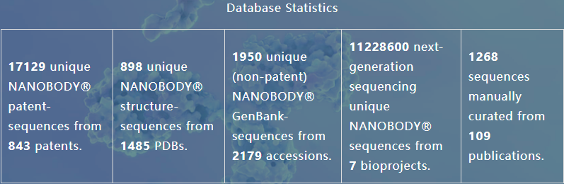
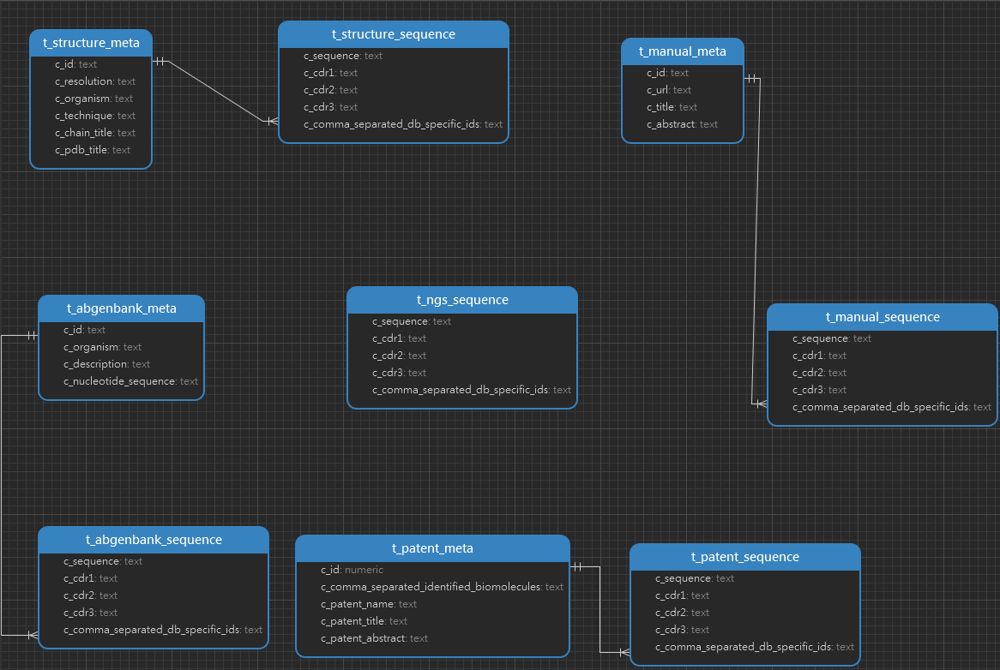

<h1 align="center">INDI Tables 详情</h1>

#### 一. 数据统计

**官网数据库统计数据显示**：

**从官网下载的rawdata最终入库数据统计**：
| 表名                 | 行数         |
| -------------------- | ------------ |
| t_abgenbank_meta     | 2,179        |
| t_abgenbank_sequence | 1,950        |
| t_manual_meta        | 109          |
| t_manual_sequence    | 1,268        |
| t_ngs_sequence       | `10,715,539` |
| t_patent_meta        | 843          |
| t_patent_sequence    | 17,129       |
| t_structure_meta     | `2,463`      |
| t_structure_sequence | `797`        |

#### 二. ER 图

#### 三. Tables

1. *_sequence
 
    | 字段名                            | 注释                              | 数据类型 |
    | --------------------------------- | --------------------------------- | -------- |
    | c_sequence                        | 氨基酸序列(可变区v-region)        | text     |
    | c_cdr1                            | CDR1序列                          | text     |
    | c_cdr2                            | CDR2序列                          | text     |
    | c_cdr3                            | CDR3序列                          | text     |
    | c_comma_separated_db_specific_ids | 逗号分隔的抗体(不同数据库)特定IDs | text     |

2. abgenbank_meta
   
   | 字段名                | 注释     | 数据类型 |
   | --------------------- | -------- | -------- |
   | c_id                  | 抗体id   | text     |
   | c_organism            | 物种     | text     |
   | c_description         | 描述     | text     |
   | c_nucleotide_sequence | 核酸序列 | text     |

3. manual_meta 
   
   | 字段名     | 注释    | 数据类型 |
   | ---------- | ------- | -------- |
   | c_id       | 抗体id  | text     |
   | c_url      | url链接 | text     |
   | c_title    | 标题    | text     |
   | c_abstract | 摘要    | text     |

4. patent_meta
   
   | 字段名                                    | 注释                     | 数据类型 |
   | ----------------------------------------- | ------------------------ | -------- |
   | c_id                                      | 抗体id                   | numeric  |
   | c_comma_separated_identified_biomolecules | 逗号分隔的已鉴定生物分子 | text     |
   | c_patent_name                             | 专利id                   | text     |
   | c_patent_title                            | 专利标题                 | text     |
   | c_patent_abstract                         | 专利摘要                 | text     |

5. structure_meta

    | 字段名        | 注释                         | 数据类型 |
    | ------------- | ---------------------------- | -------- |
    | c_id          | 抗体id                       | text     |
    | c_resolution  | (蛋白质晶体结构解析的)分辨率 | text     |
    | c_organism    | 物种                         | text     |
    | c_technique   | 技术                         | text     |
    | c_chain_title | 链标题                       | text     |
    | c_pdb_title   | pdb文件标题                  | text     |