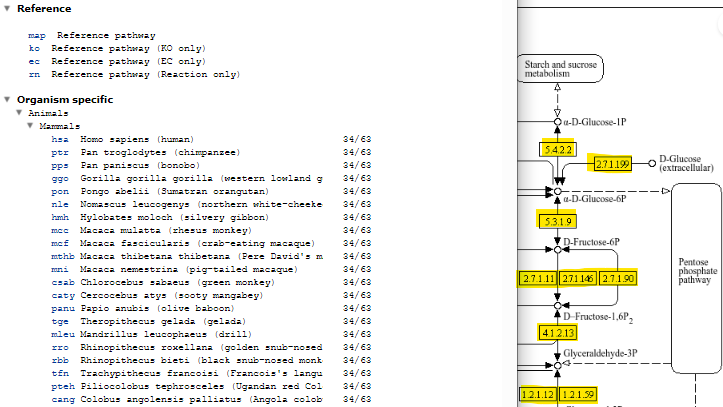
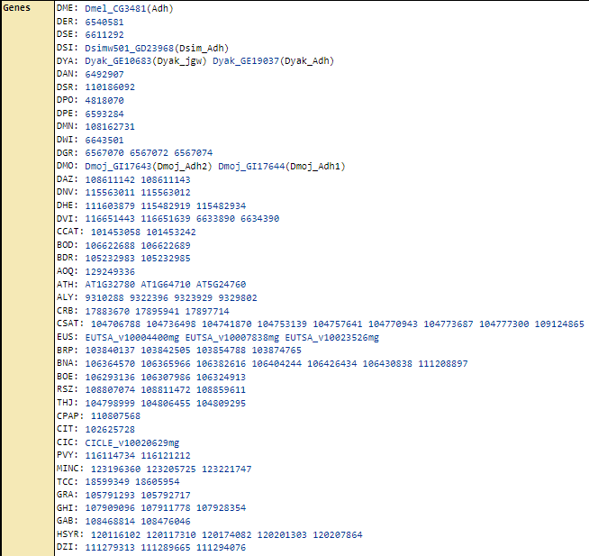
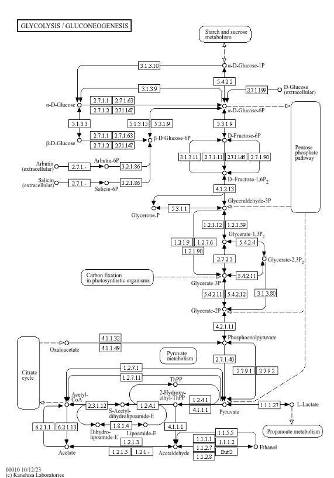
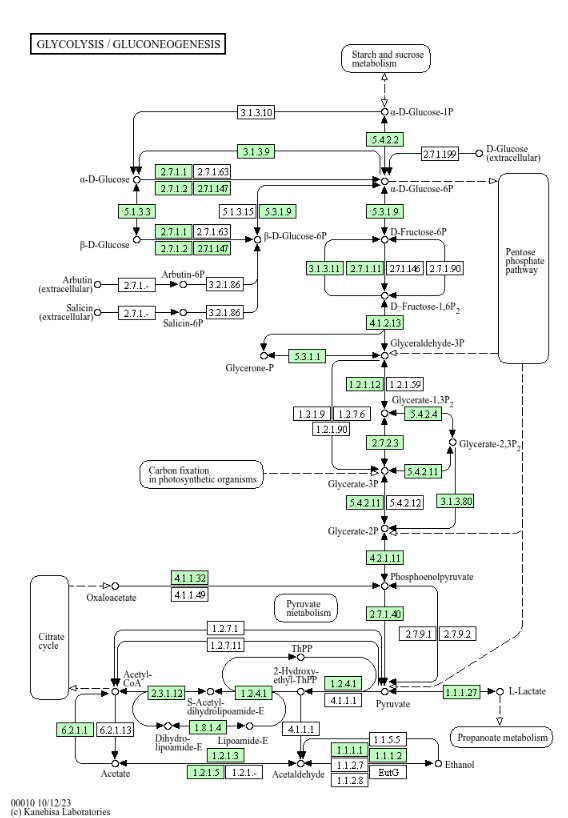
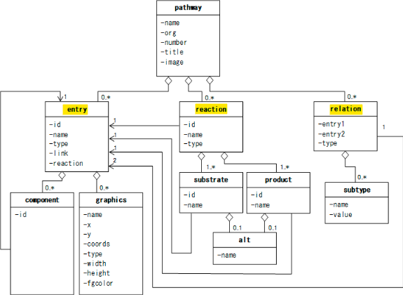
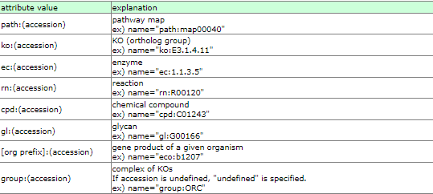
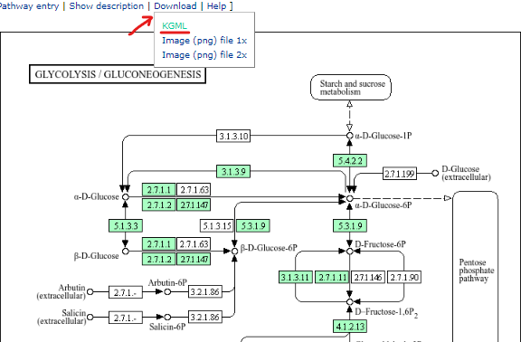
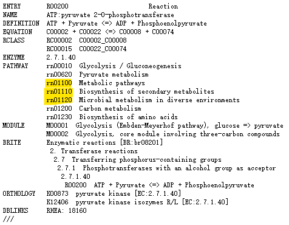
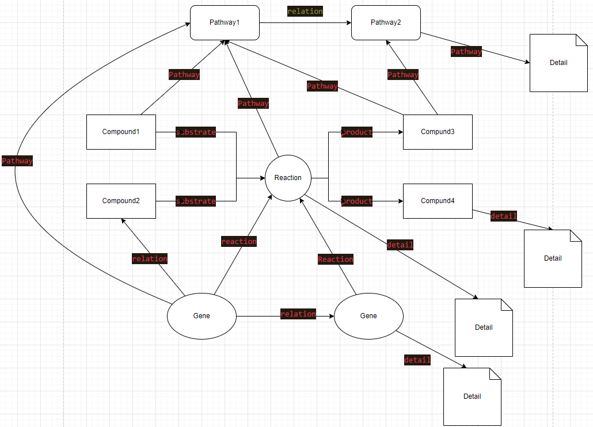
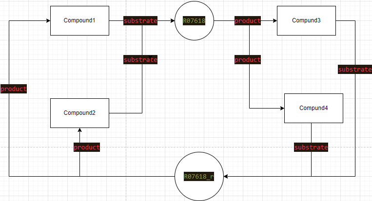

<h1 align="center">KEGG PATHWAY — 生物通路信息数据库</h1>

<p align="center">
    编写作者：wu_jiannan /
    编写时间：2024.05.29
</p>

<p align="center">
    <a href='https://www.kegg.jp/kegg/pathway.html'>Website</a> •
    <a href="#数据统计">version 4.4.233</a> •
    <a href="#netword">Network</a> •
    <a href="#biogrid-数据下载">Download</a> •
    <a href="#reference">Publications</a> • 
    <a href="KEGG-PATHWAY_metadata.md">Metadata</a> 
</p>

**简介**

KEGG PATHWAY（Kyoto Encyclopedia of Genes and Genomes Pathway）数据库是一个整合了生物通路信息的数据库，由日本京都大学生物信息学中心（Bioinformatics Center, Kyoto University）创建和维护。它提供了广泛的生物通路信息，涵盖了多种生物学过程，包括代谢通路、信号传导、细胞周期等，是生物信息学和系统生物学研究中常用的资源之一。

> KEGG

---
## 数据库详情
### 一. 数据库内容
#### 1. 通路标识符

- 前缀
  - map，pathway
  - ko， KOs*
  - ec, EC numbers**
  - rn, reactions
  - &lt;org&gt;，`organism-specific pathway` generated by converting KOs to gene identifiers
  
- 后缀：5位数字；当以以下几位数字开头时，有特别含义：
  - 011, global map
  - 012, overview map
  - 010, chemical structure map
  - 07, drug structure map



```
* 注：
KO（KEGG Orthology）介绍

1. 定义：
KO（KEGG Orthology） 是KEGG数据库中的一个标准化系统，用于对基因和基因产品进行功能注释。
每个KO条目代表一组具有相同或非常相似功能的直系同源基因或蛋白质。

2. 功能：
注释基因功能：通过KO系统，基因可以被注释为具有特定功能的同源群，提供了功能预测和基因分析的基础。
连接通路：KO 系统将基因与 KEGG PATHWAY、KEGG BRITE（层次分类）等数据库中的生物过程和功能分类联系起来，使研究人员能够在系统生物学和代谢网络研究中更好地利用基因功能信息。

3. 结构：
KO条目：每个KO条目以“K”开头，后跟一串数字，例如K00001。一个KO条目可以包括来自不同物种的多个基因或蛋白质。
链接与注释：每个KO条目都与 KEGG PATHWAY、KEGG MODULE、KEGG BRITE等数据库中的具体通路、功能模块或分类系统相链接。

4. 应用：
基因功能注释：通过将新测序的基因与KO条目进行比对，研究人员可以预测这些基因的功能。
代谢和信号通路分析：使用KO条目将基因与KEGG PATHWAY中的特定代谢或信号通路关联起来，有助于研究基因在生物过程中的作用。
进化研究：通过比较不同物种的KO条目，可以研究基因的进化和功能保守性。

KO的使用示例
假设有一个基因X，研究人员希望知道它的功能。通过与KEGG数据库中的KO条目进行比对，发现基因X与KO条目K00844高度相似。查看K00844的注释，发现其代表的功能是"果糖-1,6-二磷酸醛缩酶"。因此，可以推测基因X具有果糖-1,6-二磷酸醛缩酶的功能。

KO的优势
标准化：KO系统提供了一个标准化的功能注释方法，使得不同物种的基因功能可以进行直接比较。
广泛应用：KO系统与KEGG的其他数据库（如PATHWAY、BRITE等）紧密集成，使得基因功能注释、通路分析和系统生物学研究更加方便。
```

`K00001中的gene模块:`



`map 与 &lt;org&gt; 的区别，以通路 "00010" 为例：`

- `map00010`
  
    

- `mmu00010`

    

```
** 注：
EC 代表 Enzyme Commission（酶委员会）编号，是一种用于分类和命名酶的系统。
每个EC编号唯一标识一种酶，并根据其催化反应的类型将酶分为六大类。
EC编号由四组数字组成，形式为EC x.x.x.x。

EC编号的结构:
    第一位数字：表示酶的主要类别（总共六大类）。
    第二位数字：表示酶的次级类别，根据所涉及的具体化学反应类型进行分类。
    第三位数字：表示酶的亚类，进一步细化反应类型。
    第四位数字：表示酶的个体编号，特定于具体的酶。

例如，EC 1.1.1.1 表示“醇脱氢酶 (Alcohol dehydrogenase)”，其分类如下：
    1：氧化还原酶（Oxidoreductases）
    1.1：作用于 CH-OH 基团的酶
    1.1.1：以 NAD+ 或 NADP+ 作为电子受体
    1.1.1.1：具体的酶名称为醇脱氢酶

EC编号的主要类别:

    1. 氧化还原酶 (Oxidoreductases) - EC 1.x.x.x
        催化氧化还原反应。
        例如：酒精脱氢酶 (EC 1.1.1.1)

    2. 转移酶 (Transferases) - EC 2.x.x.x
        催化某个基团从一个分子转移到另一个分子的反应。
        例如：己糖激酶 (EC 2.7.1.1)
    
    3. 水解酶 (Hydrolases) - EC 3.x.x.x
        催化水解反应。
        例如：酯酶 (EC 3.1.1.1)
    
    4. 裂合酶 (Lyases) - EC 4.x.x.x
        催化化学键断裂的反应，不涉及水解或氧化。
        例如：脱羧酶 (EC 4.1.1.1)

    5. 异构酶 (Isomerases) - EC 5.x.x.x
        催化分子内重排反应。
        例如：顺反异构酶 (EC 5.3.1.1)

    6. 连接酶 (Ligases) - EC 6.x.x.x
        催化两个分子间化学键的形成，通常伴随ATP的水解。
        例如：DNA连接酶 (EC 6.5.1.1)

```
#### 2. 常用通路分类

**Metabolism**

|                                             |                                                                                                                                                                                                                         |
| ------------------------------------------- | ----------------------------------------------------------------------------------------------------------------------------------------------------------------------------------------------------------------------- |
| Global and overview maps                    | 01100, 01110, 01120, 01200, 01210, 01212, 01230, 01232, 01250, 01240, 01220                                                                                                                                             |
| Carbohydrate metabolism                     | 00010, 00020, 00030, 00040, 00051, 00052, 00053, 00500, 00520, 00620, 00630, 00640, 00650, 00660, 00562                                                                                                                 |
| Energy metabolism                           | 00190, 00195, 00196, 00710, 00720, 00680, 00910, 00920                                                                                                                                                                  |
| Lipid metabolism                            | 00061, 00062, 00071, 00073, 00100, 00120, 00121, 00140, 00561, 00564, 00565, 00600, 00590, 00591, 00592, 01040                                                                                                          |
| Nucleotide metabolism                       | 00230, 00240                                                                                                                                                                                                            |
| Amino acid metabolism                       | 00250, 00260, 00270, 00280, 00290, 00300, 00310, 00220, 00330, 00340, 00350, 00360, 00380, 00400                                                                                                                        |
| Metabolism of other amino acids             | 00410, 00430, 00440, 00450, 00460, 00470, 00480                                                                                                                                                                         |
| Glycan biosynthesis and metabolism          | 00510, 00513, 00512, 00515, 00514, 00532, 00534, 00533, 00531, 00563, 00601, 00603, 00604, 00511, 00540, 00542, 00541, 00550, 00552, 00571, 00572, 00543                                                                |
| Metabolism of cofactors and vitamins        | 00730, 00740, 00750, 00760, 00770, 00780, 00785, 00790, 00670, 00830, 00860, 00130                                                                                                                                      |
| Metabolism of terpenoids and polyketides    | 00900, 00902, 00909, 00904, 00906, 00905, 00981, 00908, 00903, 00907, 01052, 00522, 01051, 01059, 01056, 01057, 00253, 00523, 01054, 01053, 01055                                                                       |
| Biosynthesis of other secondary metabolites | 00940, 00945, 00941, 00944, 00942, 00943, 00946, 00901, 00403, 00950, 00960, 00996, 00232, 00965, 00966, 00402, 00311, 00332, 00261, 00331, 00521, 00524, 00525, 00401, 00404, 00405, 00333, 00254, 00998, 00999, 00997 |
| Xenobiotics biodegradation and metabolism   | 00362, 00627, 00364, 00625, 00361, 00623, 00622, 00633, 00642, 00643, 00791, 00930, 00363, 00621, 00626, 00624, 00365, 00984, 00980, 00982, 00983                                                                       |
| Chemical structure transformation maps      | 01010, 01060, 01061, 01062, 01063, 01064, 01065, 01066, 01070                                                                                                                                                           |

**Genetic Information Processing**

|                                   |                                                                                                         |
| --------------------------------- | ------------------------------------------------------------------------------------------------------- |
| Transcription                     | 03020, 03022, 03040                                                                                     |
| Translation                       | 03010, 00970, 03013, 03015, 03008                                                                       |
| Folding, sorting and degradation  | 03060, 04141, 04130, 04120, 04122, 03050, 03018                                                         |
| Replication and repair            | 03030, 03410, 03420, 03430, 03440, 03450, 03460                                                         |
| Chromosome                        | 03082, 03083                                                                                            |
| Information processing in viruses | 03230, 03240, 03250, 03260, 03271, 03262, 03261, 03263, 03264, 03265, 03266, 03268, 03267, 03259, 03258 |

**Environmental Information Processing**

|                                     |                                                                                                                                                                                                                                       |
| ----------------------------------- | ------------------------------------------------------------------------------------------------------------------------------------------------------------------------------------------------------------------------------------- |
| Membrane transport                  | 02010, 02060, 03070                                                                                                                                                                                                                   |
| Signal transduction                 | 02020, 04010, 04013, 04016, 04011, 04012, 04014, 04015, 04310, 04330, 04340, 04341, 04350, 04390, 04391, 04392, 04370, 04371, 04630, 04064, 04668, 04066, 04068, 04020, 04070, 04072, 04071, 04024, 04022, 04151, 04152, 04150, 04075 |
| Signaling molecules and interaction | 04080, 04060, 04061, 04512, 04514                                                                                                                                                                                                     |

**Cellular Processes**

|                                  |                                                                                    |
| -------------------------------- | ---------------------------------------------------------------------------------- |
| Transport and catabolism         | 04144, 04145, 04142, 04146, 04140, 04138, 04136, 04137, 04139, 04148               |
| Cell growth and death            | 04110, 04111, 04112, 04113, 04114, 04210, 04214, 04215, 04216, 04217, 04115, 04218 |
| Cellular community - eukaryotes  | 04510, 04520, 04530, 04540, 04550                                                  |
| Cellular community - prokaryotes | 02024, 05111, 02025, 02026                                                         |
| Cell motility                    | 02030, 02040, 04814, 04820, 04810                                                  |

**Organismal Systems**

|                              |                                                                                                                                                          |
| ---------------------------- | -------------------------------------------------------------------------------------------------------------------------------------------------------- |
| Immune system                | 04640, 04610, 04611, 04613, 04620, 04624, 04621, 04622, 04623, 04625, 04650, 04612, 04660, 04658, 04659, 04657, 04662, 04664, 04666, 04670, 04672, 04062 |
| Endocrine system             | 04911, 04910, 04922, 04923, 04920, 03320, 04929, 04912, 04913, 04915, 04914, 04917, 04921, 04926, 04935, 04918, 04919, 04928, 04916, 04924, 04925, 04927 |
| Circulatory system           | 04260, 04261, 04270                                                                                                                                      |
| Digestive system             | 04970, 04971, 04972, 04976, 04973, 04974, 04975, 04979, 04977, 04980, 04978                                                                              |
| Excretory system             | 04962, 04960, 04961, 04964, 04966                                                                                                                        |
| Nervous system               | 04724, 04727, 04725, 04728, 04726, 04720, 04730, 04723, 04721, 04722                                                                                     |
| Sensory system               | 04744, 04745, 04740, 04742, 04750                                                                                                                        |
| Development and regeneration | 04320, 04360, 04361, 04380                                                                                                                               |
| Aging                        | 04211, 04212, 04213                                                                                                                                      |
| Environmental adaptation     | 04710, 04713, 04711, 04712, 04714, 04626                                                                                                                 |

**Human Diseases**

|                                 |                                                                                                                       |
| ------------------------------- | --------------------------------------------------------------------------------------------------------------------- |
| Cancer: overview                | 05200, 05202, 05206, 05205, 05204, 05207, 05208, 05203, 05230, 05231, 05235                                           |
| Cancer: specific types          | 05210, 05212, 05225, 05226, 05214, 05216, 05221, 05220, 05217, 05218, 05211, 05219, 05215, 05213, 05224, 05222, 05223 |
| Infectious disease: viral       | 05166, 05170, 05161, 05160, 05171, 05164, 05162, 05168, 05163, 05167, 05169, 05165                                    |
| Infectious disease: bacterial   | 05110, 05120, 05130, 05132, 05131, 05135, 05133, 05134, 05150, 05152, 05100                                           |
| Infectious disease: parasitic   | 05146, 05144, 05145, 05140, 05142, 05143                                                                              |
| Immune disease                  | 05310, 05322, 05323, 05320, 05321, 05330, 05332, 05340                                                                |
| Neurodegenerative disease       | 05010, 05012, 05014, 05016, 05017, 05020, 05022                                                                       |
| Substance dependence            | 05030, 05031, 05032, 05033, 05034                                                                                     |
| Cardiovascular disease          | 05417, 05418, 05410, 05412, 05414, 05415, 05416                                                                       |
| Endocrine and metabolic disease | 04930, 04940, 04950, 04936, 04932, 04931, 04933, 04934                                                                |
| Drug resistance: antimicrobial  | 01501, 01502, 01503                                                                                                   |
| Drug resistance: antineoplastic | 01521, 01524, 01523, 01522                                                                                            |

**Drug Development**

|                                                          |                                                                                                  |
| -------------------------------------------------------- | ------------------------------------------------------------------------------------------------ |
| Chronology: Antiinfectives                               | 07011, 07012, 07013, 07021, 07019, 07020, 07014, 07023, 07026, 07044, 07053                      |
| Chronology: Antineoplastics                              | 07040, 07041, 07042, 07043, 07045                                                                |
| Chronology: Nervous system agents                        | 07032, 07030, 07033, 07015, 07039, 07028, 07029, 07031, 07027, 07056, 07057                      |
| Chronology: Other drugs                                  | 07055, 07016, 07017, 07018, 07037, 07038, 07046, 07047, 07048, 07049, 07050, 07051, 07052, 07054 |
| Target-based classification: G protein-coupled receptors | 07220, 07215, 07214, 07213, 07212, 07227, 07211, 07228, 07224, 07229                             |
| Target-based classification: Nuclear receptors           | 07225, 07226, 07223, 07222                                                                       |
| Target-based classification: Ion channels                | 07221, 07230, 07036, 07231, 07232, 07235                                                         |
| Target-based classification: Transporters                | 07233, 07234                                                                                     |
| Target-based classification: Enzymes                     | 07216, 07219, 07024, 07217, 07218                                                                |
| Structure-based classification                           | 07025, 07034, 07035                                                                              |
| Skeleton-based classification                            | 07110, 07112, 07114, 07117                                                                       |


#### 3. 通路更新
   
   [updata history](https://www.kegg.jp/kegg/docs/upd_map.html)
   

#### 4. 数据统计

最新数据请在线[查看](https://www.kegg.jp/kegg/docs/statistics.html)

下表统计数据对应日期：2024/5/30

| 数据库                 | 数据类型                                                                                | 数量            |
| ---------------------- | --------------------------------------------------------------------------------------- | --------------- |
| *Systems information*  |                                                                                         |                 |
| `KEGG PATHWAY`         | Pathway maps, reference (total)                                                         | 571 (1,171,970) |
| KEGG BRITE             | Functional hierarchies, reference (total)                                               | 195 (390,123)   |
| KEGG MODULE            | KEGG modules                                                                            | 481             |
|                        | Reaction modules                                                                        | 48              |
| *Genomic information*  |
| KEGG ORTHOLOGY         | KEGG Orthology (KO) groups                                                              | 26,786          |
| KEGG GENES             | Genes in KEGG organisms                                                                 | 53,657,141      |
|                        | Addendum proteins                                                                       | 4,181           |
|                        | Viral genes                                                                             | 688,823         |
|                        | Viral mature peptides                                                                   | 377             |
| KEGG GENOME            | KEGG organisms                            (1045 eukaryotes, 8482 bacteria, 435 archaea) | 9,962           |
|                        | KEGG selected viruses (T4 category)                                                     | 359             |
|                        | KEGG viruses (Vtax category)                                                            | 14,397          |
| *Chemical information* |
| KEGG COMPOUND          | Metabolites and other chemical substances                                               | 19,356          |
| KEGG GLYCAN            | Glycans                                                                                 | 11,220          |
| KEGG REACTION          | Biochemical reactions                                                                   | 12,088          |
|                        | Reaction class                                                                          | 3,194           |
| KEGG ENZYME            | Enzyme nomenclature                                                                     | 8,158           |
| *Health information*   |
| KEGG NETWORK           | Disease-related network elements                                                        | 1,408           |
|                        | Network variation maps                                                                  | 141             |
| KEGG VARIANT           | Human gene variants                                                                     | 1,452           |
| KEGG DISEASE           | Human diseases                                                                          | 2,746           |
| KEGG DRUG              | Drugs                                                                                   | 12,440          |
|                        | Drug groups                                                                             | 2,471           |
*Drug labels*
KEGG MEDICUS|	Japanese prescription drug labels from JAPIC|12,158
||Japanese OTC drug labels from JAPIC|	10,190
KEGG MEDICUS|	FDA prescription drug labels linked to DailyMed	|33,892

#### 5. 数据格式

> KEGG pathway 储存格式为 KGML (KEGG Markup Language)
> 格式详细说明 - [Documents](https://www.kegg.jp/kegg/xml/docs/)

KGML overview:



其中 entry 元素的 name 属性值包括：


例如：
**&lt;org&gt;**: path, ko, cpd, gl, *&lt;org&gt;*, group

### 二. 数据下载

- 在线：KEGG PATHWAY 数据库提供了 [KGML](#4-数据格式) 格式文件来下载通路, 下载的文件为`.xml`。

    
  
- KEGG FTP：仅供订阅者使用
- KEGG API: 代码下载可以通过 [KEGG API](https://www.kegg.jp/kegg/rest/keggapi.html) 中的 'get' 方法.

#### 数据解析清洗注意事项

对于单独的每个reaction， kegg pathway 都显示为可逆，但具体表现在不同 map 或不同物种时，会发生变化

1. 放在不同的 map 中，相同的 reaction id，不一定都是可逆的。示例：：

    

    *标黄为可逆 map*

- 不同物种，相同 map 相同 reaction id，可逆性不一样。示例：
    
    

### 三. Network

网络构建设计图

#### 1. 版本1





#### 2. 版本2


## Reference 