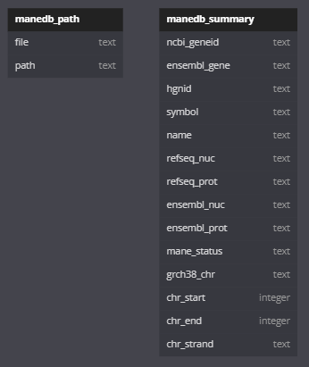
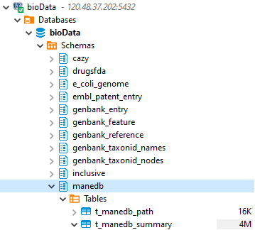

# MANE(Matched Annotation from NCBI and EMBL-EBI)
## 简介
MANE 项目是一个来自 NCBI 和 EMBL-EBI 的匹配注释（MANE）的合作项目，旨在汇聚人类基因和转录注释，并为人类蛋白编码基因定义一个基因组范围的代表性转录本和相应的蛋白质。每个 MANE 转录本代表 Refseq 转录本与其在 Ensembl/GENCODE 注释中的对应物在外显子区域的精确匹配，以便这两个标识符可以互换使用。此外，MANE 转录本与 GRCh38 参考基因组组装完全匹配，并根据转录本表达水平和编码区域的保守等生物学相关标准进行选择。目前，该项目的可交付成果包括：
-   MANE Select：MANE 选择集包含跨基因组中的每个蛋白编码位点的一个转录本，代表该位点的生物学特征。该集合可作为临床报告的通用标准，作为浏览器和关键基因组资源的默认显示内容，以及作为比较或进化基因组学的起点。MANE Select 转录本是通过计算方法结合手动审查和讨论来识别的。
-   MANE Plus Clinical：MANE Plus 临床集包括额外的转录本，用于需要 MANE Select 单独无法报告所有公共资源中可用的“致病（P）”或“可能致病（LP）”临床变异的基因。

MANE 版本 1.0 覆盖了 99% 的人类蛋白编码基因和 99.8% 的与临床相关基因，包括美国医学遗传学与基因组学学院（ACMG）二次发现名单（SF）v3.0 中的基因。

### MANE Select Methodology
https://www.ncbi.nlm.nih.gov/refseq/MANE/
#### Choosing the transcript
NCBI 和 EMBL-EBI分别为每个基因选择最具代表性的 the ‘select’ transcript（具体细节见流程图：https://www.ncbi.nlm.nih.gov/refseq/refseq_select/#Picking_Select），之后寻找在这两类转录本中具有相同剪接结构和相同CDS的matched pairs，作为共有转录本。
#### Matching transcript ends
-   转录本起点的确定：通过高通量测序技术CAGE (cap analysis of gene expression)来特异性捕捉基因5'端。把50bp内的TSS视作一个cluster，将cluster中最靠近5’端的、具有至少50% 最大CAGE tag counts数的核苷酸位置作为frequently used TSS。
-   转录本终点的确定：通过高通量polyA-seq确定转录本最后一位。把50bp内的TSS视作一个cluster，将cluster中最靠近3’端的、具有至少50%最大counts数的核苷酸位置作为转录本的最后一位。

## 数据组织形式

-   release data（1-11和13）位于 https://ftp.ncbi.nlm.nih.gov/refseq/MANE/MANE_human/release_##/
-   track data（12）位于 https://ftp.ncbi.nlm.nih.gov/refseq/MANE/trackhub/data/release_##/

1. MANE.GRCh38.v##.ensembl_genomic.gtf.gz
    Transcripts from the MANE Project, with Ensembl identifiers for nucleotide,
    protein and genes in GTF format
2. MANE.GRCh38.v##.ensembl_genomic.gff.gz
    Transcripts from the MANE Project, with Ensembl identifiers for nucleotide,
    protein and genes in GFF3 format
3. MANE.GRCh38.v##.refseq_genomic.gtf.gz
    Transcripts from the MANE Project, with NCBI Refseq identifiers for
    nucleotide, protein and genes in GTF format
4. MANE.GRCh38.v##.refseq_genomic.gff.gz
    Transcripts from the MANE Project, with NCBI RefSeq identifiers for
    nucleotide, protein and genes in GFF3 format
5. MANE.GRCh38.v##.ensembl_protein.faa.gz
    Protein sequences, with Ensembl identifiers in FASTA format
6. MANE.GRCh38.v##.ensembl_rna.fna.gz
    Transcript sequences, with Ensembl identifiers in FASTA format
7. MANE.GRCh38.v##.refseq_protein.faa.gz
    Protein sequences, with NCBI RefSeq identifiers in FASTA format
8. MANE.GRCh38.v##.refseq_protein.gpff.gz
    Proteins in GenPept flatfile view
9. MANE.GRCh38.v##.refseq_rna.fna.gz
    Transcript sequences, with NCBI RefSeq identifiers in FASTA format
10. MANE.GRCh38.v##.refseq_rna.gbff.gz
    Transcripts in GenBank flatfile view
11. MANE.GRCh38.v##.summary.txt.gz
    A summary file with the following tab-delimited fields:
    [  1] NCBI_GeneID
    [  2] Ensembl_Gene
    [  3] HGNC_ID
    [  4] symbol
    [  5] name
    [  6] RefSeq_nuc
    [  7] RefSeq_prot
    [  8] Ensembl_nuc
    [  9] Ensembl_prot
    [ 10] MANE_status
    [ 11] GRCh38_chr
    [ 12] chr_start
    [ 13] chr_end
    [ 14] chr_strand
12. trackhub
    This directory includes files that can used to add a custom track hub to
    NCBI Genome Data Viewer, UCSC genome browser or Ensembl genome browser.
    Specifically, the url for the track hub is:
    http://ftp.ncbi.nlm.nih.gov/refseq/MANE/trackhub/hub.txt
    Please see the following pages for help with adding track hubs to
    specific browsers:
    NCBI GDV -- https://www.ncbi.nlm.nih.gov/genome/gdv/browser/help/#TRACKHUBS
    UCSC -- http://genome.ucsc.edu/goldenPath/help/hgTrackHubHelp.html
    Ensembl -- http://ensembl.org/info/website/adding_trackhubs.html

    Users interested in consuming these data in a stand-alone genome browser can
    use the following files in bigBed format:
    trackhub/data/release_##/MANE.GRCh38.v##.refseq.bb        RefSeq Identifiers
    trackhub/data/release_##/MANE.GRCh38.v##.ensembl.bb     EMBL-EBI Identifiers
13. MANE.GRCh38.v##.protein_coding_genes_not_in_mane.txt.gz
    This file includes a list of human protein-coding genes not in the MANE set,
    and a category associated with each gene indicating the reason why it is not 
    in MANE. Genes in the category "pending MANE review" are yet to be reviewed 
    by RefSeq and Ensembl/GENCODE curators. 

## 数据更新
未找到官方的更新相关说明。

## schema

## metadata
### manedb_path

| column | dtype | description |   |
|--------|-------|-------------|---|
| c_file | text  | file        |   |
| c_path | text  | path        |

### manedb_summary

| column         | dtype   | description  |   |
|----------------|---------|--------------|---|
| c_ncbi_geneid  | text    | NCBI_GeneID  |   |
| c_ensembl_gene | text    | Ensembl_Gene |   |
| c_hgnc_id      | text    | HGNC_ID      |   |
| c_symbol       | text    | symbol       |   |
| c_name         | text    | name         |   |
| c_refseq_nuc   | text    | RefSeq_nuc   |   |
| c_refseq_prot  | text    | RefSeq_prot  |   |
| c_ensembl_nuc  | text    | Ensembl_nuc  |   |
| c_ensembl_prot | text    | Ensembl_prot |   |
| c_mane_status  | text    | MANE_status  |   |
| c_grch38_chr   | text    | GRCh38_chr   |   |
| c_chr_start    | integer | chr_start    |   |
| c_chr_end      | integer | chr_end      |   |
| c_chr_strand   | text    | chr_strand   |

## 入库情况

v1.3 已入库。

