# MSR bioinformatics demand survey
## Demand
-   Building a database that `combines and deduplcates proteins` from as many public databases as possible (UniParc, JGI, MGnify and GenBank, etc) and is `continually updated` as those  databases are updated.

## Mentioned databases
### UniParc
#### Introduction
The UniProt Archive (UniParc) is a comprehensive and `non-redundant` database that contains `most of the publicly available protein sequences` in the world. UniParc contains `only protein sequences`. All other information about the protein must be retrieved from the source databases using the database cross-references. 

#### Data sources
Currently UniParc contains protein sequences from the following publicly available databases:
- EMBL-Bank / DDBJ / <u>GenBank</u>: nucleotide sequence databases
- Ensembl
- EnsemblGenomes
- EnsemblRapid
- European Patent Office (EPO)
- FlyBase
- H-Invitational Database (H-InvDB)
- International Protein Index (IPI)
- Japan Patent Office (JPO)
- Korean Intellectual Property Office (KIPO)
- Pathosystems Resource Integration Center (PATRIC)
- Protein Data Bank (PDB)
- Protein Research Foundation (PRF)
- RefSeq
- Saccharomyces Genome database (SGD)
- TAIR Arabidopsis thaliana Information Resource
- The Seed (SEED)
- TROME
- USA Patent Office (USPTO)
- UniProtKB/Swiss-Prot, UniProtKB/Swiss-Prot protein isoforms, UniProtKB/TrEMBL
- Vertebrate Genome Annotation database (VEGA)
- WormBase
- WormBase ParaSite (WBParaSite)

#### Data structure
-   https://ftp.uniprot.org/pub/databases/uniprot/current_release/uniparc/
-   fasta/active/: Directory representing UniParc sequences with at least one active cross-reference to a source database, in gzip-compressed FASTA format.
-   xml/all/: Directory containing all UniParc sequences, including those that have been deleted from the source database in XML format, split into smaller files.
-   uniparc.xsd: Schema definition for the UniParc XML format. Related files can be found in xml/all directory

#### Data format
1. fasta: containing protein sequence and UniParc identifier in the header, the status is always 'active'
\>UPI0004D324EB status=active

2. xml: The XML files include:
    - cross-references to the source databases
    - status of the sequence in each source database (e.g. if the sequence still exists, the status will be "active")
    - source database accession numbers and version
    - cross-references to NCBI GI and TaxID if appropriate

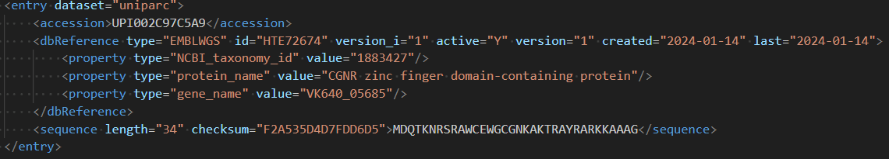

### JGI
-   https://genome.jgi.doe.gov/portal/

#### Introduction
 Database hosted by `Joint Genome Institute (USA)` consisting of 4 database. Users can log in or register a free account to download the data.

1. <b>Genomes OnLine Database (GOLD)</b>: a World Wide Web resource for comprehensive access to information regarding `genome and metagenome sequencing projects`, and their associated metadata, around the world.

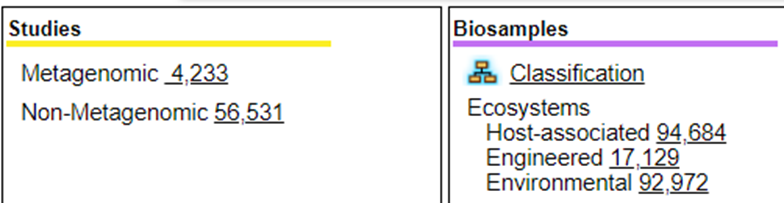

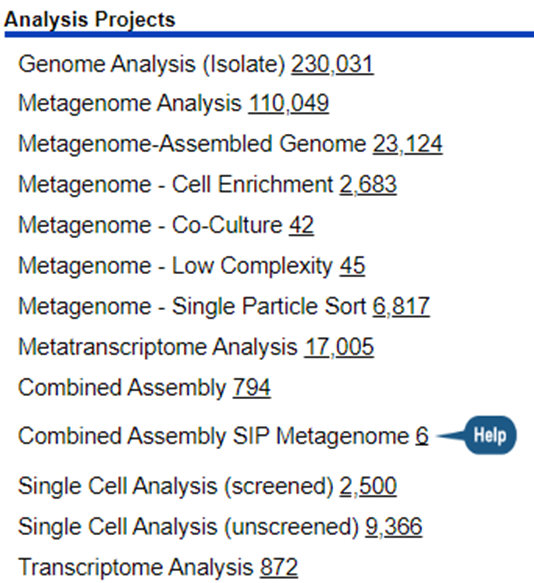

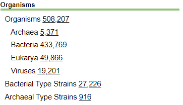

-   Including 555,770 sequencing projects, among which 231,753 projects overlap with GenBank projects.
-   Containing more prokaryotic type Strain organisms than GenBank (10,065 in GenBank vs 28,002 in GOLD)

2. <b>Integrated Microbial Genomes (IMG) and Metagenomes (IMG/M)</b>: resources for `comparative analysis and annotation of microbial genome and microbiome datasets`. The current release (dated 11/20/2023) contains 143,796 isolate genomes from Archaea, Bacteria, Eukarya and Viruses as shown in the table below.

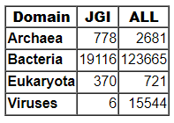

-   Search output contains ‘Statistics’ and ‘Explore’ tags as shown below:

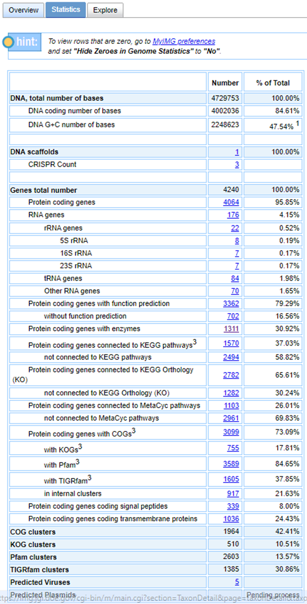

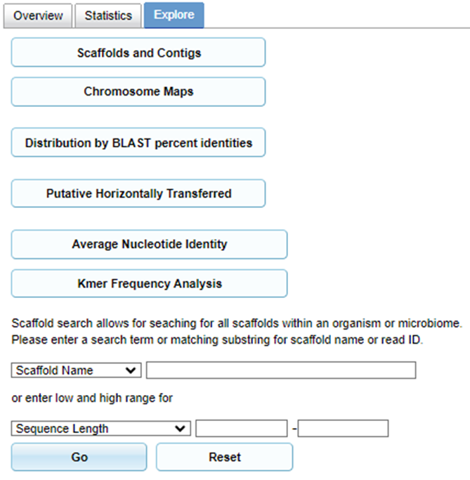 

3. <b>MycoCosm & PhycoCosm</b>: access to data, visualization, and analysis tools for comparative genomics of `fungi or algae`.
-   Users can `browse genomes, search gene information, access annotations (such as GO, KEGG, Pfam, etc.), access references and perform BLAST analysis` on organisms organized within a phylogenetic tree.

4. <b>Phytozome</b>: a hub for accessing, visualizing and analyzing `plant genomes`.
-   Users can `browse genomes, access references, search gene information and perform BLAST analysis` on organisms organized within a phylogenetic tree.

#### Data structure & data format
##### GOLD
-   https://gold.jgi.doe.gov/
-   NCBI BioProject: providing Project information, Sequencing information and Sample information on the website, including links pointing to the NCBI BioProject database, such as: https://www.ncbi.nlm.nih.gov/bioproject/PRJNA16523
-   non-NCBI BioProject: providing Project information, Sequencing information and Sample information on the website. Only completed projects are eligible to download raw sequencing files from JGI portal.

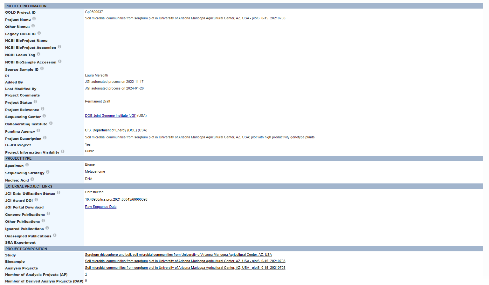

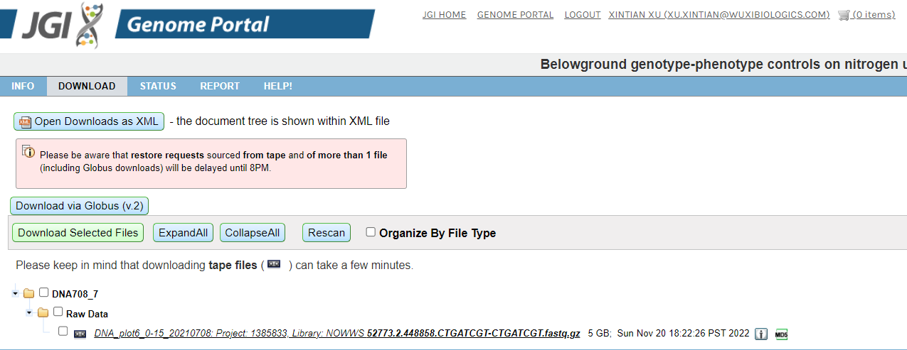

##### IMG & IMG/M
-   All genomes & metadata

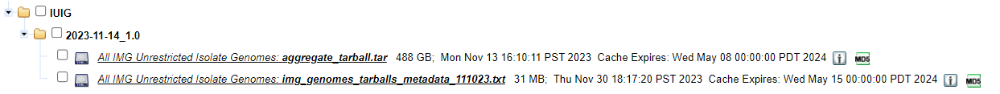

##### MycoCosm & PhycoCosm
-   Genome sequence, annotation (genomic and functional) and fastq.gz

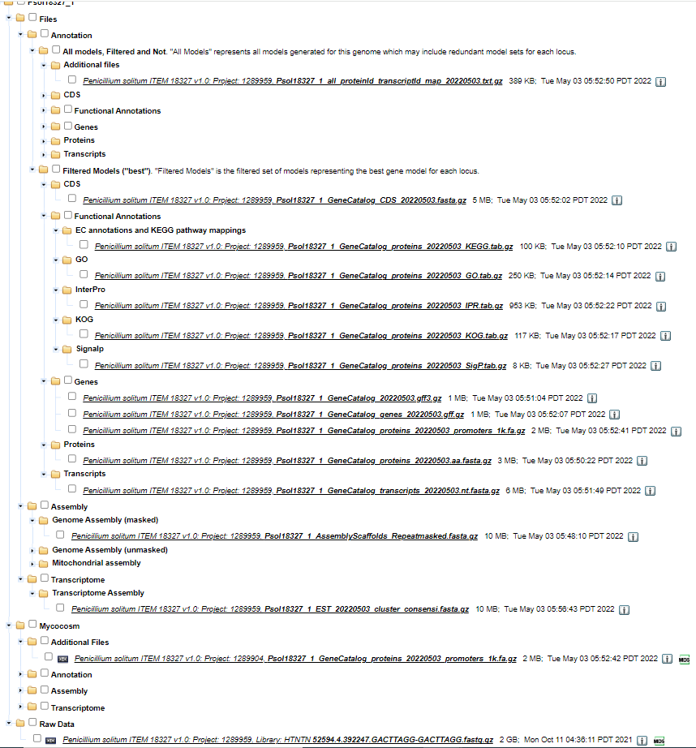

##### Phytozome
-   Genome sequence and annotation (displayed in JGI Data portal)

#### Download
-   JGI Data portal: https://data.jgi.doe.gov/search?q=

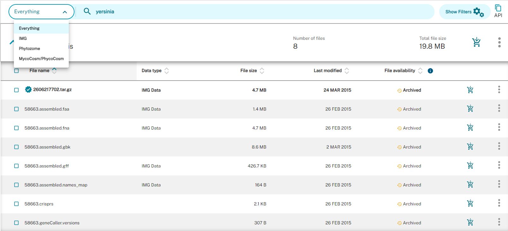

-   JGI Genome portal: https://genome.jgi.doe.gov/portal/?core=genome&query=
    
    -   Including more detailed metadata than the JGI Data portal.
    -   Project overview report, sample report and sample QC report can also be downloaded.

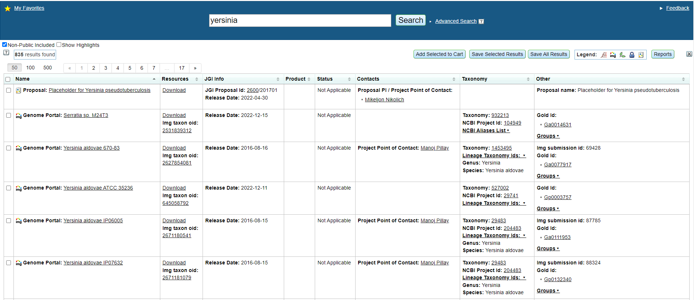

-   The command line download option (or the API download option): providing a working curl command. Details: https://sites.google.com/lbl.gov/data-portal-help/home/faq#h.7v3sgzjgwl9d

### MGnify
-   https://www.ebi.ac.uk/metagenomics

#### Introduction
Database hosted by `EBI`. Users can analyse, discover and compare `microbiome data`. 

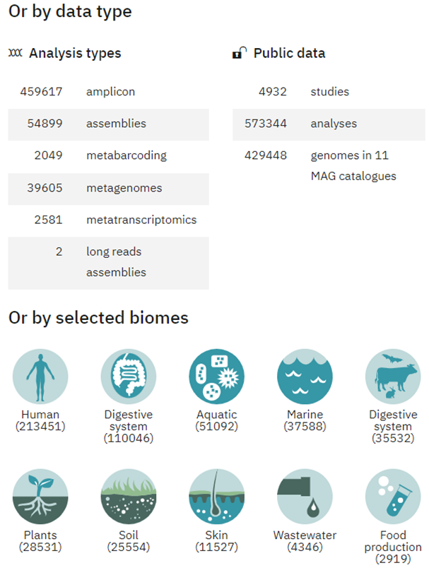

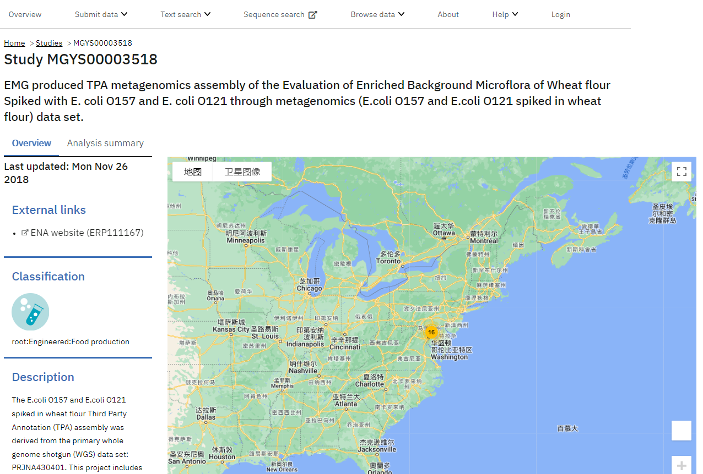

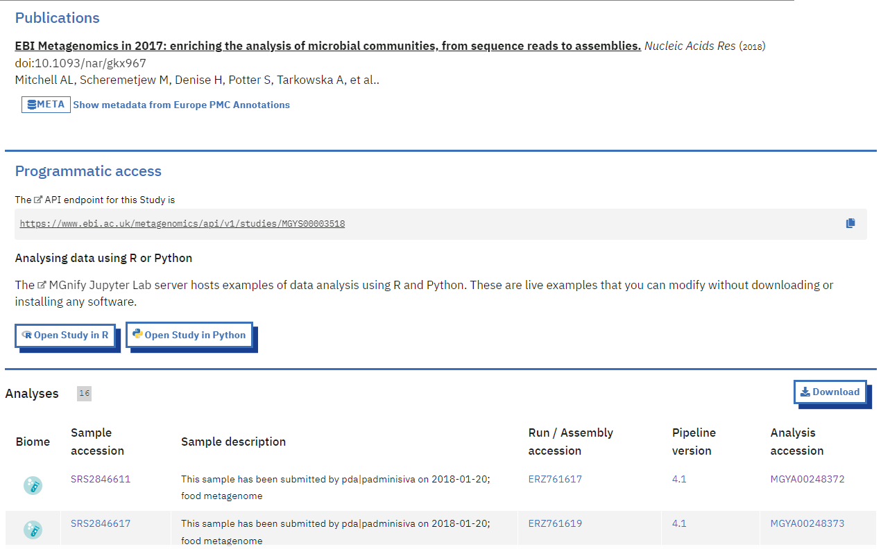

#### Data structure
1.  SRA FTP Structure
-   https://ftp.sra.ebi.ac.uk/vol1/
-   This server contains all `raw read data` submitted to ENA and INSDC, as well a subset of `analysis data`. Analyses found in SRA FTP include <u>variant data in VCF format, methylation data, and taxonomic reference sets</u>.
    -   Raw read data is in path such as: https://ftp.sra.ebi.ac.uk/vol1/file-type/ERR164/ERR164407 (file-type here can be: run(.bam), fastq(fastq.gz))
    -   Analysis data is in path such as: https://ftp.sra.ebi.ac.uk/vol1/ERZ998/ERZ9980016/

2.  ENA FTP Structure
-   https://ftp.ebi.ac.uk/pub/databases/ena/
-   This server contains short pieces of `assembled/annotated sequence` dating back to the early 80s, as well as larger scale data types including genome assemblies, MAG/SAG assemblies, and transcriptome sequence assemblies.

3.  peptide_database
-   https://ftp.ebi.ac.uk/pub/databases/metagenomics/peptide_database/2023_02/
-   Protein sequences are derived from the analysis of publicly available metagenomics assemblies within MGnify using the combined gene caller (which uses both Prodigal and  FragGeneScan). [Details](https://ftp.ebi.ac.uk/pub/databases/metagenomics/peptide_database/current_release/README.txt)

#### Download
-   Download data from FTP as shown above.
-   Command line tool: The ENA File Downloader is a new Java based command line application that you can download from [GitHub](https://github.com/enasequence/ena-ftp-downloader/tree/master/command-line-downloader).

### GenBank
-   https://www.ncbi.nlm.nih.gov/genbank/
#### Introduction
 GenBank is the `NIH` genetic sequence database, `an annotated collection` of all publicly available `DNA sequences`.

#### Data structure

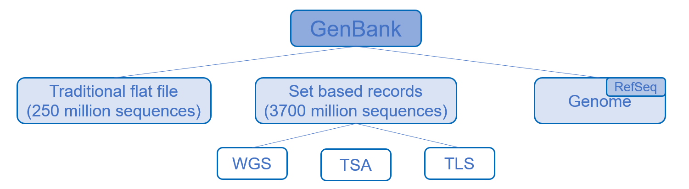

-   <u>Traditional flatfile</u>: Annotated sequences consisting of 18 GenBank divisions in the flatfile format. The current version comprises approximately 250 million sequences.
-   <u>Set based records</u>: The current version comprises approximately 3.7 billion sequences. Including WGS, TSA and TLS.
    -   The WGS (Whole Genome Shotgun) sequences are `incomplete genome sequences` obtained through `shotgun sequencing`.
    -   The TSA (Transcriptome Shotgun Assembly) sequences are transcriptome sequences obtained by `computational assembly of primarily RNA sequence data`.
    -   The TLS (Targeted Locus Study) sequences are sequences generated from `large-scale targeted gene sequencing studies`.
-   <u>Genome</u>:This includes sequences, annotations, and metadata for all sequenced and assembled genomes available in the NCBI Assembly resource. Including RefSeq genome and Genbank genome.
    -   RefSeq genome: `Manually curated` genome data, including assembled genome sequences and RefSeq annotation information, with accessions starting with GCF_.
    -   Genbank genome: This includes initial submissions of assembled genome sequences, along with annotation information (if available), with accessions starting with GCA_.

#### Data format
1. traditional flatfile:

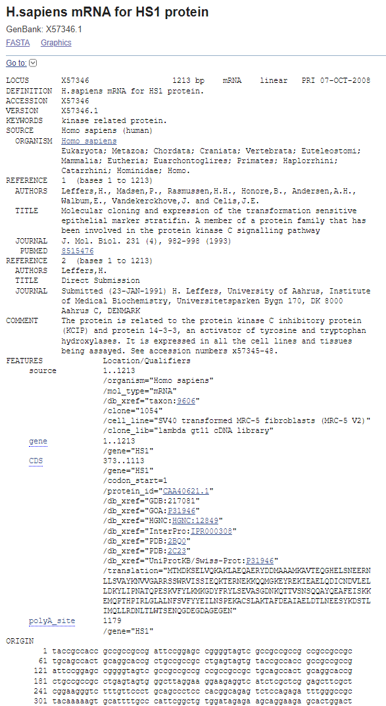

2. WGS:

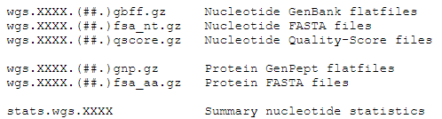

3. TSA:

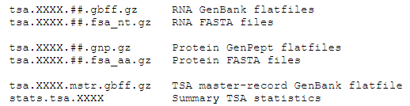

4. TLS:

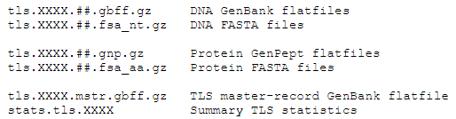

5. RefSeq genome:

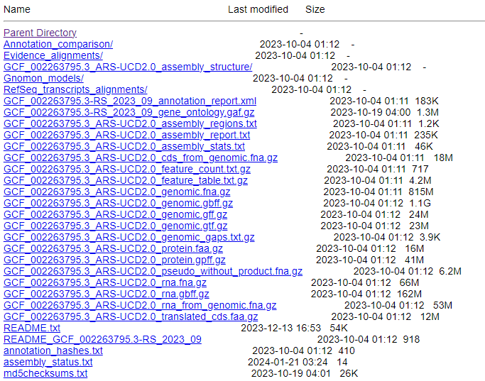

6. Genbank genome:

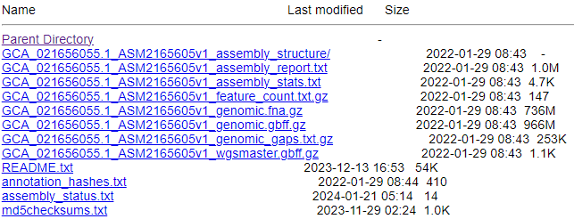

## Summary
### Comparison
|            | UniParc   | JGI         | JGI                 | JGI                  | JGI                 | Mgnify     | GenBank                |
|------------|-----------|-------------|---------------------|----------------------|---------------------|------------|------------------------|
|            |           | GOLD        | IMG & IMG/M         | MycoCosm & PhycoCosm | Phytozome           |            |                        |
| Organisms  | all       | microbe     | microbe             | fungi & algae        | plant               | microbe    | all                    |
| Data types | fasta/xml | omics data  | genome & annotation | genome & annotation  | genome & annotation | omics data | omics data & flatfile  |
| Annotated  | n         | y/n         | y                   | y                    | y                   | y          | y                      |
| Download   | ftp       | website/cmd | website/cmd         | website/cmd          | website/cmd         | ftp/cmd    | ftp                    |

### Protein related data
-   UniParc: fasta
-   JGI: fasta in the JGI Data portal
-   MGnify：fasta in the peptide_database
-   GenBank: features in the flatfile + fasta in the WGS/TSA/TLS/Genome

### 20240426
#### GOLD本身不包括sequence data
-   https://gold.jgi.doe.gov/help
-   Q3: How is GOLD related to IMG and JGI Genome Portal?
    -   A: - Integrated Microbial Genomes (IMG) system provides the tools for comparative analysis of genomes and metagenomes. The JGI Genome Portal provides unified access to all JGI datasets from where users can download sequence data. Users who wish to have sequences annotated in IMG are required to first define their project and provide necessary metadata in GOLD. Then they can upload sequences to IMG for annotation. Finally, the annotated sequences can be downloaded from the Genome Portal.
-   Q4: Can I download sequence data from GOLD?
    -   A: - GOLD does not host any sequence data. You can download both raw and analyzed sequences from the JGI Genome Portal

#### 有关JGI中fungi，algae，plant的数据下载
-   入口：https://phycocosm.jgi.doe.gov/Chabra1/Chabra1.info.html 中 Links 的 JGI Algae EcoGroup Portal
-   example: 从JGI Genome portal下载全部algae数据：https://genome.jgi.doe.gov/portal/pages/dynamicOrganismDownload.jsf?organism=algae

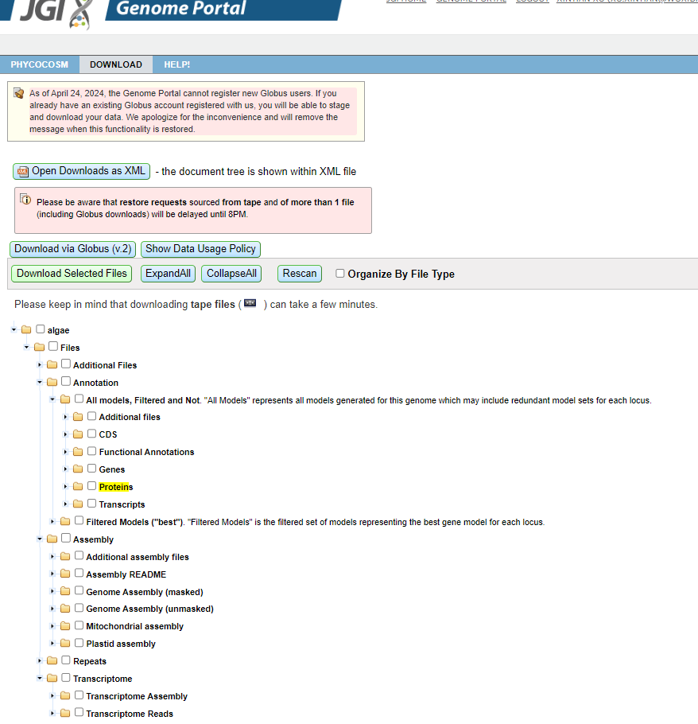

#### MGnify API获取各类metadata

-   https://www.ebi.ac.uk/metagenomics/api/v1/
-   metadata的不同主体：https://ena-docs.readthedocs.io/en/latest/retrieval/general-guide.html#viewing-and-exploring-ena-records

#### MGnify下载可能遇到的问题
Common Issues
Downloading a large number of records
If your search criteria is returning a large number of records (e.g.millions) then please consider using a non-browser client (like wget or curl). NOTE: You need to include the additional parameter “limit=0” to obtain ALL matching records, as the default limit is 100,000.

Slow FTP downloads
Sometimes you may experience slowness or incomplete files when downloading from our FTP servers due to high load or ongoing maintenance. If the issue persists, please report it at
here <https://www.ebi.ac.uk/ena/browser/support>
. You could also use other download methods such as Aspera or Globus, which might provide better performance than FTP.

#### MGnify中biosample/sample的taxon id问题
-   MGnify和GOLD classification间的弱联系：https://docs.mgnify.org/src/docs/portal.html#data-discovery-on-mgnify-portal
-   宏基因组taxid相关：https://ena-docs.readthedocs.io/en/latest/faq/taxonomy.html#environmental-taxonomic-classifications

