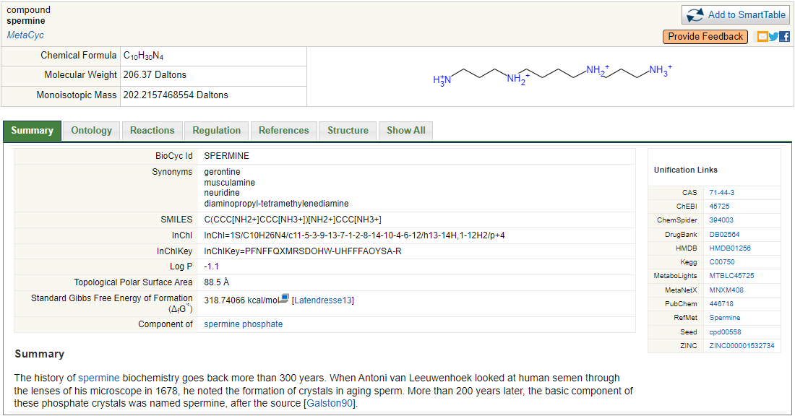
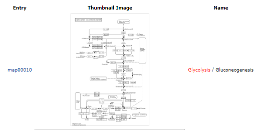
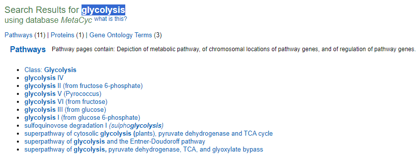
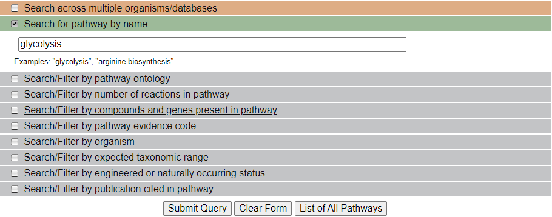
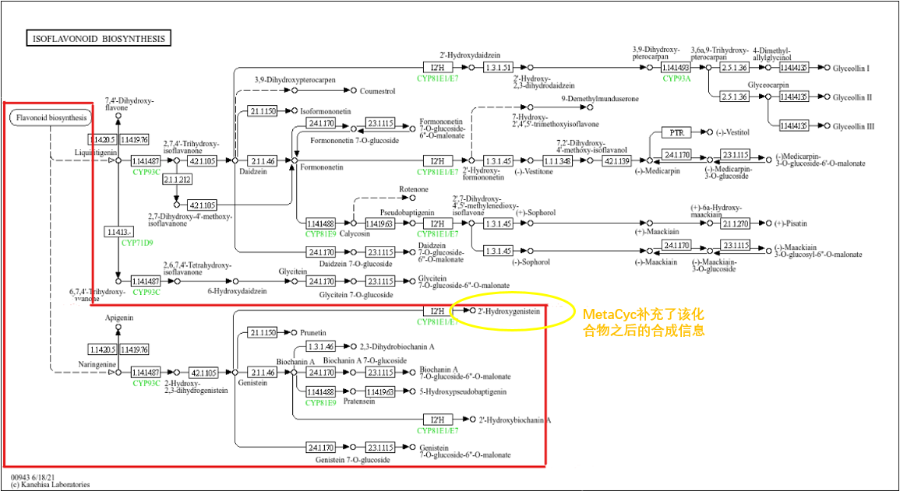
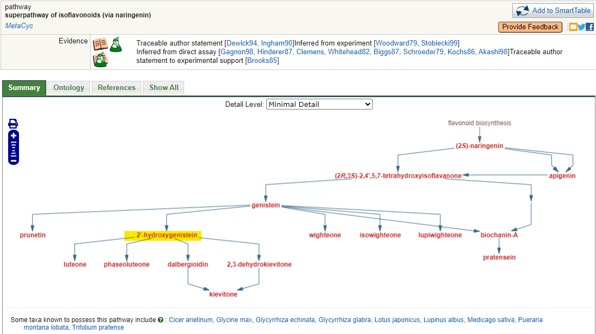
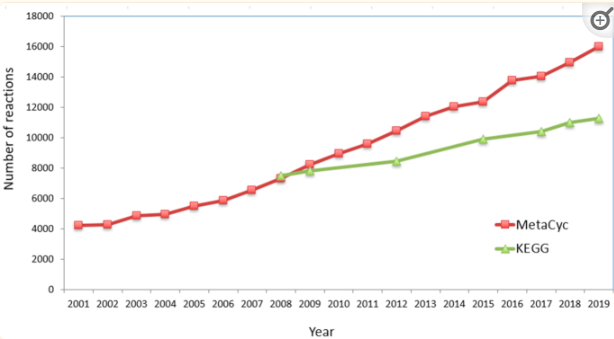
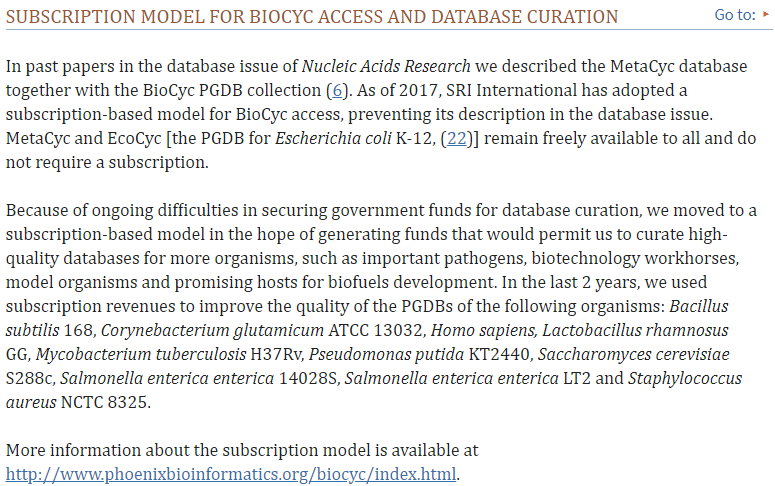
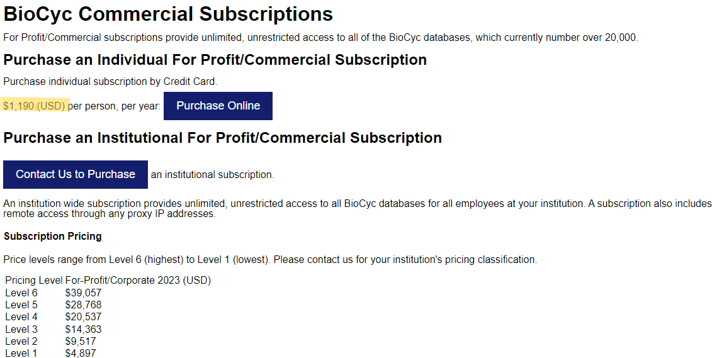

<h1 align="center">MetaCyc — 代谢通路数据库</h1>

    编写作者：wu_jiannan /
    编写时间：2024.05.27

    <a href='https://metacyc.org/'>Website</a> •
    <a href="#数据统计">version 28.0</a> •
    <!-- <a href="#">Network</a> • -->
    <a href="#数据下载">Download/Subscription</a> •
    <a href="#reference">Publications</a> • 
    <!-- <a href="MetaCyc_metadata.md">Metadata</a>  -->

**简介**

MetaCyc 全称 MetaCyc Metabolic Pathway Database，属于 BioCyc 子数据库。

- MetaCyc 是一个由生物学家基于大量的科学文献手工注释的、具有经过实验验证报道的代谢途径和酶的数据库， 确保了高质量和高准确性。
- MetaCyc 包含参与初级和次级代谢的通路，以及相关的化合物、反应、酶和基因。
- MetaCyc 的目标是通过存储每个实验阐明的通路的代表性样本来对代谢领域进行编目。

>BioCyc：  
> - BioCyc 是由 SRI International（SRI）创建，可以通过 Ovid 平台访问的，以生物体为中心的数据库集合，包含基因组、代谢途径和其他相关生物信息，并配有一套可以进行相关的搜索，浏览，分析和可视化处理的软件工具。
> - 截至到 2023 年 12 月 8 日（27.5 版），BioCyc 包含了 20,050 个数据库，其中第一层数据库包括： MetaCyc (多种生物代谢途径)，HumanCyc (人类代谢途径), EcoCyc (大肠杆菌 Escherichia coli K-12), AraCyc（拟南芥）, YeastCyc（酿酒酵母）。第二层、第三层数据库详情请查看 [BioCyc PGDB list](https://biocyc.org/biocyc-pgdb-list.shtml)。
> - BioCyc 涵盖超过2万个生物体，内容来自超过14万种出版物，提供百科全书式的数据，可用于生物信息学，遗传学，生物医学工程，代谢组学和传染病相关的研究，适用于本科、研究生和更高水平的研究人员和从业者，也可用于大规模计算研究、转录组学、代谢组学和比较数据分析、定量建模、以及在制药和医疗保健，化妆品，生物技术和食品生产中的合成生物学。

> [BioCyc 数据库详细介绍](https://biocyc.org/intro.shtml)

---

## 数据库详情
### 数据统计

版本 28.0

| 数据类型            | 数量   |
| ------------------- | ------ |
| Genes               | 15,525 |
| Pathways            | 3,538  |
| Enzymatic Reactions | 19,017 |
| Transport Reactions | 980    |
| Polypeptides        | 17,336 |
| Protein Complexes   | 4,877  |
| Enzymes             | 13,902 |
| Transporters        | 685    |
| Compounds           | 19,196 |
| tRNAs               | 8      |
| Growth Media        | 19     |
| Protein Features    | 32,149 |
| GO Terms            | 85,012 |

### 与 KEGG 数据库的比较

关于 MetaCyc 与 KEGG 的全面比较在 2013 年[2](#refer-id)就有发表.

**一些比较列举**：

- 相较于 KEGG, MetaCyc 提供的代谢物信息更多，除了基础的物质信息以外，还包括`物质的化学性质`（如：油水分配系数、拓扑极性表面积、标准吉布斯自由能等）；

    在线搜索示例：

    

- KEGG 在通路方面的检索方式比 MetaCyc 更简单一些，通过通路名称或一个代谢物即可检索到相关的通路，而 MetaCyc 除了通路名称外，还需要提供其他信息进行筛选，也就是需要`高级搜索`功能才可以锁定一个通路；
    在线搜索示例（以 `glycolysis` 为例）：
    - KEGG
  
        
    
    - MetaCyc，会搜索出11个通路名称中包含'glycolysis'的通路

          
        
        - MetaCyc 高级搜索
  
            

- 另外，在通路的完整度上，KEGG 中更加注重的是在所有物种中的通路汇总到一张图上，而 MetaCyc 更加注重的是不同物种中通路的差异化。
- KEGG 部分通路会覆盖的更全一些，而 MetaCyc 相对会少一些，但是 MetaCyc 可以补充部分 KEGG 通路上不全的部分，因此 KEGG 与 MetaCyc 可以`相互补充`，达到相得益彰的效果。
    在线搜索示例（以`isoflavonoids`为例）：
    - KEGG

        

    - MetaCyc, 补充了`2'-hydroxygenistein`之后的合成信息
  
        

- MetaCyc 与 KEGG 数据库中 `reaction` 增长趋势对比[1](#refer-id)：

    

### 数据下载

**根据文献[1](#refer-id)中对 MetaCyc 数据库获取的描述，截止到2017年都是免费获取，之后因资金问题改为订阅：**

#### 数据库订阅

**关于`订阅的费用`，分为个人和企业**：

### Reference

[1] Caspi20: Caspi R, Billington R, Keseler IM, Kothari A, Krummenacker M, Midford PE, Ong WK, Paley S, Subhraveti P, Karp PD (2020). "The MetaCyc database of metabolic pathways and enzymes - a 2019 update." Nucleic Acids Res 48(D1);D445-D453. [ PubMed ](https://pubmed.ncbi.nlm.nih.gov/31586394/)

[2] Altman T., Travers M., Kothari A., Caspi R., Karp P.D.. A systematic comparison of the MetaCyc and KEGG pathway databases. BMC Bioinformatics. 2013; 14:112. [PubMed](https://pubmed.ncbi.nlm.nih.gov/30406744) 