<h1 align="center">MySQL Workbench 使用说明</h1>

### 一. 下载安装

下载地址 - https://dev.mysql.com/downloads/workbench/

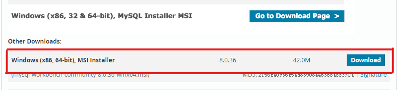

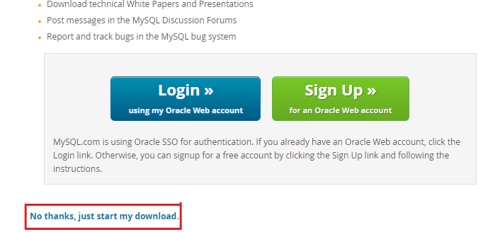

准备好安装包，然后需要在[oneBPM](https://onebpm.wuxibiologics.com/)上进行"软件使用申请"才能安装.

### 二. 连接数据库

- **tep1: 点击"+"**
   
   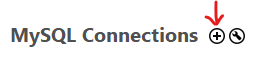

- **tep2: 依次填写连接名称(自定义)、IP地址、端口、用户名、密码，可先点击"Test Connection"测试，如成功点击OK即可保存.**
   
   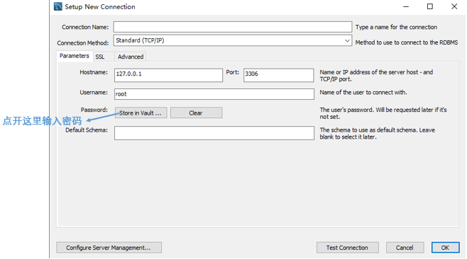

- **tep3: 进入刚刚添加的数据库**
   
   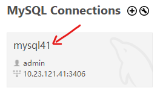
   
   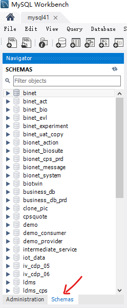

### 三. 构建ER图

构建ER图的模型来源有三种：`数据库逆向`、`导入外部.sql文件`和`手动创建数据模型`。这里只展示数据库逆向构建ER图。

### 1. 数据库逆向构建ER图

- tep1: 点击菜单栏 Database -> Reverse Engineer
- tep2：选择刚创建的本地数据库连接，按引导执行并选择自己想构建ER的Schema(s)即可
    
    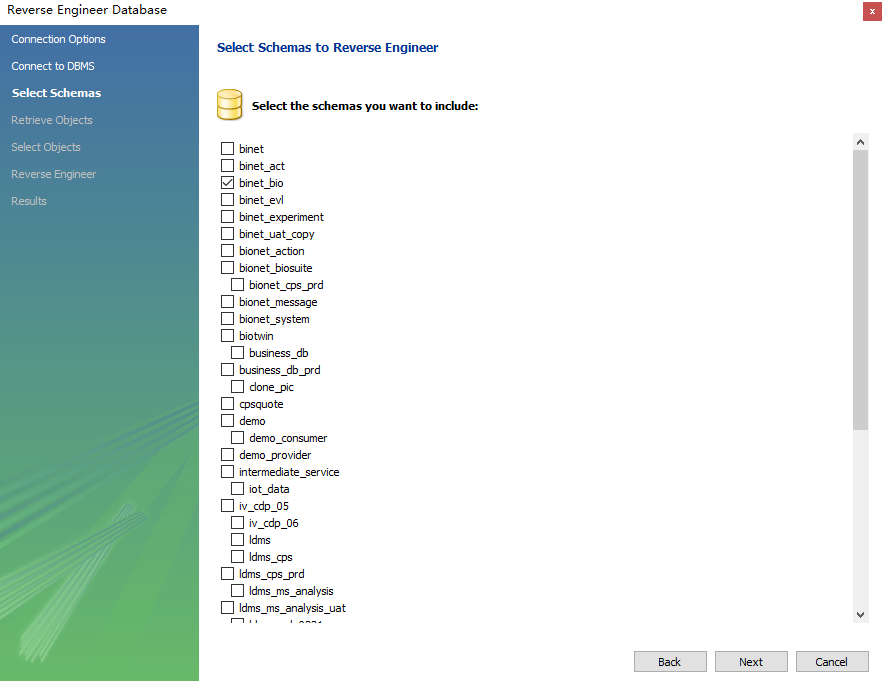

- tep3: 编辑ER图，添加图层、外键等
  
  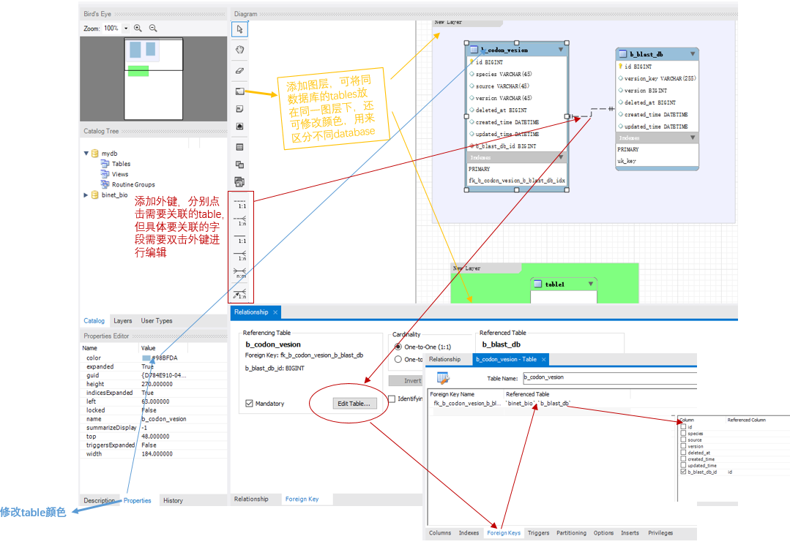

  效果示例

  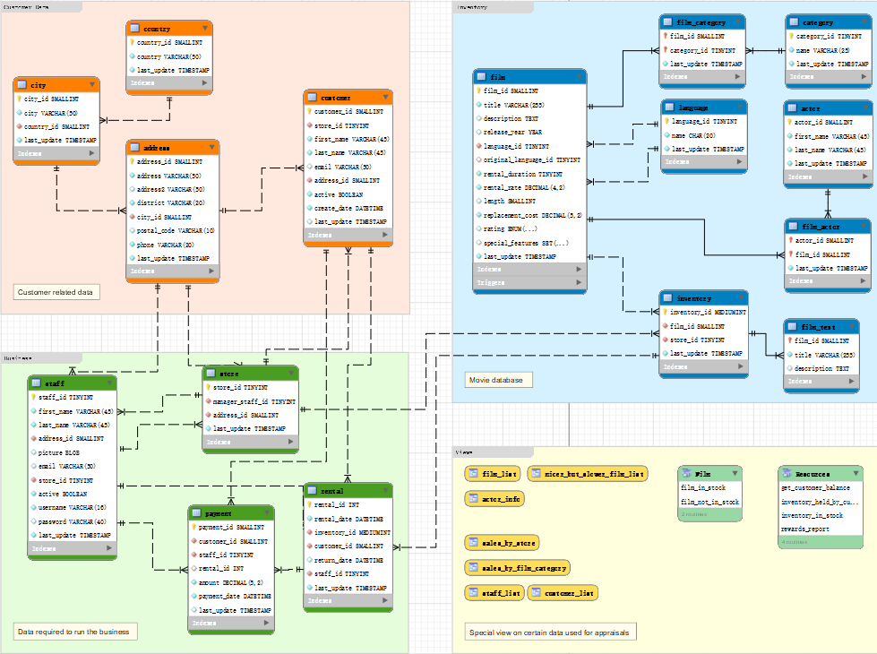

*`ER图中的修改也可以同步到数据库，知道就行，此项目不需要该操作`*

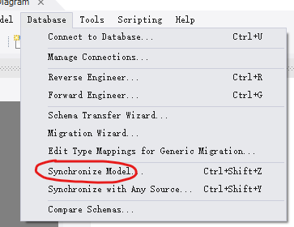

### 2. 导出ER图协同工作

MySQL Workbench 构建的ER图不支持多人实时编辑（`企业版可以`），但提供了多种格式导出方式，其中.mwb可以放在公共资源中（如git），供团队成员导入到 MySQL Workbench 并进行编辑。（MySQL Workbench 导出 ER 为 PDF 比 Navicat 好，Navicat 会分页）

MySQL Workbench 企业版与 Navicat 企业版比较：

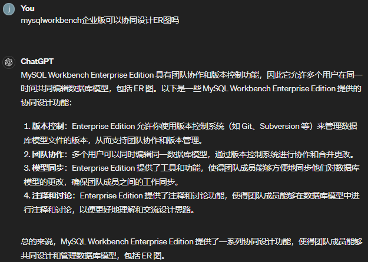

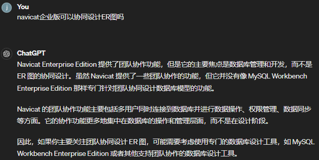