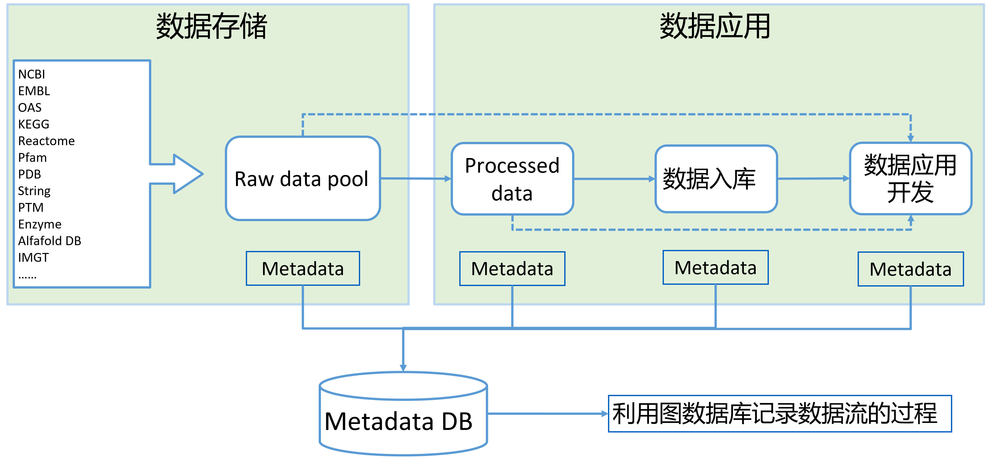

# Bioinformatics data项目

## 目的

生物药开发使用到的主要公开数据的本地化存储及其数据使用工具开发。

## 内容

数据本地化与数据清洗

数据存储开发

数据应用工具开发，包括基因信息查询、序列查询、药物信息查询

## Candidate database

| 数据(库)名称                                     | 数据内容                                                                         | 潜在用途               | 提出者   | 功能需求                    |
| ------------------------------------------------ | -------------------------------------------------------------------------------- | ---------------------- | -------- | --------------------------- |
| Genebank                                         | annotated gene database                                                          | 序列查询与比对         | Yihan    | 序列查询与序列比对          |
| UniProt                                          | protein sequence                                                                 | 蛋白序列查询           |          | UniProt与PDB关联，blast功能 |
| OAS                                              | BCR sequence                                                                     | BCR分析，抗体人源化    |          |                             |
| SwissProt                                        | protein sequence                                                                 | 蛋白序列查询与比对     |          |                             |
| IMGT                                             | V(D)J reference                                                                  | BCR annotatin          |          | igblast功能                 |
| IEDB                                             | Immune Epitope Database                                                          | 抗体免疫原性与人源化   | Cong     |                             |
| Thera-SAbDab                                     | therapeutic antibodies                                                           | 成药性分析             |          |                             |
| SAbDab                                           | antibody structure                                                               |                        |          |                             |
| INDI                                             | Nanobody Database                                                                |                        |          |                             |
| CHO多组学数据                                    | 对in-house和public NGS数据开发成多组学数据库                                     | CHO细胞开发            | Quanxue  |                             |
| PubMed                                           | 文献数据                                                                         | NER相关模型            |          |                             |
| HPA                                              | human protein atlas                                                              |                        |          |                             |
| Pfam                                             | 蛋白质结构域数据库                                                               |                        |          |                             |
| PDB                                              | 蛋白结构                                                                         |                        |          |                             |
| AlphaFold DB                                     | 蛋白结构                                                                         |                        | Cong     | 先整理human, mouse等主要物  |
| KEGG                                             | 通路数据、基因数据、化合物数据、生化反应数据                                     | 通路查询，代谢模型构建 |          |                             |
| GO                                               | gene ontology                                                                    | 基因功能查询           |          |                             |
| String                                           | 蛋白质互作网络数据、基因数据                                                     | 代谢模型构建           |          |                             |
| Reactome                                         | 通路数据、基因数据、化合物数据、生化反应数据                                     | 通路查询，代谢模型构建 |          |                             |
| metacyc                                          | 通路数据、生化反应数据                                                           | metacyc.org            |          |                             |
| BioGrid                                          | 通路数据、生化反应数据                                                           | 通路查询，代谢模型构建 |          |                             |
| Matched Annotation from NCBI and EMBL-EBI (MANE) | 基因注释数据                                                                     | 序列                   |          |                             |
| Drugs@FDA                                        | 药物信息数据                                                                     | 药物获批状态查询       |          |                             |
| CaZy                                             | 酶数据库                                                                         | 蛋白改造，代谢通路     | Cong     |                             |
| SPSED                                            | Signal Peptide Secretion Efficiency Database                                     | 信号肽匹配             | Junghao  |                             |
| iNClusive                                        | non-canonical AAs database                                                       | nAA host cell开发      | Quanxue  |                             |
| ADCdb                                            | database of antibody–drug conjugates                                            | ADC development        | Quanxue  |                             |
| DGIdb                                            | drug–gene interaction database                                                  | drug development       | Quanxue  |                             |
| TTD                                              | Therapeutic Target Database                                                      | drug development       | Quanxue  |                             |
| ChEMBL                                           | database of bioactive molecules with drug-like properties                        | drug development       | Quanxue  |                             |
| E.coli NCBI全量基因组数据                        |                                                                                  | SBD引物设计            | Qing     |                             |
| patent protein databases                         | cover sequences of EPO proteins, JPO proteins, KIPO proteins and USPTO proteins. | 蛋白专利信息查询       | Shixiang |                             |
| allele frequency net database                    | MHC data                                                                         | 免疫原性               | Chen     |                             |

## Workflow

