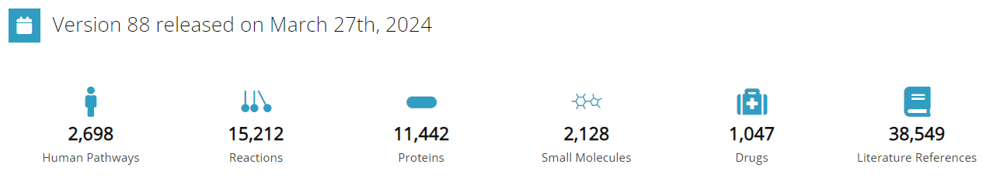
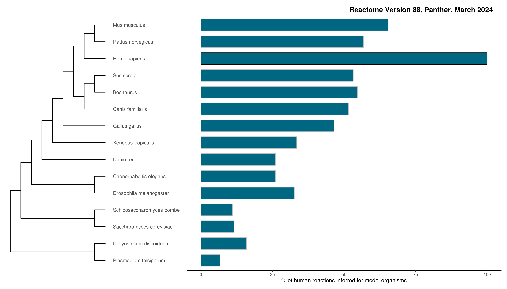
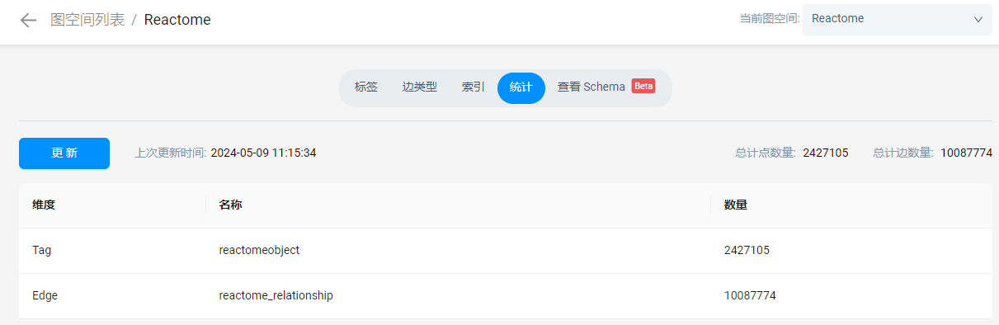

# Reactome

## 简介
-   Reactome是包含人类生物学中通路和反应的经过筛选的数据库。

-   `反应`可被视为`通路`的步骤，Reactome将“反应”定义为生物学中改变生物分子状态的任何事件：结合、激活、转位、降解以及涉及催化剂的经典生化事件都被视为反应，蛋白质修饰过程、形成复合物的多聚化事件等也被建模为反应。

-   Reactome交叉引用其他数据库，例如NCBI、Ensembl、UniProt、KEGG（基因和化合物）、ChEBI、PubMed和GO。

## 数据组织形式

Reactome使用基于框架的知识表示。数据模型由描述不同概念的`类（Class）`组成（例如：反应，简单实体）。知识以这些类的`实例（Instance）`形式捕获（例如：葡萄糖跨越细胞膜，胞内ATP）。类具有`属性（Attribute）`，保存实例的属性（例如：参与反应的输入和输出分子的identity）。

### 主要data class：物理实体和事件
#### 物理实体 (PhysicalEntity)

-   物理实体包括单个分子、多个分子复合物以及基于共有特征而组合在一起的分子或复合物集合。分子可分为基因组编码（DNA、RNA和蛋白质）或非基因组编码（其他所有分子）。
-   物理实体实例的属性包含了该实体的化学结构，包括大分子的任何共价修饰，及其亚细胞定位。
    -   在Reactome中，`蛋白质`的未`修饰`和修饰形式被视为不同的物理实体。
    -   大分子的功能可能取决于分子是自由的还是与特定的其他分子形成复合物。Reactome将`复合物`视为与其组分不同的物理实体
    -   在Reactome中，一个`区室`中的分子与另一个区室中的分子是不同的。因此，胞外和胞质中的葡萄糖在Reactome中被视为不同的实体，例如，葡萄糖跨越细胞膜的移动是将胞外葡萄糖实体转化为胞质葡萄糖实体的一个反应。
-   例如，代表不同区室中相同化学物质的物理实体实例，或单一蛋白质的不同翻译后修饰形式，具有许多共有特征（如名称、分子结构和与UniProt或ChEBI等外部数据库的链接）。为了存储这些共有特征，并在所有variant form间创建一个显式链接，Reactome定义了`ReferenceEntity`类实例。ReferenceEntity实例包含一个分子的不变特征，<u>物理实体实例是ReferenceEntity属性（例如，糖原磷酸化酶UniProt：P06737）的组合，并提供特定条件信息的属性（例如，在细胞质定位和丝氨酸残基14的磷酸化）。</u>

-   物理sta实体类有子类来区分不同种类的实体，并确保数据完整性，同时可为不同类别启用不同的处理规则：
    - 带有Accessioned Sequence的实体（<b>EntityWithAccessionedSequence</b>）：已知序列的蛋白质和核酸。
    - 基因组编码实体（GenomeEncodedEntity）：一个具体物种中序列未知的蛋白质或核酸，例如：已经功能性描述但尚未纯化和测序的酶，如胞浆15-HEDH酶。
    - 简单实体（<b>SimpleEntity</b>）：其他经过全面描述的分子，例如核质ATP或胞浆谷胱甘肽。
    - 复合物（<b>Complex</b>）：由两个或更多物理实体组成的复合物，例如FASL：FAS受体复合物的三聚体。
    - 实体集（<b>EntitySet</b>）：在给定情况下可互换功能的物理实体（分子或复合物）的集合，例如成熟NOTCH异源二聚体运输到细胞膜。这种表示允许描述多个个体实体的集体属性。

<u>物理实体与GO中的molecular function配对</u>，以描述生物催化的实例。可选的`ActiveUnit`属性指示介导催化作用的蛋白质的特定结构域或复合物的亚单位。如果物理实体具有多个催化活性，则为每个催化活性创建单独的`CatalystActivity`。<u>该策略允许将特定活性与蛋白质或复合物的特定变体形式关联，同时也方便检索某个蛋白质的所有活性，以及能够介导某一特定分子功能的所有蛋白质。</u>

#### 事件 (Event)

-   事件在Reactome中被用来代表所有生物过程的输入实体转换为输出实体的`一个或多个步骤`。事件的两个子类是反应类事件和通路：
-   反应类事件（<b>ReactionlikeEvent</b>）是将输入转换为输出的事件
    -   反应类事件又分为反应、黑匣子事件、聚合和解聚：
        -   反应类事件（Reaction）包含具有平衡输入和输出的真实反应。
        -   黑匣子事件类（BlackBoxEvent）用于“不平衡”反应，如蛋白质合成或降解，以及更复杂过程的“捷径”反应，例如涉及脂肪酸合成的一系列循环反应。
        -   解聚/聚合类（De-/Polymerisation）是描述解聚/聚合反应机制的反应，由于聚合物的性质（即使添加或减去单位后在Reactome中仍然保持“相同”的物理实体），这些反应本质上是“不平衡”的。
-   通路（<b>Pathway</b>）是一组相关事件，一个事件可能属于多个通路。

## 计算推断事件 (Computationally Inferred Events) 

-   <u>Reactome使用手工筛选的人类反应集合来计算推断14种具有高质量全基因组序列的真核生物中的反应</u>。推断的同源反应涉及小鼠、大鼠、猪、牛、狗、鸡、非洲爪蟾、斑马鱼、秀丽隐杆线虫、果蝇、裂殖酵母、酿酒酵母、盘基网柄菌、疟原虫这14种物种。推断可分为四个步骤：

    1.  蛋白同源数据来自`PANTHER`。PANTHER使用UniProt维护的参考蛋白质组数据集生成跨多个物种的蛋白编码基因的系统发生树。同源物从这些树派生出来，并按类型（直系同源、旁系同源）进行注释。此外，在存在多个同源物的情况下，Reactome使用PANTHER推断出的最保守的同源物（[细节](https://academic.oup.com/nar/article/41/D1/D377/1060482)）。
    2.  Reactome中涉及一个或多个蛋白的所有人类反应都可作为可推断反应用于计算推断，但有两个例外情况：基于模式生物数据推断出的反应和涉及人类以外物种（例如，HIV感染人类细胞）的反应。可推断反应还应满足以下条件：每个涉及的蛋白质在进行推断的生物体的输入、输出和（如存在）催化物中至少有一个同源蛋白质（HP）。如果一个人类反应涉及一个复合物，那么人类复合物的至少75%的accessioned蛋白质必须在模式生物中有HP。
    3.  对于符合以上标准的每个反应，将为模式生物创建一个等效反应，方法是用模式生物HP替换每个人类蛋白质。如果一个人类蛋白质对应多于一个模式生物HP，那么将创建一个包含模式生物HP的DefinedSet。
    4.  在为物种推断了所有可能的`反应`之后，任何包含至少1个被推断反应的人类`通路`也将在该物种中被推断。

-   下图展示了人类反应在这14种物种中被推断的百分比。

-   相反地，很多生物过程并没有直接在人类身上进行研究。对于这种`从模式生物实验推断而来的人类反应`，Reactome将模式生物的反应和推断的人类反应`各自注释为事件`，并明确记录两个反应间的`推断关系`。

## 数据下载

pull官方[docker镜像](https://hub.docker.com/r/reactome/graphdb/tags)，包含Neo4j和最新的Reactome graph database release。

## 数据更新
-   每年更新四次，分别在3，6，9和12月。
-   https://reactome.org/about/release-calendar

## schema
-   https://reactome.org/content/schema/DatabaseObject
-   共99个class。中括号中的数字是当前版本各个class的实例数量。

- DatabaseObject
  - AbstractModifiedResidue [51759]
    - GeneticallyModifiedResidue [5044]
      - FragmentModification [2144]
        - FragmentDeletionModification [82]
        - FragmentInsertionModification [145]
        - FragmentReplacedModification [1917]
      - ReplacedResidue [2900]
        - NonsenseMutation [1094]
    - TranscriptionalModification [44]
      - ModifiedNucleotide [44]
    - TranslationalModification [46671]
      - CrosslinkedResidue [1154]
        - InterChainCrosslinkedResidue [758]
        - IntraChainCrosslinkedResidue [396]
      - GroupModifiedResidue [11565]
      - ModifiedResidue [33952]
  - Affiliation [335]
  - CatalystActivity [37704]
  - ControlReference [2729]
    - CatalystActivityReference [948]
    - MarkerReference [55]
    - RegulationReference [1726]
  - ControlledVocabulary [14]
    - NegativePrecedingEventReason [6]
    - ReactionType [3]
      - DrugActionType [3]
    - ReviewStatus [5]
  - DatabaseIdentifier [720031]
  - EntityFunctionalStatus [683]
  - Event [111908]
    - Pathway [22231]
      - CellLineagePath [2]
      - TopLevelPathway [406]
    - ReactionLikeEvent [89677]
      - BlackBoxEvent [9180]
      - CellDevelopmentStep [4]
      - Depolymerisation [28]
      - FailedReaction [448]
      - Polymerisation [227]
      - Reaction [79790]
  - ExternalOntology [958]
    - Anatomy [6]
    - CellType [19]
    - Disease [746]
    - EvidenceType [2]
    - PsiMod [170]
    - SequenceOntology [15]
  - Figure [873]
  - FunctionalStatus [27]
  - FunctionalStatusType [5]
  - GO_Term [3004]
    - GO_BiologicalProcess [987]
    - GO_CellularComponent [464]
      - Compartment [154]
    - GO_MolecularFunction [1553]
  - InstanceEdit [124179]
  - Interaction [54236]
    - UndirectedInteraction [54236]
  - NegativePrecedingEvent [313]
  - Person [156101]
  - PhysicalEntity [389298]
    - Cell [5]
    - Complex [101725]
    - Drug [1129]
      - ChemicalDrug [1038]
      - ProteinDrug [90]
      - RNADrug [1]
    - EntitySet [43152]
      - CandidateSet [8633]
      - DefinedSet [34519]
    - GenomeEncodedEntity [237682]
      - EntityWithAccessionedSequence [231463]
    - OtherEntity [347]
    - Polymer [1504]
    - SimpleEntity [3754]
  - Publication [38727]
    - Book [129]
    - LiteratureReference [38549]
    - URL [49]
  - ReferenceDatabase [148]
  - ReferenceEntity [739543]
    - ReferenceGroup [116]
    - ReferenceMolecule [2128]
    - ReferenceSequence [736251]
        - ReferenceDNASequence [513026]
        - ReferenceGeneProduct [100216]
          - ReferenceIsoform [2284]
        - ReferenceRNASequence [123009]
    - ReferenceTherapeutic [1048]
  - Regulation [6937]
    - NegativeRegulation [2859]
      - NegativeGeneExpressionRegulation [278]
    - PositiveRegulation [4078]
      - PositiveGeneExpressionRegulation [1177]
      - Requirement [713]
  - Summation [20052]
  - Taxon [391]
    - Species [85]

## metadata
-   https://reactome.org/content/schema/PhysicalEntity 
-   将hierarchy of Reactome classes中每个class的attributes of class([点击跳转](reactome_class_attr_metadata.tsv))和referrals of class instances（[点击跳转](reactome_class_referral_metadata.tsv)）分别整理为表格。
-   cardinality列中的'+'表示这个属性是multi-value attribute

## 入库情况
Release 88 已入库 nebula
