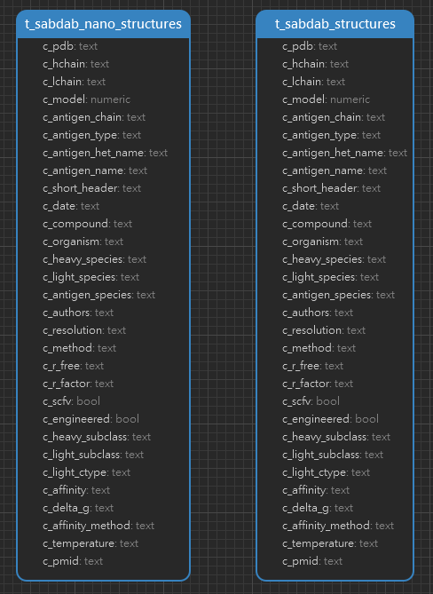

<h1 align="center">SAbDab Tables 详情</h1>

#### 一. 数据统计

| 数据类型                 | 数量  |
| ------------------------ | ----- |
| t_sabdab_structures      | 16269 |
| t_sabdab_nano_structures | 2422  |

#### 二. ER 图

#### 三. Tables

1. t_sabdab_structures_summary
   
    | 字段名             | 注释                                      | 数据类型 | 备注                                                                     |
    | ------------------ | ----------------------------------------- | -------- | ------------------------------------------------------------------------ |
    | c_pdb              | pdb accession号                           | text     |
    | c_hchain           | 重链                                      | text     |
    | c_lchain           | 轻链                                      | text     |
    | c_model            | 模型                                      | int      |
    | c_antigen_chain    | 结合抗原的链                              | text     |
    | c_antigen_type     | 抗原类型                                  | text     |
    | c_antigen_het_name |                                           | text     | 抗原是聚合物或重轻配对未结合，则为“NA”                                   |
    | c_antigen_name     | 抗原名称                                  | text     |
    | c_short_header     | 结构的短标题                              | text     | 通常是对结构条目中分子类型的简短描述                                     |
    | c_date             | PDB的交存日期                             | text     | deposition date                                                          |
    | c_compound         | 出版物标题                                | text     |                                                                          |
    | c_organism         | 物种                                      | text     |
    | c_heavy_species    | 抗体重链的物种来源                        | text     |
    | c_light_species    | 抗体轻链的物种来源                        | text     |
    | c_antigen_species  | 抗原物种                                  | text     |
    | c_authors          | 作者                                      | text     |
    | c_resolution       | 通过X射线衍射或电子显微镜测定结构的分辨率 | text     |
    | c_method           | 方法                                      | text     |
    | c_r_free           | 如果通过X射线衍射确定，则结构的Rfree值    | text     |
    | c_r_factor         | 如果通过X射线衍射确定，则结构的R factor值 | text     |
    | c_scfv             | 结构是否为单链Fv                          | bool     | 如果为真，则重链标识符和轻链标识符可以是相同的，这取决于结构是如何确定的 |
    | c_engineered       | 结构是否经过工程设计                      | bool     |
    | c_heavy_subclass   | 重链的IMGT可变子群                        | text     | IMGT数据库中不可用的结构有一个由SAbLab分配的子组                         |
    | c_light_subclass   | 轻链的IMGT可变子群                        | text     | MGT数据库中不可用的结构有一个由SAbLab分配的子组                          |
    | c_light_ctype      | 轻链的类型                                | text     | Kappa或Lambda                                                            |
    | c_affinity         | 抗体对结构中存在的抗原的亲和力            | text     | KD-M                                                                     |
    | c_delta_g          | 抗体对结构中存在的抗原的ΔG（kcal/mol）    | text     | 这是手动计算的                                                           |
    | c_affinity_method  | 收集亲和性数据的方法                      | text     | SPR, ITC or other                                                        |
    | c_temperature      | 收集亲和性数据的温度（°C）                | text     |
    | c_pmid             | pubmed的标识符                            | text     | pubmed identifier                                                        |

2. t_sabdab_nano_structures_summary
   
   同上