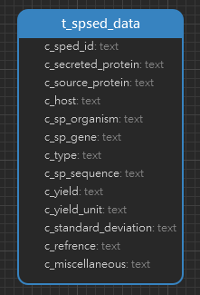

<h1 align="center">SPSED Tables 详情</h1>

#### 一. 数据统计

| 表名         | 行数 |
| ------------ | ---- |
| t_spsed_data | 2050 |

#### 二. ER 图

#### 三. Tables

| 字段名             | 注释       | 数据类型 |
| ------------------ | ---------- | -------- |
| sped_id            |            | text     |
| secreted_protein   | 分泌蛋白   | text     |
| source_protein     | 来源       | text     |
| host               | 宿主       | text     |
| sp_organism        | 信号肽物种 | text     |
| sp_gene            | 信号肽基因 | text     |
| type               | 类型       | text     |
| sp_sequence        | 信号肽序列 | text     |
| yield              | 产量       | numeric  |
| yield_unit         | 产量单位   | text     |
| standard_deviation | 标准差     | text     |
| refrence           | 参考文献   | text     |
| miscellaneous      |            | text     |