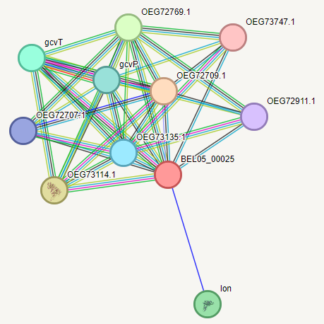
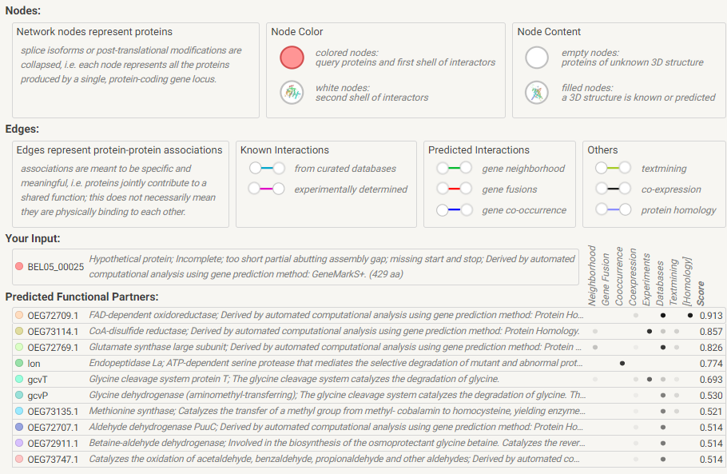
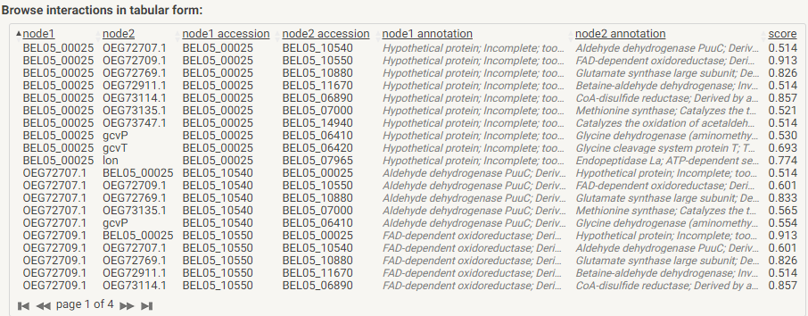
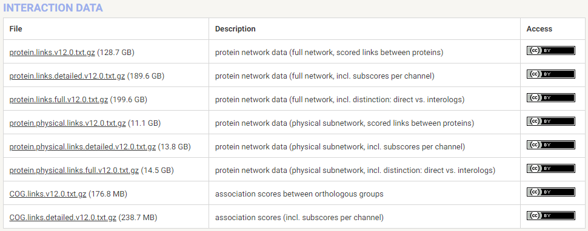
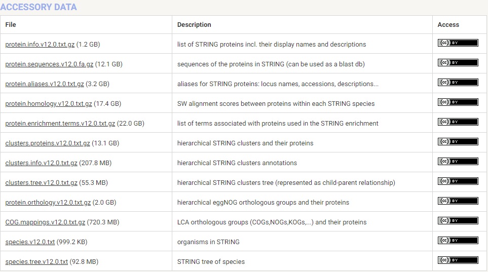
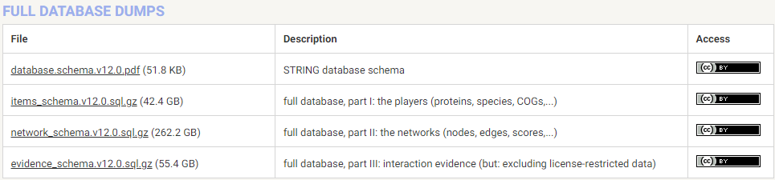

<h1 align="center">STRING — 蛋白质相互作用数据库</h1>

    编写作者：wu_jiannan /
    编写时间：2024.06.11

    <a href='https://cn.string-db.org/'>Website</a> •
    <a href="#一-数据统计">v12.0</a> •
    <a href="#五-network">Network</a> •
    <a href="#四-数据下载">Download</a> •
    <a href="#reference">Publications</a> • 
    <a href="string_metadata.md">Metadata</a> 

**简介**

STRING (Search Tool for the Retrieval of Interacting Genes/Proteins) 是一个用于分析和可视化蛋白质相互作用网络的数据库。它集成了来自多种来源的蛋白质-蛋白质相互作用数据，包括实验数据、计算预测方法和公共文本集合。其目的是提供一个全面的、经过整合的蛋白质相互作用网络，以帮助研究人员理解蛋白质功能和生物过程。

- 创建年份
  
    STRING 数据库最初创建于 2000 年。

- 更新频率
  
    STRING 数据库的主要版本通常每 1-2 年更新一次。这些主要版本会包括新的数据集、改进的算法和新的功能。
    小的更新和修订可能会在主要版本之间进行，以修复错误或添加一些额外的数据。
    
- 版本信息
  
    最新版本为 STRING v12.0，发布于 2021 年。

### 一. 数据库详情
#### 1. 数据统计

- Number of organisms：

    | 分类            | 数量   |
    | --------------- | ------ |
    | Bacteria        | 10'756 |
    | Eukaryotes      | 1'322  |
    | Archaea         | 457    |
    | total organisms | 12'535 |

    查看详细物种 list: [string species](species.v12.0.txt)

    其中常用物种（按官网查询量排序）：
    1. Homo sapiens
    2. Mus musculus
    3. Arabidopsis thaliana
    4. Saccharomyces cerevisiae
    5. Escherichia coli
    6. Caenorhabditis elegans
    7. Rattus norvegicus
    8. Drosophila melanogaster
    9. Bacillus subtilis
    10. Pseudomonas aeruginosa PAO1

- Number of proteins
  
    | 类型     | 数量       |
    | -------- | ---------- |
    | proteins | 59'309'604 |

- Number of interactions (by confidence level)
  
    | 类型                                                         | 数量           |
    | ------------------------------------------------------------ | -------------- |
    | interactions at highest confidence (score >= 0.900)          | 332'075'812    |
    | interactions at high confidence or better (score >= 0.700)   | 977'339'418    |
    | interactions at medium confidence or better (score >= 0.400) | 3'884'503'786  |
    | total interactions (including low confidence links)          | 27'541'372'832 |

#### 2. 数据查询

#### 3. Network
all network：[overview](https://cn.string-db.org/organism_overview.html)
该链接中包含了STRING`每个物种`的`每个蛋白`对应的network，且一一对应

示例：

**Known Interactions：**
  - from curated databases: 来自整理的数据库， curated databases 提供了高质量、经过人工审核和验证的数据。这些数据库通常由专家团队管理，确保数据的准确性和完整性。
  - experimentally determined

**Predicted Interactions：**
  - gene neighborhood ：指的是在基因组上相邻或靠近的基因。
  - gene fusions: 基因融合
  - gene co-occurrence: 指在多个物种中基因一起出现的频率。这个概念用于研究基因在进化过程中的保守性和功能关联。具体来说，如果两个基因在多个物种中频繁地共同存在（即它们的基因序列都出现在相同的物种中），那么这两个基因很可能在生物学功能上有某种联系，比如参与相同的生物过程或分子机制。

#### 4. 关于相互作用

在生物信息学和系统生物学中，研究生物分子之间的相互作用（interactions）是理解生物系统功能的重要途径。相互作用可以分为**直接相互作用 *direct interactions* 和互作同源 *interologs* 两类，二者在研究中的应用和数据来源有所不同。

Table1. 直接相互作用与互作同源的对比

| 特点             | 直接相互作用（Direct Interactions） | 互作同源（Interologs）             |
| ---------------- | ----------------------------------- | ---------------------------------- |
| **数据性质**     | 实验验证的数据                      | 基于保守性推测的数据               |
| **数据来源**     | 实验手段（如Y2H、Co-IP、MS等）      | 基因同源性和进化保守性分析         |
| **置信度**       | 高                                  | 可能较低                           |
| **应用范围**     | 精确功能和机制研究                  | 跨物种相互作用推测、功能推测       |
| **代表性数据库** | BioGRID、IntAct、DIP等              | STRING、IntAct、OrthoDB等          |
| **优势**         | 数据准确，适用于精确分析            | 数据广泛，适用于缺乏实验数据的物种 |
| **局限性**       | 数据量较小，依赖实验验证            | 置信度可能较低，需结合实验数据验证 |

详细描述：

- **直接相互作用（Direct Interactions）**
  
    - 定义：
        直接相互作用是指两个生物分子（如蛋白质、DNA、RNA等）之间通过物理接触发生的相互作用。这种相互作用通常通过实验手段直接检测和验证。

    - 特点：
        物理接触：相互作用是通过实际的物理接触发生的，如蛋白质-蛋白质相互作用、蛋白质-DNA相互作用等。
        实验验证：通过实验手段（如酵母双杂交、共免疫沉淀、质谱分析等）直接检测和验证这些相互作用。
        高置信度：由于数据来自实验验证，具有较高的置信度，适合于精确的功能和机制研究。
        数据来源：
        - 数据库：BioGRID、IntAct、DIP、MINT等
        - 实验手段：酵母双杂交（Y2H）、共免疫沉淀（Co-IP）、质谱分析（MS）等
  
    - 应用：
        功能基因组学：揭示基因和蛋白质的功能及其相互作用网络。
        疾病研究：识别疾病相关的关键相互作用，发现潜在的治疗靶点。
        药物发现：通过药物-靶标相互作用网络，预测药物的作用机制和潜在副作用。

- **互作同源（Interologs）**
  
    - 定义：
        互作同源是指基于不同物种间保守的蛋白质相互作用推测的相互作用关系。即，如果在一个物种中两个蛋白质相互作用，那么在其同源蛋白在另一物种中也可能发生相似的相互作用。

    - 特点：
        跨物种保守性：基于不同物种间保守的蛋白质序列和相互作用关系进行推测。
        推测性质：与直接相互作用不同，互作同源是通过比较基因组学和进化学的方法推测出来的，因此置信度可能较低。
        广泛性：可以利用其他物种的相互作用数据推测目标物种的相互作用，特别适用于缺乏实验数据的物种。
        数据来源：
        - 数据库：STRING、IntAct、OrthoDB等
        - 方法：基因同源性分析、进化保守性分析等
  
    - 应用：
        进化生物学：研究相互作用网络在不同物种中的进化和保守性。
        功能推测：在缺乏实验数据的物种中推测可能的相互作用，辅助功能注释。
        大规模数据整合：结合多物种的相互作用数据，提高相互作用网络的覆盖范围。

#### 5. STRING数据库 与 BioGrid数据库 的区别

STRING和BioGRID都是研究蛋白质-蛋白质相互作用的重要数据库，但它们在数据来源、功能和应用上存在显著差异。以下是两者的主要区别：

Table2. STRING 和 BioGRID 对比

| 特点             | STRING数据库                             | BioGRID数据库                        |
| ---------------- | ---------------------------------------- | ------------------------------------ |
| **数据性质**     | 预测的和实验验证的相互作用               | 实验验证的相互作用                   |
| **相互作用类型** | 蛋白质-蛋白质相互作用                    | 蛋白质-蛋白质相互作用                |
| **数据来源**     | 高通量实验、文本挖掘、共表达、基因邻近等 | 主要来自实验验证的结果               |
| **置信度**       | 置信度评分基于多种证据                   | 高置信度，基于实验验证               |
| **覆盖范围**     | 包含多种相互作用类型，覆盖广             | 主要集中于直接的物理相互作用         |
| **物种数量**     | 超过2000种                               | 超过60种                             |
| **应用范围**     | 蛋白质功能预测、网络构建、交互网络分析   | 基因功能研究、网络构建、交互网络分析 |
| **集成数据**     | 包含从多个来源集成的数据                 | 独立的实验数据                       |
| **数据库访问**   | 提供API、网页接口                        | 提供API、网页接口                    |
| **其他功能**     | 提供功能富集分析、网络图谱等功能         | 主要提供相互作用数据                 |

详细描述：

1. 数据来源

    `STRING`

    多种数据来源：STRING整合了实验数据、计算预测和文献挖掘结果。它包含以下类型的数据：
    - 实验数据：直接来自于各种生物化学实验、质谱分析、酵母双杂交等。
    - 计算预测：基于基因共表达、基因邻近性、融合基因、共进化等方法预测的相互作用。
    - 文献挖掘：通过自然语言处理技术从生物医学文献中提取的相互作用。
    - 其他数据库整合：集成了来自多个其他相互作用数据库（如BioGRID、IntAct、DIP等）的数据。
  
    `BioGRID`
    实验数据为主：BioGRID主要收录的是基于实验验证的蛋白质-蛋白质相互作用数据。数据主要来自科学文献中报道的实验结果。
    文献手动注释：BioGRID中的数据由专家从文献中手动注释，确保了数据的准确性和可靠性。

2. 数据内容
   
    `STRING`

    多物种支持：STRING涵盖了多种生物，包括人类、动物、植物、微生物等。
    功能注释丰富：除了相互作用数据外，STRING还提供了丰富的功能注释，包括蛋白质的功能域、参与的生物过程、亚细胞定位等。
    评分系统：STRING为每个相互作用分配了置信度评分，基于数据来源和证据的可靠性。

    `BioGRID`
    专注实验数据：BioGRID专注于提供经过实验验证的高置信度的相互作用数据。
    多物种覆盖：虽然主要以人类数据为主，但也涵盖了多种模式生物的数据，如酵母、果蝇、小鼠等。
    更新频繁：BioGRID定期更新，确保收录最新的研究成果和相互作用数据。

3. 功能和应用
   
    `STRING`
    网络可视化：提供强大的网络可视化工具，用户可以查看和分析复杂的蛋白质相互作用网络。
    数据整合和预测：支持多种数据的整合和相互作用预测，适合系统生物学研究。
    功能富集分析：提供功能富集分析工具，帮助用户识别特定生物过程和功能模块。
    
    `BioGRID`
    数据检索和下载：提供详细的相互作用数据，用户可以根据自己的研究需要进行检索和下载。
    验证数据：BioGRID提供的数据经过严格的实验验证，适合需要高置信度相互作用数据的研究。
    API接口：提供API接口，支持用户进行程序化的数据检索和分析。

总结：
STRING 更适合于需要综合分析多种数据来源、进行系统生物学研究和功能预测的用户。它的多样化数据来源和强大的网络可视化工具使其成为功能基因组学研究的有力工具。
BioGRID 则更适合于需要高置信度实验验证数据的用户。其手动注释和频繁更新确保了数据的准确性和时效性，适合于深入的实验研究和数据验证。
两者在蛋白质相互作用研究中各有优势，研究人员可以根据具体的研究需求选择适合的数据库，或者结合使用两者的数据，进行更全面的分析。

### 二. 数据下载

**STRING 提供了可直接下载的 [Download](https://cn.string-db.org/cgi/download?sessionId=bQudXvtW89uO) 链接, 包括：**

**而且支持只下载某个特定物种数据：**

文件内容：

**links.txt:**
- protein1 
- protein2 
- combined_score

**links.full.txt:**

| 字段                       | 含义                                                                   |
| -------------------------- | ---------------------------------------------------------------------- |
| `protein1`                 | 相互作用的第一个蛋白质的标识符                                         |
| `protein2`                 | 相互作用的第二个蛋白质的标识符                                         |
| `neighborhood`             | 基因邻近性得分：基因在染色体上的相邻位置                               |
| `neighborhood_transferred` | 基于已知相互作用转移的邻近性得分：从其他物种中转移的基因邻近性信息     |
| `fusion`                   | 基因融合得分：两个基因在不同物种中作为一个融合基因出现的证据           |
| `cooccurence`              | 基因共现得分：两个基因在多种物种中同时存在的证据                       |
| `homology`                 | 同源性得分：基因之间的同源关系得分                                     |
| `coexpression`             | 基因共表达得分：基因在同一种生物中的共表达证据                         |
| `coexpression_transferred` | 基于已知相互作用转移的共表达得分：从其他物种中转移的共表达信息         |
| `experiments`              | 实验验证的相互作用得分：基于实验数据的相互作用证据                     |
| `experiments_transferred`  | 基于已知相互作用转移的实验验证得分：从其他物种中转移的实验数据         |
| `database`                 | 数据库记录的相互作用得分：基于已知数据库中的相互作用记录               |
| `database_transferred`     | 基于已知相互作用转移的数据库记录得分：从其他物种中转移的数据库信息     |
| `textmining`               | 文本挖掘得分：基于文献中的文本挖掘相互作用证据                         |
| `textmining_transferred`   | 基于已知相互作用转移的文本挖掘得分：从其他物种中转移的文本挖掘信息     |
| `combined_score`           | 综合评分：整合了所有上述证据类型的综合得分，用于衡量相互作用的总可信度 |

**protein.info.txt:**
- string_protein_id: STRING 数据库中蛋白质的唯一标识符，用于唯一标识一个蛋白质。
- preferred_name: 蛋白质的常用名称或首选名称。
- protein_size: 蛋白质的长度（以氨基酸残基数表示）。
- annotation: 对蛋白质功能或特性的注释或描述。

**protein.aliases.txt:**
- string_protein_id：STRING 数据库中蛋白质的唯一标识符
- alias：对应于其他数据库的标识符
- source：alias的来源数据库
  
**注：STRING 数据库中的 protein ID 主要对应于 Ensembl 蛋白质 ID，同时也可以映射到其他数据库如 UniProt 和 NCBI Gene。这些映射关系可以通过 STRING 提供的下载文件或 REST API 获取(protein.aliases.v12.0.txt.gz)。**