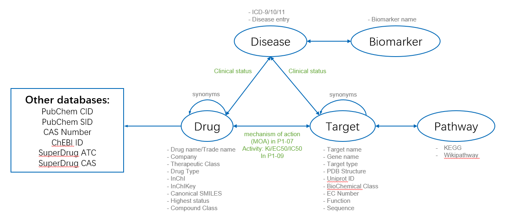
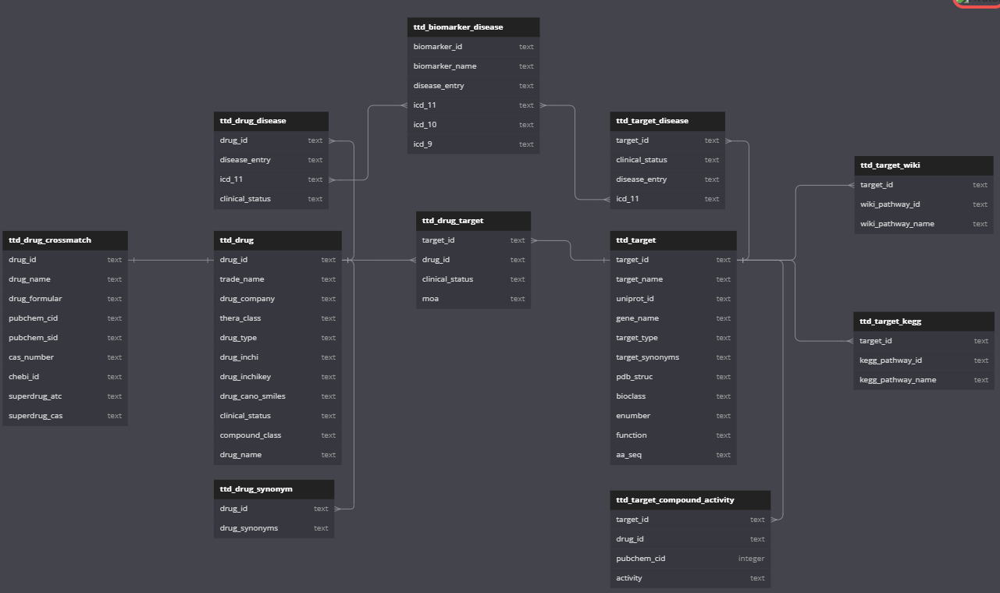
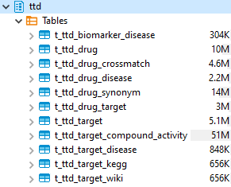

# TTD (Therapeutic Target Database)
## 简介
TTD是一个提供已知和已探索的治疗蛋白质和核酸靶点信息的数据库，包括靶向疾病、通路信息以及针对每个靶点的相应药物。所有提供的信息都有完整的参考文献支持。

## 数据下载
https://db.idrblab.net/ttd/full-data-download

## 数据组织形式

-   target共4298个，其中3662个有对应的蛋白质序列。根据临床研究进展程度，TTD将target分为了以下几类：

| number | target_type         |
|--------|---------------------|
| 1845   | Literature-reported |
| 1327   | Clinical trial      |
| 802    | Successful          |
| 184    | Patented-recorded   |
| 83     | Discontinued        |
| 57     | Preclinical         |

-   drug共42938个，其中25643个记录了与其他数据库的对应关系（crossmatch）。包括小分子化学药和大分子生物药。
(部分药物的brand name缺失，可通过与Drugs@FDA联查解决)
-   biomarker共2512个。
-   目前提供的下载数据中缺少文献数据。

## 数据更新
未找到官方的更新频率相关说明。目前版本更新时间为January 10th, 2024。

## 相关的cross-referenced databases
-   CAS Number
CAS Number是美国化学学会CAS注册数据库的注册号。CAS Number的格式为“[0-9]{2-7}-[0-9]{2}-[0-9]”，第一部分2至7位数字、第二部分2位数字为顺序号，第三部分一位数字为根据前两部分数字计算得到的校验码。比如：D-Glucose的CAS Registry Number为50-99-7；L-Glucose的CAS Registry Number为921-60-8。
-   Pubchem SID
数据源使用PubChem Upload提交包含注释和可选结构的记录。每个数据源的每个记录都分配有一个唯一的Substance Identifier（SID）。例如，如果有十个组织提交了阿司匹林信息记录，那么将创建十个唯一的`物质（SID）记录`。
-   Pubchem CID
Pubchem CID是NCBI数据库的子库`Pubchem数据库对化合物建立的编号`。Pubchem目前收录了近一亿个Compound的全面信息（物理、化学、生物特性等），是最大的开源化合物库。Pubchem CID的格式为纯数字，也就是顺序号。比如：D-Glucose的Pubchem CID为5793；L-Glucose的Pubchem CID为10954115。`当且仅当一个或多个物质记录包含可以标准化为相同化学结构的结构时，才会自动生成一个Compound record（CID）`。例如，许多包含阿司匹林相同结构的化学药品供应商物质记录将被汇总到单个Compound record （CID）。
-   SMILES
SMILES（The Simplified Molecular-inout Line-entry System）是一种`线性描述化合物结构的字符串`。SMILES的本质是使用文本记录原子（节点）和键（边）从而记录化合物结构（图）。往往使用B、C、N、O、P、S、Cl、Br等字母来表示原子；使用.、-、=、#、$等符号来表示键；使用 ( ) 来表示分支。一个化合物结构往往可以书写为多个SMILES，但是一个SMILES只会表示一个确定的化合物结构。使用canonicalization 算法生成canonical SMILES可以保证一个化合物结构只能书写为一个canonical SMILES。比如：D-Glucose的canonical SMILES为“C(C1C(C(C(C(O1)O)O)O)O)O”；L-Glucose的canonical SMILES为“C(C(C(C(C(C=O)O)O)O)O)O”。
-   InChI
InChI（The IUPAC International Chemical Identifier）是一种用于`描述化合物结构信息的新型文本`。InChI由国际理论（化学）与应用化学联合会和美国国家标准与技术研究院共同开发。InChI在设计之初就保证了InChI和化合物结构的一一对应关系。InChI将化学结构信息拆分为不同的特征层（化学式层、连接层、电荷层、同位素层等）来分开描述以方便不同的使用需求。InChI的格式为“InChI=1S/化学式层/原子连接层/氢原子层/其他层（可省略）”。其中“InChI=”表明ID类型，“1”为版本号，“S”代表标准的InChI，化学式层、原子连接层和氢原子层必需包含其余层可以省略。比如：D-Glucose的InChI为“InChI=1S/C6H12O6/c7-1-2-3(8)4(9)5(10)6(11)12-2/h2-11H,1H2/t2-,3-,4+,5-,6?/m1/s1”；L-Glucose的InChI为“InChI=1S/C6H12O6/c7-1-3(9)5(11)6(12)4(10)2-8/h1,3-6,8-12H,2H2/t3-,4+,5+,6+/m1/s1”。 
-   InChIKey
InChIKey由InChI衍生而来，是`InChI的一种“加密”形式`，是固定长度的一串字符。InChIKey的格式为“[A-Z]{14}-[A-z]{11}-[A-Z]{1}”，第一部分14个字母基于连接层和质子层、第二部分的前9个字母基于其余层、第二部分的后两个字母基于标准/非标准特征使用SHA-256编码，第三部分的唯一字母描述（去）质子层。比如：D-Glucose的InChIKey为“WQZGKKKJIJFFOK-GASJEMHNSA-N”；L-Glucose的InChIKey为“GZCGUPFRVQAUEE-VANKVMQKSA-N”。`可根据InChI直接计算得到InChIKey`；由InChIKey得到InChI需要查表；10亿之一的概率一个InChIKey会对应一个以上的InChI。 
-   ChEBI ID
ChEBI(Chemical Entities of Biological Interest)是一个化合物分子实体数据库和本体论，分子实体（molecular entity）是指任何组成或同位素上不同的原子、分子、离子、离子对、自由基、自由基离子、络合物、构象异构体等，可作为单独可区分的实体。ChEBI ID，即ChEBI Identifer，是化合物在ChEBI数据库的唯一标识符，如甘油三磷酸（triglyceride）的ChEBI ID是17855。
-   ATC
ATC是解剖（anatomical）-治疗（therapeutic）-化学（chemical）分类法的简称，是一种`药物的系统分级分类`，建立在该系统上的药物代码称为ATC代码，由WHO药物统计方法协作中心发布并维护。ATC分级分类体系不仅能表明药物的治疗学和药理学分类，也有利于对药物进行不同级别的分析与汇总（例如：按照药物的治疗目的、作用部位、化学结构等）。
该体系将所有药物按照其治疗的解剖学器官/系统、治疗学、药理学和化学特点进行5类分级。药物编码是按照上述5个级别，由字母与数字间隔组成的7位代码形式。
    -   第一级（ATC01级），1位字母，代表药物的解剖学分类，共14大类
    -   第二级（ATC02级），2位数字，代表药物的治疗学分类
    -   第三级（ATC03级），1位字母，代表药物的药理学分类
    -   第四级（ATC04级），1位字母，代表药物的化学分类
    -   第五级（ATC05级），2位数字，代表药物化合物上的分类，即化学物质

具有相同化学名的药物，因其治疗目的不同，给药部位、给药途径不同而可能存在多个ATC代码。例如：M05BA07中，M代表Musculo-skeletal system，05代表Bone diseases，B代表Bone mineralization，A代表Bisphosphonates。

-   SuperDrug CAS
SuperDrug数据库中将CAS Number标准化为9位数字。建议仍以CAS Number为准。

-   EC Number
国际生物化学与分子生物学联合会（IUBMB）将所有的`酶`按照催化的反应类型进行分类的编号，格式为小数点分隔的四组数字。可分为七大类：氧化-还原酶 (EC 1)、移换酶 (EC 2)、水解酶(EC 3)、裂合酶 (EC 4)、异构酶 (EC 5) 、连接酶 (EC 6)和转位酶（EC 7）。例如丙酮酸羧化酶（EC 6.4.1.1）。

-   ICD-11
ICD-11是`国际疾病分类`第十一次修订本，ICD-9和ICD-10以此类推，它是目前最新的全球诊断信息标准。ICD-11 涵盖了54，000个实体（Entities）概念，实体可以是疾病、障碍、外伤原因、体征和症状等；每个实体拥有13个维度的属性进行描述，分别表示系统结构、临床表现、因果属性等。编码方式采用4位必需的主干码（Stem Code）+ 2位可选的扩展码 （Extension Codes）。例如：DD70代表Crohn disease。

## schema

## metadata
### ttd_biomarker_disease
| column           | dtype | description    |   |
|------------------|-------|----------------|---|
| c_biomarker_id   | text  | biomarker_id   |   |
| c_biomarker_name | text  | biomarker_name |   |
| c_disease_entry  | text  | disease_entry  |   |
| c_icd_11         | text  | ICD_11         |   |
| c_icd_10         | text  | ICD_10         |   |
| c_icd_9          | text  | ICD_9          |

### ttd_drug_crossmatch
| column          | dtype | description   |   |
|-----------------|-------|---------------|---|
| c_drug_id       | text  | drug_id       |   |
| c_drug_name     | text  | drug_name     |   |
| c_drug_formular | text  | drug_formular |   |
| c_pubchem_cid   | text  | PubChem CID   |   |
| c_pubchem_sid   | text  | PubChem SID   |   |
| c_cas_number    | text  | CAS Number    |   |
| c_chebi_id      | text  | ChEBI ID      |   |
| c_superdrug_atc | text  | SuperDrug ATC |   |
| c_superdrug_cas | text  | SuperDrug CAS |

### ttd_drug_disease
| column            | dtype | description     |   |
|-------------------|-------|-----------------|---|
| c_drug_id         | text  | drug_id         |   |
| c_disease_entry   | text  | disease_entry   |   |
| c_icd_11          | text  | ICD_11          |   |
| c_clinical_status | text  | clinical_status |

### ttd_drug
| column             | dtype | description      |   |
|--------------------|-------|------------------|---|
| c_drug_id          | text  | drug_id          |   |
| c_trade_name       | text  | trade_name       |   |
| c_drug_company     | text  | drug_company     |   |
| c_thera_class      | text  | thera_class      |   |
| c_drug_type        | text  | drug_type        |   |
| c_drug_inchi       | text  | drug_inchi       |   |
| c_drug_inchikey    | text  | drug_inchikey    |   |
| c_drug_cano_smiles | text  | drug_cano_smiles |   |
| c_clinical_status  | text  | clinical_status  |   |
| c_compound_class   | text  | compound_class   |   |
| c_drug_name        | text  | drug_name        |

### ttd_drug_synonym
| column          | dtype | description   |   |
|-----------------|-------|---------------|---|
| c_drug_id       | text  | drug_id       |   |
| c_drug_synonyms | text  | drug_synonyms |

### ttd_drug_target
| column            | dtype | description         |   |
|-------------------|-------|---------------------|---|
| c_target_id       | text  | target_id           |   |
| c_drug_id         | text  | drug_id             |   |
| c_clinical_status | text  | clinical_status     |   |
| c_moa             | text  | mechanism of action |

### ttd_target_compound_activity
| column        | dtype   | description |   |
|---------------|---------|-------------|---|
| c_target_id   | text    | target_id   |   |
| c_drug_id     | text    | drug_id     |   |
| c_pubchem_cid | integer | pubchem_cid |   |
| c_activity    | text    | activity    |

### ttd_target_disease
| column            | dtype | description     |   |
|-------------------|-------|-----------------|---|
| c_target_id       | text  | target_id       |   |
| c_clinical_status | text  | clinical_status |   |
| c_disease_entry   | text  | disease_entry   |   |
| c_icd_11          | text  | ICD_11          |

### ttd_target_kegg
| column              | dtype | description       |   |
|---------------------|-------|-------------------|---|
| c_target_id         | text  | target_id         |   |
| c_kegg_pathway_id   | text  | kegg_pathway_id   |   |
| c_kegg_pathway_name | text  | kegg_pathway_name |

### ttd_target
| column            | dtype | description     |   |
|-------------------|-------|-----------------|---|
| c_target_id       | text  | target_id       |   |
| c_target_name     | text  | target_name     |   |
| c_uniprot_id      | text  | uniprot_id      |   |
| c_gene_name       | text  | gene_name       |   |
| c_target_type     | text  | target_type     |   |
| c_target_synonyms | text  | target_synonyms |   |
| c_pdb_struc       | text  | pdb_struc       |   |
| c_bioclass        | text  | bioclass        |   |
| c_ec_number       | text  | ec_number       |   |
| c_function        | text  | function        |   |
| c_aa_seq          | text  | aa_seq          |

### ttd_target_wiki
| column              | dtype | description       |   |
|---------------------|-------|-------------------|---|
| c_target_id         | text  | target_id         |   |
| c_wiki_pathway_id   | text  | wiki_pathway_id   |   |
| c_wiki_pathway_name | text  | wiki_pathway_name |

## 入库情况
更新时间为January 10th, 2024的版本已入库。

