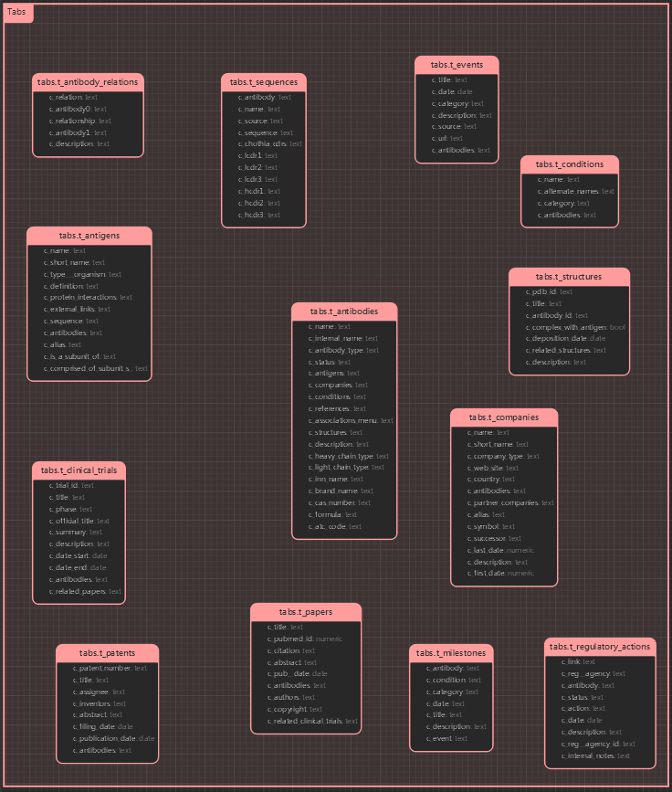

<h1 align="center">TABS Tables 详情</h1>

#### 一. 数据统计

*该表中统计的是官网 `2024-03-12` 及之前的数据*
- 当前数据统计：

    |                      | 数量               | 备注                                                         |
    | -------------------- | ------------------ | ------------------------------------------------------------ |
    | t_antibodies         | 8,817`+10`         | 抗体                                                         |
    | t_antigens           | 1,581              | 抗原                                                         |
    | t_conditions         | 164                | 疾病                                                         |
    | t_clinical_trials    | 15,553`+6`         | 临床试验                                                     |
    | t_sequences          | 3,272(实际为3,277) | 序列, 与网页显示数据有差距，是因为有些虽在目录中但实际无内容 |
    | t_structures         | 264                | 结构                                                         |
    | t_papers             | 20,711             | 论文                                                         |
    | t_patents            | 40,259             | 专利                                                         |
    | t_companies          | 2,452`+4`          | 公司                                                         |
    | t_regulatory_actions | 228                |                                                              |
    | t_antibody_relations | 773`+1`            | `New Data`更新记录里不显示该信息的更新                       |
    | t_events             | 2,482`+2`          | 事件                                                         |
    | t_milestones         | 2,832(实际为3,012) | 重要事件，有些网页有错误（已记录），无法打开                 |
    
    <!--               | Biosimilars        | 25组                                                         | 包含在`Antibody_relations`表中 | - | --> 
    

#### 二. ER 图 

#### 三. Tables
1. t_antibodies

    | 字段名            | 注释                     | 数据类型 |
    | ----------------- | ------------------------ | -------- |
    | name              | 名称                     | text     |
    | antigens          | 抗原                     | text     |
    | companies         | 公司                     | text     |
    | brand_name        | 产品名称                 | text     |
    | inn_name          | 国际非专利药品名称       | text     |
    | internal_name     | 内部名称                 | text     |
    | conditions        | 疾病                     | text     |
    | references        | 参考文献                 | text     |
    | antibody_type     | 抗体类型                 | text     |
    | description       | 描述                     | text     |
    | status            | 状态                     | text     |
    | atc_code          | ATC码                    | text     |
    | associations_menu | 关联的事件、文献、专利等 | text     |
    | heavy_chain_type  | 重链类型                 | text     |
    | light_chain_type  | 轻链类型                 | text     |
    | sequences         | 序列                     | bool     |
    | structures        | 结构                     | text     |
    | cas_number        | CAS号                    | text     |
    | formula           | 化学式                   | text     | - |

<!-- | Timepoints | 时间点 | img |  |
| Timeline | 时间线 | img |  | -->
<!-- | Milestones | 重要事件 | text | 另添加一个`Milestones`表  | -->
<!-- | Relationships | 关系 | - | 另添加一个`Antibody_relations`表 | -->
<!-- | Composition | 组成 | - | 该数据虽有标签，但值都为空 | -->
<!-- | Heavy Chain | 重链 | text | - |
| Light Chain | 轻链 | text | - |
| HCVR | 重链可变区 | text | - |
| LCVR | 轻链可变区 | text | - |
| H Chothia CDRs | | text | - |
| L Chothia CDRs | | text | - | -->
<!-- | Events | 事件 | - | 在该表中只显示数量 | -->
<!-- | Clinical Trials | 临床试验 | - | 在该表中只显示数量 |
| Patents | 专利 | - | 在该表中只显示数量 |
| Papers | 论文 | - | 在该表中只显示数量 |
| Mtg Abstracts | 会议摘要 | - | 在该表中只显示数量 | -->
<!-- | Regulatory Actions | 监管行动 | - | 在该表中只显示数量，另添加一个`Regulatory Actions`表 | -->
<!-- | ATCC Deposition | - | - | 只有极个别有该数据 | -->

2. t_antigens

    | 字段名               | 注释         | 数据类型 |
    | -------------------- | ------------ | -------- |
    | name                 | 名称         | text     |
    | short_name           | 简写         | text     |
    | alias                | 别名         | text     |
    | type                 | 类别         | text     |
    | organism             | 物种         | text     |
    | definition           | 定义         | text     |
    | protein_interactions | 蛋白相互作用 | text     |
    | external_links       | 外部链接     | text     |
    | sequence             | 序列         | text     |
    | antibodies           | 抗体         | text     |

3. t_conditions 

    | 字段名     | 注释 | 数据类型 |
    | ---------- | ---- | -------- |
    | name       | 名称 | text     |
    | category   | 分类 | text     |
    | antibodies | 抗体 | text     |

4. t_clinical_trials

    | 字段名         | 注释                             | 数据类型 |
    | -------------- | -------------------------------- | -------- |
    | trial_id       | 试验号                           | text     |
    | title          | 标题                             | text     |
    | phase          | 阶段                             | text     |
    | official_title | 官方标题                         | text     |
    | summary        | 总结                             | text     |
    | description    | 描述                             | text     |
    | date_start     | 开始日期                         | date     |
    | date_end       | 结束日期                         | date     |
    | antibodies     | 抗体                             | text     |
    | related_papers | 关联的文章，== 'papers'('title') | text     |

5. t_sequences

    | 字段名   | 注释                           | 数据类型 |
    | -------- | ------------------------------ | -------- |
    | name     | 名称                           | text     |
    | antibody | 抗体                           | text     |
    | chain    | 链                             | text     |
    | region   | 区域，`该数据来源于page列表中` | text     |
    | source   | 来源                           | text     |
    | sequence | 序列                           | text     |

6. t_structures

    | 字段名               | 注释             | 数据类型 |
    | -------------------- | ---------------- | -------- |
    | pdb_id               | pdb号            | text     |
    | external_link        | 外部(数据库)链接 | text     |
    | title                | 标题             | text     |
    | antibody_id          | 抗体名称         | text     |
    | complex_with_antigen |                  | bool     |
    | deposition_date      |                  | date     |
    | related_structures   | 相关结构         | text     |
    | description          | 描述             | text     |

<!-- | Structure Chains | 结构链| - | 拆 | -->
<!-- | Heavy Chain | 重链序列 | text | `只有文件` |
| Light Chain | 轻链序列 | text | `只有文件` |
| Structure GIF | 结构图 | gif | 下载为文件 |
| PDB file | pdb文件 | - | 下载为文件 |
| Sequence | 序列 | - | 下载为文件 | -->

7. t_papers

    | 字段名                  | 注释             | 数据类型 |
    | ----------------------- | ---------------- | -------- |
    | antibody                | 抗体             | text     |
    | title                   | 标题             | text     |
    | pubmed_id               | -                | numeric  |
    | authors                 | 作者             | text     |
    | citation                | 引文             | text     |
    | abstract                | 摘要             | text     |
    | copyright               | 版权             | text     |
    | pub_date                | 发表时间         | date     |
    | related_clinical_trials | 相关联的临床试验 | text     |

8. t_patents

    | 字段名           | 注释     | 数据类型 |
    | ---------------- | -------- | -------- |
    | patent_number    | 专利号   | text     |
    | title            | 标题     | text     |
    | assignee         | 受让人   | text     |
    | inventors        | 发明人   | text     |
    | abstract         | 摘要     | text     |
    | tiling_date      | 申请日期 | date     |
    | publication date | 发表时间 | date     |
    | antibodies       | 抗体     | text     |

9. t_companies

    | 字段名            | 注释                         | 数据类型 |
    | ----------------- | ---------------------------- | -------- |
    | name              | 名称                         | text     |
    | short_name        | 简写                         | text     |
    | company_type      | 公司类型                     | text     |
    | web_site          | 网页                         | text     |
    | country           | 国家                         | text     |
    | successor         | 接替者                       | text     |
    | antibodies        | 抗体（在网页中为`pipeline`） | text     |
    | partner_companies | 合作公司                     | text     |
    | alias             |                              | text     |
    | symbol            |                              | text     |
    | last_date         |                              | numeric  |
    | description       | 描述                         | text     |
    | first_date        |                              | numeric  |

10. t_antibody_relations

    | 字段名       | 注释  | 数据类型 |
    | ------------ | ----- | -------- |
    | relation     | 关系  | text     |
    | antibody0    | 抗体0 | text     |
    | relationship | 关系  | text     |
    | antibody1    | 抗体1 | text     |
    | description  | 描述  | text     |

11. t_events

    | 字段名      | 注释 | 数据类型 |
    | ----------- | ---- | -------- |
    | title       | 标题 | text     |
    | date        | 时间 | date     |
    | category    | 类别 | text     |
    | description | 描述 | text     |
    | source      | 来源 | text     |
    | url         | URL  | text     |
    | antibodies  | 抗体 | text     |

12. t_regulatory_actions

    | 字段名         | 注释           | 数据类型 |
    | -------------- | -------------- | -------- |
    | link           | Link           | text     |
    | reg_agency_id  | Reg. Agency ID | text     |
    | reg_agency     | 管理机构       | text     |
    | antibody       | 抗体           | text     |
    | status         | 状态           | text     |
    | action         |                | text     |
    | date           | 日期           | date     |
    | internal_notes |                | text     |

13. t_milestones

    | 字段名      | 注释 | 数据类型 |
    | ----------- | ---- | -------- |
    | antibody    | 抗体 | text     |
    | condition   | 疾病 | text     |
    | category    |      | text     |
    | date        | 日期 | text     |
    | title       | 标题 | text     |
    | description | 描述 | text     |
    | event       | 事件 | text     |