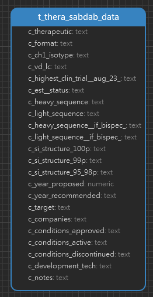

<h1 align="center">Thera-SAbDab Tables 详情</h1>

#### 一. 数据统计

| 表名                | 行数 |
| ------------------- | ---- |
| t_thera_sabdab_data | 940  |

#### 二. ER 图

#### 三. Tables

| 字段名                      | 注释          | 数据类型 |
| --------------------------- | ------------- | -------- |
| c_therapeutic               | 治疗药物      | text     |
| c_format                    | 格式          | text     |
| c_ch1_isotype               | CH1同种型     | text     |
| c_vd_lc                     |               | text     |
| c_highest_clin_trial_aug_23 | 最高临床      | text     |
| c_est_status                |               | text     |
| c_heavy_sequence            | 重链序列      | text     |
| c_light_sequence            | 轻链序列      | text     |
| c_heavy_sequence_if_bispec  |               | text     |
| c_light_sequence_if_bispec  |               | text     |
| c_100%_si_structure         | 100% SI结构   | text     |
| c_99% SI structure          | 99% SI结构    | text     |
| c_95_to_98p_si_structure    | 95-98% SI结构 | text     |
| c_year_proposed             | 提出年份      | numeric  |
| c_year_recommended          | 推荐年份      | text     |
| c_target                    | 靶向          | text     |
| c_companies                 | 公司          | text     |
| c_conditions_approved       |               | text     |
| c_conditions_active         |               | text     |
| c_conditions_discontinued   | 疾病          | text     |
| c_development_tech          | 开发技术      | text     |
| c_notes                     | 注释          | text     |
