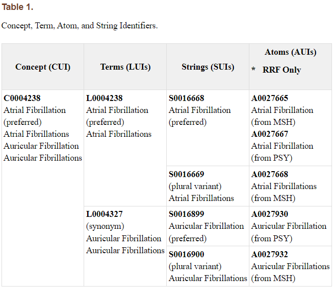
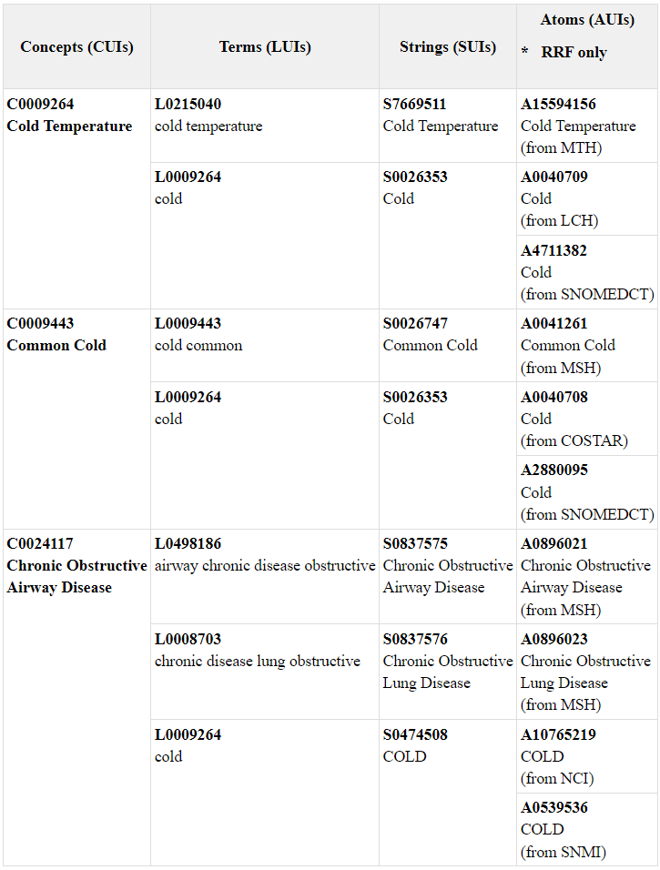

# UMLS (Unified Medical Language System)

## 简介
-   UMLS是一体化医学语言系统，整合了关键术语、分类、编码标准和相关资源，以促进有效和可协作的生物医学信息系统和服务。
-   用户可使用UMLS来：处理文本以提取概念、关系或知识，促进术语之间的映射，开发信息检索系统，从Metathesaurus中提取特定术语，创建和维护本地术语，开发术语服务，研究术语或本体论等。
-   UMLS包括超级叙词表、语义网络、专家词典和工具。

### 超级叙词表（Metathesaurus）
-   Metathesaurus是一个按`概念`组织的大型多功能和多语言的词汇数据库，链接了生物医学和健康相关概念的不同名称，包括概念的层次结构、定义以及其他关系和属性，并确定了不同概念间的关系。
-   2024AA版本的[超级叙词表的源词汇表](#附录1umls超级叙词表的词汇来源)共有189个，包括了CPT、ICD-10-CM、LOINC、MeSH、RxNorm和SNOMED CT等许多词汇表中的术语和代码。

### 语义网络（Semantic Network）
-   语义网络包含了广泛的语义类型及其关系。
-   与超级叙词表的关系：Metathesaurus中的所有概念都至少分配给语义网络中的一个语义类型。

### 专家词典和工具（SPECIALIST Lexicon and Lexical Tools）
- 一个包含英语的生物医学大型句法词汇表，以及用于标准化字符串、生成词汇变体和创建索引的工具。
- 与超级叙词表的关系：在Metathesaurus中出现在概念名称或字符串中的许多单词和多词术语也出现在SPECIALIST词汇表中。词汇工具用于生成与Metathesaurus相关的单词、标准化单词和标准化字符串索引。

## 数据组织形式
### 概念的组织形式

-   Metathesaurus是按概念组织的，其主要目的之一是连接来自许多不同源词汇表的同一概念的不同名称。Metathesaurus除了保留源词汇表中存在的所有标识符之外，为其包含的概念和概念名称分配了几种类型的唯一永久标识符。Metathesaurus概念结构包括概念名称、它们的标识符以及这些概念名称的关键特征（例如，语言、词汇来源、名称类型）。整个概念结构以MRCONSO.RRF单个文件形式出现。
    -   CUI：每个概念或含义在Metathesaurus中都有一个唯一且永久的<b>概念标识符</b>（CUI）。废弃的CUI不会被再次启用。
    -   LUI：SUI经过术语原型化处理得到LUI。对于Metathesaurus中的`英语`条目，每个字符串都通过共同<b>术语标识符</b>（LUI）链接到其所有词汇变体或次要变体。非英语字符串的LUI实际上是另一个SUI。当互为词汇变体的字符串具有不同含义时，与SUI类似，英语字符串的LUI可能与多个CUI相关联。相反，每个SUI和每个AUI只能链接到一个LUI。
    -   SUI：Metathesaurus中独特概念名称或字符串都有一个唯一且永久的<b>字符串标识符</b>（SUI）。字符集、大小写或标点的任何变化都具有单独的SUI。不同语言中相同的字符串将分配不同的字符串标识符。如果相同的字符串（例如Cold）具有多个含义，则一个SUI将关联多个CUI。
    -   AUI：Metathesaurus构建的基本构建模块或“原子”来自每个源词汇表的概念名称或字符串。在每个源词汇表中，字符串的每次出现都被分配一个唯一的<b>原子标识符</b>（AUI）。所有这些AUI都将链接到单个字符串标识符（SUI），因为它们代表了相同字符串的出现。与字符串标识符不同，一个AUI总是只关联到一个CUI。AUI只存在于RRF格式的文件中。

-   `CUI-LUI-SUI-AUI层级关系`：AUI原词会有不同来源，但是相同字符串的AUI会关联到同一个SUI；不同的SUI会由于单复数/时态等原因有多种表达形式，但若这些SUI都表示同一种东西，则会被连接到同一个LUI；不同表达形式的LUI会选出一个优选词赋予CUI。

### （非同义）关系和关系识别符
-   Metathesaurus记录了CUI和AUI层面的源词汇表内关系和源词汇表间关系。
-   Metathesaurus并不包含概念间的所有可能的非同义关系。
-   关系标签REL用于表示关系的本质（例如：Broader, Narrower, Child of, Qualifier of, etc.）。约1/4的关系还具有来自源词汇表的RELA标签，用于更精确地表示关系的本质（例如：is_a, branch_of, component_of）。
-   关系标识符：RUI。

### 属性和属性识别符
-   Metathesaurus包括3种属性：概念属性、原子属性和关系属性。
    -   概念属性在Metathesaurus构建过程中添加，并适用于概念的所有名称。
    -   原子属性和关系属性来自特定的源词汇表。
-   属性识别符：ATUI

### 主要文件内容
-   MRSAB.RRF：Metathesaurus的所有源词汇表及其缩写。[附录1](#附录1umls超级叙词表的词汇来源)
-   `MRCONSO.RRF`：最重要的文件。包含概念名称、术语、源词汇表、各类标识符等信息。

-   MRCUI.RRF：从1991年至今的每个Metathesaurus版本的CUI的更改。
-   AMBIGLUI.RRF：有歧义的字符串和术语的LUI和SUI。

-   MRREL.RRF：`源词汇表内关系`，所有概念间的关系。（SRUI字段包含了SNOMED CT分配给关系的唯一标识符）包含“距离-1”层次关系，即直接的parent和child关系，以及其他类型。
-   MRHIER.RRF：`源词汇表内关系`，概念间的层次关系，包含了所有sibling关系和path to root。
-   MRMAP.RRF：`源词汇表间关系`，不同源词汇表间的映射关系
-   MRDOC.RRF：所有缩写值的定义（仅限只有有限个值的字段，不包括源词汇表缩写）。[网页版](https://www.nlm.nih.gov/research/umls/knowledge_sources/metathesaurus/release/abbreviations.html)

-   MRSAT.RRF：属性，每一行都包含属性的名称、属性的来源和属性的值，以及所有适当的标识符

-   MRSTY.RRF：描述概念的语义类型（例如：Pharmacologic Substance）
-   MRDEF.RRF：对概念属性的描述（例如：Conditions that impair the transmission of auditory impulses and information from the level of the ear to the temporal cortices, including the sensorineural pathways.）

## 数据下载
-   下载UMLS数据需要license，只接受个人发起的license申请。

-   [超级叙词表下载地址（已入库）](https://www.nlm.nih.gov/research/umls/licensedcontent/umlsknowledgesources.html)
-   [语义网络browser](https://uts.nlm.nih.gov/uts/umls/semantic-network/root)
-   [Web Services APIs](https://documentation.uts.nlm.nih.gov/rest/home.html)

## 数据更新

-   UMLS每年更新两次，春、秋各一次，编号分别为AA和AB。
>   -   Release version:    2024AA
    -   Release format:    RRF
    -   Concepts:    3,383,352
    -   Number of concept names (AUIs):    16,357,099
    -   Number of distinct concept names (SUIs):    13,516,488
    -   Number of distinct normalized concept names (LUIs):    12,331,893
    -   Number of sources (distinct source families by language):    168
    -   Number of sources contributing concept names:    187
    -   Number of languages contributing concept names:    27

## schema

## metadata
-   [超级叙词表metadata](https://www.nlm.nih.gov/research/umls/knowledge_sources/metathesaurus/release/columns_data_elements.html)：Table 1. Columns and Data Elements in Rich Release Format (RRF)

### umls_mrconso_metadata

| column     | dtype   | description                                    |   |
|------------|---------|------------------------------------------------|---|
| c_cui      | text    | Unique identifier for concept                  |   |
| c_lat      | text    | Language of Term(s)                            |   |
| c_ts       | text    | Term status                                    |   |
| c_lui      | text    | Unique identifier for term                     |   |
| c_stt      | text    | String type                                    |   |
| c_sui      | text    | Unique identifier for string                   |   |
| c_ispref   | text    | Indicates whether AUI is preferred             |   |
| c_aui      | text    | Unique identifier for atom                     |   |
| c_saui     | decimal | Source asserted atom identifier                |   |
| c_scui     | text    | Source asserted concept identifier             |   |
| c_sdui     | text    | Source asserted descriptor identifier          |   |
| c_sab      | text    | Source abbreviation                            |   |
| c_tty      | text    | Term type in source                            |   |
| c_code     | text    | Unique Identifier or code for string in source |   |
| c_str      | text    | String                                         |   |
| c_srl      | integer | Source Restriction Level                       |   |
| c_suppress | text    | Suppressible flag                              |   |
| c_cvf      | decimal | Content view flag                              |

## 入库情况

-   2024AA UMLS Metathesaurus (May 6, 2024) 的MRCONSO.RRF已入库

## 附录1：UMLS超级叙词表的源词汇表
-   2024AA：189个

| **源词汇表缩写（Abbreviation）** | **源词汇表（Name）**                                                                                  | **最后更新版本（Last Updated）** | **源词汇表语言（Language）** | **源词汇表使用限制（Restriction Level）** |
|------------------|-------------------------------------------------------------------------------------------|------------------|--------------|-----------------------|
| AIR              | AI/RHEUM                                                                                  | 1995AA           | ENG          | 0                     |
| ALT              | Alternative Billing Concepts                                                              | 2009AA           | ENG          | 3                     |
| AOD              | Alcohol and Other Drug Thesaurus                                                          | 2002AC           | ENG          | 0                     |
| AOT              | Authorized Osteopathic Thesaurus                                                          | 2006AD           | ENG          | 0                     |
| ATC              | Anatomical Therapeutic Chemical Classification System                                     | 2024AA           | ENG          | 0                     |
| BI               | Beth Israel Problem List                                                                  | 1999AA           | ENG          | 2                     |
| CCC              | Clinical Care Classification                                                              | 2018AA           | ENG          | 1                     |
| CCPSS            | Clinical Problem Statements                                                               | 2000AA           | ENG          | 3                     |
| CCS              | Clinical Classifications Software                                                         | 2005AC           | ENG          | 0                     |
| CCSR_ICD10CM     | Clinical Classifications Software Refined for ICD-10-CM                                   | 2024AA           | ENG          | 0                     |
| CCSR_ICD10PCS    | Clinical Classifications Software Refined for ICD-10-PCS                                  | 2024AA           | ENG          | 0                     |
| CDCREC           | Race & Ethnicity - CDC                                                                    | 2021AB           | ENG          | 0                     |
| CDT              | CDT                                                                                       | 2022AB           | ENG          | 3                     |
| CHV              | Consumer Health Vocabulary                                                                | 2012AA           | ENG          | 0                     |
| COSTAR           | COSTAR                                                                                    | 2002AD           | ENG          | 0                     |
| CPM              | Medical Entities Dictionary                                                               | 2003AC           | ENG          | 2                     |
| CPT              | CPT - Current Procedural Terminology                                                      | 2024AA           | ENG          | 3                     |
| CPTSP            | CPT Spanish                                                                               | 2001AC           | SPA          | 3                     |
| CSP              | CRISP Thesaurus                                                                           | 2006AB           | ENG          | 0                     |
| CST              | COSTART                                                                                   | 1999AA           | ENG          | 0                     |
| CVX              | Vaccines Administered                                                                     | 2024AA           | ENG          | 0                     |
| DDB              | Diseases Database                                                                         | 2001AA           | ENG          | 3                     |
| DMDICD10         | ICD-10 German                                                                             | 1997AA           | GER          | 1                     |
| DMDUMD           | UMDNS German                                                                              | 1999AA           | GER          | 1                     |
| DRUGBANK         | DrugBank                                                                                  | 2024AA           | ENG          | 0                     |
| DSM-5            | Diagnostic and Statistical Manual of Mental Disorders, Fifth Edition                      | 2016AB           | ENG          | 3                     |
| DXP              | DXplain                                                                                   | 1995AA           | ENG          | 0                     |
| FMA              | Foundational Model of Anatomy                                                             | 2019AB           | ENG          | 0                     |
| GO               | Gene Ontology                                                                             | 2023AB           | ENG          | 0                     |
| GS               | Gold Standard Drug Database                                                               | 2024AA           | ENG          | 3                     |
| HCDT             | CDT in HCPCS                                                                              | 2023AA           | ENG          | 3                     |
| HCPCS            | HCPCS - Healthcare Common Procedure Coding System                                         | 2024AA           | ENG          | 0                     |
| HCPT             | CPT in HCPCS                                                                              | 2024AA           | ENG          | 3                     |
| HGNC             | HUGO Gene Nomenclature Committee                                                          | 2023AB           | ENG          | 0                     |
| HL7V2.5          | HL7 Version 2.5                                                                           | 2005AC           | ENG          | 0                     |
| HL7V3.0          | HL7 Version 3.0                                                                           | 2024AA           | ENG          | 0                     |
| HLREL            | ICPC2E ICD10 Relationships                                                                | 2001AA           |              | 3                     |
| HPO              | Human Phenotype Ontology                                                                  | 2024AA           | ENG          | 0                     |
| ICD10            | International Classification of Diseases and Related Health Problems, Tenth Revision      | 2004AB           | ENG          | 3                     |
| ICD10AE          | ICD-10, American English Equivalents                                                      | 1998AA           | ENG          | 3                     |
| ICD10AM          | ICD-10, Australian Modification                                                           | 2000AB           | ENG          | 3                     |
| ICD10AMAE        | ICD-10, Australian Modification, Americanized English Equivalents                         | 2002AD           | ENG          | 3                     |
| ICD10CM          | International Classification of Diseases, Tenth Revision, Clinical Modification           | 2023AB           | ENG          | 4                     |
| ICD10DUT         | ICD10, Dutch Translation                                                                  | 2004AB           | DUT          | 3                     |
| ICD10PCS         | ICD-10 Procedure Coding System                                                            | 2023AB           | ENG          | 0                     |
| ICD9CM           | International Classification of Diseases, Ninth Revision, Clinical Modification           | 2015AA           | ENG          | 0                     |
| ICF              | International Classification of Functioning, Disability and Health                        | 2009AA           | ENG          | 4                     |
| ICF-CY           | International Classification of Functioning, Disability and Health for Children and Youth | 2009AA           | ENG          | 4                     |
| ICNP             | International Classification for Nursing Practice                                         | 2023AA           | ENG          | 3                     |
| ICPC             | International Classification of Primary Care                                              | 1998AA           | ENG          | 0                     |
| ICPC2EDUT        | ICPC2E Dutch                                                                              | 2004AB           | DUT          | 3                     |
| ICPC2EENG        | International Classification of Primary Care, 2nd Edition, Electronic                     | 2004AB           | ENG          | 3                     |
| ICPC2ICD10DUT    | ICPC2-ICD10 Thesaurus, Dutch Translation                                                  | 2005AB           | DUT          | 3                     |
| ICPC2ICD10ENG    | ICPC2-ICD10 Thesaurus                                                                     | 2005AB           | ENG          | 3                     |
| ICPC2P           | ICPC-2 PLUS                                                                               | 2006AB           | ENG          | 3                     |
| ICPCBAQ          | ICPC Basque                                                                               | 2000AA           | BAQ          | 0                     |
| ICPCDAN          | ICPC Danish                                                                               | 1999AA           | DAN          | 0                     |
| ICPCDUT          | ICPC Dutch                                                                                | 1999AA           | DUT          | 0                     |
| ICPCFIN          | ICPC Finnish                                                                              | 1999AA           | FIN          | 0                     |
| ICPCFRE          | ICPC French                                                                               | 2000AA           | FRE          | 0                     |
| ICPCGER          | ICPC German                                                                               | 2000AA           | GER          | 0                     |
| ICPCHEB          | ICPC Hebrew                                                                               | 2000AA           | HEB          | 0                     |
| ICPCHUN          | ICPC Hungarian                                                                            | 1999AA           | HUN          | 0                     |
| ICPCITA          | ICPC Italian                                                                              | 1999AA           | ITA          | 0                     |
| ICPCNOR          | ICPC Norwegian                                                                            | 1999AA           | NOR          | 0                     |
| ICPCPOR          | ICPC Portuguese                                                                           | 1999AA           | POR          | 0                     |
| ICPCSPA          | ICPC Spanish                                                                              | 2000AA           | SPA          | 0                     |
| ICPCSWE          | ICPC Swedish                                                                              | 2000AA           | SWE          | 0                     |
| JABL             | Congenital Mental Retardation Syndromes                                                   | 2000AA           | ENG          | 1                     |
| KCD5             | Korean Standard Classification of Disease Version 5                                       | 2009AA           | KOR          | 3                     |
| LCH              | Library of Congress Subject Headings                                                      | 1992AA           | ENG          | 0                     |
| LCH_NW           | Library of Congress Subject Headings, Northwestern University subset                      | 2014AB           | ENG          | 0                     |
| LNC              | LOINC                                                                                     | 2024AA           | ENG          | 0                     |
| LNC-DE-AT        | LOINC Linguistic Variant - German, Austria                                                | 2024AA           | GER          | 0                     |
| LNC-DE-DE        | LOINC Linguistic Variant - German, Germany                                                | 2024AA           | GER          | 0                     |
| LNC-EL-GR        | LOINC Linguistic Variant - Greek, Greece                                                  | 2024AA           | GRE          | 0                     |
| LNC-ES-AR        | LOINC Linguistic Variant - Spanish, Argentina                                             | 2024AA           | SPA          | 0                     |
| LNC-ES-ES        | LOINC Linguistic Variant - Spanish, Spain                                                 | 2024AA           | SPA          | 0                     |
| LNC-ES-MX        | LOINC Linguistic Variant - Spanish, Mexico                                                | 2024AA           | SPA          | 0                     |
| LNC-ET-EE        | LOINC Linguistic Variant - Estonian, Estonia                                              | 2024AA           | EST          | 0                     |
| LNC-FR-BE        | LOINC Linguistic Variant - French, Belgium                                                | 2024AA           | FRE          | 0                     |
| LNC-FR-CA        | LOINC Linguistic Variant - French, Canada                                                 | 2024AA           | FRE          | 0                     |
| LNC-FR-FR        | LOINC Linguistic Variant - French, France                                                 | 2024AA           | FRE          | 0                     |
| LNC-IT-IT        | LOINC Linguistic Variant - Italian, Italy                                                 | 2024AA           | ITA          | 0                     |
| LNC-KO-KR        | LOINC Linguistic Variant - Korea, Korean                                                  | 2024AA           | KOR          | 0                     |
| LNC-NL-NL        | LOINC Linguistic Variant - Dutch, Netherlands                                             | 2024AA           | DUT          | 0                     |
| LNC-PL-PL        | LOINC Linguistic Variant - Polish, Poland                                                 | 2024AA           | POL          | 0                     |
| LNC-PT-BR        | LOINC Linguistic Variant - Portuguese, Brazil                                             | 2024AA           | POR          | 0                     |
| LNC-RU-RU        | LOINC Linguistic Variant - Russian, Russia                                                | 2024AA           | RUS          | 0                     |
| LNC-TR-TR        | LOINC Linguistic Variant - Turkish, Turkey                                                | 2024AA           | TUR          | 0                     |
| LNC-UK-UA        | LOINC Linguistic Variant - Ukrainian, Ukraine                                             | 2024AA           | UKR          | 0                     |
| LNC-ZH-CN        | LOINC Linguistic Variant - Chinese, China                                                 | 2024AA           | CHI          | 0                     |
| MCM              | Glossary of Clinical Epidemiologic Terms                                                  | 1992AA           | ENG          | 0                     |
| MDR              | MedDRA                                                                                    | 2024AA           | ENG          | 3                     |
| MDRARA           | MedDRA Arabic                                                                             | 2024AA           | ARA          | 3                     |
| MDRBPO           | MedDRA Brazilian Portuguese                                                               | 2024AA           | POR          | 3                     |
| MDRCZE           | MedDRA Czech                                                                              | 2024AA           | CZE          | 3                     |
| MDRDUT           | MedDRA Dutch                                                                              | 2024AA           | DUT          | 3                     |
| MDREST           | Medical Dictionary for Regulatory Activities Terminology (MedDRA), Estonian Edition       | 2024AA           | EST          | 3                     |
| MDRFIN           | Medical Dictionary for Regulatory Activities Terminology (MedDRA), Finnish Edition        | 2024AA           | FIN          | 3                     |
| MDRFRE           | MedDRA French                                                                             | 2024AA           | FRE          | 3                     |
| MDRGER           | MedDRA German                                                                             | 2024AA           | GER          | 3                     |
| MDRGRE           | MedDRA Greek                                                                              | 2024AA           | GRE          | 3                     |
| MDRHUN           | MedDRA Hungarian                                                                          | 2024AA           | HUN          | 3                     |
| MDRITA           | MedDRA Italian                                                                            | 2024AA           | ITA          | 3                     |
| MDRJPN           | MedDRA Japanese                                                                           | 2024AA           | JPN          | 3                     |
| MDRKOR           | MedDRA Korean                                                                             | 2024AA           | KOR          | 3                     |
| MDRLAV           | MedDRA Latvian                                                                            | 2024AA           | LAV          | 3                     |
| MDRPOL           | MedDRA Polish                                                                             | 2024AA           | POL          | 3                     |
| MDRPOR           | MedDRA Portuguese                                                                         | 2024AA           | POR          | 3                     |
| MDRRUS           | MedDRA Russian                                                                            | 2024AA           | RUS          | 3                     |
| MDRSPA           | MedDRA Spanish                                                                            | 2024AA           | SPA          | 3                     |
| MDRSWE           | MedDRA Swedish                                                                            | 2024AA           | SWE          | 3                     |
| MED-RT           | Medication Reference Terminology                                                          | 2024AA           | ENG          | 0                     |
| MEDCIN           | MEDCIN                                                                                    | 2024AA           | ENG          | 3                     |
| MEDLINEPLUS      | MedlinePlus Health Topics                                                                 | 2024AA           | ENG          | 0                     |
| MEDLINEPLUS_SPA  | MedlinePlus Spanish Health Topics                                                         | 2024AA           | SPA          | 0                     |
| MMSL             | Multum                                                                                    | 2024AA           | ENG          | 1                     |
| MMX              | Micromedex                                                                                | 2024AA           | ENG          | 3                     |
| MSH              | MeSH                                                                                      | 2024AA           | ENG          | 0                     |
| MSHCZE           | MeSH Czech                                                                                | 2024AA           | CZE          | 3                     |
| MSHDUT           | MeSH Dutch                                                                                | 2005AB           | DUT          | 3                     |
| MSHFIN           | MeSH Finnish                                                                              | 2008AA           | FIN          | 3                     |
| MSHFRE           | MeSH French                                                                               | 2024AA           | FRE          | 3                     |
| MSHGER           | MeSH German                                                                               | 2023AB           | GER          | 0                     |
| MSHITA           | MeSH Italian                                                                              | 2019AA           | ITA          | 3                     |
| MSHJPN           | MeSH Japanese                                                                             | 2015AB           | JPN          | 3                     |
| MSHLAV           | MeSH Latvian                                                                              | 2012AA           | LAV          | 3                     |
| MSHNOR           | MeSH Norwegian                                                                            | 2019AA           | NOR          | 3                     |
| MSHPOL           | MeSH Polish                                                                               | 2024AA           | POL          | 3                     |
| MSHPOR           | MeSH Portuguese                                                                           | 2024AA           | POR          | 3                     |
| MSHRUS           | MeSH Russian                                                                              | 2024AA           | RUS          | 3                     |
| MSHSCR           | MeSH Croatian                                                                             | 2019AA           | SCR          | 3                     |
| MSHSPA           | MeSH Spanish                                                                              | 2024AA           | SPA          | 3                     |
| MSHSWE           | MeSH Swedish                                                                              | 2021AB           | SWE          | 3                     |
| MTH              | Metathesaurus Names                                                                       | 1990AA           | ENG          | 0                     |
| MTHCMSFRF        | Metathesaurus CMS Formulary Reference File                                                | 2024AA           | ENG          | 0                     |
| MTHICD9          | ICD-9-CM Entry Terms                                                                      | 2015AA           | ENG          | 0                     |
| MTHICPC2EAE      | ICPC2E American English Equivalents                                                       | 2004AB           | ENG          | 3                     |
| MTHICPC2ICD10AE  | ICPC2E-ICD10 Thesaurus, American English Equivalents                                      | 2005AB           | ENG          | 3                     |
| MTHMST           | Minimal Standard Terminology (UMLS)                                                       | 2002AA           | ENG          | 0                     |
| MTHMSTFRE        | Minimal Standard Terminology French (UMLS)                                                | 2002AA           | FRE          | 0                     |
| MTHMSTITA        | Minimal Standard Terminology Italian (UMLS)                                               | 2002AA           | ITA          | 0                     |
| MTHSPL           | FDA Structured Product Labels                                                             | 2024AA           | ENG          | 0                     |
| MVX              | Manufacturers of Vaccines                                                                 | 2024AA           | ENG          | 0                     |
| NANDA-I          | NANDA-I Taxonomy                                                                          | 2018AA           | ENG          | 3                     |
| NCBI             | NCBI Taxonomy                                                                             | 2024AA           | ENG          | 0                     |
| NCI              | NCI Thesaurus                                                                             | 2024AA           | ENG          | 0                     |
| NCISEER          | NCI SEER ICD Mappings                                                                     | 2002AD           |              | 0                     |
| NDDF             | FDB MedKnowledge                                                                          | 2024AA           | ENG          | 3                     |
| NEU              | Neuronames Brain Hierarchy                                                                | 2023AB           | ENG          | 3                     |
| NIC              | Nursing Interventions Classification                                                      | 2018AB           | ENG          | 3                     |
| NOC              | Nursing Outcomes Classification                                                           | 2018AB           | ENG          | 3                     |
| NUCCHCPT         | National Uniform Claim Committee - Health Care Provider Taxonomy                          | 2023AB           | ENG          | 3                     |
| OMIM             | Online Mendelian Inheritance in Man                                                       | 2024AA           | ENG          | 0                     |
| OMS              | Omaha System                                                                              | 2007AC           | ENG          | 1                     |
| ORPHANET         | ORPHANET                                                                                  | 2023AB           | ENG          | 1                     |
| PCDS             | Patient Care Data Set                                                                     | 1999AA           | ENG          | 3                     |
| PDQ              | Physician Data Query                                                                      | 2019AA           | ENG          | 0                     |
| PNDS             | Perioperative Nursing Data Set                                                            | 2024AA           | ENG          | 3                     |
| PPAC             | Pharmacy Practice Activity Classification                                                 | 1999AA           | ENG          | 3                     |
| PSY              | Psychological Index Terms                                                                 | 2005AB           | ENG          | 3                     |
| QMR              | Quick Medical Reference                                                                   | 1998AA           | ENG          | 0                     |
| RAM              | Clinical Concepts by R A Miller                                                           | 2000AA           | ENG          | 0                     |
| RCD              | Read Codes                                                                                | 2000AA           | ENG          | 3                     |
| RCDAE            | Read Codes Am Engl                                                                        | 2000AA           | ENG          | 3                     |
| RCDSA            | Read Codes Am Synth                                                                       | 2000AA           | ENG          | 3                     |
| RCDSY            | Read Codes Synth                                                                          | 2000AA           | ENG          | 3                     |
| RXNORM           | RXNORM                                                                                    | 2024AA           | ENG          | 0                     |
| SCTSPA           | SNOMED CT Spanish Edition                                                                 | 2024AA           | SPA          | 9                     |
| SNM              | SNOMED 1982                                                                               | 1991AA           | ENG          | 9                     |
| SNMI             | SNOMED Intl 1998                                                                          | 1999AA           | ENG          | 9                     |
| SNOMEDCT_US      | SNOMED CT, US Edition                                                                     | 2024AA           | ENG          | 9                     |
| SNOMEDCT_VET     | SNOMED CT, Veterinary Extension                                                           | 2024AA           | ENG          | 9                     |
| SOP              | Source of Payment Typology                                                                | 2021AA           | ENG          | 0                     |
| SPN              | Standard Product Nomenclature                                                             | 2004AA           | ENG          | 0                     |
| SRC              | Source Terminology Names (UMLS)                                                           | 1995AA           | ENG          | 0                     |
| TKMT             | Traditional Korean Medical Terms                                                          | 2011AB           | KOR          | 0                     |
| ULT              | UltraSTAR                                                                                 | 1995AA           | ENG          | 3                     |
| UMD              | UMDNS                                                                                     | 2023AA           | ENG          | 1                     |
| USP              | USP Compendial Nomenclature                                                               | 2024AA           | ENG          | 0                     |
| USPMG            | USP Model Guidelines                                                                      | 2024AA           | ENG          | 0                     |
| UWDA             | Digital Anatomist                                                                         | 2003AC           | ENG          | 0                     |
| VANDF            | National Drug File                                                                        | 2024AA           | ENG          | 0                     |
| WHO              | WHOART                                                                                    | 1999AA           | ENG          | 2                     |
| WHOFRE           | WHOART French                                                                             | 1999AA           | FRE          | 2                     |
| WHOGER           | WHOART German                                                                             | 1999AA           | GER          | 2                     |
| WHOPOR           | WHOART Portuguese                                                                         | 1999AA           | POR          | 2                     |
| WHOSPA           | WHOART Spanish                                                                            | 1999AA           | SPA          | 2                     |
