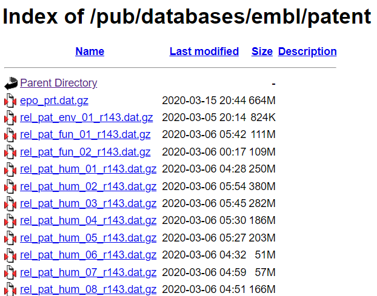
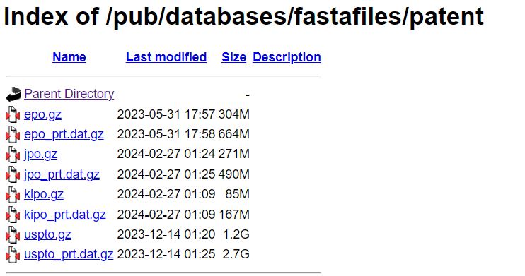
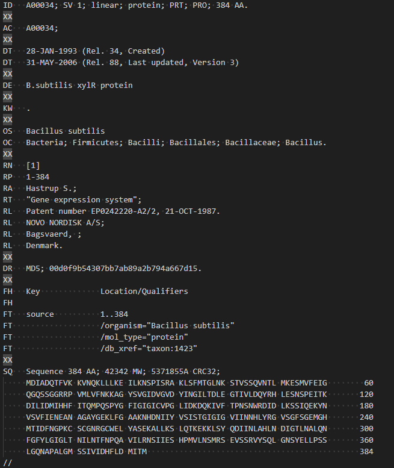
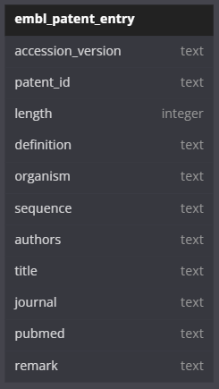
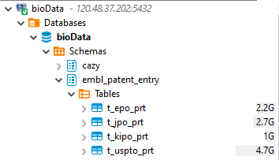

# EMBL专利数据库调研
## 数据组成
### Patent Nucleotide Sequences
-   https://ftp.ebi.ac.uk/pub/databases/embl/patent/
-   包含在Genbank的PAT核酸序列内，且最近一次更新在2020年，故暂不下载

### Patent Protein Sequences
-   https://ftp.ebi.ac.uk/pub/databases/fastafiles/patent/
-   包含了欧洲、日本、韩国、美国（EPO, JPO, KIPO and USPTO）的蛋白专利序列(但也包含部分核酸序列)。其中dat.gz结尾的为embl格式的文件。

-   embl格式见下：

## 数据更新
未找到官方的更新频次说明。目前下载的蛋白专利序列数据上传时间见上图。 

## schema

## metadata

| column              | dtype   | description                                                                                                                                                                                      |   |
|---------------------|---------|--------------------------------------------------------------------------------------------------------------------------------------------------------------------------------------------------|---|
| c_accession_version | text    | The accession number + version (ie. AB01234.2).                                                                                                                                                  |   |
| c_patent_id         | text    | Patent id, region + id + patent class + serial, concatenated by _ (ie. EP_0238993_A2_21).                                                                                                        |   |
| c_length            | integer | The size of the record.                                                                                                                                                                          |   |
| c_definition        | text    | The definition of the record.definition                                                                                                                                                          |   |
| c_organism          | text    | The genus and species of the organism (ie. 'Homo sapiens').                                                                                                                                      |   |
| c_sequence          | text    | A string with the sequence itself. Should consider limit of length. If string length is more than 1 billion, then the sequence is saved in a file and this column cantains the path of the file. |   |
| c_authors           | text    | String with all of the authors. Concatenated with ', '.                                                                                                                                          |   |
| c_title             | text    | The title of the reference.                                                                                                                                                                      |   |
| c_journal           | text    | Information about the patent.                                                                                                                                                                    |   |
| c_pubmed            | text    | The pubmed_id for the reference.                                                                                                                                                                 |   |
| c_remark            | text    | Free-form remarks about the reference.                                                                                                                                                           |

## 入库情况

已全部入库202上pg。

