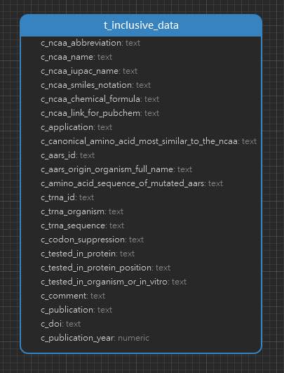

<h1 align="center">iNClusive Tables 详情</h1>

#### 一. 数据统计

| 表名             | 行数  |
| ---------------- | ----- |
| t_inclusive_data | 2,432 |

#### 二. ER 图

#### 三. Tables

1. t_inclusive_data

    | 字段名                                          | 注释                                                                                                    | 数据类型 | 备注 |
    | ----------------------------------------------- | ------------------------------------------------------------------------------------------------------- | -------- | ---- |
    | c_ncaa_abbreviation                             | ncAA 缩写                                                                                               | text     |
    | c_ncaa_name                                     | ncAA名称                                                                                                | text     |
    | c_ncaa_iupac_name                               | ncAA IUPAC 名称，IUPAC命名法是系统命名化学物质的方法；该命名法是由国际纯粹与应用化学联合会（IUPAC）规定 | text     |
    | c_ncaa_smiles_notation                          | ncAA SMILES 表示法                                                                                      | text     |
    | c_ncaa_chemical_formula                         | ncAA化学式                                                                                              | text     |
    | c_ncaa_link_for_pubchem                         | Pubchem 的 ncAA 链接                                                                                    | text     |
    | c_application                                   | 应用                                                                                                    | text     |
    | c_canonical_amino_acid_most_similar_to_the_ncaa | 与ncAA最相似的典型氨基酸                                                                                | text     |
    | c_aars_id                                       | 氨酰-tRNA合成酶 id                                                                                      | text     |
    | c_aars_origin_organism_full_name                | aars物种                                                                                                | text     |
    | c_amino_acid_sequence_of_mutated_aars           | 突变的aaRS氨基酸序列,已下载，其中`2417、2422`有id但并无信息                                             | text     |
    | c_trna_id                                       | tRNA id                                                                                                 | text     |
    | c_trna_organism                                 | tRNA物种来源                                                                                            | text     |
    | c_trna_sequence                                 | tRNA序列                                                                                                | text     |
    | c_codon_suppression                             | 密码子抑制                                                                                              | text     |
    | c_tested_in_protein                             | 掺入ncAA的蛋白质                                                                                        | text     |
    | c_tested_in_protein_position                    | 掺入ncAA的蛋白质位点                                                                                    | text     |
    | c_tested_in_organism_or_in_vitro                | 体内或体外                                                                                              | text     |
    | c_comment                                       | 评论                                                                                                    | text     |
    | c_publication                                   | 出版物                                                                                                  | text     |
    | c_doi                                           | DOI连接                                                                                                 | text     |
    | c_publication_year                              | 发表年份                                                                                                | numeric  |