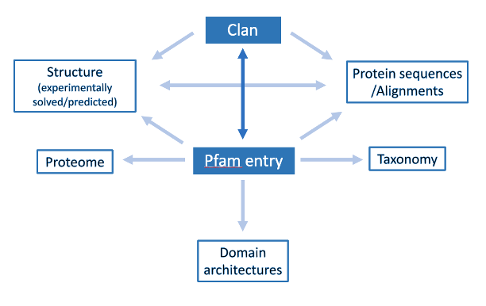
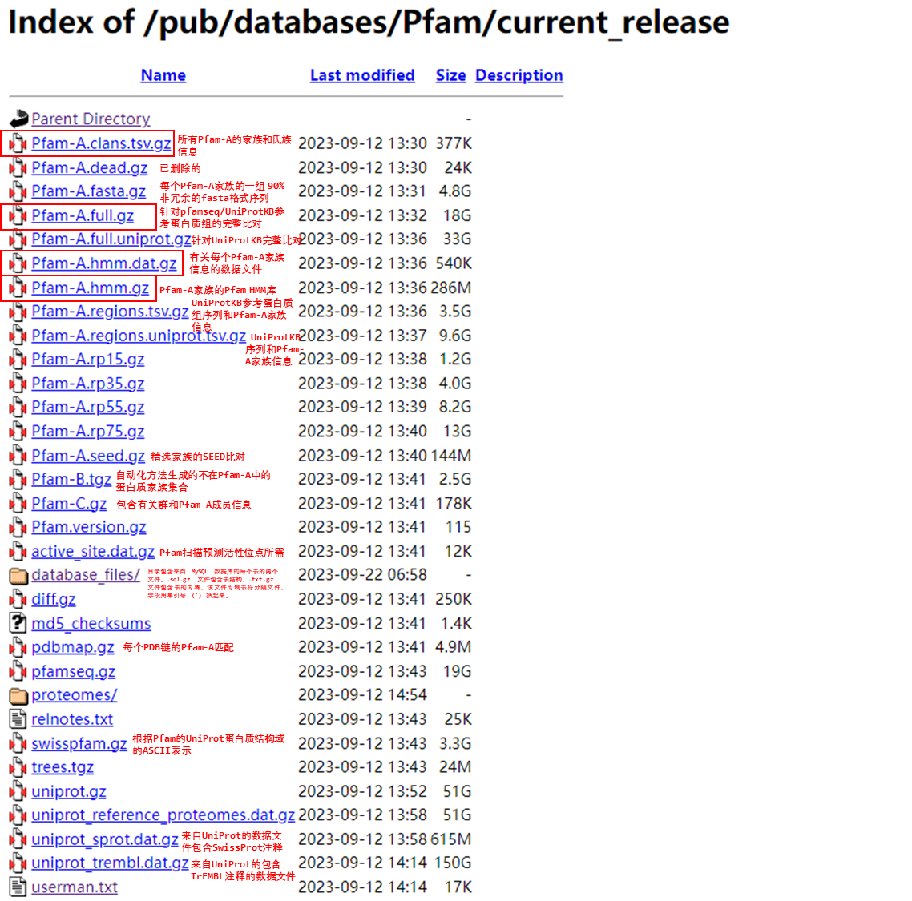

# Pfam
    多个序列比对和隐藏马尔可夫模型的大型集合，涵盖许多常见的蛋白质结构域，最新版本包括21979个家族，81514348条序列和32596740121氨基酸。目前由InterPro托管。

## 作用

* 识别属于某个蛋白质家族或包含特定结构域的所有蛋白质

* 确定特定蛋白质中存在哪些域和位点。

* 识别拥有共同结构域的蛋白质，即使蛋白质的名称和活性变化很大。

* 检查特定蛋白质家族或结构域所属的物种。

## 结构
Pfam 数据库中信息组织的示意图。箭头表示数据流。

* Pfam域（Domain）：一个结构单元。
* Pfam家族（family）：表示具有显著序列相似性和共同功能的蛋白质组，是Pfam数据库的基本分类单元。
* Pfam群（clan）：表示多个相关家族的集合，通过更高层次的进化和功能相似性联系在一起，帮助组织和理解蛋白质的进化关系。
* Pfam组（proteones）：物种的蛋白质组信息，某物种内所有蛋白质家族信息。  

## 更新状态
**InterPro更新频率**：8周/次；  
**最新版本**：Pfam37.0；  
**更新时间**：2024.4.24；  
**UniProtKB reference proteomes**：2023_05 

## 下载项  

*红色框中为已下载项*
## Metadata
### t_pfama
    多个蛋白质家族的访问号、内部id、家族类型、描述、多种算法对应和阈值和家族保守序列等信息。

| name                 | type           | description       |
|----------------------|----------------|-------------------|
| `pfamA_acc`            | object         | 访问号               |
| pfamA_id             | object         | id                |
| previous_id          | object         | 旧id               |
| description          | object         | 简单描述              |
| deposited_by         | object         | 存储者               |
| seed_source          | object         | 种子源               |
| type                 | object         | 类型                |
| comment              | object         | 详细描述              |
| sequence_GA          | float64        | 序列聚类阈值            |
| domain_GA            | float64        | 结构域聚类阈值           |
| sequence_TC          | float64        | 序列可信阈值            |
| domain_TC            | float64        | 结构域可信阈值           |
| sequence_NC          | float64        | 序列噪声阈值            |
| domain_NC            | float64        | 结构域噪声阈值           |
| buildMethod          | object         | 构建方法（hmmbuild）    |
| model_length         | int32          | 模型长度              |
| searchMethod         | object         | 搜多方法（hmmserch）    |
| msv_lambda           | float64        | 得分分布尺度            |
| msv_mu               | float64        | 得分分布平均值           |
| viterbi_lambda       | float64        | Viterbi 算法比对得分形状  |
| viterbi_mu           | float64        | Viterbi 算法比对得分平均值 |
| forward_lambda       | float64        | Forward 算法比对得分形状  |
| forward_tau          | float64        | Forward 算法比对得分偏移值 |
| num_seed             | Int64          |                   |
| num_full             | Int64          |                   |
| updated              | datetime64[ns] | 更新时间              |
| created              | datetime64[ns] | 创建时间              |
| version              | Int16          | 版本号               |
| number_archs         | Int64          | 相关架构数             |
| number_species       | Int64          | 物种数               |
| number_structures    | Int64          | 结构数               |
| average_length       | float64        | 序列平均长度            |
| percentage_id        | Int8           |                   |
| average_coverage     | float64        | 平均覆盖率             |
| change_status        | object         | 蛋白质家族变化状态         |
| seed_consensus       | object         | 种子保守序列            |
| full_consensus       | object         | 完整保守序列            |
| number_shuffled_hits | Int64          | 显著匹配次数            |
| number_uniprot       | Int64          | 与Uniport匹配序列数     |
| rp_seed              | Int8           | 代表性蛋白质组种子         |
| number_rp15          | Int64          | 15%代表性蛋白质组匹配序列数   |
| number_rp35          | Int64          | 35%代表性蛋白质组匹配序列数   |
| number_rp55          | Int64          | 55%代表性蛋白质组匹配序列数   |
| number_rp75          | Int64          | 75%代表性蛋白质组匹配序列数   |

### *家族类型*
* Family: 表示该条目代表一个蛋白质家族，通常由相似的序列组成，这些序列可能在结构和功能上具有共同点。

* Domain: 表示该条目代表一个蛋白质结构域，即蛋白质的部分序列，通常具有特定的结构和功能。这些结构域可以在不同的蛋白质中重复出现，因此通常用于描述蛋白质的结构组成。

* Repeat: 表示该条目代表一个蛋白质中重复出现的结构单元，可能不具有完整的功能。

* Motif: 表示该条目代表一个蛋白质中的特定结构或序列模式，通常用于识别和分类蛋白质中的功能性区域。

*  Coiled-Coil: 主要包含卷曲螺旋结构的区域，这些区域通常包含α螺旋，它们以2-7个为一束卷曲在一起。

* Disordered: 这些区域是保守的，但已显示或预测包含偏置的序列组成和/或固有无序（非球状）结构。

### t_pfama_clan
    各pfamA家族以及所属的群(clan)信息。
|||
|---|---|
|`pfamA_acc`|pfamA 访问号|
|pfamA_clan|群访问号|
|pfamA_clan_id |群ID|
|pfamA_id |Pfam ID|
|description| Pfam 描述|

### t_pfama_fasta
    各pfamA家族包含的蛋白序列信息。
|||
|---|----|
|`pfamA_acc`|pfamA 访问号|
|fasta|序列信息|
|nr_threshold|非冗余阈值|

### pfamA_full

    此文件包含pfamseq/UniProtKB参考蛋白质组的完整比对，结果以Stockholm格式储存，其中部分缩写如下所示。

| Compulsory fields                |                                                                                       |
|----------------------------------|---------------------------------------------------------------------------------------|
|    AC   Accession number         | PFxxxxx.version 格式的访问号。                                                      |
|    ID   Identification           | 家族标识符。                                                                          |
|    DE   Definition               | 家族的简要描述。                                                                      |
|    AU   Author                   | 条目的作者。                                                                          |
|BM   | HMM 构建命令。| 
| SM   |HMM 搜索命令。|
|    SE   Source of seed           | 建议种子成员属于同一家族的来源。                                                    |
|    GA   Gathering method         | 用于构建完整比对的搜索阈值。                                                         |
|    TC   Trusted Cutoff           | 完整比对中匹配的最低序列得分和结构域得分。                                          |
|    NC   Noise Cutoff             | 完整比对中未匹配的最高序列得分和结构域得分。                                        |
|    TP   Type                     | 家族的类型 -- 目前为家族、结构域、基序、重复序列、螺旋结构或无序结构。              |
|    SQ   Sequence                 | 比对中的序列数。                                                                      |
|PI   Previous IDs| 旧ID。|
|    //                            | 比对结束标记。                                                                        |
|                                  |                                                                                       |

|    Optional fields               |                                                                                       |
|----------------------------------|---------------------------------------------------------------------------------------|
|    DC   Database Comment         | 关于数据库引用的注释。                                                                |
|    DR   Database Reference       | 外部数据库的引用。                                                                    |
|    RC   Reference Comment        | 关于文献引用的注释。                                                                  |
|    RN   Reference Number         | 文献引用编号。                                                                        |
|    RM   Reference Medline        | 八位数字的 Medline UI 编号。                                                          |
|    RT   Reference Title          | 文献标题。                                                                            |
|    RA   Reference Author         | 文献作者。                                                                            |
|    RL   Reference Location       | 期刊位置。                                                                            |
|    PI   Previous identifier      | 所有先前 ID 行的记录。                                                               |
|    KW   Keywords                 | 关键词。                                                                              |
|    CC   Comment                  | 注释。                                                                                |
|    NE   Pfam accession           | 表示嵌套结构域。                                                                      |
|    NL   Location                 | 嵌套结构域的位置 - 序列 ID、插入的起始和结束位置。                                  |
|    WK   Wikipedia Reference      | 对维基百科的引用。                                                                    |
|                                  |                                                                                       |

|    Obsolete fields               |                                                                                       |
|----------------------------------|---------------------------------------------------------------------------------------|
|    AL   Alignment method of seed | 用于对齐种子成员的方法。                                                              |
|    AM   Alignment Method         | 用于将 ls 和 fs 命中与模型对齐以构建完整比对的顺序。                                |

