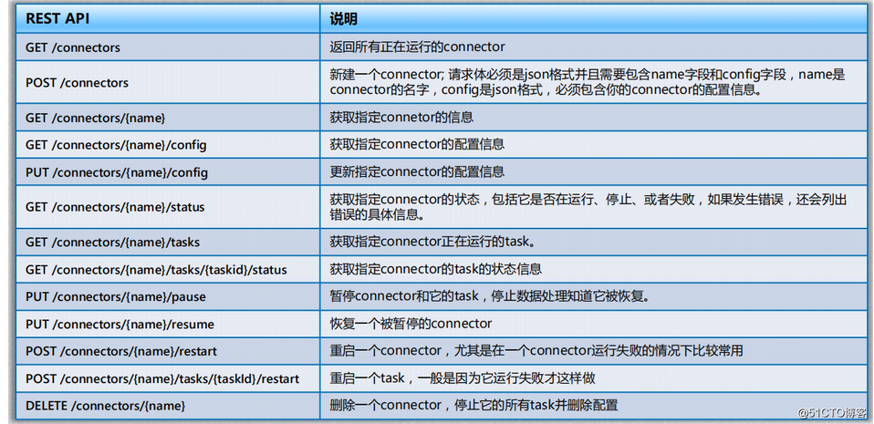

# Flink 

第 1 代：Hadoop MapReduc 批处理 Mapper、Reducer 2；

第 2 代：DAG 框架（Oozie 、Tez），Tez + MapReduce 批处理 1 个 Tez = MR(1) + MR(2) + ... + MR(n) 相比 MR 效率有所提升；

第 3 代：Spark 批处理、流处理、SQL 高层 API 支持 自带 DAG 内存迭代计算、性能较之前大幅提；

第 4 代：Flink 批处理、流处理、SQL 高层 API 支持 自带 DAG 流式计算性能更高、可靠性更高。

四个基石：**Checkpoint、State、Time、Window**。

流计算：  Storm ,Spark Streaming ,Flink , 低延时，Exactly Once，高吞吐

Flink 提供事件事件， event-time, processing-time 

无界数据流，有界数据流 ，有状态计算

application scenarios

1. event-driven applications
2. data analytics applications
3. data pipeline application 

Master-work 架构模式： JobManager 为管理节点  TaskManager 为工作节点

**当一个 Job 被提交到 Flink 集群时，它会被分解成多个 Task，并且每个 Task 会被分配到不同的 TaskManager 上执行。Flink 会根据数据源、数据的分区方式以及 Job 的算子等信息来进行任务的划分和调度，以实现最佳的性能和吞吐量。在任务执行期间，Flink 会对 Task 的状态进行管理和监控，以便在出现故障或异常情况时进行恢复或重试。**

Flink 任务提交与架构模型

1. Standalone

1. session mode:

1. pre-job mode

1. application mode

在 Apache Flink 中，**算子链（Operator Chaining）** 是一种优化技术，用于将多个算子合并为一个任务（Task），从而减少任务之间的数据传输开销和线程切换开销，提高作业的执行效率。

- Flink 作业的逻辑计划由多个算子（Operator）组成，例如 `map`、`filter`、`keyBy`、`reduce` 等。
- 默认情况下，Flink 会尝试将多个算子合并为一个任务（Task），形成一个算子链。
- 算子链中的算子会在同一个线程中执行，数据通过函数调用的方式传递，而不是通过网络或序列化/反序列化的方式传递。

### **算子链的形成条件**

Flink 会将多个算子合并为一个算子链，前提是满足以下条件：

1. **上下游算子的并行度相同**：
   - 如果两个算子的并行度不同，Flink 无法将它们合并为一个链。
2. **数据传输方式是 Forward**：
   - 上下游算子之间的数据传输方式必须是 **Forward**（即一对一的数据传递）。
   - 如果是 **Rebalance**、**Broadcast** 或 **KeyBy** 等分区方式，Flink 无法将它们合并为一个链。
3. **算子属于相同的 Slot Sharing Group**：
   - Flink 默认会将所有算子放在同一个 Slot Sharing Group 中，因此它们可以被合并为一个链。
   - 如果显式设置了不同的 Slot Sharing Group，则无法合并。
4. **没有禁用算子链**：
   - 如果显式禁用了算子链（通过 API 或配置），则不会形成算子链。

### Flink Table , Sql

DataStream , Dataset 

flink  创建表3部分组成： catalog , 数据库， table name 

FLInk 创建的表分为临时表， Temporary table 和 Permanet Table 

虚拟表： select 

常规表：  连接外部系统，DDL 

表更日志流

append 流

状态过时时间

append-only

upsert 

retract 

时态表

Flink Table API /SQL

https://github.com/uncleguanghui/pyflink_learn.git

https://www.cnblogs.com/wan-ming-zhu/p/18050046

原文链接：https://blog.csdn.net/helloHbulie/article/details/120333974

# Kafka

Kafka Connect适用于以下场景：

- 数据迁移：数据从关系型数据库移到Kafka之后进行统一处理。
- 数据的离线分析：离线任务获取Kafka中的数据进行分析。
- 数据的实时计算：实时任务消费Kafka中的数据进行计算。

Connector type

1. Source Connector将外部系统中的数据导入到Kafka消息队列中，
2. Sink  Connector将Kafka消息队列中的数据导出到外部系统中。
3. 由于Kafka  Connect提供的Connector是基于接口定义的，所以可以很容易地实现自定义Connector。

### 2，Kafka Connect 核心概念

  **Kafka Connect** 有两个核心概念：**Source** 和 **Sink**。 **Source** 负责导入数据到 **Kafka**，**Sink** 负责从 **Kafka** 导出数据，它们都被称为 **Connector**。

应用场景：

1. 2个kafka 之间的数据同步
2. 

### 3，Kafka Connect 特性

- **Kafka connector** 通用框架，提供统一的集成 **API**
- 同时支持分布式模式和单机模式
- **REST** 接口，用来查看和管理 **Kafka connectors**
- 自动化的 **offset** 管理，开发人员不必担心错误处理的影响
- 分布式、可扩展
- 流/批处理集成

### Kafka Connect 工作模式

- **standalone** 模式：在该模式中，所有的 **worker** 都在一个独立的进程中完成
- **distributed** 模式：该模式具有高扩展性，以及提供自动容错机制。你可以使用一个 **group.ip** 来启动很多 **worker** 进程，在有效的 **worker** 进程中它们会自动的去协调执行 **connector** 和 **task**，如果你新加了一个 **worker** 或者挂了一个 **worker**，其他的 **worker** 会检测到然后在重新分配 **connector** 和 **task**。

要编写一个自定义的Connector，需要实现org.apache.kafka.connect.connector.Connector接口，该接口包含了4个主要方法：

    start(Map<String, String> props)
    stop()
    taskClass()
    config()
数据同步案例：

1. 在数据同步案例中，我们使用Kafka Connect将两个Kafka集群之间的数据进行同步，具体步骤如下：`ReplicatorSourceConnector`）、任务数、源Kafka集群和目标Kafka集群的bootstrap servers、以及需要同步的主题名称。

在数据库实时备份案例中，我们使用Debezium来实时捕获MySQL数据库的变更事件，并将其持久化到Kafka集群中。具体步骤如下：

#### Debezium

为了更有效地讨论Kafka Connect的内部工作原理，我们需要建立几个主要的概念。

- Connector：通过管理任务来协调数据流的高级抽象
- Tasks：描述如何从Kafka复制数据
- Workers：执行连接器和任务的运行进程
- Converters：用于在 Connect 和发送或接收数据的系统之间转换数据的代码
- Transforms：改变由连接器产生或发送到连接器的每条消息的简单逻辑
- Dead Letter Queue：Connect 如何处理连接器错误

## ：Kafka Connect 的 REST API 接口

  由于 **Kafka Connect** 的意图是以服务的方式去运行，所以它提供了 **REST API** 去管理 **connectors**，默认的端口是 **8083**（我们也可以在启动 **Kafka Connect** 之前在配置文件中添加 **rest.port** 配置）：

- **GET /connectors**：返回所有正在运行的 **connector** 名
- **POST /connectors**：新建一个 **connector**；请求体必须是 **json** 格式并且需要包含 **name** 字段和 **config** 字段，**name** 是 **connector** 的名字，**config** 是 **json** 格式，必须包含你的 **connector** 的配置信息。
- **GET /connectors/{name}**：获取指定 **connetor** 的信息
- **GET /connectors/{name}/config**：获取指定 **connector** 的配置信息
- **PUT /connectors/{name}/config**：更新指定 **connector** 的配置信息
- **GET /connectors/{name}/status**：获取指定 **connector** 的状态，包括它是否在运行、停止、或者失败，如果发生错误，还会列出错误的具体信息。
- **GET /connectors/{name}/tasks**：获取指定 **connector** 正在运行的 **task**。
- **GET /connectors/{name}/tasks/{taskid}/status**：获取指定 **connector** 的 **task** 的状态信息
- **PUT /connectors/{name}/pause**：暂停 **connector** 和它的 **task**，停止数据处理知道它被恢复。
- **PUT /connectors/{name}/resume**：恢复一个被暂停的 **connector**
- **POST /connectors/{name}/restart**：重启一个 **connector**，尤其是在一个 **connector** 运行失败的情况下比较常用
- **POST /connectors/{name}/tasks/{taskId}/restart**：重启一个 **task**，一般是因为它运行失败才这样做。
- **DELETE /connectors/{name}**：删除一个 **connector**，停止它的所有 **task** 并删除配置。

CDC  数据入湖

1. 手工映射表结构

    FlinkCDC 构建同步任务时，需要手工映射 Mysql 等表结构到 Flink DDL，当表和字段数目非常多时，开发和维护的成本将线性增加。而且人工映射字段类型容易出错。

2. **Schema 变更导致入湖链路难以维护**

3. 

~~~bash
sudo curl -L "https://github.com/docker/compose/releases/download/v2.20.3/docker-compose-$(uname -s)-$(uname -m)" -o /usr/local/bin/docker-compose
sudo chmod +x /usr/local/bin/docker-compose
sudo ln -s /usr/local/bin/docker-compose /usr/bin/docker-compose
docker-compose --version

docker exec -it  

#list topic
docker exec -it broker /opt/kafka/bin/kafka-topics.sh --bootstrap-server 127.0.0.1:9092 --list
# new topic
docker exec -it broker /opt/kafka/bin/kafka-topics.sh --bootstrap-server 127.0.0.1:9092 --create --topic data-share --partitions 3 --replication-factor 1
# Producer message 
docker exec -it broker /opt/kafka/bin/kafka-console-producer.sh --bootstrap-server 127.0.0.1:9092 --topic data-share
# consumer message 
docker exec -it broker /opt/kafka/bin/kafka-console-consumer.sh --bootstrap-server 127.0.0.1:9092 --topic data-share

dinkydocker/dinky-standalone-server:1.1.0-flink1.17
~~~

# Dataflow 

1 个思维的转变

2个 时间域：

3 个字模型

 HostName  114.55.236.158

  User root

Atlas@2025

alias flink='/root/workspace/softs/flink-1.20.1/bin/flink'

https://blog.csdn.net/u010349629/article/details/130932313

https://developer.aliyun.com/article/852041

