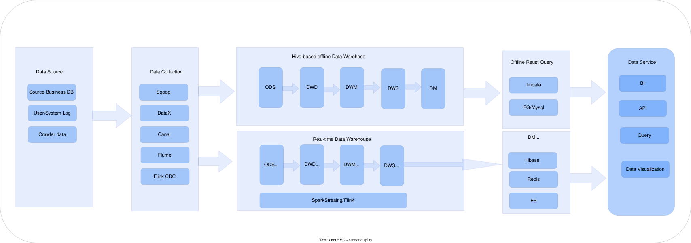
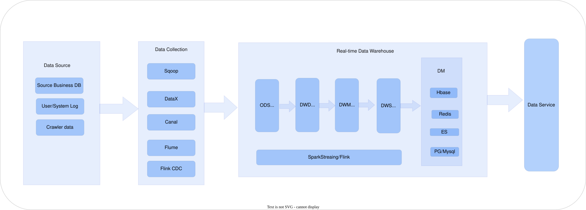
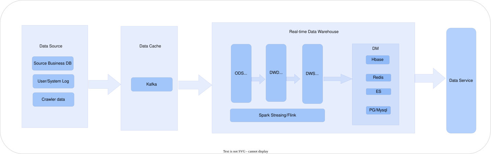
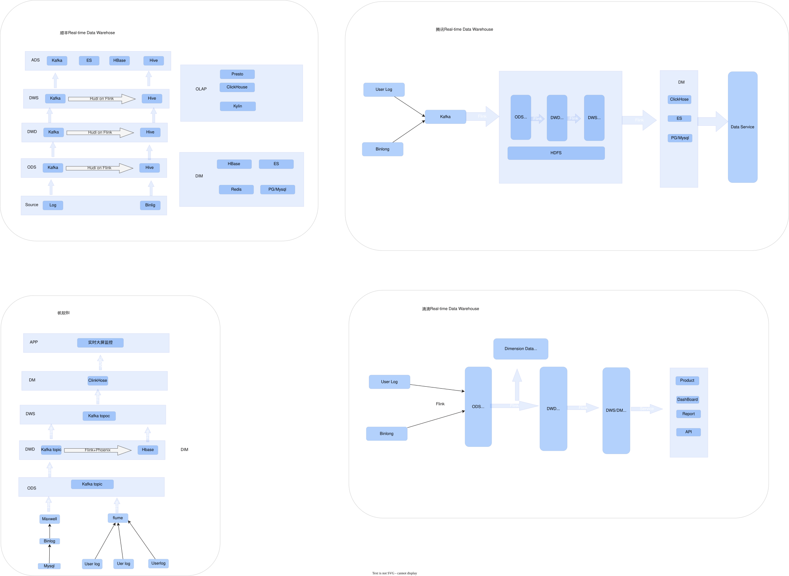
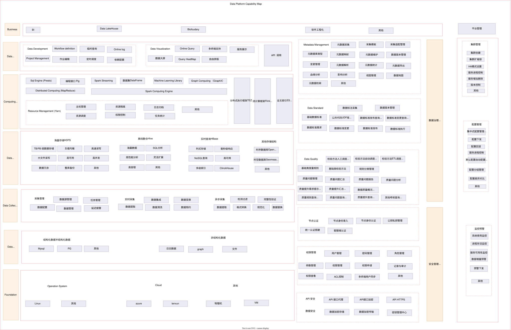
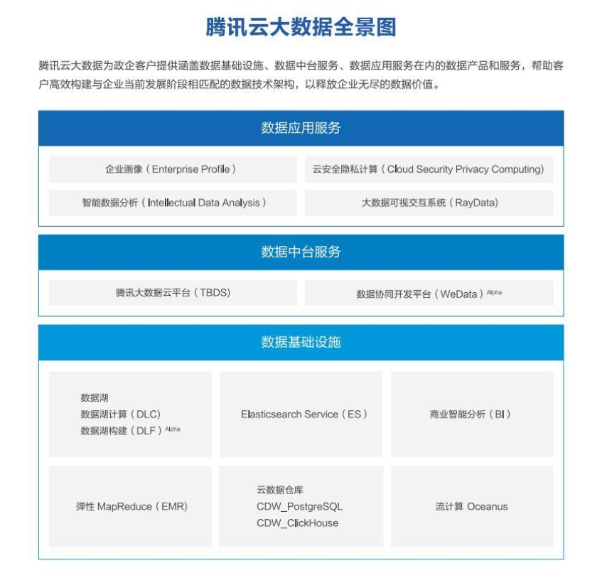

# Data Platform

## Architecture evolution

### Lambda

###  Kappa



### Data Lakehouse



### eg



| Architecture | Disadvantages                                                                                                                                               | 湖仓一体对其缺点的解决                                                                                                                                                                            |
| ------------ | ----------------------------------------------------------------------------------------------------------------------------------------------------------- | ------------------------------------------------------------------------------------------------------------------------------------------------------------------------------------------------- |
| Lambda       | 1. 需开发两套代码实现同样需求<br />2. 集群资源占用增多 <br />3. 离线与实时结果不一致 <br />4. 批量计算可能存在T + 1计算不完的情况 <br />5. 服务器存储需求大 | 未直接针对Lambda架构这些缺点专门解决，但通过存储统一、支持OLAP等，<br />在一定程度上简化架构和提升数据处理能力，间接减少对资源和存储的压力                                                        |
| Kappa        | 1. Kafka无法支撑海量数据存储<br />2. Kafka无法支持高效的OLAP <br />3. 无法复用数据血缘管理体系 <br />4. Kafka不支持update/upsert                            | 1. 存储统一解决Kafka存储量小问题<br />2. 任意分层都可OLAP数据分析，解决OLAP支持问题 <br />3. 复用同一套血缘关系，解决血缘管理体系复用问题 <br />4. 实时数据更新，解决Kafka不支持update/upsert问题 |

**Data Lake Storage-layer format**

Table Format

1. Delta Lake
2. Apache Hudi
3. Apache Iceberg

**Column - based Storage Formats**

* Parquet
* ORC

**Binary Serialization Formats**

* Avro

**Text Formats**

- JSON
- CSV

## Database & Data Warehose

| Function               | Database (OLTP)                                                 | Data Warehouse (OLAP)                                        |
| ---------------------- | --------------------------------------------------------------- | ------------------------------------------------------------ |
| Data Scope             | Current - state data                                            | Store complete data that reflects historical changes         |
| Data Change            | Support frequent insert, delete, update, and query operations   | Can insert, query, no update or delete operations            |
| Application Scenarios  | Oriented to business transaction processes                      | Oriented to analysis, focusing on decision - making analysis |
| Data Processing Volume | Frequent, small batches, high concurrency, low latency          | Infrequent, large batches, high throughput, with latency     |
| Design Theory          | Follow the three normal forms of the database, avoid redundancy | Violate normal forms, appropriate redundancy                 |
| Modeling Method        | ER entity - relationship modeling (normal form modeling)        | Normal form modeling + dimensional modeling                  |

##### 


DataPlatform 总体架构

构建1个技术底座：

1. Azure/Tenxun Cloud 

3个平台：

1. 数据治理平台
2. 数据共享开发平台
3. 数据分析平台

4个中心：

1. 数据运营中心
2. 数据服务中心
3. 数据开发中心
4. AI 中心

3个保障体系：

1. 安全保障体系
2. 运维保障体系
3. 标准规范体系

1个门户


## Architecuture DataPlatform 

整个架构由以下关键部分组成：

## 1 个技术底座

技术底座是 DataPlatform 运行的基础，提供计算、存储、网络等基础资源。采用 Azure/Tenxun Cloud 云服务，Azure 凭借强大的全球基础设施和丰富云服务种类，为平台赋予高可用性、弹性扩展的计算和存储能力。在数据量爆发式增长时，Azure 能迅速调配资源，保障数据处理和存储高效稳定 。Tenxun Cloud 则凭借国内市场优势，在网络优化、本地服务支持方面提供有力保障。当企业进行面向国内用户的实时数据推送业务时，Tenxun Cloud 可利用其在国内的节点优势，降低网络延迟，提升推送效率。两者结合，为 DataPlatform 搭建坚实可靠的底层运行环境，支撑上层平台、中心及保障体系的稳定运行。

## 3 个平台

### 数据治理平台

数据治理平台是确保数据质量和合规性的关键。在数据接入阶段，它制定严格的数据标准，规范不同数据源的数据格式和编码规则，保证数据的一致性和规范性。在数据处理过程中，数据质量管理模块实时监测数据的准确性、完整性和时效性，通过预设的质量规则，如数据字段必填、数值范围校验等，及时发现并修复数据问题。元数据管理详细记录数据的来源、定义、流向等信息，为后续的数据开发、分析提供清晰指引。在数据存储和使用阶段，数据安全管理通过加密传输、访问权限控制等手段，保障数据在整个生命周期中的安全，防止数据泄露和非法访问。

### 数据共享开发平台

数据共享开发平台主要面向数据开发者和业务人员，提供数据开发、共享和交换的功能。开发者在平台上进行数据集成时，可利用多种数据源适配工具，将来自数据库、文件系统、API 接口等不同数据源的数据进行抽取。在 ETL 作业开发过程中，依据企业的数据标准和业务需求，对抽取的数据进行清洗、转换和加载，去除脏数据、统一数据格式。平台支持数据的共享和交换，企业内部不同部门可通过标准化的数据接口，安全、高效地共享数据。例如，市场部门将用户行为数据共享给研发部门，研发部门基于这些数据优化产品功能，打破数据孤岛，促进数据的流通和价值挖掘。

### 数据分析平台

数据分析平台聚焦于数据的分析和洞察。它集成多种数据分析工具和技术，数据挖掘算法可从海量数据中发现潜在模式和关联规则，如电商平台通过关联规则挖掘发现用户购买商品的组合规律，从而进行精准营销。机器学习算法可构建预测模型，预测市场趋势、用户需求等。可视化分析功能将复杂的数据以直观的图表、报表等形式呈现，业务人员和数据分析师可通过简单的拖拽操作，快速生成各类可视化图表，方便快速理解和决策，如通过柱状图对比不同地区的销售业绩，饼图展示产品的市场份额占比等。

## 4 个中心

### 数据运营中心

数据运营中心负责对 DataPlatform 的日常运营进行监控和管理。通过实时数据采集工具，收集平台的资源使用情况，如 CPU、内存、磁盘 I/O 等；任务执行状态，包括 ETL 任务、数据分析任务的执行进度和结果；数据流量，如不同数据源的数据流入量和流出量等。通过对这些数据的分析，利用智能预警系统，及时发现平台运行中出现的性能瓶颈、任务失败等问题。同时，数据运营中心还负责制定和执行数据运营策略，如依据数据的重要性和使用频率，制定数据备份与恢复策略；根据数据的生命周期，制定数据存储、归档和删除策略，确保平台的稳定运行和数据的有效管理。

### 数据服务中心

数据服务中心是 DataPlatform 对外提供数据服务的窗口。它将经过治理和加工的数据以 API、数据订阅等形式提供给企业内外部的应用系统和用户。在提供 API 服务时，根据不同业务场景和用户需求，设计多样化的 API 接口，如查询接口、推送接口等，通过身份认证、权限校验等机制，保障数据服务的安全。对于数据订阅服务，用户可根据自身需求订阅特定的数据主题，数据服务中心按照订阅规则，定期或实时推送数据，满足不同业务场景对数据的需求，促进数据与业务的深度融合，如金融机构将风险评估数据以 API 形式提供给合作伙伴，帮助其进行信贷审批。

### 数据开发中心

数据开发中心为数据开发人员提供集中的开发环境。在这里，开发人员利用专业的数据建模工具进行数据模型设计，依据业务需求构建星型、雪花型等数据模型。在数据仓库建设过程中，进行数据分层架构设计，如分为 ODS（操作数据存储层）、DWD（数据明细层）、DWS（数据汇总层）、ADS（应用数据层）等，每个层次承担不同的数据处理和存储职责。中心配备完善的开发工具和版本管理系统，支持团队协作开发，开发人员可实时共享代码、协同调试，提高数据开发的效率和质量。同时，数据开发中心与数据治理平台紧密结合，在开发过程中实时校验数据标准和规范，确保开发成果符合企业数据管理要求。

### AI 中心

AI 中心是 DataPlatform 引入人工智能技术的核心模块。它利用机器学习、深度学习等人工智能算法，对数据进行智能化处理和分析。在机器学习方面，通过分类算法对客户进行分类，如将客户分为潜在客户、活跃客户、流失客户等，为精准营销提供支持；聚类算法对产品进行聚类分析，帮助企业发现产品的不同特性和市场定位。在深度学习领域，利用图像识别技术对图像数据进行分析，如安防领域的人脸识别、工业领域的缺陷检测等；利用语音识别技术将语音数据转化为文本，应用于智能客服、语音指令控制等场景，拓展数据应用的场景和领域，提升 DataPlatform 的智能分析能力和业务创新能力。

## 3 个保障体系

### 安全保障体系

安全保障体系是 DataPlatform 的重要防线，涵盖网络安全、数据安全、应用安全等多个层面。在网络安全方面，部署防火墙阻挡外部非法网络访问，入侵检测系统（IDS）实时监测网络流量，一旦发现异常流量和攻击行为，立即发出警报；入侵防御系统（IPS）则在检测到攻击时，主动采取措施进行阻断。在数据安全方面，通过数据加密技术对数据在传输和存储过程中进行加密，确保数据的保密性；访问控制通过设置不同用户角色和权限，限定用户对数据的访问范围；数据脱敏对敏感数据进行变形处理，如将身份证号部分数字替换为星号，确保数据在使用过程中的安全性。在应用安全方面，定期对平台上的应用系统进行安全漏洞扫描，利用自动化工具检测常见的安全漏洞，如 SQL 注入、XSS 攻击等，并及时进行修复，防止应用层面的安全风险。

### 运维保障体系

运维保障体系负责 DataPlatform 的日常运维工作，确保平台的稳定运行。在硬件设备维护方面，定期对服务器、存储设备等进行巡检，检查硬件的运行状态，如温度、风扇转速等，及时更换老化或故障的硬件部件。在软件系统升级方面，制定合理的升级计划，在业务低峰期进行软件版本更新，确保系统的功能优化和安全补丁更新。通过建立完善的运维监控体系，利用监控软件实时监测平台的运行状态，包括系统性能指标、服务可用性等，及时发现并解决潜在的问题。同时，制定应急预案，针对可能出现的硬件故障、网络中断、软件崩溃等重大故障，明确故障处理流程和责任分工，确保在出现重大故障时能够快速恢复平台的正常运行，减少对业务的影响。

### 标准规范体系

标准规范体系为 DataPlatform 的建设和运行提供统一的标准和规范。数据标准详细规定数据的定义、格式、编码等，如客户姓名采用固定的字符长度和字符集，确保数据的一致性和互操作性，方便不同系统之间的数据交换和共享。技术标准规范平台建设所采用的技术架构、开发语言、接口规范等，如统一采用 Java 语言进行后端开发，遵循 RESTful 风格设计 API 接口，提高平台的可维护性和扩展性，降低开发和维护成本。管理标准涵盖项目管理、运维管理、安全管理等方面的流程和规范，在项目管理中，明确项目的立项、需求分析、设计、开发、测试、上线等各个阶段的流程和交付物；在运维管理中，规范运维操作流程和故障处理流程；在安全管理中，制定安全策略和风险评估流程，保障平台建设和运行的有序进行。

## 1 个门户

门户是用户访问 DataPlatform 的统一入口，为不同的用户角色提供个性化的操作界面。业务人员登录后，通过简洁的导航栏和快捷入口，可快速访问数据分析平台，在报表展示区查看最新的报表和分析结果，还可通过搜索功能快速定位所需数据。数据开发人员在门户中拥有专门的开发任务管理模块，可查看任务进度、提交代码、协同开发；数据管理人员则可通过门户进入数据治理平台，进行数据标准管理、元数据管理等操作。门户的设计注重用户体验，采用简洁直观的交互设计，如按钮布局合理、操作流程简化，方便用户快速找到所需的功能和数据，提高工作效率。

# TenXun Cloud



# Azure Cloud


## ADF :  Azure Data Factory  


ADF是基于云的ETL，用于数据集成和数据转换，不需要代码，直接通过UI（code-free UI）来设计，可进行直观监控和管理


## Event HUb 

Pass 服务

Partition 

## Fabric


数据产品团队

数据平台部门

数据开发团队

应用开发团队


OneData + oneService

meta data:

1. 数据字典  数据的结构信息： 表结构信息：表明。字段名称，类型和注释，表的数据产出任务，表和字段权限
2. 数据血缘 
3. 数据特征： 数据的属性信息，存储空间大小，数仓分层，访问热度，主题分类，关联指标

Metacat , Apache Atlas 

商业： Cloudera Navigator 


OpenSource 

1. Atlas 
2. Ranger  


Security:

1. kerberos
2. Apache Sentry  
3. Apache Ranger 

Ranger : 是hadoop 平台上操作，监控，管理数据安全的集中式安全管理框架

支持Apache 项目的细粒度授权和审计


1. Dolphin Scheduler :
2. Azkaban:
3. Airflow :

A distributed and easy-to-expand visual DAG workflow scheduling system .


Davinci :  Data visualization a service 

Ambari 

Dinky

```text
{     "connector.class": "io.debezium.connector.mysql.MySqlConnector",//debezium的入口 
"database.hostname": "192.168.xxx.xxx",//数据库配置 
"database.port": "3306",   
"database.user": "root",   
"database.password": "xxxxx",     
"database.server.name": "debezium",//会创建一个debezium的topic,并把相应的ddl语句发送到该topic下 
"database.include.list": "database_name",//捕捉的mysql 
database "table.include.list":"database_name.table_one,database_name.table_two,database_name.table_three",//捕捉的MySql表 
"snapshot.mode": "schema_only",//启动阶段的一致性操作
"snapshot.locking.mode": "none",//启动阶段的一致性操作 
"decimal.handling.mode": "string",//decimal转为字符串 "database.history.kafka.bootstrap.servers": "kafka地址和connect-distributed.properties中的保持一致",    
"transforms": "Reroute",//配合下面三个参数把捕捉的消息再次路由到order_message这个topic下 "transforms.Reroute.type": "io.debezium.transforms.ByLogicalTableRouter",     "transforms.Reroute.topic.regex": "([^.]+)\\.([^.]+)\\.([^.]+)",     "transforms.Reroute.topic.replacement": "order_message",     "database.history.kafka.topic": "debezium.history",//debezium内部使用的一个topic,客户端无需关注 "event.deserialization.failure.handling.mode": "warn",//报错时仅打印日志,不暂停解析 "inconsistent.schema.handling.mode": "warn",//报错时仅打印日志,不暂停解析 "converters": "datetime", // debezium 时间序列化完善 可安靠https://github.com/holmofy/debezium-datetime-converter "datetime.type": "com.darcytech.debezium.converter.MySqlDateTimeConverter",     "datetime.format.date": "yyyy-MM-dd",     "datetime.format.time": "HH:mm:ss.SSS",     "datetime.format.datetime": "yyyy-MM-dd HH:mm:ss.SSS",     "datetime.format.timestamp": "yyyy-MM-dd HH:mm:ss.SSS",     "datetime.format.timestamp.zone": "UTC+8", } 
```